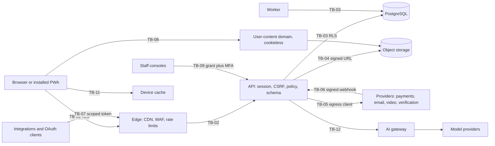
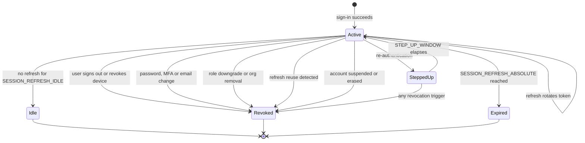
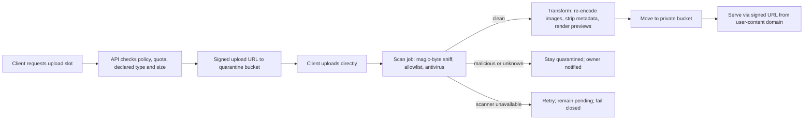

# Security Architecture

Status: intended complete product. Nothing in this file claims that a control is built. What exists today is recorded only in `ARCHITECTURE.md` and `docs/reports/` [SRC: CONVENTIONS §1].

Owner role: `SAD` (Security Officer). Reviewers: `PAD`, privacy lead (see [02_PRIVACY_AND_DATA_GOVERNANCE.md](02_PRIVACY_AND_DATA_GOVERNANCE.md)), counsel for anything in [03_COMPLIANCE_MAP.md](03_COMPLIANCE_MAP.md).

Identifier namespaces used here:

| Namespace | Meaning | Range in this file |
|---|---|---|
| `NFR-SEC-nnn` | Testable security requirement | NFR-SEC-001..NFR-SEC-072 (§24) |
| `OD-SEC-nn` | Security decision for stakeholders | OD-SEC-01..OD-SEC-16 (§25). OD-SEC-17 onward live in [03_COMPLIANCE_MAP.md](03_COMPLIANCE_MAP.md) |
| `RSK-SEC-nn` | Security risk | RSK-SEC-01..RSK-SEC-14 (§26) |
| `AS-nn`, `TB-nn`, `AB-<group>-nn`, `RL-<class>` | Document-local labels (assets, trust boundaries, abuse cases, rate classes). Not registry ids | — |

## 1. Objectives and principles

Security exists to protect four product promises: a person's career data is seen only by those they chose, evidence and verification status cannot be forged, hiring and assessment outcomes are decided by accountable humans, and the platform stays available when deadlines matter [DER from SSOT §1.2, §15].

| # | Principle | What it means in practice | Source |
|---|---|---|---|
| P1 | Deny by default | Every route, job, event consumer and query declares a policy action; anything undeclared is refused | [SRC: SSOT §10.14 BR-08, BR-09] |
| P2 | Server authority | The client, service worker and cache are never the source of truth for identity, permissions, entitlements, timers, scores or verification state | [SRC: SSOT §19.2] |
| P3 | Defense in depth | Edge, application policy, database row-level security (RLS) and infrastructure each block the same class of attack independently | [SRC: SSOT §15.4] |
| P4 | Least privilege and least data | Each principal, service and AI call receives only the fields its purpose needs | [SRC: SSOT §15.2, §16.5] |
| P5 | Tenant isolation is a Sev-1 property | A cross-tenant read is treated as a critical incident regardless of data volume | [SRC: Yash 14/THREAT_MODEL A7] |
| P6 | Accountable humans for consequential acts | AI and automated signals open review items; they never reject, sanction or grade a person on their own | [SRC: SSOT §15.10.1] |
| P7 | Evidence over assertion | A control is "in place" only when an automated test or recorded drill proves it | [SRC: SSOT Part I §H] |
| P8 | Uniform, non-leaky failure | Errors carry a generic message and a correlation id; existence of other users' resources is never revealed | [SRC: SSOT §15.7 HDN-010] |

## 2. Asset inventory

Classification codes `C0`..`C4` are defined in [02_PRIVACY_AND_DATA_GOVERNANCE.md §2](02_PRIVACY_AND_DATA_GOVERNANCE.md).

| Label | Asset | Owning modules | Class | Why it matters | Primary threats (abuse labels §6) |
|---|---|---|---|---|---|
| AS-01 | Credentials, passkeys, MFA secrets, recovery codes, session and refresh tokens | IDN | C4 | Account takeover exposes everything the user can see and do | AB-FND-01..05 |
| AS-02 | Candidate personal data: profile, resume, contact details, preferences | PRF, SET | C2/C3 | Privacy harm, discrimination, legal exposure | AB-CID-01, AB-HIR-01, AB-PLT-02 |
| AS-03 | Evidence records, verification status ("rung"), credentials, badges | EVD, BGV, REP | C2 | The core promise "verified over claimed" | AB-CID-02..05 |
| AS-04 | Referee, attestation and capability tokens | EVD, BGV | C4 | Possession equals the ability to attest as a third party | AB-CID-03 |
| AS-05 | Consent records and share grants | SET | C2 | Decide who may see what; legal proof | AB-HIR-01, AB-INS-01 |
| AS-06 | Assessment content, answer keys, attempt data, integrity signals | ASM, LRN | C3 | Credible skill signals; fairness | AB-LRN-01..04 |
| AS-07 | Tenant data of employers, institutions and enterprises | EMP, ATS, INS, ENT | C2/C3 | Cross-tenant read is Sev-1 | AB-HIR-03, AB-INS-02 |
| AS-08 | Applications, pipeline stages, scorecards, interview notes, recordings, offers | JOB, ATS, INT | C3 | Hiring decisions; litigation evidence | AB-HIR-02..06 |
| AS-09 | Messages, community posts, reviews | MSG, NET, TSF | C2/C3 | Private communication; harassment vector | AB-SOC-01..05 |
| AS-10 | Billing state, entitlements, payouts, tax identifiers | BIL, STU, GIG, MEN | C3/C4 | Revenue, fraud, financial regulation | AB-COM-01..05 |
| AS-11 | AI gateway policy, budgets, prompts, provider keys, model outputs | AIC | C3/C4 | Cost, assessment fairness, data leakage | AB-AIC-01..06 |
| AS-12 | Signing keys, key-encryption keys, API secrets, webhook secrets | PLT, IDN | C4 | Total compromise | AB-PLT-05 |
| AS-13 | Audit log, privileged-access records, erasure ledger | ADM, SET | C3 | Accountability and legal proof | AB-GOV-01..03 |
| AS-14 | Build, deploy and dependency chain; static asset origin | PLT | C1 | Code execution in every user's browser | AB-PLT-06 |
| AS-15 | User-content origin and rendered rich content | PLT, PRF, NET | C2 | Stored XSS and phishing | AB-PLT-03 |
| AS-16 | Availability of the core career loop | all | C1 | Hiring and enrollment deadlines | AB-PLT-07 |
| AS-17 | Salary, review and market aggregates | MKT, EMP, ANL | C2 | Re-identification of individuals through small cells | AB-INT-03 |
| AS-18 | Fairness self-identification data (demographics) | AIC, ANL | C4 | Special-category data; must never reach recruiters or rankers | AB-AIC-05 |
| AS-19 | Identity-verification artifacts and background-check reports | BGV | C4 | Government ids, criminal records; regulated | AB-CID-06 |

## 3. Adversaries

| Label | Adversary | Capability | Motive | Source |
|---|---|---|---|---|
| ADV-1 | Anonymous attacker or bot operator | Automation, breach lists, residential proxies | Takeover, spam, scraping | [SRC: Yash 14/THREAT_MODEL §3] |
| ADV-2 | Malicious candidate | Valid account, crafted uploads, collusion | Inflate verification, cheat assessments | [SRC: same] |
| ADV-3 | Malicious or careless recruiter or org member | Valid org role | Harvest candidates, bypass consent, cross-tenant snooping | [SRC: same] |
| ADV-4 | Impostor or colluding referee | Controls a mailbox | Forge attestations | [SRC: same] |
| ADV-5 | Malicious insider (support, moderator, admin, engineer) | Privileged tooling | Data browsing, tampering | [SRC: same] |
| ADV-6 | Supply-chain attacker | Compromised dependency, CI step or CDN | Code execution | [SRC: same] |
| ADV-7 | Network attacker or shared-device user | Physical access to a signed-in browser | Session and data theft | [SRC: same] |
| ADV-8 | Competitor or data broker | Systematic scraping | Business intelligence | [SRC: same] |
| ADV-9 | Fraudulent employer or fake job poster | Creates an employer org | Phishing, advance-fee scams, identity theft of applicants | [PROP] |
| ADV-10 | Fraudulent instructor, mentor or freelancer | Seller account | Payout fraud, stolen content, off-platform payment scams | [PROP] |
| ADV-11 | Abusive user (harasser, stalker) | Valid account | Locate or harass a person through profile, messages, events | [PROP] |
| ADV-12 | Malicious integration or compromised customer system | Valid OAuth client or webhook endpoint | Bulk extraction, replay | [PROP] |

## 4. Trust boundaries

| Label | Boundary | Crossing | Required controls |
|---|---|---|---|
| TB-01 | Internet to edge | Every request | TLS 1.2+ (1.3 preferred), WAF, bot challenge on auth routes, request size limits, per-IP and per-ASN rate limits |
| TB-02 | Edge to API | Authenticated and anonymous requests | Session validation, CSRF check on unsafe methods, policy evaluation, schema validation, idempotency |
| TB-03 | API to database | Every query | Per-transaction principal and tenant context, RLS FORCE on tenant and personal tables, least-privilege database roles, statement timeout |
| TB-04 | API and worker to object storage | Uploads and downloads | Signed URLs bound to object and principal with short expiry; private buckets; quarantine bucket |
| TB-05 | API and worker to external providers (payments, email, AI, verification, video, calendars) | Outbound calls | Central egress client, allowlisted hosts, timeouts, circuit breakers, redaction, per-provider credentials |
| TB-06 | External providers to API (webhooks) | Inbound callbacks | Signature verification, replay window, idempotent processing, persist-then-acknowledge |
| TB-07 | Third-party integrations (public API, OAuth clients, customer webhooks) | API calls and outbound events | Scoped tokens, per-client rate limits, consent-gated payloads |
| TB-08 | Browser main origin to user-content origin | Rendered uploads and media | Separate registrable, cookieless domain; `Content-Disposition` and `nosniff` |
| TB-09 | Platform staff to production data | Support, moderation, admin, engineering | Time-boxed grants, step-up MFA, reason codes, subject-visible access log, break-glass procedure |
| TB-10 | Tenant A to tenant B | Any shared component | Tenant id in every key, query, cache entry, job payload, search document and log line |
| TB-11 | Device storage (PWA cache, IndexedDB) to server | Offline reads and queued writes | No tokens at rest, owner-only cache, cleared on sign-out and revocation, server re-validates queued writes |
| TB-12 | AI gateway to model providers | Prompts and outputs | Purpose and classification check, redaction, consent check, assessment-mode check, output schema validation |

## 5. STRIDE by surface

S = spoofing, T = tampering, R = repudiation, I = information disclosure, D = denial of service, E = elevation of privilege. Each cell names the threat and the control that answers it; the control's requirement id is in §24 [DER].

| Surface | S | T | R | I | D | E |
|---|---|---|---|---|---|---|
| Web app and PWA shell | Phishing lookalike origin; mitigated by passkeys (origin-bound) and HSTS preload (NFR-SEC-030) | Malicious script via dependency or CDN; Subresource Integrity, CSP with nonces (NFR-SEC-031) | n/a — client actions are logged server-side | Tokens readable by XSS; httpOnly cookies only (NFR-SEC-011) | Heavy client bundle on low-end devices; budgets in [01_NON_FUNCTIONAL_REQUIREMENTS.md](../06_QUALITY_AND_PERFORMANCE/01_NON_FUNCTIONAL_REQUIREMENTS.md) | Hidden admin routes treated as protection; server-side policy on every call (NFR-SEC-020) |
| Authentication endpoints | Credential stuffing, reset-link takeover; layered rate limits, uniform responses, single-use hashed tokens (NFR-SEC-001..006) | Host-header poisoning of reset links; canonical base URL from config (NFR-SEC-007) | Disputed sign-in; audit `auth.login_*` with IP prefix and device (NFR-SEC-060) | Account enumeration; uniform response and timing (NFR-SEC-004) | Hash-cost exhaustion; bounded hash pool returns 429 (NFR-SEC-003) | MFA bypass through recovery; recovery delay and alerts (NFR-SEC-008) |
| Public REST API (`/api/v1`) | Forged or replayed token; signature, expiry, revocation list (NFR-SEC-012) | Mass assignment of protected fields; strict schemas with unknown-key rejection (NFR-SEC-040) | Unattributed writes; actor on every mutating audit event (NFR-SEC-060) | IDOR/BOLA; resource loaded then authorized, non-visible returns 404 (NFR-SEC-021) | Expensive queries; rate classes, pagination caps, statement timeout (NFR-SEC-050) | Function-level bypass; route policy registry lint (NFR-SEC-020) |
| Database | Shared connection role used as identity; per-transaction principal context (NFR-SEC-023) | Direct writes to protected columns; column privileges and definer functions (NFR-SEC-024) | Silent row edits; append-only history tables (NFR-SEC-061) | Missing tenant filter; RLS FORCE plus canary rows (NFR-SEC-022) | Lock contention, runaway queries; statement and lock timeouts (NFR-SEC-051) | Application role able to alter schema; migration role separate (NFR-SEC-025) |
| Object storage and media | Guessable object paths; random keys and signed URLs (NFR-SEC-045) | Polyglot or malicious files; sniff, scan, re-encode (NFR-SEC-044) | Disputed upload; uploader id and hash stored (NFR-SEC-046) | Public bucket misconfiguration; private by default, policy test (NFR-SEC-045) | Upload flooding, zip bombs; size and count caps, decompression limits (NFR-SEC-044) | Path traversal in filenames; server-generated keys only (NFR-SEC-044) |
| Worker and background jobs | Job forged by enqueuing through public API; only server code enqueues (NFR-SEC-026) | Payload altered in queue; jobs read authoritative state, not payload copies, for decisions (NFR-SEC-026) | Job outcome unknown; job audit with attempt history (NFR-SEC-062) | Job runs without tenant pin; tenant pinned in payload and re-checked (NFR-SEC-022) | Poison job loops; bounded retries and dead-letter queue (NFR-SEC-052) | Worker role broader than needed; per-job-kind privileges (NFR-SEC-026) |
| Inbound webhooks (payments, email, video, verification) | Forged callback; signature verification with provider secret (NFR-SEC-047) | Replayed event; timestamp window and event-id dedupe (NFR-SEC-047) | Lost event; persisted before acknowledgment (NFR-SEC-047) | Error bodies leak internals; generic 400 (NFR-SEC-047) | Flooding; per-provider rate limit at edge (NFR-SEC-050) | Event grants entitlement directly; entitlements derived from reconciled provider state (NFR-SEC-048) |
| Outbound webhooks and integrations | Endpoint impersonation; HTTPS only, signed payloads (NFR-SEC-049) | n/a — payload signed by platform | Disputed delivery; delivery log with response code (NFR-SEC-049) | Over-broad payloads; consent-gated, minimal event DTOs (NFR-SEC-049) | Slow receivers block queue; per-endpoint concurrency and backoff (NFR-SEC-052) | Client scopes broader than consented; scope review on install (NFR-SEC-027) |
| AI gateway | Caller spoofs purpose; purpose bound server-side to route (NFR-SEC-055) | Prompt injection via user content; enclosure, no side-effect tools, output schema (NFR-SEC-056) | Unexplained suggestion; provenance record per call (NFR-SEC-063) | Personal data sent to provider; redaction and classification gate (NFR-SEC-055) | Cost exhaustion; reserve-then-settle budgets (NFR-SEC-057) | AI used during a prohibited assessment; server-side assessment-mode check (NFR-SEC-058) |
| Real-time channels (messaging, interviews, notifications) | Joining another user's channel; channel tokens bound to participant (NFR-SEC-028) | Message edits rewriting history; edit history kept (owner module MSG) | Denied sending; server-stamped message ids | Subscription to unauthorized topics; topic authorization on subscribe (NFR-SEC-028) | Connection floods; per-user connection cap (NFR-SEC-050) | n/a — channels carry no privileged commands |
| Staff consoles (support, moderation, admin, finance) | Stolen staff session; phishing-resistant MFA mandatory (NFR-SEC-009) | Unreviewed config change; dual control on high-risk changes (NFR-SEC-065) | Staff denies action; hash-chained audit with operator id (NFR-SEC-061) | Browsing user data; time-boxed grants, subject-visible access log (NFR-SEC-066) | n/a — consoles are not public | Self-approval; requester differs from approver (NFR-SEC-065) |
| Device storage (PWA) | Another person on a shared device; shared-device mode and idle lock (NFR-SEC-016) | Tampered queued writes; server re-validates every queued mutation (NFR-SEC-042) | n/a — server records the authoritative write | Cached data after sign-out; cache purge on sign-out and on 401/403 (NFR-SEC-016) | n/a — local only | Cached permissions; never trusted by the server (P2) |

## 6. Abuse cases per module group

Each row names the abuse, how it is attempted, the controls that must exist and how it is detected. Controls owned by a feature module are stated as requirements on that module (module ids marked "(planned)" where the module file defines them).

### 6.1 Foundation: IDN, SET, NTF

| Label | Abuse | Vector | Required controls | Detection |
|---|---|---|---|---|
| AB-FND-01 | Credential stuffing | Breach lists through rotating proxies | Edge per-IP/ASN limits, durable per-account counters, progressive delay, passkeys, breached-password check, step-up for risky actions | Failed-login rate by account, IP prefix and ASN |
| AB-FND-02 | Password reset or email-change takeover | Intercepted link, host-header poisoning, mailbox compromise | Hashed single-use tokens, short expiry, canonical base URL, notification to old address, 24 h hold before email change takes effect for MFA-less accounts [PROP] | Reset volume per account; reset followed by new-device login |
| AB-FND-03 | Session theft or refresh replay | XSS, malware, device theft | httpOnly cookies, short access token, rotating refresh with family revocation, device list with revoke | Refresh-reuse alarm |
| AB-FND-04 | SIM-swap or MFA fatigue | Social engineering of carrier or push spam | No SMS factor, no push-approve factor; TOTP and passkeys only [SRC: Yash 14/SECURITY_ARCHITECTURE §2.1] | n/a — factor not offered |
| AB-FND-05 | Account and handle enumeration | Register, login and reset responses, timing | Uniform responses and timing; handle availability check behind throttle | Enumeration-pattern rule |
| AB-FND-06 | Consent forging by the client | Client sends `granted=true` for another user or scope | Consent writes only for the session subject; scope catalogue validated server-side | Consent writes per minute per account |
| AB-FND-07 | Notification abuse (email bombing a third party) | Repeated invitations, referee requests, verification resends | Per-recipient caps across all senders, per-sender caps, suppression list | Bounce and complaint rates |
| AB-FND-08 | Data-rights abuse | Fraudulent export request to exfiltrate another person's data | Export only for the session subject after step-up; download link to the account, never emailed as an attachment | Export requests after recent credential change |

### 6.2 Career identity: PRF, EVD, BGV, REP

| Label | Abuse | Vector | Required controls | Detection |
|---|---|---|---|---|
| AB-CID-01 | Profile scraping | Public profile pages, search, enumeration of handles | Public profile opt-in, robots policy, per-viewer view budgets, no contact fields on public pages | View-rate anomaly per viewer and per IP |
| AB-CID-02 | Self-assigned verification | Client sets `verified` or rung fields | No verification field in any request schema; status changes only through verification workflow functions | Schema-conformance tests |
| AB-CID-03 | Forged referee attestation | Candidate supplies attacker-controlled mailbox; forwarded token | Peer attestations never reach authority rung; exact employer-domain match for work claims; tokens 256-bit, hashed, single-use, bound to request | Referee-graph ring detection to human review |
| AB-CID-04 | Forged documents | Edited PDFs, lookalike certificates | UI says "document provided", never "true", until an issuer or authority verifies; issuer verification through signed credentials where available | Duplicate file hashes across accounts |
| AB-CID-05 | Reputation farming | Endorsement rings, fake reviews, self-dealing | Endorsement requires connection; per-source caps; graph anomaly flags to TSF review | Clustering of mutual endorsements |
| AB-CID-06 | Misuse of background-check data | Recruiter requests checks without candidate authorization | Check only after candidate's explicit authorization per request; pre-adverse-action workflow per [03_COMPLIANCE_MAP.md](03_COMPLIANCE_MAP.md) FCRA row | Check requests without linked authorization (must be zero) |

### 6.3 Learning: LRN, STU, ASM

| Label | Abuse | Vector | Required controls | Detection |
|---|---|---|---|---|
| AB-LRN-01 | Answer-key extraction | API responses, client bundle, caching | Keys never sent to client; graded server-side; keys encrypted at rest | Content-hash of answers found in public pastes (monitoring) [PROP] |
| AB-LRN-02 | Assessment cheating | Proxy test-taker, collusion, AI use | Server timer, randomized variants, AI-mode enforcement in gateway, similarity detection, integrity signals routed to human review only | Similarity clusters; attempt timing outliers |
| AB-LRN-03 | Code-execution sandbox escape | Submitted code in challenges | Isolated sandbox with no network, CPU, memory and wall-clock limits, read-only filesystem, per-run ephemeral environment | Sandbox syscall denials |
| AB-LRN-04 | Course piracy | Download of paid video and materials | Signed, short-lived media URLs bound to enrollment; watermarking for paid content [PROP]; download limits | Concurrent stream count per enrollment |
| AB-LRN-05 | Fake completion to mint credentials | Calling completion endpoints directly | Completion computed server-side from recorded progress and required assessment; credentials issued by a single issuance function | Completions faster than content duration |

### 6.4 Hiring: JOB, ATS, INT, EMP

| Label | Abuse | Vector | Required controls | Detection |
|---|---|---|---|---|
| AB-HIR-01 | Recruiter bypasses consent | Direct evidence ids, search side channels, exports | Consent obligations checked at read time; search documents carry consent epoch; access log visible to candidate | Reads without an active grant (must be zero) |
| AB-HIR-02 | Fake job postings and recruitment scams | New employer org posts phishing jobs, asks for fees or ids | Employer verification before publishing (domain proof or business verification), new-org posting limits, scam-keyword review, report button on every job, block requests for payment in messages | Reports per job; new-org posting velocity |
| AB-HIR-03 | Cross-tenant pipeline read | Missing org filter, shared cache keys | RLS FORCE on ATS tables, tenant id in cache keys and search filters, canary rows | Canary-row access alarms |
| AB-HIR-04 | Bulk candidate export | CSV export of whole talent pool | Export limited to applicants of the org's own jobs; export events audited; volume caps per day | Export volume per org |
| AB-HIR-05 | Interview recording without consent | Recording started silently | All-party consent captured before recording; recording blocked otherwise [SRC: SSOT §15.7 HDN-027] | Recordings without consent rows (must be zero) |
| AB-HIR-06 | Discriminatory screening questions | Knockout questions on protected traits | Question library review; blocked terms for protected characteristics; questions shown to candidate verbatim | TSF review of flagged questions |

### 6.5 Social: NET, MSG

| Label | Abuse | Vector | Required controls | Detection |
|---|---|---|---|---|
| AB-SOC-01 | Spam outreach | Mass connection requests, cold messages | Weekly caps, credit per non-connection message, recipient-side filters | Accept and reply rates per sender |
| AB-SOC-02 | Harassment and stalking | Messages, profile views, event attendance lists | Block (hides both ways), mute, report; private-mode profile views; attendee lists opt-in | Report volume per sender |
| AB-SOC-03 | Malicious links and files in messages | Phishing, malware | Link safety check at send and at click (interstitial for unknown domains); attachments scanned | Click-through on flagged links |
| AB-SOC-04 | Off-platform payment scams | "Pay me via gift card" in messages | Pattern detection flags to TSF; in-product warning on payment-request phrases | Flag rate |
| AB-SOC-05 | Stored XSS in posts and comments | Script in markdown, SVG, URL schemes | Text-only by default; allowlist sanitizer for markdown; `javascript:` and `data:` URLs rejected | Sanitizer-rejection metrics |

### 6.6 Intelligence: AIC, SRC, MKT

| Label | Abuse | Vector | Required controls | Detection |
|---|---|---|---|---|
| AB-AIC-01 | Prompt injection through resumes and job posts | Hidden instructions in user content shown to an AI feature used by another person | Content enclosed as data; no tool with side effects in the call; output schema validation; canary token in system prompt | Canary leak alarm |
| AB-AIC-02 | Personal data leakage to providers | Unredacted prompts | Mandatory redaction for names, emails, phones, addresses, national ids [SRC: SSOT §15.10.3] | Redaction-miss sampling |
| AB-AIC-03 | Free-tier inference abuse | Many accounts, scripted calls | Budget reserve-then-settle, per-account and global caps, no paid inference for free users unless a cost policy allows it [SRC: SSOT §16.4] | Spend anomaly |
| AB-AIC-04 | Ranking manipulation | Keyword stuffing, hidden text in resumes | Text normalization, hidden-text stripping, evidence-weighted features | Outlier match scores |
| AB-AIC-05 | Demographic data reaching rankers | Feature leakage | Separate store and key for self-identification data; build fails if a non-allowlisted feature reaches the scorer | Feature-allowlist test |
| AB-AIC-06 | Model output defames or fabricates credentials | Hallucination presented as fact | Outputs labeled as AI suggestions; claims about the user must cite a source object; never written to verified state | Sampling review |
| AB-INT-03 | Re-identification through aggregates | Narrow salary or review filters | Small-cell suppression with `min_cohort_k` at query layer; no drill-down below threshold [SRC: SSOT §15.7 HDN-026] | Query-pattern differencing detection [PROP] |

### 6.7 Governance and institutions: TSF, ADM, INS, ENT, ANL

| Label | Abuse | Vector | Required controls | Detection |
|---|---|---|---|---|
| AB-GOV-01 | Insider browsing | Support console | Time-boxed grants, reason codes, approver for broad scope, subject-visible access log, monthly review | Grant volume per operator |
| AB-GOV-02 | Audit tampering | Database-level edits | Append-only audit with hash chain and external anchoring | Daily chain verification |
| AB-GOV-03 | Abuse of moderation powers | Moderator removes a competitor's content | Every sanction has a statement of reasons, appeal to a different moderator, sampling QA | Overturn rate per moderator |
| AB-INS-01 | Institution oversharing student data | Faculty exports cohort data beyond consent | Consent scope `evidence.share_institution`; aggregates with suppression; exports audited | Export volume per institution |
| AB-INS-02 | Cross-institution access | Shared staff accounts across institutions | Membership-scoped sessions; organization context switch is explicit and audited | Context-switch frequency |
| AB-ENT-01 | Employer surveillance of employees through internal mobility data | Managers reading employees' external job-search signals | Hard separation: external job-seeking activity never visible to the current employer's tenant [PROP] | Policy test (must be zero rows) |

### 6.8 Commercial and OS expansion: BIL, GIG, MEN, EVT

| Label | Abuse | Vector | Required controls | Detection |
|---|---|---|---|---|
| AB-COM-01 | Entitlement without payment | Tampered return URL, forged webhook | Return URL grants nothing; entitlements derived from verified, reconciled provider state | Daily reconciliation drift |
| AB-COM-02 | Card testing through checkout | Many small attempts | Payment provider risk tools; per-account and per-IP checkout limits; bot challenge on checkout | Decline-rate spike |
| AB-COM-03 | Refund fraud | Consume then refund repeatedly | Refund rules in BIL; dual control above a threshold [PROP] ([SRC: SSOT §15.7 HDN-022]) | Refund rate per account |
| AB-COM-04 | Payout account takeover | Change payout bank details after account takeover | Payout detail change needs step-up and a hold period [PROP] before first payout; notification to all channels | Payout detail change followed by payout request |
| AB-COM-05 | Escrow and milestone fraud in gigs | Fake delivery, chargeback after release | Milestone acceptance by client, dispute window, provider-held funds | Dispute rate |
| AB-COM-06 | Fake events collecting attendee data | Event organizer harvests registrant contacts | Attendee contact sharing opt-in per event; organizer verification for paid events | Reports per organizer |

### 6.9 Platform: PLT, PWA

| Label | Abuse | Vector | Required controls | Detection |
|---|---|---|---|---|
| AB-PLT-01 | SSRF | Import URL, webhook endpoint, link preview, SSO metadata URL | Central egress client (§14) | Blocked-destination counter |
| AB-PLT-02 | API scraping by integration clients | Valid OAuth client with broad scope | Scopes least-privilege, per-client quotas, consent screen naming data, revoke from account settings | Per-client volume anomaly |
| AB-PLT-03 | Stored XSS via uploads | SVG, HTML, PDF with script | Served only from user-content domain with `Content-Disposition: attachment` for non-image types; SVG converted to raster | CSP violation reports |
| AB-PLT-04 | CSRF, clickjacking, open redirect | Cross-site forms, framing, `returnTo` | CSRF token plus Origin check; `frame-ancestors 'none'`; `returnTo` restricted to relative paths on an allowlist | CSRF rejection metrics |
| AB-PLT-05 | Secret leakage | Repository, logs, CI, client bundle | Secret manager, scanning in CI and pre-commit, log redaction tests | Scanner findings |
| AB-PLT-06 | Supply-chain compromise | Malicious package, dependency confusion, CI action takeover | §19 controls | SBOM diff alerts |
| AB-PLT-07 | Denial of service | Expensive search, report spam, upload floods | Rate classes, timeouts, queue fairness per tenant, WAF | Saturation alerts |
| AB-PLT-08 | Cookie tossing from a sibling host | Takeover of a subdomain under the apex | `__Host-` cookies, user content on a different registrable domain, dangling-DNS monitoring | Duplicate-cookie alarm |

## 7. Authentication model

### 7.1 Methods

| Method | Who | Design | Source |
|---|---|---|---|
| Passkey (WebAuthn) | All human roles; preferred | Discoverable credentials; `userVerification: required` for sign-in and step-up; attestation `none`; store credential id, public key, sign counter, transports, backup flags; sign-counter regression is a risk signal, not an automatic lockout (synced passkeys can report 0) | [SRC: Yash 14/SECURITY_ARCHITECTURE §2.1] |
| Password | All human roles | Argon2id; Unicode NFKC normalization; length 12..128 [PROP, OD-SEC-02]; no composition rules; no periodic forced rotation; breached and common password denylist; paste and password managers allowed (WCAG 3.3.8) | [SRC: same; NIST SP 800-63B direction] |
| TOTP second factor | Optional for `CAN`, `STD`, `INS`, `MNT`, `FRL`; mandatory for `REC`, `HMG`, `EAD`, `IAD`, `PLO`, `EXA` [PROP, OD-SEC-03] | RFC 6238, 30 s step, ±1 step tolerance, secrets encrypted with a dedicated key; replay of a used code within its window refused | [DER] |
| Phishing-resistant MFA | Mandatory for `MOD`, `SUP`, `FIN`, `PAD`, `SAD` | Passkey or hardware security key only; TOTP not accepted for staff roles | [PROP] |
| Recovery codes | Anyone with MFA | 10 single-use codes, 10 characters from an unambiguous alphabet, stored hashed; regenerating invalidates the old set | [PROP] |
| Email magic link | Optional sign-in for `CAN`/`STD` only [PROP, OD-SEC-04] | Hashed single-use token, 15 min expiry [PROP], bound to the requesting browser by a nonce cookie; never for staff roles | [PROP] |
| Social sign-in (OIDC) | `CAN`, `STD`, `INS`, `MNT` [PROP, OD-SEC-05] | Authorization code with PKCE; `email_verified` required before linking to an existing account; linking an existing account requires signing in to it first | [PROP] |
| Enterprise SSO (OIDC or SAML 2.0) | Members of EMP, INS, ENT tenants | Org-verified domains; enforced SSO disables password sign-in for that domain's members; SCIM 2.0 provisioning and deprovisioning [PROP]; IdP-initiated SAML off by default | [SRC: Yash 14/SECURITY_ARCHITECTURE §2.1] |
| Service principal (client credentials) | `API` | OAuth 2.0 client credentials; secrets shown once, stored hashed; short-lived scoped access tokens; optional mTLS or private-key JWT for enterprise clients [PROP] | [SRC: same] |
| Capability token | Referees, interview guests, event guests | Not account authentication; a single-purpose token bound to one resource and one action, 256-bit random, hashed at rest, single-use or bounded-use, expiry per purpose | [SRC: same] |

### 7.2 Password hashing

| Item | Value | Source |
|---|---|---|
| Algorithm | Argon2id (RFC 9106) | [SRC: Yash 14/SECURITY_ARCHITECTURE §2.2] |
| Floor | Never below the OWASP Password Storage Cheat Sheet minimum (19 MiB memory, 2 iterations, parallelism 1, or an equivalent trade-off) | [SRC: same] |
| Starting parameters | 64 MiB, 3 iterations, parallelism 1, 16-byte salt, 32-byte output [PROP] | [SRC: same] |
| Calibration | Tuned so one verification costs 250..500 ms of CPU on production hardware at idle; re-evaluated yearly [PROP] | [SRC: same] |
| Capacity guard | Hashing runs in a bounded pool; a full queue returns `429` with `Retry-After`; login rate limits apply before hashing | [SRC: same] |
| Storage format | PHC string so parameters travel with the hash; lazy rehash on successful sign-in when parameters change | [SRC: same] |
| Legacy hashes | Existing PBKDF2-SHA512 hashes are verified once and replaced on next successful sign-in | [SRC: ARCHITECTURE.md §20] |
| Pepper | Optional; decided under OD-SEC-02 | [SRC: Yash OPEN-B49] |

### 7.3 Account recovery

1. User selects "Forgot password" and enters an email address.
2. System responds identically whether or not the account exists, with the same latency envelope.
3. If the account exists and has no MFA: a reset link (hashed single-use token, 60 min expiry [PROP]) is emailed; using it requires setting a new password; all sessions are revoked; the user is notified on every channel.
4. If the account has MFA: the reset link must be followed by a second factor or a recovery code. Without either, the request enters a recovery hold of 72 h [PROP, OD-SEC-06] during which notices go to every verified channel and any signed-in session can cancel it.
5. Staff accounts never self-recover; recovery requires `SAD` approval plus identity verification by a second staff member (dual control).

### 7.4 Step-up authentication

A fresh authentication (`recent_auth_at` within the step-up window, default 10 min [PROP, OD-SEC-01]) is required for: changing password, passkeys, MFA or recovery codes; changing email or phone; requesting a data export; requesting erasure; creating, rotating or revoking API clients and webhook secrets; changing SSO configuration; changing roles or inviting admins; changing payout details; approving a support grant; any staff action on another person's data. Unmet step-up returns `403` with error code `STEP_UP_REQUIRED` and the methods available.

## 8. Session and token lifecycle

### 8.1 Constants (single table; every other document cites these names)

| Constant | Meaning | Default | Status |
|---|---|---|---|
| `SESSION_ACCESS_TTL` | Lifetime of the signed access token | 15 min | [SRC: Yash ADR-T06]; [PROP] here |
| `SESSION_REFRESH_IDLE` | Refresh lifetime without use | 14 days | [PROP], OD-SEC-01 |
| `SESSION_REFRESH_ABSOLUTE` | Maximum session age regardless of use | 90 days | [PROP], OD-SEC-01 |
| `SESSION_SHARED_DEVICE_ABSOLUTE` | Cap when "This is a shared device" is selected | 12 h | [PROP], OD-SEC-01 |
| `SESSION_PRIVILEGED_ABSOLUTE` | Cap for `MOD`, `SUP`, `FIN`, `PAD`, `SAD` sessions | 12 h, idle 30 min | [PROP], OD-SEC-01 |
| `SESSION_REFRESH_REUSE_LEEWAY` | Window in which a just-rotated refresh token is accepted once (parallel tabs) | 10 s | [SRC: Yash PWA-01]; [PROP] |
| `STEP_UP_WINDOW` | Freshness of `recent_auth_at` | 10 min | [PROP], OD-SEC-01 |
| `SESSION_REVOKE_PROPAGATION` | Time for a revoked session to stop working on all API instances | ≤ 5 s target; ≤ `SESSION_ACCESS_TTL` hard bound | [SRC: Yash 14/SECURITY_ARCHITECTURE R3-2] |
| `GRANTS_CACHE_TTL` | Maximum staleness of a cached role or membership | 15 s | [SRC: same] |
| `SIGNING_KEY_ROTATION` | Rotation period for token signing keys | 90 days with 24 h overlap | [SRC: Yash 14/SECURITY_ARCHITECTURE §2.3] |
| `RESET_TOKEN_TTL` | Password reset link | 60 min | [PROP] |
| `EMAIL_VERIFY_TTL` | Email verification code or link | 24 h link; 10 min code | [PROP] |
| `REFEREE_TOKEN_TTL` | Referee attestation link | 14 days | [SRC: Yash 14/THREAT_MODEL AC-07] |
| `EXPORT_LINK_TTL` | Data export download link | 24 h | [SRC: Yash 14/PRIVACY §4] |
| `IDEMPOTENCY_KEY_RETENTION` | How long an idempotency key replays its first result | 24 h | [PROP] |

### 8.2 Tokens and cookies

| Token | Format | Delivery | Rules |
|---|---|---|---|
| Access token | Signed JWS (Ed25519 preferred), `kid` header; claims `sub`, `sid`, `amr`, `iat`, `exp`, `grants_version`, `recent_auth_at`, `act` (when a staff member acts on behalf of a user); no email, no role list, no personal data | Cookie `__Host-ts_at`: `HttpOnly; Secure; SameSite=Lax; Path=/` | Never in `localStorage` or `sessionStorage`; never in URLs |
| Refresh token | Opaque 256-bit random value, SHA-256 hashed at rest, stored with `session_id` and `family_id` | Cookie `__Secure-ts_rt`: `HttpOnly; Secure; SameSite=Strict; Path=/api/v1/auth/refresh` | Rotates on every use; reuse outside the leeway revokes the whole family and alerts; accepted only when its `session_id` equals the `sid` in the access cookie |
| CSRF token | HMAC of `sid` with a server key | Returned by sign-in and `GET /me`; sent as `X-CSRF-Token` | Required on every unsafe method, plus `Origin` and `Sec-Fetch-Site` validation |
| API access token (service principal) | Signed JWS, `aud` = API, `scope` list, `client_id`, `tenant_id` | `Authorization: Bearer` | 10 min lifetime [PROP]; no refresh token; re-request with client credentials |
| Personal access token | Opaque, prefixed `tsp_` for secret scanning, hashed at rest | `Authorization: Bearer` | Optional; scoped; expiry required, maximum 1 year [PROP]; shown once |

Current-state note: the existing implementation stores self-issued HMAC tokens in `localStorage` with a 24 h lifetime and no refresh flow [SRC: ARCHITECTURE.md §12]. This blueprint replaces that transport; whether the platform keeps a self-issued token service or adopts a managed identity provider is OD-SEC-07.

### 8.3 Session lifecycle

Rules:

1. Every session row stores `created_at`, `last_seen_at`, device label (user-agent family and OS), coarse location (country and region from IP, no precise location), `amr`, and `shared_device` flag. Users see and revoke them in Settings > Security > Devices.
2. Revoking a session adds its `sid` to a denylist checked on every request for the remaining access-token lifetime.
3. Signing out clears both cookies, revokes the refresh family, and instructs the service worker to purge user caches (`Clear-Site-Data: "cache", "storage"` on the sign-out response [PROP]).
4. A sign-in from a new device sends a notification to the account's verified email ("New sign-in") with a one-click "This was not me" that revokes the session and starts recovery.
5. Organization context (which employer, institution or enterprise tenant the user acts in) is part of the request, not the token; switching context is audited as `session.org_context_switched`.

## 9. Authorization model

### 9.1 Layers

| Layer | Control | Source |
|---|---|---|
| Route | Every route declares a policy action; a registry lint fails the build if a route has none | [SRC: Yash 14/SECURITY_ARCHITECTURE §3] |
| Policy decision | One function `can(principal, action, resource, context)` in `packages/domain`; deny by default; returns `allow`, `deny` or `allow_with_obligations` (masking, consent check, audit) | [SRC: same; CLAUDE.md "business rules live only in packages/domain"] |
| Object | Resource loaded, then authorized; non-visible objects return `404 NOT_FOUND`; visible but forbidden actions return `403 FORBIDDEN` | [SRC: same] |
| Tenant | `tenant_id` on every tenant row; RLS FORCE; tenant context set per transaction; no context returns zero rows | [SRC: same] |
| Field | Masking obligations (for example contact details hidden until a consent grant); protected columns not writable by the application role | [SRC: same] |
| Consent | Consent obligations resolved at read time, never cached | [SRC: Yash 14/PRIVACY §3] |
| Database | RLS policies are the last line; the API's database role cannot bypass RLS for tenant and personal tables [PROP, OD-SEC-08] | [DER from ARCHITECTURE.md §20 "API connection can bypass RLS"] |

### 9.2 RBAC: platform and tenant roles

Roles are canonical codes from CONVENTIONS §5. A person can hold several roles; each tenant role is held per tenant.

| Scope | Roles | Granted by | Notes |
|---|---|---|---|
| Personal (no tenant) | `CAN`, `STD`, `INS`, `MNT`, `FRL` | Self-service, with eligibility checks (for example `INS` and `MNT` require profile completion and terms acceptance) | `STD` is a `CAN` with an institution membership |
| Employer tenant | `REC`, `HMG`, `EAD` | `EAD` of that tenant | At least one `EAD` per tenant always (last-admin removal refused with `409`) |
| Institution tenant | `IAD`, `PLO`, `INS` (institution-employed) | `IAD` of that tenant | Faculty see only consented student data |
| Enterprise tenant | `EXA`, plus enterprise employees as `CAN` | `EXA` | Employees' external job-seeking data never visible to the tenant (AB-ENT-01) |
| Platform staff | `MOD`, `SUP`, `FIN`, `PAD`, `SAD` | `SAD` with dual approval | Staff roles never combine with tenant roles in the same account [PROP] |
| Machine | `API` | Tenant admin (tenant clients) or `PAD` (platform integrations) | Scoped tokens only |

### 9.3 ABAC attributes used by policies

| Attribute | Examples | Used for |
|---|---|---|
| Subject | roles, tenant memberships with role, `amr`, `recent_auth_at`, account status (`active`, `restricted`, `suspended`, `pending_erasure`), age band, verification level | Step-up, staff MFA, minors' restrictions |
| Resource | owner, `tenant_id`, visibility (`private`, `connections`, `recruiters`, `named_org`, `public`), lifecycle state, classification | Object checks, masking |
| Relationship | connection, application to this org's job, interview participant, enrollment, mentor engagement, contract party | Contextual access (for example a recruiter may read a candidate only through an application or an active search consent) |
| Consent | active grant of scope X to grantee Y for target Z | Consent-gated reads |
| Environment | assessment AI mode, maintenance mode, region of residence, time window | AI-mode enforcement, residency routing |
| Entitlement | plan features and quotas | Feature gating only; entitlements never grant access to another person's data |

### 9.4 Permission matrix (cross-cutting actions)

| Action | CAN | REC | HMG | EAD | IAD | MOD | SUP | FIN | PAD | SAD | API |
|---|---|---|---|---|---|---|---|---|---|---|---|
| Read own data | allow | allow | allow | allow | allow | allow | allow | allow | allow | allow | n/a |
| Read a candidate's private evidence | owner only | with consent grant | with consent grant via application | with consent grant | with institution consent | no | with support grant | no | with support grant | with break-glass | with scope `evidence:read` and consent |
| Change tenant roles | no | no | no | allow (own tenant) | allow (own tenant) | no | no | no | allow with audit | allow with audit | scope `org:admin` |
| Moderate content | report only | report only | report only | report only | report only | allow | no | no | allow | allow | no |
| Issue refund | request | no | no | request | request | no | request | allow (below dual-control threshold) | allow with dual control | allow with dual control | no |
| Read message bodies of others | no | no | no | no | no | reported messages only | with specific grant | no | with specific grant | with break-glass | no |
| Export tenant data | no | no | no | allow with step-up | allow with step-up | no | no | no | allow with audit | allow with audit | scope `org:export` |
| Change platform config and flags | no | no | no | no | no | no | no | no | allow with dual control | allow with dual control | no |

### 9.5 API scopes

Scopes follow `resource:action`. A token's effective permission is the intersection of its scopes, the granting principal's permissions and the subject's consents.

| Scope | Grants | Grantable by |
|---|---|---|
| `profile:read` | Read profile fields visible to the grantee | Candidate (OAuth consent screen) |
| `evidence:read` | Read evidence the candidate has shared with the client's tenant | Candidate |
| `jobs:read`, `jobs:write` | Read or manage the tenant's job postings | `EAD` |
| `applications:read`, `applications:write` | Read or move the tenant's applications (stage changes still need a human actor id, §9.7) | `EAD` |
| `interviews:write` | Create and update interviews and availability | `EAD` |
| `org:admin`, `org:export` | Manage members; export tenant data | `EAD`, `IAD`, `EXA` with step-up |
| `webhooks:manage` | Create and rotate webhook endpoints | Tenant admin |
| `learning:read`, `learning:write` | Course catalog, enrollments, progress (institution LMS sync) | `IAD`, `INS` |

### 9.6 Service principals

1. Every internal service (API, worker, scheduler, AI gateway, search indexer, media processor) runs under its own principal with its own database role and its own secret.
2. Each job kind declares the tables it reads and writes; the worker role for that job kind holds only those privileges [PROP].
3. Jobs carry `tenant_id` and `actor` (the human or system principal that caused the job); the job re-loads authoritative state and re-checks policy before acting.
4. No service principal can perform a consequential action on a person (reject, sanction, grade, refund) without a human actor id recorded on the triggering request.

### 9.7 Separation of duties

| Pair that must differ | Reason |
|---|---|
| Support grant requester and approver | Prevent self-granted access |
| Refund or payout requester and approver above threshold | Fraud |
| Moderation decision and appeal reviewer | Fair appeal |
| Assessment author and integrity reviewer for the same attempt | Conflict of interest |
| Platform config change author and approver (high-risk flags, rate-limit overrides, AI policy) | Change control |
| Staff role grantor and grantee | Privilege escalation |

### 9.8 Permission staleness

| Fact | Maximum staleness | Fail mode |
|---|---|---|
| Roles and memberships | `GRANTS_CACHE_TTL` (15 s) | Version mismatch forces reload |
| Session revocation | Checked every request | Denylist store unreachable: fail closed for step-up and staff actions; fall back to database lookup otherwise |
| Entitlement for reads | 60 s [PROP] | Last known value |
| Entitlement for spend, quota or export | 0 s (primary read) | Deny |
| Consent, support grants | 0 s | Deny |
| Client caches | Never authoritative | Re-fetch on focus; `401`/`403` clears local caches |

## 10. Secrets and key management

### 10.1 Rules

1. All secrets live in a managed secret store; the application reads them at start-up or through a short-lived lease. No secret is committed, baked into an image, written to logs or shipped to the browser [SRC: ARCHITECTURE.md INVARIANT-006].
2. Deployed environments refuse to start when a required secret is missing or matches a known development value [SRC: ARCHITECTURE.md §20 "deployed configuration refusals"].
3. Each secret has a named owner role, a rotation period and a tested rotation procedure.
4. Keys are separated by purpose: a key used for signing sessions is never used for encryption, CSRF or webhooks.
5. Encryption uses envelope encryption: data-encryption keys (DEKs) are wrapped by key-encryption keys (KEKs) held in a cloud KMS or HSM; KEK material never leaves the KMS.

### 10.2 Key and secret inventory

| Key or secret | Purpose | Storage | Rotation | Compromise response |
|---|---|---|---|---|
| Session signing keys (Ed25519) | Sign access tokens | Secret store; public half in internal key set | `SIGNING_KEY_ROTATION` | Remove `kid`; all tokens with it fail; users refresh or re-sign-in |
| CSRF HMAC key | Derive CSRF tokens | Secret store | 90 days [PROP] | Rotate; clients fetch new token via `GET /me` |
| KEK-PII | Wrap DEKs for confidential personal fields | KMS | Yearly automatic [PROP] | Re-wrap DEKs; rotate KEK |
| KEK-FIN | Wrap DEKs for tax ids and payout data | KMS, separate key policy | Yearly [PROP] | Same; finance notified |
| KEK-DEMO | Wrap DEKs for fairness self-identification data | KMS, access only to fairness-audit job principal | Yearly [PROP] | Same; privacy lead notified |
| KEK-ASM | Wrap answer keys and protected assessment items | KMS | Yearly [PROP] | Re-wrap; affected item banks retired |
| Per-subject DEK | Crypto-erasure of a person's field-encrypted data | Database, wrapped by KEK-PII | On erasure: destroyed | n/a |
| TOTP secret key | Encrypt TOTP seeds | KMS-wrapped | Yearly [PROP] | Re-enroll affected users |
| Webhook signing secrets (outbound, per endpoint) | Sign payloads to customer endpoints | Database, encrypted | On customer request; overlap 24 h | Rotate and notify customer |
| Provider credentials (payments, email, AI, video, verification) | Call providers | Secret store, per environment | Per provider policy, at least yearly [PROP] | Revoke at provider; rotate |
| Provider webhook secrets | Verify inbound callbacks | Secret store | On provider rotation | Rotate at provider |
| Bring-your-own AI provider keys | User-authorized AI provider | Encrypted per user (credential class C4, not personal data) [SRC: SSOT §15.5 note] | User controlled | User revokes at provider; platform deletes on removal |
| Database credentials | Service roles | Secret store, short-lived if supported | 90 days [PROP] | Rotate; review audit |
| CI and deploy credentials | Build and release | OIDC federation to cloud; no long-lived keys [PROP] | n/a (short-lived) | Revoke trust policy |

## 11. Encryption

### 11.1 In transit

| Path | Requirement |
|---|---|
| Browser to edge | TLS 1.2 minimum, TLS 1.3 preferred; modern cipher suites only; HSTS `max-age=63072000; includeSubDomains`, `preload` after review [SRC: SSOT §15.6] |
| Edge to API, API to database, API to providers | TLS with certificate verification; database connections `sslmode=verify-full` [PROP] |
| Internal service traffic | TLS or a private network with mutual authentication [PROP, OD-SEC-09] |
| Email | Opportunistic TLS by provider; no sensitive content in email bodies (links to the app instead) |
| Push notifications | Web Push payload encryption (RFC 8291); payload carries no sensitive text |

### 11.2 At rest

| Store | Requirement |
|---|---|
| Database, replicas, backups, WAL archives | Provider encryption with AES-256 or equivalent; backups in a separate account or project with separate credentials [PROP] |
| Object storage | Server-side encryption; versioning on evidence buckets |
| Search index, cache | Encrypted volumes; cache holds no C4 data |
| Logs and traces | Encrypted at rest; redacted before write |
| Device (PWA) | No tokens; owner data only; cleared on sign-out; IndexedDB not relied on for confidentiality |

### 11.3 Field-level encryption

| Field | Class | Key | Notes | Source |
|---|---|---|---|---|
| Phone number | C3 | KEK-PII via per-subject DEK | Searchable by keyed hash for duplicate detection | [SRC: SSOT §15.5] |
| Tax id, national id, bank or payout details | C4 | KEK-FIN | Prefer provider-held storage; store only provider references where possible | [SRC: SSOT §15.5] |
| Resume raw text | C3 | KEK-PII via per-subject DEK | Decrypted only in parsing and owner view | [SRC: SSOT §15.5] |
| Date of birth (age gate) | C3 | KEK-PII | Store age band where exact date is not needed [PROP] | [SRC: SSOT §15.5 open note] |
| Salary reports | C3 | KEK-PII | Aggregates computed in a job; raw rows never exposed | [SRC: same] |
| Interview recordings and transcripts | C3 | Storage-level plus per-object key [PROP] | Retention per privacy schedule | [SRC: same] |
| Identity-verification results and background reports | C4 | KEK-FIN or provider-held | Store result and reference, not document images, unless counsel requires | [SRC: same] |
| Accommodation requests | C4 (health-adjacent) | KEK-PII, separate access policy | Visible only to the person handling the accommodation | [SRC: same] |
| Fairness self-identification | C4 | KEK-DEMO | Separate schema; only the audit job can decrypt | [DER] |
| Answer keys, protected items | C3 | KEK-ASM | Decrypted inside grading only | [SRC: SSOT §15.7 HDN-020] |
| Billing event payloads | C3 | KEK-FIN | Card data never present (provider-hosted checkout) | [SRC: SSOT §15.5] |

## 12. Input handling and injection defenses

| Class | Rule |
|---|---|
| Schema validation | Every request body, query and path parameter is validated with a shared Zod contract (`packages/contracts`); unknown keys are rejected with `400 VALIDATION_FAILED`; protected fields (owner, tenant, status, verification rung, scores, prices) never appear in request schemas |
| Size limits | JSON body 1 MiB default, 256 KiB for auth routes [PROP]; arrays capped per field; strings have explicit maximum lengths in the contract |
| Unicode | Normalize to NFC for storage (NFKC for passwords and handles); strip zero-width and bidirectional override characters in names, handles and titles; reject control characters |
| SQL | Parameterized queries only; no string-built SQL; dynamic sort fields mapped from an allowlist; full-text search inputs passed through the search engine's parser, never concatenated |
| HTML and markdown | User text rendered as text by default; markdown through an allowlist sanitizer (no raw HTML, no `javascript:`, `data:` or `vbscript:` URLs); lint forbids `dangerouslySetInnerHTML` on user data |
| URLs | Only `https:` (and `mailto:` in profiles) accepted; displayed with the destination domain; outbound clicks to unknown domains through an interstitial |
| Email and headers | Header values reject CR and LF; template engine escapes all variables |
| CSV and spreadsheet export | Cells starting with `=`, `+`, `-`, `@`, tab or carriage return are prefixed with a single quote |
| Logs | Structured JSON logging; user values never interpolated into message templates; newline escaping |
| Deserialization | JSON only on public interfaces; no native object deserialization of untrusted data; XML (SAML) parsed with external entities disabled and signature wrapping defenses |
| Regular expressions | User-supplied patterns not accepted; server patterns reviewed for catastrophic backtracking or run with a linear-time engine |
| Templates | No user-controlled template strings in server-side or AI prompt templates; user content inserted only as delimited data |
| Code execution | Candidate code (challenges) runs only inside the isolated sandbox (AB-LRN-03), never in API or worker processes |

## 13. File-upload security

### 13.1 Pipeline

### 13.2 Rules

| Rule | Value |
|---|---|
| Allowed types | Per purpose: avatar and cover (JPEG, PNG, WebP; SVG refused); evidence (PDF, PNG, JPEG, WebP, plain text, Office Open XML documents); course media (MP4, WebM, MP3, M4A, VTT captions); imports (CSV, JSON) [PROP, OD-SEC-10] |
| Detection | Type decided by content sniffing, not by the extension or the client `Content-Type`; mismatch refused with `415 UNSUPPORTED_MEDIA_TYPE` |
| Size | Avatar 5 MiB; evidence 25 MiB per file; course video 4 GiB through resumable upload; import 10 MiB [PROP, OD-SEC-10] |
| Archives | ZIP refused by default [PROP]; if allowed later, nested depth ≤ 2, total uncompressed ≤ 10× compressed and ≤ 100 MiB |
| Antivirus | Every non-media file scanned before it is visible to anyone, including its owner's sharees; scanner failure fails closed |
| Active content | PDFs with JavaScript or embedded files flagged; Office macros refused; HTML refused |
| Metadata | EXIF (including GPS) stripped from images; document author metadata retained only in the owner's original |
| Names | Server-generated object keys; original filename stored as display text only, sanitized |
| Serving | From the user-content registrable domain, cookieless; `Content-Disposition: attachment` for everything that is not an image, audio or video; `X-Content-Type-Options: nosniff`; `Content-Security-Policy: sandbox` on served files |
| Access | Signed URLs bound to object and principal, expiry 5 min for private files [PROP]; revoking a share stops new URL issuance immediately and old URLs lapse within their expiry |
| Quotas | Per-account storage quota by plan [PROP, OD-SEC-10]; upload count limit per hour (RL-UPLOAD) |
| Scan latency | p95 upload-to-visible ≤ 60 s [SRC: Yash 15/SLO SLO-22] |

## 14. Server-side request forgery (SSRF)

All server-initiated HTTP requests to user-influenced destinations (link previews, profile URL checks, import from URL, customer webhook endpoints, SSO metadata URLs, calendar ICS feeds, portfolio repository fetches) go through one egress client [SRC: SSOT §15.7 HDN-004, HDN-017]:

1. Scheme allowlist: `https` only (plus `http` for nothing); ports 443 and 8443 [PROP].
2. Resolve DNS, then reject private, loopback, link-local, multicast, carrier-grade NAT, unique-local IPv6, IPv4-mapped IPv6 and cloud metadata addresses; connect to the validated IP (no second resolution).
3. Redirects not followed automatically; each hop re-validated; maximum 3 hops.
4. Timeouts: connect 3 s, total 10 s [PROP]; response size cap 5 MiB [PROP].
5. Requests leave through an egress proxy with its own allowlist for platform providers and a deny-internal rule for user destinations.
6. No user-controlled headers; no credentials attached to user destinations.
7. Customer webhook endpoints are validated on registration and on every delivery.
8. Every blocked attempt increments `egress.blocked_total{reason}` and is logged with the requesting principal.

## 15. Browser and edge security headers

| Header | Value | Source |
|---|---|---|
| `Strict-Transport-Security` | `max-age=63072000; includeSubDomains`; `preload` after domain review | [SRC: SSOT §15.6] |
| `Content-Security-Policy` | `default-src 'self'; script-src 'self' 'nonce-{n}' 'strict-dynamic' 'wasm-unsafe-eval'; style-src 'self'; img-src 'self' https://{ugc-domain} data:; media-src https://{ugc-domain}; connect-src 'self' {realtime-origin}; frame-src {approved video and meeting origins}; frame-ancestors 'none'; base-uri 'self'; form-action 'self'; object-src 'none'; upgrade-insecure-requests; report-to csp` [PROP] | [DER from SSOT §15.6] |
| `X-Content-Type-Options` | `nosniff` | [SRC: SSOT §15.6] |
| `Referrer-Policy` | `strict-origin-when-cross-origin`; `no-referrer` on capability-token pages | [SRC: SSOT §15.6; Yash AC-07] |
| `Permissions-Policy` | Deny by default; `camera=(self)`, `microphone=(self)`, `display-capture=(self)` only on documents that need capture (interview room, proctored assessment) | Conflict, see OD-SEC-11 |
| `Cross-Origin-Opener-Policy` | `same-origin` | [SRC: SSOT §15.6] |
| `Cross-Origin-Resource-Policy` | `same-site` | [SRC: SSOT §15.6] |
| `Cache-Control` on authenticated API responses | `private, no-store` | [SRC: Yash 14/SECURITY_ARCHITECTURE R3-2] |

Conflict recorded: SSOT §15.6 sets `camera=()` and `microphone=()` globally, which blocks interviews and proctoring on the platform's own origin [SRC: SSOT §15.6 note]. Because a single-page app's response header applies to the whole document, capture-enabled features must load as separate documents (for example `/rooms/*` served as its own HTML entry). Decision OD-SEC-11.

## 16. Rate limiting and abuse prevention

### 16.1 Layers

1. Edge: per-IP and per-ASN limits, bot challenge on authentication, checkout and sign-up; geographic or reputation blocks only by `SAD` decision with audit.
2. Application: per-principal and per-tenant token buckets by rate class; durable counters for authentication (survive restart and failover) [SRC: Yash 14/SECURITY_ARCHITECTURE Rev2 §3].
3. Business caps: weekly outreach caps, invitation caps, referee request caps, application caps; enforced in `packages/domain`.
4. Cost caps: AI budgets per account, tenant and platform.

### 16.2 Rate classes (defaults are proposals; OD-SEC-12)

| Class | Applies to | Key | Default limit [PROP] | Response |
|---|---|---|---|---|
| RL-AUTH | Sign-in, sign-up, reset, MFA verify, magic link | IP prefix and account | 10 per 15 min per account+IP; 50 per 15 min per IP [SRC: docs/quality/SECURITY.md default 10 per 15 min] | `429` with `Retry-After`; progressive delay after 5 failures |
| RL-READ | Ordinary authenticated reads | Principal | 600 per min | `429` |
| RL-WRITE | Ordinary writes | Principal | 120 per min | `429` |
| RL-HEAVY | Search, exports, report generation, match explanations | Principal and tenant | 30 per min per principal; 300 per min per tenant | `429`; queue position for async |
| RL-UPLOAD | Upload slot requests | Principal | 60 per hour; storage quota by plan | `429` or `413` |
| RL-AI | AI gateway calls | Principal, tenant, platform | Budget-based (tokens and cost), not request count | `402 QUOTA_EXHAUSTED` or `429` |
| RL-MSG | Messages and connection requests to non-connections | Sender | 50 messages per hour; weekly outreach caps by plan [SRC: SSOT BR-130] | `429` with reason |
| RL-NOTIFY-RECIPIENT | Any email or SMS-like send to one recipient address from any sender | Recipient | 5 invitations or referee requests per day [PROP] | Silently dropped beyond cap; sender sees "limit reached" |
| RL-PUBLIC | Anonymous public pages and public API | IP | 300 per min | `429`; challenge |
| RL-WEBHOOK-IN | Provider callbacks | Provider and source IP range | 100 per s | `429` (providers retry) |
| RL-INTEGRATION | Third-party clients | Client and tenant | Plan-defined [OD-SEC-12] | `429` with `RateLimit-*` headers |

Every `429` response carries `Retry-After` and the standard `RateLimit` headers; limit breaches emit `ratelimit.exceeded{class}` metrics. Limit changes are configuration with audit, not code changes.

### 16.3 Bot and fraud signals

Signals feed TSF review queues, never automatic sanctions on a person's merit: account creation velocity per device and IP prefix, disposable email domains, impossible travel between sessions, headless-browser markers, repeated payment declines, identical content across accounts. Automated technical controls (throttle, challenge, temporary hold of a send) are allowed because they are reversible and do not judge a person [SRC: Yash 14/PRIVACY §7].

## 17. Audit logging

### 17.1 What is audited

Every security-relevant or consequential action writes one audit event in the same database transaction as the change (or, for read audits, before the response is sent). Event names follow `audit.<domain>.<verb>` [SRC: Yash 14/SECURITY_ARCHITECTURE R3-3].

| Domain | Events (minimum) |
|---|---|
| Authentication | `auth.login_succeeded`, `auth.login_failed`, `auth.mfa_changed`, `auth.passkey_changed`, `auth.password_changed`, `auth.recovery_started`, `auth.recovery_completed`, `auth.step_up_completed`, `auth.step_up_failed` |
| Sessions | `session.revoked`, `session.refresh_reuse_detected`, `session.org_context_switched` |
| Organizations | `org.created`, `org.member_added`, `org.member_removed`, `org.role_changed`, `org.sso_configured`, `org.ownership_transferred`, `org.offboarded`, `org.export_requested` |
| Privileged access | `grant.requested`, `grant.approved`, `grant.used`, `grant.expired`, `grant.revoked`, `impersonation.started`, `impersonation.ended`, `impersonation.action_blocked`, `breakglass.invoked`, `breakglass.closed` |
| Privacy | `privacy.export_requested`, `privacy.export_delivered`, `privacy.erasure_requested`, `privacy.erasure_completed`, `consent.granted`, `consent.revoked`, `privacy.rights_request_decided` |
| Third-party reads | `access.evidence_viewed`, `access.profile_viewed_by_org`, `access.contact_revealed` (these also populate the subject-visible access log) |
| Evidence and verification | `evidence.created`, `evidence.status_changed`, `verification.decided`, `credential.issued`, `credential.revoked` |
| Hiring | `application.submitted`, `application.stage_changed`, `application.bulk_move_completed`, `offer.sent`, `offer.accepted`, `interview.recording_started` |
| Assessments | `assessment.attempt_submitted`, `assessment.integrity_flag_opened`, `assessment.integrity_decided`, `assessment.grade_overridden` |
| Moderation | `moderation.action_taken`, `moderation.appeal_decided` |
| Billing | `billing.plan_changed`, `billing.refund_issued`, `billing.payout_details_changed`, `billing.payout_released`, `billing.webhook_rejected` |
| AI | `ai.output_accepted`, `ai.output_rejected`, `ai.policy_denied`, `ai.canary_tripped` |
| Platform change | `change.flag_changed`, `change.config_changed`, `change.rate_limit_overridden`, `admin.job_run` |
| Legal | `legal.request_received`, `legal.request_answered`, `legal.request_declined`, `legal.hold_placed`, `legal.hold_released` |

### 17.2 Event schema

`event_id` (UUIDv7), `occurred_at` (server UTC), `event_name`, `actor_subject_ref`, `actor_role`, `on_behalf_of_subject_ref` (impersonation or support), `tenant_id`, `resource_type`, `resource_id`, `outcome` (`success`, `denied`, `error`), `reason_code`, `request_id`, `trace_id`, `ip_prefix` (IPv4 /24, IPv6 /48), `user_agent_family`, `prev_hash`, `hash`. No free text, no personal data beyond opaque references [SRC: Yash 14/PRIVACY §6.1].

### 17.3 Integrity, access and retention

1. Append-only: the application role can insert only; update and delete privileges do not exist on audit tables.
2. Hash chain per partition (`hash = SHA-256(prev_hash || canonical_event)`); a daily job verifies the chain and anchors the day's final hash outside the primary database (separate storage account with write-once retention) [SRC: SSOT §15.7 HDN-009].
3. Erasure compatibility: audit rows carry `subject_ref`, never the account id; erasure deletes the identity mapping, so rows stay intact and unlinkable [SRC: Yash 14/PRIVACY §6.1]. This resolves the SSOT conflict between HDN-009 and erasure only if OD-PRV-03 accepts the design.
4. Access: `SAD` and `PAD` read through the audit console; tenant admins read their tenant's events; users read their own access log; nobody edits.
5. Retention: per [02_PRIVACY_AND_DATA_GOVERNANCE.md §6](02_PRIVACY_AND_DATA_GOVERNANCE.md) (`RET-AUDIT`).
6. Alerting rules on the audit stream: staff reads of a person's data without an active grant (must be zero), refresh-reuse events, more than N failed step-ups in 10 min, mass exports, break-glass use, role grants to staff roles.

## 18. Privileged access, impersonation and break-glass

### 18.1 Support grants

1. A support agent opens a grant request from a ticket: scope (resource types and ids), reason code, duration (maximum 4 h [SRC: Yash 14/SECURITY_ARCHITECTURE §3]).
2. Narrow scopes (one account, read-only) are auto-approved only when the user initiated the ticket and consented in the ticket ("Allow support to view my account for this ticket") [PROP]; otherwise a second staff member approves.
3. During the grant, every read is logged and shown to the subject in Settings > Privacy > Access log within 1 min [PROP].
4. Grants expire server-side; dormant staff privileges expire after 60 days without use [SRC: same].

### 18.2 View-as (impersonation)

Read-only by default. Blocked while viewing as a user: credential, MFA and payment changes, sending messages, consent changes, export, erasure, approving grants. A persistent banner shows the operator; tokens carry the `act` claim so every downstream log names the operator [SRC: Yash 14/SECURITY_ARCHITECTURE R3-4].

### 18.3 Break-glass

| Step | Rule |
|---|---|
| Who | Two named `SAD` holders; credentials sealed (hardware keys in separate custody) [PROP] |
| When | Production incident where normal grants cannot work (identity system down, data corruption under active exploitation) |
| How | Invocation requires both holders (two-person rule), an incident id and a reason; access lasts 1 h [PROP] and auto-expires |
| Visibility | `breakglass.invoked` pages the security on-call and notifies the incident channel immediately |
| After | Mandatory review within 2 business days [PROP]; all actions listed from audit; credentials rotated |
| Test | Drilled every 6 months [PROP] |

### 18.4 Staff access hygiene

Staff accounts are separate from any personal account; phishing-resistant MFA; managed devices only for console access [PROP, OD-SEC-13]; console reachable only through an identity-aware proxy; quarterly access review of every staff role; immediate deprovisioning on role change or departure (SCIM from the workforce IdP).

## 19. Supply-chain security

| Control | Requirement |
|---|---|
| Lockfile and pinning | Exact versions in the lockfile; installs in CI use frozen lockfile; no install scripts from new dependencies without review [PROP] |
| Dependency intake | New direct dependencies need a reviewer check of maintenance, license, download provenance and known vulnerabilities |
| Vulnerability scanning | Software composition analysis on every pull request and daily on the default branch; results gate merges per §20 SLAs |
| SBOM | CycloneDX or SPDX SBOM generated per release artifact and retained with it |
| Provenance | Build provenance attestation (SLSA level 2 target, level 3 aspiration [PROP]); images signed; deploy verifies signature |
| CI hardening | Third-party CI actions pinned to commit SHA; least-privilege tokens per job; OIDC federation instead of stored cloud keys; protected branches with required review |
| Secret scanning | In CI and pre-commit; push protection on the repository host; token prefixes (`tsp_`) registered for partner scanning [PROP] |
| Client assets | Served from the platform origin with hashed filenames; third-party scripts only through allowlisted origins with Subresource Integrity; no tag manager injecting arbitrary scripts |
| Base images | Minimal, regularly rebuilt base images; container scanning; non-root runtime |
| Static analysis | SAST on every pull request (injection, unsafe rendering, crypto misuse); lint rules for `dangerouslySetInnerHTML`, raw SQL, `eval` |

## 20. Vulnerability management

| Severity (CVSS v4 base plus exploitability context) | Mitigation target | Fix target | Source |
|---|---|---|---|
| Critical (SEV-1) | 24 h | 72 h | [SRC: SSOT §15.8] |
| High (SEV-2) | 72 h | 7 days with a blocking control | [SRC: SSOT §15.8] |
| Medium (SEV-3) | n/a | 14 days | [SRC: SSOT §15.8] |
| Low (SEV-4) | n/a | Next release | [SRC: SSOT §15.8] |

SSOT notes target remediation hypotheses that differ (V61-26); these values stand until OD-SEC-14 ratifies them.

Intake channels: automated scanning, penetration tests (before general availability and yearly thereafter [PROP]), a public `security.txt` and responsible disclosure policy with safe harbor, a bug bounty programme after general availability [PROP, OD-SEC-15]. Every finding gets an owner, severity, due date and verification test; exceptions require `SAD` approval with an expiry date.

## 21. Incident response

### 21.1 Severity

| Severity | Definition | Examples | Response start |
|---|---|---|---|
| SEC-P0 | Confirmed breach of C3/C4 data, cross-tenant access, active account takeover at scale, compromise of signing keys or KEKs | Tenant A reads tenant B's pipeline | 15 min, 24×7 [PROP] |
| SEC-P1 | Likely breach or exploitable critical vulnerability in production; assessment content leak | Answer bank posted publicly | 1 h |
| SEC-P2 | Contained incident, no evidence of data access | Blocked SSRF attempts from one account | 1 business day |
| SEC-P3 | Policy deviation without exposure | Expired grant used once and blocked | 3 business days |

### 21.2 Phases

1. Detect and declare: any staff member can declare; the security on-call becomes incident commander.
2. Contain: revoke sessions or keys, disable features by flag, block accounts or IPs, isolate hosts. Containment actions are audited.
3. Preserve evidence: snapshot logs, audit ranges and affected rows before remediation; chain of custody record.
4. Assess: scope who and what was affected using the audit log, access log and consent records [SRC: Yash 14/PRIVACY §12].
5. Notify: the privacy lead and counsel decide regulator and individual notification within the applicable deadlines (for example GDPR 72 h to the supervisory authority after awareness; customers per contract) [SRC: SSOT §15.9.1]; tenant customers notified per their agreements.
6. Eradicate and recover: fix, rotate credentials, restore from backup if needed (with erasure re-application, see privacy §8.6).
7. Review: blameless post-incident review within 5 business days [PROP]; actions tracked to closure.

## 22. Secure development lifecycle and verification

| Stage | Activity |
|---|---|
| Design | Threat-model delta for each feature touching a trust boundary, new data class, AI or payments; privacy checklist (privacy doc §11) |
| Build | Policy action declared for every new route and job; contract schemas; tests for allow and deny |
| Review | Security reviewer required for changes to authentication, authorization, crypto, uploads, egress, webhooks, AI gateway |
| Test | Generated authorization matrix tests (every role × action × resource state); IDOR suite with foreign ids for every route; RLS tests with the real application role; tenant canary rows; CSRF and header tests; fuzzing of parsers (uploads, imports, markdown) |
| Release | Dependency and container scans pass; no open Critical or High beyond SLA |
| Operate | Detection rules, quarterly access review, drills (key rotation, break-glass, restore) |

Tests named in this file must exist before the related NFR is reported as met. The existing `persistence-honesty` and `database-migrations` suites stay mandatory [SRC: CLAUDE.md Rules].

## 23. AI gateway security controls

All AI calls pass through one gateway [SRC: SSOT §16.1]. Security controls in order of execution:

1. Identity and purpose: the calling route binds a capability id (for example `aic.resume_suggest`); the gateway refuses capability ids not registered for that route.
2. Classification: input fields are tagged `PUBLIC`, `INTERNAL`, `PRIVATE`, `SENSITIVE`, `RESTRICTED`, `NEVER_EXTERNAL` [SRC: SSOT §16.5]; `NEVER_EXTERNAL` (credentials, fairness data, government ids, answer keys) cannot be sent to any provider.
3. Consent and assessment mode: `ai.assist.process` consent checked at call time; an active assessment in `AI_PROHIBITED` mode for the subject denies every capability that could help answer it, whichever route calls it [SRC: SSOT §17.2–17.3].
4. Budget: reserve estimated cost before the call; settle after; deny when the reserve fails.
5. Redaction: mandatory placeholders for names, emails, phones, addresses, national ids [SRC: SSOT §15.10.3]; restoration only for display to the authorized viewer.
6. Enclosure: user content wrapped in delimited data blocks with an instruction never to follow instructions inside them; canary token in system prompt [SRC: SSOT §15.10.4].
7. Tools: no AI-callable tool may write data, send messages or call external URLs; any proposed change is returned as a draft for a human to apply.
8. Output validation: strict schema; parse failure falls back to a non-AI path; outputs containing the canary are dropped and alerted.
9. Provenance: request id, capability, provider and model version, prompt template hash, classification, policy decision, redactions applied, output hash, and later user acceptance or rejection [SRC: SSOT §15.10.6, §16.8].
10. Provider terms: production providers must contractually offer no training on customer data and bounded retention (OD-PRV-09).

## 24. Security requirements (NFR-SEC)

Each requirement is pass/fail testable. "Test" names the verification that proves it. Tier per CONVENTIONS §6.

| ID | Requirement | Test | Tier | Source |
|---|---|---|---|---|
| NFR-SEC-001 | Authentication routes enforce RL-AUTH per account+IP and per IP, with counters that survive process restart and instance failover | Integration test restarts the API between attempts; the 11th attempt in the window still returns `429` | R0 | [SRC: Yash Rev2 §3] |
| NFR-SEC-002 | After 5 consecutive failed sign-ins for one account, each further attempt is delayed progressively (1 s, 2 s, 4 s … capped at 30 s) [PROP] without locking the legitimate owner out of passkey sign-in | Automated test measures response delay; passkey sign-in still succeeds | R0 | [DER] |
| NFR-SEC-003 | Password hashing runs in a bounded pool; when saturated the API returns `429` within 100 ms rather than queuing unbounded work | Load test with concurrent sign-ins beyond pool size | R0 | [SRC: Yash 14 §2.2] |
| NFR-SEC-004 | Sign-in, sign-up and reset responses are identical in body, status and timing envelope (difference of medians ≤ 50 ms) for existing and non-existing accounts | Statistical timing test over 200 samples each | R0 | [SRC: Yash AC-30] |
| NFR-SEC-005 | Passwords shorter than the minimum, longer than 128 characters, or on the breached/common denylist are refused with a specific message | Unit tests with denylist samples | R0 | [SRC: Yash 14 §2.1] |
| NFR-SEC-006 | All email tokens (verify, reset, magic link, referee, invitations) are ≥ 128-bit random, stored only as hashes, single-use, and expire per §8.1 | Database inspection test finds no plaintext token; reuse returns `410` | R0 | [SRC: Yash INV-T05] |
| NFR-SEC-007 | Links in emails are built from the configured canonical base URL; a request with a forged `Host` header produces links to the canonical host | Integration test with forged `Host` | R0 | [SRC: Yash AC-05] |
| NFR-SEC-008 | Recovery of an MFA-protected account without a second factor waits for the recovery hold and notifies every verified channel; any signed-in session can cancel it | End-to-end test with clock control | R1 | [PROP] |
| NFR-SEC-009 | `MOD`, `SUP`, `FIN`, `PAD`, `SAD` accounts cannot sign in or act without a phishing-resistant factor (passkey or security key) | Policy test: TOTP-only staff account refused | R0 | [PROP] |
| NFR-SEC-010 | Roles listed as MFA-mandatory in §7.1 cannot complete onboarding into a tenant role without enrolling a second factor | End-to-end test | R2 | [PROP] |
| NFR-SEC-011 | No session, refresh or CSRF secret is readable by page JavaScript except the CSRF token; access and refresh tokens are only in `HttpOnly; Secure` cookies with the names and attributes in §8.2 | Browser test inspects `document.cookie`, `localStorage`, `sessionStorage`, IndexedDB | R0 | [SRC: Yash 14 §2.3; ARCHITECTURE.md §12 gap] |
| NFR-SEC-012 | Every request with an expired, wrongly signed, unknown-`kid` or revoked token returns `401` and performs no side effect | Contract tests per failure type | R0 | [SRC: Yash 14 §2.3] |
| NFR-SEC-013 | Refresh tokens rotate on every use; presenting a rotated token outside `SESSION_REFRESH_REUSE_LEEWAY` revokes the family and emits `session.refresh_reuse_detected` | Integration test | R0 | [SRC: Yash BR-T050] |
| NFR-SEC-014 | A refresh whose stored `session_id` differs from the access cookie's `sid` is rejected without rotation; duplicate security cookies in one request are rejected and cleared | Integration test | R0 | [SRC: Yash REVW-32] |
| NFR-SEC-015 | Password, MFA, email change, role downgrade, org removal, suspension and erasure revoke affected sessions; revoked sessions fail within `SESSION_REVOKE_PROPAGATION` on every API instance | Multi-instance test measures propagation | R0 | [SRC: Yash R3-2] |
| NFR-SEC-016 | Sign-out and any `401`/`403` purge user-scoped caches in the service worker and IndexedDB; shared-device sessions end at `SESSION_SHARED_DEVICE_ABSOLUTE` and lock after 15 min idle [PROP] | Browser test checks storage after sign-out | R1 | [SRC: Yash AC-24] |
| NFR-SEC-017 | Unsafe methods without a valid CSRF token or with a cross-site `Origin`/`Sec-Fetch-Site` return `403 CSRF_REJECTED` | Contract test | R0 | [SRC: Yash 14 §2.3] |
| NFR-SEC-018 | Step-up-gated actions (§7.4) return `403 STEP_UP_REQUIRED` when `recent_auth_at` is older than `STEP_UP_WINDOW` | Contract test per action | R1 | [SRC: Yash BR-T057] |
| NFR-SEC-019 | Users can list and revoke every active session; new-device sign-in notifies the verified email within 5 min | End-to-end test | R1 | [PROP] |
| NFR-SEC-020 | Every registered route and job kind declares a policy action; the build fails when one is missing | Registry lint in CI | R0 | [SRC: SSOT BR-08] |
| NFR-SEC-021 | For every route taking a resource id, a valid id owned by another user or tenant returns `404` with no side effect | Generated IDOR suite covering 100% of id-bearing routes | R0 | [SRC: Yash AC-01] |
| NFR-SEC-022 | Tenant and personal tables have RLS enabled and forced; a transaction without tenant/principal context reads zero rows; seeded canary rows in a sentinel tenant are never returned to any other tenant | RLS test suite with the application role; production canary alarm | R0 | [SRC: Yash INV-T03] |
| NFR-SEC-023 | Each transaction sets principal and tenant context with `SET LOCAL`; connection reuse cannot leak context between requests | Pool-reuse test | R0 | [DER] |
| NFR-SEC-024 | Protected columns (owner, tenant, verification rung, scores, status) are not writable by the application role except through reviewed definer functions | Privilege test attempts direct update | R0 | [SRC: Yash AC-03] |
| NFR-SEC-025 | Schema changes run only under a migration role; the runtime roles hold no DDL privileges | Privilege test | R0 | [DER] |
| NFR-SEC-026 | Jobs can be enqueued only by server code; each job kind runs with its declared privileges, re-loads authoritative state and re-checks policy before acting | Code test plus privilege test per job kind | R1 | [DER] |
| NFR-SEC-027 | Third-party OAuth clients show a consent screen naming each scope in plain language; users and tenant admins can revoke a client and its tokens stop working within `SESSION_REVOKE_PROPAGATION` | End-to-end test | R5 | [PROP] |
| NFR-SEC-028 | Real-time subscriptions are authorized on subscribe and re-checked on membership change; a removed participant stops receiving events within 15 s | Integration test | R2 | [DER] |
| NFR-SEC-029 | Organization admins can enforce SSO for verified domains; enforced members cannot sign in with password; SCIM deprovisioning revokes sessions within 5 min | Integration test with test IdP | R5 | [SRC: Yash 14 §2.1] |
| NFR-SEC-030 | All production hosts serve HSTS as in §15; no production endpoint answers on plain HTTP except a redirect | External scan | R0 | [SRC: SSOT §15.6] |
| NFR-SEC-031 | CSP as in §15 is enforced (not report-only) on every HTML document; no inline script without a nonce; third-party scripts carry Subresource Integrity | Header test and CSP violation monitoring | R1 | [DER] |
| NFR-SEC-032 | Capture permissions (camera, microphone, display capture) are enabled only on the documents listed under OD-SEC-11 | Header test per document | R2 | [SRC: SSOT §15.6 conflict] |
| NFR-SEC-033 | Authenticated API responses carry `Cache-Control: private, no-store`; public responses that vary by auth state carry correct `Vary` | Header test | R0 | [SRC: Yash R3-2] |
| NFR-SEC-034 | Error responses never contain stack traces, SQL, internal hostnames or provider error bodies; they contain a stable code and `request_id` | Fault-injection test | R0 | [SRC: SSOT HDN-010] |
| NFR-SEC-035 | TLS configuration scores at least the equivalent of "A" on a standard external scanner; TLS 1.0 and 1.1 disabled | External scan per release | R0 | [DER] |
| NFR-SEC-036 | Field-level encryption applies to every field in §11.3; database dumps taken with the application role show ciphertext for those fields | Dump inspection test | R1 | [SRC: SSOT §15.5] |
| NFR-SEC-037 | Erasing a subject destroys their per-subject DEK; previously encrypted fields in backups become undecryptable once the key's backup copies age out | Crypto-erasure test | R1 | [DER] |
| NFR-SEC-038 | Every key and secret in §10.2 has a documented rotation procedure that has been executed in staging within its period | Rotation drill record | R1 | [SRC: SSOT §22.5] |
| NFR-SEC-039 | No secret appears in the repository, client bundle, container image layers or logs | Secret scanning on repo, bundle and images; log-redaction test | R0 | [SRC: Yash AC-27] |
| NFR-SEC-040 | Every request is validated against its contract; unknown keys return `400 VALIDATION_FAILED` listing field paths | Contract fuzz test | R0 | [SRC: SSOT §15.4] |
| NFR-SEC-041 | User-supplied rich text renders without executing script for the OWASP XSS filter evasion corpus | Rendering test with corpus | R1 | [SRC: Yash AC-14] |
| NFR-SEC-042 | Offline-queued writes are re-validated (authorization, schema, version) on sync; a queued write for a revoked permission fails with a visible conflict, not silently | PWA sync test | R1 | [SRC: SSOT §19.2] |
| NFR-SEC-043 | CSV and spreadsheet exports neutralize formula-leading cells | Export test | R1 | [SRC: Yash AC-31] |
| NFR-SEC-044 | Uploads follow §13: content sniffing, allowlist, size caps, antivirus before visibility, fail closed on scanner failure, EXIF stripping, server-generated keys | Upload test corpus (EICAR, polyglots, oversized, zip bomb, traversal names) | R1 | [SRC: SSOT HDN-006] |
| NFR-SEC-045 | Buckets are private; objects are reachable only via signed URLs bound to object and principal with the expiry in §13.2 | Policy test; unsigned request returns `403` | R1 | [SRC: SSOT §15.1] |
| NFR-SEC-046 | Each stored file records uploader, SHA-256 hash and scan result; the hash is shown to authorized verifiers | Data test | R1 | [DER] |
| NFR-SEC-047 | Inbound webhooks verify signatures, reject timestamps outside a 5 min window [PROP], deduplicate by provider event id, and persist before acknowledging | Webhook contract tests including replay | R1 | [SRC: SSOT HDN-005] |
| NFR-SEC-048 | Entitlements are derived only from verified provider state; a checkout return URL alone grants nothing; a daily reconciliation reports drift | Integration test; reconciliation report | R1 | [SRC: Yash AC-21] |
| NFR-SEC-049 | Outbound webhooks are HTTPS-only, signed (HMAC-SHA256 with timestamp), carry only consented minimal fields, and log each delivery attempt | Integration test with test receiver | R5 | [PROP] |
| NFR-SEC-050 | Rate classes in §16.2 are enforced; responses carry `Retry-After` and `RateLimit` headers | Per-class load test | R0 | [SRC: SSOT §15.4] |
| NFR-SEC-051 | Database statements time out at 5 s for interactive roles and 60 s for job roles [PROP]; lock wait timeout 2 s [PROP] | Integration test with slow query | R0 | [DER] |
| NFR-SEC-052 | Retries are bounded; a job failing its maximum attempts moves to a dead-letter queue with an alert | Fault-injection test | R0 | [SRC: SSOT §20.1] |
| NFR-SEC-053 | All user-influenced outbound requests pass through the egress client and are refused for the address classes in §14 | SSRF test corpus (metadata IP, DNS rebinding, redirects, IPv6 mapped) | R1 | [SRC: SSOT HDN-004] |
| NFR-SEC-054 | Per-recipient send caps apply across all senders for invitations, referee requests and verification emails | Integration test | R1 | [SRC: Yash AC-26] |
| NFR-SEC-055 | The AI gateway refuses `NEVER_EXTERNAL` fields and unredacted direct identifiers for external providers | Gateway unit tests with seeded identifiers | R4 | [SRC: SSOT §15.10.3, §16.5] |
| NFR-SEC-056 | Prompt-injection test corpus produces no tool call, no policy bypass and no canary leak | Red-team suite (fairness doc §8) | R4 | [SRC: SSOT §15.10.4] |
| NFR-SEC-057 | AI spend cannot exceed the active budget for an account, tenant or platform by more than one in-flight call's reserved estimate | Budget concurrency test | R4 | [SRC: SSOT §16.4] |
| NFR-SEC-058 | While a subject has an active `AI_PROHIBITED` attempt, every AI capability that could assist returns `403 AI_MODE_PROHIBITED` from any route or client | Gateway matrix test | R3 | [SRC: SSOT §17.3] |
| NFR-SEC-059 | No AI output writes to verified state, application stage, moderation outcome, grade or refund without a human actor id | Code-path test and database constraint `actor_subject_ref NOT NULL` | R4 | [SRC: SSOT §15.10.1] |
| NFR-SEC-060 | Every event in §17.1 is written with the schema in §17.2 in the same transaction as the change | Audit coverage test per action | R0 | [SRC: Yash R3-3] |
| NFR-SEC-061 | Audit tables are append-only for all runtime roles; the daily hash-chain verification passes and its anchor is stored outside the primary database | Privilege test; verifier job result | R1 | [SRC: SSOT HDN-009] |
| NFR-SEC-062 | Each job records attempts, outcome and error class; operators can see why a job failed without reading payload personal data | Job audit test | R1 | [DER] |
| NFR-SEC-063 | Each AI call has a provenance record as in §23 step 9, retrievable by request id | Gateway test | R4 | [SRC: SSOT §16.8] |
| NFR-SEC-064 | Audit and security logs are retained per `RET-AUDIT` and `RET-SECLOG` and are searchable by request id, actor and resource within 1 min of the event | Log pipeline test | R1 | [DER] |
| NFR-SEC-065 | Actions in §9.7 refuse when requester and approver are the same principal | Policy test | R1 | [SRC: Yash 14 §3] |
| NFR-SEC-066 | Staff reads of personal data require an active grant and appear in the subject's access log within 1 min | End-to-end test | R1 | [SRC: Yash INV-T18] |
| NFR-SEC-067 | Break-glass requires two holders, expires in 1 h and pages security on-call; it is drilled every 6 months | Drill record | R1 | [PROP] |
| NFR-SEC-068 | Release artifacts have an SBOM and signed provenance; deploy refuses unsigned artifacts | Pipeline test | R1 | [SRC: SSOT HDN-011] |
| NFR-SEC-069 | No Critical or High vulnerability is open beyond its §20 target without an approved, unexpired exception | Weekly vulnerability report | R0 | [SRC: SSOT §15.8] |
| NFR-SEC-070 | Code execution for challenges runs in a sandbox with no network, ≤ 1 vCPU, ≤ 512 MiB memory, ≤ 10 s wall time per test case [PROP], read-only base filesystem and a fresh environment per run | Sandbox escape test suite | R3 | [SRC: SSOT HDN-021] |
| NFR-SEC-071 | Employer organizations cannot publish jobs until verification (OD-SEC-16) passes; unverified orgs are limited to drafts | Policy test | R2 | [PROP] |
| NFR-SEC-072 | A penetration test by an independent party covers authentication, authorization, tenancy, uploads, payments and AI before general availability; all Critical and High findings are fixed and retested | Test report and retest record | R2 | [PROP] |

## 25. Open decisions

| ID | Question | Options | Default proposal | Who decides | Blocking |
|---|---|---|---|---|---|
| OD-SEC-01 | Session constants in §8.1 (refresh idle and absolute, shared-device cap, privileged cap, step-up window) | A: values in §8.1; B: shorter (7/30 days) for stronger stolen-token bounds; C: longer for PWA convenience | A | Product owner + `SAD` | IDN session features, PWA offline sign-in |
| OD-SEC-02 | Password minimum length and server-side pepper | A: 12 chars, no pepper; B: 8 chars (NIST minimum) plus mandatory breached check; C: 12 chars plus KMS pepper | A | `SAD` | IDN sign-up |
| OD-SEC-03 | Which roles must use MFA | A: all tenant roles mandatory, personal roles optional (§7.1); B: tenant admins only; C: everyone | A | Product owner + `SAD` | Recruiter onboarding |
| OD-SEC-04 | Offer passwordless email sign-in for candidates | A: yes, candidates and students only; B: no | A | Product owner | IDN sign-in screens |
| OD-SEC-05 | Social sign-in providers | A: none at R0, add OIDC providers at R1; B: at R0; C: never | A | Product owner | IDN |
| OD-SEC-06 | Recovery hold length for MFA accounts without a factor | A: 72 h; B: 24 h [SRC: Yash 14 §2.1]; C: support-verified only | A | `SAD` | Account recovery |
| OD-SEC-07 | Keep a self-issued token service (current ADR-004) or adopt a managed identity provider | A: keep and harden to §8; B: managed IdP for authentication with platform authorization; C: hybrid (managed IdP for enterprise SSO only) | A until enterprise SSO (R5), then revisit | Product owner + `SAD` + architecture | All of IDN; SSO |
| OD-SEC-08 | Remove the API role's ability to bypass RLS | A: application role subject to RLS FORCE, a separate audited maintenance role for jobs that need cross-tenant scans; B: keep bypass, rely on application checks | A | Architecture + `SAD` | Data access layer |
| OD-SEC-09 | Mutual TLS for internal service traffic | A: private network plus service tokens; B: mTLS service mesh | A until more than one deployable service exists | Architecture | Deployment topology |
| OD-SEC-10 | Upload type allowlist, size limits and storage quotas per plan | A: §13.2 values; B: stricter evidence types (PDF and images only) | A | Product owner | EVD, LRN, STU, MSG uploads |
| OD-SEC-11 | Capture permissions for interviews and proctoring (SSOT §15.6 conflict) | A: capture-enabled routes served as separate documents with `camera=(self)`, `microphone=(self)`; B: enable for the whole app; C: delegate capture to an embedded provider origin only | A | Architecture + `SAD` | INT video interviews, ASM proctoring |
| OD-SEC-12 | Rate-limit values per class and per plan | A: §16.2 values, tuned after load baseline; B: plan-differentiated from launch | A | Product owner + SRE | Public API pricing, abuse controls |
| OD-SEC-13 | Require managed devices for staff console access | A: yes for `PAD`, `SAD`, `FIN`; B: all staff; C: no | B | `SAD` | Staff operations |
| OD-SEC-14 | Ratify vulnerability SLAs (SSOT §15.8 vs V61-26 alternatives) | A: SSOT §15.8; B: target hypotheses | A | `SAD` | Release gates |
| OD-SEC-15 | Bug bounty programme | A: private programme after general availability; B: public; C: disclosure policy only | A | `SAD` + product owner | n/a (post-GA) |
| OD-SEC-16 | Employer verification method before job publishing | A: verified email domain matching company website plus business registry check for paid plans; B: domain only; C: manual review for every new org | A | Product owner + TSF lead | JOB publishing, scam prevention |

## 26. Risks

| ID | Risk | Likelihood / impact | Mitigation | Owner |
|---|---|---|---|---|
| RSK-SEC-01 | Cross-tenant data exposure through a missed filter in a new feature | Medium / High | RLS FORCE, generated IDOR suite, canary rows, OD-SEC-08 | `SAD` |
| RSK-SEC-02 | Account takeover at scale through credential stuffing before passkey adoption | High / Medium | RL-AUTH, breached-password check, MFA for tenant roles | `SAD` |
| RSK-SEC-03 | Fake employers use the platform to phish job seekers | High / High | OD-SEC-16 verification, scam detection, report flows | TSF lead |
| RSK-SEC-04 | Prompt injection through user content causes an AI feature to leak another person's data | Medium / High | §23 controls, no side-effect tools, red team | AI governance owner |
| RSK-SEC-05 | Assessment item bank leak destroys credibility of credentials | Medium / High | KEK-ASM, item rotation, leak monitoring | ASM owner |
| RSK-SEC-06 | Insider browsing of candidate data | Low / High | Grants, access log, monthly review | `SAD` |
| RSK-SEC-07 | Supply-chain compromise of a frontend dependency | Medium / High | §19 controls | Engineering lead |
| RSK-SEC-08 | Erasure conflicts with tamper-evident audit if `subject_ref` design is rejected | Medium / Medium | OD-PRV-03 | Privacy lead |
| RSK-SEC-09 | Self-issued identity stack accumulates unreviewed edge cases (recovery, SSO, SCIM) | Medium / High | OD-SEC-07, external pen test (NFR-SEC-072) | `SAD` |
| RSK-SEC-10 | Payout account takeover drains seller earnings | Medium / High | Step-up, payout change hold, notifications | `FIN` |
| RSK-SEC-11 | Sandbox escape from code challenges | Low / High | NFR-SEC-070, isolated execution infrastructure | ASM owner |
| RSK-SEC-12 | Media and file storage misconfiguration makes evidence public | Low / High | Private by default, policy tests, CSPM scan [PROP] | Platform lead |
| RSK-SEC-13 | Real-time and offline features cache sensitive data on shared devices | Medium / Medium | NFR-SEC-016, shared-device mode | PWA owner |
| RSK-SEC-14 | Security controls are documented but never proven, repeating the gap noted in SSOT §21.2 | High / High | Every NFR-SEC has a named test; release gate refuses unproven requirements | `SAD` |

## 27. Legacy source trace

| Source | Used for | Dropped or changed, and why |
|---|---|---|
| SSOT §15.1–15.10 | Layers, field encryption, headers, HDN controls, vulnerability SLAs, AI safety, redaction | `camera=()`/`microphone=()` global policy changed to per-document enablement (OD-SEC-11); HDN-029..032 have no text in any source and are not invented |
| SSOT §10.14 BR-01..BR-09 | Deny by default, route and domain authorization | `ROLE_USER`/`ROLE_ADMIN` labels replaced by CONVENTIONS role codes; BR-07 billing audience conflict left to BIL |
| Yash 14/SECURITY_ARCHITECTURE (incl. Rev2, Rev3) | Methods, Argon2id, cookie design, refresh binding, staleness, audit names, impersonation, tenant isolation | Constants consolidated into §8.1 with [PROP] tags because the cited constants table does not exist |
| Yash 14/THREAT_MODEL | Assets, adversaries, abuse cases AC-01..AC-34 | Remote-module (federation) specific threats reduced to supply-chain controls because the bundled build is the default |
| ARCHITECTURE.md §12, §20 and docs/quality/SECURITY.md | Current-state notes (HMAC tokens in `localStorage`, PBKDF2, rate-limit defaults) | Not copied as status; used only to record migration needs |
