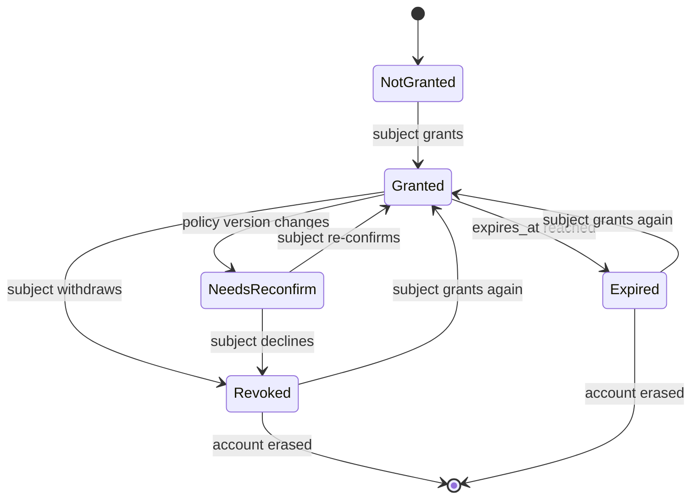
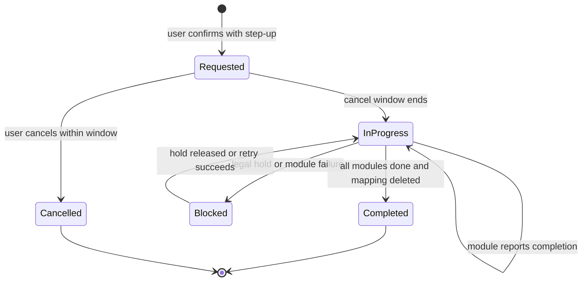

# Privacy and Data Governance

Status: intended complete product. Nothing here claims a control is built or that TalentSphere complies with any law. Legal characterizations (lawful basis, controller or processor role, deadlines) are candidates for counsel to confirm; see [03_COMPLIANCE_MAP.md](03_COMPLIANCE_MAP.md). This is not legal advice.

Owner role: privacy lead (a function, not a headcount claim), with `SAD` and counsel. Settings surfaces are owned by module SET; this file sets the rules SET and every other module implement.

| Namespace                                           | Meaning                                                                        | Range in this file             |
| --------------------------------------------------- | ------------------------------------------------------------------------------ | ------------------------------ |
| `NFR-PRV-nnn`                                       | Testable privacy requirement                                                   | NFR-PRV-001..NFR-PRV-048 (§16) |
| `OD-PRV-nn`                                         | Privacy decision                                                               | OD-PRV-01..OD-PRV-16 (§17)     |
| `RSK-PRV-nn`                                        | Privacy risk                                                                   | RSK-PRV-01..RSK-PRV-10 (§18)   |
| `PUR-nn`, `RET-<name>`, `C0`..`C4`, scope ids `x.y` | Document-local labels: purposes, retention parameters, classes, consent scopes | —                              |

## 1. Principles and roles

| #   | Principle             | Rule                                                                                                                                                |
| --- | --------------------- | --------------------------------------------------------------------------------------------------------------------------------------------------- |
| PP1 | Purpose first         | Every collected field maps to at least one `PUR-` purpose; a field with no purpose is not collected [SRC: Yash 14/PRIVACY §2]                       |
| PP2 | Privacy by default    | All optional consent scopes are off for new accounts; profiles start private; no pre-ticked boxes [SRC: Yash 14/PRIVACY §3]                         |
| PP3 | Contextual visibility | Each item has a visibility level: `private`, `connections`, `recruiters` (consented search), `named_org`, `institution`, `public` [SRC: SSOT §15.2] |
| PP4 | Check at use time     | Consent and visibility are evaluated when data is read or sent, never from a cache [SRC: Yash CONST-S13]                                            |
| PP5 | Separation of stores  | AI conversation memory, user profile, talent graph and verified evidence are separate stores with separate rules [SRC: SSOT §16.6]                  |
| PP6 | Provable lifecycle    | Collection, sharing, retention and deletion each leave an auditable record                                                                          |
| PP7 | Equal effort          | Withdrawing consent or leaving takes no more steps than granting or joining                                                                         |

Controller and processor roles (candidates; counsel confirms per OD-SEC-18):

| Processing                                                                                         | TalentSphere role (candidate)                                                                       | Counterparty role                             |
| -------------------------------------------------------------------------------------------------- | --------------------------------------------------------------------------------------------------- | --------------------------------------------- |
| Candidate accounts, profiles, evidence, learning, community, marketplace discovery                 | Controller                                                                                          | n/a                                           |
| An employer's own hiring pipeline in ATS (applications to its jobs, scorecards, notes, interviews) | Processor for the employer, or joint controller for marketplace-originated applications             | Employer is controller                        |
| Institution-provisioned student accounts and cohort reporting                                      | Processor for the institution for managed learning; controller for the student's own career profile | Institution is controller (education records) |
| Enterprise internal mobility and L&D (ENT)                                                         | Processor                                                                                           | Enterprise is controller (employee data)      |
| Payments                                                                                           | Controller for billing records; payment provider acts per its terms                                 | Payment provider                              |

## 2. Data classification

| Class | Name                  | Definition                                                   | Examples                                                                                                                                                                                                              | Handling minimum                                                                     |
| ----- | --------------------- | ------------------------------------------------------------ | --------------------------------------------------------------------------------------------------------------------------------------------------------------------------------------------------------------------- | ------------------------------------------------------------------------------------ |
| C0    | Public                | Intended for anyone                                          | Published job posts, public course pages, profiles the user set public                                                                                                                                                | Integrity controls only                                                              |
| C1    | Internal              | Non-personal operational data                                | Feature flags, aggregate metrics above `min_cohort_k`, build metadata                                                                                                                                                 | Access by staff role                                                                 |
| C2    | Personal              | Identifies or relates to a person; ordinary sensitivity      | Name, headline, skills, evidence metadata, application status, messages metadata                                                                                                                                      | Purpose-bound, access-controlled, exportable, erasable                               |
| C3    | Confidential personal | Harm likely if disclosed                                     | Contact details, resume text, messages bodies, scorecards, interview notes, recordings, assessment attempts, salary reports, date of birth, location history                                                          | C2 plus field encryption where listed, access logging for third-party reads          |
| C4    | Restricted            | Special-category, financial, credential or legally regulated | Fairness self-identification (race, ethnicity, sex, disability, veteran status), accommodation requests, government ids, background-check reports, tax ids, payout details, credentials, minors' data flagged as such | C3 plus separate key, separate store or schema, no AI egress, named-role access only |

Derived data inherits the highest class of its inputs unless it is aggregated above `min_cohort_k` and reviewed as non-personal [DER].

## 3. PII inventory by module

`Subjects`: CAN candidate, STD student, REF referee or other non-account person, EMPL employee of a tenant, STF staff, ORG contact person of an organization.

| Module          | Data categories                                                                                                                                                                          | Highest class                     | Subjects  | Purposes               | Notes                                                                              |
| --------------- | ---------------------------------------------------------------------------------------------------------------------------------------------------------------------------------------- | --------------------------------- | --------- | ---------------------- | ---------------------------------------------------------------------------------- |
| IDN             | Email, phone, password hash, passkeys, MFA secrets, sessions (device, IP prefix, coarse location), date of birth or age band                                                             | C4 (credentials)                  | all       | PUR-01                 | IP stored as prefix in audit; full IP in security logs only for `RET-SECLOG`       |
| SET             | Consent records, privacy settings, rights requests, notification preferences                                                                                                             | C2                                | all       | PUR-19, PUR-12         | Consent rows keyed by `subject_ref`                                                |
| NTF             | Delivery addresses, push endpoints, delivery logs                                                                                                                                        | C2                                | all       | PUR-12, PUR-13         | Email bodies not stored after send beyond `RET-NOTIFY`                             |
| REP             | Badges, points, endorsements, reputation signals                                                                                                                                         | C2                                | CAN       | PUR-02, PUR-15         | Reputation is contextual; no universal score [SRC: SSOT §18.1]                     |
| PRF             | Name, headline, photo, location (city level), work history, education, skills, resume files and text, portfolio, links, preferences (salary expectation, work authorization, relocation) | C3                                | CAN, STD  | PUR-02, PUR-21, PUR-22 | Work authorization and salary expectation are C3 and never public                  |
| EVD             | Evidence items, artifacts, referee contact details, attestations, credentials                                                                                                            | C3                                | CAN, REF  | PUR-03, PUR-04         | Referee data minimized to name, email, relationship, organization                  |
| BGV             | Identity-verification results, background-check authorizations and reports, adverse-action notices                                                                                       | C4                                | CAN       | PUR-25                 | Provider-held documents preferred; regulated (FCRA-type)                           |
| SRC             | Search queries, saved searches, search documents of discoverable candidates                                                                                                              | C2                                | CAN, REC  | PUR-21, PUR-06         | Candidate search documents exist only with `search.discoverable`                   |
| LRN             | Enrollments, progress, notes, quiz attempts, certificates                                                                                                                                | C2                                | CAN, STD  | PUR-08                 | Institution-managed learning may be an education record                            |
| STU             | Instructor identity, payout details, tax forms, course content                                                                                                                           | C4 (payout)                       | INS       | PUR-11, PUR-26         | Payout and tax data provider-held where possible                                   |
| ASM             | Attempts, answers, code submissions, timing, integrity signals, proctoring media if enabled                                                                                              | C3 (C4 if biometric)              | CAN, STD  | PUR-08, PUR-09         | Proctoring with face or voice analysis is a DPIA trigger and EU AI Act review item |
| JOB             | Applications, answers to screening questions, cover letters, application snapshots, accommodation requests                                                                               | C3 (C4 accommodation)             | CAN       | PUR-05, PUR-27         | Accommodation request visible only to its handler                                  |
| ATS             | Pipeline stages, scorecards, interviewer notes, rejection reasons, offers                                                                                                                | C3                                | CAN, EMPL | PUR-27                 | Employer is controller (candidate role in §1)                                      |
| INT             | Availability, calendar tokens, interview schedules, recordings, transcripts                                                                                                              | C3                                | CAN, EMPL | PUR-27                 | Recording only with all-party consent [SRC: SSOT HDN-027]                          |
| EMP             | Org profile, members, employer reviews (anonymous), interview experiences                                                                                                                | C2 (reviewer identity C3)         | ORG, CAN  | PUR-28                 | Anonymous reviewer identity hidden from employer [SRC: SSOT BR-136]                |
| NET             | Connections, follows, posts, comments, referrals, recommendations                                                                                                                        | C2                                | CAN       | PUR-29                 | Recommendations shown only after recipient acceptance [SRC: SSOT BR-132]           |
| MSG             | Message bodies, attachments, read receipts                                                                                                                                               | C3                                | all       | PUR-29, PUR-07         | Staff read only reported messages or under a specific grant                        |
| AIC             | Prompts, conversation memory, match explanations, embeddings, AI provenance                                                                                                              | C3                                | CAN, REC  | PUR-06, PUR-10         | Memory separate from profile; user can view and delete memory                      |
| TSF             | Reports, moderation decisions, appeals, fraud signals                                                                                                                                    | C3                                | all       | PUR-15, PUR-16         | Reporter identity hidden from reported user                                        |
| INS             | Student roster, cohort membership, placement outcomes, institution consents                                                                                                              | C3                                | STD       | PUR-18, PUR-23         | Minors possible (§10)                                                              |
| BIL             | Billing contact, invoices, subscription state, provider ids, tax location                                                                                                                | C3                                | CAN, ORG  | PUR-11                 | No card data stored                                                                |
| MEN             | Mentor profiles, session bookings, session notes, coaching goals                                                                                                                         | C3                                | CAN, MNT  | PUR-30                 | Session notes private to the participants who wrote them                           |
| GIG             | Contracts, milestones, deliverables, payments, disputes, ratings                                                                                                                         | C3 (C4 payout)                    | FRL, ORG  | PUR-31                 | Tax forms provider-held                                                            |
| EVT             | Registrations, attendance, team membership, submissions, judging scores                                                                                                                  | C2                                | CAN       | PUR-32                 | Attendee list visibility opt-in                                                    |
| MKT             | Salary reports, career-path aggregates                                                                                                                                                   | C3 (raw), C0 (aggregates above k) | CAN       | PUR-33                 | `min_cohort_k` suppression                                                         |
| ENT             | Employee skills, internal applications, L&D assignments                                                                                                                                  | C3                                | EMPL      | PUR-34                 | Employer is controller; external job search never visible to employer              |
| ANL             | Product analytics events, rollups                                                                                                                                                        | C2 (pseudonymous)                 | all       | PUR-14                 | Consent-gated; operational telemetry separate (PUR-24)                             |
| ADM             | Support tickets, staff actions, grants                                                                                                                                                   | C3                                | all, STF  | PUR-17                 | Ticket attachments scanned and retained per `RET-SUPPORT`                          |
| PWA             | Device cache of owner data, push subscriptions                                                                                                                                           | C2/C3                             | all       | PUR-01, PUR-12         | Never authoritative; purged on sign-out                                            |
| PLT             | Files, media, webhook delivery logs, OAuth grants                                                                                                                                        | C3                                | all       | PUR-35                 | Webhook logs store status, not payload bodies                                      |
| (cross-cutting) | Fairness self-identification                                                                                                                                                             | C4                                | CAN       | PUR-36                 | Separate store, audit job only (fairness doc §4)                                   |

## 4. Lawful basis and purposes register

"Basis" is the candidate GDPR Article 6 basis for counsel to confirm: `contract` (6(1)(b)), `consent` (6(1)(a)), `legit-int` (6(1)(f)), `legal` (6(1)(c)). Rows marked consent are opt-in in the product regardless of whether another basis could apply (privacy by default) [SRC: Yash 14/PRIVACY §2]. C4 special-category rows also need an Article 9(2) condition (OD-PRV-01).

| PUR    | Purpose                                                                     | Modules            | Consent scope                                                                                    | Basis (candidate)                                             | Recipients                                 | Automated decision?                                |
| ------ | --------------------------------------------------------------------------- | ------------------ | ------------------------------------------------------------------------------------------------ | ------------------------------------------------------------- | ------------------------------------------ | -------------------------------------------------- |
| PUR-01 | Account, authentication, security                                           | IDN, PWA           | —                                                                                                | contract; legit-int (security)                                | Email provider                             | No                                                 |
| PUR-02 | Maintain profile and portfolio                                              | PRF, REP           | `profile.public_view` for public visibility                                                      | contract; consent (public)                                    | Public if chosen                           | No                                                 |
| PUR-03 | Store evidence and run verification                                         | EVD                | —                                                                                                | contract                                                      | Verifiers named by the user                | No (human decisions)                               |
| PUR-04 | Contact referees and employer mailboxes at the user's request               | EVD                | —                                                                                                | contract; legit-int (referee, minimized)                      | Referee                                    | No                                                 |
| PUR-05 | Share an application snapshot with the employer                             | JOB                | `application.share_snapshot` (shown at submit)                                                   | consent; pre-contract steps                                   | Hiring team of that job                    | No                                                 |
| PUR-06 | Job and learning recommendations and match explanations to the candidate    | AIC, SRC           | `matching.recommend`                                                                             | consent                                                       | Candidate                                  | Decision support only                              |
| PUR-07 | Recruiter outreach                                                          | MSG, ATS           | `outreach.recruiter_contact`                                                                     | consent                                                       | Recruiter                                  | No                                                 |
| PUR-08 | Deliver courses and assessments                                             | LRN, ASM           | —                                                                                                | contract                                                      | Instructors                                | Objective-item grading is automated and appealable |
| PUR-09 | Assessment integrity review                                                 | ASM                | —                                                                                                | legit-int                                                     | Human reviewers                            | Signals advisory; human decides                    |
| PUR-10 | AI assistance on the user's own content                                     | AIC                | `ai.assist.process`                                                                              | consent                                                       | AI provider (redacted)                     | Suggestions only                                   |
| PUR-11 | Billing, entitlements, payouts                                              | BIL, STU, GIG, MEN | —                                                                                                | contract; legal (tax records)                                 | Payment provider, tax provider             | Entitlements by rule                               |
| PUR-12 | Transactional notifications                                                 | NTF                | Per-channel preferences                                                                          | contract                                                      | Email and push services                    | No                                                 |
| PUR-13 | Marketing and lifecycle email                                               | NTF                | `comms.marketing_email`                                                                          | consent                                                       | Email provider                             | No                                                 |
| PUR-14 | Product analytics                                                           | ANL                | `analytics.product`                                                                              | consent                                                       | None external by default                   | No                                                 |
| PUR-15 | Safety, moderation, abuse prevention                                        | TSF, REP           | —                                                                                                | legit-int; legal (DSA notice-and-action)                      | Moderators                                 | No automated sanctions on merit                    |
| PUR-16 | Fraud and verification-integrity analytics                                  | TSF, EVD           | —                                                                                                | legit-int [SRC: Yash OPEN-B46]                                | Human reviewers                            | Flags to review only                               |
| PUR-17 | Customer support with privileged access                                     | ADM                | Ticket-level permission                                                                          | legit-int                                                     | Support (time-boxed)                       | No                                                 |
| PUR-18 | Institution cohort reporting                                                | INS                | `evidence.share_institution`                                                                     | consent; contract (institution)                               | Faculty (aggregates)                       | No                                                 |
| PUR-19 | Rights handling and legal obligations                                       | SET, ADM           | —                                                                                                | legal                                                         | Handlers                                   | No                                                 |
| PUR-20 | Aggregate research                                                          | ANL, MKT           | `data.research_aggregate`                                                                        | consent [SRC: Yash OPEN-B10]                                  | Internal                                   | No                                                 |
| PUR-21 | Recruiter search presence                                                   | SRC                | `search.discoverable`                                                                            | consent                                                       | Consented recruiters                       | Decision support only                              |
| PUR-22 | Candidate-granted employer access to evidence and contact details           | EVD, PRF           | `evidence.share_summary`, `evidence.share_artifact` (per org), `profile.share_contact` (per org) | consent                                                       | Named org                                  | No                                                 |
| PUR-23 | Alumni outcome sharing with an institution                                  | INS                | `alumni.share_outcomes`                                                                          | consent                                                       | Named institution                          | No                                                 |
| PUR-24 | Operational telemetry (reliability, errors, security signals; no person id) | ANL, PLT           | —                                                                                                | legit-int, counsel to confirm (OD-PRV-07)                     | Internal SRE                               | No                                                 |
| PUR-25 | Identity verification and background checks                                 | BGV                | Per-check authorization                                                                          | consent plus regulatory authorization (FCRA-type)             | Verification provider, requesting employer | Results reviewed by humans; adverse action process |
| PUR-26 | Instructor onboarding and payouts                                           | STU                | —                                                                                                | contract; legal (tax)                                         | Payment and tax providers                  | No                                                 |
| PUR-27 | Employer hiring process (pipeline, interviews, offers)                      | ATS, INT           | —                                                                                                | employer's basis (TalentSphere as processor)                  | Employer team                              | Human decisions only                               |
| PUR-28 | Employer reviews and interview experiences                                  | EMP                | —                                                                                                | legit-int (public interest in workplace information), counsel | Public (anonymous)                         | No                                                 |
| PUR-29 | Networking and messaging                                                    | NET, MSG           | —                                                                                                | contract                                                      | Chosen participants                        | No                                                 |
| PUR-30 | Mentorship and coaching sessions                                            | MEN                | —                                                                                                | contract                                                      | Mentor and mentee                          | No                                                 |
| PUR-31 | Freelance contracts and disputes                                            | GIG                | —                                                                                                | contract                                                      | Counterparty                               | No                                                 |
| PUR-32 | Events and hackathons                                                       | EVT                | `events.share_attendee_contact` per event                                                        | contract; consent (contact sharing)                           | Organizer, judges                          | Judging by humans                                  |
| PUR-33 | Salary and market insights                                                  | MKT                | `market.contribute_salary`                                                                       | consent                                                       | Public aggregates above k                  | No                                                 |
| PUR-34 | Enterprise internal mobility and L&D                                        | ENT                | —                                                                                                | employer's basis (processor)                                  | Employer                                   | Decision support only                              |
| PUR-35 | Files, media and integrations                                               | PLT                | Per-client OAuth consent                                                                         | contract; consent (integrations)                              | Chosen integrations                        | No                                                 |
| PUR-36 | Fairness and adverse-impact monitoring                                      | AIC, ANL           | `fairness.self_identify`                                                                         | consent; Art 9(2) condition per OD-PRV-01                     | Audit job; auditors (aggregates only)      | No                                                 |

## 5. Consent model

### 5.1 Scope catalogue

| Scope                           | Grantee granularity                                                          | Default                                    | Expiry option                                  | Purpose |
| ------------------------------- | ---------------------------------------------------------------------------- | ------------------------------------------ | ---------------------------------------------- | ------- |
| `profile.public_view`           | Everyone                                                                     | Off                                        | No                                             | PUR-02  |
| `search.discoverable`           | All verified employer orgs, or an excluded-org list (block current employer) | Off                                        | Yes                                            | PUR-21  |
| `matching.recommend`            | Platform                                                                     | Off                                        | No                                             | PUR-06  |
| `outreach.recruiter_contact`    | All verified orgs                                                            | Off                                        | Yes                                            | PUR-07  |
| `application.share_snapshot`    | One org, one job                                                             | Granted at submit with explicit field list | Ends at application end plus `RET-APPLICATION` | PUR-05  |
| `evidence.share_summary`        | All verified orgs                                                            | Off                                        | Yes                                            | PUR-22  |
| `evidence.share_artifact`       | One org                                                                      | Off                                        | Yes, default 90 days [PROP]                    | PUR-22  |
| `profile.share_contact`         | One org                                                                      | Off                                        | Yes                                            | PUR-22  |
| `ai.assist.process`             | Platform and listed AI providers                                             | Off                                        | No                                             | PUR-10  |
| `analytics.product`             | Platform                                                                     | Off                                        | No                                             | PUR-14  |
| `comms.marketing_email`         | Platform                                                                     | Off                                        | No                                             | PUR-13  |
| `evidence.share_institution`    | One institution                                                              | Off                                        | Yes                                            | PUR-18  |
| `alumni.share_outcomes`         | One institution, chosen fields                                               | Off                                        | Yes                                            | PUR-23  |
| `data.research_aggregate`       | Platform                                                                     | Off                                        | No                                             | PUR-20  |
| `events.share_attendee_contact` | One event                                                                    | Off                                        | Event end                                      | PUR-32  |
| `market.contribute_salary`      | Platform aggregates                                                          | Off                                        | No                                             | PUR-33  |
| `fairness.self_identify`        | Audit job only                                                               | Off; each field has "Prefer not to say"    | No                                             | PUR-36  |

The scope list lives in one catalogue in `packages/contracts`; a scope not in the catalogue cannot be granted or checked [SRC: Yash 14/PRIVACY §3 CSC rule].

### 5.2 Consent record

Append-only rows keyed by opaque `subject_ref`: `scope`, `grantee_type`, `grantee_id`, `target` (data object or field set), `granted` (boolean), `policy_version`, `source` (screen id or API client), `expires_at`, `created_at`, coarse client info. The current state is a view over the latest non-expired row per (subject, scope, grantee, target).

### 5.3 Rules

1. Consent is never bundled with terms acceptance; each scope has its own control with accept and decline of equal prominence.
2. The screen states in plain language: what data, who receives it, for how long, how to withdraw.
3. Withdrawal is in the same place, with the same number of steps, and takes effect at the next read; asynchronous clean-up (search documents, caches, embeddings) completes within `CONSENT_CLEANUP_MAX` (15 min [PROP]).
4. A material change to a scope's description increments its policy version; the scope is treated as not granted until the user re-confirms.
5. Browser Global Privacy Control (`Sec-GPC: 1`) is honored as an opt-out of any sale or sharing for cross-context advertising (none is planned) and of `analytics.product` for that browser [PROP, OD-PRV-08].
6. Storage: only strictly necessary cookies and local storage by default; analytics storage only after `analytics.product`; therefore no cookie banner is expected, subject to counsel on ePrivacy and PECR rules [SRC: Yash OPEN-B55].
7. Minors' accounts cannot grant `search.discoverable`, `outreach.recruiter_contact`, `profile.public_view`, `comms.marketing_email` or `analytics.product` (§10).

### 5.4 Consent state per grant

### 5.5 Effects of revocation

| Scope                        | Immediate effect                                                                                             | Asynchronous effect                                                           | Cannot be undone (must be stated to the user)                    |
| ---------------------------- | ------------------------------------------------------------------------------------------------------------ | ----------------------------------------------------------------------------- | ---------------------------------------------------------------- |
| `profile.public_view`        | Public profile returns 404; CDN purged                                                                       | Search engines asked to drop via `noindex` and removal                        | Copies others already saved                                      |
| `search.discoverable`        | Excluded from recruiter results at next query                                                                | Search document removed                                                       | Shortlists recruiters already made                               |
| `matching.recommend`         | No new recommendations                                                                                       | Embeddings and match explanations deleted                                     | n/a                                                              |
| `application.share_snapshot` | Live reads by the hiring team stop; snapshot kept as employer's hiring record under the employer's retention | Dashboards drop live items                                                    | What the team already saw                                        |
| `evidence.share_artifact`    | New signed URLs refused                                                                                      | Issued URLs lapse within their expiry                                         | Downloads already made                                           |
| `profile.share_contact`      | Contact masked for that org                                                                                  | Audit entry                                                                   | Details already copied                                           |
| `ai.assist.process`          | AI routes return `CONSENT_REQUIRED`                                                                          | Pending AI jobs cancelled; conversation memory kept until the user deletes it | Data already processed by the provider under its retention terms |
| `analytics.product`          | Client stops sending; server rejects                                                                         | Pseudonymous key discarded                                                    | Aggregates already computed                                      |
| `fairness.self_identify`     | Excluded from next audit run                                                                                 | Values deleted                                                                | Aggregates already published (above k)                           |

## 6. Purpose limitation rules

1. Data collected for one `PUR-` may be used for another only if the new purpose is listed as compatible in this register or a new consent scope is obtained; adding a compatibility entry needs privacy-lead approval and a DPIA-trigger check (§12).
2. Hard separations [SRC: SSOT §16.6; DER]:
   - Fairness self-identification (PUR-36) is never available to recruiters, rankers, AI prompts, search or analytics outside the audit job.
   - Assessment integrity signals (PUR-09) are never shown to employers as such; employers see only the attempt outcome after human review.
   - Accommodation requests are never visible to evaluators or interviewers beyond the accommodation itself.
   - Enterprise internal data (PUR-34) never flows to the marketplace, and marketplace activity never flows to the current employer.
   - AI conversation memory never becomes profile content or evidence without the user's explicit "Add to profile" action.
   - Payment status and plan tier are never ranking or matching inputs [SRC: Yash 14/PRIVACY §7].
3. Model training on personal data (any purpose) requires a separate decision (OD-PRV-10); default: not allowed.
4. Data sold or shared for cross-context behavioral advertising: never [SRC: SSOT §15.9.2 CCPA "no sale"].

## 7. Retention schedule

Retention values are policy configuration, not architectural constants [SRC: SSOT Part I §G]. Every value below is a [PROP] default that stands until OD-PRV-04 (and the specific OD named) is decided with counsel. A legal hold (`legal.hold_placed`) suspends deletion for the held records only.

| Parameter               | Data                                                                    | Trigger (clock start)                  | Default [PROP]                                                                                                                                                             | Disposition                                              | OD        |
| ----------------------- | ----------------------------------------------------------------------- | -------------------------------------- | -------------------------------------------------------------------------------------------------------------------------------------------------------------------------- | -------------------------------------------------------- | --------- |
| `RET-ACCOUNT-INACTIVE`  | Whole account with no sign-in                                           | Last sign-in                           | 36 months, after two warning emails at −60 and −14 days                                                                                                                    | Erasure workflow (§8.6)                                  | OD-PRV-04 |
| `RET-DEACTIVATED`       | Account deactivated by the user (not erased)                            | Deactivation                           | 30 days [SRC: SSOT §15.9.1 deactivation purge]                                                                                                                             | Erasure                                                  | OD-PRV-02 |
| `RET-SESSION`           | Revoked or expired session rows                                         | Revocation or expiry                   | 30 days                                                                                                                                                                    | Delete                                                   | OD-PRV-04 |
| `RET-SECLOG`            | Security logs with full IP                                              | Event                                  | 90 days                                                                                                                                                                    | Delete                                                   | OD-PRV-04 |
| `RET-OPLOG`             | Operational logs (redacted)                                             | Event                                  | 30 days logs, 7 days traces [SRC: Yash 14 R3-6]                                                                                                                            | Delete                                                   | OD-PRV-04 |
| `RET-AUDIT`             | Audit events                                                            | Event                                  | 7 years [PROP]                                                                                                                                                             | Keep unlinkable after erasure (§8.6)                     | OD-PRV-03 |
| `RET-CONSENT`           | Consent records                                                         | Superseded or account erased           | Life of account plus 6 years [PROP] as proof                                                                                                                               | Unlinkable after erasure                                 | OD-PRV-03 |
| `RET-APPLICATION`       | Employer's copy of an application, scorecards, notes, interview records | Application terminal state             | Employer-configured, default 24 months [SRC: SSOT §15.9.2 "2-year decision retention"]; minimum per applicable law (US federal: 1 year from the record or action, counsel) | Delete or pseudonymize per employer setting              | OD-PRV-05 |
| `RET-APPLICATION-DRAFT` | Unsubmitted application drafts                                          | Last edit                              | 90 days                                                                                                                                                                    | Delete                                                   | OD-PRV-04 |
| `RET-RECORDING`         | Interview recordings and transcripts                                    | Interview date                         | 90 days unless the employer extends to the application retention                                                                                                           | Delete                                                   | OD-PRV-05 |
| `RET-MESSAGE`           | Message bodies                                                          | Sent                                   | Life of both participants' accounts; a participant deleting a conversation hides it for them only                                                                          | Delete when both erased                                  | OD-PRV-04 |
| `RET-EVIDENCE`          | Evidence items and artifacts                                            | Owner deletion                         | Until owner deletes; revoked or superseded versions kept 30 days for undo                                                                                                  | Delete; history tombstoned                               | —         |
| `RET-REFEREE`           | Referee contact data                                                    | Request completion or expiry           | 12 months after the attestation decision; immediately if the referee declines and asks for deletion                                                                        | Delete; attestation keeps role and organization only     | OD-PRV-04 |
| `RET-ATTEMPT`           | Assessment attempts and answers                                         | Attempt submission                     | 3 years (credential validity evidence)                                                                                                                                     | Delete; aggregated item statistics kept                  | OD-PRV-06 |
| `RET-INTEGRITY`         | Integrity signals and proctoring media                                  | Attempt decision                       | Media 30 days after decision unless appealed; signals 12 months                                                                                                            | Delete                                                   | OD-PRV-06 |
| `RET-AI-PROMPT`         | AI prompts and outputs                                                  | Call                                   | 30 days for troubleshooting; provenance metadata (no content) per `RET-AUDIT`                                                                                              | Delete content                                           | OD-PRV-09 |
| `RET-AI-MEMORY`         | AI conversation memory                                                  | Last use                               | Until the user deletes it, maximum 12 months without use                                                                                                                   | Delete                                                   | OD-PRV-09 |
| `RET-ANALYTICS-RAW`     | Raw product analytics events                                            | Event                                  | 13 months                                                                                                                                                                  | Aggregate then delete                                    | OD-PRV-04 |
| `RET-NOTIFY`            | Notification delivery records                                           | Send                                   | 90 days                                                                                                                                                                    | Delete                                                   | OD-PRV-04 |
| `RET-SUPPORT`           | Support tickets and attachments                                         | Ticket closure                         | 24 months                                                                                                                                                                  | Delete                                                   | OD-PRV-04 |
| `RET-MODERATION`        | Reports, decisions, statements of reasons                               | Decision                               | 5 years for decisions (DSA transparency and repeat-offender handling, counsel); reporter identity 12 months                                                                | Delete or pseudonymize                                   | OD-PRV-04 |
| `RET-BILLING`           | Invoices, tax records, payout records                                   | Fiscal year end                        | Per tax law of the seller's jurisdiction, default 7 years (counsel)                                                                                                        | Keep minimal record after erasure                        | OD-PRV-04 |
| `RET-BGV`               | Background-check reports                                                | Check completion                       | Per regulation and employer contract; default 12 months                                                                                                                    | Delete                                                   | OD-SEC-21 |
| `RET-FAIRNESS`          | Fairness self-identification values                                     | Last update                            | Until withdrawn or account erased; audit snapshots 3 years in aggregate only                                                                                               | Delete individual values                                 | OD-PRV-01 |
| `RET-MINOR`             | Data of accounts flagged as minors                                      | Account end or institution offboarding | Shortened: 12 months after last activity                                                                                                                                   | Erasure                                                  | OD-PRV-11 |
| `RET-BACKUP`            | Database backups and point-in-time recovery archives                    | Backup time                            | 35 days [PROP]                                                                                                                                                             | Age out; erasures re-applied after restore (§8.6 step 8) | OD-PRV-02 |
| `RET-EXPORT`            | Generated export archives                                               | Generation                             | `EXPORT_LINK_TTL` (24 h)                                                                                                                                                   | Delete                                                   | —         |

Retention jobs run daily, are idempotent, emit `privacy.retention_run` metrics (rows evaluated, deleted, held) and alert when a run fails or deletes zero rows for 7 consecutive days where rows were due [PROP].

## 8. Data subject rights procedures

Generic rights are mapped to product capabilities; statutory naming and deadlines per jurisdiction are counsel matters. Deadline parameters:

| Parameter               | Default [PROP]                                                                                                          | Source              |
| ----------------------- | ----------------------------------------------------------------------------------------------------------------------- | ------------------- |
| `DSR_DEADLINE`          | 30 days from verified request (GDPR one month; extendable by up to two further months for complex requests with notice) | [SRC: SSOT §15.9.5] |
| `DSR_DEADLINE_CCPA`     | 45 days (extendable once by 45)                                                                                         | [DER, counsel]      |
| `ERASURE_CANCEL_WINDOW` | 7 days                                                                                                                  | Conflict, OD-PRV-02 |
| `ERASURE_COMPLETION`    | 30 days from request; internal target 21 days                                                                           | [SRC: Yash SLO-24]  |

### 8.1 Identity verification for requests

1. Signed-in requests: active session plus step-up (security doc §7.4).
2. Requests from people without a session (referees, deleted-account holders, non-users named in content): email challenge to an address on file; personal data is never sent as an email attachment.
3. Authorized agents (CCPA): signed authorization plus direct confirmation by the subject.
4. Requests forwarded by an employer, institution or enterprise tenant concerning data for which they are controller: routed to that tenant's admin queue with a 5 business-day handoff target [PROP]; TalentSphere assists as processor.

### 8.2 Access and transparency

1. User opens Settings > Privacy > Your data.
2. The page shows, without a request: categories held per module, purposes, recipients, consents with history, the access log (who viewed what, when), automated-processing explanations, and retention per category.
3. "Request full copy" starts an export (§8.3).

- Acceptance: Given a candidate whose evidence was viewed by org X, when they open the access log, then the entry shows org X, the item and the date. Negative: Given a user who is not the subject, when they call the access-log API with the subject's id, then the response is `404`.

### 8.3 Portability and export

1. User selects "Request export", chooses format (machine-readable JSON per module plus original uploaded files; human-readable HTML summary).
2. Step-up is required; request id and due date are shown.
3. An export job collects data through each module's export interface (every module that holds personal data must implement one); third-party personal data inside the subject's content (for example other people's messages) is limited to what the subject already sees.
4. When ready (target ≤ 24 h [PROP]), a notification links to the download page; the link expires after `EXPORT_LINK_TTL`; download requires a signed-in session.
5. Errors: a module export failure retries 3 times, then the request is flagged to the privacy queue and the user sees "Partly delayed" with the new date, never a silent partial file.

### 8.4 Rectification

1. Self-service edits for profile and unverified evidence.
2. Editing a verified item creates a new version that is unverified until re-verification; the UI states this before saving.
3. Third-party data (an employer's note, a reference) is contested through "Request correction"; the controller of that record (employer or referee) is asked to respond within the DSR deadline; if declined, the subject can attach a statement that is shown alongside the record [PROP].

### 8.5 Restriction and objection

- Restriction: handler-assisted. The item is hidden from search, sharing, matching and AI while kept; the user sees a "Restricted" label and can lift it.
- Objection to legitimate-interest processing (PUR-15, PUR-16, PUR-24, PUR-28): reviewed by the privacy queue with a reasoned answer; consent-based purposes are switched off by the user directly.
- Opt-out of sale or sharing (CCPA): no sale or sharing occurs; the control exists and records the choice [DER].

### 8.6 Erasure

Steps:

1. User selects "Delete account" in Settings > Privacy; the screen lists what will be deleted, what is kept and why (billing records, employer copies of applications under their retention, unlinkable audit history), and the dates.
2. Step-up; the request is recorded; sessions other than the current are revoked; the account becomes `pending_erasure` (hidden from search, messaging shows "Account closing").
3. During `ERASURE_CANCEL_WINDOW` the user can cancel by signing in.
4. At window end, the privacy orchestrator emits `privacy.erasure_started`; every module consumes it and deletes or anonymizes its data per its own rules, reporting completion.
5. Shared artifacts: messages sent by the subject show "Deleted user"; endorsements and recommendations given by the subject are removed; evidence attested by the subject as referee keeps the attestation with "Referee account deleted".
6. Last step: delete the `subject_identity_map` row and destroy the per-subject key; append-only history remains but cannot be linked [SRC: Yash 14/PRIVACY §6.1].
7. A receipt (without personal data) is emailed and a post-erasure sweep verifies no table still holds the account id.
8. Backups: erased subject refs are recorded in an erasure ledger kept outside the restorable database; after any restore, the ledger is re-applied before the system serves traffic [DER from SSOT §15.9.1 note].

Conflict recorded: SSOT intends a 30-day cancel window and a 30-day completion deadline from the same start, which cannot both hold [SRC: SSOT §15.9.1, DOR-017]. Default here: 7-day cancel window, completion within 30 days of request. Decision OD-PRV-02.

### 8.7 Automated decisions and human review

1. Every match explanation, integrity flag, objective grade and moderation action shows "Ask for human review".
2. The request goes to a reviewer different from any original human actor; the reviewer records outcome and reasons; target 10 business days [PROP].
3. No legal or similarly significant decision is made solely by automated means (fairness doc §5).

### 8.8 Request register

Every request has: id, type, subject_ref, received_at, verified_at, due_at, status (`received`, `verifying`, `in_progress`, `extended`, `fulfilled`, `refused`, `withdrawn`), handler, outcome, reasons, appeal route. Monthly metrics: count by type, median and p95 time to fulfil, overdue count (target 0).

## 9. Minimization, pseudonymization and aggregates

1. Collection forms request only fields mapped to a purpose; optional fields are marked optional and are never required to unlock unrelated features.
2. Location: city and country by default; precise geolocation is not collected [PROP].
3. Age: an age band or "over minimum age" flag where the exact date is not needed.
4. Subject references: history tables use opaque `subject_ref`; only `subject_identity_map` links refs to accounts.
5. Aggregates: one policy parameter `min_cohort_k`, default k ≥ 10 for public and sensitive cells; stricter feature values override; any lower value needs owner and counsel decision [SRC: SSOT Part I §G, BR-178]. Conflict recorded: SSOT BR-135 sets ≥ 5 reports for salary cells, below the default; the default applies until OD-PRV-12.
6. Suppression is enforced in the query layer, including complementary suppression so a suppressed cell cannot be derived from totals [DER]; cohort suppression is not claimed to be differential privacy [SRC: ARCHITECTURE.md §20].
7. Test and staging environments never contain production personal data; staging uses synthetic or irreversibly anonymized data [SRC: SSOT §22.1].

## 10. Children and minors

Not directed at children. Design stance until counsel decides per market (OD-PRV-11):

| Rule                                      | Value                                                                                                                                                                                                |
| ----------------------------------------- | ---------------------------------------------------------------------------------------------------------------------------------------------------------------------------------------------------- |
| Minimum self-registration age             | 16 [PROP]; market overrides (for example 13 in the US for COPPA purposes, 18 under India DPDP unless verifiable parental consent)                                                                    |
| Age signal                                | Date of birth or age band at sign-up; no age inference from behavior                                                                                                                                 |
| Under-minimum at sign-up                  | Registration refused without storing the entered date; neutral message ("You can't create an account right now") so the user is not prompted to retry with a false date                              |
| Institution-provisioned learners under 18 | Allowed only through an institution tenant (INS) with the institution as controller and, where required, parental consent collected by the institution                                               |
| Defaults for minor accounts               | No public profile, no recruiter search, no outreach, no marketing, no analytics, no AI memory, no behavioral recommendations beyond course progress, no messaging with non-institution adults [PROP] |
| Turning 18                                | Prompt to review settings; restrictions lift only after the user opts in to each scope                                                                                                               |
| Discovered minor without consent basis    | Account restricted; data deleted within 30 days unless an institution confirms enrollment                                                                                                            |
| Hiring                                    | Job applications by minors allowed only for jobs marked as open to minors (internships, apprenticeships) where local law permits [PROP]                                                              |

## 11. Privacy-by-design checklist (required for every feature specification and pull request touching personal data)

1. Which `PUR-` ids does the feature serve? Is any data used for a new purpose?
2. Which data classes and fields are collected, displayed, shared or derived? Is each field necessary?
3. Which consent scope is checked, and is it checked at read or send time?
4. Who can see each field (visibility level, roles, tenants)? Is masking needed?
5. Is a third-party read logged to the subject's access log?
6. What is the retention parameter (`RET-`) and how is the data deleted or anonymized on erasure?
7. Is the data included in the module's export interface?
8. Do logs, events, analytics and error reports stay free of personal free text and direct identifiers?
9. Does any AI call receive this data? With which classification and redaction?
10. Does it involve minors, special-category data, profiling, monitoring, new processors or cross-border transfer? If yes, start a DPIA (§12).
11. What does the user see explaining the processing at the point of collection?
12. Which tests prove revocation, erasure and export behavior?

## 12. DPIA triggers

A privacy review and DPIA (standard template: description, necessity and proportionality, risks to rights and freedoms, mitigations, residual risk, sign-off) is completed before build when a change involves any of:

1. New or changed AI use on personal data, including any change to ranking, matching or screening inputs.
2. Systematic evaluation or scoring of people (match scores, integrity signals, reputation).
3. Special-category or C4 data (fairness self-identification, accommodation, background checks, biometrics, government ids).
4. Processing of minors' data.
5. Proctoring, recording, or monitoring (interviews, assessments, enterprise learning tracking).
6. A new processor, recipient class or cross-border transfer.
7. Large-scale public exposure (public profiles, salary aggregates, reviews).
8. Combining datasets from different modules for a new purpose.
9. Employer-side features used on employees (ENT internal mobility, skills inference).

The SSOT requires a DPIA before launch [SRC: SSOT §15.9.1 Art 35]. A DPIA is reviewed again when the processing changes materially or every 2 years [PROP].

## 13. Cross-border transfer

| Item                          | Design                                                                                                                                                                                                                  |
| ----------------------------- | ----------------------------------------------------------------------------------------------------------------------------------------------------------------------------------------------------------------------- |
| Residency attribute           | Every account and tenant has `data_residency_region` set from the declared country at sign-up or the tenant contract [SRC: SSOT §15.9.3]                                                                                |
| Primary region                | Decided by OD-SEC-24; SSOT intends US-East primary with an EU partition later [SRC: SSOT §15.9.3]                                                                                                                       |
| Regional storage              | Personal data of an EU-region subject stored and processed in the EU region once the EU partition exists; until then, transfers rely on an approved mechanism                                                           |
| Transfer mechanisms           | EU-US Data Privacy Framework for certified recipients; Standard Contractual Clauses (EU) and the UK International Data Transfer Addendum otherwise, each with a transfer impact assessment [SRC: SSOT §15.9.3; counsel] |
| AI egress                     | Subjects in a region route only to model endpoints in permitted regions; no permitted endpoint means the non-AI fallback [SRC: SSOT §15.9.3]                                                                            |
| India                         | DPDP allows transfers except to countries the government restricts; maintain a check against the restricted list [DER, counsel]                                                                                         |
| Support access across regions | Staff in another region access data only under grants; recorded as a transfer in the register                                                                                                                           |

## 14. Subprocessor register structure

The register is a maintained table published to customers and reviewed on every change. Columns:

| Column                 | Content                                                                                                                                                                                                                      |
| ---------------------- | ---------------------------------------------------------------------------------------------------------------------------------------------------------------------------------------------------------------------------- |
| Subprocessor           | Legal entity name                                                                                                                                                                                                            |
| Service                | What it does for the platform (hosting, database, object storage, CDN, email, push, payments, AI inference, video meetings, identity verification, background checks, antivirus, observability, support desk, calendar sync) |
| Data categories        | Classes and categories sent                                                                                                                                                                                                  |
| Subjects               | Which subject types                                                                                                                                                                                                          |
| Purposes               | `PUR-` ids                                                                                                                                                                                                                   |
| Location of processing | Countries and regions                                                                                                                                                                                                        |
| Transfer mechanism     | DPF, SCC, IDTA, adequacy, none needed                                                                                                                                                                                        |
| Contract               | DPA in place (yes or no, date), security terms, retention and no-training terms for AI providers                                                                                                                             |
| Role                   | Processor, subprocessor, independent controller                                                                                                                                                                              |
| Risk tier              | Low, medium, high (C3/C4 data or AI)                                                                                                                                                                                         |
| Review date            | Last security and privacy review                                                                                                                                                                                             |
| Notice                 | Customer notice date before a new subprocessor goes live (default 30 days [PROP], OD-PRV-13)                                                                                                                                 |

No subprocessor receives C4 data unless its purpose requires it (verification, background checks, payments) and the privacy lead approved it.

## 15. Transparency artifacts

Layered privacy notice; candidate notice for employers' processing (who controls what); just-in-time notices on each consent screen; AI use notice (fairness doc §6); referee notice in every referee email with decline and deletion links; access log; consent history; retention table in Settings; subprocessor register; cookie and storage statement; notice at collection for California residents (categories, purposes, retention, no sale); annual transparency report for moderation and government requests [PROP].

## 16. Privacy requirements (NFR-PRV)

| ID          | Requirement                                                                                                                                                                          | Test                                                             | Tier | Source                           |
| ----------- | ------------------------------------------------------------------------------------------------------------------------------------------------------------------------------------ | ---------------------------------------------------------------- | ---- | -------------------------------- |
| NFR-PRV-001 | Every persisted personal-data field is mapped to a `PUR-` id and a `RET-` parameter in a machine-readable data map; the build fails on an unmapped column in a table tagged personal | Schema lint against the data map                                 | R0   | [SRC: Yash 14/PRIVACY §10]       |
| NFR-PRV-002 | All optional consent scopes default to not granted for new accounts                                                                                                                  | Sign-up test inspects consent view                               | R0   | [SRC: Yash 14/PRIVACY §3]        |
| NFR-PRV-003 | Consent is checked at read or send time; no cache holds consent state                                                                                                                | Revoke-then-read test returns denial on the very next request    | R1   | [SRC: Yash CONST-S13]            |
| NFR-PRV-004 | Asynchronous consent clean-up (search, embeddings, caches) completes within `CONSENT_CLEANUP_MAX`                                                                                    | Timed integration test                                           | R1   | [PROP]                           |
| NFR-PRV-005 | Consent records are append-only, keyed by `subject_ref`, and include policy version and source                                                                                       | Privilege and schema test                                        | R0   | [SRC: Yash 14/PRIVACY §3]        |
| NFR-PRV-006 | A scope description change increments its policy version and treats existing grants as needing re-confirmation                                                                       | Unit test                                                        | R1   | [SRC: same]                      |
| NFR-PRV-007 | Withdrawal takes no more interactions than granting, measured in the UI flow definitions                                                                                             | Journey test counts steps                                        | R1   | [DER]                            |
| NFR-PRV-008 | The scope catalogue is the only list of scope ids; granting or checking an unknown scope fails                                                                                       | Contract test                                                    | R0   | [SRC: Yash FF-12]                |
| NFR-PRV-009 | No analytics storage or analytics request occurs before `analytics.product` is granted                                                                                               | Browser test inspects storage and network before and after grant | R1   | [SRC: Yash 14/PRIVACY §11]       |
| NFR-PRV-010 | Operational telemetry beacons validate against an allowlist schema that contains no user id or persistent client id                                                                  | Beacon schema lint                                               | R1   | [SRC: Yash 14/PRIVACY §3.1]      |
| NFR-PRV-011 | `Sec-GPC: 1` is recorded and honored per OD-PRV-08                                                                                                                                   | Integration test                                                 | R2   | [PROP]                           |
| NFR-PRV-012 | Users can view categories held, purposes, recipients, consents, retention and their access log without filing a request                                                              | End-to-end test                                                  | R1   | [SRC: Yash 14/PRIVACY §4]        |
| NFR-PRV-013 | Every third-party read of C3 data or shared evidence appears in the subject's access log within 1 min                                                                                | End-to-end test                                                  | R1   | [SRC: Yash INV-T18]              |
| NFR-PRV-014 | Every module holding personal data implements an export interface; the export contains every field in the data map for that subject                                                  | Data-map coverage test against a seeded subject                  | R1   | [SRC: SSOT §15.9.1 Art 20]       |
| NFR-PRV-015 | Export is machine-readable JSON plus original files, delivered behind sign-in, with link expiry `EXPORT_LINK_TTL`                                                                    | End-to-end test                                                  | R1   | [SRC: Yash 14/PRIVACY §4]        |
| NFR-PRV-016 | Exports never include other people's personal data beyond what the subject already sees in the product                                                                               | Test with multi-party conversations                              | R1   | [DER]                            |
| NFR-PRV-017 | Editing verified evidence creates a new unverified version and the UI warns before saving                                                                                            | UI and data test                                                 | R1   | [SRC: Yash 14/PRIVACY §4]        |
| NFR-PRV-018 | Restriction hides the item from search, sharing, matching and AI while keeping it                                                                                                    | Integration test                                                 | R2   | [SRC: same]                      |
| NFR-PRV-019 | Erasure follows §8.6; cancel window and completion deadline are configuration values per OD-PRV-02                                                                                   | State-machine test with clock control                            | R1   | [SRC: SSOT §15.9.1]              |
| NFR-PRV-020 | After erasure completes, a sweep finds no row in any table or index that contains the account id, email or phone                                                                     | Post-erasure sweep test                                          | R1   | [SRC: Yash INV-T38]              |
| NFR-PRV-021 | After erasure, the audit hash-chain verification still passes                                                                                                                        | Verifier test after erasure                                      | R1   | [SRC: Yash TEST-PRV-009]         |
| NFR-PRV-022 | Append-only tables contain no direct identifiers or free-text columns                                                                                                                | Schema lint                                                      | R0   | [SRC: Yash TEST-PRV-010]         |
| NFR-PRV-023 | After a database restore, the erasure ledger is re-applied before traffic is admitted                                                                                                | Restore drill record                                             | R1   | [DER]                            |
| NFR-PRV-024 | Each erasure produces a receipt listing deleted categories and retained categories with reasons                                                                                      | End-to-end test                                                  | R1   | [SRC: Yash 14/PRIVACY §6.1]      |
| NFR-PRV-025 | Rights requests have due dates computed from the applicable deadline parameter; overdue requests alert the privacy queue daily                                                       | Unit test plus alert test                                        | R1   | [SRC: SSOT §15.9.5]              |
| NFR-PRV-026 | Requests from people without accounts are fulfilled only after an email challenge; no personal data is sent as an email attachment                                                   | Integration test                                                 | R1   | [SRC: Yash 14/PRIVACY §4]        |
| NFR-PRV-027 | Every automated output that affects a person offers "Ask for human review", routed to a reviewer different from the original actor                                                   | Policy test                                                      | R2   | [SRC: Yash 14/PRIVACY §7]        |
| NFR-PRV-028 | Retention jobs delete or anonymize data per §7 within 24 h after the due time, skipping only rows under legal hold                                                                   | Retention test with clock control                                | R1   | [SRC: SSOT §15.9.1 Art 5(1)(e)]  |
| NFR-PRV-029 | Legal holds are scoped to named records, audited, and listed for review every 90 days                                                                                                | Integration test                                                 | R2   | [PROP]                           |
| NFR-PRV-030 | Aggregates shown to any role suppress cells below `min_cohort_k`, including complementary suppression                                                                                | Query-layer test with differencing attack                        | R2   | [SRC: SSOT HDN-026]              |
| NFR-PRV-031 | Fairness self-identification data is stored in a separate schema readable only by the audit job principal                                                                            | Privilege test with every runtime role                           | R4   | [SRC: Yash 14 R3-6]              |
| NFR-PRV-032 | Purpose separations in §6 rule 2 hold: no query path from recruiter, ranker, AI or search principals reaches PUR-36 data, integrity signals or accommodation records                 | Data-flow tests per principal                                    | R2   | [DER]                            |
| NFR-PRV-033 | Payment status and plan tier are absent from ranking and matching features                                                                                                           | Feature allowlist test                                           | R2   | [SRC: Yash INV-T19]              |
| NFR-PRV-034 | Under-minimum-age registration is refused without storing the date entered                                                                                                           | Sign-up test                                                     | R0   | [SRC: Yash 14/PRIVACY §8]        |
| NFR-PRV-035 | Minor accounts cannot enable the scopes listed in §5.3 rule 7                                                                                                                        | Policy test                                                      | R3   | [PROP]                           |
| NFR-PRV-036 | Each account and tenant has `data_residency_region`; storage and AI routing honor it                                                                                                 | Integration test per region                                      | R4   | [SRC: SSOT §15.9.3]              |
| NFR-PRV-037 | No subprocessor receives data before it appears in the published register with a DPA date                                                                                            | Egress allowlist cross-check                                     | R1   | [SRC: SSOT §15.9.5 DSR register] |
| NFR-PRV-038 | Image uploads have EXIF and GPS metadata removed before anyone other than the owner can access them                                                                                  | Upload test                                                      | R1   | [DER]                            |
| NFR-PRV-039 | Logs, traces and error reports contain no email addresses, phone numbers, tokens or message bodies                                                                                   | Log-redaction test with seeded values                            | R0   | [SRC: Yash INV-T14]              |
| NFR-PRV-040 | Staging and test environments contain no production personal data                                                                                                                    | Data scan of non-production stores                               | R0   | [SRC: SSOT §22.1]                |
| NFR-PRV-041 | A DPIA record exists and is approved before any feature meeting a §12 trigger is enabled in production                                                                               | Release gate checks the DPIA register                            | R1   | [SRC: SSOT §15.9.1 Art 35]       |
| NFR-PRV-042 | The privacy notice version shown at sign-up and in Settings matches the current published version; acceptance of material changes is recorded                                        | Integration test                                                 | R0   | [DER]                            |
| NFR-PRV-043 | Users can view and delete AI conversation memory per item and in full                                                                                                                | End-to-end test                                                  | R4   | [SRC: SSOT §16.6]                |
| NFR-PRV-044 | Public profile pages expose only fields the user marked public and never contact details                                                                                             | Rendering test                                                   | R1   | [SRC: SSOT §15.2]                |
| NFR-PRV-045 | Profile-view logging honors the viewer's private mode                                                                                                                                | Integration test                                                 | R2   | [SRC: SSOT BR-133]               |
| NFR-PRV-046 | Anonymous reviewer identity is never returned to employer or public principals                                                                                                       | Policy test                                                      | R2   | [SRC: SSOT BR-136]               |
| NFR-PRV-047 | Interview recording starts only after every participant consented in that session                                                                                                    | Integration test                                                 | R2   | [SRC: SSOT HDN-027]              |
| NFR-PRV-048 | A rights-request register reports monthly counts, median and p95 fulfilment time and overdue count                                                                                   | Report generation test                                           | R1   | [DER]                            |

## 17. Open decisions

| ID        | Question                                                                                             | Options                                                                                                                                                 | Default proposal                                    | Who decides                    | Blocking                                                 |
| --------- | ---------------------------------------------------------------------------------------------------- | ------------------------------------------------------------------------------------------------------------------------------------------------------- | --------------------------------------------------- | ------------------------------ | -------------------------------------------------------- |
| OD-PRV-01 | Collect fairness self-identification data, and under which Article 9(2) condition and US practice    | A: voluntary self-identification with explicit consent, separate store; B: no collection, external audits only; C: per-employer collection as processor | A, counsel to confirm basis per market              | Product owner + counsel        | Bias monitoring (fairness doc §4), EEOC and LL144 audits |
| OD-PRV-02 | Erasure clocks (SSOT DOR-017) and backup retention                                                   | A: 7-day cancel, 30-day completion, 35-day backups; B: 30-day cancel then 30-day completion (60 total, needs counsel); C: no cancel window              | A                                                   | Product owner + counsel        | SET erasure flow                                         |
| OD-PRV-03 | Accept the `subject_ref` and identity-map design for unlinkable history                              | A: accept; B: rewrite history rows on erasure (breaks hash chain)                                                                                       | A                                                   | Privacy lead + `SAD` + counsel | Audit, consent and evidence history design               |
| OD-PRV-04 | Ratify retention defaults in §7                                                                      | A: §7 values; B: per-market tables                                                                                                                      | A, with per-market overrides where counsel requires | Counsel + product owner        | Retention jobs                                           |
| OD-PRV-05 | Employer retention for applications and recordings                                                   | A: employer-configurable within platform minimum and maximum; B: fixed platform value                                                                   | A                                                   | Product owner + counsel        | ATS, INT                                                 |
| OD-PRV-06 | Retention of assessment attempts and integrity media                                                 | A: §7 values; B: shorter media retention (7 days)                                                                                                       | A                                                   | ASM owner + counsel            | ASM                                                      |
| OD-PRV-07 | Basis for operational telemetry (consent or legitimate interest)                                     | A: legitimate interest with allowlist; B: consent (synthetic-only client SLIs)                                                                          | A                                                   | Counsel                        | Client SLIs in NFR doc                                   |
| OD-PRV-08 | Scope of Global Privacy Control handling                                                             | A: opt-out of analytics and any sharing; B: sharing only                                                                                                | A                                                   | Product owner + counsel        | ANL                                                      |
| OD-PRV-09 | AI provider terms required before enablement (no training, retention ceiling, region)                | A: zero retention or ≤ 30 days, no training, region-bound; B: provider defaults                                                                         | A                                                   | Privacy lead + AI governance   | AIC enablement                                           |
| OD-PRV-10 | Use of personal data to train or fine-tune any model                                                 | A: never; B: only with a dedicated consent scope and de-identification                                                                                  | A                                                   | Product owner + counsel        | AIC roadmap                                              |
| OD-PRV-11 | Minimum age per market and minors through institutions                                               | A: §10 defaults; B: 18+ only, institutions excluded for minors                                                                                          | A                                                   | Counsel + product owner        | IDN sign-up, INS                                         |
| OD-PRV-12 | `min_cohort_k` for salary cells (BR-135 ≥ 5 vs default 10)                                           | A: 10; B: 5 with additional noise; C: 20 for small markets                                                                                              | A                                                   | Product owner + counsel        | MKT, EMP insights                                        |
| OD-PRV-13 | Customer notice period for new subprocessors                                                         | A: 30 days; B: 14 days                                                                                                                                  | A                                                   | Counsel                        | Enterprise contracts                                     |
| OD-PRV-14 | Lawful basis for showing marketplace candidates to employers before an application (search presence) | A: consent (`search.discoverable`); B: legitimate interest with opt-out                                                                                 | A                                                   | Counsel                        | SRC recruiter search                                     |
| OD-PRV-15 | Disclosure of anonymous reviewer identity on legal request                                           | A: only on valid legal order, with notice to reviewer where lawful; B: never store identity                                                             | A                                                   | Counsel + TSF lead             | EMP reviews                                              |
| OD-PRV-16 | What happens to employer copies of applications when a candidate erases                              | A: employer keeps as controller under its retention, candidate told; B: platform deletes on candidate erasure                                           | A                                                   | Counsel                        | ATS, SET erasure receipt                                 |

## 18. Risks

| ID         | Risk                                                                               | Likelihood / impact | Mitigation                                                                                      | Owner               |
| ---------- | ---------------------------------------------------------------------------------- | ------------------- | ----------------------------------------------------------------------------------------------- | ------------------- |
| RSK-PRV-01 | Consent revocation not propagated to derived stores (search, embeddings, exports)  | Medium / High       | Read-time checks, consent epoch, clean-up SLA                                                   | Privacy lead        |
| RSK-PRV-02 | Erasure misses a module or a backup restore resurrects erased data                 | Medium / High       | Module export and erasure interfaces mandatory, sweep, ledger re-application                    | Privacy lead        |
| RSK-PRV-03 | Fairness data leaks into ranking or recruiter views                                | Low / High          | Separate schema and key, data-flow tests                                                        | AI governance owner |
| RSK-PRV-04 | Controller and processor roles unclear with employers, causing unanswered requests | Medium / Medium     | OD-SEC-18, tenant routing of requests                                                           | Counsel             |
| RSK-PRV-05 | Small-cell re-identification in salary or institution reports                      | Medium / Medium     | `min_cohort_k`, complementary suppression                                                       | ANL owner           |
| RSK-PRV-06 | Minors onboarded without valid basis                                               | Medium / High       | Age gate, institution-only path                                                                 | INS owner           |
| RSK-PRV-07 | AI providers retain prompts beyond policy                                          | Medium / Medium     | OD-PRV-09 contract terms, redaction                                                             | Privacy lead        |
| RSK-PRV-08 | Employer surveillance of employees' job search                                     | Low / High          | Hard separation, tests                                                                          | ENT owner           |
| RSK-PRV-09 | Retention defaults adopted without counsel review                                  | Medium / Medium     | OD-PRV-04 gate before production                                                                | Counsel             |
| RSK-PRV-10 | Dark patterns creep into consent screens through growth experiments                | Medium / Medium     | Experiment review rule: consent screens excluded from A/B tests without privacy approval [PROP] | Product owner       |

## 19. Legacy source trace

| Source                                    | Used for                                                                                                                         | Dropped or changed, and why                                                                                                                                       |
| ----------------------------------------- | -------------------------------------------------------------------------------------------------------------------------------- | ----------------------------------------------------------------------------------------------------------------------------------------------------------------- |
| SSOT Part I §G, §15.2, §15.9              | Retention as configuration, `min_cohort_k`, erasure clocks, GDPR matrix, DSR queue, residency                                    | Erasure clocks left open as OD-PRV-02; DSR-001..012 items absorbed into §8 procedures                                                                             |
| Yash 14/PRIVACY_AND_DATA_LIFECYCLE_DESIGN | Purposes register, consent design, revocation effects, rights flows, processors, `subject_ref`, minors, DPIA triggers, checklist | PUR ids renumbered and extended to OS-expansion modules (PUR-25..36); catalogue reference `CONSENT_SCOPE_CATALOGUE.md` replaced by `packages/contracts` catalogue |
| Yash 14/SECURITY_ARCHITECTURE R3-6        | Sensitive data classes                                                                                                           | Mapped to C0..C4                                                                                                                                                  |
