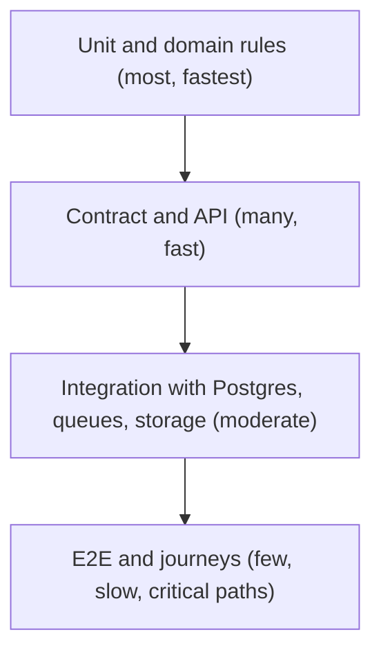

# QA and Test Strategy

Status: intended strategy for the complete TalentSphere product. Nothing here claims a test exists or passes. Today's measured state lives only in `ARCHITECTURE.md` and `docs/reports/`; the legacy [TESTING.md](../../docs/quality/TESTING.md) is input.

Evidence tags follow [CONVENTIONS](../00_START_HERE/CONVENTIONS.md). Numeric thresholds are `[PROP]` defaults tied to an `OD-` id in section 22.

## 1. Principles

1. Tests prove intended behavior from the blueprint, not accidental current behavior. [SRC: docs/quality/TESTING.md §1]
2. Business rules are tested where they live: `packages/domain` (pure functions and state machines). Routes are tested only for wiring, authz and contract shape. [SRC: CLAUDE.md Rules]
3. A passing test must be able to fail. Every new test is demonstrated failing against a deliberately broken implementation once (mutation or reverted fix) before merge. [DER]
4. Honesty tests are first-class: features labelled `ephemeral`, simulated scoring, stubbed providers and dev outboxes must be asserted as labelled, never as real. The existing `persistence-honesty` and `database-migrations` suites are protected and never weakened. [SRC: CLAUDE.md Rules]
5. A skipped, quarantined or weakened check is a finding with an owner, not a fix. [SRC: CLAUDE.md Reticle honesty rules]
6. Test environments never contain production personal data. [DER]

## 2. Stack mapping

| Layer | Tooling for this stack | Location (proposed) | Runs in |
|---|---|---|---|
| Unit / domain | Vitest | `packages/domain/**/*.test.ts` | local, CI PR |
| Component | Vitest + Testing Library (jsdom) | `apps/web/src/**/*.test.tsx` | local, CI PR |
| Contract | Vitest + Zod schemas from `packages/contracts` | `packages/contracts/**/*.test.ts` | CI PR |
| API integration (in-memory) | Vitest + Fastify `inject` | `apps/api/**/*.test.ts` | CI PR |
| Integration with Postgres | Vitest `test:pg` using `TEST_DATABASE_URL` | `apps/api/**/*.pg.test.ts` | CI PR (service container) |
| Migration | Ledger helper suite + apply-from-empty + upgrade-from-previous | `supabase/migrations`, `database-migrations` suite | CI PR |
| Security | Vitest security suite + SAST + dependency audit + DAST | `tests/security` | CI PR, nightly |
| End to end | Playwright | `tests/e2e` | CI merge, nightly, preview |
| Accessibility | axe via Playwright + manual audit | `tests/e2e/a11y` | CI merge |
| Performance | k6 or equivalent HTTP load; Lighthouse CI; web-vitals RUM | `tests/perf` | nightly, pre-release |
| Visual | Playwright screenshot comparison | `tests/e2e/visual` | CI merge |
| Chaos / resilience | Fault injection scripts against staging | `tests/resilience` | scheduled, pre-release |
| AI evaluation | Offline eval harness with golden sets | `tests/ai-eval` | per prompt/model change, nightly |

Tool names are `[PROP]` and replaceable through an ADR; the layer set is the requirement. Adding a test dependency touches `package.json` and is therefore an "ask first" action under the build-files rule. [SRC: AGENTS.md via CLAUDE.md]

## 3. Test pyramid

Target shape `[PROP]`: unit and domain roughly 60 percent of test count, contract and API 20, integration 12, E2E 5, other specialized 3. The shape is monitored as a metric (section 21), not enforced as a gate. `OD-QA-01`.

## 4. Layer specifications

### 4.1 Unit and domain tests

- Scope: every `BR-<MOD>-nnn` rule and every `SM-<MOD>-nn` transition has at least one test in `packages/domain`.
- Style: table-driven for rules (input, expected decision, expected reason code); transition matrix test for state machines asserting every allowed transition succeeds, every disallowed transition throws a typed error, and terminal states accept nothing.
- Determinism: clock, random and id generators are injected; no `Date.now()` in domain code under test.
- Property tests `[PROP]` for pure scoring, ranking, deduplication, matching and permission-resolution functions: invariants (monotonicity, idempotency, symmetric merge, no privilege escalation).
- Negative tests are mandatory: for each rule, at least one input on each side of every boundary.
- Coverage expectation: statement and branch coverage is reported per package; domain package floor `[PROP]` 90 percent branches; gate in section 13. `OD-QA-02`.

### 4.2 Component tests

- Every page has tests for loading, empty, error, populated and permission-denied states. [SRC: CODE_STYLE §4]
- Forms: required, invalid, server-error mapping, double-submit prevention, keyboard submission.
- No business rule assertions in component tests; they assert that the UI shows what the API/domain decided.

### 4.3 Contract tests

- Every request and response schema in `packages/contracts` has: a valid fixture, one invalid fixture per constraint, and an unknown-field fixture (rejected or stripped per the standard).
- API responses of every route are validated against the response schema in integration tests (response-shape test), so server drift fails CI.
- Backward-compatibility check: the contract diff job compares the PR's schemas to the base branch and fails on a breaking change within a published API version (removed field, narrowed type, new required request field). Breaking changes require a new version and an ADR. [DER]
- Public API and webhook payloads (module PLT) carry consumer-driven fixtures stored in `tests/contract-fixtures` and replayed on every change.
- Provider contracts (Stripe, Brevo, video, storage, background-check vendors) use recorded and sanitized fixtures plus a scheduled live sandbox smoke test that is allowed to fail without blocking PRs but opens a defect.

### 4.4 Integration tests with Postgres

- Run against a real Postgres of the same major version as production, created fresh per CI job, with all migrations applied from empty. [SRC: CLAUDE.md `pnpm test:pg`]
- Each test runs in a transaction or an isolated schema/database; no cross-test leakage. Parallel workers use separate databases.
- Mandatory classes: repository CRUD and constraint violations; uniqueness and foreign-key behavior; RLS policy tests proving a user of tenant A cannot read or write tenant B rows through every table that carries tenant or owner scope [SRC: CODE_STYLE §7]; optimistic-concurrency and idempotency-key behavior; `FOR UPDATE SKIP LOCKED` job claim with N concurrent workers executing each job exactly once [SRC: CLAUDE.md Worker; TESTING baseline notes duplicate execution]; outbox-to-worker delivery; retention sweep selection; full-text search ranking fixtures.
- A "persistence honesty" check asserts that every module marked durable has repository tests against Postgres and every module marked `ephemeral` is labelled so in API responses. [SRC: CLAUDE.md Rules]

### 4.5 Migration tests

1. Apply all migrations to an empty database: must succeed and produce the schema snapshot stored in the repo.
2. Upgrade test: restore the previous release's schema plus seeded data, apply new migrations, run smoke queries. Fails on data loss or long locks (lock-timeout probe, see doc 07/01 section on zero-downtime).
3. Idempotency and ordering: ledger helper verifies unique, contiguous, immutable filenames and that applied migrations are never edited. [SRC: `database-migrations` suite]
4. Expand/contract compliance: a lint rule rejects in a single migration both the addition of a new required column and its use, and rejects `DROP COLUMN`/type narrowing in the same release as the code change that stops using it. [DER]
5. RLS coverage check: every new table in a tenant-scoped schema has RLS enabled and at least one policy test. [DER]
6. Rollback/forward-fix rehearsal for risky migrations, recorded in the PR.

### 4.6 Security tests

- Authn/authz matrix test generated from the role permission matrices of each module: for every route and every canonical role, assert allow or deny exactly as the matrix states (deny by default). [DER]
- Token tests: HMAC session expiry, tampering, replay after logout/rotation, role flags from the client ignored. [SRC: CODE_STYLE §8]
- Tenant isolation tests (IDOR): for each resource route, request with another tenant's id returns 404 (not 403) with no existence leak.
- Rate-limit and lockout tests; the tests must not be weakened. [SRC: CLAUDE.md Rules]
- Input handling: injection corpora (SQL, XSS, header, path traversal, SSRF in URL-fetching features, CSV/formula injection in exports, prompt injection in AI inputs).
- Secrets: secret scanning in CI; test that logs and error bodies never contain tokens, passwords or raw DB errors.
- Webhook signature verification tests (Stripe and outbound webhooks), including replay with stale timestamp.
- File upload tests: type sniffing, size limit, malware-scan stub verdicts, polyglot files.
- Tool-availability honesty: the injection scan must fail, not pass, when its scanner is unavailable. [SRC: TESTING baseline note]
- Static: SAST, dependency audit (section 9 of doc 03 standards), container image scan, IaC scan, license check.
- Dynamic: authenticated DAST against preview on a schedule.

### 4.7 End-to-end tests (Playwright)

- Run against a built preview with a seeded Postgres, the worker running, and a labelled dev outbox for email.
- Browsers `[PROP]`: Chromium on every merge; Firefox and WebKit nightly; mobile viewport emulation (Chromium Pixel-class and WebKit iPhone-class) on every merge for the smoke suite. `OD-QA-03`.
- Each journey `JRN-*` has at least one E2E test; each release-tier exit criterion has a tagged journey suite (`@r1`, `@r2` ...).
- Rules: no fixed sleeps; wait on observable conditions; each test creates its own data via API fixtures and never depends on order; each test records trace, video on failure, and network log.
- Real-time features (MSG, notifications, live interview) use two browser contexts.
- Time-dependent flows (deadlines, expiries, retention) use an injectable server clock exposed only in non-production builds.

### 4.8 Accessibility tests

- Automated: axe on every route in every key state (empty, error, modal open); failures of `serious` or `critical` impact fail the build.
- Manual per release: keyboard-only walkthrough of top journeys; screen reader pass (NVDA with Firefox or Chrome, VoiceOver with Safari, TalkBack on Android) on registration, application, assessment-taking, course player, messaging; 200 percent zoom and 400 percent reflow check; reduced motion; forced colors; color-contrast spot check against tokens. Target conformance WCAG 2.2 AA `[PROP]`, `OD-QA-04`.
- Assessment-taking and video/interview surfaces have an accommodations test set (extra time, caption, alternative to proctoring) owned jointly with ASM.

### 4.9 Performance tests

- Budgets come from the NFR register (`NFR-PERF-*`, owned by the architecture documents); this strategy defines how they are tested, with `[PROP]` initial budgets in section 14.
- Types: baseline (single user), load (expected peak), stress (find breaking point), soak (long duration for leaks), spike (sudden burst, e.g. campus-wide assessment start), and endurance of worker queues.
- Web: Lighthouse CI budgets on key routes; RUM web-vitals sampled in production.
- Database: top-N query plan regression check (EXPLAIN snapshot on seeded volume) for list and search queries; fails when a sequential scan appears on a table above a threshold row count.
- Results are compared with the previous release baseline; a regression beyond tolerance fails the release gate.

### 4.10 Visual regression tests

- Playwright screenshots of design-system components in all states and a curated list of key pages in light and dark themes and three widths.
- Diffs above a threshold require explicit reviewer approval in the PR; baselines are updated only by reviewed commits, never automatically.
- Dynamic regions (timestamps, avatars) are masked by stable test ids.

### 4.11 Chaos and resilience tests

Executed in staging (never production without an approved game day). Each experiment has a hypothesis, blast radius, abort condition and expected observable behavior.

| Experiment | Expected behavior |
|---|---|
| Kill the API process mid-request | In-flight non-idempotent writes either commit once or not at all; client retry with idempotency key is safe |
| Kill a worker mid-job | Job lease expires and exactly one other worker completes it; side effects (email, webhook) not duplicated |
| Postgres primary failover or connection saturation | API returns canonical 503 with retry hint; no data corruption; recovery without restart |
| Email provider down or 429 | Messages queue with backoff and dead-letter; user-facing action unaffected; operator alert fires |
| Payment webhook delivered twice, out of order, or delayed | Entitlement state converges correctly; no double grant |
| Search index unavailable | Degrades to database search or shows labelled degraded state |
| Object storage error on upload and download | Resumable upload; no orphan metadata; clear error state |
| AI provider timeout or policy refusal | Feature falls back to non-AI path with honest label; cost cap respected |
| Clock skew between nodes | Tokens and scheduled jobs behave within defined tolerance |
| Region or zone loss (if multi-zone) | Restore within RPO and RTO targets (doc 07/01 section 17) |

### 4.12 Compatibility, localization and offline tests

- PWA: installability audit, service worker update flow, offline read of cached items, offline write queue replay and conflict resolution (module PWA).
- Localization: pseudo-locale run to detect hard-coded strings and truncation; right-to-left layout smoke test; date, number, currency and timezone formatting tests including DST boundaries. `OD-QA-05` decides the launch locale set.
- Browser extension (module PWA) has its own manifest, permission and content-script tests.

## 5. Test data strategy

1. **Synthetic only.** Fixtures are generated from factories (`buildCandidate`, `buildJob`, ...) with seeded random so runs are reproducible. No production dump is ever loaded into a lower environment. [DER]
2. **Personas.** A named persona set covers every canonical role in `CONVENTIONS` section 5, plus edge personas: user with 2,000 work-history items, user with unicode and very long names, minor-age-restricted account, suspended account, user with expired subscription, institution with 50,000 students, employer with 500 jobs.
3. **Layers.** `seed:minimal` (one of each role), `seed:standard` (realistic small world for E2E), `seed:volume` (performance, generated at scale with realistic skew), `seed:adversarial` (hostile strings, boundary values).
4. **Isolation.** Tests create their own tenant and clean up by tenant deletion; shared immutable reference data (skills taxonomy, countries) is loaded once.
5. **External services.** Emails go to the labelled dev outbox; payments use provider test mode with fixed test cards; background-check, video and AI providers use deterministic stubs in CI and sandboxes in scheduled smoke runs. Stubs are labelled so they cannot be mistaken for real results. [SRC: CLAUDE.md Stack]
6. **Privacy.** Data-subject rights tests (export, deletion, consent withdrawal) run against synthetic users and verify that every ENT with personal data is covered by the deletion and export maps.
7. **Secrets.** Test credentials are distinct from any real credential and rotated independently.
8. **Refresh.** Seed definitions are versioned with the migrations; a migration PR that changes schema updates seeds in the same PR.

## 6. Environments

| Environment | Purpose | Data | Who deploys | Tests run |
|---|---|---|---|---|
| local | developer loop | seed:minimal/standard | developer | unit, component, API, pg on demand |
| CI | every PR and merge | ephemeral Postgres, seed per suite | pipeline | all automated layers per gate |
| preview | per-PR full stack for review, UAT-lite, E2E | seed:standard, auto-destroyed | pipeline | E2E smoke, a11y, DAST baseline |
| staging | production-like, release candidate soak | seed:volume plus synthetic traffic | pipeline on release branch | full regression, performance, chaos, UAT |
| production | live | real | pipeline with approval | synthetic probes, canary checks, post-deploy smoke |

Staging parity rules: same Postgres major version, same worker count ratio, same CDN and auth settings, provider sandboxes, and feature flags mirroring the intended production flag state. Differences are listed in a parity register reviewed at each release.

## 7. Defect management

### 7.1 Severity (impact)

| Severity | Definition | Examples |
|---|---|---|
| S1 Critical | Data loss or corruption, security or privacy breach, cross-tenant exposure, payment error, total outage of a core flow, legal-compliance failure | Candidate sees another candidate's private evidence; double charge; deletion request ignored |
| S2 Major | Core flow broken for a user class with no workaround; wrong business-rule outcome | Applications cannot be submitted on mobile; assessment score miscomputed |
| S3 Moderate | Feature impaired, workaround exists; degraded performance within 2x budget | Filter returns wrong order; slow report |
| S4 Minor | Cosmetic or low-impact; copy errors; minor a11y issues that do not block use | Misaligned icon; typo |
| S5 Trivial | Suggestions, polish | Spacing tweak |

### 7.2 Priority (urgency)

`P0` fix now, stop-the-line; `P1` fix in current cycle before release; `P2` schedule within next planned cycles; `P3` backlog. Priority is set by product and engineering leads; severity by QA. S1 defaults to P0, S2 to P1, S3 to P2, S4 and S5 to P3. A severity or priority override is recorded with a reason.

### 7.3 Defect lifecycle

`New` -> `Triaged` -> `In progress` -> `In review` -> `Ready for verify` -> `Verified` -> `Closed`; side exits `Duplicate`, `Cannot reproduce` (needs evidence request, auto-close after the stale window in `OD-QA-06`), `Won't fix` (requires lead sign-off), `Deferred` (requires target release). A defect report minimally contains: environment and build id, steps, expected vs actual, evidence (screenshot, trace, request id), affected role and tenant, regression flag, linked FR/BR/TC ids.

### 7.4 Defect rules

- Every S1 and S2 production defect gets a regression test before closure and a root-cause note (escape analysis: which layer should have caught it).
- Security defects follow the confidential path (not in public trackers) and the SAD/security officer process in the 05 security documents.
- Defect SLAs `[PROP]`: S1 acknowledge in 1 hour and mitigate on the severity-1 incident clock (doc 07/02); S2 acknowledge within 1 business day. `OD-QA-06`.

## 8. Definition of ready (DoR)

A story or feature is ready for build only when all hold:

1. Linked `FR-` id exists with full template fields and a named priority/tier.
2. Every acceptance criterion is in Given/When/Then, includes a negative case, and has a proposed test layer.
3. All referenced `BR-`, `SM-`, `ENT-`, `EVT-` ids exist in the module spec.
4. Permissions per role are stated; abuse cases listed.
5. UI work has `SCR-` ids and states (empty, loading, error, denied) designed, with accessibility notes.
6. Open `OD-` items that block it are resolved or explicitly deferred with a default.
7. Analytics and observability events are named (doc 03 observability standard).
8. Data impact is stated: migrations, retention class, privacy review needed or not.
9. Dependencies are available or scheduled before it.
10. Test data needs identified.

## 9. Definition of done (DoD)

1. Code merged by review standard (doc 03 section 11) with all required checks green.
2. Every acceptance criterion maps to at least one passing automated test (or a recorded manual test with owner where automation is impossible, with reason).
3. Negative and permission tests included.
4. Contract changes versioned and documented; no breaking change inside a version.
5. Migrations follow expand/contract and pass migration tests.
6. Accessibility checks pass for changed UI; no new serious axe violations.
7. Observability: logs, metrics, traces, audit events and alerts for the feature exist as specified.
8. Documentation updated: module spec, API docs, runbook entry where operational impact exists, feature-status record.
9. Feature flag in place with its lifecycle record if rollout is gradual.
10. Security and privacy checklist completed; threat model note for new trust boundaries.
11. User-visible change verified in the running app (CLAUDE.md verification rule). The verification outcome is recorded as a verdict, never as "no fault". [SRC: CLAUDE.md Reticle]
12. No new flaky test, no skipped test without a linked defect.

## 10. Acceptance criteria to test traceability

### 10.1 Method

1. Each acceptance criterion in an `FR-` spec is given a stable id: `FR-<MOD>-<nnn>.AC<n>`, numbered in order of appearance. Negative criteria are suffixed in the trace as `.AC<n>-` when the criterion is the negative case.
2. Each automated test names the criterion(s) it proves in its title or metadata tag: `[FR-JOB-012.AC2]`. Vitest uses `describe`/`it` title prefix; Playwright uses `test.info().annotations` with type `ac`.
3. Business rules are traced the same way: `[BR-JOB-004]`; state machines `[SM-JOB-02:applied->withdrawn]`.
4. A generated report (script reading the module specs and a grep of test titles) produces the **traceability matrix**: rows = AC ids, columns = test layer, test file, last result, last run build.
5. Coverage views: AC coverage per FR, per module and per tier; BR coverage; SM transition coverage; journey coverage.
6. Orphan checks: a test tag referencing a nonexistent id fails the check; an AC with zero tests is a gap list entry.
7. Manual tests live in `tests/manual/<MOD>/` as numbered Markdown with the same tags and are included in the matrix with their last executed build.

### 10.2 Traceability matrix format

| AC id | Rule ids | Layer | Test location | Type | Last result | Last build |
|---|---|---|---|---|---|---|
| FR-JOB-012.AC1 | BR-JOB-004 | integration | `apps/api/jobs/apply.pg.test.ts` | positive | pass | build id |
| FR-JOB-012.AC3- | BR-JOB-004 | integration | same | negative | pass | build id |

Release gate G6 (section 13) requires 100 percent of `Must` ACs for features in the release tier to be mapped and passing, `Should` ACs mapped, and any gap on `Could` disclosed.

## 11. Exploratory testing

- Charter-based sessions of 60 to 90 minutes; a charter states mission, area, time-box, and risks to probe (for example "explore application withdrawal with concurrent recruiter action").
- Heuristics: SFDIPOT, CRUD per entity, boundary and interruption (network loss, back button, double submit, multi-tab, session expiry mid-form), role switching, locale and timezone, hostile input, slow device.
- Each release runs charters for every module changed plus a rotating set from the module catalogue; "fresh eyes" rule: the tester should not be the feature author.
- Output: session notes with findings, new test ideas, and defects; findings that reveal a missing automated test create a task to add it.
- Bug bash `[PROP]` before each tier exit: cross-functional, time-boxed, with a scoreboard for severity-weighted findings.

## 12. User acceptance testing (UAT)

1. Entry: release candidate on staging, all automated gates green, known-defect list published.
2. Participants by tier: R1 candidates (internal testers and a recruited beta cohort); R2 recruiter and hiring-manager pilot users; R3 instructor and institution admin pilots; R4+ domain reviewers (trust and safety, AI reviewers). `OD-QA-07` decides who is recruited.
3. Scripts: each UAT scenario is a journey with business-language steps and expected outcomes drawn from `JRN-*` and acceptance criteria; participants also have free-exploration time.
4. Capture: structured feedback form (task completed yes/no, difficulty, blockers), session recordings only with consent, defects entered with the defect template.
5. Exit: every Must journey completed by the agreed share of participants (`OD-QA-07` default `[PROP]` all participants complete without assistance for core loop), no open S1 or S2, product owner sign-off recorded in the release record.
6. Data used in UAT is synthetic except where participants test with their own consented data in an isolated beta tenant.

## 13. Release gates

Each gate is binary; override requires the named approver and is logged in the release record.

| Gate | Stage | Criteria | Override authority |
|---|---|---|---|
| G1 Commit | pre-merge PR | lint, format check, typecheck, unit, component, contract, in-memory API tests green; secret scan clean; no new `any`/ts-ignore without justification comment | none (blocking) |
| G2 Integration | pre-merge PR | `test:pg` green; migration suite green; RLS tests green; dependency audit has no new high/critical | engineering lead for audit false positives only, with record |
| G3 Merge | post-merge main | E2E smoke and tagged tier suite green on preview; axe has no serious violations; visual diffs approved; contract diff clean | engineering lead |
| G4 Candidate | release candidate on staging | full regression green; performance within budget (section 14); security DAST has no high; chaos set passed for changed areas; migration upgrade test on production-shaped data passed | QA lead and engineering lead jointly |
| G5 Readiness | pre-production | no open S1/S2; S3 list reviewed; UAT sign-off; runbooks updated; rollback plan and flag plan present; on-call briefed; change record approved | release manager |
| G6 Traceability | G4 or G5 | AC traceability complete per section 10 for the release scope | product owner for explicit waivers |
| G7 Post-deploy | after production deploy | synthetic probes green, canary metrics within thresholds, error budget not burning abnormally for the observation window | automatic rollback if breached |

AI-feature release adds gate G8 (section 16). Any release touching auth, billing, privacy or tenant isolation adds a mandatory security review sign-off (SAD).

## 14. Performance budgets (initial `[PROP]`, finalized by `OD-QA-08`)

| Area | Metric | Initial budget |
|---|---|---|
| API read endpoints | p95 latency at expected peak | 300 ms |
| API write endpoints | p95 latency | 600 ms |
| Search | p95 latency | 800 ms |
| Page | LCP p75 on mid-tier mobile over 4G profile | 2.5 s |
| Page | INP p75 | 200 ms |
| Page | CLS p75 | 0.1 |
| Initial JS per route | compressed | budget set per route in Lighthouse CI config |
| Worker | job queue age p95 for transactional email | 60 s |
| Error rate | 5xx share of requests | below 0.5 percent during load test |
| Availability | per `OD-` set SLO | defined in doc 07/01 |

Expected peak is a parameter, not a number we invent: `PERF_PEAK_RPS`, `PERF_CONCURRENT_USERS` are set by `OD-QA-08` from stakeholder volume assumptions.

## 15. Test case catalogue skeleton

Test-case ids: `TC-<GRP>-nnn`. Groups mirror the module groups in CONVENTIONS section 4. Each scenario is a named critical scenario; the module owner expands it into steps and traces it to AC ids. Layer codes: U unit/domain, C contract, I integration, S security, E e2e, A accessibility, P performance, R resilience. Priority is the scenario's regression tier: `Smoke` runs on every merge, `Core` in full regression, `Extended` in nightly.

### 15.1 Foundation (IDN, SET, NTF)

| Id | Scenario | Layer | Tier |
|---|---|---|---|
| TC-FND-001 | Register with email, verify email link once; reusing the link fails | E, I | Smoke |
| TC-FND-002 | Login lockout after repeated failures, unlock path, no user enumeration in messages | S, I | Core |
| TC-FND-003 | Session token tamper, expiry and post-logout replay all rejected | S, U | Core |
| TC-FND-004 | Password reset invalidates all existing sessions | I | Core |
| TC-FND-005 | Two-factor enrollment, challenge, recovery code single use | E, S | Core |
| TC-FND-006 | Role switch and tenant switch never leak previous context data | S, E | Core |
| TC-FND-007 | Consent withdrawal stops the dependent processing and emails within the defined window | I | Core |
| TC-FND-008 | Data export contains every personal-data entity in the export map; deletion request removes or anonymizes all and is idempotent | I | Core |
| TC-FND-009 | Notification preference opt-out suppresses marketing but never mandatory security notices | I, U | Core |
| TC-FND-010 | Email provider failure queues and retries without duplicate sends | R, I | Core |
| TC-FND-011 | Account deletion during an in-progress application keeps recruiter-side records per retention rule | I | Extended |
| TC-FND-012 | Age/minor restriction blocks restricted features | U, E | Core |

### 15.2 Career identity (PRF, EVD, BGV)

| Id | Scenario | Layer | Tier |
|---|---|---|---|
| TC-CID-001 | Create profile, add work history and skills, completeness score updates per rule | E, U | Smoke |
| TC-CID-002 | Visibility settings: private, recruiter-only and public views each show exactly the permitted fields | S, I | Smoke |
| TC-CID-003 | Employer verification request emails the verifier; one-time link verifies once; expiry rejected | I, S | Core |
| TC-CID-004 | Verified claim cannot be edited without reverting to unverified | U, I | Core |
| TC-CID-005 | Upload evidence file: type sniffing, size limit, malware verdict quarantine | S, I | Core |
| TC-CID-006 | Resume export renders all sections and respects hidden fields | E, I | Core |
| TC-CID-007 | Background check consent required before order; revoked consent blocks results display | I, S | Core |
| TC-CID-008 | Credential share link revoked takes effect immediately and expires on time | S, I | Core |
| TC-CID-009 | Duplicate employer or institution entity merge keeps verifications | I | Extended |
| TC-CID-010 | Profile with 2,000 items renders within the performance budget | P | Extended |

### 15.3 Platform (SRC, ANL, PWA, PLT)

| Id | Scenario | Layer | Tier |
|---|---|---|---|
| TC-PLT-001 | Search ranks exact and fuzzy matches per fixture; filters combine correctly | I | Smoke |
| TC-PLT-002 | Search results never include records the viewer may not see (visibility and block lists) | S, I | Smoke |
| TC-PLT-003 | Public API key scope enforcement and per-key rate limit | S, I | Core |
| TC-PLT-004 | Outbound webhook signed, retried with backoff, dead-lettered, replay by id idempotent | I, R | Core |
| TC-PLT-005 | Offline queue replays writes after reconnect with conflict resolution | E | Core |
| TC-PLT-006 | Service worker update does not strand users on an old incompatible API version | E | Core |
| TC-PLT-007 | Analytics report excludes data beyond viewer's tenant and applies k-anonymity threshold | S, U | Core |
| TC-PLT-008 | Large file upload resumes after interruption; orphan cleanup job removes abandoned parts | R, I | Extended |
| TC-PLT-009 | Search index outage degrades to labelled fallback | R | Core |
| TC-PLT-010 | Browser extension requests only declared permissions and clears data on sign-out | S, E | Extended |

### 15.4 Learning (LRN, STU, ASM)

| Id | Scenario | Layer | Tier |
|---|---|---|---|
| TC-LRN-001 | Enroll, consume lessons, progress persists across devices, completion triggers certificate once | E, I | Smoke |
| TC-LRN-002 | Enrollment entitlement enforced: unpaid or unassigned learner cannot fetch protected media | S, I | Smoke |
| TC-LRN-003 | Instructor publishes course: validation blocks publish with missing required lesson content | E, U | Core |
| TC-LRN-004 | Assessment timer enforces server-side deadline regardless of client clock | U, S | Core |
| TC-LRN-005 | Auto-graded scoring matches golden answer set; simulated scoring is labelled and cannot issue credentials | U, I | Smoke |
| TC-LRN-006 | Integrity signals (tab switch, copy-paste, plagiarism similarity) create review items, never silently fail a candidate | I, U | Core |
| TC-LRN-007 | Accommodation (extra time) applies to timer and is audit logged | U, I | Core |
| TC-LRN-008 | Code challenge runner sandbox blocks network and resource abuse, enforces CPU and memory limits | S, R | Core |
| TC-LRN-009 | Campus-wide simultaneous assessment start meets queue and latency budget | P | Extended |
| TC-LRN-010 | Course player works with keyboard only and with captions on | A, E | Core |
| TC-LRN-011 | Retake rule and attempt cap enforced concurrently (two tabs) | I | Core |

### 15.5 Hiring (JOB, ATS, INT, EMP)

| Id | Scenario | Layer | Tier |
|---|---|---|---|
| TC-HIR-001 | Employer posts a job, moderation passes, job appears in search and detail within the indexing budget | E, I | Smoke |
| TC-HIR-002 | Candidate applies once; duplicate and concurrent apply produce a single application | I | Smoke |
| TC-HIR-003 | Pipeline stage moves obey the state machine; invalid transition rejected with typed error | U, I | Smoke |
| TC-HIR-004 | Recruiter of employer A cannot read applications of employer B (IDOR) | S | Smoke |
| TC-HIR-005 | Candidate withdrawal while recruiter moves stage resolves to one consistent outcome | I | Core |
| TC-HIR-006 | Interview scheduling avoids double booking across calendars and timezones, DST boundary included | U, I | Core |
| TC-HIR-007 | Interview reschedule and cancel notify all parties once, update calendar invites | I | Core |
| TC-HIR-008 | Scorecard blind-review mode hides candidate identity fields until reveal | S, E | Core |
| TC-HIR-009 | Offer creation, approval chain, candidate accept and decline each emit the expected events | I | Core |
| TC-HIR-010 | Rejection email respects templates, opt-out class and does not leak other candidates | I, S | Core |
| TC-HIR-011 | Bulk action on 500 applications completes asynchronously with partial-failure report | I, P | Extended |
| TC-HIR-012 | Employer team role changes take effect immediately and are audited | S, I | Core |

### 15.6 Social (NET, MSG)

| Id | Scenario | Layer | Tier |
|---|---|---|---|
| TC-SOC-001 | Connection request, accept, withdraw and block produce consistent visibility everywhere | I, S | Smoke |
| TC-SOC-002 | Blocked user cannot message, view or find the blocker | S | Smoke |
| TC-SOC-003 | Message delivered in real time to two contexts, ordering preserved, offline delivery on reconnect | E, I | Core |
| TC-SOC-004 | Message report enters moderation queue with evidence snapshot | I | Core |
| TC-SOC-005 | Referral request, referral submission and attribution tracked once | I | Core |
| TC-SOC-006 | Message attachment passes malware scan before delivery | S, I | Core |
| TC-SOC-007 | Spam rate limit throttles repeated connection requests and DMs | S | Core |
| TC-SOC-008 | Community post edit and delete propagates to feeds and caches | I | Extended |
| TC-SOC-009 | Notification fan-out for a popular post stays within queue budget | P | Extended |

### 15.7 Intelligence (AIC, MKT)

| Id | Scenario | Layer | Tier |
|---|---|---|---|
| TC-ITL-001 | Recommendations exclude blocked, ineligible and already-applied jobs | I, U | Core |
| TC-ITL-002 | Matching explanation lists only factors actually used and omits protected attributes | U, S | Smoke |
| TC-ITL-003 | AI assistant refuses out-of-policy requests and shows the honest AI label | S, E | Core |
| TC-ITL-004 | Prompt injection in a resume or job description does not alter system behavior or exfiltrate other users' data | S | Smoke |
| TC-ITL-005 | AI provider timeout falls back to non-AI behavior with label, within latency budget | R | Core |
| TC-ITL-006 | Per-user and per-tenant AI cost caps stop calls and show a clear message | I, U | Core |
| TC-ITL-007 | Bias evaluation set shows score parity within threshold across demographic proxies | AI eval | Core |
| TC-ITL-008 | Market salary insight hides cells below minimum sample size | U | Core |
| TC-ITL-009 | Human override of an AI-assisted ranking is logged and respected on re-rank | I | Core |

### 15.8 Governance (TSF, ADM)

| Id | Scenario | Layer | Tier |
|---|---|---|---|
| TC-GOV-001 | Report content, moderator action, appeal and reversal follow the state machine and audit trail | I, E | Core |
| TC-GOV-002 | Support agent impersonation requires reason and consent, is time-boxed and fully audited | S, I | Smoke |
| TC-GOV-003 | Admin role cannot grant itself a higher role (no self-escalation) | S | Smoke |
| TC-GOV-004 | Admin audit log is append-only and tamper-evident | S, I | Core |
| TC-GOV-005 | Fraud signal (fake employer, duplicate identity) quarantines listing and notifies reviewers | I | Core |
| TC-GOV-006 | Feature flag and kill switch take effect within the propagation budget | I, E | Core |
| TC-GOV-007 | Legal hold prevents deletion sweep for the held subject | I | Core |
| TC-GOV-008 | Bulk admin action requires two-person approval where configured | S, I | Core |

### 15.9 Institutions (INS)

| Id | Scenario | Layer | Tier |
|---|---|---|---|
| TC-INS-001 | Bulk roster import validates rows, reports per-row errors, is idempotent on re-upload | I, E | Smoke |
| TC-INS-002 | Student sees only own institution cohorts; placement officer sees only permitted students | S | Smoke |
| TC-INS-003 | Cohort assignment of a course grants entitlements and removal revokes them | I | Core |
| TC-INS-004 | Placement drive: eligibility rules apply and ineligible students are excluded with reasons | U, I | Core |
| TC-INS-005 | Institution analytics respect minimum cohort size and student consent | S, U | Core |
| TC-INS-006 | Institution SSO and SCIM-style provisioning create, update and deactivate users correctly | I | Core |
| TC-INS-007 | Graduate transition keeps student data under personal ownership and detaches institution access | I | Extended |

### 15.10 Commercial (BIL)

| Id | Scenario | Layer | Tier |
|---|---|---|---|
| TC-BIL-001 | Checkout success webhook grants entitlement exactly once | I | Smoke |
| TC-BIL-002 | Duplicate, out-of-order and delayed webhooks converge to the same state | I, R | Smoke |
| TC-BIL-003 | Webhook with bad signature or stale timestamp rejected | S | Smoke |
| TC-BIL-004 | Plan upgrade, downgrade and cancel apply proration and entitlement changes at the specified moment | U, I | Core |
| TC-BIL-005 | Failed payment follows the dunning state machine and restricts features only after grace period | I | Core |
| TC-BIL-006 | Refund reverses entitlements and ledger entries | I | Core |
| TC-BIL-007 | Tax and currency rounding match fixtures | U | Core |
| TC-BIL-008 | Billing disabled mode (`BILLING_MODE=disabled`) shows no purchase paths and honest labeling | E | Smoke |
| TC-BIL-009 | Invoice access limited to billing admins of that organization | S | Core |

### 15.11 OS expansion (MEN, GIG, EVT, MKT, ENT)

| Id | Scenario | Layer | Tier |
|---|---|---|---|
| TC-OSX-001 | Mentor session booking respects availability, timezones and cancellation window | U, E | Core |
| TC-OSX-002 | Mentor payout or fee flow reconciles with ledger (if enabled) | I | Core |
| TC-OSX-003 | Gig contract milestone, escrow-like hold and release follow the state machine | U, I | Core |
| TC-OSX-004 | Gig dispute freezes release and routes to moderators with evidence | I | Core |
| TC-OSX-005 | Hackathon registration cap, team formation rules and submission deadline enforced server-side | U, I | Core |
| TC-OSX-006 | Event ticketing waitlist promotion under concurrent cancellations | I | Core |
| TC-OSX-007 | Internal mobility posting visible only to eligible employees; manager consent rules enforced | S, I | Core |
| TC-OSX-008 | Skills inference for enterprise is opt-in and employee-visible | S, E | Core |
| TC-OSX-009 | Career path recommendation cites sources and shows sample size caveat | U | Extended |

### 15.12 Engagement (REP)

| Id | Scenario | Layer | Tier |
|---|---|---|---|
| TC-ENG-001 | Points are awarded once per qualifying event even under retries | I | Smoke |
| TC-ENG-002 | Reputation cannot be inflated by self-referral or reciprocal farming patterns | U, S | Core |
| TC-ENG-003 | Badge award and revocation are audited and reflected on profile | I | Core |
| TC-ENG-004 | Leaderboards respect opt-out and privacy setting | S, E | Core |
| TC-ENG-005 | Streak calculation handles timezone change and DST | U | Core |
| TC-ENG-006 | Recognition cannot be bought where the rule forbids it | U, I | Core |

## 16. AI evaluation testing

Applies to every AI-backed capability (matching, recommendations, assistant, resume feedback, interview prep, question generation, summarization, moderation classifiers, skill inference).

1. **Golden sets.** Versioned sets of inputs with expected outputs or rubric scores, stored in `tests/ai-eval/<capability>/`. Each set has provenance, a license note, and an owner. Synthetic or consented data only.
2. **Offline evaluation harness.** Runs a candidate prompt, model or ranking change against the golden set and reports metrics: task accuracy or rubric score, precision and recall for classifiers, ranking quality (NDCG at k) for recommenders, refusal correctness, hallucination rate on grounded tasks (every factual claim must cite the profile or source data), latency and token cost per call.
3. **Safety and policy.** Red-team set per capability: prompt injection through user-controlled fields, jailbreaks, requests for protected-attribute inference, personal-data extraction about other users, harmful advice, defamation of named people. Pass criterion: zero policy violations on the Must red-team subset.
4. **Fairness.** Counterfactual pairs (same qualifications, varied names, gender markers, age proxies, institution prestige, nationality) must produce score differences within a tolerance parameter `AI_FAIRNESS_TOLERANCE` (`[PROP]` default: no statistically significant difference at the agreed significance level; `OD-QA-09`). Adverse-impact ratio is reported for any automated screening or ranking use.
5. **Regression gate G8.** No AI release without: golden-set metrics not worse than baseline beyond tolerance, red-team pass, fairness pass, cost within cap, a rollback prompt/model version, and the honest-labeling check (AI output is always labelled; simulated output is never presented as real).
6. **Determinism.** Evaluation uses fixed seeds, temperature settings recorded in the run, and repeated trials to bound variance; flaky evals are handled by the flaky policy with thresholds on mean and variance.
7. **Online monitoring.** Shadow mode and canary comparison before full rollout; production monitors for refusal rate, user override rate, thumbs feedback, cost per active user, drift in input distribution. Alerts per doc 07/02.
8. **Human review.** A sampled human-review queue grades outputs weekly (cadence name: weekly) with inter-rater agreement tracking; disagreements feed the golden set.
9. **Provider change.** Switching model or provider is treated as a change requiring the full gate, even when the API is unchanged.
10. **Transparency tests.** Explanations shown to users are verified to correspond to the factors actually used (TC-ITL-002).

## 17. Flaky test policy

1. **Definition.** A flaky test passes and fails on the same code and environment. Detected by automatic rerun in CI: a test that fails then passes on retry is recorded as a flake event, never silently ignored.
2. **Retries.** CI may retry a failed test once to collect evidence; a pass on retry still counts as a flake event and the build annotation shows it.
3. **Budget.** Flake rate is a tracked metric (section 21). Exceeding the threshold `[PROP]` for a suite blocks adding new tests to that suite until the rate recovers. `OD-QA-10`.
4. **Quarantine.** A flaky test may be moved to a quarantine list only with a linked defect, an owner, and a maximum quarantine duration by cadence (one release cycle `[PROP]`). Quarantined tests still run and report but do not gate. A test in quarantine beyond the limit is deleted only by explicit decision of the QA lead, with the coverage gap recorded.
5. **No hiding.** Quarantine is not allowed for security, tenant-isolation, migration or honesty tests; those must be fixed immediately.
6. **Root-cause categories.** Timing/wait, shared state, order dependence, external service, clock, concurrency, resource limits, test bug. Fix patterns documented in the testing guide; fixed-sleep is never an accepted fix.
7. **Hard failures are real.** A test that fails twice is treated as a product defect until proven otherwise.

## 18. Review of tests

- Test code is reviewed with the same rigor as product code; reviewers check that the assertion would fail for the wrong behavior, that negative cases exist, and that no assertion was loosened to pass.
- Deleting or weakening an assertion requires a note in the PR and approval from the QA lead or module owner. [SRC: CLAUDE.md honesty rule]
- Tooling that bypasses a test (skip, only, retries raised) is flagged by a CI lint.

## 19. Regression suite management

- Tiers: `Smoke` (minutes, every merge), `Core` (full regression on release candidate and nightly), `Extended` (nightly/weekly cadence).
- Every S1/S2 defect adds a regression test at the lowest layer that can reproduce it.
- Suite health review each quarterly health review (doc 07/03): remove duplicates, move over-tall E2E tests down the pyramid, retire tests for withdrawn features (the `FR-` id keeps its `Withdrawn` status).

## 20. Roles in quality

| Role | Responsibility |
|---|---|
| QA lead | owns this strategy, gates, metrics, flaky policy, release quality sign-off |
| Feature developer | unit, component, contract, integration tests for own change; DoD |
| Module owner | scenario catalogue for the module, AC traceability, exploratory charters |
| Security officer (`SAD`) | security test plan, DAST, pen-test coordination, security sign-off |
| Product owner | UAT sign-off, waiver decisions |
| Release manager | gate enforcement and release record |
| SRE/DevOps | performance and resilience environments, synthetic probes |

Team sizes are not specified here; one person may hold several roles.

## 21. Quality metrics

| Metric | Definition / formula | Use |
|---|---|---|
| AC coverage | ACs with at least one passing mapped test / total ACs in release scope | G6 |
| BR coverage | BR ids referenced by at least one passing test / total BR ids | health |
| SM transition coverage | tested transitions / total defined transitions | health |
| Test pass rate (main) | passing runs / total runs on main, excluding quarantined | health |
| Flake rate | flake events / total test executions per suite | policy |
| Mean time to detect (MTTD) | time from defect introduction (commit) to detection | process |
| Defect escape rate | production defects S1-S3 / (all defects found S1-S3) in the release | quality |
| Defect density | open defects by severity per module | triage |
| Defect age | median and p90 age of open defects by severity | process |
| Change failure rate | production changes needing rollback, hotfix or flag-off / total production changes | DORA |
| Lead time for changes | merge to production | DORA |
| Deployment frequency | production deploys per cadence period | DORA |
| Mean time to restore | detection to recovery for S1/S2 incidents | DORA |
| Pyramid ratio | test counts per layer | shape monitoring |
| Pipeline duration | p50 and p90 per gate | developer experience |
| Accessibility debt | open axe and manual a11y defects by severity | a11y |
| Mutation score `[PROP]` | killed mutants / total on `packages/domain` sample | test strength |
| Escape analysis completion | S1/S2 production defects with a regression test and root-cause note / total | learning |

Targets for these metrics are not invented here; baselines are measured over the first release cycle and then proposed via `OD-QA-11`.

## 22. Open decisions

| Id | Question | Options | Default proposal `[PROP]` | Decides | Blocks |
|---|---|---|---|---|---|
| OD-QA-01 | Pyramid ratio as monitored shape or enforced gate | monitor only / enforce | monitor only | QA lead, engineering lead | metric design |
| OD-QA-02 | Coverage floors | none / per package | 90 percent branch for domain; reported elsewhere | engineering lead | G1 |
| OD-QA-03 | Browser and device matrix | Chromium only / plus Firefox, WebKit, mobile | Chromium merge; others nightly | product owner, QA lead | E2E setup |
| OD-QA-04 | Accessibility conformance target | WCAG 2.1 AA / 2.2 AA | WCAG 2.2 AA | product owner, legal | a11y gates |
| OD-QA-05 | Launch locale set | English only / multiple | English first, i18n-ready | product owner | localization tests |
| OD-QA-06 | Defect SLAs and stale-report window | as proposed / custom | section 7.4 | QA lead, engineering lead | triage process |
| OD-QA-07 | UAT cohort composition and exit threshold | internal / external beta | internal plus consented beta, all complete core loop | product owner | UAT |
| OD-QA-08 | Performance budgets and expected peak load | section 14 / custom | section 14, peak set from stakeholder volumes | product owner, SRE | perf gates |
| OD-QA-09 | AI fairness tolerance and statistical test | as proposed / custom | agreed significance, parity within tolerance | AI lead, legal | G8 |
| OD-QA-10 | Flake thresholds and quarantine duration | as proposed / custom | one release cycle quarantine; threshold set after baseline | QA lead | flaky policy |
| OD-QA-11 | Targets for quality metrics | after baseline | propose after first release cycle | engineering lead | dashboards |

## 23. Risks

| Id | Risk | Mitigation |
|---|---|---|
| RSK-QA-01 | Tests pass while features are simulated or ephemeral (as the legacy baseline showed for assessment scoring) | honesty tests, labelled stubs, G8 and persistence honesty checks |
| RSK-QA-02 | Tenant-isolation regressions across many modules | generated authz matrix tests and RLS coverage check |
| RSK-QA-03 | E2E suite slow and flaky as product grows to 30 modules | pyramid discipline, tiering, flaky policy |
| RSK-QA-04 | AC traceability decays into paperwork | generated matrix, orphan checks, gate G6 |
| RSK-QA-05 | AI evaluation sets go stale or are biased | owners, weekly human sampling, fairness sets |
| RSK-QA-06 | Build-file restriction slows adding test tooling | batch tooling requests through an ADR and ask-first step |

## 24. Legacy trace

Informed by: [TESTING.md](../../docs/quality/TESTING.md) (layer list, honesty baseline), [SECURITY.md](../../docs/quality/SECURITY.md), [CODE_STYLE.md](../../docs/engineering/CODE_STYLE.md), CLAUDE.md rules (Vitest, `test:pg`, Playwright, honesty tests). Dropped: measured counts and the audit baseline as targets (they describe a past state, not intent). Added `[PROP]`: AI evaluation, chaos, visual, mutation testing, traceability generation, DORA metrics.
