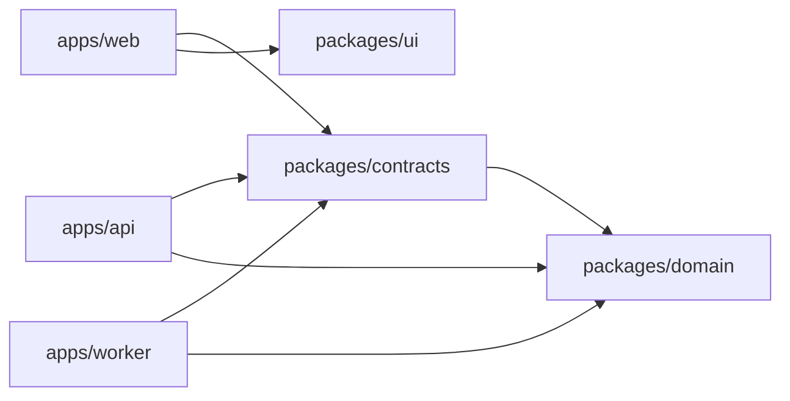
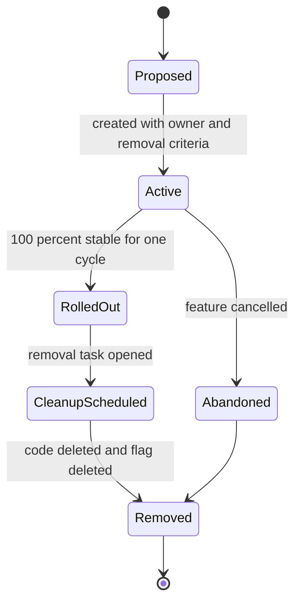

# Engineering Standards

Status: intended standards for building the complete TalentSphere product. Input: [CODE_STYLE.md](../../docs/engineering/CODE_STYLE.md) (v6.0), which remains authoritative for the rules it states; this document extends it and cites it as `[SRC: CODE_STYLE §n]`. Other inputs: [API_CONTRACTS.md](../../docs/engineering/API_CONTRACTS.md), [DATABASE.md](../../docs/engineering/DATABASE.md), [PROJECT_MAINTENANCE.md](../../docs/engineering/PROJECT_MAINTENANCE.md), CLAUDE.md rules. Evidence tags per [CONVENTIONS](../00_START_HERE/CONVENTIONS.md). Numeric thresholds are `[PROP]` with an `OD-ENG-` id in section 20.

Rule wording: MUST and MUST NOT are enforced by CI or review; SHOULD requires a written reason to deviate.

## 1. Repository and module structure

### 1.1 Monorepo layout `[SRC: CLAUDE.md Where things live]`

```text
apps/
  web/            React 19 + TypeScript + Vite PWA (pages, components, components/ui)
  api/            Fastify 5 modular monolith
  worker/         background_jobs consumer, email service, scheduled sweeps
packages/
  contracts/      Zod request/response/event schemas (single source of API shape)
  domain/         pure business rules and state machines, no I/O
  ui/             design tokens and primitives (tokens.ts)
supabase/migrations/   ordered SQL migrations
docs/              engineering, quality, governance, registries
PRODUCT_BLUEPRINT/ intended product specification
tests/             e2e, perf, security, resilience, ai-eval, manual (proposed)
```

### 1.2 Dependency direction (MUST)



- `packages/domain` MUST NOT import from apps, `pg`, Fastify, React, the network, the filesystem, or the clock directly. Time, randomness and ids are injected.
- `packages/contracts` MAY depend on domain types only for shared enums and state names; it contains no logic beyond schema refinement.
- `apps/web` MUST NOT import from `apps/api` or `apps/worker`. `apps/api` and `apps/worker` MUST NOT import from each other; shared logic moves to `domain` or `contracts`.
- Cycles are forbidden; a dependency-graph lint check enforces them in CI. [DER]

### 1.3 API module layout (modular monolith)

One folder per blueprint module code (for example `apps/api/src/modules/job/`) once the code is split out of `server.ts`:

```text
modules/<code>/
  routes.ts        thin: parse, authz, call use case, map result
  use-cases/       application orchestration, one file per use case
  repository.ts    persistence interface + pg implementation (or in-memory labelled ephemeral)
  adapters/        provider adapters (email, payment, storage, AI)
  events.ts        emitted events (EVT ids) and handlers
  index.ts         the only exported surface of the module
```

Rules:
- A module MAY call another module only through that module's `index.ts` exports or through domain events; it MUST NOT read another module's tables directly. [DER]
- Each module declares in its `index.ts` metadata: `persistence: "durable" | "ephemeral"`. Ephemeral modules MUST label responses as ephemeral. [SRC: CLAUDE.md Stack]
- Splitting `server.ts` into module folders is a refactor and needs approval before it happens. [SRC: CLAUDE.md "Ask before any big refactor"]

### 1.4 Web layout

- Pages in `apps/web/src/pages`, shared components in `apps/web/src/components`, primitives in `components/ui`; feature folders only when a feature has more than one page or shared hooks. [SRC: CLAUDE.md]
- Server state uses the small fetch helper; introducing a data-fetching library requires an ADR. [SRC: CLAUDE.md Stack]
- Routes are code-split by module group to meet the performance budget (doc 06/02 section 14).

### 1.5 File and symbol naming

- Files `kebab-case`; React component files `PascalCase.tsx` only if the repository convention already does so; consistency within a folder wins. [SRC: CODE_STYLE §2]
- Values and functions `camelCase`; components, classes and types `PascalCase`; true constants `UPPER_SNAKE_CASE`.
- Blueprint ids (`FR-`, `BR-`, `SM-`, `EVT-`, `ENT-`) appear in comments and test titles at the point of implementation: `// BR-JOB-004`. [DER]
- Event names `module.entity.action` in lowercase dot form matching the `EVT-` catalogue.
- Database objects `snake_case`; tables plural, primary keys `id`, foreign keys `<entity>_id`, timestamps `created_at`, `updated_at` as `timestamptz`.

## 2. Coding standards

### 2.1 TypeScript (MUST) `[SRC: CODE_STYLE §1]`

- `strict` on in every project; no `any` (use `unknown` plus narrowing); no non-null assertions on external input; `@ts-ignore` forbidden, `@ts-expect-error` allowed with a linked issue.
- Explicit types on exported functions and public module surfaces.
- Domain states are discriminated unions with an exhaustive `switch` helper (`assertNever`) so adding a state breaks compilation.
- External input (HTTP, queue payload, webhook, env, local storage, provider response) is parsed with Zod at the boundary and never trusted afterward.
- Money is integer minor units plus ISO 4217 currency; never floats. Timestamps are UTC `Date`/ISO strings; user timezone is a display concern only. Ids are opaque strings; the client never constructs them.

### 2.2 Layering (MUST) `[SRC: CODE_STYLE §3; CLAUDE.md Rules]`

| Layer | Allowed | Forbidden |
|---|---|---|
| Route | parse input, resolve actor, authorize, call a use case, serialize | restating business rules, SQL, provider calls |
| Use case | orchestrate repositories, domain rules, adapters, transactions, emit events | HTTP types, direct SQL strings |
| Domain | pure rules and state machines | I/O, time, randomness |
| Repository | SQL, row mapping, constraint-to-error mapping | business decisions |
| Adapter | provider SDK calls with timeout, retry, mapping to internal types | business decisions, leaking provider types |

### 2.3 Functions and complexity

- SHOULD: functions under about 50 lines and cyclomatic complexity under 10 `[PROP]`; deviations explained in review. `OD-ENG-01`.
- No boolean flag arguments that change behavior; split the function.
- No hidden global state; module-level singletons only for clients created at startup and injected.

### 2.4 Async and concurrency (MUST) `[SRC: CODE_STYLE §6]`

- Every external call has a timeout and cancellation (`AbortSignal`).
- Retries are bounded, use exponential backoff with jitter, and apply only to idempotent operations or operations carrying an idempotency key.
- Multi-step writes run inside one database transaction; side effects that leave the database (email, webhook, payment) go through the outbox and the worker, never inline after commit "hoping it works".
- Use optimistic concurrency (`version` column or `updated_at` precondition) for user-editable records edited concurrently, and return a typed conflict error.
- No unawaited promises (lint rule `no-floating-promises`).

### 2.5 React (MUST) `[SRC: CODE_STYLE §4]`

- Functional components and hooks; no business rules in JSX; derived decisions come from the API or `packages/domain`.
- Every data-bound view implements loading, empty, error and permission-denied states explicitly.
- Semantic HTML first, ARIA only when native elements cannot express the role; visible focus; every interactive element reachable and operable by keyboard; form errors announced and associated via `aria-describedby`.
- Design tokens only: no hard-coded colors, spacing or font sizes in feature code; use `packages/ui/src/tokens.ts`. [SRC: CLAUDE.md Style]
- No `dangerouslySetInnerHTML` without a sanitizer reviewed under the security standard.
- Side effects in `useEffect` are limited to synchronization with external systems; fetches use the shared helper with abort on unmount.
- Respect reduced-motion and color-scheme preferences.

### 2.6 Comments and readability

- Comments explain why, not what. A rule's `BR-` id and a link to its spec are enough documentation for the rule's intent.
- No commented-out code in merged changes. TODO comments MUST carry a tracker id.

### 2.7 Security coding rules (MUST NOT) `[SRC: CODE_STYLE §8]`

- Commit secrets; log tokens, passwords, session ids, full card data or raw personal data; trust client role flags; expose raw database errors; pass unrestricted user content to external providers (AI, email templates) without the redaction step defined by the privacy standard.
- Build SQL by string concatenation; always parameterize.
- Disable TLS verification, auth, rate limits or RLS to make a test or demo pass.

### 2.8 Formatting and lint

- Prettier is the formatter and `pnpm lint` is the Prettier check; ESLint rules in section 2 above (floating promises, no-explicit-any, exhaustive switch, import boundaries) are added through the build-file approval path. [SRC: CLAUDE.md Commands]
- Formatting changes MUST NOT be mixed into behavior PRs beyond the touched lines.

## 3. API and contract standards

Input: [API_CONTRACTS.md](../../docs/engineering/API_CONTRACTS.md). Group ids `API-<MOD>-nn` are defined per module.

### 3.1 Contract-first (MUST)

1. The Zod schema in `packages/contracts` is the single source of request and response shape. Routes parse with it; clients infer types from it.
2. OpenAPI documentation is generated from the schemas (`[PROP]` tooling); no hand-written drifting copy.
3. Response validation: in non-production the API validates its own responses against the schema; in production sampling `[PROP]` reports violations as errors.

### 3.2 URLs and methods

- Base path `/api/v1`. Resources plural nouns, kebab-case: `/api/v1/job-postings/{id}/applications`. [SRC: CLAUDE.md Where things live]
- Methods: `GET` safe and cacheable, `POST` create or action, `PUT` full replace, `PATCH` partial update (JSON merge semantics defined per resource), `DELETE` idempotent removal.
- Actions that are not CRUD use a sub-resource verb path `POST /applications/{id}/withdraw`; the verb maps to a state-machine transition.
- No verbs in collection paths; no deep nesting beyond two levels.

### 3.3 Versioning and compatibility (MUST)

- Major version in the path. Within a version only additive changes: new optional request fields, new response fields, new enum values only where the contract declares enums as open.
- Breaking changes (removal, rename, type change, new required input, tightened validation on existing field, changed semantics) need a new version and an ADR. The contract-diff CI job enforces this (doc 06/02 section 4.3).
- Deprecation uses `Deprecation` and `Sunset` response headers and the policy in doc 07/03 section 7.

### 3.4 Request and response conventions

- JSON, UTF-8, camelCase fields, ISO 8601 UTC timestamps, ids as strings.
- Create returns `201` with the resource and a `Location` header; accepted async work returns `202` with a job resource id.
- Mutations accept an `Idempotency-Key` header where retried delivery is plausible (applications, payments, messages, bulk imports); the server stores key, request hash and response for a bounded window `[PROP]` and replays the stored response; a different body with the same key returns `422 idempotency_key_reuse`. `OD-ENG-02` sets the window.
- Concurrency preconditions via `If-Match` with the resource version for editable resources; mismatch returns `412` with code `version_conflict`.
- Unknown request fields are rejected on mutations (strict schemas) so typos are not silently dropped.

### 3.5 Pagination, filtering, sorting

- Cursor pagination for all lists that can grow: `?limit=` (default 25, max 100 `[PROP]`) and `?cursor=`; response `{ items, nextCursor }`; the cursor is opaque and stable under inserts.
- Offset pagination is allowed only for small bounded admin tables.
- Filters are explicit allow-listed query parameters; sorting `?sort=field` or `?sort=-field` against an allow-list; unknown parameter returns `400 unsupported_parameter` rather than being ignored.
- Total counts are computed only on request (`?includeTotal=true`) because they are expensive.

### 3.6 Error format (MUST) `[SRC: CODE_STYLE §5]`

```json
{
  "error": {
    "code": "application.duplicate",
    "message": "You already applied to this job.",
    "requestId": "req_...",
    "details": [{ "field": "jobId", "issue": "duplicate" }]
  }
}
```

- `code` is a stable dotted machine code from a central registry; `message` is safe for display and never contains internals; `requestId` is always present and equals the log correlation id.
- HTTP status mapping: `400` malformed or failed validation, `401` unauthenticated, `403` authenticated but not permitted, `404` not found or hidden for isolation, `409` state conflict, `410` gone, `412` precondition failed, `413` too large, `422` semantic violation of a business rule, `429` rate limited with `Retry-After`, `500` unexpected, `502/504` upstream failure, `503` dependency down with `Retry-After`.
- Cross-tenant and invisible resources return `404`, not `403`.
- Validation errors list every failing field in one response.

### 3.7 Authentication and authorization

- Session tokens as defined in `packages/domain/src/auth.ts`; scopes for service principals.
- Every route declares its required permission explicitly in route metadata; a route without declaration fails the boot-time check (deny by default). The authz matrix test (doc 06/02 section 4.6) is generated from these declarations.
- Authorization is evaluated in the use case with actor, resource and tenant; client-supplied role flags are ignored.

### 3.8 Rate limiting and abuse controls

- Default per-actor and per-IP limits with stricter limits on authentication, messaging, search export and AI endpoints; limits are configuration, not code. Responses include `RateLimit-*` headers.
- Limits and lockouts MUST NOT be weakened to pass tests. [SRC: CLAUDE.md Rules]

### 3.9 Events and webhooks

- Domain events are schemas in `packages/contracts`, named per the `EVT-` catalogue, carrying `eventId`, `occurredAt`, `actor`, `tenantId`, `schemaVersion`, `payload`.
- Event schema evolution follows the same additive rule; consumers MUST ignore unknown fields.
- Outbound webhooks are signed (HMAC with timestamp), retried with backoff, idempotent by event id, and documented with fixtures.

## 4. Database and migration standards

Input: [DATABASE.md](../../docs/engineering/DATABASE.md), `docs/engineering/HOSTED_SUPABASE_MIGRATION_GATE.md`.

### 4.1 Schema rules (MUST)

- Constraints over application-only assumptions: `NOT NULL`, `CHECK`, `UNIQUE`, foreign keys with explicit `ON DELETE` behavior. [SRC: CODE_STYLE §7]
- Every table has `id`, `created_at`, `updated_at`; tenant-scoped tables have `tenant_id` (or equivalent owner column) with an index and RLS.
- Enumerations: Postgres enums or lookup tables with `CHECK`; adding a value is additive, removing is a contract change.
- Soft delete (`deleted_at`) only where the retention class requires recoverability; otherwise hard delete with audit event. Personal-data tables declare a retention class matching the module `ENT-` entry.
- Indexes justified by a query; a migration adding an index states the query it serves. Large-table index creation uses `CREATE INDEX CONCURRENTLY` in its own migration.
- JSONB only for genuinely schemaless payloads with a Zod schema; queryable fields get columns.
- No business logic in triggers except integrity (timestamps, audit capture); business rules stay in `packages/domain`. [SRC: CLAUDE.md Rules]

### 4.2 Migration files (MUST)

- Location `supabase/migrations`, applied by `pnpm db:migrate`; names ordered and immutable once merged; an applied migration is never edited, a fix is a new migration. [SRC: `database-migrations` suite]
- One logical change per migration; each runs in a transaction unless it uses `CONCURRENTLY`.
- Every migration PR contains: the SQL, the schema snapshot update, seed updates, and RLS policy tests for new or changed policies. [SRC: CODE_STYLE §7]
- No ad hoc production schema edits; emergency changes still land as a migration afterwards within the same incident. [SRC: CODE_STYLE §7]
- Migrations set `lock_timeout` and `statement_timeout` to prevent long blocking `[PROP]`; values `OD-ENG-03`.

### 4.3 Expand and contract (MUST)

Destructive or incompatible changes are split across releases:

1. **Expand:** add nullable column/new table/new index; deploy code that writes both and reads old.
2. **Migrate:** backfill in batches through a worker job (bounded batch size, resumable, idempotent), monitored.
3. **Switch:** deploy code that reads new.
4. **Contract:** after a full release cycle with no reads of the old shape, drop it in a separate migration.

Never in one release: rename a column, change a type in place, add `NOT NULL` without default to a populated table, drop a used column.

### 4.4 Data access

- Queries parameterized; repositories return domain-shaped objects; no `SELECT *` in production code; N+1 queries are defects, detected by query-count assertions in integration tests for list endpoints.
- Transactions are short; no network calls inside a transaction.
- Raw database errors are mapped to canonical error codes at the repository boundary.
- Background job claiming uses `FOR UPDATE SKIP LOCKED` with lease expiry and attempt counters; handlers are idempotent. [SRC: CLAUDE.md Worker]

### 4.5 RLS and tenancy

- RLS enabled on every table that holds user or tenant data; policies written deny-by-default; policy tests prove cross-tenant denial for read, insert, update and delete. [SRC: CLAUDE.md Rules]
- Service roles bypassing RLS are used only by the worker and migrations, never by request-handling code paths acting for a user.

## 5. Review process

### 5.1 Pull request requirements

- Small, single-purpose PRs; size guideline `[PROP]` under 400 changed lines excluding generated files and lockfiles; larger changes need a split plan or reviewer agreement. `OD-ENG-04`.
- PR description states: linked `FR-`/`BR-` ids, what changed, how it was verified (including Reticle verdict for user-visible changes), risk and rollback, migration and flag notes.
- Behavior-changing PRs update: tests, analytics events, docs, migration, feature status record and ADR where material. [SRC: CODE_STYLE §10]
- Build files (`package.json`, lockfiles, `tsconfig*`, `vite*`/`vitest*`/`playwright.config.*`, `.github/`, `deploy/`, Dockerfiles, Prettier and git ignore files) are read-only for AI agents and require human owner approval for anyone. [SRC: CLAUDE.md Rules]

### 5.2 Review checklist (reviewer MUST confirm)

1. Matches the FR spec and acceptance criteria; negative cases covered.
2. Business rules only in `packages/domain`; routes thin.
3. Authz explicit; tenant isolation preserved; no new unauthenticated route.
4. Input validated at the boundary; errors use canonical codes.
5. Migration safe (expand/contract, locks, RLS tests).
6. Observability and audit events present; no sensitive data in logs.
7. Tests would fail if the behavior broke; no weakened assertions.
8. Accessibility for UI; tokens used.
9. Dependencies justified (section 9).
10. Docs and flags updated.

### 5.3 Approvals

| Change type | Required approvals |
|---|---|
| Ordinary code | 1 reviewer who did not author, plus CODEOWNER for touched paths |
| Auth, session, permissions, RLS, rate limits | CODEOWNER plus security officer (`SAD`) review |
| Migrations | CODEOWNER plus a second engineer who has read the SQL |
| Billing and entitlements | CODEOWNER plus finance-aware reviewer (`FIN` representative) |
| Privacy-affecting (new personal data, retention, sharing) | privacy reviewer sign-off |
| AI behavior | AI evaluation gate G8 plus owner approval |
| Build files, CI, deploy | repository owner (human) |
| Public API/contract breaking change | ADR approved by architecture owner |

CODEOWNERS is maintained per path; reviewer count minimums are parameters (`OD-ENG-04`), not invented headcount.

### 5.4 Review conduct

- Review turnaround expectation `[PROP]`: first response within one business day. Authors do not self-merge except documented emergency (section 6.5). Disagreements are resolved by the CODEOWNER; unresolved architectural disagreements go to an ADR.

## 6. Branching and release policy

### 6.1 Branching

- Trunk-based: `main` is always releasable. Short-lived branches `type/short-description` (`feat/`, `fix/`, `chore/`, `docs/`, `refactor/`), merged by squash after required checks. `[PROP]`
- Branch protection on `main`: required status checks (G1, G2 from doc 06/02), required reviews, no force push, linear history, signed commits optional `OD-ENG-05`.
- Release branches are cut only if a release needs stabilization; otherwise releases are tags on `main`.

### 6.2 Commits

- Conventional commit style `[PROP]`: `type(scope): summary` with module code as scope, for example `feat(job): add application withdrawal`. Body explains why; footer links ids. Attribution lines follow the session policy when an agent commits.
- Agents and developers do not commit or push unless asked. [SRC: CLAUDE.md Rules]

### 6.3 Versioning

- The product release identifier is a build id plus a tag; the public API has its own major version (section 3.3). Semantic versioning for published packages and SDKs.
- A changelog entry (user-facing and operator-facing) is generated from merged PR labels.

### 6.4 Release flow

1. Merge to `main` triggers build, test, deploy to staging.
2. Release candidate is promoted by tag; gates G4 to G6 evaluated (doc 06/02 section 13).
3. Production rollout by canary or flags (doc 07/01 section 13), then G7.
4. Release record lists scope (FR ids), flags, migrations, risks, rollback plan, approver.

### 6.5 Hotfix and emergency

- A hotfix branches from the production tag, carries the minimal fix plus a regression test, is reviewed by one CODEOWNER at minimum, and merges back to `main` the same day by cadence name "same working cycle". Skipped checks require incident commander approval and are recorded; a post-incident review follows.

## 7. Architecture Decision Records (ADR)

Location `docs/engineering/adr/` (existing: ADR-015, ADR-016). [SRC: docs/engineering/adr]

### 7.1 When an ADR is required

New or changed: data store, queue, search engine, major library or framework, auth mechanism, tenancy model, public API version, cross-module contract, AI provider or model family, hosting provider, deployment topology, retention or privacy policy, anything that is expensive to reverse.

### 7.2 Template

```markdown
# ADR-nnn: Title
Status: Proposed | Accepted | Superseded by ADR-xxx | Rejected | Deprecated
Context: forces, constraints, linked ODs/DECs
Decision: what we will do, in the active voice
Options considered: each with pros, cons, cost of reversal
Consequences: positive, negative, follow-up work, migration plan
Verification: how we will know it worked (metric or test)
Review trigger: the condition that makes us revisit it
```

### 7.3 Rules

- ADR numbers are never reused; superseded ADRs stay and link forward.
- A decision made by the stakeholder is recorded as `DEC-nnn`; an ADR may cite it.
- Proposed ADRs are discussed in a PR; accepted by the architecture owner; implementation PRs link the ADR.
- ADRs state evidence, not documentation claims of "implemented"; see feature status reports. [SRC: CLAUDE.md Rules]

## 8. Documentation as code

1. Docs live in the repository, are reviewed in PRs, and are Prettier-formatted Markdown with relative links. [SRC: CONVENTIONS §10]
2. Generated artifacts (registers in `09_REGISTERS`, OpenAPI, traceability matrix, schema snapshot, event catalogue) are produced by scripts from sources and are never hand-edited. A CI check fails when a generated file is stale.
3. Link and anchor check runs in CI; broken relative links fail G1. Mermaid blocks are rendered by a syntax check.
4. Each module spec is the source of truth for intent; code comments carry ids only. A PR that changes behavior updates the module spec or opens an `OD-` explaining why it diverges. [SRC: CODE_STYLE §10]
5. Status honesty: documents distinguish intended from built; only `ARCHITECTURE.md` and feature-status reports state what is built; no feature is called implemented from documentation. [SRC: CLAUDE.md Rules]
6. Documentation ownership: each doc names an owner role in its header; unowned docs are listed in the quarterly health review (doc 07/03).
7. Runbooks, ADRs, and public API docs have "last verified" metadata updated when re-verified, not merely edited.
8. Doc types: reference (specs), how-to (runbooks), explanation (ADRs), tutorial (onboarding).
9. No secrets, personal data, or customer names in docs or examples; examples use synthetic data.

## 9. Dependency policy

### 9.1 Adding a dependency (MUST)

A PR adding or upgrading a runtime dependency states: purpose, alternatives considered (including writing it ourselves), maintenance health (release cadence, issue response, maintainers count), license, size impact (bundle for web), security history, transitive count. Changes to `package.json` and lockfiles require the repository owner's approval. [SRC: CLAUDE.md Rules]

### 9.2 Rules

- Licenses: allow-list (permissive: MIT, BSD, Apache-2.0, ISC) `[PROP]`; copyleft or unknown licenses blocked by the license check pending legal review. `OD-ENG-06`.
- Pin exact versions through the lockfile; package manager version pinned (pnpm per `package.json`). [SRC: CLAUDE.md Commands]
- Minimize: prefer platform features and existing dependencies; each new one must beat "write 30 lines". [SRC: CODE_STYLE §9]
- No dependencies fetched at runtime from CDNs for application code.
- Vulnerability handling: audit on every PR and nightly; severity response targets `[PROP]`: critical and high exploitable within one working cycle, moderate scheduled, with exceptions documented and time-boxed. `OD-ENG-07`.
- Supply chain: lockfile integrity check, install scripts disabled unless allow-listed, SBOM generated per release, provenance attestation for build artifacts `[PROP]`.
- Upgrades follow the cadence and process in doc 07/03 section 4.
- Abandoned dependency (no maintenance, unresolved security issue) triggers a replacement task tracked as tech debt.

## 10. Feature flag lifecycle

### 10.1 Flag types

| Type | Purpose | Max life |
|---|---|---|
| Release | hide incomplete or risky work, gradual rollout | until fully rolled out plus one release cycle, then removed |
| Experiment | A/B tests | until decision, then removed |
| Ops / kill switch | disable a feature or provider quickly | permanent, documented in runbook |
| Entitlement | plan-based access | not a flag; modeled in the billing module (BIL) |
| Permission | role access | not a flag; modeled in authorization |

### 10.2 Lifecycle



### 10.3 Rules

- Every flag has: name `area.feature.purpose`, type, owner, creation date, description, default value, removal criteria, linked `FR-` id, and expiry review cadence.
- Default off in production for new release flags; staging mirrors intended production state.
- Evaluation server-side for anything security- or entitlement-sensitive; the client never decides access.
- Flags have a bounded number of combinations in tests: the CI runs the default config and the "all release flags on" config.
- Stale flag report in the quarterly health review; a release flag older than two release cycles after full rollout is a defect.
- Changing a production flag is a change under doc 07/02 change management and is audit logged.
- Flag evaluation failure behavior is explicit: fail closed for risky features, fail open for kill-switch semantics defined per flag.

## 11. Observability instrumentation standard

Input: [OPERATIONS.md](../../docs/quality/OPERATIONS.md) critical trace `request -> user -> tenant -> feature -> API -> DB/queue -> provider -> result`.

### 11.1 Correlation (MUST)

- Every request gets `requestId` (accept inbound if valid, otherwise generate) propagated through logs, error responses, queue payloads, outbound provider calls, and worker jobs. [SRC: CODE_STYLE §5]
- Trace context (W3C `traceparent`) propagates web to API to worker to provider; span names `module.useCase`.

### 11.2 Logs

- Structured JSON, one event per line. Required fields: `timestamp`, `level`, `service`, `env`, `release`, `requestId`, `traceId`, `module`, `event`, `actorRole`, `tenantId`, `durationMs` where applicable. Actor and tenant are ids, never names or emails.
- Levels: `error` (needs action), `warn` (unexpected but handled), `info` (business and lifecycle events), `debug` (off in production by default).
- MUST NOT log: tokens, passwords, secrets, full request bodies of sensitive endpoints, personal data beyond ids, raw provider payloads containing personal data. A redaction layer and a log-scan test enforce this. [SRC: CODE_STYLE §8]
- Sampling only for high-volume `info`/`debug`; errors are never sampled out.

### 11.3 Metrics

- RED for every route: rate, errors, duration histograms labelled `module`, `route`, `method`, `status_class` (low cardinality; never user id or full URL).
- USE for resources: Postgres connections and saturation, worker concurrency, queue depth and oldest-job age.
- Business metrics per module use names `ts_<module>_<entity>_<action>_total`; every module's metrics table (module spec section 12) maps to an emitted metric.
- Provider metrics: call count, latency, error and timeout rate, cost units (AI tokens, SMS segments, emails).
- SLIs per capability feed SLO definitions in doc 07/01.

### 11.4 Traces

- Spans around DB queries (statement fingerprint only, no parameters), outbound calls, queue enqueue and job execution, cache operations.
- Sampling: head-based baseline `[PROP]` with always-sample on errors and slow requests.

### 11.5 Audit events

- Security-relevant and business-critical actions (auth events, permission changes, data export and deletion, impersonation, moderation decisions, payment and entitlement changes, admin overrides, verification outcomes) emit append-only audit records with actor, target, action, reason, before/after summary, requestId.
- Audit storage is separate from application logs, has restricted write path and tamper-evidence, and its retention is a security parameter. (Defined in 05 security documents.)

### 11.6 Product analytics

- Events named `module.entity.action` matching `EVT-` where the event is also a domain event; client-side events are in a typed catalogue in `packages/contracts`.
- No personal data in event properties beyond ids; consent state gates non-essential analytics. [SRC: CODE_STYLE §10 requires analytics updates in PRs]

### 11.7 Frontend

- Real user monitoring for web-vitals; client error reporting with release and route, scrubbed of personal data; unhandled-rejection handler; user-visible errors display the `requestId` for support.

### 11.8 Alerts

- Alerts are symptom-based (user impact, SLO burn) first, cause-based second. Each alert has an owner, severity, runbook link, and a test (fire drill). Alert list per [OPERATIONS.md](../../docs/quality/OPERATIONS.md) section 4 is the minimum.
- Noise budget: an alert that fires without action twice in a cycle is tuned or deleted in the health review.

## 12. Error handling standard

Input: [CODE_STYLE §5](../../docs/engineering/CODE_STYLE.md).

1. **Typed errors.** Domain and use-case code throws or returns instances of `AppError` with `code`, `httpStatus`, `safeMessage`, `retryable`, `details`; never strings. A central registry lists all codes; adding a code updates the registry and docs.
2. **Result vs throw.** Expected business outcomes (validation failure, rule rejection, conflict) are explicit return values or typed errors handled by the route mapper; unexpected failures are exceptions.
3. **Boundary mapping.** The route error handler is the only place that converts errors to HTTP responses: unknown errors become `500 internal_error` with `requestId` and no internals; database errors are mapped to `409/422/500` by constraint name; provider errors to `502/503/504` with provider detail only in logs.
4. **Preserve context.** Wrap with `cause`; keep `requestId` through async paths including worker jobs.
5. **Retry semantics.** `retryable: true` only for transient failures; clients and workers may retry only those and only with idempotency.
6. **Worker failures.** Job failures record attempt count, last error code, and next-run time; after the attempt limit the job goes to `dead` status, raises an alert, and is replayable by an operator with audit. Poison messages never block the queue.
7. **Graceful degradation.** Optional dependencies (search, recommendations, AI) failing produce a labelled degraded response rather than failing the primary action.
8. **User-facing errors.** Messages say what happened, what the user can do next, never blame the user, and never include internals; every error screen offers a retry or a path forward and shows the `requestId`. Accessibility: errors announced via live region.
9. **Never swallow.** Empty `catch` blocks are forbidden; a caught error is handled, mapped, or logged with context and rethrown.
10. **Fail closed.** Authorization or integrity check failures deny rather than proceed.
11. **Timeouts everywhere.** Default outbound timeout parameter per adapter, documented; `OD-ENG-08` for values.

## 13. Security and privacy engineering hooks

Detailed controls live in `05_SECURITY_PRIVACY`; engineering obligations here:

- Threat-model note in the PR for a new trust boundary, new external integration, or new personal-data class.
- Data classification label on every `ENT-` and field (public, internal, personal, sensitive, secret) drives logging, export and deletion.
- Secrets are only read from the secrets manager through config (doc 07/01 section 9), never from code or committed files.
- Privacy by default: new profile or sharing features default to the most private visibility.
- Deletion and export maps updated whenever a table with personal data is added.

## 14. Performance engineering rules

- Budgets in doc 06/02 section 14. PRs touching list queries include the query plan on volume seed data.
- Web: code-split by route, images responsive and lazy, no layout shift from late content, virtualization for lists over a threshold `[PROP]`.
- API: no unbounded queries, mandatory `limit`, projection of needed columns, caching only with explicit invalidation owner.
- Worker: batch size and concurrency are configuration; long jobs checkpoint progress.

## 15. Testing obligations (summary)

Tests per layer follow doc 06/02. In this standard: every `BR-` has a domain test, every `SM-` transition is tested, every route has an authz test and a response-contract test, every migration has a migration test, every user-visible change has a verified run in the app (verdict, not "no fault"). [SRC: CLAUDE.md Reticle]

## 16. Internationalization and accessibility engineering

- All user-visible strings come from message catalogs with ICU plural and gender-neutral patterns; no string concatenation for sentences; locale-aware formatting through one utility.
- Layout tolerant of 40 percent text expansion and RTL mirroring (logical CSS properties).
- Accessibility acceptance is part of DoD: keyboard, focus order, labels, contrast from tokens, motion preferences. Conformance target `OD-QA-04`.

## 17. Definition of Done (engineering)

A change is done only when every item is true (this is the engineering view of the DoD in doc 06/02 section 9):

1. Implements the FR acceptance criteria including negative cases; ids referenced in code and tests.
2. Business rules live in `packages/domain`; routes thin; layering respected.
3. All required CI checks green: lint (Prettier), typecheck, unit, contract, integration (`test:pg` when persistence touched), migration, security, e2e smoke for user-visible flows.
4. Contracts additive or versioned with ADR; OpenAPI regenerated.
5. Migration follows expand/contract with RLS tests and seed updates; rollback or forward-fix plan noted.
6. Authz explicit and tested; tenant isolation verified; no weakened auth, RLS, rate limits or honesty tests.
7. Observability in place: logs, metrics, traces, audit events, alert and runbook updates where operational impact exists.
8. Accessibility and design-token compliance verified.
9. Feature flag created with lifecycle record if gradual; stale flags removed.
10. Documentation updated (module spec, API docs, ADR, feature status) and generated artifacts regenerated.
11. Reviewed per section 5; approvals per change type.
12. User-visible change verified in the running app with a recorded verdict before reporting done. [SRC: CLAUDE.md]
13. No new debt without a tracked item (doc 07/03 section 5).
14. No secrets, personal data, or commented-out code introduced.

## 18. Working agreements for AI agents in the repository

- Follow AGENTS.md and CLAUDE.md. Keep changes small; ask before a big refactor; do not touch build files; do not commit or push unless asked; do not claim a feature implemented from documentation. [SRC: CLAUDE.md]
- Verify user-visible changes in the running app; report `unknown` and `no-fault` honestly.
- Document, don't silently resolve: conflicts between sources become `OD-` entries.

## 19. Compliance with CODE_STYLE

| CODE_STYLE section | Extended here |
|---|---|
| §1 TypeScript | 2.1 |
| §2 Naming | 1.5 |
| §3 Structure | 1.3, 2.2 |
| §4 React | 2.5 |
| §5 Errors | 3.6, 12 |
| §6 Async | 2.4 |
| §7 Database | 4 |
| §8 Security | 2.7, 13 |
| §9 Abstraction | 9.2, 1.4 (no premature abstraction; shared abstractions need an owner and tests) |
| §10 PR rule | 5.1, 8.4 |

Where this document and CODE_STYLE differ, CODE_STYLE governs until an ADR amends it.

## 20. Open decisions

| Id | Question | Options | Default proposal `[PROP]` | Decides | Blocks |
|---|---|---|---|---|---|
| OD-ENG-01 | Function size and complexity thresholds | advisory / lint-enforced | advisory, lint warning | engineering lead | lint config |
| OD-ENG-02 | Idempotency key retention window | hours / days | days, set by longest client retry horizon | architecture owner | API standard |
| OD-ENG-03 | Migration lock and statement timeouts | strict / lenient | strict lock timeout, per-migration override with note | DB owner | migration tooling |
| OD-ENG-04 | PR size guideline and minimum reviewer count | as proposed / custom | under 400 lines; one non-author reviewer plus CODEOWNER | engineering lead | branch protection |
| OD-ENG-05 | Signed commits required | yes / no | no initially | security officer | branch protection |
| OD-ENG-06 | License allow-list | permissive only / case by case | permissive only | legal, engineering lead | license check |
| OD-ENG-07 | Vulnerability response targets | as proposed / custom | section 9.2 | security officer | dependency gate |
| OD-ENG-08 | Default outbound timeouts per adapter class | tune after baseline | set from measured provider p99 | architecture owner | adapters |
| OD-ENG-09 | Split `server.ts` into module folders and timing | now / when first module outgrows it | defer until needed; requires approval | architecture owner | module layout |

## 21. Risks

| Id | Risk | Mitigation |
|---|---|---|
| RSK-ENG-01 | Single `server.ts` grows to unmaintainable size with 30 modules | module folder standard, approved split plan (OD-ENG-09) |
| RSK-ENG-02 | Standards documented but not enforced | each MUST maps to a CI check or review checklist item; quarterly review of unenforced rules |
| RSK-ENG-03 | Build-file restriction blocks required tooling | ask-first path with batching and ADRs |
| RSK-ENG-04 | Flag sprawl | lifecycle rules and stale-flag report |
| RSK-ENG-05 | Business rules leak into routes and UI | review checklist, lint import boundaries, domain tests per BR |

## 22. Legacy trace

Informed by CODE_STYLE.md, API_CONTRACTS.md, DATABASE.md, TRD.md, PROJECT_MAINTENANCE.md, OPERATIONS.md, TESTING.md, ADR-015 and ADR-016 and CLAUDE.md rules. Dropped: any statement that a pattern is implemented; the legacy "feature implemented" language is not carried over. Added `[PROP]`: module folder layout, idempotency and cursor standards, flag lifecycle, observability field standard, SBOM and provenance.
