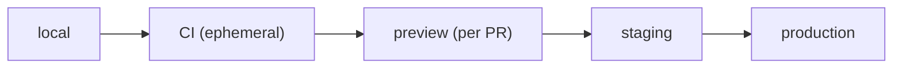
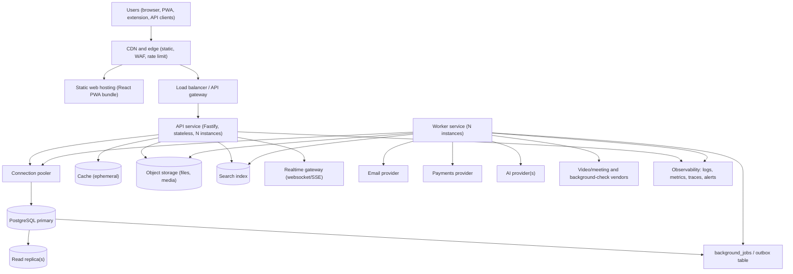

# Infrastructure and Deployment

Status: intended infrastructure and delivery design for the complete product. Nothing here claims that any environment, pipeline or provider exists. Inputs: [OPERATIONS.md](../../docs/quality/OPERATIONS.md), [TARGET_ARCHITECTURE.md](../../docs/engineering/TARGET_ARCHITECTURE.md), [TRD.md](../../docs/engineering/TRD.md), [HOSTED_SUPABASE_MIGRATION_GATE.md](../../docs/engineering/HOSTED_SUPABASE_MIGRATION_GATE.md), CLAUDE.md stack notes (React/Vite PWA, Fastify API, worker with `FOR UPDATE SKIP LOCKED`, Postgres via `pg`, Stripe and Brevo opt-in). Evidence tags per [CONVENTIONS](../00_START_HERE/CONVENTIONS.md). No numbers for volume, price or headcount are invented; parameters carry `[PROP]` defaults and `OD-OPS-` ids (section 21). Build and deployment files (`.github/`, `deploy/`, Dockerfiles) are read-only for AI agents and need human owner approval. [SRC: CLAUDE.md Rules]

Vendor names below are examples of a capability class, not selections; selection is `OD-OPS-01`.

## 1. Design goals

1. Boring, reproducible, reversible deploys; any production change can be undone by the documented rollback. [DER]
2. Tenant isolation, secret hygiene and least privilege by default. [SRC: OPERATIONS §1 separate secrets/config per environment]
3. Operable by a small team: managed services preferred over self-hosting where equal. [PROP]
4. Honest degradation: every optional dependency can fail without losing user data (see doc 06/02 section 4.11).
5. Cost visible and bounded per component (section 17).

## 2. Environments

[SRC: OPERATIONS §1 `local -> CI -> preview -> staging -> production`]

| Environment | Purpose                                                     | Data                                 | Scale                                                    | Access                       | Lifetime                                     |
| ----------- | ----------------------------------------------------------- | ------------------------------------ | -------------------------------------------------------- | ---------------------------- | -------------------------------------------- |
| local       | developer loop with Postgres, API, worker, web dev server   | synthetic seeds                      | single instance                                          | developer                    | permanent per dev                            |
| CI          | automated tests on ephemeral Postgres service container     | synthetic per job                    | minimal                                                  | pipeline                     | per job                                      |
| preview     | full stack per pull request for review, e2e smoke, UAT-lite | `seed:standard`                      | minimal                                                  | team plus invited reviewers  | auto-destroyed on PR close, with idle expiry |
| staging     | production-shaped release candidate soak, perf, chaos, UAT  | `seed:volume` plus synthetic traffic | same topology as production, scaled by ratio `OD-OPS-02` | team, UAT users              | permanent                                    |
| production  | live                                                        | real                                 | autoscaled within limits                                 | least privilege, break-glass | permanent                                    |

Rules:

- Each environment has its own secrets, database, storage buckets, queues, domains and provider accounts or sandboxes. No credential is shared across environments. [SRC: OPERATIONS §1]
- Production data never flows downward. A debugging need uses a scrubbed, consented reproduction.
- Parity register: a living table of differences between staging and production, reviewed at each release (doc 06/02 section 6).
- Custom environments (beta tenant, demo, sales sandbox) are labelled with an environment banner so synthetic data cannot be mistaken for real; the demo environment uses a different domain and cannot send real email or payments. [SRC: CLAUDE.md "labelled dev outbox"]

## 3. Reference architecture

The system stays a modular monolith: one API deployable and one worker deployable from the same repository, scaled independently. Extraction of a module into its own service requires an ADR and a measured need. [SRC: CLAUDE.md "Fastify 5 modular monolith"]

## 4. Infrastructure components

| Component                                                     | Responsibility                                                                                                                                 | Requirements `[PROP]`                                                                                                                           | Failure behavior                                                     |
| ------------------------------------------------------------- | ---------------------------------------------------------------------------------------------------------------------------------------------- | ----------------------------------------------------------------------------------------------------------------------------------------------- | -------------------------------------------------------------------- |
| Web hosting and CDN                                           | serve versioned immutable PWA assets, edge caching, TLS, HTTP/3, security headers, WAF and bot rules, edge rate limiting                       | static assets content-hashed with long cache; `index.html` and service worker short cache; CSP, HSTS, COOP/COEP as per security docs            | last good version served from edge; stale-while-revalidate           |
| API                                                           | stateless Fastify instances behind load balancer; health, readiness endpoints                                                                  | horizontal autoscale on CPU and request concurrency; graceful shutdown draining; min 2 instances in production for availability                 | instance loss tolerated; readiness removes unhealthy                 |
| Worker                                                        | claims `background_jobs` with `FOR UPDATE SKIP LOCKED`, runs email, webhooks, retention sweeps, backfills, scoring, indexing                   | horizontal; per-queue concurrency limits; lease with heartbeat; idempotent handlers                                                             | lease expiry re-queues; poison jobs go to `dead` with alert          |
| Scheduler                                                     | triggers periodic jobs (sweeps, digests, reconciliation) by enqueueing rows once                                                               | single-leader or database advisory lock to avoid duplicate schedules                                                                            | missed ticks caught up idempotently                                  |
| PostgreSQL                                                    | system of record                                                                                                                               | managed service, same major version across envs, point-in-time recovery, automated backups, TLS, private network only, extension allow-list     | failover per section 16; connection pool protects against saturation |
| Connection pooler                                             | multiplex connections for many API and worker instances                                                                                        | transaction pooling compatible with `pg` usage; limits per service                                                                              | saturation alert; shed load with 503 + `Retry-After`                 |
| Read replica(s)                                               | offload analytics and heavy reads when needed                                                                                                  | introduced only on measured need; replica lag metric and staleness-tolerant routes only                                                         | fall back to primary                                                 |
| Object storage                                                | files: evidence, resumes, course media, attachments, exports                                                                                   | private buckets, signed short-lived URLs, server-side encryption, lifecycle rules, versioning on, malware scan on upload, per-tenant key prefix | resumable uploads; orphan cleanup job                                |
| Media pipeline (module PLT/LRN)                               | transcoding, thumbnails, HLS packaging, captions                                                                                               | queue-driven, outputs to object storage, cost caps                                                                                              | job retry; original preserved                                        |
| Search                                                        | full-text and faceted search for jobs, candidates, courses, people (module SRC)                                                                | start with Postgres full-text and trigram; dedicated engine only after ADR with measured need `OD-OPS-03`                                       | degrade to database search with label                                |
| Cache                                                         | rate limit counters, short-lived computed data, session denylist                                                                               | ephemeral by design; never source of truth; TTL on every key                                                                                    | miss is safe; no correctness dependency                              |
| Queues                                                        | durable work: Postgres `background_jobs` as the baseline; a broker only after ADR                                                              | at-least-once delivery, idempotent consumers, dead-letter, visibility metrics                                                                   | replay tooling                                                       |
| Realtime                                                      | messaging, notifications, live interview presence (MSG, NTF, INT)                                                                              | websocket or SSE gateway, horizontally scalable, backed by pub/sub if multi-instance, auth on connect, reconnect with resume token              | falls back to polling                                                |
| Email                                                         | transactional and notification email through the provider-independent service; development uses the labelled dev outbox [SRC: CLAUDE.md Stack] | SPF, DKIM, DMARC aligned; separate sending domains for transactional vs marketing; bounce and complaint webhooks; suppression list              | queue and retry; dead-letter                                         |
| SMS/push                                                      | optional channels (NTF)                                                                                                                        | provider adapter, opt-in only, per-country rules                                                                                                | queue and retry                                                      |
| Payments                                                      | Stripe Checkout, Customer Portal, signed webhook, active only with `BILLING_MODE=stripe` [SRC: CLAUDE.md Stack]                                | webhook endpoint isolated, verified, idempotent                                                                                                 | reconcile job compares provider and local state                      |
| AI providers                                                  | model calls for AIC and others                                                                                                                 | adapter with timeout, cost cap, fallback, redaction, per-tenant quota                                                                           | non-AI fallback with label                                           |
| Video / meeting, calendar, background-check, identity vendors | INT, BGV, LRN live sessions                                                                                                                    | adapters with sandbox in non-production                                                                                                         | graceful "unavailable" states                                        |
| Observability                                                 | logs, metrics, traces, error tracking, RUM, uptime probes, alert routing, status page                                                          | per doc 03 section 11; retention parameters `OD-OPS-04`                                                                                         | telemetry loss never blocks requests (async, bounded buffers)        |
| Secrets manager                                               | store and rotate secrets                                                                                                                       | per-environment, audit logged, no secrets in images or repository                                                                               | see section 9                                                        |
| DNS and certificates                                          | domains, TLS automation, CAA, DNSSEC where supported                                                                                           | automated renewal with expiry alerts                                                                                                            | alert at expiry horizon                                              |
| Backup store                                                  | backups in a separate account/region from primary                                                                                              | immutable retention window, encryption keys separate                                                                                            | restore drills (section 16)                                          |

## 5. Infrastructure as code (IaC) principles

1. **Everything reproducible from the repository.** Environments, networking, databases, buckets, queues, DNS, alert rules, dashboards, and IAM are defined as code in `deploy/` (human-owned path); no click-ops in staging or production except a declared break-glass, which is followed by a code change the same working cycle. [DER]
2. **Declarative and idempotent.** Plan then apply; the plan output is attached to the change record and reviewed.
3. **Modules and environments.** Shared modules; environment differences expressed only as variables. A diff of variable files is the complete list of environment differences.
4. **State handling.** Remote state with locking and encryption, access restricted, backed up.
5. **Drift detection.** Scheduled plan against live to detect drift; drift opens a defect and is resolved by code or by revert.
6. **Policy as code.** Automated checks: no public buckets, no `0.0.0.0/0` on databases, encryption on, required tags, approved regions, instance classes within caps.
7. **Least privilege.** Separate deploy roles per environment; production apply requires approval and short-lived credentials from CI via federation, not stored keys.
8. **Immutable artifacts.** One build produces one artifact (container image, static bundle) promoted unchanged through environments; configuration is injected at runtime.
9. **Tagging.** Every resource tagged `env`, `service`, `owner`, `cost-center` to support cost attribution (section 17).
10. **Review.** IaC changes follow the review process in doc 03 section 5, with repository owner approval for `deploy/`.
11. **Disaster rebuild.** The full production stack can be recreated from code plus restored data; this is exercised in the DR drill (section 16.5).

## 6. CI/CD pipeline

### 6.1 Stages

| #   | Stage              | Actions                                                                                                                                          | Gate (see doc 06/02 section 13) | Failure action                  |
| --- | ------------------ | ------------------------------------------------------------------------------------------------------------------------------------------------ | ------------------------------- | ------------------------------- |
| 1   | Validate           | install with frozen lockfile, Prettier lint, typecheck, doc link check, generated-artifact freshness, import-boundary and dependency-cycle check | G1                              | fail PR                         |
| 2   | Build              | build contracts, domain, api, worker, web; produce artifact with build id and SBOM                                                               | G1                              | fail                            |
| 3   | Test               | unit, component, contract, in-memory API; Postgres integration with fresh DB; migration apply-from-empty and upgrade tests; RLS tests            | G1, G2                          | fail                            |
| 4   | Security           | secret scan, SAST, dependency audit, license check, container image scan, IaC policy scan                                                        | G2                              | block on high/critical          |
| 5   | Package            | build container images (API, worker), sign and attest provenance, push to registry with immutable tag = build id                                 | n/a                             | fail                            |
| 6   | Deploy preview     | create per-PR environment, run migrations on its database, deploy artifacts                                                                      | n/a                             | comment link; teardown on close |
| 7   | Verify preview     | Playwright smoke, axe, visual diff, DAST baseline                                                                                                | G3                              | fail PR                         |
| 8   | Deploy staging     | on merge to `main` or release tag; run migrations (expand phase), deploy, flags mirrored                                                         | n/a                             | halt pipeline                   |
| 9   | Release gates      | full regression, performance, chaos for changed areas, upgrade test on production-shaped data, UAT, traceability                                 | G4, G5, G6                      | block promotion                 |
| 10  | Deploy production  | approval, migration, rollout strategy (section 13), flag settings                                                                                | approval                        | auto-halt                       |
| 11  | Post-deploy verify | synthetic probes, canary metrics, smoke journeys                                                                                                 | G7                              | auto-rollback per section 14    |
| 12  | Observe and close  | release record, changelog publish, status communication, error-budget check                                                                      | n/a                             | follow-up tasks                 |

### 6.2 Pipeline rules

- The pipeline definition is under `.github/` or equivalent and is a build file: owner-approved changes only. [SRC: CLAUDE.md Rules]
- Required checks are enforced by branch protection; no manual deploy from a laptop to staging or production.
- Pipelines are idempotent and re-runnable; a failed stage can be retried without side effects.
- Flaky pipeline steps follow the flaky policy; retries are visible, not hidden. (doc 06/02 section 17)
- Concurrency control: one production deploy at a time; a freeze switch (change freeze) blocks production deploys and is recorded (doc 07/02 section 17).
- Artifact provenance: production runs only images built and signed by the pipeline from a reviewed commit; the deployed build id and commit are displayed in an operator-visible version endpoint.
- Pipeline duration budget `[PROP]`: G1 and G2 complete within a developer-tolerable window; measured as p50 and p90 and reviewed monthly (doc 06/02 metric). `OD-OPS-05`.
- Secrets in CI come from the secrets manager through short-lived credentials; PRs from forks get no secrets.
- Preview environments for external contributors require maintainer approval before secrets or data access.

### 6.3 Database change in the pipeline

1. CI applies all migrations to an empty DB and to the previous-release schema snapshot.
2. Staging applies the pending migrations first, then deploys the new code (expand-compatible).
3. Production applies migrations with lock and statement timeouts, monitored by the migration runner, then deploys code. A destructive step (contract) never ships in the same release as the code change that stops needing the old shape (doc 03 section 4.3).
4. Hosted database applies follow the gate in [HOSTED_SUPABASE_MIGRATION_GATE.md](../../docs/engineering/HOSTED_SUPABASE_MIGRATION_GATE.md) while that provider applies; the gate steps are a checklist in the change record. [SRC]

## 7. Application runtime

- Containers: one image for API, one for worker, both from the same build; non-root user, read-only root filesystem where possible, minimal base image, no shell tools beyond need, resource requests and limits set.
- Health: `/healthz` liveness (process only), `/readyz` readiness (database reachable, required config present), `/version` (build id, commit, migration version). Health endpoints expose no sensitive data.
- Graceful shutdown: stop accepting, drain in-flight requests within a parameter, finish or release job leases, close pool.
- Startup checks: configuration validated by a Zod schema at boot; the process refuses to start with missing or malformed required config (fail fast). Integrations enabled by mode flags (`BILLING_MODE`, email provider mode) must report their mode in `/version` so the honesty labels match reality. [SRC: CLAUDE.md Stack]
- Statelessness: no local disk state; uploads stream to object storage; sessions are self-issued HMAC tokens, so no sticky sessions are needed. [SRC: CLAUDE.md Auth]
- Web: PWA service worker versioning ties to build id; the update flow prompts users and handles API version skew (doc 06/02 TC-PLT-006).

## 8. Networking and security perimeter

- Private networking for database, cache, workers; only the load balancer and CDN are internet-facing.
- WAF with managed rule set and custom rules for authentication endpoints; bot management on registration, login and application endpoints.
- Egress controls: workers and API reach only allow-listed provider hosts; SSRF guard for user-supplied URLs (link previews, webhooks) with deny of private ranges.
- TLS 1.2+ everywhere; internal service-to-service TLS where the platform supports it.
- Administrative access (database, consoles) only through an authenticated bastion or provider-managed access with MFA, per-person identities and session logging; no shared accounts.
- Tenant isolation is application and RLS enforced; there is no per-tenant infrastructure by default; dedicated-tenant deployment is an enterprise option under `OD-OPS-06`.
- Detailed controls are in `05_SECURITY_PRIVACY`.

## 9. Configuration and secrets

### 9.1 Configuration

1. Twelve-factor style: configuration through environment variables validated at boot by schema; no environment-specific code branches.
2. Config classes: **static** (build-time, such as API base path), **runtime** (env vars), **dynamic** (feature flags and kill switches evaluated at runtime, doc 03 section 10), **secret** (section 9.2).
3. A configuration catalogue (name, purpose, type, default, required-per-environment, secret yes/no, owner) is a versioned document generated from the schema; undocumented variables fail CI.
4. Mode variables (for example `BILLING_MODE`) default to the safe, disabled value; production enabling is a change record item.
5. Configuration changes in production are audited changes (doc 07/02 section 16).

### 9.2 Secrets

- Stored in the secrets manager; injected at runtime; never in repository, images, logs, build output or client bundles. Client bundles contain only public identifiers.
- Per environment, per service; least privilege read.
- Rotation: all secret classes have a rotation procedure and cadence name (session-signing key: quarterly cadence `[PROP]`; provider API keys: on staff change and on schedule; database credentials: scheduled). Rotation without downtime via dual-key acceptance for HMAC session keys (old key verifies only until expiry).
- Compromise response: documented in runbook RB-SEC-01 (doc 07/02 section 3), including revoke, rotate, invalidate sessions, audit access.
- Secret scanning on every push; a leaked secret is treated as compromised immediately regardless of repository privacy.
- Break-glass access to production secrets requires two-person approval and is logged.

## 10. Zero-downtime migrations

1. **Expand/contract** (doc 03 section 4.3) is the only permitted way to change a populated schema.
2. **Backward compatibility window:** the previous release's code MUST run against the new schema, and the new code MUST run against the previous schema during rollout. CI verifies both directions (upgrade test plus "N-1 code on N schema" test).
3. **Locking discipline:** `lock_timeout` set low with retry; `CREATE INDEX CONCURRENTLY`; add columns nullable without volatile defaults; add constraints as `NOT VALID` then `VALIDATE` separately; avoid table rewrites; large backfills are chunked worker jobs with throttling based on replica lag and database load, resumable, and idempotent.
4. **Backfill monitoring:** progress metric, ETA, abort switch; backfills never run inside the deploy transaction.
5. **Rollback plan per migration:** forward fix preferred; destructive migrations are preceded by a verified backup point and a dry run on a production-shaped copy.
6. **Dual-write period** for data model changes, with a reconciliation query run before switching reads.
7. **Queue compatibility:** job payload schemas are versioned; workers accept N and N-1 payloads; new job types are deployed to workers before producers enqueue them.
8. **Search and cache:** index mappings versioned; reindex into a new index and swap alias; caches keyed with schema version.
9. **Web and API skew:** the API stays compatible with the previous web bundle for at least one release (service worker clients may lag).

## 11. Release and rollout strategy

### 11.1 Strategy by risk class

| Risk class | Examples                                                                                   | Strategy                                                                   |
| ---------- | ------------------------------------------------------------------------------------------ | -------------------------------------------------------------------------- |
| Low        | copy changes, internal tools, additive endpoints                                           | rolling deploy, post-deploy smoke                                          |
| Medium     | new feature behind a flag, UI changes                                                      | rolling deploy, feature flag off, enable by cohort                         |
| High       | auth, billing, tenant isolation, migrations with backfill, search ranking, AI model change | canary plus flag, staged exposure, extended observation, explicit approver |
| Emergency  | security fix, outage fix                                                                   | hotfix path with reduced gates recorded (doc 03 section 6.5)               |

### 11.2 Canary

1. Deploy new version to a small share of API instances (parameter `CANARY_SHARE`, `[PROP]` smallest meaningful share) while the worker is updated in a separate step.
2. Compare canary vs baseline on error rate, latency p95, saturation, business KPIs (login success, application submit success).
3. Automated promotion steps with hold intervals; any breached threshold triggers automatic rollback (section 14).
4. Stateful side effects are safe during mixed-version operation by the compatibility rules in section 10.

### 11.3 Flags and staged exposure

- New capability ships dark, then is enabled for internal tenants, then beta cohort, then a percentage ramp, then everyone; each step has an entry criterion (metrics healthy) and a hold period. Flag lifecycle in doc 03 section 10.
- Exposure cohorts are by tenant or user id hash so a user sees a consistent experience.
- Every ramp step is recorded in the change log; kill switch ownership is named in the runbook.

### 11.4 Blue/green option

For major infrastructure changes (database engine upgrade, runtime upgrade) a parallel stack is built, validated with replayed or mirrored traffic, and traffic is switched at the load balancer with the old stack kept warm for the rollback window.

### 11.5 Release communications

Release notes (user-facing and operator-facing), scheduled-maintenance notices when user impact is possible, and status page entries when applicable (doc 07/02 section 7). Release timing avoids declared change-freeze windows; the freeze calendar is a parameter, not hard-coded dates (`OD-OPS-07`).

## 12. Release record

Every production release produces a record: build id, commit range, FR ids shipped, flags and their states, migrations applied, config changes, risk class, approver, gate evidence links (G1 to G7), rollback plan, observation window result, incidents attributed. Stored as a document in the repository or ticket system and referenced from the changelog.

## 13. Rollback

### 13.1 Rollback levels (fastest first)

| Level | Mechanism                                               | When                                | Time-to-effect target `[PROP]`      |
| ----- | ------------------------------------------------------- | ----------------------------------- | ----------------------------------- |
| L0    | turn off feature flag / kill switch                     | feature misbehaving                 | minutes (flag propagation budget)   |
| L1    | route traffic back (canary abort or blue/green switch)  | bad deploy detected early           | minutes                             |
| L2    | redeploy previous immutable artifact (N-1)              | regression found after full rollout | within the incident clock for Sev 1 |
| L3    | forward fix                                             | data-shape changes already applied  | per fix                             |
| L4    | restore data (point-in-time recovery or backup restore) | data corruption                     | per RTO (section 16)                |

### 13.2 Rules

- Every production change states its rollback level in the change record; if only L3 or L4 apply, the change needs higher approval and a rehearsal.
- Rollback of code never rolls back an expand-phase migration (it is compatible by design); contract-phase migrations are irreversible and need a verified restore point first.
- Automatic rollback triggers `[PROP]`: error rate above threshold relative to baseline, p95 latency breach, failed readiness, failed synthetic critical journey, queue age breach. Thresholds finalized in `OD-OPS-08`.
- After any rollback: freeze further promotions until a root-cause note exists; add a regression test.
- Jobs in flight during rollback: handlers are idempotent and payload schema compatible, so N-1 workers can finish N jobs or the jobs are paused and replayed.

## 14. Service level objectives

SLOs are set after baseline measurement. [SRC: OPERATIONS §3] Initial candidate SLIs and `[PROP]` targets as parameters, not commitments:

| Capability                  | SLI                                       | Candidate target parameter | Window          |
| --------------------------- | ----------------------------------------- | -------------------------- | --------------- |
| Sign-in and session         | successful auth requests / valid attempts | `SLO_AUTH_AVAIL`           | rolling 30 days |
| Core API availability       | non-5xx / total, excluding client errors  | `SLO_API_AVAIL`            | rolling 30 days |
| Core API latency            | p95 under budget (doc 06/02 section 14)   | `SLO_API_LAT`              | rolling 30 days |
| Application submit          | successful submits / attempts             | `SLO_APPLY_SUCCESS`        | rolling 30 days |
| Search                      | p95 latency, availability                 | `SLO_SEARCH`               | rolling 30 days |
| Messaging delivery          | message delivered within threshold        | `SLO_MSG_DELIV`            | rolling 30 days |
| Transactional email         | queued-to-sent age                        | `SLO_EMAIL_AGE`            | rolling 30 days |
| Webhook delivery (outbound) | delivered within retry policy             | `SLO_WEBHOOK`              | rolling 30 days |
| Assessment taking           | session start success and timer integrity | `SLO_ASSESS`               | rolling 30 days |

Error budgets: burn-rate alerts (fast and slow window) page on-call; budget exhaustion pauses feature releases for the affected service until restored. Targets are decided in `OD-OPS-09` after baseline.

## 15. Capacity planning

1. **Inputs (parameters, not invented numbers):** registered users, monthly active users, concurrent peak, jobs posted, applications per day, course video hours streamed, assessments started concurrently (campus events), messages per day, AI calls per active user, storage growth per user. Names: `CAP_MAU`, `CAP_PEAK_CONCURRENT`, `CAP_APPS_PER_DAY`, `CAP_VIDEO_HOURS`, `CAP_ASSESS_BURST`, `CAP_MSGS_PER_DAY`, `CAP_AI_CALLS_PER_USER`, `CAP_STORAGE_PER_USER`. Values come from stakeholders (`OD-OPS-10`); until then scale tests use relative multiples of the measured staging baseline.
2. **Method:** model load per feature -> derive requests and database load -> test with the performance suite (doc 06/02 section 4.9) -> choose instance counts and database class with 2x peak headroom `[PROP]` -> set autoscale min/max.
3. **Known burst patterns:** campus-wide assessment start, job-fair/hackathon registration opening, email-driven spikes after digest sends, end-of-term enrollments, big-employer job posts triggering alert fan-out. Each has a pre-scale or queue-smoothing plan.
4. **Database:** monitor connections, CPU, IOPS, storage growth, bloat, replication lag, slow queries, lock waits; scale vertically first, then read replicas, then partitioning of large time-series tables (events, audit, messages) by time; sharding is out of scope until an ADR shows need.
5. **Storage:** lifecycle policies move cold objects to cheaper classes; per-tenant quotas by plan (BIL).
6. **Queues:** monitor oldest-job age and depth per queue; autoscale workers on age.
7. **Quotas and limits:** provider rate limits (email, AI, video) are tracked and have headroom alerts.
8. **Review cadence:** capacity review in the quarterly health review (doc 07/03) and before each tier release; results feed cost forecast.
9. **Load shedding:** when saturated, shed in this order: analytics refresh, recommendations refresh, search facets, non-critical notifications; never auth, application submit, assessment saving or payments.

## 16. Backup, restore and disaster recovery

### 16.1 RPO and RTO parameters

RPO is the maximum acceptable data loss window; RTO is the maximum acceptable downtime. Both are open decisions with proposed defaults tied to data class. `OD-OPS-11`.

| Tier | Data / service                                                                                        | `RPO` `[PROP]`                           | `RTO` `[PROP]` | Rationale                            |
| ---- | ----------------------------------------------------------------------------------------------------- | ---------------------------------------- | -------------- | ------------------------------------ |
| T0   | Authentication, tenant data, applications, payments and entitlements, verification records, audit log | 5 minutes (point-in-time recovery)       | 1 hour         | integrity and legal/financial impact |
| T1   | Profiles, evidence metadata, messaging, learning progress, assessment attempts                        | 15 minutes                               | 4 hours        | user-visible core, high trust cost   |
| T2   | Object storage files (resumes, evidence, media originals)                                             | 24 hours via versioning plus replication | 8 hours        | recoverable, versioned               |
| T3   | Search index, caches, analytics aggregates, recommendations                                           | rebuildable (no RPO)                     | 24 hours       | derived data                         |
| T4   | Logs, metrics                                                                                         | per retention policy                     | best effort    | observability                        |

Parameters in config catalogue: `DR_RPO_T0`, `DR_RTO_T0`, and so on. Values above are `[PROP]` placeholders pending stakeholder decision, not commitments.

### 16.2 Backup design

- Database: continuous WAL archiving with point-in-time recovery plus scheduled base backups; backups encrypted, stored in a separate account and region from the primary; immutable (write-once) retention window `[PROP]` set by `OD-OPS-12`; backup success is monitored and an alert fires on any missed backup.
- Object storage: versioning with delete markers protected, cross-region replication for T2 `[PROP]`, lifecycle retention aligned with the retention schedule (05 privacy documents).
- Configuration and IaC state: repository plus state backups; secrets manager export procedure that never stores plaintext in the repository.
- Queue/jobs: the `background_jobs` table is in the database backup; in-flight jobs are idempotent so a restore replays safely.
- Third-party data of record (payments provider, email provider suppression lists) has an export or reconciliation procedure so the platform can rebuild local state.

### 16.3 Restore procedures

1. **Point-in-time restore** into a new instance, validated with integrity queries and a smoke run, then traffic switched (or tables selectively copied back for partial corruption).
2. **Single-tenant or single-record restore:** restore to a side instance, extract rows, re-import via a reviewed script with audit; never restore over live production for a partial problem.
3. **Object restore:** by version id or from the replica.
4. **Right-to-erasure interaction:** deletions processed since the backup are re-applied after any restore (deletion ledger replay) so erased users do not reappear; the ledger is stored separately from the backup. [DER, privacy requirement]
5. Each procedure has a runbook (RB-DB-02, RB-DB-03, RB-STO-01 in doc 07/02) with step list, owner, validation queries and communications.

### 16.4 Disaster scenarios

| Scenario                                           | Response                                                                  |
| -------------------------------------------------- | ------------------------------------------------------------------------- |
| Primary database failure                           | automatic failover to standby within the platform; verify; RTO tier T0    |
| Data corruption / bad migration / malicious delete | point-in-time restore to before the event; replay safe writes if possible |
| Region or zone outage                              | multi-zone resilience by default; cross-region recovery per section 16.6  |
| Provider outage (email, payments, AI, video)       | degrade features with labelled states; queue and replay                   |
| Credential compromise                              | rotate, revoke, audit (RB-SEC-01)                                         |
| Ransomware or account takeover of cloud account    | restore from immutable separate-account backups; rebuild from IaC         |
| Loss of key personnel or vendor lockout            | break-glass access and documented rebuild (doc 07/03 section 9)           |

### 16.5 Drills

- Restore drill: restore latest backup to an isolated environment, run integrity checks and a smoke suite, record achieved RPO and RTO versus targets. Cadence: quarterly cadence `[PROP]` for database, semiannual for full rebuild from IaC; results reported in the quarterly health review. A backup that has not been restored in a drill is treated as unverified.
- Game days for resilience experiments (doc 06/02 section 4.11).
- Findings become tracked tasks with owners.

### 16.6 Multi-region question

Decision `OD-OPS-13` (`[DEC-REQ]`): single region with multi-zone vs active-passive multi-region vs active-active.

| Option                                             | Pros                                         | Cons                                                                          |
| -------------------------------------------------- | -------------------------------------------- | ----------------------------------------------------------------------------- |
| A. Single region, multi-zone, cross-region backups | simplest, lowest cost, data residency simple | regional outage means restoring elsewhere (RTO hours)                         |
| B. Active-passive (warm standby region)            | much lower RTO for regional loss             | doubled infrastructure cost, replication lag defines RPO, failover complexity |
| C. Active-active                                   | lowest latency and RTO globally              | write conflicts, data residency complexity, highest cost and risk             |

Default proposal `[PROP]`: Option A for the first release tiers, with the architecture avoiding region-specific assumptions so B is possible. Data residency (candidate and institution data in specific jurisdictions) is a separate open decision `OD-OPS-14` owned with the privacy lead: options are single global region, regional deployments per jurisdiction, or tenant-pinned storage. Both decisions block infrastructure selection beyond staging.

## 17. Cost controls

1. **Attribution:** tagging by service and environment (IaC rule 9); dashboards per component showing spend, unit cost (per MAU, per application, per video hour, per AI call), and trend.
2. **Budgets and alerts:** monthly budget parameter per environment `COST_BUDGET_<ENV>` (values from `OD-OPS-15`); alert at progress thresholds and on anomaly detection; preview and staging have auto-shutdown schedules and idle expiry.
3. **Guardrails in code:** AI per-user and per-tenant caps; media transcoding caps; export size limits; email volume caps per tenant; search and API rate limits (also abuse controls).
4. **Hygiene:** automated cleanup of orphan objects, expired previews, old images, unused volumes; lifecycle rules on storage; log retention and sampling limits.
5. **Commit and rightsizing:** quarterly rightsizing and reserved-capacity review in the FinOps review (doc 07/03 section 10).
6. **Make-or-buy review:** costs of each third-party vendor compared with usage tiers during vendor review (doc 07/02 section 14).
7. **Cost in design:** an ADR for a new component includes a cost estimate by the capacity parameters; a feature with material cost has a cost KPI in its module metrics.

## 18. Operational readiness checklist (new service or major feature)

1. Health endpoints, structured logs with correlation, metrics, traces (doc 03 section 11).
2. SLI and alert defined with runbook link; alert tested.
3. Dashboards for golden signals and business KPIs.
4. Capacity estimate and load test result.
5. Rollback level documented and rehearsed for high risk.
6. Backup and restore coverage confirmed for new data.
7. Secrets and config catalogued; least privilege roles created.
8. Dependency failure behavior tested (chaos).
9. Cost estimate and budget alert.
10. On-call briefed; support articles and macros prepared (doc 07/02).
11. Data retention and deletion paths implemented.
12. Security review and threat model note complete.

## 19. Environment and platform parity with current repository

Today's repository defines scripts for local dev (`pnpm dev`), tests, lint, typecheck, build and migrations, plus a worker that claims jobs. The environments, hosting, IaC and pipeline described here are intended design; no deployment is claimed. The existing `deploy/` and `.github/` content, if any, is an input to be reconciled with this design by the repository owner. [SRC: CLAUDE.md Commands; DER]

## 20. Acceptance criteria for this design (testable)

1. A new engineer can recreate preview from a clean clone using only repository docs and a documented set of credentials.
2. A synthetic production-shaped restore drill produces measured RPO and RTO and records them against targets.
3. A deliberately failing canary (injected error rate) triggers automatic rollback within the configured detection window, and the release record captures it.
4. A deploy of N+1 code against N schema and N code against N+1 schema both pass the compatibility test.
5. A secret rotation of the session-signing key completes with zero failed valid sessions during the overlap window.
6. Negative: a pipeline run that attempts to deploy an unsigned or untested image to production is rejected.
7. Negative: a configuration with a missing required secret causes the process to refuse to start and `/readyz` to remain not ready.

## 21. Open decisions

| Id        | Question                                           | Options                             | Default proposal `[PROP]`                                                                     | Decides                           | Blocks             |
| --------- | -------------------------------------------------- | ----------------------------------- | --------------------------------------------------------------------------------------------- | --------------------------------- | ------------------ |
| OD-OPS-01 | Cloud and vendor selection per component class     | single cloud / multi-vendor managed | managed Postgres, managed container platform, S3-compatible storage, one observability vendor | architecture owner, finance       | all infrastructure |
| OD-OPS-02 | Staging scale ratio to production                  | 10 percent / 50 percent / full      | enough to run perf tests proportionally                                                       | SRE, finance                      | G4                 |
| OD-OPS-03 | Dedicated search engine vs Postgres full-text      | Postgres first / dedicated          | Postgres first, ADR on measured need                                                          | architecture owner                | SRC module         |
| OD-OPS-04 | Observability retention periods                    | per data class                      | logs short, metrics longer, audit per security policy                                         | SRE, security officer             | observability cost |
| OD-OPS-05 | Pipeline duration budget                           | as measured                         | set after first baseline                                                                      | engineering lead                  | CI design          |
| OD-OPS-06 | Dedicated single-tenant deployments for enterprise | not offered / offered               | not offered initially                                                                         | product owner                     | EMP, ENT modules   |
| OD-OPS-07 | Change-freeze calendar                             | cadence rules                       | freeze around declared high-traffic periods, defined by cadence name                          | product owner, SRE                | release planning   |
| OD-OPS-08 | Auto-rollback thresholds                           | tune after baseline                 | relative to baseline error and latency                                                        | SRE                               | G7                 |
| OD-OPS-09 | SLO targets and error budget policy                | after baseline                      | per section 14 parameters                                                                     | product owner, SRE                | alerting           |
| OD-OPS-10 | Capacity input values                              | stakeholder estimates               | relative multiples until supplied                                                             | product owner                     | capacity plan      |
| OD-OPS-11 | RPO and RTO per tier                               | tiers as proposed / custom          | section 16.1                                                                                  | product owner, SRE, legal         | backup design      |
| OD-OPS-12 | Backup retention and immutability window           | per regulation                      | set with privacy lead                                                                         | security officer, legal           | backup cost        |
| OD-OPS-13 | Multi-region strategy                              | A / B / C                           | A                                                                                             | architecture owner, product owner | infrastructure     |
| OD-OPS-14 | Data residency model                               | global / regional / tenant-pinned   | global initially, residency-aware design                                                      | legal, privacy lead               | database topology  |
| OD-OPS-15 | Cost budgets per environment                       | stakeholder                         | supplied by finance                                                                           | finance                           | cost alerts        |

## 22. Risks

| Id         | Risk                                              | Mitigation                                                            |
| ---------- | ------------------------------------------------- | --------------------------------------------------------------------- |
| RSK-OPS-01 | Backups exist but restores fail                   | scheduled restore drills with recorded RPO/RTO                        |
| RSK-OPS-02 | Long-locking migration causes outage              | lock timeouts, expand/contract, production-shaped upgrade test        |
| RSK-OPS-03 | Provider outage cascades into user-facing failure | adapters with timeouts, queues, degraded labelled states, chaos tests |
| RSK-OPS-04 | Cost overrun from media or AI usage               | caps, budgets, anomaly alerts                                         |
| RSK-OPS-05 | Staging not representative                        | parity register, volume seed                                          |
| RSK-OPS-06 | Single operator knowledge                         | runbooks, rebuild-from-IaC drill, bus-factor controls (doc 07/03)     |
| RSK-OPS-07 | Region lock-in or residency violations            | residency-aware design, OD-OPS-14                                     |

## 23. Legacy trace

Informed by OPERATIONS.md (environments, observability, alerts, backups, incident lifecycle), TARGET_ARCHITECTURE.md, TRD.md, hosted Supabase migration gate, CLAUDE.md (stack, worker, Stripe, Brevo, dev outbox). Dropped: claims about hosting or deployment status. Added `[PROP]`: canary and flag ramp strategy, RPO/RTO tiering, capacity parameters, IaC principles, deletion-ledger replay after restore.
