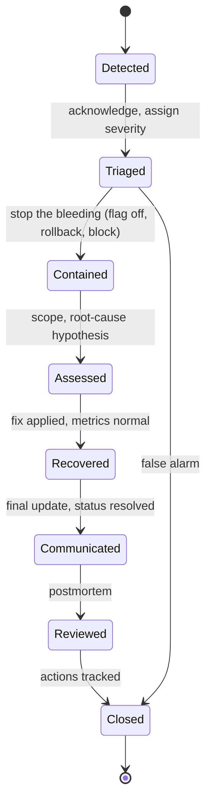

# Operations and Support

Status: intended operating model for the complete product. No on-call rotation, status page, support desk or runbook is claimed to exist. Inputs: [OPERATIONS.md](../../docs/quality/OPERATIONS.md) (observability, alerts, incident lifecycle `detect -> contain -> assess -> recover -> communicate -> postmortem`, runbook minimum list), [SECURITY.md](../../docs/quality/SECURITY.md), [PROJECT_MAINTENANCE.md](../../docs/engineering/PROJECT_MAINTENANCE.md). Evidence tags per [CONVENTIONS](../00_START_HERE/CONVENTIONS.md). No team sizes, response-time commitments or customer promises are invented: every time target is a `[PROP]` parameter with an `OD-SUP-` id (section 19). Related: [infrastructure](./01_INFRASTRUCTURE_AND_DEPLOYMENT.md), [maintenance](./03_MAINTENANCE_AND_SUSTAINABILITY.md), [engineering standards](../06_QUALITY_AND_PERFORMANCE/03_ENGINEERING_STANDARDS.md).

## 1. Operating principles

1. You build it, you run it: the team owning a module owns its alerts, runbooks and first response; central SRE provides platform, tooling and escalation. [PROP]
2. Every alert is actionable and linked to a runbook; every incident ends in learning, not blame.
3. Users are told the truth early: status communication does not wait for root cause.
4. Operators act with least privilege, with reasons, and leave audit trails; support never sees more data than the task needs.
5. Manual operations that happen more than twice become tooling.

## 2. Operating roles

| Role                                  | Operates                                                 | Notes                                                                       |
| ------------------------------------- | -------------------------------------------------------- | --------------------------------------------------------------------------- |
| On-call engineer (primary, secondary) | first response to pages                                  | one person may hold several roles; rotation size is a parameter `OD-SUP-01` |
| Incident commander (IC)               | runs the incident, decides, delegates                    | assigned per incident from trained pool                                     |
| Communications lead                   | status page, stakeholder and customer updates            | may be the IC in small incidents                                            |
| Scribe                                | timeline                                                 | optional for Sev 3                                                          |
| Subject-matter responder              | module expertise                                         | paged by IC                                                                 |
| Release manager                       | release record, gate enforcement (doc 06/02 section 13)  | rotating                                                                    |
| Support agent (`SUP`)                 | tiers 1 to 2                                             | product role in `ADM` module                                                |
| Moderator (`MOD`)                     | trust and safety queue                                   | not an operations pager role unless abuse surge                             |
| Platform admin (`PAD`)                | configuration, flags, tenant admin actions               | audited                                                                     |
| Security officer (`SAD`)              | security incidents, access reviews, break-glass approver |                                                                             |
| Finance operator (`FIN`)              | billing support, refunds, reconciliation                 |                                                                             |
| Privacy lead                          | data subject requests, breach assessment                 | named role, parameter `OD-SUP-02`                                           |

## 3. Runbook catalogue

Runbooks are Markdown in `docs/runbooks/` (proposed), one per id, using the template in section 3.2. Each is tested (a dry run or game day) and has "last verified" metadata (doc 03 section 8 documentation upkeep). Alert-to-runbook links are mandatory (doc 03 observability standard).

### 3.1 Catalogue

| Id         | Runbook                                                   | Trigger / alert           | Severity default |
| ---------- | --------------------------------------------------------- | ------------------------- | ---------------- |
| RB-GEN-01  | Triage a page: first five minutes                         | any page                  | n/a              |
| RB-GEN-02  | Declare, run and close an incident                        | Sev 1 to 3                | n/a              |
| RB-GEN-03  | Rollback a release (levels L0 to L4)                      | failed canary, regression | Sev 2            |
| RB-GEN-04  | Toggle kill switch / feature flag                         | feature incident          | Sev 2            |
| RB-GEN-05  | Emergency change and hotfix                               | urgent fix                | Sev 1 to 2       |
| RB-GEN-06  | Maintenance mode and graceful degradation                 | planned or emergency      | Sev 2            |
| RB-API-01  | Elevated 5xx rate                                         | error-rate alert          | Sev 2            |
| RB-API-02  | Latency SLO burn                                          | latency alert             | Sev 2            |
| RB-API-03  | Rate-limit false positives or abuse surge                 | 429 spike                 | Sev 3            |
| RB-API-04  | Instance crash loop or failed readiness                   | readiness alert           | Sev 2            |
| RB-WEB-01  | Bad frontend release (white screen, service worker stuck) | RUM error spike           | Sev 2            |
| RB-WEB-02  | CDN or WAF misconfiguration                               | edge errors               | Sev 2            |
| RB-WEB-03  | Certificate or DNS problem                                | expiry/DNS alert          | Sev 1            |
| RB-DB-01   | Database saturation (connections, CPU, locks)             | DB alert                  | Sev 1 to 2       |
| RB-DB-02   | Point-in-time restore                                     | corruption, bad migration | Sev 1            |
| RB-DB-03   | Partial restore of a tenant or record set                 | user data loss            | Sev 2            |
| RB-DB-04   | Failed or slow migration                                  | deploy alert              | Sev 2            |
| RB-DB-05   | Replica lag / replica failure                             | lag alert                 | Sev 3            |
| RB-DB-06   | Disk growth, bloat, vacuum problems                       | storage alert             | Sev 3            |
| RB-JOB-01  | Queue backlog or oldest-job age breach                    | queue age alert           | Sev 2            |
| RB-JOB-02  | Dead-letter inspection and replay                         | dead-job alert            | Sev 3            |
| RB-JOB-03  | Duplicate job execution suspicion (idempotency check)     | anomaly                   | Sev 2            |
| RB-JOB-04  | Worker lease storm / stuck leases                         | lease alert               | Sev 2            |
| RB-STO-01  | Object storage failure or restore by version              | storage errors            | Sev 2            |
| RB-STO-02  | Malware scan backlog or false positive                    | scanner alert             | Sev 3            |
| RB-EML-01  | Email provider outage or deliverability drop              | bounce/complaint spike    | Sev 2            |
| RB-EML-02  | Domain reputation / blocklisting                          | deliverability            | Sev 2            |
| RB-PAY-01  | Payment webhook failures or backlog                       | webhook alert             | Sev 1 to 2       |
| RB-PAY-02  | Entitlement mismatch reconciliation                       | reconcile job             | Sev 2            |
| RB-PAY-03  | Refund, dispute and chargeback handling                   | finance request           | Sev 3            |
| RB-SEC-01  | Secret leak or credential compromise                      | scan or report            | Sev 1            |
| RB-SEC-02  | Account takeover wave / credential stuffing               | auth anomaly              | Sev 1 to 2       |
| RB-SEC-03  | Tenant isolation / RLS violation suspicion                | isolation signal          | Sev 1            |
| RB-SEC-04  | Personal data breach assessment and notification          | suspected breach          | Sev 1            |
| RB-SEC-05  | Vulnerability disclosure intake and fix                   | report                    | per severity     |
| RB-SEC-06  | Impersonation or admin abuse investigation                | audit anomaly             | Sev 2            |
| RB-AUTH-01 | Login or token failures, session key rotation             | auth alert                | Sev 1 to 2       |
| RB-SRC-01  | Search degraded or index rebuild                          | search alert              | Sev 3            |
| RB-RT-01   | Realtime gateway failure (messaging, live sessions)       | realtime alert            | Sev 2            |
| RB-ASM-01  | Assessment platform incident during live cohort exam      | exam alert                | Sev 1            |
| RB-ASM-02  | Integrity-signal anomaly (false flag wave)                | anomaly                   | Sev 2            |
| RB-AI-01   | AI provider outage, cost spike or policy anomaly          | AI alert                  | Sev 3            |
| RB-AI-02   | Harmful or biased AI output report                        | report                    | Sev 2            |
| RB-INT-01  | Calendar or video provider failure during interviews      | provider alert            | Sev 2            |
| RB-BGV-01  | Background-check vendor outage or wrong report            | vendor alert              | Sev 2            |
| RB-TSF-01  | Abuse surge (spam, fake employers, scam jobs)             | moderation backlog        | Sev 2            |
| RB-TSF-02  | Content removal and legal takedown                        | legal request             | Sev 2            |
| RB-PRV-01  | Data subject access / export request                      | request                   | n/a              |
| RB-PRV-02  | Erasure request and deletion-ledger handling              | request                   | n/a              |
| RB-PRV-03  | Legal hold placement and release                          | legal                     | n/a              |
| RB-DAT-01  | Run a backfill safely                                     | planned                   | n/a              |
| RB-DAT-02  | Retention sweep failure or dry-run review                 | sweep alert               | Sev 3            |
| RB-DAT-03  | Bulk data correction with approval                        | planned                   | n/a              |
| RB-OPS-01  | Capacity scale-up before known burst                      | planned event             | n/a              |
| RB-OPS-02  | Cost anomaly                                              | cost alert                | Sev 3            |
| RB-OPS-03  | Region or zone loss                                       | cloud alert               | Sev 1            |
| RB-OPS-04  | Full rebuild from IaC                                     | DR drill or disaster      | Sev 1            |
| RB-OPS-05  | Status page publishing and templates                      | incident                  | n/a              |
| RB-OPS-06  | Break-glass access procedure                              | emergency                 | n/a              |
| RB-SUP-01  | Support escalation to engineering                         | ticket                    | n/a              |
| RB-SUP-02  | Account recovery with identity checks                     | ticket                    | n/a              |
| RB-SUP-03  | Mass-impact ticket surge handling                         | ticket spike              | Sev 2            |

### 3.2 Runbook template (MUST)

Title and id; purpose; when to use (alerts and symptoms); severity guidance; prerequisites and access; step-by-step with commands/links and expected output after each step; decision points; verification (how to know it worked); rollback/abort; communications (who to tell, template links); data-protection notes; escalation path; related alerts, dashboards, ADRs; last verified date and verifier; owner.

### 3.3 Runbook quality rules

- A runbook is verified by someone other than the author through a dry run or game day before it is marked active.
- Steps are copy-paste safe and state their blast radius; destructive steps require a confirmation line.
- Runbooks do not contain secrets; they reference the secrets manager entry names.
- Every Sev 1 or Sev 2 postmortem checks whether a runbook existed and worked; gaps create tasks.

## 4. On-call

1. **Rotation:** primary and secondary; handoff meeting or written handoff each rotation; rotation length and size are parameters (`OD-SUP-01`). No one is on-call without completed training and a shadow rotation.
2. **Escalation chain:** primary -> secondary -> module owner -> engineering lead -> executive on-call for Sev 1 when needed. Unacknowledged page escalates automatically after the acknowledgment window `[PROP]` 5 minutes for Sev 1, 15 minutes otherwise (`OD-SUP-03`).
3. **Paging policy:** only symptom-based, user-impacting or error-budget-burning conditions page; everything else creates a ticket. Page volume per shift is a health metric; sustained excess triggers an alert-tuning task. (doc 03 observability standard noise budget)
4. **Fairness and wellbeing:** compensation and time-off policy for on-call is an HR matter outside this document; the engineering policy is: no one is paged for non-actionable alerts, follow-the-sun or backup coverage for sleep recovery after a major night incident is arranged by the lead.
5. **Tooling:** paging service with schedules, overrides and escalation policies; chat channel per incident auto-created; runbook links in pages; mobile access with MFA.
6. **Access:** on-call has pre-granted, time-boxed elevated access via the access process (section 15); production data access still follows least privilege and audit.
7. **Coverage gaps:** a gap in coverage is a Sev 3 operational risk and is reported to the engineering lead immediately.
8. **Training:** each on-call completes runbook walkthroughs and one simulated incident per cadence period (quarterly cadence `[PROP]`).

## 5. Incident process

### 5.1 Lifecycle [SRC: OPERATIONS §6]

### 5.2 Procedure

1. **Detect:** alert, synthetic probe, user report via support, internal report, security report.
2. **Triage (target within acknowledgment window):** acknowledge the page, assess impact (who, how many, what flows, data at risk), assign severity per section 6, declare an incident for Sev 1 to 3 (chat channel, ticket, IC named).
3. **Contain:** prefer the fastest safe mitigation: kill switch, rollback, rate-limit or block, pause worker queue, fail over, put feature in maintenance state. Containment before diagnosis.
4. **Communicate:** first status update within the communication target for the severity (section 7); internal updates on a fixed cadence; support is briefed with a macro and known-issue note.
5. **Assess and recover:** diagnose with dashboards, traces, logs by `requestId`; apply fix or restore; verify with synthetic probes and business metrics.
6. **Resolve:** IC declares resolved only when user-visible metrics are normal for an observation window; final status update.
7. **Review:** blameless postmortem for every Sev 1 and Sev 2 and for near misses that revealed a control gap; draft within the postmortem target `[PROP]` (cadence name: "within one working cycle"), published internally, actions tracked with owners.
8. **Security incidents** additionally: preserve evidence (no destructive cleanup before snapshot), involve `SAD` and the privacy lead, assess breach notification duties with legal; the clock for regulatory notification starts at awareness and is tracked in the incident ticket. Regulatory timeframes are a legal decision (`OD-SUP-04`).
9. **Customer data loss or exposure:** affected-user notification content and channel approved by the privacy lead and legal before sending; support receives a prepared script.

### 5.3 Roles during an incident

IC decides and coordinates, does not debug; responders debug; scribe keeps timeline with timestamps; comms lead owns external text. The IC may be changed on handoff with an explicit "you are now IC" message. Conflicts of decision go to the IC; the IC may escalate to the engineering lead.

### 5.4 Postmortem template

Summary; impact (users, duration, data, revenue-adjacent effects stated without invented figures); timeline (UTC); detection (how and delay); root cause and contributing factors (technical, process, human factors without blame); what went well; what went badly; where we got lucky; action items (owner, priority, due by cadence name, tracked ticket id); detection and prevention coverage: "which test, alert or review should have caught this" (feeds escape analysis, doc 06/02 section 7.4); linked runbook and ADR updates.

### 5.5 Problem management

Recurring incidents (same signature twice) get a problem record, owned by a module owner, with a permanent-fix action prioritized in the tech-debt backlog (doc 07/03 section 5).

## 6. Severity levels

| Severity | Definition                                                                                                                                        | Examples                                                                                    | Response `[PROP]`                                                 | Comms                                                        |
| -------- | ------------------------------------------------------------------------------------------------------------------------------------------------- | ------------------------------------------------------------------------------------------- | ----------------------------------------------------------------- | ------------------------------------------------------------ |
| Sev 1    | critical: widespread outage of core flows, data loss or corruption, security or privacy breach, cross-tenant exposure, payments wrongly processed | login down for all; applications not saving; database restore needed; leaked candidate data | page immediately, IC assigned, 24x7 response, all hands as needed | status page within the Sev 1 target; exec and legal informed |
| Sev 2    | major: significant degradation or a core feature unavailable for a segment, no workaround                                                         | search down; email delayed hours; assessments failing for one institution                   | page, response within business and out-of-hours as parameter      | status page if user-visible; support briefed                 |
| Sev 3    | moderate: partial impairment with workaround, non-core feature failure                                                                            | recommendations stale; one provider degraded with fallback                                  | ticket and next-business-cycle response; page only if worsening   | support note; status page optional                           |
| Sev 4    | minor: cosmetic, single-user issues                                                                                                               | UI glitch                                                                                   | normal backlog                                                    | none                                                         |

Rules:

- Severity is set by impact, not cause, and re-assessed during the incident; it may only be lowered by the IC with a stated reason.
- Any suspected security or privacy breach starts at Sev 1 until assessed.
- Severity aligns with defect severity S1 to S5 (doc 06/02 section 7) for production defects: S1 maps to Sev 1, S2 to Sev 2, S3 to Sev 3, S4/S5 to Sev 4.
- Acknowledgment, first-update and resolution-target numbers are parameters `OPS_ACK_SEV1`, `OPS_FIRSTUPDATE_SEV1`, and so on; defaults in this table are qualitative until `OD-SUP-03` sets values.

## 7. Status page and communications

1. **Status page** is hosted outside the primary infrastructure (separate provider and domain) so it survives a platform outage. Components mirror user-visible capabilities (web app, API, sign-in, search, messaging, email notifications, assessments, payments, integrations/webhooks).
2. **States:** operational, degraded performance, partial outage, major outage, under maintenance. Incident updates use: Investigating, Identified, Monitoring, Resolved, each with a timestamp.
3. **Update cadence:** while an incident is open, an update every cadence interval `[PROP]` (30 minutes for Sev 1, 60 for Sev 2) even if the update is "no change". `OD-SUP-03`.
4. **Content rules:** plain language, impact first, workaround if any, no speculation, no blame, no personal data, no internal system names beyond what helps users. Templates in RB-OPS-05.
5. **Subscriptions:** users and API customers can subscribe by email, RSS or webhook.
6. **Scheduled maintenance** is announced in advance for a lead time `[PROP]` set by `OD-SUP-05`, with window, impact and rollback plan.
7. **In-app banner** for degraded features driven by the same incident record (platform admin console, module ADM) so the web app and PWA show honest labels without a deploy.
8. **Postmortem publication:** public summaries for Sev 1 incidents with user impact, after legal review.
9. **Channel for enterprise and institution customers:** named contact notification by the account owner for incidents affecting their tenant, including assessment-day incidents (RB-ASM-01).
10. **Status accuracy metric:** time from detection to first public update; reviewed in the health review.

## 8. Support tiers

| Tier                | Who                                                       | Handles                                                                                                               | Tools                                    | Escalates when                                       |
| ------------------- | --------------------------------------------------------- | --------------------------------------------------------------------------------------------------------------------- | ---------------------------------------- | ---------------------------------------------------- |
| Tier 0 self-service | users                                                     | help center, in-app guidance, status page, chatbot with honest AI label, account self-service (reset, export, delete) | knowledge base                           | no answer found                                      |
| Tier 1              | support agents (`SUP`)                                    | how-to, account access, billing questions, known-issue handling, reports triage                                       | ticketing, macros, read-only admin view  | cannot resolve with playbook, or severity indicators |
| Tier 2              | senior support / specialists (`SUP` senior, `FIN`, `MOD`) | complex account issues, refunds, verification disputes, moderation appeals, data corrections within policy            | admin console with scoped actions, audit | requires code or data fix                            |
| Tier 3              | engineering on rotation (support engineer role)           | bugs, data repairs, performance issues, integration failures                                                          | logs by `requestId`, runbooks, scripts   | confirmed defect -> defect process                   |
| Tier 4              | module owner, security officer, privacy lead, legal       | security, privacy, legal and compliance cases                                                                         |                                          | decision-level                                       |

Routing queues: Accounts and access, Billing, Jobs and applications (candidate), Employer and recruiter, Institutions, Learning and certificates, Assessments (with priority lane during scheduled exams), Verification and background checks, Trust and safety reports, Privacy requests, Integrations and API, Accessibility feedback.

### 8.1 Support SLAs

Targets are parameters, differentiated by plan (BIL) and severity, not invented here: `SUP_FIRST_RESPONSE_<PLAN>_<PRIORITY>`, `SUP_RESOLUTION_<PLAN>_<PRIORITY>`. Default proposal `[PROP]`: a first-response target per priority band, a business-hours coverage window, and faster bands for assessment-day issues, payment failures and security reports. `OD-SUP-06`.

### 8.2 Ticket priorities

P1 impacts many users or security/payment/data risk -> linked to an incident; P2 blocks one user's core task; P3 impaired with workaround; P4 question or feedback. Priority mapping to incident severity is in section 6.

## 9. Support workflows

### 9.1 Ticket lifecycle

`New -> Triaged (category, priority, queue) -> Assigned -> Waiting on user -> In progress -> Escalated -> Resolved -> Closed (auto after confirmation window) -> Reopened`. Merge duplicates; link to incident or defect; satisfaction survey on resolve.

### 9.2 Channels

In-app help and contact form (attaches `requestId`, app version, role, environment banner, with user consent for diagnostic data), email, public community Q&A, enterprise dedicated channel. Phone and live chat are options under `OD-SUP-06`.

### 9.3 Standard workflows

| Workflow                | Steps and controls                                                                                                                                                                                                                |
| ----------------------- | --------------------------------------------------------------------------------------------------------------------------------------------------------------------------------------------------------------------------------- |
| Account recovery        | verify identity with allowed factors; never reveal whether an email exists; no password handling by agents; MFA reset requires stronger verification and notifies the account owner (RB-SUP-02)                                   |
| Impersonation / view-as | agent requests with reason and ticket id; user consent where feasible; time-boxed read-only by default; every action audited; banner shown to user session; prohibited for sensitive classes unless consent (module ADM controls) |
| Billing issue           | confirm entitlement state; refund or credit via `FIN` with approval threshold `OD-SUP-07`; reconcile with provider (RB-PAY-02)                                                                                                    |
| Verification dispute    | route to verification queue with evidence; outcome recorded; employer verifier contact templates                                                                                                                                  |
| Content report          | route to moderation (TSF); support updates reporter with outcome class only                                                                                                                                                       |
| Privacy request         | identity verification, route to privacy lead, deadline tracked on the ticket per legal timeframe (`OD-SUP-04`), outcome logged (RB-PRV-01/02)                                                                                     |
| Bug report              | reproduce, collect `requestId`, link to defect with severity (doc 06/02 section 7), tell the user the workaround and keep them updated at status changes                                                                          |
| Feature request         | recorded with demand count; reviewed by product on cadence                                                                                                                                                                        |
| Accessibility help      | priority queue; response by a trained agent; defects get an accessibility label                                                                                                                                                   |
| Assessment-day support  | pre-registered institution contact, priority lane, incident runbook RB-ASM-01, accommodation questions to ASM owner                                                                                                               |
| Mass issue              | create parent incident; macro; auto-link new tickets; proactive outreach after resolution                                                                                                                                         |

### 9.4 Knowledge base

Articles are owned (named role), reviewed by cadence, linked to features by `FR-` id, and updated by the release process (a user-visible change that alters workflow requires a KB update before rollout). Search analytics on "no result" queries feed the content backlog. Deprecated features get redirects and sunset articles (doc 07/03 section 7).

### 9.5 Support data protection

Agents see the minimum necessary fields by role; sensitive fields (identity documents, background-check results, messages) are masked unless the ticket category requires them and access is logged; screen recordings and ticket attachments follow retention rules; support exports are prohibited.

## 10. Data operations

General rules (all data operations): written request with business reason, approver per section 10.5, dry run first with a reported row count, bounded batch size, idempotent and resumable, audit event per run, post-run verification query, ability to stop, and a restore point for destructive operations. Operations run through the worker or a reviewed script in the repository, never ad hoc SQL against production; emergency exceptions follow break-glass and become reviewed code afterward. [SRC: CODE_STYLE §7 "no ad hoc production schema edits"; DER]

### 10.1 Backfills (RB-DAT-01)

1. Defined by a ticket with purpose, source and target, expected volume, idempotency key, and verification query.
2. Implemented as a worker job: chunked by primary-key range, throttled by database load and replica lag, resumable from a stored cursor, safe to re-run.
3. Run first in staging against volume seed, then in production with progress metric and abort switch.
4. Verification: counts and checksums before and after; spot checks; reconciliation report attached to the ticket.
5. Does not run during a declared change freeze or peak window unless approved.

### 10.2 Retention sweeps (RB-DAT-02)

1. Driven by the retention schedule of data classes defined in the privacy documents (`ENT-` retention class values); each class has: retention period parameter, trigger event (account closure, application closed, end of course), action (delete, anonymize, archive), exceptions (legal hold, open dispute).
2. A scheduled sweep selects eligible rows in dry-run mode first on a recurring cadence, writes a report (class, count, sample ids), and requires a platform admin acknowledgment for any run whose count exceeds a threshold relative to the previous run (anomaly guard) before executing.
3. Execution deletes in batches, writes audit events (counts and class, not content), emits `*.retention.purged` events for downstream search and cache cleanup, and updates the deletion ledger.
4. Legal hold: held subjects are excluded; hold placement and release are audited (RB-PRV-03).
5. Failure: the sweep is resumable; partial runs alert (Sev 3); never "fix" by widening the selection.
6. Backups: data deleted from the live database remains in backups until backup expiry; restore procedures replay the deletion ledger (doc 07/01 section 16.3).

### 10.3 Data subject operations

Export and erasure are product features (SET module); the operational side is: queue health, deadline tracking, verification of completeness against the export and deletion maps, and monthly sampling audit by the privacy lead. A failed export or deletion is a Sev 3 incident with a deadline timer.

### 10.4 Reconciliations

Scheduled reconciliation jobs with alerting on mismatch: payments provider vs local entitlements; email provider events vs local delivery state; search index vs database counts; storage objects vs file metadata; verification vendor results vs local status; webhook delivery logs vs events. Mismatches create tickets with the discrepancy report; auto-repair only for classes approved in the runbook.

### 10.5 Approvals for data operations

| Operation                                          | Approver                                                        |
| -------------------------------------------------- | --------------------------------------------------------------- |
| Read-only analytics extraction with personal data  | privacy lead + data owner                                       |
| Non-destructive backfill                           | module owner + SRE                                              |
| Destructive backfill, bulk correction, bulk delete | module owner + SRE + `SAD` or privacy lead                      |
| Retention policy change                            | privacy lead + legal                                            |
| Production data copy to lower environment          | not permitted; synthetic or scrubbed only (doc 06/02 section 5) |
| Tenant data export for a customer contract         | account owner + privacy lead + legal                            |

### 10.6 Operational data hygiene

Orphan file cleanup; expired token and session purge; expired invitation cleanup; stale preview environment cleanup; outbox and job table pruning with retention for forensic needs; index and vacuum maintenance; archival of large append-only tables (audit, events, messages) by time partitions.

## 11. Release management

1. **Cadence:** release cadence is a parameter, not a date (`OD-SUP-08`); the platform supports continuous delivery of low-risk changes and scheduled releases for high-risk ones.
2. **Roles:** release manager (rotating), approvers per risk class (doc 07/01 section 11.1).
3. **Process:** scope freeze for the release candidate; gates G4 to G6; release record (doc 07/01 section 12); rollout by strategy; G7; observation window; closure.
4. **Release train hygiene:** no unreviewed changes enter the candidate; late additions require release manager approval and re-run of affected gates.
5. **Communication:** internal release notes (operators and support: what changed, flags, known issues, KB links) before rollout; external changelog after; scheduled maintenance notice when needed.
6. **Compatibility commitments:** API versions and deprecations follow doc 07/03 section 7.
7. **Hotfix and emergency path:** doc 03 section 6.5; reduced gates are recorded as exceptions with the approver.
8. **Release health metrics:** change failure rate, rollback count, time to restore, lead time, deployment frequency (doc 06/02 section 21).
9. **Tier releases (R0 to R6):** a tier is released when its exit criteria are met: journeys and Must ACs passing (G6), SLOs baselined, runbooks verified for the tier's modules, support trained, KB articles live, capacity validated. Tier exit review is a formal meeting with a checklist and signed record.

## 12. Operational reviews and cadences

| Review                   | Cadence name                              | Inputs                                    | Outputs                        |
| ------------------------ | ----------------------------------------- | ----------------------------------------- | ------------------------------ |
| Alert review             | weekly                                    | page volume, noisy alerts                 | tuned or deleted alerts        |
| Incident review          | after each Sev 1/2 plus monthly aggregate | postmortems                               | action tracking, trend         |
| Error-budget review      | monthly                                   | SLO burn                                  | release pacing decisions       |
| Capacity and cost review | monthly                                   | utilization and spend                     | scaling actions                |
| Support review           | monthly                                   | ticket categories, SLA, CSAT, top defects | KB and product actions         |
| Access review            | quarterly                                 | privileged roles, break-glass use         | revoke or recertify            |
| Vendor review            | quarterly                                 | vendor health, cost, incidents            | continue, renegotiate, replace |
| DR and restore drill     | quarterly                                 | drill results                             | RPO/RTO vs target              |
| Quarterly health review  | quarterly                                 | doc 07/03 section 11 checklist            | health report                  |

## 13. Postmortem learning loop

Action items from postmortems enter the same backlog as tech debt; actions older than the overdue threshold `[PROP]` are escalated in the monthly incident review; "repeat incident" is tracked as a metric; learnings are summarized in a searchable index and fed into new runbooks, alerts and tests (doc 06/02 escape analysis).

## 14. Vendor management

### 14.1 Vendor register

A register lists every third-party service that touches production or personal data: vendor, purpose, module(s), data categories processed, location, contract and DPA status, security attestation status, owner role, cost model, SLA, exit plan, last review. Capability classes: cloud hosting, database, CDN/WAF, email, SMS/push, payments, AI model providers, video/meeting, calendar, background-check and identity verification, search, observability, status page, support desk, analytics, code hosting and CI, secrets manager, paging, e-signature (if used), translation (if used).

### 14.2 Onboarding a vendor

1. Business justification and alternatives (including do-nothing).
2. Security and privacy review: data minimization, subprocessors, data location, encryption, access controls, incident notification terms, certifications evidence requested (the specific attestations required are `OD-SUP-09`).
3. Contract: data processing agreement, SLA, termination and data return/deletion terms, liability, audit rights.
4. Technical: adapter behind the provider-independent interface; sandbox environment; timeouts, retries, circuit breaking; cost caps; fallback behavior; observability of calls (doc 03 section 11.3 provider metrics); secret handling.
5. Approval by security officer and privacy lead, budget owner, and architecture owner; recorded as ADR for material vendors (doc 03 section 7).

### 14.3 Ongoing management

- Quarterly vendor review: availability and incidents vs SLA, support responsiveness, cost vs usage, security posture changes, roadmap and deprecations, subprocessor changes (notified, reviewed, objections handled per DPA).
- Vendor status feeds subscribed by on-call; provider incident links appear in our incident record.
- Concentration risk review: no single vendor outage should take down sign-in plus payments plus data (RSK-SUP-04).
- Contract renewals tracked by cadence name; renewal decision requires a review at least one review cycle before expiry.

### 14.4 Exit plan

Each vendor has a documented exit plan: data export method, replacement candidates, migration effort class, abstraction boundary in code (adapter), and the trigger conditions (sustained SLA breach, security event, price change, deprecation). A vendor without an exit plan is flagged in the health review. Exit rehearsals for critical vendors (email, payments, AI) are tabletop exercises once per year cadence `[PROP]`.

### 14.5 Vendor incidents

Treated as our incident if user impact exists: IC runs it, status page references the third party, support macro prepared; after resolution, claim SLA credits where contractually available and record in the register.

## 15. Access management and break-glass

1. Production access is granted by role through the identity provider with MFA, time-boxed requests for elevated access with reason and ticket reference, auto-expiry, and approval by the resource owner.
2. Break-glass (RB-OPS-06): emergency elevated access when normal approval is unavailable; requires two-person approval or post-hoc review within the review target; every command is logged; use triggers an automatic security officer notification and a mandatory review.
3. Quarterly access review recertifies privileged roles; joiner-mover-leaver process revokes access the same working cycle as departure.
4. Admin console actions (ADM) are audit logged with actor, reason, target; bulk actions need a second approver where configured; no shared accounts.
5. Service accounts have narrow scopes, owner, expiry and rotation (doc 07/01 section 9).

## 16. Change management

### 16.1 Change types

| Type      | Definition                                                  | Approval                                                                      | Examples                                                                                                     |
| --------- | ----------------------------------------------------------- | ----------------------------------------------------------------------------- | ------------------------------------------------------------------------------------------------------------ |
| Standard  | pre-approved, low risk, repeatable, with a runbook          | none beyond pipeline gates                                                    | normal deploys of reviewed low-risk code, flag ramp steps within an approved plan, scheduled retention sweep |
| Normal    | requires review of risk and rollback                        | change approver per risk class                                                | new feature enablement, config change, infrastructure change, migration with backfill                        |
| Major     | high blast radius or irreversible                           | change advisory group: engineering lead, SRE, security officer, product owner | database engine upgrade, auth model change, region move, vendor switch                                       |
| Emergency | urgent to restore service or close a critical vulnerability | IC approval, retrospective review                                             | hotfix, emergency config                                                                                     |

### 16.2 Change record (MUST for Normal, Major, Emergency)

Description and reason; linked `FR-`/ADR/ticket; risk class and blast radius; test evidence and gate results; rollout plan (canary, flags, hold times); rollback level and verified steps (doc 07/01 section 13); communications (status page, support brief); window; approver; implementer; outcome (success, rolled back, partial) and follow-ups. Stored with the release record.

### 16.3 Rules

- Every production change is traceable to a commit, a pipeline run, and a change record; configuration, flag and infrastructure changes are changes too.
- Changes are scheduled to avoid overlap on the same component; the change calendar is visible to on-call.
- No Friday-style rule by date: instead a risk-based rule: a High-risk change requires on-call coverage and an observation window that fit before a change-freeze window or reduced-coverage period (cadence names defined by `OD-SUP-08`).
- Post-implementation review for Major and failed changes; change failure rate reviewed monthly.
- Unauthorized changes (outside the process) are treated as incidents of class security/process and reviewed.

## 17. Change freeze

1. A change freeze blocks production deploys, flag ramps and configuration changes except emergency changes approved by the IC or engineering lead.
2. Triggers (declared by the product owner or SRE, recorded with start and end conditions, not hard-coded dates): periods of expected peak load (institution term starts, campus assessment windows, large hiring events), reduced operations coverage, an ongoing Sev 1/2 incident, an unresolved error-budget exhaustion, compliance audits or high-stakes customer events.
3. The pipeline reads the freeze flag and refuses production deploys; override requires the named approver and is logged.
4. Freeze calendar and criteria are reviewed in the quarterly health review. `OD-SUP-08`.

## 18. Operations metrics

| Metric                                     | Definition / formula                                      | Owner role       |
| ------------------------------------------ | --------------------------------------------------------- | ---------------- |
| Time to acknowledge                        | page time to ack, p50 and p90 by severity                 | on-call lead     |
| Time to mitigate                           | incident start to containment                             | IC pool          |
| Time to restore (MTTR)                     | detection to recovery for Sev 1/2                         | SRE              |
| Incident count by severity and cause class | counts per period                                         | SRE              |
| Repeat incident rate                       | incidents with an existing problem record / all incidents | engineering lead |
| Postmortem completion                      | Sev 1/2 with published postmortem inside target / all     | engineering lead |
| Action item closure                        | closed within target / opened                             | engineering lead |
| Pages per on-call shift                    | pages received per rotation; share non-actionable         | SRE              |
| Alert precision                            | actionable pages / total pages                            | SRE              |
| Detection source mix                       | alerts vs customer-reported incidents                     | SRE              |
| Status communication latency               | detection to first public update                          | comms lead       |
| Support first-response                     | median and p90 per priority                               | support lead     |
| Support resolution                         | median per priority; reopen rate                          | support lead     |
| Backlog age                                | open tickets older than target                            | support lead     |
| Customer satisfaction                      | survey score per ticket                                   | support lead     |
| Escalation rate                            | tickets reaching Tier 3 / all                             | support lead     |
| Runbook coverage                           | alerts with verified runbook / all paging alerts          | SRE              |
| Restore drill result                       | achieved RPO and RTO vs targets                           | SRE              |
| Change failure rate                        | failed or rolled-back changes / all changes               | release manager  |
| Data operation success                     | operations completed and verified without rollback / all  | module owner     |
| Vendor SLA attainment                      | per vendor                                                | vendor owner     |

Targets for these are proposed after baseline (`OD-SUP-10`), not invented here.

## 19. Open decisions

| Id        | Question                                                   | Options                                      | Default proposal `[PROP]`                                                                                 | Decides                         | Blocks                         |
| --------- | ---------------------------------------------------------- | -------------------------------------------- | --------------------------------------------------------------------------------------------------------- | ------------------------------- | ------------------------------ |
| OD-SUP-01 | On-call rotation structure and sizing                      | follow-the-sun / single region / best-effort | primary plus secondary, size set by actual team                                                           | engineering lead, HR            | on-call launch                 |
| OD-SUP-02 | Named privacy lead and security officer roles              | assign internal / external                   | internal named roles                                                                                      | leadership                      | incident and privacy workflows |
| OD-SUP-03 | Acknowledgment, update and resolution targets per severity | as section 6 qualitative / numeric           | Sev 1 ack 5 minutes, first update within 30 minutes, then every 30; Sev 2 ack 15 minutes, update every 60 | engineering lead, product owner | incident process, status page  |
| OD-SUP-04 | Breach notification and data-subject-request deadlines     | jurisdiction-specific                        | follow the strictest applicable legal timeframe, confirmed by legal                                       | legal, privacy lead             | RB-SEC-04, RB-PRV-\*           |
| OD-SUP-05 | Maintenance notice lead time                               | hours / days                                 | days for user-impacting maintenance                                                                       | product owner                   | status policy                  |
| OD-SUP-06 | Support channels, hours and per-plan SLAs                  | email only / plus chat and phone             | email and in-app first; chat for paid plans                                                               | product owner, finance          | support design                 |
| OD-SUP-07 | Refund and credit approval thresholds                      | by amount                                    | agent up to a low threshold, `FIN` above                                                                  | finance                         | billing workflow               |
| OD-SUP-08 | Release cadence and freeze criteria                        | continuous / scheduled                       | continuous for low risk, scheduled for high risk, freeze by declared conditions                           | product owner, SRE              | release plan                   |
| OD-SUP-09 | Vendor security attestations required                      | none / specific reports                      | evidence of recognized security attestation or equivalent questionnaire                                   | security officer, legal         | vendor onboarding              |
| OD-SUP-10 | Targets for operations metrics                             | after baseline                               | propose after two quarterly cycles                                                                        | engineering lead                | dashboards                     |
| OD-SUP-11 | In-house support vs outsourced tier 1                      | in-house / outsourced                        | in-house initially                                                                                        | product owner                   | staffing                       |

## 20. Risks

| Id         | Risk                                                    | Mitigation                                                   |
| ---------- | ------------------------------------------------------- | ------------------------------------------------------------ |
| RSK-SUP-01 | Alert fatigue leads to missed Sev 1                     | symptom-based paging, weekly alert review, precision metric  |
| RSK-SUP-02 | Runbooks rot                                            | verification metadata, game days, postmortem checks          |
| RSK-SUP-03 | Support access leaks personal data                      | role-scoped views, masking, audit, impersonation limits      |
| RSK-SUP-04 | Single vendor outage cascades                           | concentration review, fallbacks, exit plans                  |
| RSK-SUP-05 | Data operation damages production data                  | dry runs, approvals, restore point, idempotency, audit       |
| RSK-SUP-06 | Status page unavailable during platform outage          | separate hosting and domain                                  |
| RSK-SUP-07 | Support overwhelmed during assessment day or mass issue | priority lanes, pre-registered contacts, mass-issue workflow |
| RSK-SUP-08 | Breach notification deadline missed                     | clock tracked from awareness, legal on-call, RB-SEC-04       |

## 21. Acceptance criteria (testable)

1. Given a synthetic Sev 2 alert, when fired in game day, then page reaches primary, escalates after the unacknowledged window, and the incident channel and ticket are auto-created with the runbook link.
2. Given a retention sweep dry run whose count exceeds the anomaly threshold, when execution is attempted without acknowledgment, then it is refused and no rows change (negative case).
3. Given a support agent requests impersonation without a ticket and reason, then the request is rejected and logged (negative case).
4. Given a vendor outage simulated for the email adapter, then messages queue, status page shows the correct component state, and delivery resumes without duplicates.
5. Given a restore drill, then the report states achieved RPO and RTO against targets and the deletion ledger replay prevents erased users from reappearing.
6. Given a production change without a change record, then the pipeline blocks the production stage.

## 22. Legacy trace

Informed by OPERATIONS.md (alerts list, incident lifecycle, runbook minimum list: DB, auth, RLS/tenant isolation, storage and others), SECURITY.md, PROJECT_MAINTENANCE.md. Dropped: statements of implemented monitoring. Added `[PROP]`: full runbook catalogue, support tiers and workflows, vendor management, change types and freeze rules, data-operation controls, operational review cadences.
