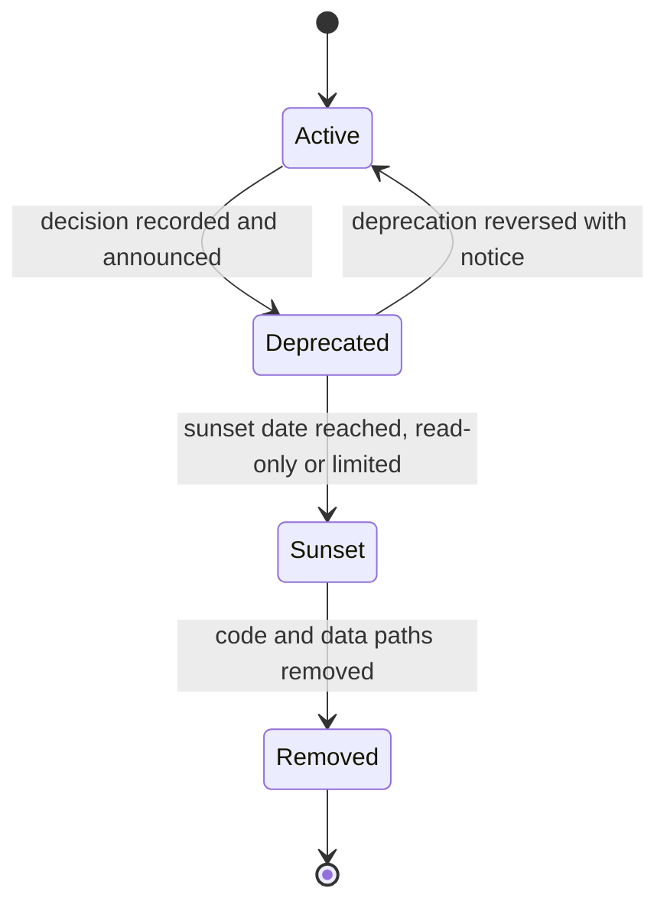

# Maintenance and Sustainability

Status: intended plan for keeping the complete product healthy over its life. Nothing here claims a practice is in place. Inputs: [PROJECT_MAINTENANCE.md](../../docs/engineering/PROJECT_MAINTENANCE.md), [OPERATIONS.md](../../docs/quality/OPERATIONS.md), [CODE_STYLE.md](../../docs/engineering/CODE_STYLE.md), CLAUDE.md rules. Evidence tags per [CONVENTIONS](../00_START_HERE/CONVENTIONS.md). No dates, team sizes or budgets are invented; schedules use cadence names only (`continuous`, `weekly`, `monthly`, `quarterly`, `semiannual`, `annual`, `per release`), and numeric thresholds are `[PROP]` parameters with `OD-MNT-` ids (section 15). Related: [infrastructure](./01_INFRASTRUCTURE_AND_DEPLOYMENT.md), [operations](./02_OPERATIONS_AND_SUPPORT.md), [engineering standards](../06_QUALITY_AND_PERFORMANCE/03_ENGINEERING_STANDARDS.md), [QA strategy](../06_QUALITY_AND_PERFORMANCE/02_QA_AND_TEST_STRATEGY.md).

## 1. Goals

1. The product remains buildable, testable, secure and operable by people who did not write it.
2. Maintenance is planned capacity, not leftover time: a share of every cycle is reserved (parameter `MNT_CAPACITY_SHARE`, `[PROP]` default proposal a fixed minority share of engineering capacity, `OD-MNT-01`).
3. Every decayed asset (dependency, doc, runbook, flag, test, vendor contract) has an owner and a review trigger.
4. Sustainability includes people (knowledge continuity) and money (FinOps), not just code.

## 2. Maintenance plan

### 2.1 Maintenance classes

| Class       | Definition                       | Examples                                                                  | Planning                             |
| ----------- | -------------------------------- | ------------------------------------------------------------------------- | ------------------------------------ |
| Corrective  | fix defects                      | bug fixes, regressions                                                    | defect process (doc 06/02 section 7) |
| Preventive  | reduce future failures           | refactors with tests, alert tuning, flaky test fixes, query tuning        | tech-debt backlog (section 5)        |
| Adaptive    | respond to environment changes   | runtime/framework/browser/OS updates, provider API changes, legal changes | dependency and vendor calendars      |
| Perfective  | improve non-functional qualities | performance, accessibility, usability polish                              | quarterly health review              |
| Operational | keep running                     | certificate renewals, key rotation, capacity, backups, data operations    | runbooks and scheduled jobs          |

### 2.2 Maintenance calendar (cadence names, no dates)

| Cadence     | Activities                                                                                                                                                                                                               | Owner role                                         |
| ----------- | ------------------------------------------------------------------------------------------------------------------------------------------------------------------------------------------------------------------------ | -------------------------------------------------- |
| continuous  | automated dependency alerts, vulnerability scanning, error tracking triage, secret scanning                                                                                                                              | engineering                                        |
| weekly      | alert review, flaky-test review, dependency update batch merge window, support top-issues review, stale PR sweep                                                                                                         | tech lead / SRE                                    |
| monthly     | error-budget review, capacity and cost review, incident aggregate review, vendor status review, documentation freshness report, defect aging review                                                                      | engineering lead, SRE                              |
| per release | release record, changelog, flag cleanup check, migration contract-phase scheduling                                                                                                                                       | release manager                                    |
| quarterly   | restore drill, access review, vendor review, FinOps review, quarterly health review (section 11), threat-model refresh for changed areas, performance baseline re-measure, suite health review, accessibility audit pass | engineering lead, SRE, security officer            |
| semiannual  | full rebuild-from-IaC drill, game day, key and certificate inventory audit, license audit                                                                                                                                | SRE, security officer                              |
| annual      | penetration test, architecture and ADR review, disaster recovery plan review, vendor exit tabletop, end-of-life review of the technology stack, policy review (privacy, retention, AI)                                   | architecture owner, security officer, privacy lead |

### 2.3 Maintenance work intake

- Sources: scanners, alerts, postmortem actions, health review findings, support top issues, developer pain reports, audit findings.
- All items become tickets labelled `maintenance` with class, risk, effort class and owner; unowned items are listed in the health review.
- Prioritization: risk score = likelihood x impact (security, data loss, availability, compliance weigh highest), then cost of delay (does it get harder if postponed, such as end-of-support dates), then effort.

### 2.4 Definition of healthy

The system is "healthy" when the quarterly health review checklist (section 11) passes with no red items older than one review cycle. Red items have an owner and a plan.

## 3. Platform baseline currency

Runtime and platform components tracked on a currency matrix (name, current version, support status, next support milestone, upgrade owner, last upgraded): Node.js runtime, pnpm, TypeScript, React, Vite, Fastify, Zod, `pg`, Vitest, Playwright, PostgreSQL major version, base container images, OS packages, browser support matrix, mobile OS support for the PWA, CDN/WAF rules, Terraform-class tooling, CI runner images, observability agents. The matrix is generated where possible (from lockfile and image manifests) and reviewed monthly. Rule: no component runs past its vendor end-of-support without a recorded exception with an owner and a mitigation (section 12).

## 4. Dependency upgrades

Applies with doc 03 (engineering standards) section 9. Build files (`package.json`, lockfiles, `tsconfig*`, `vite*`) are read-only for AI agents; every upgrade PR touching them needs the human repository owner's approval. [SRC: CLAUDE.md Rules]

### 4.1 Classes and handling

| Class                                      | Handling                                                                                                                                    | Cadence                                                      |
| ------------------------------------------ | ------------------------------------------------------------------------------------------------------------------------------------------- | ------------------------------------------------------------ |
| Security patch (exploitable high/critical) | out-of-band, fast path with targeted tests; severity targets in doc 03 section 9.2                                                          | continuous                                                   |
| Patch and minor (non-security)             | automated PR batch, CI must be green, merged by reviewer in the weekly window; grouped by ecosystem to limit noise                          | weekly                                                       |
| Major version                              | planned task with ADR if architectural effect: read changelog and migration guide, spike in a branch, update tests, canary rollout          | scheduled by currency matrix, at least before end-of-support |
| Runtime (Node, PostgreSQL major, OS)       | project with staging soak, perf comparison, rollback plan; PostgreSQL major uses blue/green or logical replication (doc 07/01 section 11.4) | annual review, ahead of end-of-support                       |
| Transitive-only vulnerability              | resolved via override or parent upgrade; exception recorded if no fix exists                                                                | continuous                                                   |
| Provider SDK/API versions                  | tracked in vendor register; adapter tests against provider sandbox                                                                          | monthly review                                               |

### 4.2 Upgrade procedure

1. Read release notes; classify risk (breaking changes, behavior changes, performance, license change).
2. Update in a dedicated PR with no unrelated changes; regenerate lockfile in the pipeline environment.
3. Run the full pipeline, including contract, integration with Postgres, migration, security, e2e smoke and performance comparison for runtime changes.
4. Review bundle size and install-script changes; new transitive dependencies are reviewed.
5. Roll out through normal release gates; major or runtime upgrades use canary and extended observation.
6. Record in the currency matrix and the changelog.

### 4.3 Policies

- Upgrade-or-justify: any dependency more than the allowed lag behind the latest supported major `[PROP]` (one major version) appears on the health review with an owner and reason. `OD-MNT-02`.
- Freeze-and-pin for unstable periods only by recorded decision with expiry.
- Automated update tooling is configured in repository settings or CI files, which are owner-approved build files.
- Deprecation warnings from dependencies and runtimes are treated as work items, not noise: counted and trended.
- Abandoned or unmaintained dependencies trigger a replacement or vendoring decision (ADR).
- Test coverage must make upgrades safe: if a dependency upgrade breaks nothing because no test covers the feature, the coverage gap is the finding.

## 5. Technical debt policy

### 5.1 Definition and classes

Technical debt is a known shortcut or decayed structure that raises the future cost or risk of change. Classes: design/architecture, code quality, test debt (missing or flaky), documentation debt, infrastructure debt, dependency debt, data debt (schema or data quality), security debt, accessibility debt, operational debt (missing runbook or alert).

### 5.2 Rules

1. **Visible:** debt is a ticket with: description, class, location, interest (what it costs each cycle), risk, proposed fix, effort class, owner, and the trigger that makes it urgent. Untracked debt is not allowed in merged code: a `TODO` must carry a ticket id (doc 03 section 2.6).
2. **Intentional debt allowed** only with a recorded decision: why now, the payoff, and a repayment trigger or review date by cadence name (for example "review at next quarterly health review").
3. **Budget:** `MNT_CAPACITY_SHARE` of each cycle is reserved for maintenance and debt; unspent share does not roll into feature work without the engineering lead's explicit record. `OD-MNT-01`.
4. **Prioritization:** risk first (security, data integrity, tenant isolation, availability), then interest (items that slow most changes), then effort. Quick wins are taken opportunistically.
5. **Boy-scout rule within scope:** small improvements in files already touched are welcome only when they stay inside the "surgical changes" principle; large refactors require approval before starting. [SRC: CLAUDE.md Rules "Ask before any big refactor"]
6. **Debt ceilings:** guardrail metrics trigger a debt sprint-equivalent when exceeded: open high-risk debt count, oldest high-risk age, flaky test count, dependency lag, skipped test count, unowned runbook count (`OD-MNT-03` sets thresholds).
7. **No new debt in protected areas:** auth, RLS, rate limits, migrations, honesty tests (`persistence-honesty`, `database-migrations`) never accept weakening as debt. [SRC: CLAUDE.md Rules]
8. **Repayment is verified:** closing a debt item includes evidence (metric, test or review) and removal of related TODOs, flags and docs notes.
9. **Honesty debt:** surfaces labelled `ephemeral` or simulated that block a release tier's exit criteria are tracked as `Must` debt until converted to durable behavior (feature status record is the source of truth). [SRC: CLAUDE.md Rules]
10. **Debt review:** the backlog is reviewed monthly (top items) and fully reviewed in the quarterly health review; items with no progress for two review cycles are either scheduled, re-scoped, or explicitly accepted with a sign-off.

### 5.3 Debt register fields

Id, title, class, module, linked `FR-`/ADR, risk (S1 to S4 style), interest description, trigger, effort class (S, M, L, XL), owner, created cadence marker, last reviewed, status (`Open`, `Scheduled`, `In progress`, `Accepted`, `Done`, `Withdrawn`).

## 6. Code and data hygiene tasks

| Task                                        | Cadence                            | Notes                                                                                   |
| ------------------------------------------- | ---------------------------------- | --------------------------------------------------------------------------------------- |
| Remove stale feature flags                  | per release, reported quarterly    | flag lifecycle (doc 03 section 10)                                                      |
| Remove dead code, unused exports and routes | quarterly                          | use coverage plus usage telemetry; unused public API versions follow deprecation policy |
| Remove unused tables and columns            | quarterly                          | contract phase of expand/contract only                                                  |
| Migrations squash/baseline                  | annual `[PROP]`, only with ADR     | history stays in repository; ledger helper still validates immutability                 |
| Index and query review                      | quarterly                          | slow query log, unused index report, bloat report                                       |
| Test suite health                           | quarterly                          | duplicates, slow tests, quarantined tests (doc 06/02 section 17)                        |
| Seed data and fixtures refresh              | per release when schema changes    | synthetic data only                                                                     |
| Content and taxonomy upkeep                 | per cadence in owning module       | skills taxonomy, job categories, countries, certificate definitions, translations       |
| Generated registers and docs freshness      | per release                        | stale generated file fails CI (doc 03 section 8)                                        |
| Secret and certificate rotation             | per cadence in doc 07/01 section 9 | inventory audit semiannual                                                              |
| Access recertification                      | quarterly                          | doc 07/02 section 15                                                                    |

## 7. Deprecation policy

Covers features (`FR-`), API versions and endpoints, events and webhook payload versions, SDK versions, integrations, browser/platform support, configuration options, and data exports.

### 7.1 Principles

1. Nothing is removed silently. Users and integrators get notice, a migration path and a sunset date.
2. Removal needs a decision record (ADR or `DEC-`) naming the reason: low usage, replaced, security, cost, legal, vendor end-of-life.
3. The `FR-`, `API-` or `EVT-` id keeps its identity with status `Withdrawn` after removal (never reused). [SRC: CONVENTIONS §3]
4. Contracted customers (enterprise, institution) with agreed terms receive the longer of the policy notice and contract notice.

### 7.2 Lifecycle

| Stage             | What happens                                                                                                                                              | Controls                                    |
| ----------------- | --------------------------------------------------------------------------------------------------------------------------------------------------------- | ------------------------------------------- |
| Announce          | changelog, in-app notice, email to affected users/integrators identified via usage telemetry, docs banner, status/developer announcement                  | announcement text reviewed by product owner |
| Deprecated        | feature works; new use discouraged or blocked for new tenants; API returns `Deprecation` and `Sunset` headers and logs usage per caller; warnings in SDKs | usage dashboard by caller                   |
| Migration support | migration guide, tooling or export, support macro, office hours for integrators                                                                           | tickets tagged `deprecation`                |
| Sunset            | feature read-only or limited, final reminder, final export offered                                                                                        | blocked only after remaining-usage review   |
| Removal           | code, routes, flags, jobs, tables or columns removed via contract phase; docs and KB redirected; data retained or deleted per retention policy            | removal PR links decision; export done      |

### 7.3 Minimum notice periods `[PROP]`

Parameters `DEPR_NOTICE_UI_FEATURE`, `DEPR_NOTICE_API_VERSION`, `DEPR_NOTICE_WEBHOOK`, `DEPR_NOTICE_SECURITY` with default proposals: end-user features one release cycle plus a minimum notice period; public API versions a longer period than end-user features and not less than a full quarter of overlap with the successor; webhook payload versions as API versions; security-driven removals as fast as safe, with direct notice. Exact values `OD-MNT-04`.

### 7.4 Rules

- A deprecated API version stays supported in security fixes until sunset.
- Telemetry on remaining usage gates removal: removal requires that remaining callers are contacted or that the decision-maker signs a documented override.
- User data in a removed feature is exported to the user or deleted per retention rules, with the privacy lead's sign-off.
- Browser/platform support drops follow the same notice and are tied to the browser support matrix in QA.
- Contract tests (doc 06/02 section 4.3) keep running for deprecated versions until removal.

## 8. Documentation upkeep

Applies doc 03 section 8 (documentation as code).

1. **Ownership:** every document names an owner role; docs with no owner appear in the quarterly health review.
2. **Freshness:** each runbook, ADR-status, API doc, and onboarding doc has "last verified" metadata updated only when verified; a freshness report lists documents past their verification interval by class (runbooks: quarterly cadence; onboarding: per hire and per quarter; API docs: per release; module specs: per release touching the module; policies: annual).
3. **Docs in the change path:** PR template asks which docs changed; CI blocks stale generated files; link and anchor check blocks broken links.
4. **Registers and traceability:** generated from module specs (`09_REGISTERS`) and tests; regenerating is part of each release.
5. **Status honesty:** only `ARCHITECTURE.md` and feature-status reports describe what is built; module specs describe intent. A feature moves to "implemented" only with verification evidence. [SRC: CLAUDE.md Rules]
6. **Divergence handling:** if code and spec diverge, either fix the code or amend the spec through a PR with rationale; no silent drift. An `OD-` records unresolved divergence.
7. **Knowledge base and help center** follow the support process (doc 07/02 section 9.4).
8. **Archive policy:** superseded documents are moved with a pointer, not deleted, unless they contain personal or secret data.
9. **Docs quality checks:** a new engineer's onboarding is a test of docs: each onboarding finding becomes a documentation fix.

## 9. Knowledge continuity and bus-factor controls

### 9.1 Bus factor definition

Bus factor of an area = the minimum number of people whose absence would stall it. Target `[PROP]`: at least two people able to operate, deploy, restore and modify every critical area. `OD-MNT-05`.

### 9.2 Critical areas register

A register per area (authentication and session keys, database and migrations, payments and entitlements, email deliverability, worker and queues, search, assessment integrity, AI provider integration, infrastructure and IaC, CI/CD, domain/DNS/certificates, secrets manager, vendor accounts, security and privacy operations) with: primary owner, secondary owner, last cross-training date marker, runbook ids, ADR ids, access status. Any area with a single named person is a red item in the health review.

### 9.3 Controls

1. **Pairing and rotation:** non-trivial changes in critical areas involve a second person (review is not enough: the second person must be able to explain the change); on-call rotation covers critical areas widely.
2. **Runbooks and rebuild drills:** the full rebuild-from-IaC drill is performed by someone other than the usual operator (doc 07/01 section 16.5).
3. **Decision memory:** ADRs and `DEC-` records capture the why; postmortems capture operational lessons; the blueprint modules capture product intent. Tribal knowledge discovered in a conversation is written down within the working cycle.
4. **Onboarding path:** a documented path (environment setup, architecture tour, first PR, first on-call shadow) is kept current by the most recent joiner; time-to-first-merged-PR is a metric.
5. **Access continuity:** all accounts are organizational (no personal accounts for vendors or cloud); at least two administrators per system; credentials in the secrets manager with break-glass (doc 07/02 section 15); recovery contacts for domains and registrars are role-based mailboxes.
6. **Departure protocol:** knowledge handoff meeting and document, access revocation the same working cycle, key rotation if the person held shared secrets, review of unfinished work and on-call coverage.
7. **Vendor and contractor continuity:** contractor work follows the same repository, review and documentation rules; escrow of access (not code ownership issues) and exit documentation in contracts.
8. **AI-agent continuity:** instructions for agents (CLAUDE.md, AGENTS.md) are kept current; agent-written work follows the same review and DoD; agents do not hold unique knowledge: any context worth keeping is committed to docs or ADRs. [SRC: CLAUDE.md]
9. **Single points of failure beyond people:** one provider account, one domain registrar, one CI provider, one secrets store: each listed with a recovery plan.
10. **Tests of continuity:** an annual "key-person-out" exercise where the primary owner of a critical area is excluded and the secondary performs a deploy, a restore or an incident drill; findings become tasks.

## 10. Cost and FinOps review

Reviewed in the monthly capacity and cost review and in depth quarterly. Inputs: tagged cost data (doc 07/01 section 17), usage metrics, vendor register.

### 10.1 Quarterly FinOps checklist

1. Spend by service, environment and tenant tier versus budget (`COST_BUDGET_<ENV>`); variance explained.
2. Unit economics: cost per monthly active user, per application, per video hour, per assessment, per AI call, per email; trend and outliers.
3. Top cost drivers (compute, database, storage, egress, media transcoding, AI tokens, search, observability, third-party licenses) with a reduction or acceptance decision each.
4. Waste: idle and orphaned resources, over-provisioned instances, unused indices and replicas, stale preview environments, log volume.
5. Commitments: reserved capacity or savings plans versus actual baseline use.
6. Data lifecycle: storage tiers, retention sweeps effectiveness, backup size growth.
7. Observability cost: log and metric cardinality and retention versus value; sampling adjustments.
8. AI cost guardrails: per-user and per-tenant caps effective, prompt and model efficiency, cache hit rates; model choice versus quality (eval results, doc 06/02 section 16).
9. Vendor costs vs usage tiers; renegotiation or replacement candidates.
10. Forecast against capacity parameters (doc 07/01 section 15) and planned tier releases.
11. Cost of reliability: DR and multi-region cost versus RPO/RTO benefits.
12. Report to the product owner and finance with actions, owners and expected savings stated as ranges, not fabricated figures.

### 10.2 Rules

- Any new infrastructure component or vendor includes a cost model in its ADR.
- Cost anomaly alerts open a ticket (RB-OPS-02).
- Cost-reducing changes follow normal change control; never cut backups, security controls or monitoring to save cost without an approved risk acceptance.
- Pricing and plan decisions for customers belong to the commercial module and product owner, not this process.

## 11. Quarterly health review checklist

Held once per quarterly cadence. Output: a health report with red, amber and green status per area, an action list with owners, and decisions recorded. No dates in this document: the report carries its own cadence marker.

### 11.1 Security and compliance

- [ ] Open vulnerabilities: none exploitable high/critical past target; exceptions have owner and expiry.
- [ ] Privileged access recertified; break-glass uses reviewed; leavers' access removed.
- [ ] Secret and certificate inventory current; rotations performed on cadence.
- [ ] Penetration test and DAST findings tracked; threat models refreshed for changed areas.
- [ ] Privacy: data subject request deadlines met; retention sweeps ran and anomalies reviewed; legal holds reviewed; vendor DPAs current.
- [ ] Audit logs complete and tamper-evident check passed.
- [ ] AI governance: bias, safety and cost reports reviewed; model/provider changes recorded.

### 11.2 Reliability and operations

- [ ] SLO attainment and error budgets reviewed; release pacing decisions recorded.
- [ ] Incident trends, repeat incidents, postmortem action closure.
- [ ] Alert precision and paging load reviewed; noisy alerts removed.
- [ ] Runbooks verified inside interval; coverage of paging alerts complete.
- [ ] Restore drill performed; achieved RPO/RTO versus targets recorded; backup success rate reviewed.
- [ ] Capacity headroom versus forecast; known burst plans current.
- [ ] Synthetic probes cover all critical journeys.
- [ ] Status page accuracy and communication latency reviewed.

### 11.3 Quality and engineering health

- [ ] Defect aging and escape rate; S1/S2 regression tests present.
- [ ] Flaky test rate; quarantine list age; skipped tests list.
- [ ] AC traceability coverage for shipped scope; BR and SM coverage.
- [ ] Performance baselines re-measured; budgets vs actuals; regression list.
- [ ] Accessibility audit pass; open a11y debt.
- [ ] Dependency currency matrix reviewed; items past lag limit have owners; end-of-support horizon list.
- [ ] Tech-debt register reviewed; debt ceilings checked; stale items resolved or accepted.
- [ ] Stale flags removed; flag inventory current.
- [ ] Generated registers and docs fresh; unowned docs assigned.
- [ ] Persistence honesty: labelled-ephemeral and simulated surfaces listed against release-tier exit criteria.

### 11.4 People and continuity

- [ ] Bus-factor register: areas with a single owner listed; cross-training plan.
- [ ] Onboarding path walked or updated; time-to-first-merge reviewed.
- [ ] On-call load and training status.
- [ ] Vendor and account continuity: two admins per system confirmed.

### 11.5 Vendors and cost

- [ ] Vendor register reviewed; SLA attainment; incidents; subprocessor changes; renewals ahead; exit plans current.
- [ ] FinOps checklist (section 10.1) completed.
- [ ] Concentration-risk review.

### 11.6 Product and platform lifecycle

- [ ] Deprecation list: active deprecations, remaining usage, removal readiness.
- [ ] Feature usage review: candidates for deprecation or investment.
- [ ] Support top issues and KB gaps; user satisfaction trends.
- [ ] Open decisions (`OD-`) older than one review cycle: decide, re-scope or escalate.
- [ ] Risk register (`RSK-`) review: new, changed, retired risks.
- [ ] End-of-life horizon scan (section 12) updated.

### 11.7 Review rules

- Any red item older than one cycle is escalated to leadership with a decision request (fix, accept risk with sign-off, or stop).
- The checklist itself is reviewed annually for relevance.

## 12. End-of-life (EOL) planning

### 12.1 Horizon scan

A living register of end-of-support and end-of-life milestones for: runtimes (Node, PostgreSQL), frameworks and libraries (React, Fastify, Vite and others), operating systems and container base images, browsers and mobile OS versions in the support matrix, cloud services and instance types, provider APIs (payments, email, AI models, video, background-check, identity), SDKs, protocols and standards (TLS versions, authentication standards), certificates and domains, and licenses. For each: milestone cadence marker (as published by the vendor), impact, owner, planned action, and lead time needed. Items within the lead-time horizon are red in the health review.

### 12.2 Lead-time rule

Every EOL item has a required lead time (effort class plus testing and rollout) and must be started when the remaining time reaches `1.5 x` lead time `[PROP]` (`OD-MNT-06`). Missing this threshold escalates automatically.

### 12.3 AI model and provider EOL

Models and provider APIs are deprecated frequently: each AI capability pins a model version in configuration, has a documented fallback model, and a re-evaluation path through the evaluation gate G8 (doc 06/02 section 16) so a forced migration is a routine change, not an emergency.

### 12.4 Product, feature and module EOL

1. Decision criteria: sustained low usage with no strategic role, cost exceeds value, replaced by a better module, legal/security cause, vendor end-of-life with no replacement.
2. Follow the deprecation lifecycle (section 7), including data export and deletion plans and customer communications; modules marked "OS expansion" (MEN, GIG, EVT, MKT, ENT) are gated by `DEC-002` and may be descoped through this process without loss of the specs, which stay as `Withdrawn` or `Won't-now`.
3. Dependencies: before removal, a dependency scan lists modules, events, jobs, tables, integrations and docs that reference the item; each is handled in the removal plan.
4. Contractual and legal obligations (data retention after termination, notice to enterprise customers) are checked by legal before announcement.

### 12.5 Platform sunset

A plan template exists for a hypothetical full wind-down so obligations are known in advance: customer notice, data export for all users and institutions, deletion of personal data per retention policy, vendor contract terminations, secret and domain handling, archive of source and documentation, financial records retention, status communications. It is reviewed annually and is not a commitment about the product's future. `OD-MNT-07` decides whether to maintain this template.

### 12.6 Repository and tooling EOL

Build tooling, CI providers and package registries are on the horizon register; migration to a replacement follows the ADR and dual-run approach (doc 03 section 7) with the build-file approval path for configuration changes. [SRC: CLAUDE.md Rules]

## 13. Sustainability metrics

| Metric                                 | Definition / formula                                                     | Owner role       |
| -------------------------------------- | ------------------------------------------------------------------------ | ---------------- |
| Maintenance capacity share             | maintenance and debt effort / total engineering effort per cycle         | engineering lead |
| Dependency lag                         | dependencies behind latest supported major / total                       | tech lead        |
| Items past end-of-support              | EOL register entries beyond milestone without exception                  | tech lead        |
| Mean time to patch (security)          | disclosure to production per severity                                    | security officer |
| Debt backlog age                       | median and p90 age of open high-risk debt                                | engineering lead |
| Debt interest trend                    | tickets labelled debt-slowdown per cycle                                 | tech lead        |
| Docs freshness                         | docs within verification interval / total owned docs                     | doc owners       |
| Runbook currency                       | runbooks verified within interval / total                                | SRE              |
| Bus-factor coverage                    | critical areas with at least two qualified people / total critical areas | engineering lead |
| Time to first merged PR (new joiner)   | join to first merged change                                              | engineering lead |
| Flag debt                              | release flags past removal criteria / active release flags               | tech lead        |
| Cost per MAU trend                     | monthly spend / MAU                                                      | finance, SRE     |
| Waste ratio                            | identified waste spend / total spend                                     | SRE              |
| Deprecation completion                 | deprecations reaching Removed on plan / total                            | product owner    |
| Health review red items open > 1 cycle | count                                                                    | engineering lead |

Targets are set after baseline (`OD-MNT-08`).

## 14. Roles

| Role                          | Responsibility                                                  |
| ----------------------------- | --------------------------------------------------------------- |
| Engineering lead              | owns maintenance capacity, debt policy, health review           |
| Tech lead(s) per module group | dependency upgrades, debt register, flags, module docs          |
| SRE                           | currency of platform, drills, capacity, FinOps data             |
| Security officer (`SAD`)      | vulnerability policy, access review, pen test                   |
| Privacy lead                  | retention, DPAs, data operations approvals                      |
| Product owner                 | deprecation decisions, EOL of features, health review decisions |
| Finance partner               | FinOps review, budgets                                          |
| Doc owners                    | freshness of their documents                                    |

One person may hold several roles; no headcount is implied.

## 15. Open decisions

| Id        | Question                                                    | Options                             | Default proposal `[PROP]`                                    | Decides                         | Blocks              |
| --------- | ----------------------------------------------------------- | ----------------------------------- | ------------------------------------------------------------ | ------------------------------- | ------------------- |
| OD-MNT-01 | Reserved maintenance capacity share                         | fixed share / per-cycle negotiation | fixed minority share, reviewed quarterly                     | engineering lead, product owner | planning            |
| OD-MNT-02 | Allowed dependency lag                                      | one major / two majors / n.a.       | one major behind latest supported                            | tech lead                       | health review       |
| OD-MNT-03 | Debt ceiling thresholds                                     | numeric after baseline              | set after first quarterly review                             | engineering lead                | debt policy         |
| OD-MNT-04 | Deprecation notice periods                                  | per class                           | section 7.3 defaults, contract terms override                | product owner, legal            | deprecation process |
| OD-MNT-05 | Bus-factor target                                           | two / three for critical            | two for all, three for security and database                 | engineering lead                | continuity plan     |
| OD-MNT-06 | EOL start threshold                                         | multiplier                          | 1.5 x lead time                                              | tech lead                       | horizon register    |
| OD-MNT-07 | Maintain a platform wind-down template                      | yes / no                            | yes, annual review                                           | leadership                      | EOL planning        |
| OD-MNT-08 | Targets for sustainability metrics                          | after baseline                      | propose after two quarterly cycles                           | engineering lead                | dashboards          |
| OD-MNT-09 | Dependency update automation and its configuration location | tool choice                         | automated PR batches; config as an owner-approved build file | repository owner                | upgrade flow        |

## 16. Risks

| Id         | Risk                                                  | Mitigation                                                         |
| ---------- | ----------------------------------------------------- | ------------------------------------------------------------------ |
| RSK-MNT-01 | Maintenance squeezed out by feature pressure          | reserved capacity, health review escalation of red items           |
| RSK-MNT-02 | Unnoticed end-of-support of a runtime or provider API | horizon register with lead time rule, model/provider pinning       |
| RSK-MNT-03 | Knowledge concentrated in few people                  | bus-factor register, pairing, key-person-out exercise              |
| RSK-MNT-04 | Documentation drifts from intent and from code        | docs-as-code checks, freshness reports, divergence rule            |
| RSK-MNT-05 | Deprecations break integrators                        | notice periods, usage telemetry, contract tests until removal      |
| RSK-MNT-06 | Build-file restriction delays urgent upgrades         | owner-approved fast path for security patches, pre-agreed approver |
| RSK-MNT-07 | Cost drift unnoticed in media and AI usage            | monthly review, unit economics, caps                               |
| RSK-MNT-08 | Quarterly review becomes ritual without action        | red-item escalation rule, annual checklist review                  |

## 17. Acceptance criteria (testable)

1. Given a vendor end-of-support milestone within 1.5 x the recorded lead time, when the monthly review runs, then the item is flagged red with an owner; absent owner fails the review (negative case).
2. Given a security patch for a high-severity exploitable dependency, when it is merged via the fast path, then it reaches production within the severity target and the currency matrix is updated.
3. Given a feature marked Deprecated, when a caller requests its API, then responses carry `Deprecation` and `Sunset` headers and usage by that caller is logged.
4. Given a removal PR for a deprecated API with remaining callers and no sign-off, then the review check blocks merge (negative case).
5. Given a critical area with one named owner, when the bus-factor report is generated, then it appears red in the quarterly checklist.
6. Given a stale generated register, when CI runs, then the pipeline fails.

## 18. Legacy trace

Informed by PROJECT_MAINTENANCE.md, OPERATIONS.md, CODE_STYLE.md and the ADR practice in `docs/engineering/adr`. Dropped: any assertion of existing maintenance procedures. Added `[PROP]`: reserved maintenance capacity, debt ceilings, deprecation lifecycle with notice parameters, EOL horizon register with lead-time rule, bus-factor register and key-person-out exercise, quarterly health review checklist, platform wind-down template.
