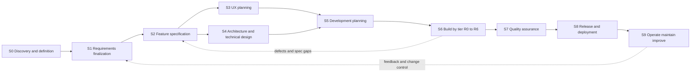

# Lifecycle Roadmap

The dependency-aware plan from product definition to long-term maintenance. It contains no dates, durations, team sizes or cost estimates: none were provided, and inventing them would be a business assumption. Order comes from dependencies and from the decisions that gate each step.

Related: [Tier plan](02_TIER_PLAN.md) · [Decision gates and critical path](03_DECISION_GATES_AND_CRITICAL_PATH.md) · [Build order from architecture](../04_ARCHITECTURE/08_TECHNICAL_SPECIFICATION_INDEX.md) · [Feature register by tier](../09_REGISTERS/FEATURES_BY_RELEASE_TIER.md)

## 1. Lifecycle stages

| Stage                                | Purpose                                                                         | Status of this stage in the blueprint                                                                                                 |
| ------------------------------------ | ------------------------------------------------------------------------------- | ------------------------------------------------------------------------------------------------------------------------------------- |
| S0 Discovery and definition          | Vision, scope, roles, journeys, business rules, unknowns                        | Drafted in [`01_PRODUCT`](../01_PRODUCT/). Needs owner ratification (`OD-PRD-31`).                                                    |
| S1 Requirements finalization         | Close the open decisions that block building; freeze the baseline for R0 and R1 | Not started. 38 high-level decisions and every module `OD-` are open: see the [register](../09_REGISTERS/OPEN_DECISIONS_REGISTER.md). |
| S2 Feature specification             | Feature-level specs a team can build from                                       | Drafted for all 30 modules in [`02_MODULES`](../02_MODULES/).                                                                         |
| S3 UX planning                       | Information architecture, design system, interaction rules, screen specs        | Drafted in [`03_EXPERIENCE`](../03_EXPERIENCE/). Visual design and prototypes not started.                                            |
| S4 Architecture and technical design | Target architecture, data, API, events, AI, security                            | Drafted in [`04_ARCHITECTURE`](../04_ARCHITECTURE/) and [`05_SECURITY_PRIVACY`](../05_SECURITY_PRIVACY/).                             |
| S5 Development planning              | Slice the baseline into buildable work, assign ownership, set up environments   | Not started. Depends on S1 and the owner-approved build-file change (F1).                                                             |
| S6 Build                             | Implement tier by tier                                                          | Not started. See [tier plan](02_TIER_PLAN.md).                                                                                        |
| S7 Quality assurance                 | Verify every acceptance criterion and quality target                            | Strategy drafted in [`06_QUALITY_AND_PERFORMANCE`](../06_QUALITY_AND_PERFORMANCE/).                                                   |
| S8 Release and deployment            | Controlled rollout with rollback                                                | Drafted in [`07_DEVOPS_AND_OPERATIONS`](../07_DEVOPS_AND_OPERATIONS/).                                                                |
| S9 Operate, maintain, improve        | Run, support, evolve, retire                                                    | Drafted in [`07_DEVOPS_AND_OPERATIONS`](../07_DEVOPS_AND_OPERATIONS/).                                                                |

## 2. Stage detail

### S0 Discovery and definition

- **Deliverables:** vision and strategy; scope and boundaries; personas and roles; permission matrix; user journeys; business model and cross-module rules; module map; stakeholder decisions list.
- **Inputs:** `SSOT.md`, `docs/`, `Yash_Final_Project_Document/`, owner direction (career operating system, learning in scope).
- **Exit criteria:** every role has goals, permissions and at least one journey; every module has an owner role and a boundary; every unknown is an `OD-`.
- **Risks:** scope creep from the OS goal (`DEC-002`); non-goal conflicts with `SSOT.md` §4.2 (`OD-PRD-02`).

### S1 Requirements finalization

- **Deliverables:** recorded `DEC-` entries for every U1 decision; a frozen baseline version of the blueprint for R0 and R1; a ratification record (`OD-PRD-31`).
- **Activities:** stakeholder review of the [open decisions register](../09_REGISTERS/OPEN_DECISIONS_REGISTER.md) by urgency class; resolve cross-module conflicts listed in the [integrity report](../09_REGISTERS/INTEGRITY_REPORT.md); counsel review of the [compliance map](../05_SECURITY_PRIVACY/03_COMPLIANCE_MAP.md); user research before R1 (`OD-PRD-25`).
- **Exit criteria:** zero open U1 decisions; R0 and R1 features have no unresolved `[DEC-REQ]` tags.
- **Dependencies:** owner and legal availability; this stage gates S5.

### S2 Feature specification

- **Deliverables:** feature specs, business rules, state machines, screens, entities and events per module ([register](../09_REGISTERS/FEATURE_REGISTER.md)).
- **Change control:** a spec change keeps the id, bumps the module file history, and re-runs the registers and integrity report.
- **Exit criteria (per module):** all 15 sections present; every feature has at least three acceptance cases including a negative case ([coverage report](../09_REGISTERS/ACCEPTANCE_CRITERIA_COVERAGE.md)); no dangling ids.

### S3 UX planning

- **Deliverables:** information architecture, design system, interaction patterns, accessibility rules, responsive and PWA rules, microcopy guide, screen checklist.
- **Still needed (not produced by this blueprint):** visual identity, high-fidelity screens, clickable prototypes, usability tests, accessibility audit of designs.
- **Exit criteria:** every `SCR-` screen in R0 and R1 has a screen spec using the [checklist](../03_EXPERIENCE/07_SCREEN_STATE_CHECKLIST.md) and a usability test result.

### S4 Architecture and technical design

- **Deliverables:** system architecture, data model, API design, event and job design, integration adapters, AI architecture, search, media and realtime architecture, security and privacy architecture.
- **Exit criteria:** foundational decisions `DEC-ARC-001`, `002`, `005`, `006`, `008`, `009`, `010`, `018` ratified or replaced; architecture-versus-module conflicts (C-01 to C-08 in the technical index) closed.

### S5 Development planning

- **Deliverables:** the batched build-file change (F1) approved by the owner; work slices per feature; environments; CI gates restored (`OD-PRD-32`); definition of done adopted.
- **Rule:** no build file is changed without explicit owner approval (`AGENTS.md`).
- **Exit criteria:** a green CI baseline; the foundation steps F1 to F10 sequenced.

### S6 Build

Build proceeds foundation first, then tier by tier as in the [tier plan](02_TIER_PLAN.md). Each feature is a vertical slice: contract, domain rule, migration, repository, use case with events, route, web feature, tests, verification in the running app.

### S7 Quality assurance

Continuous, per slice and per tier: unit, contract, integration, security, end-to-end, accessibility, performance and resilience tests as defined in the [QA strategy](../06_QUALITY_AND_PERFORMANCE/02_QA_AND_TEST_STRATEGY.md). A tier cannot exit while a Must feature has a failing acceptance case.

### S8 Release and deployment

Progressive rollout behind feature flags with a rollback path per release, following [infrastructure and deployment](../07_DEVOPS_AND_OPERATIONS/01_INFRASTRUCTURE_AND_DEPLOYMENT.md). Release gates: tier exit criteria, security and privacy review, accessibility conformance, backup and restore proven, runbooks present.

### S9 Operate, maintain, improve

Support, incident response, dependency and debt management, deprecation, cost review and the quarterly health review in [maintenance and sustainability](../07_DEVOPS_AND_OPERATIONS/03_MAINTENANCE_AND_SUSTAINABILITY.md). Product feedback re-enters at S1 through change control.

## 3. Cross-cutting tracks

| Track                | Runs through | Owner role                | Output                                                                                  |
| -------------------- | ------------ | ------------------------- | --------------------------------------------------------------------------------------- |
| Decision management  | S0 to S9     | Product owner             | Decision register kept current                                                          |
| Security and privacy | S1 to S9     | Security and privacy lead | Threat models, DPIAs, reviews                                                           |
| Accessibility        | S3 to S9     | Design lead and QA        | Conformance evidence                                                                    |
| Documentation        | S0 to S9     | Documentation owner       | Blueprint kept in step with built behavior; "implemented" only from executable evidence |
| Cost and capacity    | S4 to S9     | Engineering lead          | Budgets and reviews against `OD-` parameters                                            |

## 4. Change control for this blueprint

1. Propose the change as an edit to the owning file; keep ids stable; never reuse a retired id.
2. Record a `DEC-` entry for any decision that changes scope, money, law or trust.
3. Regenerate the registers and read the integrity report; fix new dangling references.
4. Update dependent files named in the module's dependency section.
5. The ratification owner approves baseline changes after S1 (`OD-PRD-31`).
