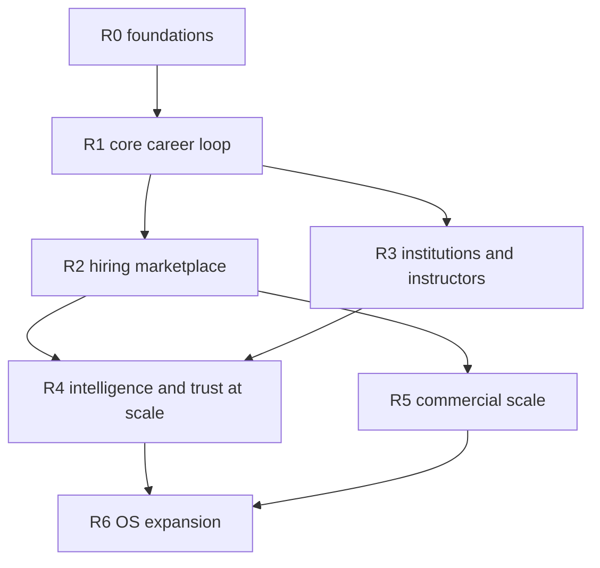

# Tier Plan (R0 to R6)

Each tier states its goal, entering capabilities, prerequisites, deliverables, exit criteria (observable), acceptance, risks and the decisions that gate it. Tiers follow dependencies and carry no dates. The authoritative scope map is [`01_PRODUCT/02_SCOPE_AND_BOUNDARIES.md` §4](../01_PRODUCT/02_SCOPE_AND_BOUNDARIES.md); per-feature tiers are in the [feature register](../09_REGISTERS/FEATURES_BY_RELEASE_TIER.md). Foundation steps F1 to F10 are in the [technical index §4.1](../04_ARCHITECTURE/08_TECHNICAL_SPECIFICATION_INDEX.md).

## Rules that apply to every tier

1. **Foundation first.** No module feature starts before its foundation dependency (F1 to F10 for R0) exists.
2. **Exit criteria are observable.** A tier exits when its exit scenario passes in the running application and every Must feature has passing acceptance cases ([QA strategy](../06_QUALITY_AND_PERFORMANCE/02_QA_AND_TEST_STRATEGY.md)).
3. **R0 controls are never bypassed:** consent, audit, tenancy, accessibility.
4. **Gated scope stays gated.** A feature whose scope decision is open ships off by default and is denied by policy until the decision closes in favor.
5. **Status comes from evidence.** Nothing is called implemented from documentation.

## R0 Foundations

| Item             | Detail                                                                                                                                                                                                                                |
| ---------------- | ------------------------------------------------------------------------------------------------------------------------------------------------------------------------------------------------------------------------------------- |
| Goal             | Anyone can hold a safe account, control privacy and receive messages.                                                                                                                                                                 |
| Modules entering | IDN, SET, NTF (transactional), ADM (audit, scoped support, flags), PLT (files, malware scan, outbox, worker), ANL (consented capture), PWA (shell, offline read cache), TSF (intake, manual moderation), BIL (free entitlement stub). |
| Prerequisites    | Owner-approved build-file change (F1); ratified foundation decisions (F2); green CI baseline (`OD-PRD-32`).                                                                                                                           |
| Deliverables     | Tenant-safe data access, outbox and job engine, policy package, session model, consent ledger, audit store, upload pipeline, email delivery, accessibility baseline.                                                                  |
| Exit scenario    | A user registers, sets visibility, grants and revokes a consent, exports data and requests erasure; every step is audited and tenant-isolated.                                                                                        |
| Acceptance       | Cross-tenant test suite green; kill-the-worker test shows no lost or duplicated effects; keyboard-only and screen-reader pass on R0 screens; no token readable by page script.                                                        |
| Risks            | Foundation work delays all later tiers; migration off the as-built session and data access model. See `RSK-ARC-*`.                                                                                                                    |
| Gating decisions | `OD-PRD-10`, `OD-PRD-11`, `OD-PRD-13`, `OD-PRD-30` to `OD-PRD-35`, `OD-PRD-38`, `OD-ARC-01` to `OD-ARC-03`.                                                                                                                           |

## R1 Core career loop

| Item             | Detail                                                                                                                                                                                                                                                                                                                             |
| ---------------- | ---------------------------------------------------------------------------------------------------------------------------------------------------------------------------------------------------------------------------------------------------------------------------------------------------------------------------------- |
| Goal             | A candidate proves skills and work history, learns, applies and hears back.                                                                                                                                                                                                                                                        |
| Modules entering | PRF, EVD, BGV (referee and email-domain verification), SRC (lexical search, taxonomy), LRN (first-party free catalog), ASM (quizzes, projects, unverified code attempts), EMP (basic), JOB, ATS (single pipeline), INT (manual scheduling), MSG (application threads), AIC (explainable non-AI matching), REP (completion badges). |
| Prerequisites    | R0 complete; skills taxonomy sub-module (owner per `OD-ARC-07`).                                                                                                                                                                                                                                                                   |
| Deliverables     | The end-to-end loop Goal, Gap, Learn, Practice, Prove, Verify, Discover, Match, Apply, Interview, Outcome with evidence at Prove, Verify and Outcome.                                                                                                                                                                              |
| Exit scenario    | One candidate completes the loop with a real employer-side counterpart; evidence is produced and shareable under consent.                                                                                                                                                                                                          |
| Acceptance       | The relevant journeys (`JRN-CAN-*`, `JRN-REC-*`) pass end to end; acceptance cases for every Must feature pass; usability test on the loop.                                                                                                                                                                                        |
| Risks            | Cold start (no jobs, no candidates); evidence quality; scope inflation from the OS goal.                                                                                                                                                                                                                                           |
| Gating decisions | `OD-PRD-01`, `OD-PRD-06` (free tier), `OD-PRD-09` (pilot scope), `OD-PRD-25` (user research), `OD-PRD-14`.                                                                                                                                                                                                                         |

## R2 Hiring marketplace

| Item             | Detail                                                                                                                                                                                                                                                                                                          |
| ---------------- | --------------------------------------------------------------------------------------------------------------------------------------------------------------------------------------------------------------------------------------------------------------------------------------------------------------- |
| Goal             | Employers hire at volume with fair, efficient tools.                                                                                                                                                                                                                                                            |
| Modules entering | ATS (requisitions, approvals, offers), INT (loops, self-scheduling, calendar sync, scorecards), EMP (teams, roles, SSO, brand), SRC (consent-gated discovery), MSG (outreach with quotas, realtime), NET (connections, referrals), BIL (employer subscriptions, seats, dunning), BGV (employment confirmation). |
| Prerequisites    | R1; BIL entitlements for posting and recruiter search; PLT calendar and email ports.                                                                                                                                                                                                                            |
| Exit scenario    | A multi-recruiter organization runs requisition to offer to hire with scorecards and approvals; candidates are notified at every terminal state.                                                                                                                                                                |
| Acceptance       | Hiring journeys pass; adverse-impact reporting works on test data; human actor recorded on every consequential decision.                                                                                                                                                                                        |
| Risks            | Fairness and compliance exposure (hiring AI regulation); spam and abuse of outreach.                                                                                                                                                                                                                            |
| Gating decisions | `OD-PRD-06` (paid packaging), `OD-PRD-08`, `OD-PRD-12`, `OD-PRD-16`, `OD-PRD-17` (reviews), `OD-PRD-22`, `OD-PRD-23`.                                                                                                                                                                                           |

## R3 Institutions and instructors

| Item             | Detail                                                                                                                                                |
| ---------------- | ----------------------------------------------------------------------------------------------------------------------------------------------------- |
| Goal             | Institutions and instructors teach, assess and place.                                                                                                 |
| Modules entering | INS, STU, LRN (institution catalogs, assignments), ASM (rubric grading, peer review, attestations), BIL (institution licences), PLT (media pipeline). |
| Prerequisites    | R1 (and R2 for placement drives with employers).                                                                                                      |
| Exit scenario    | A cohort is provisioned, taught, assessed and graduates; credentials stay with the graduate's independent identity.                                   |
| Acceptance       | Institution journeys pass; k-anonymous analytics suppress small cohorts; minors only through institutions with restricted defaults.                   |
| Risks            | Minors and education-record law; instructor content quality and copyright.                                                                            |
| Gating decisions | `OD-PRD-07`, `OD-PRD-11`, `OD-PRD-37`.                                                                                                                |

## R4 Intelligence and trust at scale

| Item             | Detail                                                                                                                                                                                                                                           |
| ---------------- | ------------------------------------------------------------------------------------------------------------------------------------------------------------------------------------------------------------------------------------------------ |
| Goal             | Guidance gets smarter while trust controls scale.                                                                                                                                                                                                |
| Modules entering | AIC (gateway, assistant, tailoring, recommendations), TSF (automated triage, appeals), BGV (vendor checks), REP (contextual reputation), ANL (organization and institution dashboards), ASM (isolated code runner; proctoring only if admitted). |
| Prerequisites    | R2 and R3; AI funding decision; fairness controls from [`04_FAIRNESS_AND_AI_GOVERNANCE.md`](../05_SECURITY_PRIVACY/04_FAIRNESS_AND_AI_GOVERNANCE.md).                                                                                            |
| Exit scenario    | AI features run only with consent and cost policy; adverse-impact review is held; integrity flags are reviewed by humans.                                                                                                                        |
| Acceptance       | Model cards and evaluation gates pass; non-AI fallback works when the provider is down; bias monitoring reports run.                                                                                                                             |
| Risks            | Regulatory classification of hiring AI; cost; false integrity flags.                                                                                                                                                                             |
| Gating decisions | `OD-PRD-14`, `OD-PRD-15`, `OD-PRD-19`, `OD-PRD-21`, `OD-PRD-26`.                                                                                                                                                                                 |

## R5 Commercial scale

| Item             | Detail                                                                                                                                                            |
| ---------------- | ----------------------------------------------------------------------------------------------------------------------------------------------------------------- |
| Goal             | The business scales across segments and partners.                                                                                                                 |
| Modules entering | BIL (invoicing, tax, paid courses, candidate premium), PLT (public API, OAuth clients, webhooks, integrations), IDN (SCIM), PWA (browser extension), co-branding. |
| Prerequisites    | R2.                                                                                                                                                               |
| Exit scenario    | A partner system syncs through the API with scoped keys; paid plans reconcile monthly.                                                                            |
| Acceptance       | API contract, rate limits and webhook replay verified; payment reconciliation has no unexplained differences.                                                     |
| Risks            | Tax and payment compliance; abuse of public API.                                                                                                                  |
| Gating decisions | `OD-PRD-04`, `OD-PRD-05`, `OD-PRD-18`, `OD-PRD-24`, `OD-PRD-27`, `OD-PRD-36`.                                                                                     |

## R6 OS expansion

| Item             | Detail                                                                                  |
| ---------------- | --------------------------------------------------------------------------------------- |
| Goal             | Career services beyond hiring and learning.                                             |
| Modules entering | MEN, GIG, EVT, MKT (beyond taxonomy), ENT; third-party marketplace payouts.             |
| Prerequisites    | R4 and R5, plus each module's admission decision (`OD-PRD-02`) and its own scope `OD-`. |
| Exit scenario    | Each admitted module writes completed outcomes into the evidence ledger (EVD).          |
| Acceptance       | Per module; none ships without its scope decision.                                      |
| Risks            | Non-goal territory (marketplace, HR, ads); money-flow compliance.                       |
| Gating decisions | `OD-PRD-02`, `OD-PRD-03`, `OD-PRD-17` (salary), `OD-PRD-20`, `OD-PRD-29`.               |

## Per-tier counts

Feature counts per tier and module are generated: [`FEATURES_BY_RELEASE_TIER.md`](../09_REGISTERS/FEATURES_BY_RELEASE_TIER.md).
