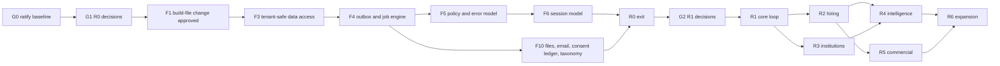

# Decision Gates and Critical Path

What must be decided before each stage can proceed, and the order work depends on. No durations are stated.

## 1. Gate list

| Gate | Blocks | Decisions that must close | Owner |
|---|---|---|---|
| G0 Baseline ratification | S1 exit | `OD-PRD-31` (how the blueprint becomes authoritative), `OD-PRD-30` (what happens to legacy code and documents) | Owner |
| G1 R0 start | S5, F1 to F10 | `OD-PRD-10` jurisdictions, `OD-PRD-11` minors, `OD-PRD-13` erasure clocks, `OD-PRD-32` green CI, `OD-PRD-33` accessibility commitment, `OD-PRD-34` support model, `OD-PRD-35` moderation model, `OD-PRD-38` locales; foundation `DEC-ARC` ratification | Owner, legal, architecture |
| G2 R1 start | R1 build | `OD-PRD-01` north star, `OD-PRD-06` free tier, `OD-PRD-09` pilot scope, `OD-PRD-25` user research | Owner, product |
| G3 R2 start | R2 build | `OD-PRD-06` paid packaging, `OD-PRD-08` billing owner, `OD-PRD-12` cohort size, `OD-PRD-22` realtime video, `OD-PRD-23` integrations | Owner, product |
| G4 R3 start | R3 build | `OD-PRD-07` institution licensing, `OD-PRD-37` managed learners applying | Owner, institutions lead |
| G5 R4 start | R4 build | `OD-PRD-14` automated hiring decisions, `OD-PRD-15` proctoring, `OD-PRD-19` background checks, `OD-PRD-21` AI funding, `OD-PRD-26` government identity | Owner, legal, security |
| G6 R5 start | R5 build | `OD-PRD-04` seller of record, `OD-PRD-05` premium tier, `OD-PRD-18` promoted placements, `OD-PRD-24` white label, `OD-PRD-27` referral bonuses, `OD-PRD-36` native apps | Owner, finance |
| G7 R6 admission (per module) | each R6 module | `OD-PRD-02` plus the module's own scope `OD-` (`OD-MEN-01`, `OD-GIG-01`, `OD-EVT-01`, `OD-MKT-01`, `OD-ENT-01`) | Owner |

The full list with options and default proposals is in [`08_STAKEHOLDER_DECISIONS_NEEDED.md`](../01_PRODUCT/08_STAKEHOLDER_DECISIONS_NEEDED.md); module-level decisions are in the [register](../09_REGISTERS/OPEN_DECISIONS_REGISTER.md).

## 2. Critical path

Longest dependency chain: ratification, R0 decisions, build-file approval, tenant-safe data access, outbox and jobs, policy, sessions, then the R1 loop. Anything on this chain delays everything after it; items off the chain (for example UX research, vendor evaluations, counsel review) should start in parallel.

## 3. Work that can run in parallel with the critical path

| Track | Starts when | Needed by |
|---|---|---|
| User research and usability testing | S1 | R1 start |
| Counsel review of compliance map and consent copy | S1 | R0 exit |
| Visual design and prototypes for R0 and R1 screens | S3 | R0 build of each screen |
| Vendor evaluation (email, video, identity, payments) | S1 | The tier that first needs the adapter |
| Taxonomy content sourcing | S1 | R1 search and matching |
| Test data and fakes for adapters | F4 | Each module's tests |

## 4. Known cross-module conflicts to close before building

Conflicts found while writing the specs are recorded as open decisions, not resolved. The ones that change structure:

| Topic | Decision or conflict | Where recorded |
|---|---|---|
| Skills taxonomy ownership | Claimed by MKT and SRC; needed at R1 although MKT is expansion scope | `OD-ARC-07` |
| Organization entities | EMP, INS and ENT each own an org-like entity; the data model centralizes | `OD-ARC-37` |
| Session model | Rotating refresh token versus opaque server session cookie | `OD-ARC-03`, `OD-IDN-01` |
| Event name prefixes | Six modules deviate from the module-code rule | `OD-ARC-36` |
| Error and pagination shape | As-built envelope versus RFC 9457 and cursors | `OD-ARC-02` |
| Erasure clocks | 30-day cancel window versus 30-day completion | `OD-PRD-13`, `OD-PRV-02`, `OD-SET-01` |
| Camera and microphone | Blocked app-wide in legacy rules versus interviews and proctoring | `OD-SEC-11` |
| Automated actions | Legacy auto-apply at confidence threshold versus human-gate rule | `OD-AIG-01` |
| Minimum cohort size | Legacy values 3 and 5 versus default 10 | `OD-PRD-12`, `OD-PRV-12`, `OD-MKT-05` |
| Plan names | Free, Pro, Team, Enterprise versus as-built plan names | `OD-BIL-14` |
