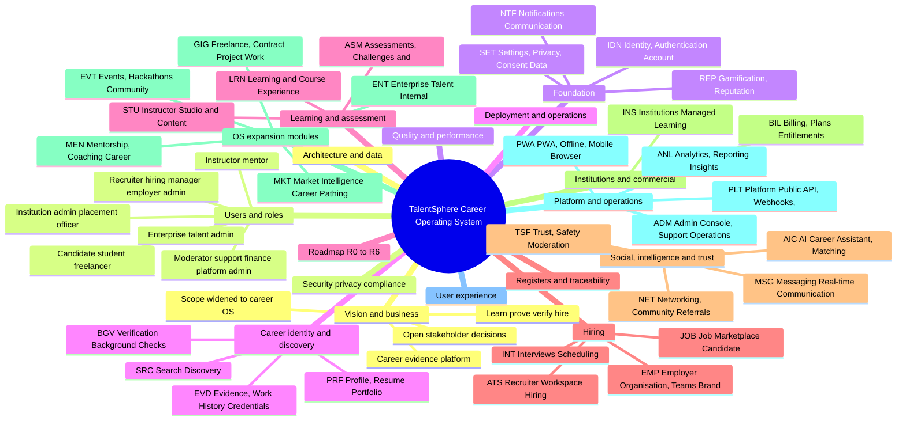

<!-- Generated from PRODUCT_BLUEPRINT sources. Regenerate instead of editing by hand. -->

# Master mind map

The whole intended product on one page. Each branch has a detailed map; follow the links below. Nothing in this map is built; it describes the blueprint.

## Detailed maps

| Map                                                                           | Covers                                      |
| ----------------------------------------------------------------------------- | ------------------------------------------- |
| [Foundation](01_FOUNDATION.md)                                                | 128 features across IDN, SET, NTF, REP      |
| [Career identity and discovery](02_CAREER_IDENTITY.md)                        | 136 features across PRF, EVD, BGV, SRC      |
| [Learning and assessment](03_LEARNING.md)                                     | 188 features across LRN, STU, ASM           |
| [Hiring](04_HIRING.md)                                                        | 162 features across JOB, ATS, INT, EMP      |
| [Social, intelligence and trust](05_SOCIAL_AI_TRUST.md)                       | 138 features across NET, MSG, AIC, TSF      |
| [Institutions and commercial](06_INSTITUTIONS_COMMERCIAL.md)                  | 66 features across INS, BIL                 |
| [OS expansion modules](07_OS_EXPANSION.md)                                    | 167 features across MEN, GIG, EVT, MKT, ENT |
| [Platform and operations](08_PLATFORM.md)                                     | 159 features across ANL, ADM, PWA, PLT      |
| [Vision, scope and business](11_VISION_BUSINESS.md)                           | Documents and section structure             |
| [Users, roles, permissions and journeys](12_ROLES_PERMISSIONS_JOURNEYS.md)    | Documents and section structure             |
| [UI/UX and navigation](13_UX_NAVIGATION.md)                                   | Documents and section structure             |
| [System architecture, database and API](14_ARCHITECTURE_DATA_API.md)          | Documents and section structure             |
| [Security, privacy, performance and NFRs](15_SECURITY_PRIVACY_PERFORMANCE.md) | Documents and section structure             |
| [QA and engineering standards](16_QA_ENGINEERING.md)                          | Documents and section structure             |
| [Deployment, infrastructure and maintenance](17_DEVOPS_OPERATIONS.md)         | Documents and section structure             |
| [Implementation roadmap](18_ROADMAP.md)                                       | Documents and section structure             |
| [Documentation, registers and traceability](19_REGISTERS_TRACEABILITY.md)     | Documents and section structure             |

## Where the detail lives

- Specifications: [`../02_MODULES/`](../02_MODULES/)
- Registers (features, rules, decisions, risks, dependencies): [`../09_REGISTERS/`](../09_REGISTERS/)
- Entry point: [`../00_START_HERE/README.md`](../00_START_HERE/README.md)
