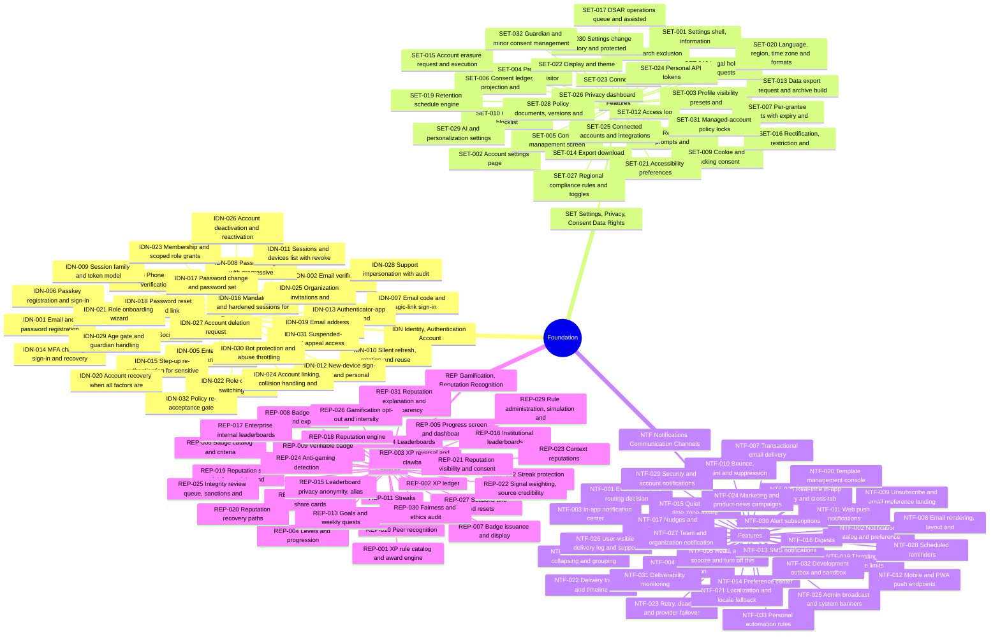

<!-- Generated from PRODUCT_BLUEPRINT sources. Regenerate instead of editing by hand. -->

# Mind map: Foundation

Every module, sub-module and feature in this domain (128 features). Feature labels carry the id suffix; the owning module file has the full specification.

## Specifications

- [IDN — Identity, Authentication & Account](../02_MODULES/IDN_Identity_Authentication_Account.md)
- [SET — Settings, Privacy, Consent & Data Rights](../02_MODULES/SET_Settings_Privacy_Consent.md)
- [NTF — Notifications & Communication Channels](../02_MODULES/NTF_Notifications_Communication.md)
- [REP — Gamification, Reputation & Recognition](../02_MODULES/REP_Gamification_Reputation.md)
