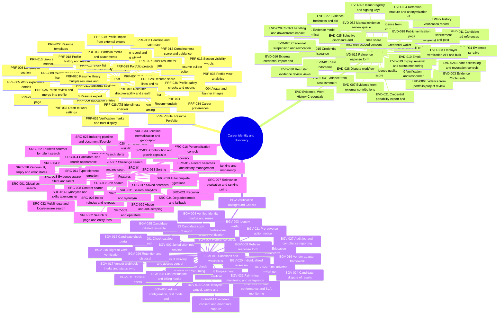

<!-- Generated from PRODUCT_BLUEPRINT sources. Regenerate instead of editing by hand. -->

# Mind map: Career identity and discovery

Every module, sub-module and feature in this domain (136 features). Feature labels carry the id suffix; the owning module file has the full specification.

## Specifications

- [PRF — Profile, Resume & Portfolio](../02_MODULES/PRF_Profile_Resume_Portfolio.md)
- [EVD — Evidence, Work History & Credentials](../02_MODULES/EVD_Evidence_Work_History_Credentials.md)
- [BGV — Verification & Background Checks](../02_MODULES/BGV_Verification_Background_Checks.md)
- [SRC — Search & Discovery](../02_MODULES/SRC_Search_Discovery.md)
