<!-- Generated from PRODUCT_BLUEPRINT sources. Regenerate instead of editing by hand. -->

# Mind map: Learning and assessment

Every module, sub-module and feature in this domain (186 features). Feature labels carry the id suffix; the owning module file has the full specification.

```mermaid
mindmap
  root((Learning and assessment))
    LRN LRN Learning and Course Experience
      Catalog and discovery
        LRN-001 Course catalog listing
        LRN-002 Taxonomy categories, tags, levels and
        LRN-003 Catalog search with typeahead
        LRN-004 Catalog filters, facets and sorting
        LRN-005 Skill-based and goal-based browse
        LRN-006 Course comparison
        LRN-007 Saved courses
      Course detail
        LRN-008 Course detail page
        LRN-009 Curriculum presentation and free
        LRN-010 Prerequisites and readiness check
        LRN-011 Instructor and ownership display
        LRN-012 Course versions and change log
      Enrollment and access
        LRN-013 Eligibility gate and lock reasons
        LRN-014 Free enrollment
        LRN-015 Paid enrollment and checkout hand-off
        LRN-016 Institution-managed enrollment
        LRN-017 Invite links and access codes
        LRN-018 Plan-entitled access
        LRN-019 Access window, expiry and extension
        LRN-020 Drop, pause and re-enroll
        LRN-021 Refund request and access revocation
      Paths and tracks
        LRN-022 Learning path and track catalog
        LRN-023 Path enrollment and progression
        LRN-024 Programs, capstone and program
        LRN-025 Personal learning plan
      Player and media
        LRN-026 Learning player shell
        LRN-027 Video core controls
        LRN-028 Playback speed
        LRN-029 Quality selection, adaptive streaming
        LRN-030 Captions and subtitles
        LRN-031 Interactive transcript
        LRN-032 Fullscreen, theater mode and
        LRN-033 Keyboard shortcuts
        LRN-034 Resume playback and cross-device
        LRN-035 Chapters and scrub previews
        LRN-036 Video completion tracking
        LRN-037 Offline download rules
        LRN-038 Accessible player
        LRN-039 Protected playback session
        LRN-040 External-provider media and fallback
      Lesson types
        LRN-041 Reading lessons and downloadable
        LRN-042 In-lesson quizzes
        LRN-043 Interactive coding exercises
        LRN-044 Assignment submission
        LRN-045 Peer review
        LRN-046 Projects and capstone work
        LRN-047 Live sessions
        LRN-048 Cohorts and cohort calendar
        LRN-049 Pacing, deadlines and drip release
      Social learning
        LRN-050 Course Q A
        LRN-051 Discussion forums
        LRN-052 Notes and bookmarks
        LRN-053 Instructor announcements
        LRN-054 Study groups
      Progress and credentials
        LRN-055 Progress tracking
        LRN-056 Learning history
        LRN-057 Lesson completion rules
        LRN-058 Course completion engine
        LRN-059 Certificate issuance
        LRN-060 Certificate verification and sharing
        LRN-061 Learning achievements
        LRN-062 Gradebook for learners
      Reviews
        LRN-063 Submit course review
        LRN-064 Review display and instructor response
        LRN-065 Review reporting and moderation hand-off
      Personalization and engagement
        LRN-066 Course recommendations
        LRN-067 Learner dashboard
        LRN-068 Goals and weekly commitment
        LRN-069 Streaks
        LRN-070 Reminders, nudges and calendar export
      Skills and analytics
        LRN-071 Skill mapping and evidence hand-off
        LRN-072 Learner analytics
        LRN-073 Adaptive review and spaced repetition
        LRN-074 Learning data export and deletion
        LRN-075 Report a content problem
    STU STU Instructor Studio and Content
      Instructor onboarding and identity
        STU-001 Instructor application
        STU-002 Instructor identity and expertise
        STU-003 Instructor agreement and policy
        STU-004 Instructor public profile
        STU-005 Payout and tax profile
        STU-006 Studio home and course list
      Course authoring
        STU-007 Course creation wizard
        STU-008 Curriculum builder
        STU-009 Video lesson authoring
        STU-010 Text lesson authoring
        STU-011 Resources and attachments
        STU-012 Learning objectives and skill tagging
        STU-013 Prerequisites and completion rule
        STU-014 Course landing page editor
        STU-015 Autosave, drafts and edit locking
        STU-016 Co-instructors and ownership
        STU-017 Course import
        STU-018 Course duplication and templates
        STU-019 Course versioning
        STU-020 Preview as learner
      Media production pipeline
        STU-021 Media upload
        STU-022 Transcoding, renditions and thumbnails
        STU-023 Captions and transcript generation and
        STU-024 Content protection signed URLs and DRM
        STU-025 Media library
        STU-026 Media processing status, failure and
        STU-027 External media validation
        STU-028 Accessibility tracks authoring
      Assessment authoring and grading
        STU-029 Quiz authoring in lessons
        STU-030 Assignment and rubric authoring
        STU-031 Grading queue and feedback
        STU-032 Peer review configuration
      Commerce
        STU-033 Pricing
        STU-034 Coupons and promotions
        STU-035 Revenue share and earnings statements
        STU-036 Payouts
        STU-037 Refunds and disputes visibility
      Publishing workflow
        STU-038 Submit for review
        STU-039 Review queue and reviewer workflow
        STU-040 Automated content quality checks
        STU-041 Publish, schedule, unpublish and archive
        STU-042 Completion sign-off
      Learner interaction
        STU-043 Learner Q A inbox
        STU-044 Announcements authoring
        STU-045 Review management for instructors
        STU-046 Learner roster and progress
        STU-047 Live session hosting
      Analytics and governance
        STU-048 Instructor analytics
        STU-049 Content moderation and strikes
        STU-050 Copyright and DMCA handling
        STU-051 Content localization
        STU-052 IP attestation and licensing
        STU-053 Instructor quality score
    ASM ASM Assessments, Challenges and
      Challenges arena
        ASM-001 Challenge catalog
        ASM-002 Challenge detail and start screen
        ASM-003 Coding workspace
        ASM-004 Run against public tests
        ASM-005 Objective question challenges
        ASM-006 Scenario challenges
        ASM-007 Project challenges
        ASM-008 System design challenges
        ASM-009 SQL challenges
        ASM-010 Data challenges
        ASM-011 Practice mode
        ASM-012 Hints and solutions
        ASM-013 Challenge discussion and shared
        ASM-014 Challenge sets and interview prep
        ASM-015 Contests
      Authoring and question bank
        ASM-016 Assessment builder
        ASM-017 Question authoring
        ASM-018 Question bank
        ASM-019 Test suite authoring
        ASM-020 Rubric builder
        ASM-021 Assessment composition and randomization
        ASM-022 Assessment versioning and publishing
      Execution and grading
        ASM-023 Sandbox execution service
        ASM-024 Language and runtime catalog
        ASM-025 Judge queue, async grading and honest
        ASM-026 Objective auto-grading
        ASM-027 Manual and rubric grading
        ASM-028 AI-assisted grading suggestions
      Integrity and proctoring
        ASM-029 Attempt session management
        ASM-030 Server-authoritative timer and time
        ASM-031 Integrity policy configuration
        ASM-032 Browser integrity signals
        ASM-033 Plagiarism and code similarity detection
        ASM-034 AI-assist policy modes and enforcement
        ASM-035 Identity verification for high-stakes
        ASM-036 Remote proctoring
        ASM-037 Integrity case review and decisions
        ASM-038 Appeals
        ASM-039 Item security and exposure control
      Attempt policy
        ASM-040 Attempts, retakes and cooldowns
        ASM-041 Accommodations
        ASM-042 Exam scheduling and registration
      Scoring, calibration and skill mapping
        ASM-043 Scoring models and pass thresholds
        ASM-044 Calibration and item analysis
        ASM-045 Skill-level mapping
      Employer-assigned and certification
        ASM-046 Employer-assigned assessments
        ASM-047 Employer assessment templates
        ASM-048 Certification exams
        ASM-049 Certification validity, renewal and
      Results, sharing and leaderboards
        ASM-050 Results and feedback
        ASM-051 Results sharing with consent
        ASM-052 Leaderboards
        ASM-053 Assessment history and score reports
      Fairness, accessibility and operations
        ASM-054 Accessible assessment delivery
        ASM-055 Fairness and bias monitoring
        ASM-056 Author analytics
        ASM-057 Item and challenge issue reports and
        ASM-058 Assessment data retention
```

## Specifications

- [LRN — LRN: Learning and Course Experience](../02_MODULES/LRN_Learning_Course_Experience.md)
- [STU — STU: Instructor Studio and Content Production](../02_MODULES/STU_Instructor_Studio_Content_Production.md)
- [ASM — ASM: Assessments, Challenges and Integrity](../02_MODULES/ASM_Assessments_Challenges_Integrity.md)
