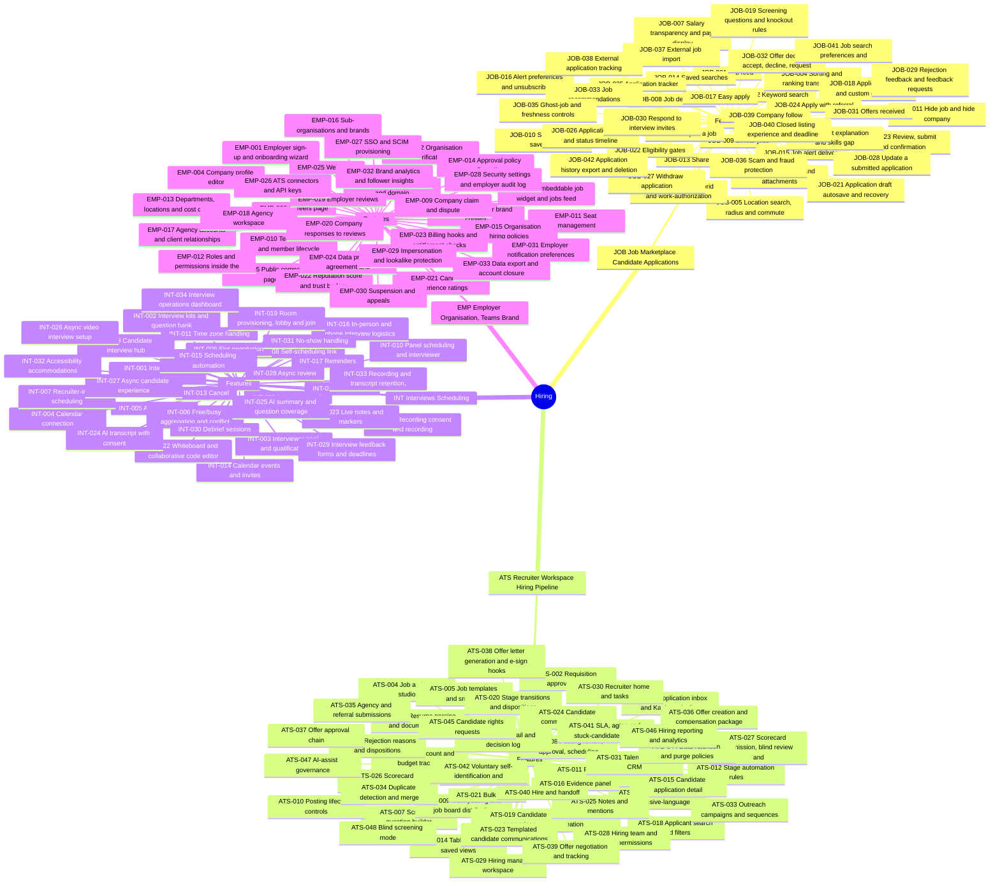

<!-- Generated from PRODUCT_BLUEPRINT sources. Regenerate instead of editing by hand. -->

# Mind map: Hiring

Every module, sub-module and feature in this domain (157 features). Feature labels carry the id suffix; the owning module file has the full specification.

## Specifications

- [JOB — Job Marketplace & Candidate Applications](../02_MODULES/JOB_Job_Marketplace_Candidate_Applications.md)
- [ATS — Recruiter Workspace & Hiring Pipeline](../02_MODULES/ATS_Recruiter_Workspace_Hiring_Pipeline.md)
- [INT — Interviews & Scheduling](../02_MODULES/INT_Interviews_Scheduling.md)
- [EMP — Employer Organisation, Teams & Brand](../02_MODULES/EMP_Employer_Organisation_Teams_Brand.md)
