<!-- Generated from PRODUCT_BLUEPRINT sources. Regenerate instead of editing by hand. -->

# Mind map: Social, intelligence and trust

Every module, sub-module and feature in this domain (138 features). Feature labels carry the id suffix; the owning module file has the full specification.

```mermaid
mindmap
  root((Social, intelligence and trust))
    NET Networking, Community Referrals
      Features
        NET-001 Send connection request
        NET-002 Respond to connection request
        NET-003 Stale-request nudges and expiry
        NET-004 Manage connections
        NET-005 Follow and unfollow
        NET-006 Block, mute and restrict
        NET-007 Network privacy controls
        NET-008 People you may know and people discovery
        NET-009 Hashed-contact mutual discovery
        NET-010 Warm introductions
        NET-011 Endorsements
        NET-012 Written recommendations
        NET-013 Profile view insights
        NET-014 Compose and publish post
        NET-015 Edit, version history, delete and
        NET-016 Comments and replies
        NET-017 Reactions, reposts and bookmarks
        NET-018 Mentions and topics
        NET-019 Home feed
        NET-020 Why am I seeing this
        NET-021 Feed controls
        NET-022 Long-form articles and newsletters
        NET-023 Sponsored content labelling
        NET-024 Share links and external previews
        NET-025 Create and configure group
        NET-026 Join, invite and approve members
        NET-027 Group roles and group moderation
        NET-028 Alumni and affinity groups
        NET-029 Candidate referral request
        NET-030 Referrer response
        NET-031 Employee-initiated referral of an
        NET-032 Referral delivery, tagging and
        NET-033 Referral rewards and bonuses
        NET-034 Referral limits and integrity controls
        NET-035 Referral program settings
        NET-036 Ranking configuration, experiments and
        NET-037 Social data lifecycle on deactivation
    MSG Messaging Real-time Communication
      Features
        MSG-001 Start a direct conversation
        MSG-002 Compose, send, edit, delete and react
        MSG-003 Attachments and media
        MSG-004 Group conversations
        MSG-005 Conversation list, folders and states
        MSG-006 Search in conversations
        MSG-007 Read receipts, delivery status, typing
        MSG-008 Conversation lifecycle
        MSG-009 Message requests inbox
        MSG-010 Recruiter outreach
        MSG-011 Outreach limits, credits and plan
        MSG-012 Candidate messaging and outreach
        MSG-013 Context threads
        MSG-014 Employer shared inbox, disclosure and
        MSG-015 Saved replies and templates
        MSG-016 Broadcast announcements
        MSG-017 Spam and abuse throttles
        MSG-018 Report, block and mute inside
        MSG-019 Scam and off-platform warnings
        MSG-020 Encryption and confidentiality posture
        MSG-021 Content scanning boundary
        MSG-022 Realtime transport and fallbacks
        MSG-023 Ordering, delivery guarantees and resume
        MSG-024 Message notifications
        MSG-025 Offline queue and sync
        MSG-026 Multi-device sync and read state
        MSG-027 Retention, deletion and legal hold
        MSG-028 Conversation export
        MSG-029 Staff access, support tooling and
        MSG-030 Messaging quotas by plan
        MSG-031 Safe link handling and previews
        MSG-032 Accessible messaging experience
        MSG-033 Availability sharing and meeting links
    AIC AI Career Assistant, Matching
      Features
        AIC-001 Career assistant chat
        AIC-002 Assistant context, memory and My AI
        AIC-003 Resume feedback and rewrite suggestions
        AIC-004 Interview practice
        AIC-005 Career plan builder
        AIC-006 Skill-gap analysis
        AIC-007 Drafting assistant
        AIC-008 Suggested actions and apply-with-review
        AIC-009 Assistant scope, refusals and
        AIC-010 Candidate-side job fit
        AIC-011 Recruiter-side candidate matching
        AIC-012 Match explanation panel
        AIC-013 Match preferences and hard constraints
        AIC-014 Skill extraction and normalization
        AIC-015 Match feedback and human review request
        AIC-016 Matching fairness monitoring
        AIC-017 Job recommendations
        AIC-018 Learning recommendations
        AIC-019 People and mentor recommendations
        AIC-020 Recommendation cards, why , dismissal,
        AIC-021 Engine pluggability and non-AI fallback
        AIC-022 AI Gateway and policy engine
        AIC-023 Human-in-the-loop enforcement and
        AIC-024 Model registry and model cards
        AIC-025 Prompt, output and data logging policy
        AIC-026 PII redaction and prompt-injection
        AIC-027 Cost metering, quotas and plan
        AIC-028 Provider routing, fallback and outage
        AIC-029 Output safety filters
        AIC-030 AI transparency and user controls
        AIC-031 Assessment integrity hook
        AIC-032 Evaluation program and bias audit
        AIC-033 AI incident management and user AI-harm
        AIC-034 On-device models and user-authorized
        AIC-035 Open-source contribution recommendations
    TSF Trust, Safety Moderation
      Features
        TSF-001 Report content or account
        TSF-002 Report entry points and categories for
        TSF-003 Reporter status and follow-up
        TSF-004 Trusted flagger channel and bulk reports
        TSF-005 Report-abuse controls
        TSF-006 Policy catalogue, taxonomy and
        TSF-007 Enforcement matrix and severity mapping
        TSF-008 Moderation queue and triage
        TSF-009 Case workspace and decisions
        TSF-010 Quorum review for severe actions
        TSF-011 Moderator tooling
        TSF-012 Pre-moderation of high-risk
        TSF-013 Detection platform and signal registry
        TSF-014 Content abuse detection
        TSF-015 Spam and scam pattern detection
        TSF-016 Fake job and fake employer detection
        TSF-017 Fake credential and document fraud
        TSF-018 Fake account, duplicate identity and
        TSF-019 Content actions
        TSF-020 Account sanctions ladder
        TSF-021 Statements of reasons and notices to
        TSF-022 Appeals
        TSF-023 Ban evasion and repeat-offender handling
        TSF-024 Minors safety
        TSF-025 Imminent harm and crisis escalation
        TSF-026 Scam warnings and safety education
        TSF-027 Evidence preservation and legal hold
        TSF-028 Legal requests handling
        TSF-029 Transparency reporting
        TSF-030 DSA and online-safety compliance
        TSF-031 Moderator wellbeing
        TSF-032 Moderator QA and calibration
        TSF-033 Moderation analytics and SLA monitoring
```

## Specifications

- [NET — Networking, Community & Referrals](../02_MODULES/NET_Networking_Community_Referrals.md)
- [MSG — Messaging & Real-time Communication](../02_MODULES/MSG_Messaging_Realtime_Communication.md)
- [AIC — AI Career Assistant, Matching & Recommendations](../02_MODULES/AIC_AI_Career_Assistant_Matching_Recommendations.md)
- [TSF — Trust, Safety & Moderation](../02_MODULES/TSF_Trust_Safety_Moderation.md)
