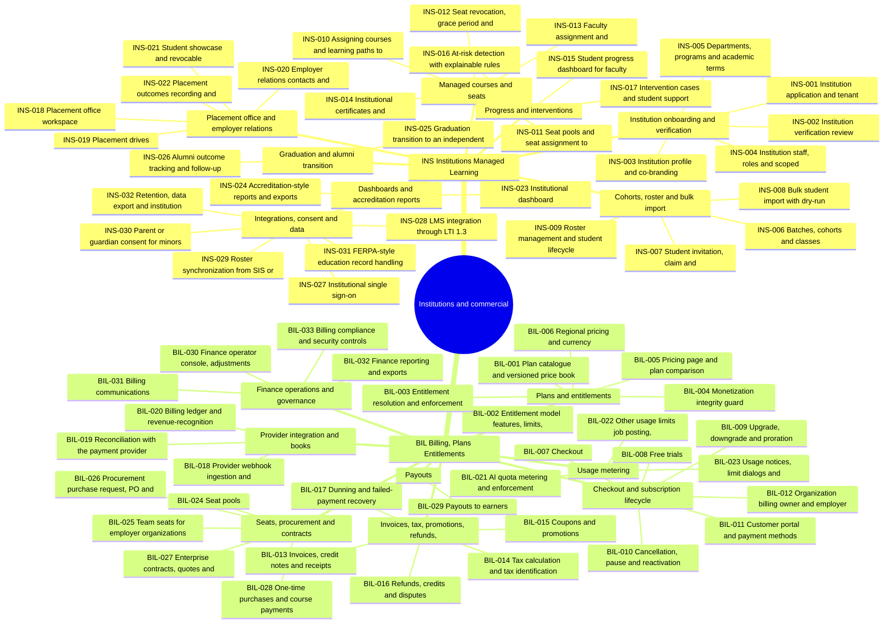

<!-- Generated from PRODUCT_BLUEPRINT sources. Regenerate instead of editing by hand. -->

# Mind map: Institutions and commercial

Every module, sub-module and feature in this domain (65 features). Feature labels carry the id suffix; the owning module file has the full specification.

## Specifications

- [INS — Institutions & Managed Learning](../02_MODULES/INS_Institutions_Managed_Learning.md)
- [BIL — Billing, Plans & Entitlements](../02_MODULES/BIL_Billing_Plans_Entitlements.md)
