<!-- Generated from PRODUCT_BLUEPRINT sources. Regenerate instead of editing by hand. -->

# Mind map: OS expansion modules

Every module, sub-module and feature in this domain (167 features). Feature labels carry the id suffix; the owning module file has the full specification.

```mermaid
mindmap
  root((OS expansion modules))
    MEN Mentorship, Coaching Career Services
      Mentor onboarding and trust
        MEN-001 Mentor application and profile
        MEN-002 Mentor verification and vetting
        MEN-003 Availability, rates and calendar
      Discovery, matching and requests
        MEN-004 Mentor directory and search
        MEN-005 Mentee intake and goals
        MEN-006 Explainable mentor matching
        MEN-007 Mentorship request, intro call and
      Sessions
        MEN-008 Session booking, rescheduling and
        MEN-009 Session payment and mentor fees
        MEN-010 Session room, logistics and recording
        MEN-011 Session notes and shared action items
        MEN-012 Feedback and ratings
      Programs and peer mentorship
        MEN-013 Mentorship program creation
        MEN-014 Program enrollment and pairing
        MEN-015 Program progress, milestones and
        MEN-016 Peer and alumni mentorship
      Goals and relationships
        MEN-017 Mentorship goals and action plans
        MEN-018 Mentorship relationship lifecycle
      Career services
        MEN-019 Resume review service
        MEN-020 Mock interview service
        MEN-021 Coaching packages
        MEN-022 Group sessions, office hours and expert
      Marketplace rules, safety and quality
        MEN-023 Coaching marketplace rules and fees
        MEN-024 Safeguarding and conduct reporting
        MEN-025 Mentor quality management and reputation
        MEN-026 Session disputes and refunds
        MEN-027 Mentor and mentee dashboards
        MEN-028 Conflict of interest disclosure and
    GIG Freelance, Contract Project Work
      Freelancer mode and profile
        GIG-001 Freelancer mode activation
        GIG-002 Freelancer profile, services and
        GIG-003 Freelancer eligibility identity, payout
      Project listings and discovery
        GIG-004 Project brief creation
        GIG-005 Listing review, publication and scope
        GIG-006 Project discovery and search
        GIG-007 Client invitations to freelancers
      Proposals and award
        GIG-008 Submit and manage a proposal
        GIG-009 Proposal quotas and anti-spam
        GIG-010 Shortlisting, comparison and pre-award
        GIG-011 Award and contract offer
      Contracts, milestones and deliverables
        GIG-012 Contract terms and templates
        GIG-013 Milestones and deliverable submission
        GIG-014 Milestone review accept, request
        GIG-015 Change requests and scope amendments
        GIG-016 Contract completion, cancellation and
        GIG-017 Project workroom messages, files and
      Money escrow gate, time tracking gate,
        GIG-018 Payment modes and the escrow decision
        GIG-019 Hourly contracts and time tracking
        GIG-020 Payment release, fees and payouts
      Compliance tax, classification,
        GIG-021 Tax documents and reporting constraints
        GIG-022 Worker classification guard
        GIG-023 Cross-border, sanctions and currency
      Trust reviews, disputes, reputation,
        GIG-024 Mutual reviews and client-confirmed
        GIG-025 Disputes and mediation
        GIG-026 Freelancer and client reputation metrics
        GIG-027 Circumvention, fraud and abuse controls
        GIG-028 Conduct, reporting and account actions
        GIG-029 Intellectual property, confidentiality
      Conversion, learning projects,
        GIG-030 Hire conversion project to job
        GIG-031 Learning projects and apprenticeship
        GIG-032 Freelancer and client dashboards
    EVT Events, Hackathons Community
      Features
        EVT-001 Create event draft
        EVT-002 Event templates and cloning
        EVT-003 Agenda, sessions and tracks
        EVT-004 Publishing and review gate
        EVT-005 Event edit, postpone, and cancel after
        EVT-006 Event discovery and detail page
        EVT-007 Register for an event
        EVT-008 Custom registration questions
        EVT-009 Ticket types and pricing
        EVT-010 Capacity and waitlist with
        EVT-011 Cancel, transfer and refund a
        EVT-012 Approval-required registration and
        EVT-013 Calendar export and timezone handling
        EVT-014 Reminders
        EVT-015 Virtual room and provider link
        EVT-016 Hosts, co-hosts and speakers
        EVT-017 Attendance and check-in
        EVT-018 Live Q A, polls and chat
        EVT-019 Recordings and replays
        EVT-020 Sponsor and employer participation
        EVT-021 Virtual career fair booths and halls
        EVT-022 Career fair candidate interactions and
        EVT-023 In-person career fair logistics
        EVT-024 Hackathon setup tracks, rules, timeline
        EVT-025 Hackathon registration and eligibility
        EVT-026 Team formation and team finder
        EVT-027 Project submission
        EVT-028 Judges and scoring
        EVT-029 Results, leaderboard and prizes
        EVT-030 Hackathon mentors and office hours
        EVT-031 Post-event follow-up and feedback survey
        EVT-032 Attendance certificates and event badges
        EVT-033 Post-event talent sourcing hand-off
        EVT-034 Attendee data-sharing consents
        EVT-035 Event moderation, reports and admin
        EVT-036 Organizer analytics
        EVT-037 Event series and community programmes
        EVT-038 Attendee announcements and messaging
    MKT Market Intelligence Career Pathing
      Features
        MKT-001 Canonical skill catalogue
        MKT-002 Skill aliases and free-text
        MKT-003 Skill relationship graph
        MKT-004 Taxonomy versioning and impact migration
        MKT-005 Emerging skill detection and promotion
        MKT-006 External taxonomy mappings
        MKT-007 Role catalogue and proficiency scales
        MKT-008 Market signal ingestion
        MKT-009 External data source registry and
        MKT-010 Provenance, lineage and methodology
        MKT-011 Data quality, outlier and anomaly
        MKT-012 Skill demand index
        MKT-013 Skill supply index
        MKT-014 Supply-demand gap and regional heat maps
        MKT-015 Trends and forecasts
        MKT-016 Personal market insights
        MKT-017 Salary report submission, verification
        MKT-018 Salary aggregation and benchmark
        MKT-019 Salary benchmark display and job-page
        MKT-020 Offer calibration and pay-equity
        MKT-021 Equity and total compensation benchmarks
        MKT-022 Career transition data opt-in
        MKT-023 Role transition graph and career path
        MKT-024 Skill-gap analysis for a target role
        MKT-025 Readiness estimate and
        MKT-026 Action plan from gap
        MKT-027 Compare career paths
        MKT-028 Institution labor-market dashboard
        MKT-029 Employer workforce-planning view
        MKT-030 Platform market-intelligence console
        MKT-031 Exports and citations
        MKT-032 Partner market API
        MKT-033 Minimum-sample privacy engine
        MKT-034 Market data consent centre
        MKT-035 Corrections, disputes and methodology
        MKT-036 Fairness review of market insights
        MKT-037 Company skill profiles
    ENT Enterprise Talent Internal Mobility,
      Features
        ENT-001 Enterprise workspace setup
        ENT-002 Single sign-on
        ENT-003 SCIM provisioning and deprovisioning
        ENT-004 HRIS integration
        ENT-005 Employee account linking and
        ENT-006 Enterprise roles, permission sets and
        ENT-007 Employee skills inventory
        ENT-008 Organization skills map and capability
        ENT-009 Workforce skill-gap analysis
        ENT-010 Internal job architecture and role
        ENT-011 Internal job board and posting
        ENT-012 Confidential internal application
        ENT-013 Internal talent matching suggestions
        ENT-014 Internal gigs and short-term assignments
        ENT-015 Internal mobility pipeline and transfer
        ENT-016 Employee career development plan
        ENT-017 Mobility preferences and visibility
        ENT-018 Learning assignment
        ENT-019 Compliance training tracking
        ENT-020 Enterprise learning paths
        ENT-021 Learning requests and approvals
        ENT-022 External learning record import
        ENT-023 L D reporting and impact
        ENT-024 Talent review cycle
        ENT-025 Succession planning for critical roles
        ENT-026 Manager workspace
        ENT-027 Employee career hub
        ENT-028 Offboarding and personal data separation
        ENT-029 Data-access log and employee
        ENT-030 Enterprise reporting and compliance
        ENT-031 Regional policy and works-council
        ENT-032 Enterprise notifications and
```

## Specifications

- [MEN — Mentorship, Coaching & Career Services](../02_MODULES/MEN_Mentorship_Coaching_Career_Services.md)
- [GIG — Freelance, Contract & Project Work](../02_MODULES/GIG_Freelance_Contract_Project_Work.md)
- [EVT — Events, Hackathons & Community Programmes](../02_MODULES/EVT_Events_Hackathons_Community_Programmes.md)
- [MKT — Market Intelligence & Career Pathing](../02_MODULES/MKT_Market_Intelligence_Career_Pathing.md)
- [ENT — Enterprise Talent: Internal Mobility, Skills & L&D](../02_MODULES/ENT_Enterprise_Talent_Internal_Mobility.md)
