<!-- Generated from PRODUCT_BLUEPRINT sources. Regenerate instead of editing by hand. -->

# Mind map: Platform and operations

Every module, sub-module and feature in this domain (159 features). Feature labels carry the id suffix; the owning module file has the full specification.

```mermaid
mindmap
  root((Platform and operations))
    ANL Analytics, Reporting Insights
      Features
        ANL-001 Metric registry
        ANL-002 Event pipeline and warehouse boundary
        ANL-003 Semantic layer and KPI rollups
        ANL-004 Data classification and PII minimization
        ANL-005 Aggregation thresholds and suppression
        ANL-006 Analytics consent and user preferences
        ANL-007 Product analytics event taxonomy and
        ANL-008 Data quality and reconciliation monitors
        ANL-009 Retention, erasure and de-identification
        ANL-010 Dashboard framework
        ANL-011 Candidate dashboard
        ANL-012 Instructor dashboard
        ANL-013 Recruiter dashboard
        ANL-014 Hiring manager dashboard
        ANL-015 Employer admin dashboard
        ANL-016 Institution admin dashboard
        ANL-017 Placement officer dashboard
        ANL-018 Enterprise admin dashboard
        ANL-019 Platform executive and product-health
        ANL-020 Operations, support and trust dashboards
        ANL-021 Fairness and adverse-impact monitoring
        ANL-022 Funnel analysis
        ANL-023 Cohort analysis and retention
        ANL-024 Learning-to-outcome analytics
        ANL-025 Hiring outcome and quality-of-hire
        ANL-026 Report builder
        ANL-027 Scheduled reports and subscriptions
        ANL-028 Governed exports and downloads
        ANL-029 Metric alerts and anomaly detection
        ANL-030 Experiment registry and guardrails
        ANL-031 Assignment, exposure logging and flags
        ANL-032 Experiment analysis and decision log
        ANL-033 Analyst workspace and identity-join
        ANL-034 Embedded analytics and partner API
        ANL-035 Metric change management and dashboard
        ANL-036 Unit economics and cost analytics
        ANL-037 Career workbench tasks, saved items and
    ADM Admin Console, Support Operations
      Console foundation and access
        ADM-001 Admin console shell and information
        ADM-002 Admin authentication hardening and
        ADM-003 Command palette and global admin search
        ADM-004 Admin notes, reason codes and action
      Entity administration
        ADM-005 User directory and account lookup
        ADM-006 Account lifecycle administration actions
        ADM-007 Admin role and permission administration
        ADM-008 Organization and institution
      Privileged access and approvals
        ADM-009 Time-boxed privileged access grants
        ADM-010 Two-person approval engine
        ADM-011 Break-glass access
        ADM-012 Periodic access review and
        ADM-013 Admin activity monitoring and anomaly
      Platform controls
        ADM-014 Feature flag console
        ADM-015 Kill switches
        ADM-016 Configuration management
        ADM-017 Announcements and banners
        ADM-018 Maintenance mode and scheduled
        ADM-019 Change calendar and change freeze
      Support desk
        ADM-020 Ticket intake from every channel
        ADM-021 Ticket workspace, queues and assignment
        ADM-022 SLA policies and timers
        ADM-023 Macros and canned responses
        ADM-024 Support impersonation with consent and
        ADM-025 Knowledge base and help center
        ADM-026 CSAT and support quality review
        ADM-027 Escalation, problem linking and
        ADM-028 Requester verification checklist
      Content CMS
        ADM-029 CMS for landing, help and system pages
        ADM-030 Legal documents versioning and
        ADM-031 Content localization and translation
      Oversight and compliance
        ADM-032 Audit log store and viewer
        ADM-033 Data request handling console
        ADM-034 Bulk operations with dry-run and safe
      Finance and operations
        ADM-035 Finance operations refunds, disputes
        ADM-036 Admin exports, saved views and
        ADM-037 Job queue and dead-letter console
        ADM-038 Incident management tooling and public
        ADM-039 Platform health dashboard
        ADM-040 Public landing page
    PWA PWA, Offline, Mobile Browser Extension
      Installability and shell
        PWA-001 Web app manifest and installability
        PWA-002 Install prompt experience
        PWA-003 App shell and navigation fallback
        PWA-004 Service worker registration and
        PWA-005 App update flow
        PWA-006 Caching strategy per surface
        PWA-007 Static asset precache and runtime cache
        PWA-008 Cache partitioning, never-cache list
        PWA-009 Storage quota, persistence and eviction
      Offline and sync
        PWA-010 Connectivity detection and indicator
        PWA-011 Offline reading of own data with as of
        PWA-012 Offline capability registry
        PWA-013 Local unsent drafts
        PWA-014 Outbox queued writes for safe actions
        PWA-015 Operation identifiers, idempotency and
        PWA-016 Conflict detection and resolution
        PWA-017 Background sync and periodic refresh
        PWA-018 Sync center
        PWA-019 Offline fallback page and
        PWA-020 Offline course downloads
      Push and re-engagement
        PWA-021 Web push permission and subscription
        PWA-022 Push payload rules and deep links
        PWA-023 Per-device push preferences and channel
        PWA-024 App badging, launch shortcuts and
      Mobile experience and distribution
        PWA-025 Responsive layout system and breakpoints
        PWA-026 Touch, gesture and mobile input rules
        PWA-027 Low-bandwidth and data-saver mode
        PWA-028 Share target, deep links and file
        PWA-029 Device capability detection and media
        PWA-030 Native wrapper decision gate
        PWA-031 Store listing and distribution
      Browser extension companion
        PWA-032 Extension installation, pairing and
        PWA-033 Job page scanner
        PWA-034 Local resume match preview
        PWA-035 Save job to TalentSphere from any site
        PWA-036 Application form autofill
        PWA-037 Extension privacy controls and
        PWA-038 Extension updates, minimum version and
      Health and measurement
        PWA-039 PWA and extension health telemetry
    PLT Platform Public API, Webhooks,
      Public API foundation
        PLT-001 API versioning and deprecation policy
        PLT-002 OAuth 2.0 authorization for API clients
        PLT-003 API keys and personal access tokens
        PLT-004 Scopes, consent screen and permission
        PLT-005 Rate limits and quotas
        PLT-006 Pagination, filtering, sorting and
        PLT-007 Idempotency keys
        PLT-008 Error model, request identifiers and
        PLT-009 OpenAPI contract, SDKs and developer
        PLT-010 API request logs and usage analytics
      Webhooks and events
        PLT-011 Webhook endpoint management and event
        PLT-012 Webhook signing and verification
        PLT-013 Webhook delivery, retries and circuit
        PLT-014 Webhook delivery log and replay
      Integrations
        PLT-015 Integration catalog and connection
        PLT-016 Provider adapter framework and
        PLT-017 Calendar integrations
        PLT-018 ATS import and export adapters
        PLT-019 HRIS sync
        PLT-020 LMS integration and LTI 1.3
        PLT-021 Single sign-on and SCIM provisioning
        PLT-022 Payment provider port
        PLT-023 Email and SMS provider ports
        PLT-024 Video meeting providers
        PLT-025 Identity verification vendor port
        PLT-026 Integration health monitoring and
        PLT-027 Integration marketplace decision gate
      Developer experience
        PLT-028 Developer portal and application
        PLT-029 Sandbox environment and test data
      Files and media
        PLT-030 File upload service
        PLT-031 Virus scanning, content validation and
        PLT-032 Storage quotas and usage
        PLT-033 File retention, deletion and legal hold
        PLT-034 Signed URLs and file access control
        PLT-035 Media transcoding and processing
        PLT-036 CDN delivery and cache management
        PLT-043 External media embeds and provider
      Data movement, background work and
        PLT-037 Import tooling
        PLT-038 Export tooling and data portability
        PLT-039 Background job platform and dead-letter
        PLT-040 Scheduler and recurring job registry
        PLT-041 SSRF-safe outbound HTTP and egress
        PLT-042 Transactional outbox and domain event
```

## Specifications

- [ANL — Analytics, Reporting & Insights](../02_MODULES/ANL_Analytics_Reporting_Insights.md)
- [ADM — Admin Console, Support & Operations](../02_MODULES/ADM_Admin_Console_Support_Operations.md)
- [PWA — PWA, Offline, Mobile & Browser Extension](../02_MODULES/PWA_PWA_Offline_Mobile_Extension.md)
- [PLT — Platform: Public API, Webhooks, Integrations, Media & Files](../02_MODULES/PLT_Platform_API_Integrations_Media_Files.md)
