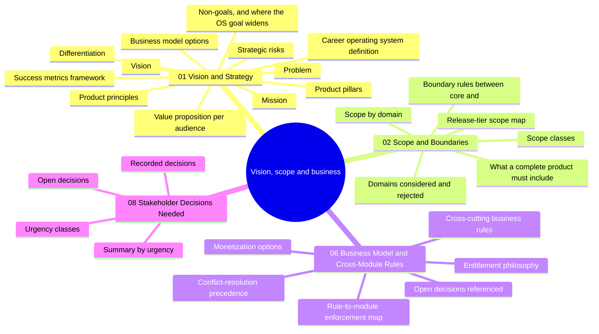

<!-- Generated from PRODUCT_BLUEPRINT sources. Regenerate instead of editing by hand. -->

# Mind map: Vision, scope and business

Vision, scope, business model, cross-module rules and decisions needed from stakeholders.

## Documents

- [01 — Vision and Strategy](../01_PRODUCT/01_VISION_AND_STRATEGY.md)
- [02 — Scope and Boundaries](../01_PRODUCT/02_SCOPE_AND_BOUNDARIES.md)
- [06 — Business Model and Cross-Module Rules](../01_PRODUCT/06_BUSINESS_MODEL_AND_CROSS_MODULE_RULES.md)
- [08 — Stakeholder Decisions Needed](../01_PRODUCT/08_STAKEHOLDER_DECISIONS_NEEDED.md)
