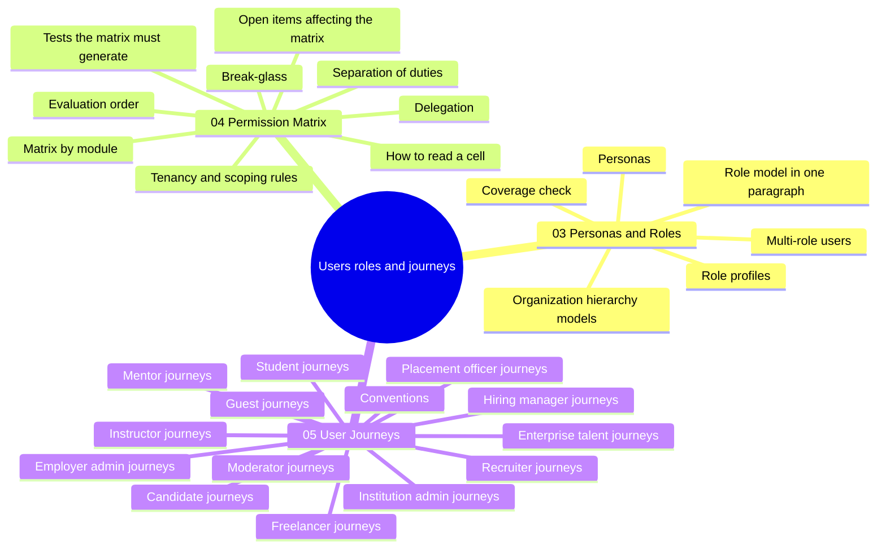

<!-- Generated from PRODUCT_BLUEPRINT sources. Regenerate instead of editing by hand. -->

# Mind map: Users roles and journeys

Personas, the permission matrix and the end-to-end user journeys.

## Documents

- [03 — Personas and Roles](../01_PRODUCT/03_PERSONAS_AND_ROLES.md)
- [04 — Permission Matrix](../01_PRODUCT/04_PERMISSION_MATRIX.md)
- [05 — User Journeys](../01_PRODUCT/05_USER_JOURNEYS.md)
