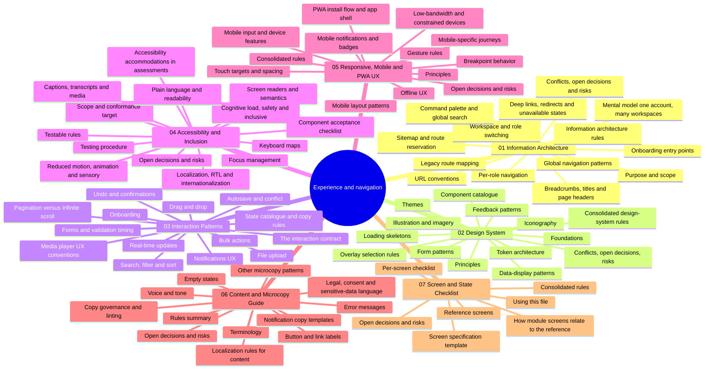

<!-- Generated from PRODUCT_BLUEPRINT sources. Regenerate instead of editing by hand. -->

# Mind map: Experience and navigation

Information architecture, design system, interaction, accessibility, responsive and content rules.

## Documents

- [01 Information Architecture](../03_EXPERIENCE/01_INFORMATION_ARCHITECTURE.md)
- [02 Design System](../03_EXPERIENCE/02_DESIGN_SYSTEM.md)
- [03 Interaction Patterns](../03_EXPERIENCE/03_INTERACTION_PATTERNS.md)
- [04 Accessibility and Inclusion](../03_EXPERIENCE/04_ACCESSIBILITY_AND_INCLUSION.md)
- [05 Responsive, Mobile and PWA UX](../03_EXPERIENCE/05_RESPONSIVE_MOBILE_PWA_UX.md)
- [06 Content and Microcopy Guide](../03_EXPERIENCE/06_CONTENT_AND_MICROCOPY_GUIDE.md)
- [07 Screen and State Checklist](../03_EXPERIENCE/07_SCREEN_STATE_CHECKLIST.md)
