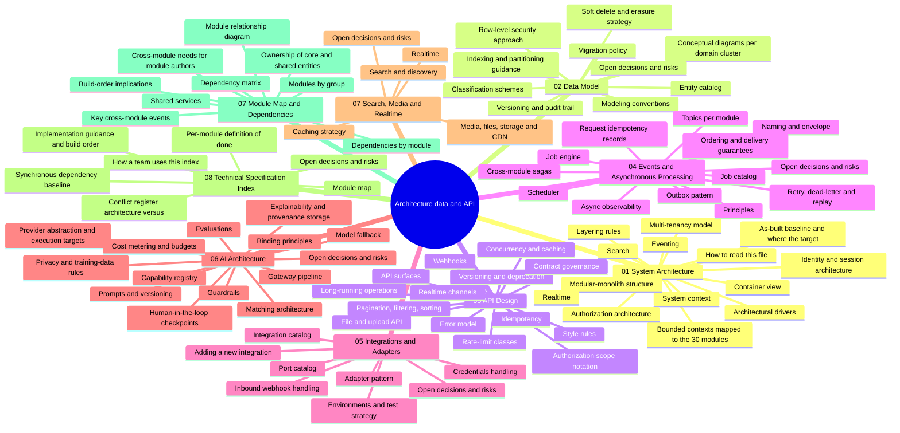

<!-- Generated from PRODUCT_BLUEPRINT sources. Regenerate instead of editing by hand. -->

# Mind map: Architecture data and API

System architecture, data model, API, events, integrations, AI, search and module dependencies.

## Documents

- [01 — System Architecture](../04_ARCHITECTURE/01_SYSTEM_ARCHITECTURE.md)
- [02 — Data Model](../04_ARCHITECTURE/02_DATA_MODEL.md)
- [03 — API Design](../04_ARCHITECTURE/03_API_DESIGN.md)
- [04 — Events and Asynchronous Processing](../04_ARCHITECTURE/04_EVENTS_AND_ASYNC.md)
- [05 — Integrations and Adapters](../04_ARCHITECTURE/05_INTEGRATIONS_AND_ADAPTERS.md)
- [06 — AI Architecture](../04_ARCHITECTURE/06_AI_ARCHITECTURE.md)
- [07 — Search, Media and Realtime Architecture](../04_ARCHITECTURE/07_SEARCH_MEDIA_REALTIME_ARCHITECTURE.md)
- [08 — Technical Specification Index](../04_ARCHITECTURE/08_TECHNICAL_SPECIFICATION_INDEX.md)
- [07 — Module Map and Dependencies](../01_PRODUCT/07_MODULE_MAP_AND_DEPENDENCIES.md)
