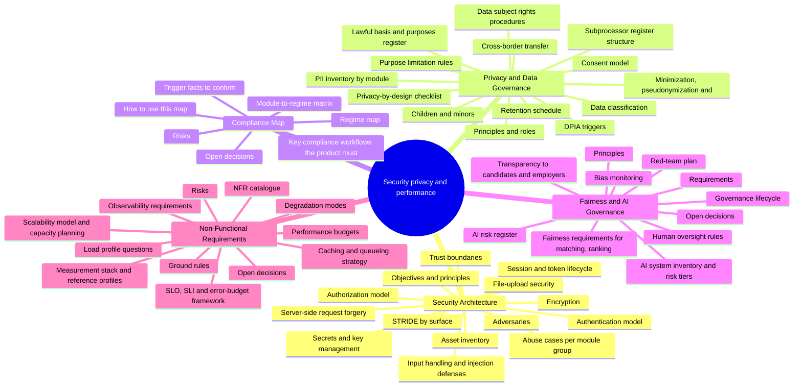

<!-- Generated from PRODUCT_BLUEPRINT sources. Regenerate instead of editing by hand. -->

# Mind map: Security privacy and performance

Security, privacy, compliance, AI fairness and non-functional requirements.

## Documents

- [Security Architecture](../05_SECURITY_PRIVACY/01_SECURITY_ARCHITECTURE.md)
- [Privacy and Data Governance](../05_SECURITY_PRIVACY/02_PRIVACY_AND_DATA_GOVERNANCE.md)
- [Compliance Map](../05_SECURITY_PRIVACY/03_COMPLIANCE_MAP.md)
- [Fairness and AI Governance](../05_SECURITY_PRIVACY/04_FAIRNESS_AND_AI_GOVERNANCE.md)
- [Non-Functional Requirements](../06_QUALITY_AND_PERFORMANCE/01_NON_FUNCTIONAL_REQUIREMENTS.md)
