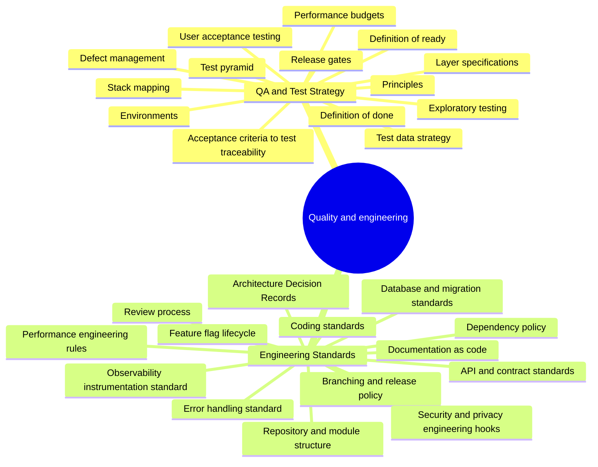

<!-- Generated from PRODUCT_BLUEPRINT sources. Regenerate instead of editing by hand. -->

# Mind map: Quality and engineering

Test strategy and engineering standards.

## Documents

- [QA and Test Strategy](../06_QUALITY_AND_PERFORMANCE/02_QA_AND_TEST_STRATEGY.md)
- [Engineering Standards](../06_QUALITY_AND_PERFORMANCE/03_ENGINEERING_STANDARDS.md)
