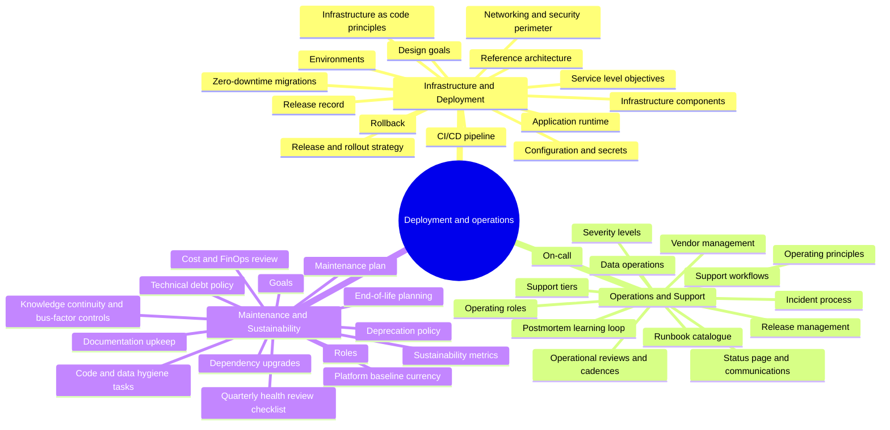

<!-- Generated from PRODUCT_BLUEPRINT sources. Regenerate instead of editing by hand. -->

# Mind map: Deployment and operations

Infrastructure, release, operations, support and long-term maintenance.

## Documents

- [Infrastructure and Deployment](../07_DEVOPS_AND_OPERATIONS/01_INFRASTRUCTURE_AND_DEPLOYMENT.md)
- [Operations and Support](../07_DEVOPS_AND_OPERATIONS/02_OPERATIONS_AND_SUPPORT.md)
- [Maintenance and Sustainability](../07_DEVOPS_AND_OPERATIONS/03_MAINTENANCE_AND_SUSTAINABILITY.md)
