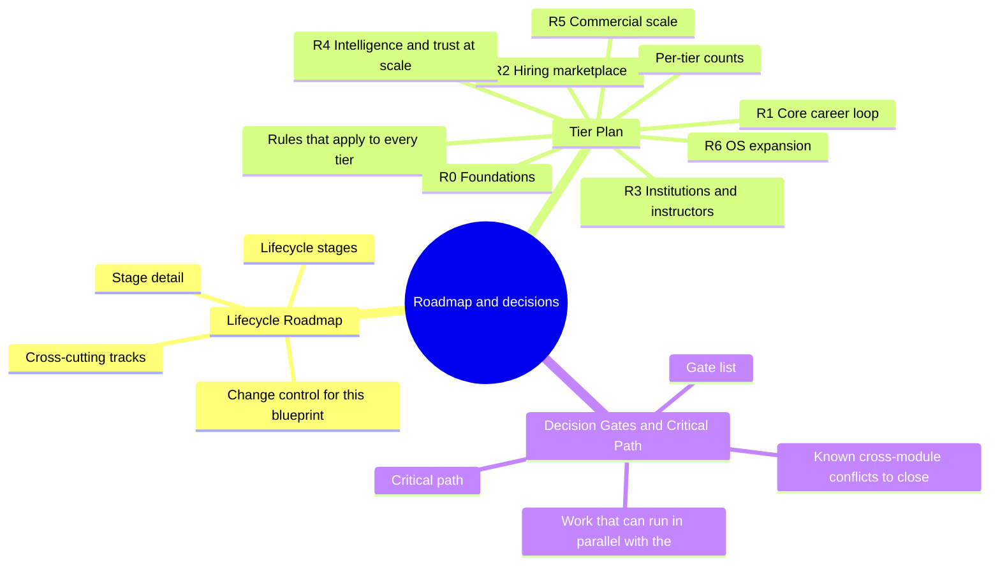

<!-- Generated from PRODUCT_BLUEPRINT sources. Regenerate instead of editing by hand. -->

# Mind map: Roadmap and decisions

Lifecycle stages, release tiers and decision gates.

## Documents

- [Lifecycle Roadmap](../08_ROADMAP/01_LIFECYCLE_ROADMAP.md)
- [Tier Plan (R0 to R6)](../08_ROADMAP/02_TIER_PLAN.md)
- [Decision Gates and Critical Path](../08_ROADMAP/03_DECISION_GATES_AND_CRITICAL_PATH.md)
