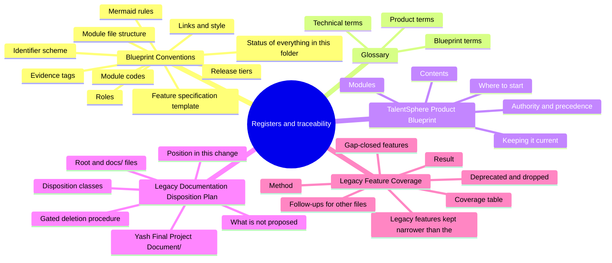

<!-- Generated from PRODUCT_BLUEPRINT sources. Regenerate instead of editing by hand. -->

# Mind map: Registers and traceability

Conventions, glossary and legacy traceability. The generated registers themselves are in 09_REGISTERS.

## Documents

- [Blueprint Conventions](../00_START_HERE/CONVENTIONS.md)
- [Glossary](../00_START_HERE/GLOSSARY.md)
- [TalentSphere Product Blueprint](../00_START_HERE/README.md)
- [Legacy Documentation Disposition Plan](../11_LEGACY_DISPOSITION/DISPOSITION_PLAN.md)
- [Legacy Feature Coverage (F-01 to F-173)](../11_LEGACY_DISPOSITION/LEGACY_FEATURE_COVERAGE.md)
