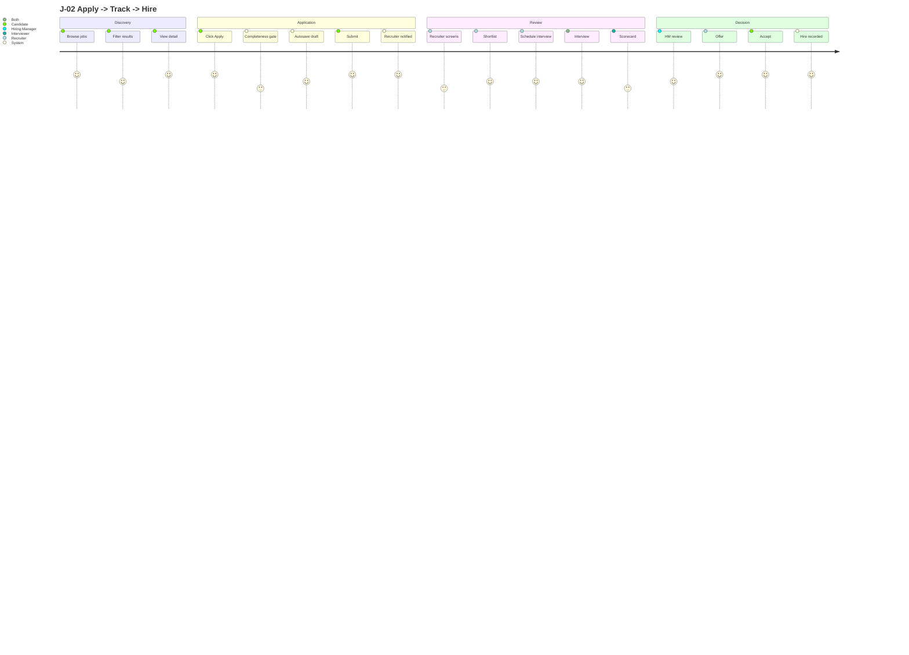

# Legacy Journey Register (J-01 to J-28)

Doc ID: USR-LEG-01 · Owner: UX Research & Service Design Lead (with Product Director) · Version 1.0 · Status: Draft for Review · Relates: `USER_JOURNEYS.md` (UJ-01..UJ-20), `STAKEHOLDERS_ROLES_PERMISSIONS.md`, `../28_TRACEABILITY_AND_COVERAGE/AUDIT_JOURNEY_EVIDENCE_CROSSWALK.csv` (OPEN-45), `../24_RISKS_AND_DECISIONS/OPEN_DECISIONS_LEGACY_MERGE.md`, `../00_CONTROL_CENTRE/LEGACY_MERGE_LEDGER_A.md`

Supersedes nothing; linked from `../00_CONTROL_CENTRE/LEGACY_MERGE_LEDGER_A.md` and `MASTER_INDEX`. Created under the standing instruction: "i dont want to loos information keep everything in use untile it get improved".

## Merged from legacy: `31_LEGACY_ARCHIVE/docs/experience/JOURNEY_REGISTRY.md` (v6.0)

## 0. Frame

| Item | Statement |
|---|---|
| Implementation status | **None.** The prior attempt called these "target journeys, not a passing test inventory"; its audit certified no full terminal journey. Here they are **requirements candidates** only. |
| Identity | Prior attempt used `J-01..J-28` (28 canonical journeys; earlier prose mentioning 31 journeys and 246 rules was stale and removed there). The target uses `UJ-01..UJ-20`. The two namespaces are **not interchangeable**; the right-hand columns below show the *candidate* mapping from `AUDIT_JOURNEY_EVIDENCE_CROSSWALK.csv`, which approves no equivalence (OPEN-45). |
| Personas | The legacy register cites persona IDs `P-A` to `P-T` (19 rows, `P-P` absent in the prior root SSOT). Persona definitions are not in this source group; the target has five hypothetical personas (P1 to P5) in `STAKEHOLDERS_ROLES_PERMISSIONS.md`. The reduction is an explicit coverage gap (OPEN-LGA-07), not a retirement. Persona abbreviation `ML` in J-12 is not defined in any merged source. |
| Terminal state | Every legacy journey names a terminal outcome. These are kept as the acceptance end-point for each journey. |

## 1. Register (verbatim) with candidate target mapping

| J ID | Name | Persona(s) | Terminal state | Candidate target UJ (from crosswalk) | Crosswalk comparison |
|---|---|---|---|---|---|
| J-01 | Learn → Prove → Showcase | P-A, P-B | Portfolio with verified signals | UJ-02; UJ-04 | candidate-partial |
| J-02 | Apply → Track → Hire | P-A, P-B | Offer accepted | UJ-05; UJ-06 | candidate-partial |
| J-03 | Post → Source → Hire | P-C, P-E, P-S | Offer extended | UJ-11; UJ-12; UJ-13 | candidate-partial |
| J-04 | Org Setup → Team → Launch | P-C, P-E | First hire | UJ-11; UJ-14 | candidate-partial |
| J-05 | Profile → Network → Referral | P-A, P-B | Referred hire | UJ-01; UJ-05; UJ-12 | candidate-partial |
| J-06 | AI Career Path: Gap → Plan → Execute | P-B | Gaps addressed | UJ-07 | candidate-partial |
| J-07 | Creator: Author → Publish → Monetize | P-G | Revenue | UJ-15 | candidate-partial |
| J-08 | Mentor: Match → Guide → Impact | P-H | Impact measured | (none) | candidate-no-match |
| J-09 | Institution: Cohort → Place → Track | P-I | Placement reported | UJ-16 | candidate-partial |
| J-10 | Agency: Multi-Org → Pipeline → Bill | P-F | Client invoice | UJ-11 | candidate-partial |
| J-11 | Extension: Install → Local-First → Sync | P-A | Profile diff applied | (none) | candidate-no-match |
| J-12 | B2B2C Graduation Flywheel | P-I, ML | Independent candidate | UJ-16 | candidate-partial |
| J-13 | Institutional Media Authoring | P-G, P-K | Course assigned to batch | UJ-15; UJ-16 | candidate-partial |
| J-14 | Institutional Procurement & Licensing | P-J | Seats provisioned | UJ-14; UJ-16 | candidate-partial |
| J-15 | Faculty: Teach → Monitor → Intervene | P-K | At-risk students intervened | UJ-16 | candidate-partial |
| J-16 | Corporate L&D: Mandate → Track → Certify | P-L, P-T | Certification + HRIS sync | UJ-16 | candidate-partial |
| J-17 | LinkedIn Migration On-ramp | New user | Native account complete | UJ-01; UJ-02 | candidate-partial |
| J-18 | Creator: Author → Publish → Sell → Payout | P-G | Monthly settlement | UJ-15 | candidate-partial |
| J-19 | Self-Paced Learner: Discover → Certify | P-M | Path enrolled | UJ-04; UJ-07 | candidate-partial |
| J-20 | Learner: Path → Courses → Capstone → Cert | P-M | Program certificate | UJ-04; UJ-07; UJ-16 | candidate-partial |
| J-21 | Contestant: Register → Compete → Rank → Certify | P-Q | Certification badge | (none) | candidate-no-match |
| J-22 | Researcher: Company → Reviews → Compare → Apply | P-O | Apply started | UJ-05 | candidate-partial |
| J-23 | Author: Post → Engage → Article → Newsletter | P-N | Audience established | (none) | candidate-no-match |
| J-24 | Reviewer: Write → Moderate → Publish → Response | Any verified user | Published review | UJ-19 | candidate-partial |
| J-25 | Peer Reviewer: Assigned → Rubric Review → Feedback | Student | Grade finalized | (none) | candidate-no-match |
| J-26 | Career Switcher: Assess → Plan → Transition | P-R | Role transition confirmed | UJ-07 | candidate-partial |
| J-27 | Hiring Manager: Define → Assess → Hire → Track | P-S | Post-hire outcome recorded | UJ-11; UJ-13 | candidate-partial |
| J-28 | Skills Analyst: Analyze → Recommend → Measure | P-T | Learning program impact reported | (none) | candidate-no-match |

Journeys with **no direct match** in the target `UJ-*` catalogue (6): J-08 (Mentor: Match, Guide, Impact), J-11 (Extension: Install, Local-First, Sync), J-21 (Contestant: Register, Compete, Rank, Certify), J-23 (Author: Post, Engage, Article, Newsletter), J-25 (Peer Reviewer: Assigned, Rubric Review, Feedback), J-28 (Skills Analyst: Analyze, Recommend, Measure). Each needs an owner decision: adopt (add a UJ), defer to a later phase with an explicit entry in the roadmap, or retire. Nothing is retired by this merge (OPEN-LGA-07).

### Grouping added by this merge (editorial)

| Group | Journeys |
|---|---|
| Candidate core loop | J-01, J-02, J-05, J-06, J-11, J-17, J-26 |
| Recruiter / hiring side | J-03, J-04, J-10 (agency), J-27 |
| Learning and creators | J-07, J-13, J-18, J-19, J-20, J-25 |
| Institutions and corporate L&D | J-09, J-12, J-14, J-15, J-16 |
| Community, mentorship and reputation | J-08, J-23, J-24 |
| Assessment and contests | J-21 |
| Research and analytics | J-22, J-28 |

## 2. J-02 Apply, Track, Hire (legacy detail diagram)

Notes tied to legacy rules (see `../06_BUSINESS_PROCESSES/LEGACY_BR_CATALOGUE_BR001_BR248.md`): the "Completeness gate" is BR-037 / BR-061 (profile completeness >= 70%); "Autosave draft" is BR-018 (autosave every 30 s, versions retained); the application lifecycle is BR-041 (strict state machine) and BR-017 / BR-020 (append-only). The emotion scores (1 to 5) are the prior attempt's design hypotheses, not measurements.

## 3. J-26 Career Switcher (legacy detail diagram)

```mermaid
flowchart LR
    A[Target role identified] --> B[F-91 Career Readiness]
    B --> C{Skills gap?}
    C -->|Yes| D[F-95 Career Transition Plan]
    D --> E[F-84 suggests learning]
    E --> F[F-07 enroll courses]
    F --> G[F-08 challenges + F-69 assignments]
    G --> H[F-96 Skill Evidence]
    H --> I[F-85 Career Graph comparison]
    I --> J{Ready?}
    J -->|Yes| K[Apply via F-04]
    J -->|No| D
    K --> L[F-88 Interview Platform]
    L --> M[Hired + outcome tracked]
```

Feature references are legacy `F-*` IDs (see `../04_PRODUCT_CAPABILITIES/LEGACY_FEATURE_REGISTRY_F01_F173.md`): F-91 Career Readiness Assessment, F-95 Career Transition Planning, F-84 Skills Graph and Taxonomy, F-07 Learning Management System, F-08 Challenges Arena, F-69 Assignments and Peer Review, F-96 Skill Evidence and Digital Credentials, F-85 Career Graph and Progression, F-04 Job Marketplace, F-88 Technical Interview Platform. Computed observation: this one flow crosses legacy phases Ph1 to Ph7 (F-07 and F-08 are Ph1; F-91, F-96 and F-04 are Ph2; F-85 and F-88 are Ph3; F-95 is Ph4; F-69 is Ph7), so J-26 cannot be completed until its slowest dependency exists. Target action: place J-26 in the roadmap by its latest dependency.

## 4. Journey contract (legacy; carried over)

Every journey must define: entry conditions, actors, permissions, main path, alternate paths, failure/recovery, terminal state, analytics, observability and acceptance evidence.

Target comparison: `USER_JOURNEYS.md` section 0 and the per-journey tables already cover actor, entry, success, steps, risk and failure/recovery. The legacy contract adds **permissions, analytics, observability and acceptance evidence** per journey. Target action: add a short "permissions / analytics events / observability / acceptance evidence" line to each UJ at its next revision (OPEN-LGA-13).

## 5. Journey status rule (legacy; carried over)

A journey is not complete until its critical feature chain is testable end to end. Target position: same; isolated API or unit assertions do not prove a terminal outcome.

## 6. Target users named by the prior PRD (for persona completeness)

Candidate/learner, career switcher, professional, recruiter, hiring manager, employer admin, instructor/course author, institution admin/faculty, mentor/expert, moderator, verification operator, support, finance and platform admin (14 roles). The target role catalogue is in `STAKEHOLDERS_ROLES_PERMISSIONS.md`; reconciliation of the 14 prior roles, the prior SSOT's 3 JWT roles plus 24 contextual roles, and the prior built union of 10 roles is OPEN-44 (see also OPEN-LGA-08).
