# User Journeys — 20 role lifecycles

Doc ID: USR-02 · Owner: UX Research & Service Design Lead · Version 1.0 · Status: Under Review · Relates: USR-01 `STAKEHOLDERS_ROLES_PERMISSIONS.md`, STR-01, DOM-00, UI-01, UI-02, UI-04, UI-07, GOAL-01…GOAL-08, INV-T04, INV-T05, INV-T09, INV-T15, INV-T18, INV-T20, BR-T004, BR-T041, BR-T060

Supersedes nothing; linked from the folder index and `MASTER_INDEX` (and from `07_UI_UX_AND_DESIGN_SYSTEM`). All content **[TARGET]**.

## 0. How to read this document

| Item | Statement |
|---|---|
| Evidence base | **No user research has been conducted.** Personas P1–P5 (USR-01) are hypothetical. Emotions, risks and drop-off points below are *design hypotheses* to be tested (OPEN-07), not findings. |
| Emotion scores | Mermaid `journey` scores 1–5 (1 = frustrated/anxious, 5 = confident/delighted) express intended experience under the designed flow, not measured sentiment. |
| IDs | Screens `SCR-*` → `SCREEN_REGISTRY.md`; actions `ACT-*` → `ACTION_REGISTRY.md`; roles `ROLE-*`; goals `GOAL-*` → `PRODUCT_VISION_AND_BUSINESS_MODEL.md`. |
| Failure/recovery | Each journey lists the failures most likely to break the goal and the designed recovery. Global failure classes (offline, validation, 401/403/412/429/5xx, remote outage) are in `ACTION_REGISTRY.md` §0 and `PROGRESSIVE_UX_AND_FEEDBACK.md`. |
| Honesty constraints | Journeys never show a claim as verified before a server verification transition (INV-T04); never make an adverse decision without a human (INV-T09); never auto-grant data access (INV-T15). |

### Journey index

| UJ | Journey | Primary role | Persona | Loop stage | Goal link | Diagram |
|---|---|---|---|---|---|---|
| UJ-01 | Discover → register → confirm email | ROLE-CAND | P1 Asha | Showcase entry | GOAL-01 | journey |
| UJ-02 | Onboard → first evidence | ROLE-CAND | P1 | Prove | GOAL-01 | journey |
| UJ-03 | Verify work history through a referee | ROLE-CAND (+ REFEREE) | P1, P4 | Prove | GOAL-01 | flow |
| UJ-04 | Learn → assess → earn evidence | ROLE-CAND | P1 | Learn→Prove | GOAL-04 | flow |
| UJ-05 | Find a job → understand the match → apply | ROLE-CAND | P1 | Match→Apply | GOAL-03 | journey |
| UJ-06 | Interview → offer → outcome | ROLE-CAND | P1 | Apply→Hire | GOAL-02, GOAL-03 | journey |
| UJ-07 | Grow: readiness, transitions, next learning | ROLE-CAND | P1 | Grow | GOAL-04 | table |
| UJ-08 | Reactivate after dormancy | ROLE-CAND | P1 | Grow | GOAL-01 | flow |
| UJ-09 | Pause, export, delete account | ROLE-CAND | P1 | Offboard | GOAL-06 | flow |
| UJ-10 | Recover access (lost passkey / locked) | any | P1 | Support | GOAL-06 | table |
| UJ-11 | Recruiter: set up → post → shortlist → hire | ROLE-REC | P2 Marcus | Hire | GOAL-02 | flow |
| UJ-12 | Recruiter: verified search → consent-gated outreach | ROLE-REC | P2 | Match | GOAL-02, GOAL-03 | table |
| UJ-13 | Hiring manager: review → scorecard → decision | ROLE-HM | — | Hire | GOAL-02 | table |
| UJ-14 | Org admin: set up org, SSO, roles, access review | ROLE-ORGADM | — | Admin | GOAL-06 | table |
| UJ-15 | Instructor: build, publish, attest outcomes | ROLE-INST | — | Learn | GOAL-04 | table |
| UJ-16 | Institution admin & faculty: cohort → coverage → credentials | ROLE-INSTADM, ROLE-FAC | P3 Dr. Lin | Learn→Prove | GOAL-05 | flow |
| UJ-17 | Referee: confirm a role in < 3 minutes, no account | ROLE-REFEREE | P4 Priya | Prove | GOAL-01 | flow |
| UJ-18 | Support operator: scoped, time-boxed access | ROLE-SUP | P5 Sam | Support | GOAL-06 | flow |
| UJ-19 | Moderator: report → decision → appeal; integrity review | ROLE-MOD | — | Safety | GOAL-03, GOAL-06 | flow |
| UJ-20 | Platform admin: remote failure → rollback; access review | ROLE-ADM | — | Operate | GOAL-08 | flow |

Table columns used in each journey: **Step · Screen / touchpoint · Emotion (hypothesis) · Risk · Failure → recovery**.

---

## UJ-01 Candidate: discover → register → confirm email

**Actor:** ROLE-CAND (P1 Asha, mobile-first, patchy data). **Entry:** shared job link, search, or referral. **Success:** confirmed account, in onboarding. **Screens:** SHELL-01, OPP-01/02 (anon), SHELL-03, SHELL-04, CAND-02.

| # | Step | Screen / touchpoint | Emotion | Risk | Failure → recovery |
|---|---|---|---|---|---|
| 1 | Arrives from a shared job link or search | OPP-02 (anon) / SHELL-01 | Curious | Bounce if page is slow or login-walled | Public job page needs no login; page works offline-first shell; "Apply" asks to sign in without losing the job (`next`) |
| 2 | Understands what is different (evidence ladder, not a résumé dump) | SHELL-01 explainer, SHELL-11 sample | Interested, slightly sceptical | Jargon ("attested") | Plain-language rung explainer; popovers; no claims of being "verified" for unverified items |
| 3 | Chooses how to sign up (passkey or password; or SSO if employer-provided) | SHELL-03 | Hesitant about yet another account | Password-policy frustration, breached-password rejection | Passkey option; clear policy up-front; password manager friendly (ACT-AUTH-01) |
| 4 | Confirms email via code or link | SHELL-04 | Impatient | Email delay/spam folder; opening link on another device | Resend with cooldown (ACT-AUTH-03); enter code manually on the original device; "Change email" link; neutral copy never reveals if the email already existed |
| 5 | Arrives in onboarding | CAND-02 | Relieved | Immediate form fatigue | Steps skippable; progress text; "Save and exit" |
| 6 | (Alt) Existing account found | SHELL-04 neutral message → SHELL-02 | Confused | Account enumeration | Same message either way; "If you already have an account, sign in" link |

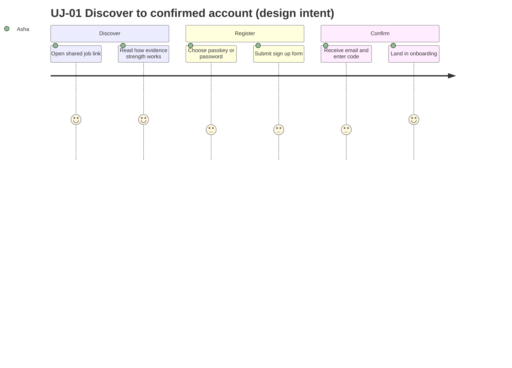

---

## UJ-02 Candidate: onboard → first evidence

**Actor:** ROLE-CAND. **Success:** first evidence item saved within 7 days (activation, STR-01 §8). **Screens:** CAND-02, CAND-08, CAND-09, CAND-01, MSG-04.

| # | Step | Screen / touchpoint | Emotion | Risk | Failure → recovery |
|---|---|---|---|---|---|
| 1 | Chooses goals and skills | CAND-02 steps 1–2 | Engaged | Unfamiliar taxonomy terms | Typeahead suggests nearest skill; free tags allowed |
| 2 | Optionally imports résumé | CAND-02 step 3 | Hopeful, wary of data use | Parse errors; AI budget exhausted; privacy worry | Items arrive as *suggestions* to accept one by one (never auto-saved, INV-T08); manual path; "why we ask" text |
| 3 | Sets visibility defaults | CAND-02 step 4 | Cautious | Over-sharing fear | Defaults Private; plain-language effects; changeable anytime in CAND-04 |
| 4 | Picks "Add my first evidence" | CAND-02 step 5 → CAND-08 | Motivated, slightly daunted | Not knowing what counts as evidence | Type chooser with examples; "Better: add from your course" hints |
| 5 | Describes the work, attaches a file/link | CAND-08 | Focused | Large upload on poor network; scan delay | Real byte progress; resume; "scanning" state; save without waiting for scan; local draft |
| 6 | Saves; sees it as **Claimed**, understands how to strengthen | CAND-09 | Proud, then informed | Disappointment that it isn't "verified" | Honest copy: "Saved as Claimed. Add proof or ask someone to attest." Clear next steps, no shaming |
| 7 | Gets a gentle reminder to ask an attester | MSG-04, email (opt-in) | Neutral | Nudge fatigue | User-controlled cadence; max 2 nudges; off in preferences |

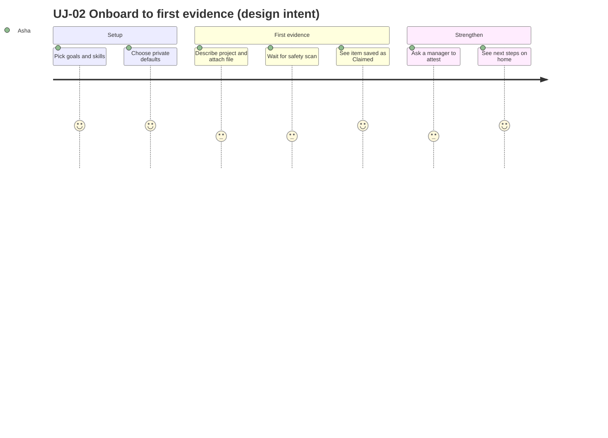

---

## UJ-03 Candidate: verify work history through a referee

**Actor:** ROLE-CAND with ROLE-REFEREE (counterpart in UJ-17). **Rules:** token hashed, single-use, bound to the request (INV-T05); expiry 14 days, max 2 reminders (BR-T004). **Screens:** CAND-10/11/12/13, SHELL-09/10, CAND-09.

| # | Step | Screen / touchpoint | Emotion | Risk | Failure → recovery |
|---|---|---|---|---|---|
| 1 | Adds a role as a claim (Claimed) | CAND-10 | Neutral | Dates/typos | Validation; edit later (before any attestation) |
| 2 | Chooses "Ask a referee" | CAND-11 | Slightly anxious about asking | Awkwardness; wrong person | Preview of the email; guidance on who to ask; relationship field |
| 3 | Sends request | CAND-12 | Relieved | Wrong email | Confirm screen shows address; cancel allowed (ACT-VER-04) |
| 4 | Waits | CAND-11/13 status: Requested → Opened → Submitted | Uncertain | Silence; no response | Timeline with dates; "We'll tell you when Priya responds"; 1st reminder after 3 days (ACT-VER-03) |
| 5 | Referee confirms or declines | SHELL-09 (UJ-17) | — | Decline hurts | Neutral decline wording to candidate: "Priya couldn't confirm this"; option to ask someone else |
| 6 | Sees updated status | CAND-09 | Pleased | Misreading what changed | Evidence shows **Peer-attested by Priya (manager)**; not called "verified" |
| 7 | Request expires | CAND-13 | Disappointed | Giving up | Expiry notice; "Send a new request" (ACT-VER-08) |

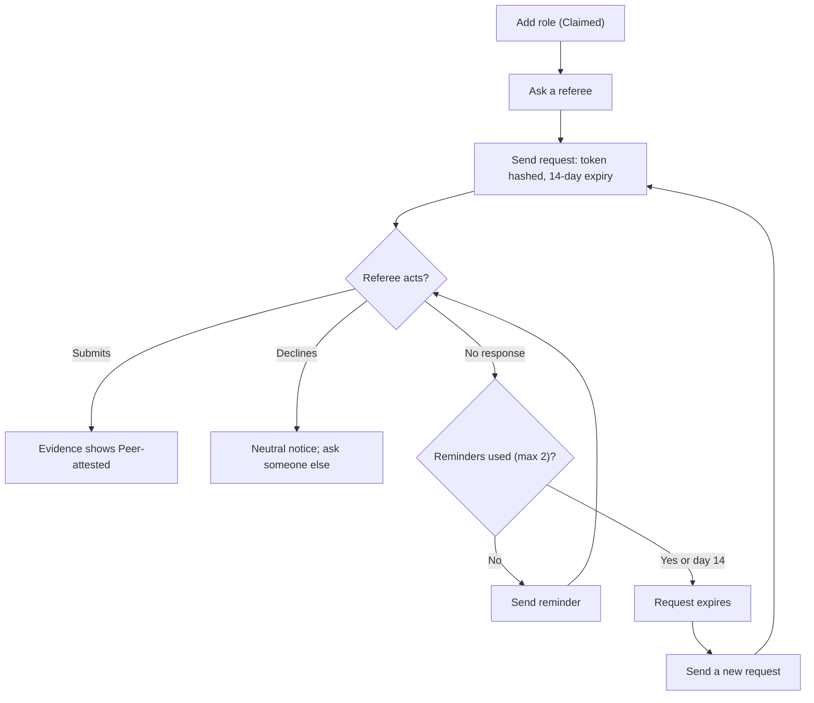

---

## UJ-04 Candidate: learn → assess → earn evidence

**Actor:** ROLE-CAND. **Rules:** lesson completion server-confirmed; `AI_PROHIBITED` enforced server-side (INV-T06); sandbox absent ⇒ results Unverified (ADR-T13); anomaly ≠ guilt (INV-T20). **Screens:** LRN-02/03/04/05, ACC-08/13, LRN-07/08/09/10/11, CAND-09.

| # | Step | Screen / touchpoint | Emotion | Risk | Failure → recovery |
|---|---|---|---|---|---|
| 1 | Finds a course tied to a target skill | LRN-02/03 | Motivated | Choice overload | Filters; outcomes shown as "evidence you can earn" |
| 2 | Enrols (free) or buys | LRN-03, Stripe, ACC-13 | Cautious | Paid but no access | Access only after verified webhook; "Confirming your payment…" (INV-T17); email fallback |
| 3 | Watches lessons | LRN-04 | Focused | Captions missing, poor network | Captions mandatory at publish; resume position; text fallback |
| 4 | Completes; asks to add to evidence | LRN-05 → CAND-09 | Satisfied | Over-claiming | Rung assigned by server per issuer; copy explains |
| 5 | Starts an assessment | LRN-08 | Nervous | Rules unclear; AI use confusion | Plain rules incl. "AI assistance is off"; accommodations request (ACT-ASM-09) |
| 6 | Takes it | LRN-09 | Pressured | Connection drop; timer anxiety | Server-authoritative timer; local buffer; milestone-only announcements |
| 7 | Gets result | LRN-10 | Relieved or disappointed | Unverified code result misread as pass | Honest label "Unverified — automated grading isn't available yet"; no evidence minted |
| 8 | If flagged: sees "Review requested" | LRN-11 | Worried | Feeling accused | Neutral copy; human review; appeal (ACT-ASM-08) |

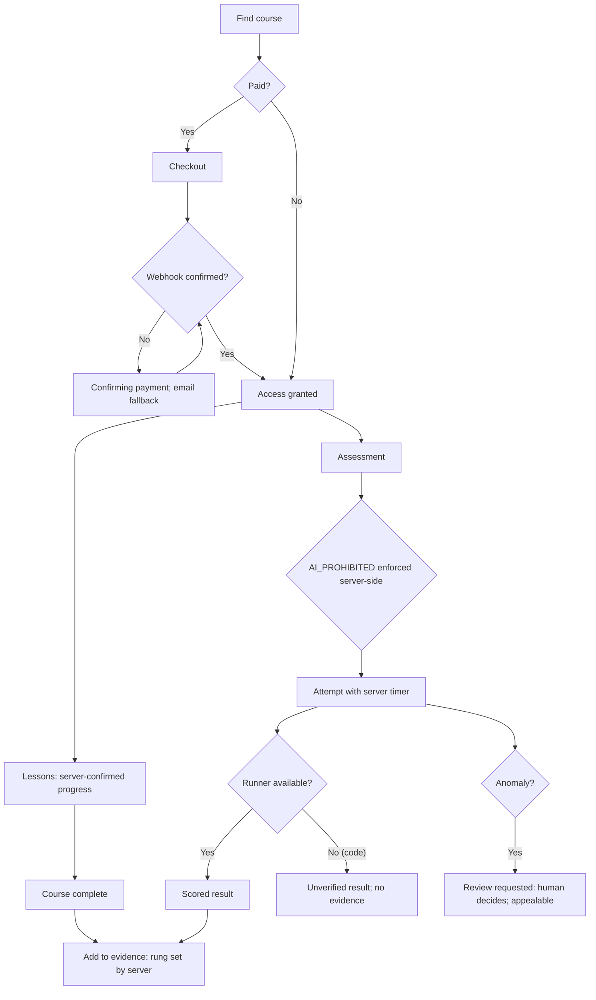

---

## UJ-05 Candidate: find a job → understand the match → apply

**Actor:** ROLE-CAND. **Rules:** match explanation shows strengths, gaps, uncertainty, never payment-ranked (INV-T19); one active application per job (BR-T001); evidence sharing consent purpose-bound (INV-T15). **Screens:** OPP-01/02/03, CAND-08, OPP-06/08.

| # | Step | Screen / touchpoint | Emotion | Risk | Failure → recovery |
|---|---|---|---|---|---|
| 1 | Searches and filters | OPP-01 | Exploring | Irrelevant results | Filters; saved search/alert; clear filters |
| 2 | Reads "Why this matched" | OPP-02 | Curious | Distrust of scores | Words not numbers; inputs and missing information listed; "Ask a person to review" |
| 3 | Sees a gap, chooses to add evidence first | OPP-02 → CAND-08 | Motivated | Losing place | Return link preserves job; draft saved |
| 4 | Starts application | OPP-06 step 1 | Focused | Re-typing data | Prefill (3.3.7); résumé variant select |
| 5 | Chooses evidence to share and consents | OPP-06 step 2 | Careful | Privacy worry | Per-item preview; unticked consent; purpose/duration plain text |
| 6 | Answers screening questions | OPP-06 step 3 | Neutral | Fear of auto-rejection | Copy: "People review answers"; no auto-reject (INV-T09) |
| 7 | Reviews and submits | OPP-06 step 4 | Anxious → relieved | Double submit; job closes | Idempotent; closed job keeps draft; persistent confirmation |
| 8 | Tracks status | OPP-07/08 | Hopeful | Silence | Timeline with human-set stages and dates |

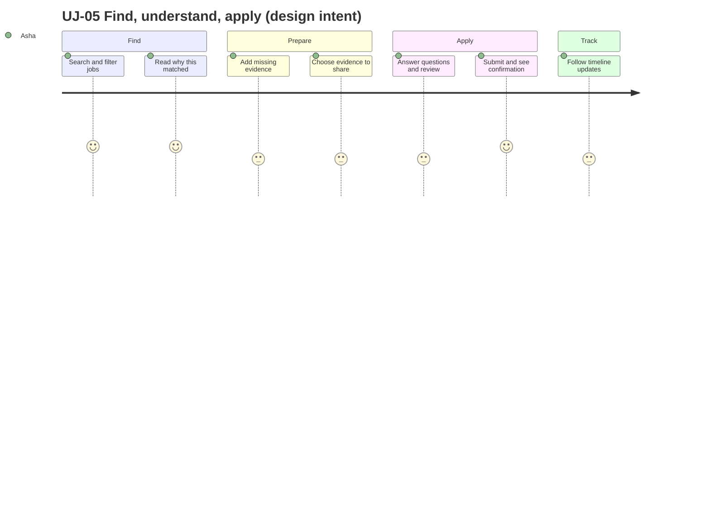

---

## UJ-06 Candidate: interview → offer → outcome

**Rules:** stage changes are made by people (INV-T09); offers confirmed with step-up; "Not moving forward" carries a human actor and reason category; candidate can ask for human review (ACT-PRV-08). **Screens:** OPP-08/09/10, MSG-02.

| # | Step | Screen / touchpoint | Emotion | Risk | Failure → recovery |
|---|---|---|---|---|---|
| 1 | Receives interview invitation | Push/email → OPP-09 | Excited | Time-zone mistakes; missed notice | Slot list with explicit time zone; ICS; reminders per preferences |
| 2 | Picks slot or proposes others | OPP-09 | Relieved | Slot taken | Atomic select; refreshed list message |
| 3 | Prepares and attends | OPP-08 notes | Nervous | Accessibility needs | Accommodation note path; message recruiter |
| 4 | Receives offer | OPP-10 | Elated / cautious | Pressure, ambiguity | Expiry stated as fact; terms displayed; message thread; no countdown theatrics |
| 5a | Accepts | OPP-10 | Relieved | Accidental accept | Review + step-up + confirm dialog |
| 5b | Declines | OPP-10 | Neutral | — | Optional reason |
| 6 | Or "Not moving forward" | OPP-08 | Disappointed | Opaque rejection | Respectful template; reason category; "Ask for a person to review" (ACT-PRV-08); suggestions for similar roles (no guarantees) |

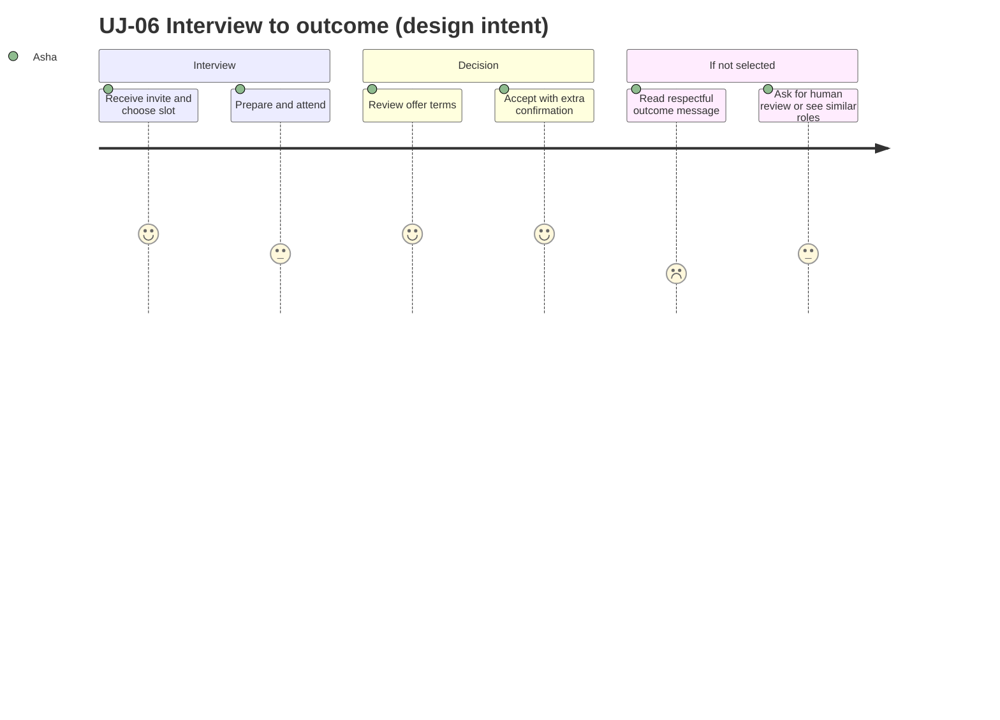

---

## UJ-07 Candidate: grow — readiness, transitions, next learning

| # | Step | Screen / touchpoint | Emotion | Risk | Failure → recovery |
|---|---|---|---|---|---|
| 1 | Opens Career | CAND-17 | Curious | "Not enough data" feels useless | Explains inputs and how to add data; no fabricated scores |
| 2 | Explores target transitions | CAND-18 | Inspired | Over-confident forecasts | Ranges and uncertainty shown; table alternative |
| 3 | Sees salary context | CAND-19 | Informed | Small samples misleading | Sample size shown; hidden when insufficient |
| 4 | Starts a learning path | LRN-06 (ACT-LRN-10) | Committed | Plan too big | Steps with prerequisites, pause anywhere |
| 5 | Earns new evidence → loop restarts | UJ-04 → CAND-09 | Progress | Plateau | Home next-step card rules; opt-in nudges |
| 6 | Considers premium tools | ACC-08 | Wary | Dark patterns | Statement: evidence, applying, messaging always free; plain comparison; no pop-ups |

---

## UJ-08 Candidate: reactivate after dormancy

**Trigger:** returns after months; account may be paused (ACT-ACC-10) or just inactive. **Screens:** SHELL-02, ACC-15, ACC-09, CAND-01, CAND-07.

| # | Step | Screen / touchpoint | Emotion | Risk | Failure → recovery |
|---|---|---|---|---|---|
| 1 | Clicks email/push or visits | SHELL-02 | Uncertain | Forgot credentials, device changed | Passkey/recovery (UJ-10) |
| 2 | Logs in; terms/privacy changed | SHELL → re-consent dialog | Impatient | Forced acceptance dark pattern | Plain summary of changes; decline = remain paused/read-only to export (ACT-ACC-11) |
| 3 | Sees "Welcome back" status summary | CAND-01 | Reassured | Stale data | Shows: evidence expiring/stale, consent scopes expired, open applications' states |
| 4 | Reviews sharing | ACC-09 | Careful | Old consents still active | Expired scopes marked; nothing silently renewed |
| 5 | Refreshes profile/evidence | CAND-03/07 | Re-engaged | Overwhelm | One "Next step" card |
| 6 | Re-subscribes to alerts | OPP-04, ACC-04 | Interested | Push unsupported | Email fallback |

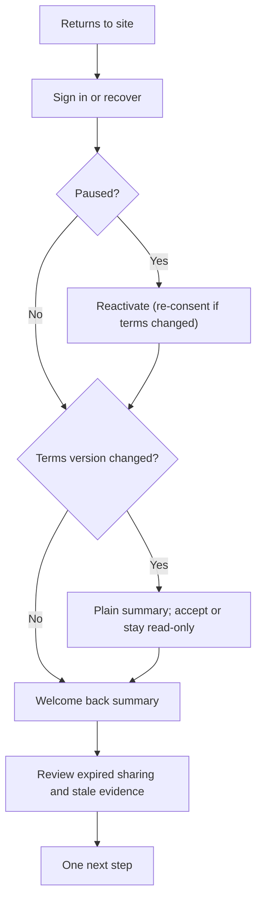

---

## UJ-09 Candidate: pause, export, delete account

**Rules:** erasure completes within 30 days except legally retained records (BR-T060, OPEN-08); typed confirmation + step-up; cancellation window [OPEN-UX-27]. **Screens:** ACC-15, ACC-11, ACC-10.

| # | Step | Screen / touchpoint | Emotion | Risk | Failure → recovery |
|---|---|---|---|---|---|
| 1 | Decides to leave | ACC-15 | Tired / conflicted | Wanting a break, not deletion | "Pause" offered first (reversible); explains difference |
| 2 | Exports data | ACC-11 (ACT-PRV-04/05) | Careful | Large export wait | "We're preparing this; we'll notify you" (no % bar); 7-day link; step-up for download |
| 3 | Reviews what deletion means | ACC-11 | Anxious | Not knowing what is kept | Retained-record list (billing/audit) stated plainly [OPEN-08]; effect on applications, shared evidence, issued credentials |
| 4 | Confirms deletion | ACC-11 (ACT-PRV-06) | Resolute | Accidental deletion | Typed "DELETE" + step-up; receipt with date |
| 5 | Waits through grace period | Email + ACC-11 status | Uncertain | Regret | Cancel deletion within window (ACT-PRV-07); sign-in shows banner |
| 6 | Completion | Email | Closure | Residual data | Confirmation after `erasure.completed`; retained categories listed |

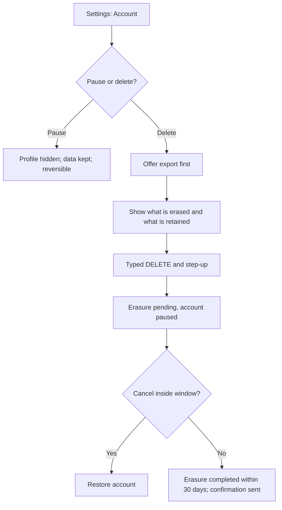

---

## UJ-10 Any user: recover access (lost passkey / locked / forgot password)

| # | Step | Screen / touchpoint | Emotion | Risk | Failure → recovery |
|---|---|---|---|---|---|
| 1 | Cannot use passkey/password | SHELL-02/07 | Frustrated | Dead end | "Can't use your passkey?" (ACT-AUTH-13) always visible |
| 2 | Requests recovery by email | SHELL-05/07 | Anxious | Email access also lost | Support route (UJ-18) with identity checks [OPEN]; no instant bypass |
| 3 | Gets code/link; proves control | SHELL-06 | Relieved | Phishing look-alikes | Clear sender, link goes to same origin; no secrets in query |
| 4 | Sets new password or adds passkey | SHELL-06 → ACC-02 | Cautious | Weak reuse | Breach check; passkey nudge |
| 5 | Security cool-off | Banner on sensitive actions for 24 h | Mildly annoyed | Legit user blocked | Explained; existing devices notified; can still apply/read |
| 6 | Reviews sessions | ACC-03 | Reassured | Unknown devices | Revoke all others (ACT-ACC-05) |

---

## UJ-11 Recruiter: set up → post a job → shortlist → hire

**Actor:** ROLE-REC (P2 Marcus, 40 open reqs, desktop-first). **Rules:** no auto-reject (INV-T09); consent-gated evidence (INV-T15); no pay-to-rank (INV-T19). **Screens:** HIR-20/01/02/03/05/06/09/10/11/12.

| # | Step | Screen / touchpoint | Emotion | Risk | Failure → recovery |
|---|---|---|---|---|---|
| 1 | Joins via invite; sets up workspace | SHELL-12 → HIR-20 | Efficient | Wrong org/role | Accept screen shows org + role; switch workspace |
| 2 | Creates job from template | HIR-03/04 | Focused | Biased language; incomplete data | Advisory lint; required skills as taxonomy; review before publish |
| 3 | Publishes | HIR-03 (ACT-HIRE-03) | Confident | Content flagged for review | "Pending review" with reason; fix and resubmit |
| 4 | Reviews incoming applications | HIR-05 | Overloaded | Volume; temptation to filter by score | Pipeline ordered by time/stage; match explanation per candidate, no score; filters by must-have evidence |
| 5 | Opens candidate; reads evidence by rung | HIR-06 | Evaluating | Consent-hidden evidence | Lock state + request access; provenance explained |
| 6 | Moves stages; bulk messages | HIR-05/12 | In flow | Bulk errors | Per-item results; retry failed; idempotent |
| 7 | Schedules interviews; collects scorecards | HIR-09/10 | Coordinating | Time zones | Explicit zones; ICS |
| 8 | Sends offer; marks hired | HIR-11, ACT-PIPE-11/12 | Satisfied | Mistakes in offer | Review step; approval per policy |
| 9 | Closes the job; notifies others | ACT-HIRE-05 | Closure | Un-notified candidates | Template for "Position filled"; human bulk action for remaining |

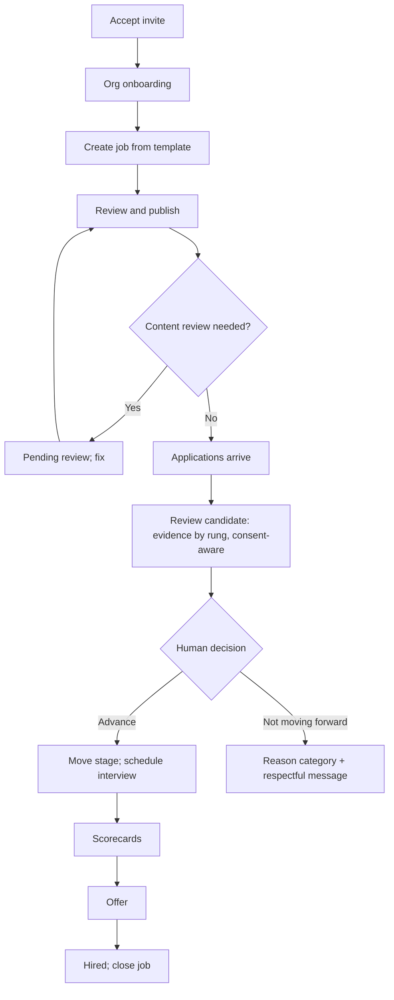

---

## UJ-12 Recruiter: verified search → consent-gated outreach

| # | Step | Screen / touchpoint | Emotion | Risk | Failure → recovery |
|---|---|---|---|---|---|
| 1 | Searches by skill and minimum evidence rung | HIR-07 | Goal-directed | Results feel like ranking by money | Explanation shown; copy states payment never affects order; only discoverable candidates |
| 2 | Opens a result | HIR-07/06 | Evaluating | Evidence hidden by consent | Lock state; "Request access" (ACT-PIPE-14) |
| 3 | Adds to shortlist | ACT-PIPE-13 | Productive | Consent expiry | Expiry flags on shortlist rows |
| 4 | Sends outreach | HIR-13 (ACT-MSG-06) | Hopeful | Quota exhausted; unwanted spam perception | Quota shown; templates must state role/org; candidate can mute/block |
| 5 | Candidate replies / grants access | MSG-02, ACC-09 | Waiting | Slow response | Status chips; no repeated nudges beyond policy |
| 6 | Candidate declines | MSG-02 | Disappointed | Persistence | Respect block; no re-contact |

---

## UJ-13 Hiring manager: review → scorecard → decision

**Actor:** ROLE-HM (assigned jobs only).

| # | Step | Screen / touchpoint | Emotion | Risk | Failure → recovery |
|---|---|---|---|---|---|
| 1 | Gets "candidates awaiting your review" | HIR-01 | Busy | Unclear priority | List ordered by age with SLA text |
| 2 | Opens candidate | HIR-06 | Evaluating | Anchoring on others' opinions | Blind scorecards until own submitted |
| 3 | Reads evidence and fit explanation | HIR-06 tabs | Analytical | Over-reading a match chip | No numeric score; gaps vs unknowns distinguished |
| 4 | Attends interview | HIR-09 | Engaged | Mobile-only context | Mobile-friendly scorecard |
| 5 | Submits scorecard | HIR-10 (ACT-PIPE-09) | Decisive | Late edits | Immutable; addendum only |
| 6 | Recommends; recruiter decides | HIR-06 | Neutral | Recommendation treated as decision | UI labels "Recommendation (advice)"; stage move requires human action with reason |

---

## UJ-14 Org admin: set up org, SSO, roles, access review

| # | Step | Screen / touchpoint | Emotion | Risk | Failure → recovery |
|---|---|---|---|---|---|
| 1 | Creates org; completes profile | HIR-20, HIR-16 | Methodical | Branding contrast | Accent colour contrast check |
| 2 | Invites members with roles | HIR-15 (ACT-ORG-01) | Efficient | Over-privileged roles | Role summaries before send; least-privilege default |
| 3 | Configures SSO; tests before enforce | HIR-16 (ACT-ORG-04) | Cautious | Lockout | Test login mandatory; break-glass owner |
| 4 | Assigns seats; sees billing | HIR-15, ACC-07 | Neutral | Surprise charges | Proration preview; entitlements from server |
| 5 | Quarterly access review prompt | HIR-15 | Mildly burdened | Skipped reviews | Prompt with keep/remove per member; overdue reminders |
| 6 | Removes a leaver | ACT-ORG-03 | Routine | Orphaned jobs | Reassign owned jobs first |
| 7 | Handles an employee's data-rights request | HIR-19 (ACT-ORG-09) | Careful | SLA miss | SLA clock; escalate to platform |

---

## UJ-15 Instructor: build, publish, attest outcomes

| # | Step | Screen / touchpoint | Emotion | Risk | Failure → recovery |
|---|---|---|---|---|---|
| 1 | Creates course | LRN-13/14 | Creative | Scope too large | Outline-first authoring; drafts autosave |
| 2 | Adds lessons with media | LRN-15 | Productive | Large uploads; missing captions | Resumable upload; captions required before publish (checklist) |
| 3 | Defines assessments and AI policy | LRN-16 | Careful | Forgetting AI policy; runner unavailable | `AI_PROHIBITED` default for graded; warning that code results will be Unverified |
| 4 | Passes publish checklist; publishes | LRN-14 (ACT-STU-04) | Anticipating | Blocked by checklist | Failures listed with links |
| 5 | Monitors learners | LRN-17 | Attentive | Seeing too much personal data | Consent-limited fields only |
| 6 | Confirms learner outcomes | LRN-17 (ACT-STU-07) | Responsible | Wrong rung expectations | Human decision per learner; rung set by server [OPEN-UX-26] |
| 7 | Reviews earnings | LRN-18 | Interested | Feature not ready | Hidden until OPEN-06 |

---

## UJ-16 Institution admin & faculty: cohort → coverage → credentials

**Actors:** ROLE-INSTADM, ROLE-FAC (P3 Dr. Lin). **Rules:** faculty see cohort skill coverage without private job-search data; aggregates only with small-cell suppression; credentials issued by humans; graduates own their identity (STR-01). **Screens:** ADM-17/18/19/20/21/22.

| # | Step | Screen / touchpoint | Emotion | Risk | Failure → recovery |
|---|---|---|---|---|---|
| 1 | Creates cohort; selects consent-notice wording | ADM-18/19 (ACT-INS-01/08) | Organised | Legal wording gaps | Versioned templates; cannot free-edit legal text |
| 2 | Invites learners in bulk | ADM-19 (ACT-INS-02) | Hopeful | Bad CSV; bounced emails | Validation before commit; per-item results |
| 3 | Learners accept and consent | Learner side (SHELL-12, ACC-09) | — | Low consent rates | Clear benefit text; opt-in per scope |
| 4 | Faculty reviews coverage | ADM-17/19 (ACT-INS-05) | Insightful | Misreading small groups | Suppression < 10 [OPEN-UX-21]; definitions linked |
| 5 | Issues credentials after human confirmation | ADM-20 (ACT-INS-03) | Responsible | Wrong learner/batch | Batch preview; per-item status; revoke with reason (ACT-INS-04) |
| 6 | Exports aggregate report | ADM-22 (ACT-INS-06) | Accomplished | Privacy leakage | Allowlisted fields; aggregates only |

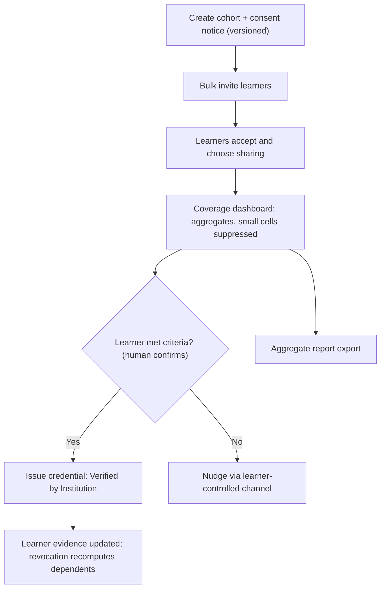

---

## UJ-17 Referee: confirm a role in < 3 minutes, no account

**Actor:** ROLE-REFEREE (P4 Priya, phone, link from email). **Rules:** token hashed, single-use, expiring, bound to one request, never shown back (INV-T05); no account; no marketing. **Screens:** SHELL-09/10.

| # | Step | Screen / touchpoint | Emotion | Risk | Failure → recovery |
|---|---|---|---|---|---|
| 1 | Gets email "Can you confirm Asha's work at Acme?" | Email | Neutral / maybe suspicious | Phishing doubts | Plain sender, short copy, no attachments; explains what happens; link to same origin |
| 2 | Opens link on phone | SHELL-09 | Slightly hurried | Link opened on desktop later; token in wrong device | Fragment secret; fallback code entry |
| 3 | Reads claim summary (employer/title/dates) | SHELL-09 | Recognising | Overwhelmed by text | ≤ 2 sentences + claim card |
| 4 | Answers 3–4 questions | SHELL-09 | Focused | Unsure about dates | "Partly" options with short correction field; optional comment |
| 5 | Sends or declines | SHELL-09/10 | Done | Misclick | Review-free single-step with clear labels; decline has own button |
| 6 | Sees thank-you | SHELL-10 | Relieved | Upsell | None; no account prompt; privacy note |
| 7 | (Alt) Link expired/used | SHELL-10 | Mildly annoyed | Re-sent to wrong address | "Send me a new link" goes only to original address |
| 8 | (Alt) Not her / misuse | ACT-REF-04 | Concerned | Harassment | Report path; rate-limited |

| Time budget | Target |
|---|---|
| Load | ≤ 1 s on mid-range phone, shell only |
| Read | ≤ 60 s |
| Answer | ≤ 90 s (4 questions) |
| Total | < 180 s (design target; verify by timed walkthrough, OPEN-07) |

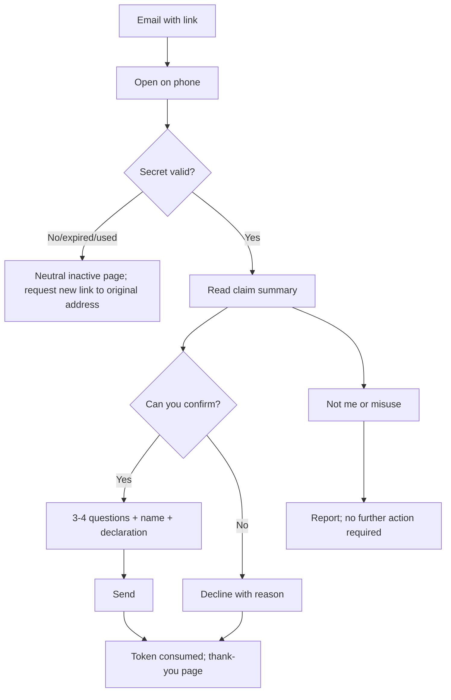

---

## UJ-18 Support operator: scoped, time-boxed access

**Actor:** ROLE-SUP (P5 Sam). **Rules:** reason-coded, ≤ 4 h (BR-T041), read-only, audited, visible to the person (INV-T18), secrets never shown (INV-T14). **Screens:** ADM-12/02/03/04/11, ACC-10 (subject view).

| # | Step | Screen / touchpoint | Emotion | Risk | Failure → recovery |
|---|---|---|---|---|---|
| 1 | Picks up a case | ADM-02 | Focused | Pressure to bypass process | Case id mandatory for any access request |
| 2 | Looks up the subject with minimal fields | ADM-12 (ACT-SUP-08) | Efficient | Over-collection | Masked results; rate-limited and audited searches |
| 3 | Requests access with reason, scope, duration | ADM-03 (ACT-SUP-01) | Deliberate | Choosing 4 h by default | Default 1 h; justification required; step-up |
| 4 | Works in the session workspace | ADM-04 | Careful | Accidentally changing data | No write/impersonate controls exist; persistent banner |
| 5 | Needs a masked field | ACT-SUP-04 | Hesitant | Habitual unmasking | Per-field reason; auto re-mask; every reveal audited |
| 6 | Resolves via guidance / data-rights assist / escalates | ACT-SUP-06/07 | Satisfied | Out-of-scope request | Escalation path; cannot execute erasure alone |
| 7 | Ends access (or it expires) | Banner, ACT-SUP-02 | Relieved | Forgetting to end | Auto-expiry; notes retained; user sees entry in their access log |

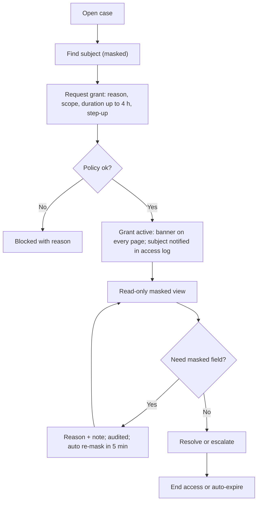

---

## UJ-19 Moderator: report → decision → appeal; integrity review

**Rules:** human decisions (INV-T09); anomaly ≠ guilt, appealable (INV-T20); appeal decided by a different moderator. **Screens:** ADM-05/06/07/08/14, LRN-11 (subject).

| # | Step | Screen / touchpoint | Emotion | Risk | Failure → recovery |
|---|---|---|---|---|---|
| 1 | Report arrives (user, system flag) | ADM-05 | Alert | Volume; graphic content | Severity sorting; content blurred by default |
| 2 | Opens case; reviews context | ADM-06 | Careful | Bias; incomplete context | Context panel with history; request more info (ACT-MOD-04) |
| 3 | Decides with reason | ACT-MOD-02 | Responsible | Disproportionate action | Decision options incl. no action/warn; reason ≥ 20 chars |
| 4 | Parties notified; appeal option | Notification | — | Opaque outcome | Plain-language reason; appeal link |
| 5 | Appeal handled by different moderator | ADM-06 (ACT-MOD-07) | Fair-minded | Same decider | System blocks same decider |
| 6 | Integrity review queue | ADM-07 (ACT-MOD-05) | Cautious | Treating anomaly as guilt | Outcomes: no concern / retake / invalidate; candidate notified |

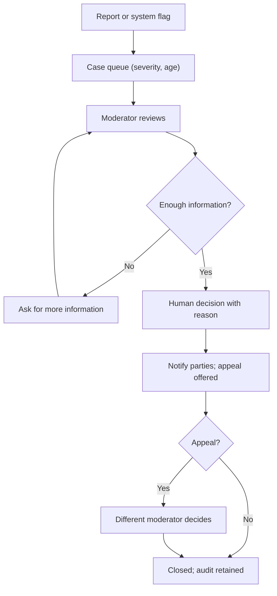

---

## UJ-20 Platform admin: remote failure → rollback; access review

**Actor:** ROLE-ADM. **Rules:** remote failure containment (GOAL-08, ADR-T18): shell falls back to last-known-good; all privileged changes audited and require step-up. **Screens:** ADM-15, ADM-09, ADM-16, ADM-10.

| # | Step | Screen / touchpoint | Emotion | Risk | Failure → recovery |
|---|---|---|---|---|---|
| 1 | Alert: error spike on a remote | Observability → ADM-15 | Urgent | Panic changes | Remote health per release; clear LKG indicator |
| 2 | Confirms incompatibility or defect | ADM-15 | Focused | Misdiagnosis | Compat status and trace links |
| 3 | Rolls back or pins version | ADM-15 (ACT-ADM-02/03) | Decisive | Rolling back to incompatible build | Block if fails Host Contract check |
| 4 | Flags off dependent feature if needed | ADM-09 (ACT-ADM-01) | Careful | Wrong environment | Environment + reason + confirm |
| 5 | Publishes status notice | ACT-ADM-09 | Transparent | Over/under-communicating | Template wording |
| 6 | Monthly privileged access review | ADM-16 (ACT-ADM-07) | Routine | Rubber-stamping | Per-grant keep/revoke with last-used date; dormant (60 d) auto-expire |

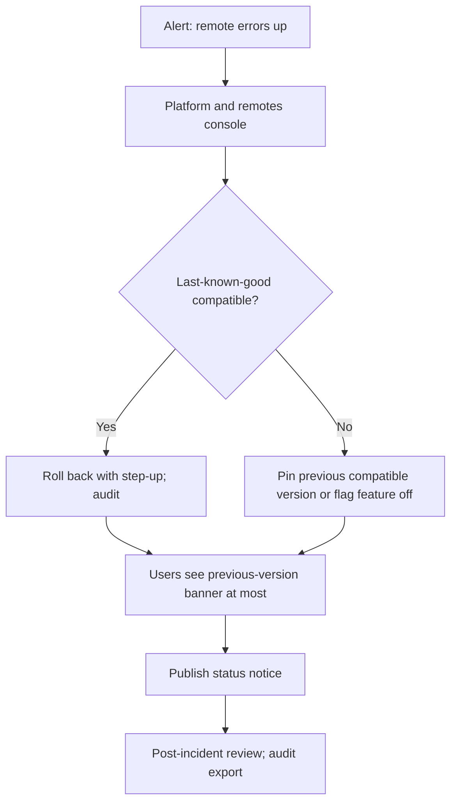

---

## Coverage check against the brief

| Required lifecycle | Where |
|---|---|
| Candidate: discover, register, verify, onboard, first evidence, apply, interview, offer, grow, reactivate, offboard/delete | UJ-01, 02, 03, 05, 06, 07, 08, 09 (+ UJ-04 learn, UJ-10 recovery) |
| Recruiter | UJ-11, UJ-12 |
| Hiring manager | UJ-13 |
| Org admin | UJ-14 |
| Instructor | UJ-15 |
| Faculty / institution admin | UJ-16 |
| Referee (< 3 min, no account) | UJ-17 |
| Support operator | UJ-18 |
| Moderator | UJ-19 |
| Platform admin | UJ-20 |
| Diagrams (≥ 8) | 14 Mermaid diagrams: journey charts for UJ-01, 02, 05, 06; flowcharts for UJ-03, 04, 08, 09, 11, 16, 17, 18, 19, 20 |

## Open items

| ID | Item |
|---|---|
| OPEN-07 | Validate every hypothesis here with real users (inherited). |
| OPEN-UX-31 | Identity checks for recovery when the person has lost access to email (support-assisted recovery policy). |
| OPEN-UX-32 | Nudge cadence rules and consent for lifecycle email (ties to DOM-15 and K-family "light growth"). |
