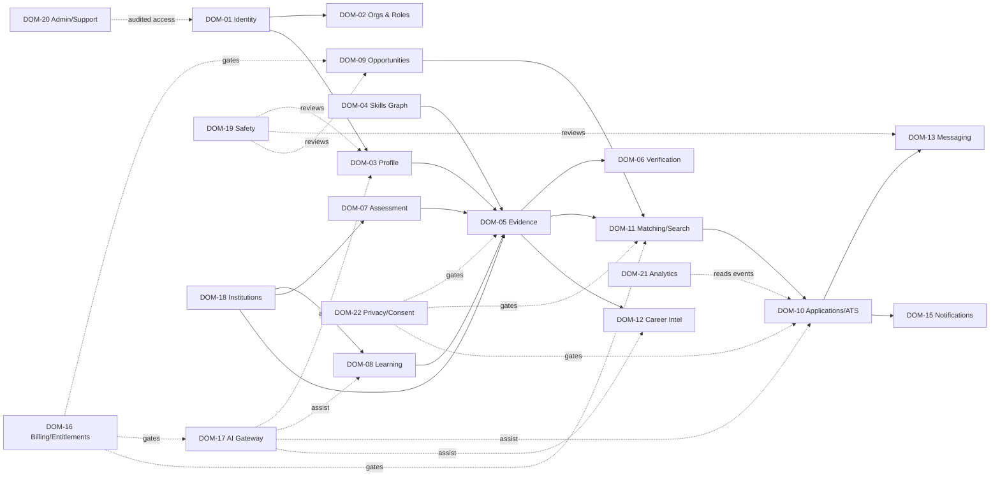

# Domain Architecture, Bounded Contexts & Coverage

Doc ID: DOM-00 · Owner: Enterprise Architect · Version 1.0 · Status: Under Review · IDs per `00_CONTROL_CENTRE/ID_REGISTRY.md`

## 1. Method
Domains were derived from the value stream (Learn→Prove→Showcase→Match→Apply→Hire→Grow), actor goals, and the 24 domain families of the mission brief, then **cross-checked against** (not copied from) the reference code layout. Each family was classified Core / Supporting / Enabling / Conditional / Exploratory / Not applicable.

## 2. Context map

Integration style: synchronous calls only through each module's **public service interface** (`api/<module>/index.ts`); cross-domain reactions via **outbox events** (ADR-T05/T09). No module reads another module's tables (fitness function FF-02).

## 3. Context ownership summary
| Context | Aggregate roots | Publishes (examples) | Consumes |
|---|---|---|---|
| Identity | Account, Session, Passkey, Device | `account.registered`, `session.revoked` | — |
| Orgs | Organization, Membership, RoleGrant | `org.member.added` | `account.*` |
| Profile | Profile, Portfolio, ResumeVariant | `profile.updated` | — |
| Skills | Skill, SkillRelation, Competency | `skill.merged` | — |
| Evidence | EvidenceItem, Credential | `evidence.created/verified/revoked` | `assessment.passed`, `course.completed` |
| Verification | VerificationRequest, ReferenceRequest, WorkClaim | `verification.completed` | `evidence.created` |
| Assessment | Assessment, Attempt, IntegritySession | `assessment.passed` | — |
| Learning | Course, Enrollment, Path | `course.completed` | — |
| Opportunities | Job, JobTemplate, SavedSearch | `job.published`, `job.closed` | `org.*` |
| Applications | Application, Pipeline, Interview | `application.submitted`, `application.stage.changed` | `job.*`, `evidence.*` |
| Matching/Search | MatchExplanation (derived), SearchIndex | — | `job.*`, `evidence.*`, `profile.*` |
| Messaging | Conversation, Message | `message.sent` | `application.*` |
| Notifications | Notification, Preference, Delivery | `notification.delivered` | all domain events |
| Billing | Subscription, Entitlement, Invoice | `entitlement.changed` | Stripe webhooks |
| Privacy | ConsentRecord, DataRightsRequest | `consent.changed`, `erasure.completed` | — |
| Safety | Report, ModerationCase | `case.resolved` | content events |
| Admin | SupportAccessGrant, AuditEvent, FeatureFlag | — | all |

## 4. Domain-family coverage (mission families A–X)
| Family | Verdict | Where / rationale |
|---|---|---|
| A Strategy | Core (docs) | 01_* |
| B Identity & accounts | Core-enabling | DOM-01 |
| C Orgs, teams, tenancy | Core-enabling | DOM-02 |
| D Core operations | Core | DOM-05/09/10 |
| E Workflow & automation | Supporting | pipelines (DOM-10), jobs (DOM-24); **no generic workflow engine** (rejected, unjustified) |
| F Search & discovery | Core | DOM-11 |
| G Content & documents | Supporting | evidence artifacts, resumes, course media |
| H Collaboration | Supporting | DOM-13 |
| I Notifications | Supporting | DOM-15 |
| J Billing | Supporting | DOM-16 |
| K Sales/marketing/growth | Supporting (light) | referrals, consented lifecycle email in DOM-15/21; no CRM build |
| L Support & success | Supporting | DOM-20 |
| M Admin & back office | Supporting | DOM-20 |
| N Reporting & analytics | Supporting | DOM-21 |
| O AI | Enabling | DOM-17 |
| P Security, privacy, trust | Core-enabling | 14_*, DOM-19/22 |
| Q Legal & compliance | Conditional | policy hooks only; no legal claims (OPEN-08) |
| R Data governance | Core-enabling | 12_*, DOM-22 |
| S Integrations | Conditional | DOM-23 |
| T Infrastructure & ops | Enabling | 17_*, 18_* |
| U Multi-platform | Core | 08_* |
| V i18n & accessibility | Core | 07_* (English at launch; framework-ready, RTL/locale formats designed) |
| W Quality & release | Enabling | 16_* |
| X Product lifecycle | Supporting | 22_*, 23_* |

## 5. Industry packs
Primary: **HR/recruitment + education marketplace**, B2B SaaS + B2C. Specialised actors: recruiter, hiring manager, referee, instructor, faculty. Regulatory-sensitive: automated employment decisions (human-in-loop), candidate personal data, minors in education (OPEN-09), accessibility. Not applicable: banking, healthcare, logistics, IoT.

## 6. Disposition vs reference (summary)
- **Merge:** challenges + skill certification + contests → one assessment engine (DOM-07); notifications + digest + nudges → DOM-15; saved searches + job alerts.
- **Remove:** legacy chat/stub services, sponsored content, business-development graph.
- **Defer:** groups/events/articles (DOM-14 phase 3), video interview recording + AI feedback, identity verification (OPEN-10), proctoring (vendor-gated).
- **Introduce:** policy module, outbox, referee flow as first-class, consent scopes, capability endpoint, sandbox runner.
