# State Machines (SM-*)

Doc ID: SM-00 · Owner: Domain Architect + Product Director · Version 1.2 (REV2 folded in 2026-10-27; row-level amendments appended, see "Revision 2 amendments") · Status: Under Review · Relates: FF-11, INV-T04, INV-T09, INV-T10, INV-T11, INV-T12, BR-T002, BR-T004, BR-T050, BR-T060, ADR-T09, ADR-T14, DOM-01, DOM-05…DOM-10, DOM-15, DOM-16, DOM-19, DOM-22, DOM-24

> **Revision 2 folded in (2026-10-27).** Amended rows, new rules/tables/machines from `STATE_MACHINES.md#record-state-machines-rev2` are now part of this file. The REV2 file stays as the change record. Status is unchanged: proposals still need owner/ARB ratification.

All content is **[TARGET]**. Timers and counts are product defaults; those that depend on policy are marked **[OPEN]**. Tables are the specification; Mermaid is a picture of the tables.

## 0. Universal rules (apply to every SM)

| # | Rule | Source |
|---|---|---|
| U1 | The only way to change `state` is `transition(entity, event, actor)` in `packages/domain`; routes and workers call it and never set `state` directly. | INV-T11, Repo rule "business rules live only in domain" |
| U2 | A transition not listed in the SM's table is **forbidden**: reject with `409 invalid_transition` (problem+json) and write no side effect. | INV-T11 |
| U3 | Terminal states are immutable: no field of the entity except audit-only annotations may change. "Undo" = a new entity linked to the old (`supersedes`, `reconsidered_from`, `cloned_from`). | INV-T11 |
| U4 | Every transition is atomic with: state write, audit event, outbox event(s). | INV-T10, INV-T12 |
| U5 | Every transition is guarded by `version` (optimistic concurrency, `If-Match`); a stale writer gets `412`/`409` and must reload. | ADR-T08 |
| U6 | Transitions that are consequential for a person (reject, suspend, revoke, void, mark no-show) require `actor.kind = human` and a reason code. Automated actors may only *flag* (INV-T09). | INV-T09 |
| U7 | Time-driven transitions are performed by `apps/worker` scheduler jobs that are idempotent and re-check the guard at execution time (never trust the scheduling-time state). | FEAT-24-09 |
| U8 | Retried transitions (same `Idempotency-Key` or same natural key) return the original result, not an error. | INV-T10 |

Legend: **H** human actor required · **S** system/worker · **C** candidate/holder · **R** role-holder. Events use `domain.event` names from `DOMAIN_ARCHITECTURE.md`.

---

## Vocabulary authority (REVW-03)

**SM-00 is the only place a state name is defined.** The state names in the tables below are the vocabulary of the platform. Everything else is **derived** and must be regenerated or amended in the same change as SM-00; it never leads:

| Derived artefact | Where | Rule |
|---|---|---|
| DB `CHECK (state/status/lifecycle IN (...))`, partial-index predicates, `DEFAULT` | `12_DATA_AND_DATABASE` (DB-01 entity tables, DB-02 §3) | value set = the machine's **persisted** set (below) |
| OpenAPI state enums (schema properties and `state` query filters) | `13_API_EVENTS_AND_INTEGRATIONS/contracts/openapi.yaml`, `API_CATALOG.md` | same set as the DB column it exposes |
| AsyncAPI / event payload enums that carry a state or decision | `contracts/asyncapi.yaml`, `EVENT_CATALOG.md` | subset of the machine's set; never a new word |
| UI status lookup / StatusBadge | `07_UI_UX_AND_DESIGN_SYSTEM/SCREEN_REGISTRY.md` §9 | one label per SM state; unknown value renders a neutral badge |

**Persisted set** = the states in the machine's table minus those flagged here: `SM-ACCOUNT.purged` is event-only (t2 deletes the row; recorded in the audit event); `SM-APPLICATION.draft` is stored as a row in `application_draft`, and `application.state` holds only the other nine states (submit = insert `application` + delete the draft in one transaction). Every other state of every machine is stored verbatim.

**Naming rules.** (1) `snake_case`, exactly as in the tables; no synonyms (`offer` vs `offer_extended` is a defect, not a style choice). (2) Platform-owned machines spell it `cancelled`; only `SM-SUBSCRIPTION` keeps `canceled` because it mirrors the processor's status words. (3) Event names (`reference.responded`, `attempt.appealed`, `account.locked`) are facts about a transition, not states: they stay as published in EVC-01 and each cites the SM transition that emits it; they never appear as a `state` value. (4) A word that is not a state of any machine (e.g. `locked`, `disputed`, `responded`, `graded`) must not appear in a state enum.

**Enum-vs-SM lint (FF-11, beside FF-06).** The machines are held as one machine-readable table in `packages/domain` (states, persisted flag, transitions). A manifest maps every `table.column`, OpenAPI schema property / query parameter and AsyncAPI field that carries a state to its machine (in `openapi.yaml` and `asyncapi.yaml` the mapping is the `x-state-machine: SM-…` extension on each state enum). CI fails when a mapped enum differs from the persisted set (missing or extra value), when a mapped partial-index predicate names a value outside the set, or when a transition used in code is not in the table (INV-T11). DB CHECKs, OpenAPI enums and event docs are **generated** from this table; hand edits are overwritten. Until the generator exists, the lint is a script run in the doc and contract review gate.

**Decisions where SM-00 itself was wrong or incomplete** (one line each):

| Machine | Decision | Rationale |
|---|---|---|
| SUBSCRIPTION | `trialing` is **not** a state | No trial exists in the product or in DT-02; adding one starts with an SM-00 change. A processor `trialing`/`paused` status in a webhook is unmapped: ignore, log, alert (never grant entitlement) |
| SUBSCRIPTION | `canceling` **stays**, stored, with `cancel_at_period_end` kept as the processor mirror | DT-02 gives it its own entitlement rule and t8/t9 are product transitions; mirror and state must agree (`canceling` ⇔ active at the processor with the flag set) |
| ACCOUNT | `locked` is **not** a state; temporary sign-in lockout is `locked_until > now()` | It is a credential-abuse guard that expires on its own; a state would need a transition out and would collide with `suspended` (human sanction). `account.locked` event name is unchanged |
| ACCOUNT | `purged` is event-only | t2 removes the row; there is nothing to hold a state |
| APPLICATION | `draft` stays in SM-00 but is stored in `application_draft` | Candidate-private autosave must not carry the NOT NULL consent snapshot, tenant RLS and `submitted_at` of a real application; BR-T001 holds through `UQ(account, job)` on drafts plus `uq_application_active` |
| VERIFICATION | one machine for every verification method (employer email, reference, issuer, runner, manual) | The entity already serves all methods; `awaiting_proof` means "waiting on this method's proof"; `failed` carries a reason code (`attempts_exhausted`, `authority_rejected`) |
| VERIFICATION | `disputed` is not a state | A dispute is a case (`verification_dispute`, then SM-MODCASE); an upheld dispute drives t7 `verified → revoked` |
| DSR | one machine for all request kinds, including erasure | `erasure_request.state` and `SM-ERASURE` duplicated t4/t5/t6; the erasure row keeps only `cooling_off_until` and step detail. `kind ∈ {access, export, erasure, rectification, restriction, objection, human_review}`; all kinds except `erasure` skip `cooling_off` |
| MODCASE | outcomes are columns, not states | `dismissed` = `actioned` with `outcome = no_action`; `reversed` = `closed` with `appeal_outcome = overturned` |
| JOB | `expired` is a close reason, not a state | A closed job is terminal either way; `close_reason ∈ {filled, expired, cancelled}` matches the existing `ClosureRequest.reason` |
| BGJOB | worker doc and DB adopt `claimed` / `retry_wait` | `claimed` is the lease window the fencing rule depends on; `failed_retry` named the cause, `retry_wait` names the state |

**Old name → new name** (what changed in `12_*` / `13_*` / `07_*` / `11_*`; old names are retired, not aliased):

| Machine | Old (DB-01 / OpenAPI) | New (SM-00) |
|---|---|---|
| ACCOUNT | `locked` | removed (`active` + `locked_until`); added `pending_verification`, `suspended` |
| EVIDENCE | `lifecycle` ∈ {active, withdrawn, revoked}; artefact scan words `pending/clean/rejected` | all nine states in `evidence_item.lifecycle`; scan words stay on `file_object.state` (SM-FILE) and map to t3 (`clean`) / t4 (`infected`, `rejected`) |
| VERIFICATION | `requested` / `in_progress` / `rejected` / `disputed` | `created` / `awaiting_proof` / `failed` / (removed; see above); added `revoked` |
| REFERENCE | `requested` / `responded` / `declined` | `queued` then `sent` / `submitted` / `submitted` with `outcome = decline`; added `bounced` |
| ATTEMPT | `started` / `graded` / `appealed` | `created` then `in_progress` / `passed` or `failed` / `under_review`; added `expired` |
| ENROLMENT | {active, completed, dropped} | added `pending_payment`, `expired`, `refunded`, `suspended` |
| JOB | `expired` | `closed` + `close_reason = expired`; added `pending_review`, `scheduled`, `paused` |
| APPLICATION | `offer` | `offer_extended`; added `shortlisted`, `offer_declined`, `draft` (stored in `application_draft`) |
| INTERVIEW | {scheduled, completed, cancelled, no_show} | added `proposed`, `rescheduled`, `expired` |
| SUBSCRIPTION | `trialing`; API-only `none` | removed; `none` is "no subscription row", not a state; added `canceling`, `incomplete_expired` |
| DSR | `identity_check`; `erasure_request.state` {requested, cooling_off, in_progress, completed, cancelled} | `verifying`; removed (state lives on `data_rights_request.state`); added `cooling_off`, `on_hold`, `completed_with_retention`, `failed` |
| MODCASE | `dismissed` / `reversed` | `actioned` + `outcome = no_action` / `closed` + `appeal_outcome = overturned`; added `triaged`, `awaiting_info`, `closed`. `moderation_appeal.state` {open, upheld, dismissed} becomes {open, upheld, overturned}: new `upheld` = the original decision stands (old `dismissed`); new `overturned` = the appeal succeeded (old `upheld`) |
| NOTIFY | {queued, sent, delivered, bounced, failed, suppressed} | added `deferred`, `sending`, `failed_retry`, `complained`, `expired` |
| BGJOB | `failed_retry` / `canceled` | `retry_wait` / `cancelled`; added `claimed` |
| SESSION | not compared | unchanged |

Not covered by SM-00 (REVW-20, still open): `SM-FILE` (`file_object.state`: intent → uploaded → verifying → scanning → clean / rejected / infected, any → deleted) stays defined in DB-01 §5 until it gets a section here; `SM-EVIDENCE` t3/t4 consume its `clean` / `infected`, `rejected` results. Other entity enums (organization, membership, report, dispute, export, webhook delivery, and so on) are outside the 14 compared machines and are not changed here.

---

## SM-ACCOUNT (DOM-01) — owned by `api/identity`

| State | Meaning |
|---|---|
| `pending_verification` | Registered, email not yet proven; no profile visibility, no applying |
| `active` | Normal use |
| `suspended` | Sanctioned by a human; sign-in allowed only to a read-only appeal page |
| `deactivated` | Holder-initiated pause; profile hidden; data kept |
| `pending_erasure` | Erasure verified; cooling-off then execution |
| `erased` | Terminal; personal data removed except legally retained records [OPEN-08] |
| `purged` | Terminal; unverified registration removed. **Event-only**: no row remains (recorded in the audit event) |

| t | From → To | Trigger / actor | Guard | Side effects |
|---|---|---|---|---|
| t1 | pending_verification → active | email code verified (C) | code valid, unexpired, attempts ≤ 5 | `account.registered` activated; welcome notification |
| t2 | pending_verification → purged | 7 days elapsed (S) | still unverified | delete row, release email |
| t3 | active → suspended | moderation/admin decision (H) | case id + reason | revoke all sessions (SM-SESSION t6); hide profile; notify |
| t4 | suspended → active | appeal upheld (H) or sanction end date (S) | decision or expiry recorded | restore visibility; notify |
| t5 | active → deactivated | holder request (C) | recent re-auth ≤ 5 min | hide profile; pause alerts; revoke all sessions |
| t6 | deactivated → active | holder signs in (C) | within retention of deactivation [OPEN: 12 months] | restore profile visibility only if previously public |
| t7 | active / deactivated / suspended → pending_erasure | erasure request verified (C) | identity re-verified; no open legal hold | start cooling-off 7 days (SM-DSR) |
| t8 | pending_erasure → *previous state* | holder cancels (C) | within cooling-off | restore |
| t9 | pending_erasure → erased | erasure job complete (S) | ≤ 30 days from request (BR-T060) | `erasure.completed`; tombstone for retained records |

**Forbidden:** erased/purged → any; pending_verification → suspended or deactivated; suspended → deactivated (cannot dodge a sanction); any → pending_verification.
**Expiry:** unverified 7 d (t2); cooling-off 7 d. **Retry:** erasure job retries per SM-BGJOB; account stays `pending_erasure` until success. **Recovery:** if t9 partially failed, job resumes from per-store checkpoints (idempotent deletes); never regress to `active` automatically.

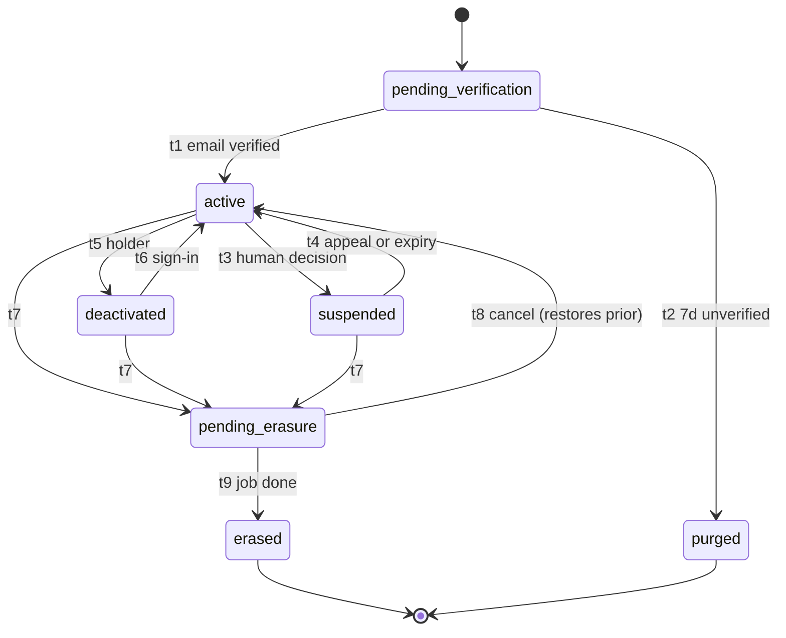

---

## SM-SESSION (DOM-01) — session = refresh-token family

| State | Meaning |
|---|---|
| `active` | Family has a current refresh token (generation g) |
| `expired` | Idle or absolute timeout reached |
| `revoked` | Ended by holder, security event, admin, or account state; `reason` ∈ {logout, device_revoke, password_change, reuse_detected, admin, account_state} |

| t | From → To | Trigger / actor | Guard | Side effects |
|---|---|---|---|---|
| t1 | (none) → active | successful authentication (C) | credentials/passkey valid; account `active` | cookie set; generation 1; `session.created` |
| t2 | active → active | refresh (C) | presented token = generation g (or g−1 within 5 s leeway and successor unused) | issue g+1; invalidate g; extend idle window |
| t3 | active → expired | idle 14 d or absolute 30 d (S/lazy) | **[OPEN]** defaults; privileged roles: idle 30 min, absolute 8 h | none |
| t4 | active → revoked(reuse_detected) | refresh token g−k presented outside leeway | whole family | revoke family; notify holder; security audit (BR-T050) |
| t5 | active → revoked(logout / device_revoke / password_change) | holder (C) | re-auth for "all devices" | cookie cleared |
| t6 | active → revoked(account_state / admin) | system / H | account suspended, deactivated, pending_erasure, or admin action | audit |

**Forbidden:** revoked → active; expired → active (must re-authenticate); refresh when account ≠ active.
**Retry:** refresh is safe to retry within leeway (returns same successor once). **Recovery:** after reuse_detected the holder must sign in again; passkey or password + email notice.

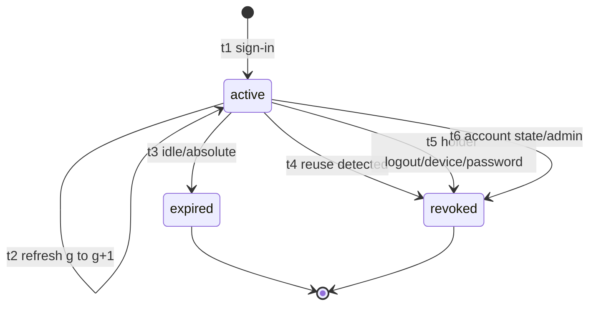

---

## SM-EVIDENCE (DOM-05) — owned by `api/evidence`

Two axes: **lifecycle state** (this SM) and **rung** ∈ {claimed, artifact_backed, peer_attested, authority_verified} (ADR-T14) which is *derived* from still-valid provenance records and changes only server-side (INV-T04).

| State | Meaning |
|---|---|
| `draft` | Owner-only, not counted |
| `pending_scan` | Artefact uploaded, awaiting virus scan; not visible (BR-T003) |
| `active` | Counted and shareable within consent; carries rung |
| `quarantined` | Scan failed; owner-only, removable |
| `under_review` | Disputed/flagged; remains visible with marker; human decides |
| `revoked` | Terminal; reason code; excluded from everything |
| `withdrawn` | Terminal; owner removed |
| `expired` | Terminal; time-limited credential lapsed (Ph3) |
| `erased` | Terminal; DSR |

| t | From → To | Trigger / actor | Guard | Side effects |
|---|---|---|---|---|
| t1 | draft → pending_scan | owner submits with artefact (C) | file allowlist/size ok | scan job enqueued |
| t2 | draft → active (rung=claimed) | owner submits claim without artefact (C) | min fields + ≥1 canonical skill | `evidence.created` |
| t3 | pending_scan → active (rung=artifact_backed) | scan clean (S) | scan verdict clean | `evidence.created` |
| t4 | pending_scan → quarantined | scan positive (S) | — | notify owner (neutral wording) |
| t5 | quarantined → withdrawn | owner (C) | — | delete blob |
| t6 | active → under_review | report/dispute opened (R/S flag) | case created | marker shown; no auto-action (INV-T09/T20) |
| t7 | under_review → active | dismissed (H) | — | clear marker |
| t8 | under_review / active → revoked | issuer or moderator (H) | reason code | `evidence.revoked`; recompute (BR-T005); notify holder with appeal path |
| t9 | active → withdrawn | owner (C) | — | recipients lose live access; submitted-application snapshots keep a redacted tombstone (FEAT-10-14) |
| t10 | active → expired | expiry date (S) | credential has `expires_at` | notify 30 d prior |
| t11 | any non-terminal → erased | DSR (S) | SM-DSR t-erase | blob + metadata removed |

**Rung changes (inside `active`):** claimed → artifact_backed (t3 or link liveness pass); artifact_backed → peer_attested (≥1 valid attestation, FEAT-05-03/06-03); {artifact_backed, peer_attested} → authority_verified (issuer verification: platform course, auto-graded assessment, institution, employer-verified); platform issuers may create directly at authority_verified. **Downgrade** only by recompute when a supporting provenance record is revoked/expired (audited). Nothing may set rung from client input or from `source=ai` (INV-T08).
**Forbidden:** terminal → any; draft → under_review; revoked → active (reinstatement = new item with `supersedes`); active → pending_scan (new artefact = new version → new item version in `pending_scan`, old version stays active until clean).
**Expiry:** `draft` auto-deleted after 90 d. **Retry:** scan job per SM-BGJOB; after dead-letter evidence stays `pending_scan` and ops is alerted (never auto-clean).

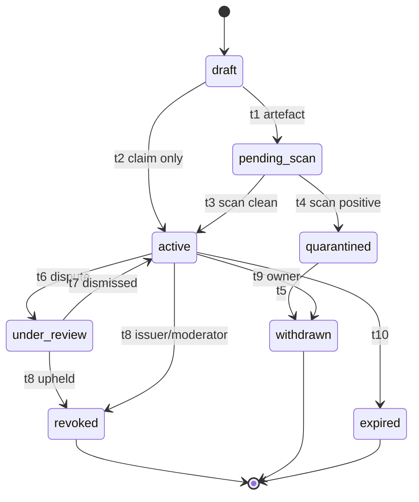

---

## SM-VERIFICATION (DOM-06) — verification request (all methods); the tables below specify the employer-domain proof-of-control path

The same states serve every `method` of `verification_request` (employer email, reference, issuer, runner, manual review). For methods other than employer email, `awaiting_proof` means "waiting for that method's proof" and t1/t3 read "request sent" / "authority or referee decision recorded".

| State | Meaning |
|---|---|
| `created` | Request drafted for one work claim |
| `awaiting_proof` | Code sent to an address on the claimed employer's domain |
| `verified` | Control of an employer-domain mailbox proven (rung effect per DT-06) |
| `failed` | Attempts exhausted, or an authority rejected the request; `reason` ∈ {attempts_exhausted, authority_rejected} |
| `expired` | Request window passed |
| `cancelled` | Candidate cancelled |
| `revoked` | Terminal after verified; set by human on dispute or fraud finding |

| t | From → To | Trigger / actor | Guard | Side effects |
|---|---|---|---|---|
| t1 | created → awaiting_proof | candidate supplies employer-domain address (C) | domain not free-mail; rate limits (≤ 3 requests / 24 h per claim) | code (6+ digits) hashed, TTL 15 min, emailed |
| t2 | awaiting_proof → awaiting_proof | resend (C) | ≤ 3 resends/h; new code invalidates old | — |
| t3 | awaiting_proof → verified | correct code (C) | attempts ≤ 5, TTL ok, bound to this request | `verification.completed`; provenance record |
| t4 | awaiting_proof → failed | 5th wrong attempt (S) | — | lock 1 h for that claim |
| t5 | awaiting_proof → expired | request age > 24 h (S) | — | — |
| t6 | created / awaiting_proof → cancelled | candidate (C) | — | — |
| t7 | verified → revoked | human decision (H) | dispute/fraud case | provenance invalidated; recompute |

**Forbidden:** verified → awaiting_proof (re-verification = new request); failed/expired → verified; code returned to caller or logged (INV-T05).
**Recovery:** failed/expired → candidate starts a new request (t1 on a fresh request) after cool-down 1 h.

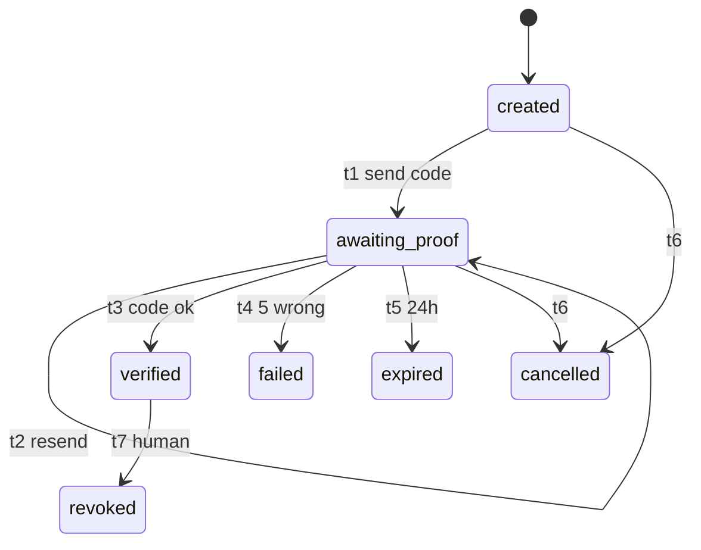

---

## SM-REFERENCE (DOM-06) — referee request (token, no account)

| State | Meaning |
|---|---|
| `queued` | Created, email not yet sent |
| `sent` | Token email delivered to provider |
| `opened` | Referee opened the link (no answer yet) |
| `submitted` | Referee answered; `outcome` ∈ {confirm, dispute, decline, unknown_candidate} |
| `expired` | 14 days elapsed (BR-T004) |
| `cancelled` | Candidate cancelled |
| `bounced` | Hard bounce / invalid address |

| t | From → To | Trigger / actor | Guard | Side effects |
|---|---|---|---|---|
| t1 | queued → sent | worker (S) | token hashed at rest, TTL 14 d, bound to (request, referee email) | email; `reference.requested` |
| t2 | sent → opened | link visited (S) | token valid, unexpired | record open (no PII beyond IP hash) |
| t3 | sent / opened → submitted | referee submits (referee) | token unused; form valid; referee ≠ candidate email/account | consume token (single-use); outcome → DT-04; `verification.completed` |
| t4 | sent / opened → expired | day 14 (S) | — | token dead; candidate told; may re-request |
| t5 | queued / sent / opened → cancelled | candidate (C) | — | token dead |
| t6 | queued / sent → bounced | provider webhook (S) | hard bounce | candidate told to fix address |
| (n/a) | reminders | S | day 4 and day 9, max 2, only while `sent`/`opened` | `reference.reminded` |

**Forbidden:** submitted → any (corrections go through FEAT-06-05 dispute); expired/cancelled/bounced → submitted; token reuse; response before `sent`.
**Concurrency:** two simultaneous submits with the same token → one wins by single-use consume (row lock); loser sees "already answered".
**Recovery:** candidate may issue a **new** request (new token) for the same claim, max 3 open referee requests per claim.

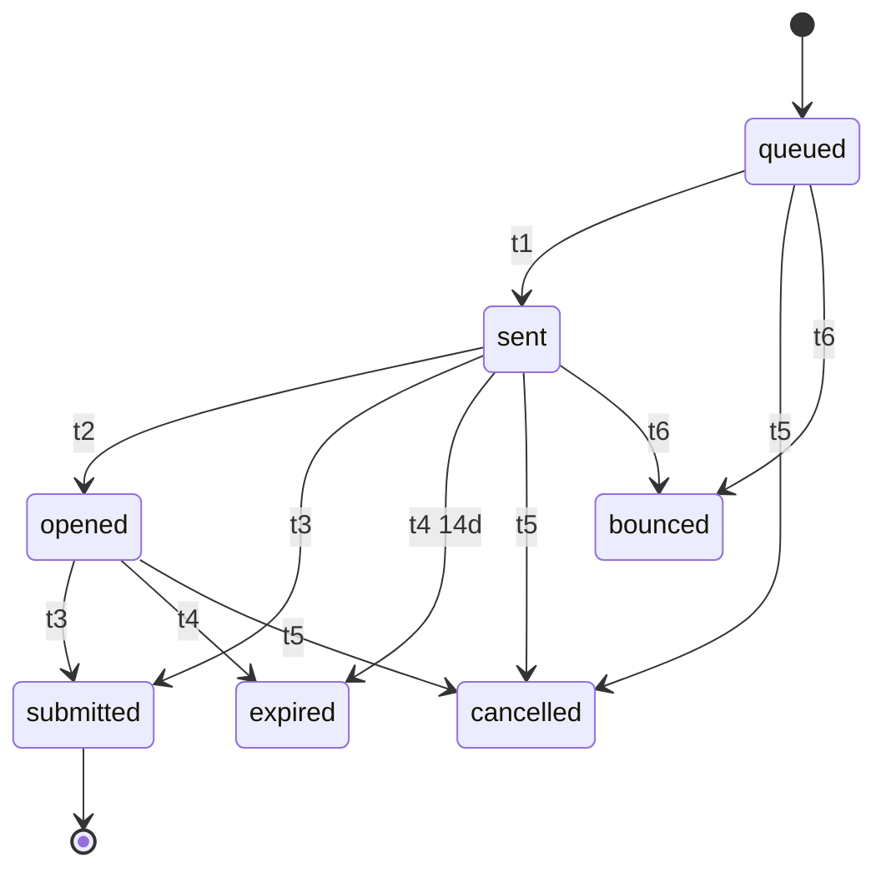

---

## SM-ATTEMPT (DOM-07) — assessment attempt

| State | Meaning |
|---|---|
| `created` | Reserved, not started |
| `in_progress` | Timer running (server clock) |
| `submitted` | Answers frozen; may be `auto_submitted` at deadline |
| `grading` | Auto-grade or runner/human grading in flight |
| `passed` / `failed` | Graded outcome |
| `unverified` | Could not be graded honestly (no runner / runner outage); never mints verified evidence (ADR-T13) |
| `under_review` | Integrity or grading appeal under human review |
| `voided` | Human-confirmed violation; terminal |
| `expired` | Never started within 24 h or abandoned untimed attempt (no heartbeat 24 h) |

| t | From → To | Trigger / actor | Guard | Side effects |
|---|---|---|---|---|
| t1 | created → in_progress | start (C) | cooldown/attempt cap ok (BR); entitlement ok | timer start; AI policy bound (AI_PROHIBITED if set) |
| t2 | in_progress → submitted | submit (C) or deadline (S) | deadline not exceeded for manual submit | freeze answers; `attempt.submitted` |
| t3 | submitted → grading | auto (S) | — | enqueue grading |
| t4 | grading → passed / failed | result (S, or H for manual) | score ≥ threshold for pass | if passed and auto-gradable: mint evidence at authority_verified (FEAT-07-06) |
| t5 | submitted / grading → unverified | code attempt with no runner, or grading dead-letter (S) | reason code | **no** evidence minted; candidate informed honestly |
| t6 | unverified → grading | re-grade when runner exists (S) | ≤ 30 d old; snapshot immutable | normal grading |
| t7 | passed / failed / unverified → under_review | integrity flag (S flags, H opens) or candidate appeal (C) | case opened | linked evidence → `under_review` (SM-EVIDENCE t6) |
| t8 | under_review → passed / failed / unverified | reviewer clears or corrects (H) | reason | evidence restored/updated |
| t9 | under_review → voided | reviewer confirms violation (H) | reason + evidence | linked evidence revoked (t8 of SM-EVIDENCE); notify with appeal |
| t10 | created / in_progress → expired | timers (S) | per above | release attempt slot (counts toward cap) |

**Forbidden:** unverified → passed (must pass through grading); passed ↔ failed directly; any change after `voided`; submit after deadline (late answers rejected, last autosave used).
**Retry:** grading job via SM-BGJOB, max 3 attempts; then t5. **Recovery:** refresh/reload during `in_progress` resumes with server timer; offline autosave replays idempotently (FEAT-07-02.1).

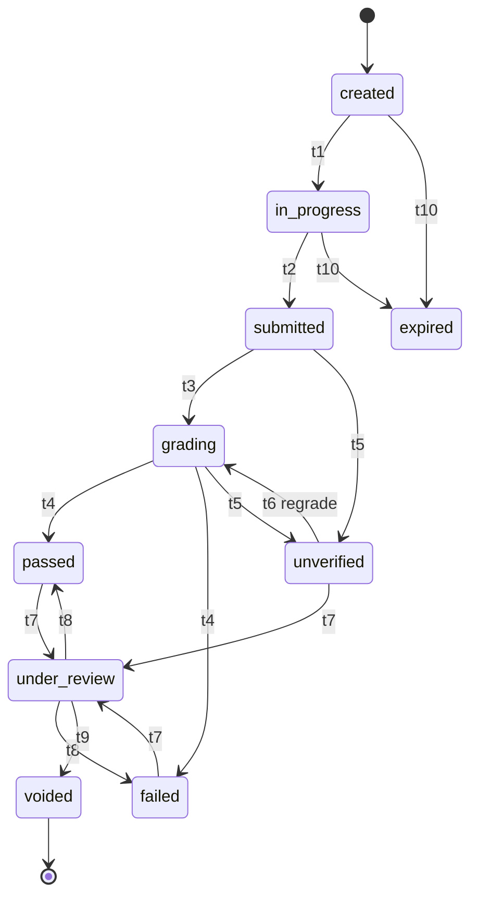

---

## SM-ENROLMENT (DOM-08)

| State | Meaning |
|---|---|
| `pending_payment` | Paid course; awaiting confirmed payment |
| `active` | Learning; progress counts |
| `completed` | Completion rule met; evidence minted |
| `dropped` | Learner left (progress kept 90 d) |
| `expired` | Checkout never confirmed (24 h) |
| `refunded` | Money returned per policy [OPEN-06] |
| `suspended` | Learner sanctioned or course taken down |

| t | From → To | Trigger / actor | Guard | Side effects |
|---|---|---|---|---|
| t1 | (none) → active | enrol free course (C) | prerequisites met; not already enrolled (idempotent) | `enrolment.created` |
| t2 | (none) → pending_payment | enrol paid course (C) | as above | checkout session (FEAT-16-09) |
| t3 | pending_payment → active | `entitlement.changed` from verified webhook (S) | payment confirmed (INV-T17) | access granted |
| t4 | pending_payment → expired | 24 h (S) | no payment | — |
| t5 | active → completed | completion rule satisfied (S) | all required lessons + passing assessments | `course.completed` → evidence (FEAT-08-04) |
| t6 | active → dropped | learner (C) | — | — |
| t7 | dropped → active | re-enrol (C) | within 90 d | progress restored |
| t8 | active → refunded | billing refund (S/H) | policy window [OPEN-06] | access removed |
| t9 | completed → refunded | exceptional refund (H) | support/admin only | linked evidence revoked via issuer (H) |
| t10 | active ↔ suspended | takedown/sanction (H) | case | access paused/restored |

**Forbidden:** completed → active/dropped; refunded → any; expired → active (new enrolment); completion without server-verified rule.
**Recovery:** progress writes are idempotent on (enrolment, lesson, version); offline progress is revalidated server-side (INV-T13).

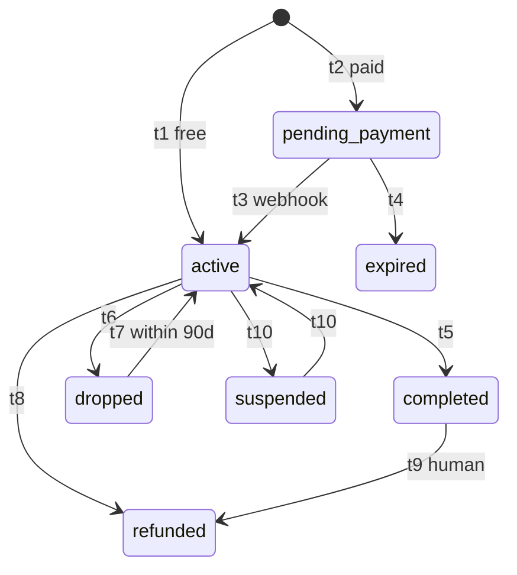

---

## SM-JOB (DOM-09)

| State | Meaning |
|---|---|
| `draft` | Editable by hiring team |
| `pending_review` | Awaiting approver or moderation pre-check |
| `scheduled` | Will publish at `publish_at` |
| `published` | Visible, accepts applications |
| `paused` | Hidden from search; existing applications continue |
| `closed` | Terminal; reason ∈ {filled, expired, cancelled} |
| `taken_down` | Hidden by a human moderator; owner notified with appeal |

| t | From → To | Trigger / actor | Guard | Side effects |
|---|---|---|---|---|
| t1 | draft → published | publish (R) | validation passes; entitlement (job slot) ok (INV-T17 derived); pre-check clean; org verified | index; `job.published` |
| t2 | draft → pending_review | publish (R) | approver required by org policy or pre-check flagged | notify approver/moderator |
| t3 | pending_review → published | approve (H) | approver ≠ author when policy demands | as t1 |
| t4 | pending_review → draft | changes requested (H) | reason | notify author |
| t5 | draft → scheduled | schedule (R) | `publish_at` future ≤ 30 d | — |
| t6 | scheduled → published | time (S) | re-check entitlement + validation at execution (U7) | as t1; on failure → draft + notify |
| t7 | published ↔ paused | recruiter (R) | — | de/re-index |
| t8 | published / paused → closed | recruiter (R) or expiry 45 d default (S) | **[OPEN]** expiry length | de-index; notify open applicants if closed unfilled |
| t9 | published / paused → taken_down | moderator (H) | case id | de-index; notice with appeal (FEAT-19-03) |
| t10 | taken_down → published / closed | appeal outcome (H) | — | re-index or close |

**Forbidden:** closed → any (use *clone* = new draft with `cloned_from`); draft → paused/closed (discard instead); published → draft (edit-in-place of safe fields only; material change creates a revision note, not a state change).
**Concurrency:** publish with the last free job slot by two recruiters → slot reservation row-lock; loser gets `entitlement_exhausted`.

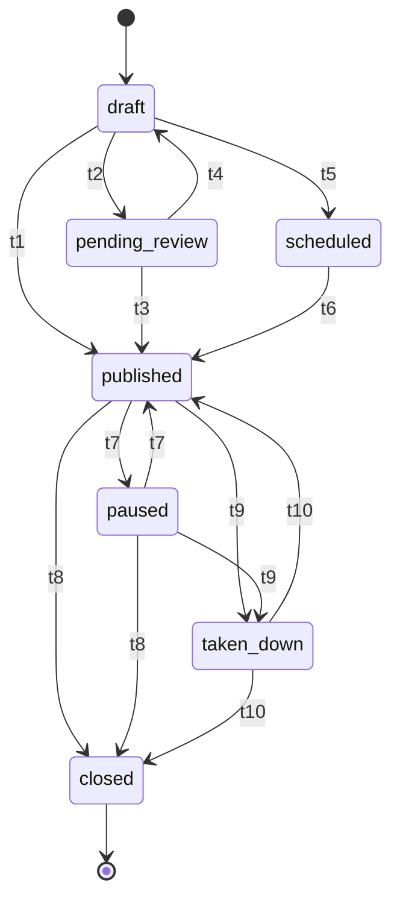

---

## SM-APPLICATION (DOM-10) — canonical states; org stages map onto them (BR-T002)

| State | Meaning | Active? |
|---|---|---|
| `draft` | Candidate-only; stored in `application_draft`, not in `application.state` (see Vocabulary authority). Discarding a draft (t9) leaves no `application` row | yes (counts for BR-T001) |
| `submitted` | Received; evidence snapshot frozen (FEAT-10-14) | yes |
| `in_review` | Hiring team screening | yes |
| `shortlisted` | Candidate selected for next steps | yes |
| `interviewing` | ≥1 interview proposed/scheduled | yes |
| `offer_extended` | Offer recorded | yes |
| `hired` | Terminal | no |
| `rejected` | Terminal; human-decided | no |
| `withdrawn` | Terminal; candidate-decided | no |
| `offer_declined` | Terminal; candidate declined offer | no |

| t | From → To | Trigger / actor | Guard | Side effects |
|---|---|---|---|---|
| t1 | draft → submitted | submit (C) | job `published`; no other active application for (candidate, job) (BR-T001); required fields; consent scope chosen | snapshot; `application.submitted`; receipt |
| t2 | submitted → in_review | first hiring-team open or assignment (S/R) | actor in job's hiring team | candidate sees "in review" |
| t3 | in_review → shortlisted | stage move (R) | `If-Match` version | `application.stage.changed` |
| t4 | shortlisted → interviewing | interview proposed (R) | ≥1 interview in `proposed`/`scheduled` | — |
| t5 | interviewing → offer_extended | record offer (R) | HM or recruiter with offer permission | notify candidate |
| t6 | offer_extended → hired | candidate accepted / recruiter records (R) | offer accepted | `application.hired`; Grow handoff (FEAT-10-15) |
| t7 | offer_extended → offer_declined | candidate (C) | — | notify team |
| t8 | {submitted, in_review, shortlisted, interviewing, offer_extended} → rejected | decision (H) | two-step confirm; reason code; actor human (INV-T09) | candidate notified; optional feedback; `application.stage.changed` |
| t9 | {draft, submitted, in_review, shortlisted, interviewing, offer_extended} → withdrawn | candidate (C) | — | cancel open interviews; notify team. From `draft`: delete the `application_draft` row, audit event only, no `application` row |
| t10 | shortlisted → in_review; interviewing → shortlisted; offer_extended → interviewing (offer withdrawn) | stage correction (R) | reason required; `in_review → submitted` and other backward moves are not allowed | audit entry |
| t11 | in_review → interviewing; shortlisted → offer_extended (forward skips) | stage move (R) | allowed only for these two skips; **never** to `hired` without `offer_extended` | `application.stage.changed` |

**Forbidden:** terminal → any (reconsideration = recruiter invites candidate to apply again; new application with `reconsidered_from`); draft → anything except submitted/withdrawn; any → hired except from offer_extended; any → rejected by system/AI/score (U6); changing candidate-supplied answers after submit.
**Stale handling:** no recruiter action for 45 d sets `stale=true` and prompts the team and the candidate; **never** an automatic transition (INV-T09).
**Job interplay:** job `closed`/`taken_down` does not alter application state; `draft` applications on a closed job are discarded after 7 d with notice.
**Concurrency:** idempotent submit key `(candidate, job)` + partial unique index on active states; two concurrent stage moves → one wins by version; loser reloads.

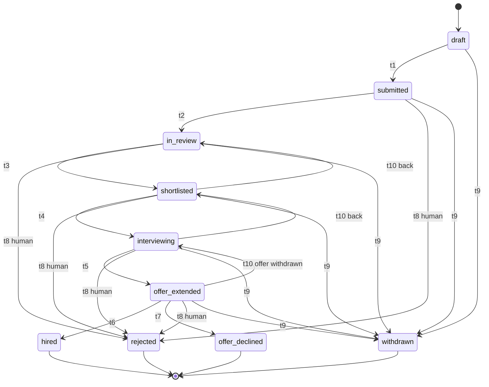

---

## SM-INTERVIEW (DOM-10)

| State | Meaning |
|---|---|
| `proposed` | Slots offered to candidate |
| `scheduled` | One slot confirmed by both sides |
| `completed` | Took place |
| `cancelled` | Cancelled with reason by either side |
| `rescheduled` | Superseded by a new interview record |
| `no_show` | Human-marked; `party` ∈ {candidate, interviewer} |
| `expired` | No slot chosen in time |

| t | From → To | Trigger / actor | Guard | Side effects |
|---|---|---|---|---|
| t1 | (none) → proposed | recruiter proposes 1–5 slots (R) | application ∈ {in_review, shortlisted, interviewing}; interviewer free (no overlap) | notify; hold slots 72 h |
| t2 | proposed → scheduled | candidate selects slot (C) | slot still free (row lock) | ICS to both; reminders at 24 h and 1 h |
| t3 | proposed → expired | 72 h without choice (S) | — | notify recruiter |
| t4 | scheduled → rescheduled | either party requests, other accepts (R/C) | ≥ 2 h before start | creates new `proposed` linked by `reschedule_of` |
| t5 | scheduled / proposed → cancelled | either party (R/C) | reason code | cancel ICS; notify |
| t6 | scheduled → completed | end time + marker or +24 h (S) | not marked no_show | prompts scorecard (FEAT-10-08) |
| t7 | scheduled → no_show | marked after start time (H) | within 48 h; evidence of absence not required but reason logged | candidate may contest (FEAT-19-06) |

**Forbidden:** completed/cancelled/rescheduled/no_show/expired → any; scheduling overlapping interviewer slots; scheduling in the past; scheduling when application is terminal.
**Timezone:** stored UTC + IANA zone; display local to viewer.

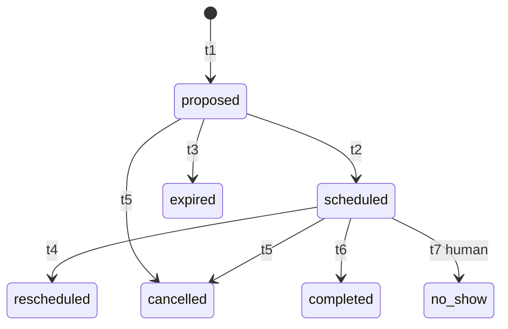

---

## SM-SUBSCRIPTION (DOM-16) — driven only by verified webhooks (INV-T17)

Vocabulary mirrors Stripe subscription statuses **[REF: Stripe docs; re-verify at build time — OPEN]**, with two deliberate differences: `canceling` is added (Stripe `active` + `cancel_at_period_end`), and Stripe `trialing` / `paused` are **not** states (no trial or pause exists in the product; an event carrying them is ignored, logged and alerted, and grants no entitlement). The processor spelling `canceled` is kept for this machine only.

| State | Entitlement derived (DT-02) |
|---|---|
| `incomplete` | none (free tier) |
| `active` | full plan |
| `canceling` | full plan until `current_period_end`, then → canceled |
| `past_due` | full during 7-day grace, then degraded (read-only on paid features) |
| `unpaid` | free tier; data retained |
| `canceled` | free tier; data retained |
| `incomplete_expired` | none; terminal |

| t | From → To | Trigger (signed webhook) | Guard | Side effects |
|---|---|---|---|---|
| t1 | (none) → incomplete | checkout session completed, first invoice open | event verified + deduped | — |
| t2 | incomplete → active | invoice paid | — | `entitlement.changed` |
| t3 | incomplete → incomplete_expired | 23 h without payment | — | — |
| t4 | active → past_due | invoice payment failed | — | dunning schedule (FEAT-16-07); notify |
| t5 | past_due → active | invoice paid | — | clear grace |
| t6 | past_due → unpaid | retries exhausted / grace over | — | degrade |
| t7 | unpaid → active | invoice paid | — | restore |
| t8 | active → canceling | cancel at period end set | — | notify |
| t9 | canceling → active | cancellation reverted | — | — |
| t10 | canceling / unpaid / past_due → canceled | period end or immediate cancel | — | free tier; seats unassigned (kept as records) |

**Forbidden:** any transition from the browser/redirect (INV-T17); canceled → active (new subscription); applying an event older than the stored object version (out-of-order → ignore + log).
**Retry:** webhook handler idempotent by event id; processor retries respected; dead-letter after 5 failures → alert. **Recovery:** reconcile job compares local state with processor daily and reports drift (never silently overwrites without audit).

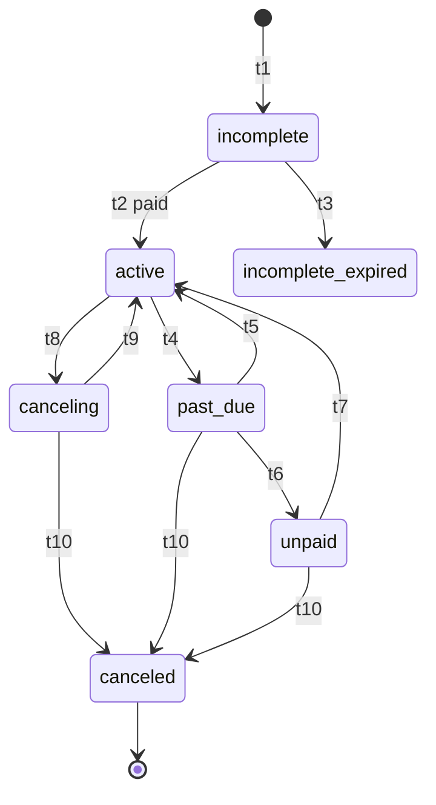

---

## SM-DSR (DOM-22) — data-rights request (`kind` ∈ access, export, erasure, rectification, restriction, objection, human_review)

One machine for every kind, stored in `data_rights_request.state`. Only `erasure` passes through `cooling_off`; other kinds go `verifying → in_progress` (t3). There is no separate erasure state machine.

| State | Meaning |
|---|---|
| `received` | Logged; type set |
| `verifying` | Re-authentication/identity confirmation |
| `cooling_off` | Erasure only: 7-day cancel window |
| `in_progress` | Export build, erasure fan-out, or change applied step-wise |
| `on_hold` | Legal hold or dispute prevents completion [OPEN-08] |
| `completed` | Fulfilled in full |
| `completed_with_retention` | Erasure done except legally retained records (listed in receipt) |
| `rejected` | Not fulfilled with stated reason (e.g. cannot verify identity) |
| `cancelled` | Requester cancelled |
| `failed` | Retries exhausted; ops escalation; request deadline still running |

| t | From → To | Trigger / actor | Guard | Side effects |
|---|---|---|---|---|
| t1 | (none) → received | request (C) / org admin assist (R) / support assist (H) | requester is the data subject or authorised | acknowledge; deadline clock starts |
| t2 | received → verifying | auto (S) | — | re-auth challenge |
| t3 | verifying → in_progress (every kind except erasure) | verified (C) | recent strong auth | enqueue job |
| t4 | verifying → cooling_off (erasure) | verified (C) | no active legal hold | account → `pending_erasure` (SM-ACCOUNT t7) |
| t5 | cooling_off → in_progress | 7 days elapsed (S) | not cancelled | fan-out erase |
| t6 | in_progress → completed / completed_with_retention | all stores done (S) | checkpoint complete; for erasure also `subject_identity_map` row deleted and sweep clean (INV-T38; history rows are not rewritten) | receipt; `erasure.completed` / `export.ready` |
| t7 | received / verifying / in_progress → on_hold ↔ in_progress | legal hold set/cleared (H) | reason | notify requester that a hold applies (reason category only) |
| t8 | verifying → rejected | verification failed 3× or not authorised (S/H) | — | notify |
| t9 | received / verifying / cooling_off → cancelled | requester (C) | — | account restored if pending |
| t10 | in_progress → failed → in_progress | retries exhausted → manual replay (H) | audited | — |

**Deadlines:** erasure ≤ 30 days from `received` (BR-T060); export target ≤ 72 h, max 30 days **[OPEN-08 legal confirmation]**.
**Forbidden:** erasure `in_progress` → cancelled (irreversible once started); rejected → in_progress (new request); any → completed without checkpoint evidence.
**Idempotency:** one open request per (subject, type); a duplicate returns the open one.
**Erasure and history (REVW-04):** erasure never UPDATEs append-only tables. Audit, consent, evidence-event and stage-transition rows hold an opaque `subject_ref`; the erasure fan-out ends by deleting the `subject_identity_map` row (and per-subject key), then the sweep runs. `completed` requires the audit and consent anchors that cover the subject's rows to still verify (TEST-PRV-009). Which history skeletons may be kept, and for how long, goes on the receipt as retained records and stays [OPEN-08].

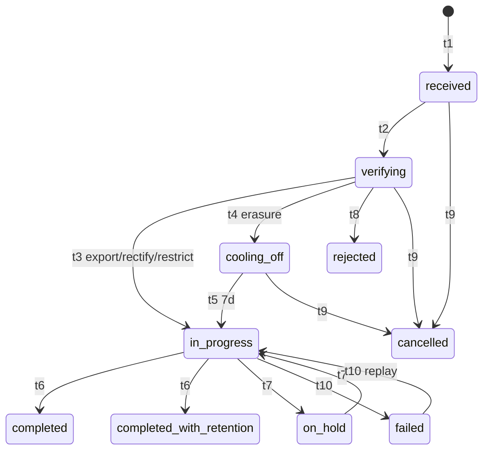

---

## SM-MODCASE (DOM-19) — moderation case

| State | Meaning |
|---|---|
| `open` | Report(s) received |
| `triaged` | Priority and queue set |
| `in_review` | Moderator working |
| `awaiting_info` | Requested info from reporter/subject; SLA paused |
| `actioned` | Human decision recorded (`outcome` ∈ {no_action, warned, content_removed, suspended, restored}) |
| `appealed` | Subject appealed within 30 d |
| `closed` | Terminal; `appeal_outcome` ∈ {none, upheld, overturned} |

| t | From → To | Trigger / actor | Guard | Side effects |
|---|---|---|---|---|
| t1 | (none) → open | report or system flag (C/S) | dedupe by (target, category) merges into existing open case | ack to reporter |
| t2 | open → triaged | auto rules or moderator (S/H) | flags may set priority; never action | SLA timer |
| t3 | triaged → in_review | moderator claims (H) | role MOD | lock to reviewer |
| t4 | in_review ↔ awaiting_info | moderator (H) | reason | notify |
| t5 | in_review → actioned | decision (H) | reasoned outcome; two-person check for `suspended` | effect applied (e.g. evidence revoked, job taken down, account suspended); notice to subject |
| t6 | actioned → appealed | subject (C/R) | ≤ 30 d | assign **different** reviewer |
| t7 | appealed → closed (upheld / overturned) | reviewer (H) | — | overturned → reverse effect (restore) |
| t8 | actioned → closed | 30 d without appeal (S) | — | — |

**Forbidden:** automation moving a case to `actioned`; same reviewer deciding the appeal; closed → any; actioned → in_review (use appeal).
**SLA (defaults [OPEN]):** triage ≤ 1 business day; decision ≤ 5 business days; safety-critical (scam, harassment) ≤ 4 h business hours.

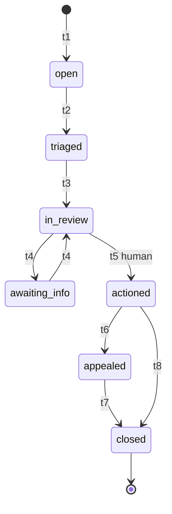

---

## SM-NOTIFY (DOM-15) — one delivery (notification × channel)

| State | Meaning |
|---|---|
| `queued` | Created, not yet routed |
| `suppressed` | Dropped by preference, suppression list, or dedupe (reason logged) |
| `deferred` | Held for quiet hours or digest window |
| `sending` | Handed to provider |
| `sent` | Provider accepted |
| `delivered` | Provider confirmed (email) / inbox row visible (in-app) / push acknowledged |
| `failed_retry` | Transient failure; backoff scheduled |
| `failed` | Permanent failure or retries exhausted |
| `bounced` | Hard bounce → address added to suppression |
| `complained` | Spam complaint → marketing category suppressed |
| `expired` | TTL passed before sending |

| t | From → To | Trigger | Guard |
|---|---|---|---|
| t1 | queued → suppressed | route check (S) | pref off (non-mandatory), suppression list, duplicate within window |
| t2 | queued → deferred | quiet hours or digest (S) | category not time-critical; mandatory security mail ignores quiet hours |
| t3 | deferred → sending | window end (S) | re-check TTL, prefs |
| t4 | queued → sending | immediate (S) | — |
| t5 | sending → sent → delivered | provider response / webhook | — |
| t6 | sending → failed_retry | 5xx/timeout (S) | attempts < 5; backoff 1 m, 5 m, 30 m, 2 h, 12 h |
| t7 | failed_retry → sending | timer | — |
| t8 | sending / failed_retry → failed | 4xx permanent or 5 attempts | dead-letter; ops metric |
| t9 | sent → bounced / complained | provider webhook | suppression updated |
| t10 | queued / deferred / failed_retry → expired | TTL (72 h time-sensitive; 7 d others) | — |

**Forbidden:** sending to a suppressed address; re-sending after `bounced` without address change; any transition out of terminal states.
**Idempotency:** delivery key `(notification_id, channel)`; duplicates collapse (at-least-once dispatcher, consumer dedupe — ADR-T09).

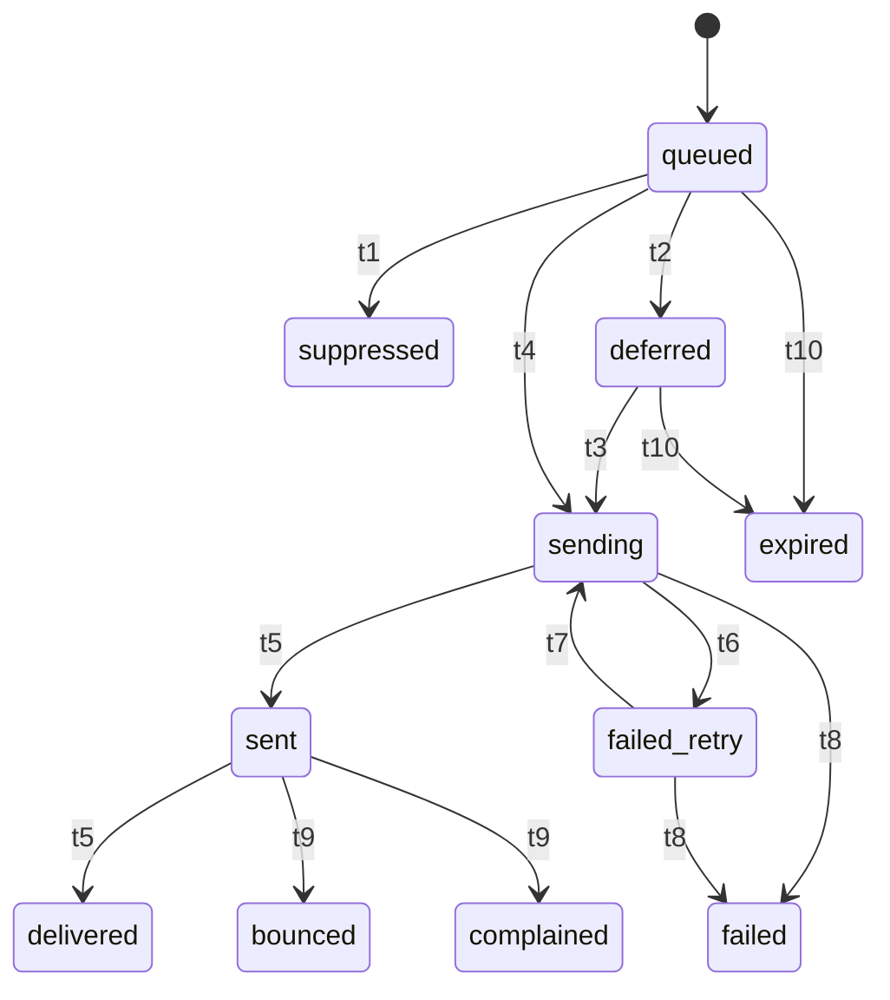

---

## SM-BGJOB (DOM-24) — background job with fenced lease (ADR-T09)

| State | Meaning |
|---|---|
| `queued` | Ready at `run_at` |
| `claimed` | Leased to one worker with `generation g`; lease TTL 60 s with heartbeat |
| `running` | Handler executing |
| `retry_wait` | Failed; waiting backoff |
| `succeeded` | Terminal |
| `dead` | Max attempts (6) exhausted |
| `cancelled` | Terminal; superseded or manually cancelled |

| t | From → To | Trigger | Guard / notes |
|---|---|---|---|
| t1 | queued → claimed | worker `FOR UPDATE SKIP LOCKED` | sets `generation = generation + 1`, `lease_until` |
| t2 | claimed → running | handler start | — |
| t3 | running → succeeded | handler ok | write is **fenced**: `WHERE id=? AND generation=?`; zero rows ⇒ stale worker must discard its result |
| t4 | running → retry_wait | handler error | attempts < 6; exponential backoff base 30 s ×2^n + jitter, cap 1 h |
| t5 | retry_wait → queued | timer | — |
| t6 | claimed / running → queued | lease expired (reaper) | `generation` bumped on next claim; counts as an attempt |
| t7 | retry_wait / running → dead | attempts exhausted | alert; payload retained |
| t8 | dead → queued | admin replay (H) | audited; attempts reset |
| t9 | queued / retry_wait → cancelled | superseding event or admin | — |

**Forbidden:** two active generations; completing with a stale generation; deleting `dead` jobs before 30 d.
**Handlers must be idempotent** (INV-T10): re-execution after t6 must be safe.

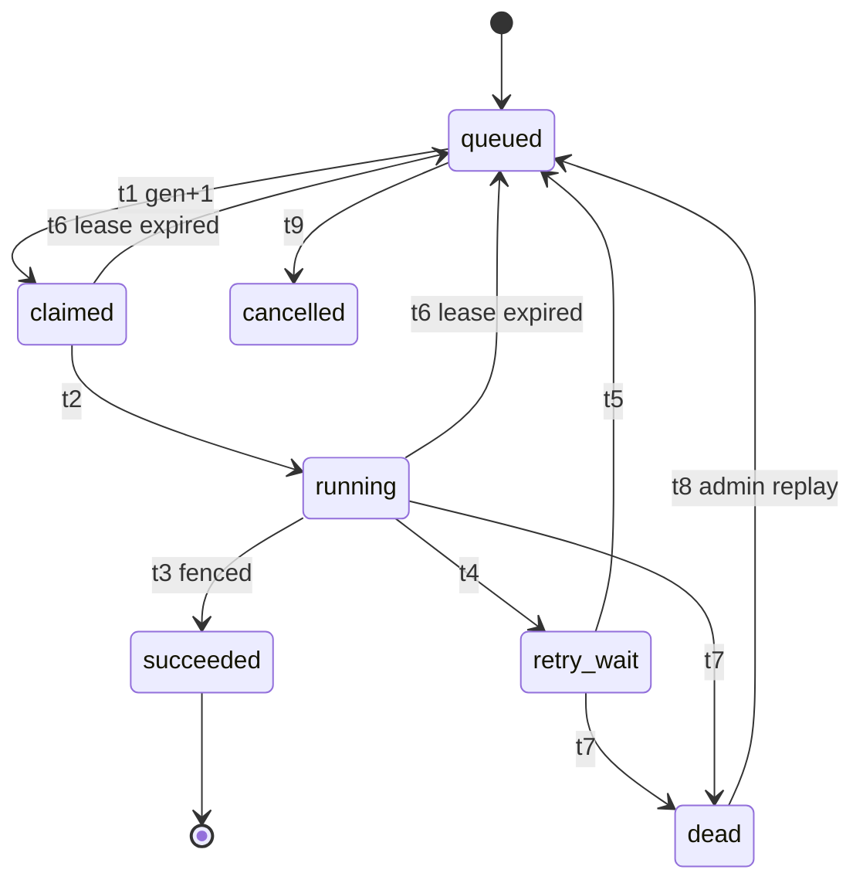

---

## Revision 2 amendments (override same-id rows in the machines above)

Only changed rows are shown. Row identifiers (t1, t2, ...) are those of SM-00 v1.1.

### R2-A.1 SM-ACCOUNT (REVW-21)

| t | From → To | Trigger / actor | Guard (replaces v1.1 guard) | Side effects |
|---|---|---|---|---|
| t3 | active → suspended | moderation/admin decision (H) | case id + reason; **second-person approval recorded, approver ≠ decider** (BR-T045; the single-moderator emergency exception is reviewed within 24 h) | unchanged |
| t7 | active / deactivated / suspended → pending_erasure | erasure request verified (C) | identity re-verified; no open legal hold; **no open moderation case on the account**. A `suspended` account qualifies only once its case is `closed`. Until then the request is parked `on_hold` with reason `moderation_case_open` (SM-DSR t7) and the account is not moved | start cooling-off 7 days (SM-DSR) |

**Forbidden (adds to v1.1):** `suspended → pending_erasure` while a moderation case is open. `locked` is not a state; temporary sign-in lockout is `locked_until > now()` (Vocabulary authority, SM-00 v1.1), and the API 423 response is produced from that column.

### R2-A.2 SM-EVIDENCE (REVW-12, REVW-20)

Replaces the "Rung changes" paragraph; t8 side effects gain the credential link. All other rows and the diagram stand.

**Rung changes (inside `active`):** `claimed → artifact_backed` (t3, link liveness pass, or employer-domain proof for a **bound** domain, BR-T017); `artifact_backed → peer_attested` (at least one valid attestation, FEAT-05-03 or 06-03); `{artifact_backed, peer_attested} → authority_verified` (issuer verification; every authority record carries an `issuer_class`); issuers may create items directly at `authority_verified`. **Downgrade** only by recompute when a supporting provenance record is revoked or expires (audited). Nothing sets a rung from client input or `source=ai` (INV-T08).

**Issuer class (amends ADR-T14; proposed as ADR-T14a).** The ladder keeps four rungs. The `authority_verified` rung is split by a mandatory attribute, not by a fifth rung:

| `issuer_class` | Who issues | Independence rule | Matching weight (DT-03) |
|---|---|---|---|
| `platform` | Platform-run auto-graded assessment; platform-authored course rule | Platform is the issuer; no instructor sign-off involved | highest [OPEN-05 values] |
| `institution` | Verified institution (BR-T102) | Institution issues only for its own learners | high |
| `employer_org` | Verified employer organization (SM-ORG `verified`) | Org verified; confirming person is not the candidate | high |
| `instructor` | Instructor sign-off on a course (`instructorSignoff`) | BR-T119: instructor ≠ learner, no shared account, device or payment signal, issuer independence check | lowest of the four |

Rules: the class is set server-side from the issuing record and cannot come from client input (INV-T46). The UI always shows the class next to the badge. **Instructor sign-off never counts as platform-verified**, in the UI, in matching weights or in any "verified" filter (INV-T47). An `instructor` record is revocable by the issuer or a moderator (t8). A rung that rests only on `instructor` records reports `authority_verified` with class `instructor`.

**Archive and undo (REVW-20).** The UI "Archive ... Undo (8 s)" is a client-side delay: the withdraw request (t9) is dispatched after the 8-second window unless the user cancels. No "archived" state exists. After t9 commits there is no undo (`withdrawn` is terminal, U3); the UI offers "Create again from this", which creates a new `draft` item linked by `restored_from`.

| t | Change |
|---|---|
| t8 | Side effects add: linked credential moves to `revoked` (SM-CREDENTIAL t4) |

### R2-A.3 SM-VERIFICATION (REVW-22)

| Change | Text |
|---|---|
| State `verified` meaning | Control of an employer-domain mailbox proven. The provenance record is `bound` or `unbound`; the rung effect follows DT-06 (`artifact_backed` only when `bound`) |
| t3 side effects | `verification.completed`; provenance record with `domain_binding` ∈ {`bound`, `unbound`} computed at this instant (BR-T017) |

**Domain binding.** `bound` means the employer domain equals a verified `org_domain` (purpose `employer_email_match`; DNS TXT or registry match) of an organization whose `verification_state` is `verified` (SM-ORG). Anything else is `unbound`: the candidate controls a mailbox, which does not show the domain belongs to the claimed employer. An `unbound` result leaves the rung at `claimed` and shows the badge "Mailbox verified, employer not confirmed". A `bound` result reaches `artifact_backed` and shows "Mailbox verified". If the binding later lapses (organization un-verified or domain proof removed) the provenance record is invalidated and the rung recomputed (BR-T005, INV-T48).

### R2-A.4 SM-REFERENCE (REVW-38)

Replaces the "reminders" row. **One cap of 2 reminders per request, shared by system and manual reminders** (BR-T121). System reminders are due on day 4 and day 9. A manual reminder (ACT-VER-03) needs at least 3 days since the last send of any kind. A due system reminder that falls less than 3 days after the last send is deferred, not dropped, and is sent when 3 days have passed. Only while the request is `sent` or `opened`. Event: `reference.reminded`.

### R2-A.5 SM-APPLICATION (REVW-27)

Adds t12 and one sentence to "Forbidden".

| t | From → To | Trigger / actor | Guard | Side effects |
|---|---|---|---|---|
| t12 | (none) → draft (new `application_draft`, then t1) | candidate re-applies after withdrawing (C) | previous application for (candidate, job) is `withdrawn`; at least {24 h} since `withdrawn_at` **[OPEN]**; job `published`; no other active application (BR-T001). `rejected`, `hired` and `offer_declined` never qualify | new application carries `reapplied_from = <withdrawn application id>`; the hiring team sees the link and the withdrawal date; the earlier snapshot is not reused (a new snapshot is taken at t1); closes OPEN-B20 (BR-T125) |

**Forbidden (amends v1.1):** terminal → any, **except** the new linked application of t12 after `withdrawn`. Reconsideration after `rejected` remains a recruiter invitation with `reconsidered_from`.

### R2-A.6 SM-DSR (REVW-21)

| t | Change |
|---|---|
| t4 | Guard adds: no open moderation case on the account (otherwise t7) |
| t7 | From-set becomes `received / verifying / cooling_off / in_progress`; hold reason ∈ {`legal_hold`, `moderation_case_open`, `dispute`}. `moderation_case_open` clears when the case is `closed`, then the request resumes at t4. How the 30-day clock (BR-T060) treats a hold stays [OPEN-08] |

### R2-A.7 SM-NOTIFY (REVW-19)

| t | Replacement text |
|---|---|
| t6 | `sending → failed_retry` on 5xx or timeout. This is the delivery job's retry, not a second layer: the `email.send` or `push.send` job is in `retry_wait` (SM-BGJOB t4). Attempts stay below the job's `max_attempts` (email 12) with the BE-01 section 7.3 backoff |
| t8 | `sending / failed_retry → failed` on error class `permanent` (4xx except 408 and 429), or when the job reaches `dead` (SM-BGJOB t7) |

The v1.1 schedule "1 m, 5 m, 30 m, 2 h, 12 h, 5 attempts" is retired.

### R2-A.8 SM-BGJOB (REVW-19, regenerated from BE-01 section 7)

BE-01 section 7 is authoritative for the job engine; this table mirrors it. State set is unchanged: `queued, claimed, running, retry_wait, succeeded, dead, cancelled`.

| t | From → To | Trigger | Guard / notes |
|---|---|---|---|
| t1 | queued → claimed | worker `FOR UPDATE SKIP LOCKED` | `lease_generation += 1`, new `lease_token`, `attempts += 1`, `lease_expires_at`; the claim query may also take a `retry_wait` job whose `run_after ≤ now()` (t5 and t1 in one UPDATE) |
| t2 | claimed → running | handler start | heartbeat every lease/3 |
| t3 | running → succeeded | handler ok | fenced: `WHERE id=? AND lease_generation=? AND status='running'`; zero rows means a newer claim exists and the stale worker discards its result |
| t4 | running → retry_wait | handler error, class `transient` or `rate_limited` | `attempts < max_attempts`; `delay = min(cap, base × 2^(attempt−1))` with full jitter `random(0, delay)`; base 5 s, cap 15 min; `rate_limited` honours `Retry-After` |
| t5 | retry_wait → queued | `run_after` reached | see t1 |
| t6 | claimed / running → queued | lease expired (reaper) | generation unchanged until the next claim; the attempt was already counted at claim |
| t7 | running → dead | `attempts ≥ max_attempts`, or error class `permanent` | `max_attempts`: default 8; `email.send` and `webhook.deliver` 12; `ai.*` 3; `assessment.run` 2; `evt:*` 8. Alert always for protected kinds (billing, erasure, evidence); payload and error retained |
| t8 | dead → queued | admin replay (H) | audited; attempts reset |
| t9 | queued / retry_wait / running → cancelled | superseding event or admin (`cancel_requested_at`) | a `running` job reaches `cancelled` only when the handler honours the abort at its next checkpoint; handlers are idempotent on resume |

Differences from SM-00 v1.1: attempts 6 → per-kind limits above; backoff 30 s × 2^n capped 1 h → 5 s base capped 15 min with full jitter; `retry_wait → dead` removed (a job fails from `running`); `running → cancelled` added.

**[OPEN, backend owner]** BE-01 section 7.3 says 12 attempts span about 24 h. With base 5 s and cap 15 min the waits sum to about 66 minutes (5+10+20+40+80+160+320+640 s, then three waits of 900 s). Either the cap or the claim is wrong; this file keeps BE-01's numbers.

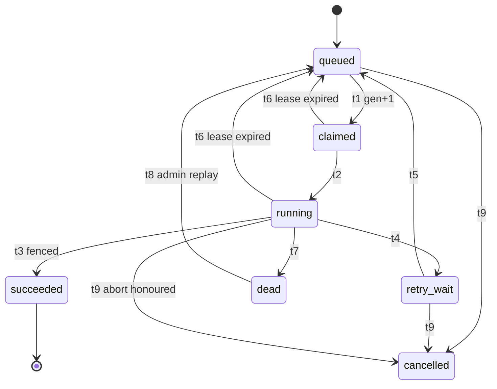

## Additional machines (Revision 2) (REVW-20)

Same conventions as SM-00: tables are the specification; U1 to U8 apply; terminal states are immutable; consequential transitions need `actor.kind = human` and a reason code.

### R2-B.1 SM-FILE (platform) — `file_object.state`

| State | Meaning |
|---|---|
| `intent` | Upload slot reserved (signed URL issued); no bytes yet |
| `uploaded` | Bytes received, size matches |
| `verifying` | Content-type sniffing, allowlist and size checks (BR-T014) |
| `scanning` | Malware scan in flight |
| `clean` | Passed every check |
| `rejected` | Failed type, size or policy check |
| `infected` | Scan positive |
| `deleted` | Terminal; blob removed, row kept as tombstone |

| t | From → To | Trigger / actor | Guard | Side effects |
|---|---|---|---|---|
| t1 | (none) → intent | request upload (C) | caller owns the target; quota | signed URL, TTL 1 h |
| t2 | intent → uploaded | upload complete (S) | size equals declared size | enqueue `file.scan` |
| t3 | uploaded → verifying | auto (S) | — | — |
| t4 | verifying → scanning | checks pass (S) | sniffed type in allowlist | — |
| t5 | verifying → rejected | checks fail (S) | reason code | owner told neutrally |
| t6 | scanning → clean | scan verdict clean (S) | verdict recorded | SM-EVIDENCE t3 may fire |
| t7 | scanning → infected | scan positive (S) | — | SM-EVIDENCE t4; blob quarantined |
| t8 | any non-terminal → deleted | owner delete, intent expiry (1 h), retention, erasure (S/C) | — | blob removed |

**Forbidden:** `clean` without a recorded verdict; any state → `clean` except from `scanning`; `deleted` → any. **Fail closed:** scanner outage leaves the file in `scanning` and alerts; it never becomes `clean` by timeout (BR-T003).

### R2-B.2 SM-ORG (DOM-02) — two axes on `organization`

**Status axis** (`organization.status`): `active` (default) · `suspended` (human sanction) · `closed` (terminal).

| t | From → To | Trigger / actor | Guard | Side effects |
|---|---|---|---|---|
| t1 | (none) → active | org created (C) | owner account verified | org starts `unverified` on the verification axis |
| t2 | active → suspended | moderation decision (H) | case id, reason, second-person approval (BR-T045) | live jobs taken down through the case (SM-JOB t9); members notified |
| t3 | suspended → active | appeal upheld or sanction end (H/S) | decision recorded | restore |
| t4 | active / suspended → closed | `org_owner` request or platform decision (C/H) | last-owner rule; re-auth | jobs closed (SM-JOB t8); data per org retention policy |

**Verification axis** (`organization.verification_state`). Mandatory for the verified benefits of BR-T035 and INV-T30. `verified_at` becomes derived: set when the state becomes `verified`, null otherwise.

| State | Meaning |
|---|---|
| `unverified` | Default. Pending-limited mode: at most 1 live job (BR-T035) |
| `pending` | Evidence submitted (domain proof, registry data); awaiting reviewer or automatic match |
| `verified` | Domain proof (DNS TXT) and registry or reviewer confirmation recorded |
| `rejected` | Reviewer declined, reason code; may resubmit |
| `revoked` | Verification withdrawn after being `verified` (fraud, impersonation, lost domain control, owner request) |

| t | From → To | Trigger / actor | Guard | Side effects |
|---|---|---|---|---|
| v1 | unverified → pending | `org_owner` or `org_admin` submits proof (C) | at least one domain; rate limit | review task |
| v2 | pending → verified | DNS and registry match (S) or reviewer (H) | proof valid at this instant | `org.verified`; `org_domain` rows usable for employer-domain binding |
| v3 | pending → rejected | reviewer (H) | reason code | notify; may resubmit after 24 h |
| v4 | rejected / revoked → pending | resubmission (C) | new evidence | review task |
| v5 | verified → revoked | reviewer or moderator (H); a system re-check failure only opens the task | reason code | Effects per BR-T123 below |

**Effects of v5 (REVW-20).** In the same transaction: the org keeps its oldest live job and every other `published` or `scheduled` job moves to `paused` (reason `org_unverified`, owner told); new publishes beyond 1 are refused (DT-12 row 2); applications on paused jobs continue; provenance with a `bound` domain of this org is invalidated and rungs recomputed; the "verified" mark leaves the public org page. INV-T30 therefore holds after the transition.

**Forbidden:** unverified → verified or revoked; verified → rejected; automation setting `revoked` or `rejected` (U6).

### R2-B.3 SM-COURSE (DOM-08) — `course.state` (publication; content versions are a separate axis)

| State | Meaning |
|---|---|
| `draft` | Author editing; not offered |
| `in_review` | Submitted for platform review (required for every course while Ph2 is first-party only, REVW-30) |
| `published` | Offered; new enrolments allowed |
| `unpublished` | Withdrawn by author or staff; existing enrolments continue, no new ones |
| `taken_down` | Hidden by a human moderator with notice and appeal |

| t | From → To | Trigger / actor | Guard | Side effects |
|---|---|---|---|---|
| t1 | (none) → draft | author creates (C) | approved instructor or platform staff | — |
| t2 | draft → in_review | author submits (C) | video lessons have captions (AC-08-03-04); completion rule valid; `issuer_class` of any sign-off declared | review task |
| t3 | in_review → published | reviewer approves (H) | reviewer ≠ author | `course.published` |
| t4 | in_review → draft | changes requested (H) | reason | notify author |
| t5 | published → unpublished | author or staff (C/H) | — | de-index; enrolments continue |
| t6 | unpublished → published | author (C) | changed content passes t2 and t3 again | re-index |
| t7 | published / unpublished → taken_down | moderator (H) | case id | de-index; enrolments suspended (SM-ENROLMENT t10); notice with appeal |
| t8 | taken_down → published / unpublished | appeal outcome (H) | — | restore enrolments |

**Forbidden:** `published → draft` (an edit creates a new `course_version` in draft while the published version stays); author reinstating a `taken_down` course; automation setting `taken_down`. Evidence already minted from a taken-down course is not revoked automatically (BR-T032): a human issuer decides.

### R2-B.4 SM-CREDENTIAL (DOM-05) — `credential.state`

| State | Meaning |
|---|---|
| `issued` | Verifiable by public code; shows `issuer_class` |
| `suspended` | Public page shows "under review"; not counted |
| `revoked` | Terminal; reason code on the public page |
| `expired` | Terminal; `expires_at` passed |

| t | From → To | Trigger / actor | Guard | Side effects |
|---|---|---|---|---|
| t1 | (none) → issued | issuer (S/H) | linked evidence `active` at `authority_verified`; `issuer_class` set | public code, at least 128 bits |
| t2 | issued → suspended | issuer or moderator (H) | reason code | notify holder with appeal path |
| t3 | suspended → issued | cleared (H) | reason | — |
| t4 | issued / suspended → revoked | issuer or moderator (H); the holder when evidence is withdrawn or erased (reason `holder_withdrawn`) | reason code; U6 except `holder_withdrawn` | BR-T012; recompute |
| t5 | issued → expired | `expires_at` (S) | — | notify 30 days before |

**Forbidden:** revoked or expired → any (re-issue is a new credential with `supersedes`); issuance without a linked evidence item.

### R2-B.5 SM-DISPUTE (DOM-06) — `verification_dispute.state`

| State | Meaning |
|---|---|
| `open` | Raised; candidate response window of 7 days running (BR-T021) |
| `under_review` | A human reviewer is working it |
| `upheld` | Terminal; the dispute is right |
| `dismissed` | Terminal; the dispute is rejected |
| `withdrawn` | Terminal; the raiser withdrew before a decision |

| t | From → To | Trigger / actor | Guard | Side effects |
|---|---|---|---|---|
| t1 | (none) → open | candidate, referee outcome `dispute` after human screening, or a report (C/R) | one open dispute per (evidence, raiser) | notify candidate; 7-day window |
| t2 | open → under_review | reviewer claims (H) | moderator or trust-reviewer role | — |
| t3 | under_review → upheld | decision (H) | reason; candidate response received or 7 days elapsed | SM-VERIFICATION t7 and/or SM-WORKCLAIM t2; rung recompute; notify with appeal path (SM-MODCASE) |
| t4 | under_review → dismissed | decision (H) | reason; same window rule | claim unmarked; notify |
| t5 | open → withdrawn | raiser (C) | before t2 | — |

**Forbidden:** automation setting `upheld` or `dismissed` (U6, INV-T20); terminal → any.

### R2-B.6 SM-WORKCLAIM (DOM-06) — `work_claim.state`

A work claim has exactly one evidence item; its state is constrained by that item's lifecycle.

| State | Meaning |
|---|---|
| `draft` | Being written; item `draft` |
| `submitted` | Claim made; item `active` |
| `disputed` | Marked for recruiters after human review (DT-04 row 4a); item stays `active` with the marker |
| `withdrawn` | Terminal; item withdrawn, revoked or erased |

| t | From → To | Trigger / actor | Guard | Side effects |
|---|---|---|---|---|
| t1 | draft → submitted | candidate submits (C) | SM-EVIDENCE t2 or t3 succeeded | — |
| t2 | submitted → disputed | SM-DISPUTE t3 (H) | upheld dispute | recruiter-visible marker; candidate may correct (new item, BR-T067) |
| t3 | disputed → submitted | reversed on appeal or marker cleared (H) | decision recorded | marker removed |
| t4 | draft / submitted / disputed → withdrawn | candidate (C), or item revoked/erased (S) | — | recipients lose live access (SM-EVIDENCE t9) |

**Forbidden:** editing employer or dates on a `submitted` claim that has a verified request (BR-T067: new item); `withdrawn` → any.

### R2-B.7 SM-FIRSTCONTACT (DOM-13) — `first_contact_request.state`

| State | Meaning |
|---|---|
| `pending` | Sent to the candidate; quota already consumed (DT-08 row 6) |
| `accepted` | Candidate accepted; an outreach conversation opens |
| `declined` | Candidate declined; sender sees only a generic code (BR-T082) |
| `expired` | 14 days without an answer |
| `withdrawn` | Sender withdrew |

| t | From → To | Trigger / actor | Guard | Side effects |
|---|---|---|---|---|
| t1 | (none) → pending | recruiter sends (R) | DT-08 row 6 | quota consumed; notify candidate |
| t2 | pending → accepted | candidate (C) | no block either way | conversation created |
| t3 | pending → declined | candidate (C) | optional block ticked | 30-day cooldown (BR-T081); a block adds a `block` row and closes the path (BR-T083) |
| t4 | pending → expired | day 14 (S) | — | no quota refund |
| t5 | pending → withdrawn | sender (R) | — | no quota refund |

**Forbidden:** terminal → any; a second request during cooldown (DT-08 row 5); accepting after expiry.

### R2-B.8 SM-SUPPORTGRANT (DOM-20) — `support_access_grant.state`

| State | Meaning |
|---|---|
| `pending_approval` | Waiting for a second person (scope `read_evidence_metadata`) |
| `active` | Reads allowed, each audited; at most 4 h (BR-T041) |
| `expired` | Terminal |
| `revoked` | Terminal; ended early |
| `rejected` | Terminal; approver refused |

| t | From → To | Trigger / actor | Guard | Side effects |
|---|---|---|---|---|
| t1 | (none) → pending_approval | support requests (H) | ticket id, reason code; scope needs approval | approver task |
| t2 | (none) → active | support requests (H) | ticket id, reason code; scope needs none | subject notified unless prohibited [OPEN-08] |
| t3 | pending_approval → active | approver (H) | approver ≠ requester | as t2 |
| t4 | pending_approval → rejected | approver (H) | reason | — |
| t5 | active → expired | `expires_at` (S) | — | access ends |
| t6 | active → revoked | grantor, Security, or system when the grantee account is suspended (H/S) | reason | access ends |

**Forbidden:** extending an active grant (a new grant is created, BR-T042); any state → `active` after `expired`, `revoked` or `rejected`.

### R2-B.9 SM-EXPORT (DOM-22, DOM-03) — `data_export.state`, `resume_export.state`

| State | Meaning |
|---|---|
| `requested` | Queued |
| `building` | Worker assembling the archive |
| `ready` | Download link valid 7 days; re-auth to download (BR-T064) |
| `expired` | Terminal; link and file deleted |
| `failed` | Retries exhausted; ops task (SM-DSR t10) |

| t | From → To | Trigger / actor | Guard | Side effects |
|---|---|---|---|---|
| t1 | (none) → requested | SM-DSR t3 (kind `export`) or resume export (C/S) | one per 24 h (BR-T064) | `privacy.export.build` job |
| t2 | requested → building | worker claims (S) | — | — |
| t3 | building → ready | archive complete, `file_object` `clean` (S) | own data only; no internal fraud signals | notify; link TTL 7 days |
| t4 | building → failed | retries exhausted (S) | — | ops alert |
| t5 | ready → expired | day 7 (S) | — | file deleted |
| t6 | failed → requested | manual replay (H) | audited | attempts reset |

**Forbidden:** download without re-auth (BR-T057); `expired → ready` (support issues a new export, BR-T064).

### R2-B.10 Entities deliberately without a machine

1. Append-only tables (`audit_event`, `consent_record`, `evidence_event`, `stage_transition`, `outbox_event`, `integrity_signal`) have no state: rows never change.
2. Single-module operational enums with no person-consequential transition and at most three values (`membership.status`, `stripe_event_inbox.state`, `webhook_endpoint.state`, `webhook_delivery.state`, `sandbox_run.state`, `report.state`, `import_job.state`) keep their local CHECK in DB-01. They stay outside FF-11 until they gain a human-decided transition or a fourth consumer-visible state.
3. Rule for adding a machine: any entity with a human-decided transition, a legal-duty clock, or a state another module reacts to.

## Cross-machine dependencies

| Event in SM | Effect in another SM |
|---|---|
| SM-ACCOUNT t3 / t5 / t7 | SM-SESSION t6 (revoke all) |
| SM-ATTEMPT t4 (pass, auto-gradable) | SM-EVIDENCE creation at authority_verified |
| SM-ATTEMPT t9 (voided) | SM-EVIDENCE t8 (revoke) |
| SM-ENROLMENT t5 (completed) | SM-EVIDENCE creation |
| SM-REFERENCE t3 (submitted) | SM-EVIDENCE rung recompute (DT-04) |
| SM-VERIFICATION t3 (verified) | SM-EVIDENCE provenance + rung recompute (DT-06) |
| SM-EVIDENCE t8 (revoked) | skill confidence + match recompute (BR-T005) via SM-BGJOB |
| SM-SUBSCRIPTION t2/t6/t10 | entitlement cache invalidation → gates in SM-JOB t1, SM-ENROLMENT t3 |
| SM-MODCASE t5 | SM-JOB t9, SM-EVIDENCE t8, SM-ACCOUNT t3 (human-decided only) |
| SM-DSR t4 | SM-ACCOUNT t7 |
| SM-APPLICATION t1 | SM-BGJOB (notification, search/match refresh) |

## Test obligations (INV-T11)

For each SM generate: (1) one test per allowed transition; (2) one test per *forbidden* pair in the Cartesian product (state × event) expecting `409 invalid_transition`; (3) terminal-immutability property test; (4) concurrency test for each guard marked "row lock"/"version".

## Revision 2: Persisted sets and required data changes

**The backend/data owner must mirror these CHECK constraints and columns in DB-01 and the OpenAPI enums in the same change; until then the FF-11 lint reports them as unmapped.**

| Machine | Stored in | Persisted states | DB / contract change needed |
|---|---|---|---|
| SM-FILE | `file_object.state` | intent, uploaded, verifying, scanning, clean, rejected, infected, deleted | none (the provisional set is confirmed) |
| SM-ORG (status) | `organization.status` | active, suspended, closed | none |
| SM-ORG (verification) | `organization.verification_state` | unverified, pending, verified, rejected, revoked | new column; `verified_at` becomes derived |
| SM-COURSE | `course.state` | draft, in_review, published, unpublished, taken_down | none |
| SM-CREDENTIAL | `credential.state` | issued, suspended, revoked, expired | new column; `issuer_kind` {platform, institution, external} replaced by `issuer_class` {platform, institution, employer_org, instructor} |
| SM-DISPUTE | `verification_dispute.state` | open, under_review, upheld, dismissed, withdrawn | add `withdrawn` |
| SM-WORKCLAIM | `work_claim.state` | draft, submitted, disputed, withdrawn | none |
| SM-FIRSTCONTACT | `first_contact_request.state` | pending, accepted, declined, expired, withdrawn | table is specified in SPEC-G5 section 3.3 and absent from DB-01: add it |
| SM-SUPPORTGRANT | `support_access_grant.state` | pending_approval, active, expired, revoked, rejected | new column |
| SM-EXPORT | `data_export.state`, `resume_export.state` | requested, building, ready, expired, failed | none |
| SM-BGJOB | `background_job.status` | queued, claimed, running, retry_wait, succeeded, dead, cancelled | none; BE-01 section 7.3 numbers stand |

Further columns implied: `evidence_attestation.issuer_class` and `.domain_binding`; `application.reapplied_from` and `.withdrawn_at`; `account.min_age_attested_at` (BR-T120); `reference_request.reminder_count` shared across sender kinds (BR-T121).

## Revision 2: Cross-machine dependencies (additions to SM-00 table)

| Event in SM | Effect in another SM |
|---|---|
| SM-FILE `clean` / `infected`, `rejected` | SM-EVIDENCE t3 / t4 |
| SM-EVIDENCE t8, t10, t9 or t11 | SM-CREDENTIAL t4, t5, t4 (reason `holder_withdrawn`) |
| SM-ORG verification v5 (`verified → revoked`) | SM-JOB t7 for jobs beyond the single pending-limited slot (reason `org_unverified`); provenance with a `bound` domain of that org invalidated; rung recompute |
| SM-ORG status t2 (suspended) | SM-JOB t9 for live jobs via the moderation case |
| SM-COURSE t7 (`taken_down`) | SM-ENROLMENT t10 (suspend active enrolments) |
| SM-DISPUTE t3 (`upheld`) | SM-VERIFICATION t7 and/or SM-WORKCLAIM t2, then SM-EVIDENCE rung recompute |
| SM-FIRSTCONTACT t3 (declined with block) | `block` row (BR-T083), conversation `blocked` |
| SM-DSR t3 / t6 for kind `export` | SM-EXPORT t1 / `ready` |
| SM-MODCASE open / closed | SM-DSR t7 (`moderation_case_open`) |

## Revision 2: Test obligations (additions to SM-00)

Each new or amended machine gets the SM-00 obligations (one test per allowed transition, one per forbidden state × event pair, terminal immutability, concurrency for row-lock guards). Specific cases: instructor equals learner cannot reach `authority_verified` (INV-T47); an `unbound` domain proof leaves the rung at `claimed` (INV-T48); a suspended account with an open case cannot enter `pending_erasure` (INV-T49); a withdrawn application re-applied inside the cooldown returns `409 reapply_cooldown`; a manual plus system reminder pair never exceeds two (INV-T51); organization `v5` pauses every live job but the oldest in the same transaction (INV-T30); SM-BGJOB claim-attempt counting matches BE-01 section 7.2.

# Patch 2026-10-27: Completion-state vocabulary (CSV-01..CSV-12)

**Scope.** Describes the lifecycle of one *user intent* across client, API and workers. It does NOT add states to any SM-* machine: persisted state names stay exactly as defined in the machines above and in SM-00 "Vocabulary authority". Each completion word is a *position* in the intent lifecycle; the machine state it maps to is shown where one exists. **[TARGET]**, owners are roles PROPOSED for confirmation.

| ID | Word | Meaning | Owner (who may set it) | Persisted? | UI may claim success? |
|---|---|---|---|---|---|
| CSV-01 | draft | Local or server draft; nothing sent as an intent. (SM-APPLICATION `draft` is stored in `application_draft`) | Client; server for stored drafts | Local / draft table | No. Shows "Draft" / "Saved as draft" only |
| CSV-02 | queued | Accepted into the client write queue (ADR-T10 set only); not yet sent | Client queue | Local (IndexedDB) | No. "Waiting to sync"; messages show "Not sent yet" |
| CSV-03 | submitted | Request left the client; outcome unknown until response or status query | Client | No | No. "Sending..." / "Checking..." |
| CSV-04 | accepted | Server validated, authorised and recorded the intent (idempotency key bound); work may still be pending | API | Idempotency record | Only for the narrow claim "We received it". Never "done" |
| CSV-05 | processing | Async work running after acceptance (scan, export build, job claim: SM-FILE `scanning`, SM-EXPORT `building`, SM-BGJOB `running`) | Worker | Yes (those machines) | No. Indeterminate progress with honest text |
| CSV-06 | committed | The authoritative state transition is durable in the owning machine (e.g. application `submitted`, evidence row exists) | Owning API module, in the transaction (INV-T11) | Yes | Yes, for effects that live inside our system |
| CSV-07 | externally-confirmed | A third party confirmed (payment webhook, SSO IdP assertion, employer-domain email proof, delivery provider) | Verified inbound event only (INV-T17) | Yes | Yes, and only now for anything that depends on the third party (money, entitlement, "verified"). A redirect return is not confirmation |
| CSV-08 | canceled | Intent stopped before commit by the person or system; no effect remains. Spelling: `cancelled` for platform machines, `canceled` only in SM-SUBSCRIPTION (SM-00 naming rule 2) | Initiator or system | Machine-dependent | Yes: "Cancelled. Nothing was changed" |
| CSV-09 | compensated | Commit was reversed by a defined compensating step (refund, seat returned, soft-delete); original record kept for audit | Owning module via a new transition, never by editing history | Yes (new event/row) | Yes, with wording that states what was undone and what was not |
| CSV-10 | failed | Terminal failure with no effect, or effect rolled back automatically | API / worker (`dead`, `rejected`...) | Yes | No success; shows cause, trace id, safe retry per UXH-07 |
| CSV-11 | partial | Batch or multi-part intent where some items committed and some did not | Bulk-operation record | Yes (per-item results) | Per item only. Header says "42 moved, 3 skipped, 5 not started"; never a single green tick |
| CSV-12 | stale | Client view older than server (ETag mismatch, cache expiry, revoked grant) | Server (412/409/403) | No | No. Offer refresh or conflict flow; the action is not retried silently |

## Rules

| ID | Rule |
|---|---|
| CSV-R1 | The client may show a persistent success only at `committed` or `externally-confirmed`, whichever the action's contract names as its completion criterion ([ACTION_REGISTRY](../07_UI_UX_AND_DESIGN_SYSTEM/ACTION_REGISTRY.md) ACT-ATOM-*). |
| CSV-R2 | Optimistic UI (UI-07 6.1) may display the *expected* result but must label it as pending until `committed`, and revert on `failed` or `stale`. |
| CSV-R3 | A word moves forward only: draft, queued, submitted, accepted, processing, then one of committed, externally-confirmed, failed, canceled, compensated, partial. `stale` can interrupt any position before commit. |
| CSV-R4 | A UI string never says "sent", "paid", "verified", "published" or "approved" before the owning machine has the matching persisted state. |
| CSV-R5 | A lost response is resolved by status query (CSV-03 to CSV-06/10), never by a second submit with a new key (UXH-07, UXH-08). |

## Mapping examples

| Action | draft | queued | submitted/accepted | processing | committed | externally-confirmed |
|---|---|---|---|---|---|---|
| ACT-APP-03 Submit application | `application_draft` | n/a (online-only) | request in flight | match/notify jobs | `application.state = submitted` | n/a |
| ACT-MSG-01 Send message | compose box | Not sent yet | accepted | delivery job | stored in thread | provider delivery receipt (email channel only) |
| ACT-BIL-01 Choose plan | plan selected | n/a | checkout created | webhook pending | n/a | `SM-SUBSCRIPTION` active via verified webhook |
| ACT-EVD-02 Add file | file picked | n/a | upload init accepted | `scanning` | `clean` | n/a |

---

## Preserved source record: STATE_MACHINES_REV2

> Consolidated on 2026-10-27. The following is the complete source record, retained for provenance, exceptions and rationale. Its dates, counts and statements about files describe the earlier revision, not the current filesystem. Approval conditions and authority remain unchanged: this move neither ratifies proposals nor overrides the owning document’s current precedence rules. Relative references now point to the consolidated records.

<!-- source-record-begin: Yash_Final_Project_Document/06_BUSINESS_PROCESSES/STATE_MACHINES_REV2.md -->

# State Machines, Revision 2 (SM-00 REV2)

Doc ID: SM-00-R2 · Owner: Domain Architect + Product Director · Version 2.0 · Status: Proposed (Under Review) · Date: 2026-10-25 · Closes: REVW-12, REVW-19, REVW-20, REVW-21, REVW-22, REVW-27 (state-machine parts) · Relates: SM-00, BR-REG-R2, INV-REG-R2, DT-00-R2, ADR-T14 (amendment ADR-T14a), ADR-T09

> **Folded into `STATE_MACHINES.md` on 2026-10-27.** This file is now a change record; edit the original, not this file.

**Relationship (no original file was edited).** This file **supersedes, once accepted by governance**, these parts of `STATE_MACHINES.md` (SM-00 v1.1): the transition rows named in section 2 for SM-ACCOUNT, SM-EVIDENCE, SM-VERIFICATION, SM-REFERENCE, SM-APPLICATION, SM-DSR, SM-NOTIFY and SM-BGJOB; the paragraph that begins "Not covered by SM-00 (REVW-20, still open)"; and the cross-machine table (extended in section 5). Everything else in SM-00 stands, including U1 to U8, the Vocabulary authority rules, and all machines not named here. Until accepted, SM-00 v1.1 remains the text of record; where the two differ, this file states the intended change. Governance should link this file from `00_CONTROL_CENTRE/MASTER_INDEX.md`.

All content is **[TARGET]**. Nothing here claims anything is built. Items marked **[OPEN]** are product defaults awaiting an owner.

## 1. Summary of changes

| Finding | Change | Section |
|---|---|---|
| REVW-12 | Evidence `authority_verified` rung carries a mandatory `issuer_class`; instructor sign-off is a distinct, weaker class | 2.2 |
| REVW-19 | SM-BGJOB regenerated from BE-01 section 7 (attempt limits, backoff, error classes); SM-NOTIFY retry is the job retry, not a second layer | 2.7, 2.8 |
| REVW-20 | Nine machines added; justification list for entities without one; organization un-verification effects; archive semantics | 2.2, 3 |
| REVW-21 | Account: second-person guard on suspension; erasure blocked while a moderation case is open | 2.1, 2.6 |
| REVW-22 | Employer-domain proof splits into `bound` and `unbound`; only `bound` reaches `artifact_backed` | 2.3 |
| REVW-27 | Withdrawn application can be re-submitted as a new linked application after a cooldown | 2.5 |
| REVW-38 | One shared cap of two referee reminders | 2.4 |

## 2. Amended machines

Only changed rows are shown. Row identifiers (t1, t2, ...) are those of SM-00 v1.1.

### 2.1 SM-ACCOUNT (REVW-21)

| t | From → To | Trigger / actor | Guard (replaces v1.1 guard) | Side effects |
|---|---|---|---|---|
| t3 | active → suspended | moderation/admin decision (H) | case id + reason; **second-person approval recorded, approver ≠ decider** (BR-T045; the single-moderator emergency exception is reviewed within 24 h) | unchanged |
| t7 | active / deactivated / suspended → pending_erasure | erasure request verified (C) | identity re-verified; no open legal hold; **no open moderation case on the account**. A `suspended` account qualifies only once its case is `closed`. Until then the request is parked `on_hold` with reason `moderation_case_open` (SM-DSR t7) and the account is not moved | start cooling-off 7 days (SM-DSR) |

**Forbidden (adds to v1.1):** `suspended → pending_erasure` while a moderation case is open. `locked` is not a state; temporary sign-in lockout is `locked_until > now()` (Vocabulary authority, SM-00 v1.1), and the API 423 response is produced from that column.

### 2.2 SM-EVIDENCE (REVW-12, REVW-20)

Replaces the "Rung changes" paragraph; t8 side effects gain the credential link. All other rows and the diagram stand.

**Rung changes (inside `active`):** `claimed → artifact_backed` (t3, link liveness pass, or employer-domain proof for a **bound** domain, BR-T017); `artifact_backed → peer_attested` (at least one valid attestation, FEAT-05-03 or 06-03); `{artifact_backed, peer_attested} → authority_verified` (issuer verification; every authority record carries an `issuer_class`); issuers may create items directly at `authority_verified`. **Downgrade** only by recompute when a supporting provenance record is revoked or expires (audited). Nothing sets a rung from client input or `source=ai` (INV-T08).

**Issuer class (amends ADR-T14; proposed as ADR-T14a).** The ladder keeps four rungs. The `authority_verified` rung is split by a mandatory attribute, not by a fifth rung:

| `issuer_class` | Who issues | Independence rule | Matching weight (DT-03) |
|---|---|---|---|
| `platform` | Platform-run auto-graded assessment; platform-authored course rule | Platform is the issuer; no instructor sign-off involved | highest [OPEN-05 values] |
| `institution` | Verified institution (BR-T102) | Institution issues only for its own learners | high |
| `employer_org` | Verified employer organization (SM-ORG `verified`) | Org verified; confirming person is not the candidate | high |
| `instructor` | Instructor sign-off on a course (`instructorSignoff`) | BR-T119: instructor ≠ learner, no shared account, device or payment signal, issuer independence check | lowest of the four |

Rules: the class is set server-side from the issuing record and cannot come from client input (INV-T46). The UI always shows the class next to the badge. **Instructor sign-off never counts as platform-verified**, in the UI, in matching weights or in any "verified" filter (INV-T47). An `instructor` record is revocable by the issuer or a moderator (t8). A rung that rests only on `instructor` records reports `authority_verified` with class `instructor`.

**Archive and undo (REVW-20).** The UI "Archive ... Undo (8 s)" is a client-side delay: the withdraw request (t9) is dispatched after the 8-second window unless the user cancels. No "archived" state exists. After t9 commits there is no undo (`withdrawn` is terminal, U3); the UI offers "Create again from this", which creates a new `draft` item linked by `restored_from`.

| t | Change |
|---|---|
| t8 | Side effects add: linked credential moves to `revoked` (SM-CREDENTIAL t4) |

### 2.3 SM-VERIFICATION (REVW-22)

| Change | Text |
|---|---|
| State `verified` meaning | Control of an employer-domain mailbox proven. The provenance record is `bound` or `unbound`; the rung effect follows DT-06 (`artifact_backed` only when `bound`) |
| t3 side effects | `verification.completed`; provenance record with `domain_binding` ∈ {`bound`, `unbound`} computed at this instant (BR-T017) |

**Domain binding.** `bound` means the employer domain equals a verified `org_domain` (purpose `employer_email_match`; DNS TXT or registry match) of an organization whose `verification_state` is `verified` (SM-ORG). Anything else is `unbound`: the candidate controls a mailbox, which does not show the domain belongs to the claimed employer. An `unbound` result leaves the rung at `claimed` and shows the badge "Mailbox verified, employer not confirmed". A `bound` result reaches `artifact_backed` and shows "Mailbox verified". If the binding later lapses (organization un-verified or domain proof removed) the provenance record is invalidated and the rung recomputed (BR-T005, INV-T48).

### 2.4 SM-REFERENCE (REVW-38)

Replaces the "reminders" row. **One cap of 2 reminders per request, shared by system and manual reminders** (BR-T121). System reminders are due on day 4 and day 9. A manual reminder (ACT-VER-03) needs at least 3 days since the last send of any kind. A due system reminder that falls less than 3 days after the last send is deferred, not dropped, and is sent when 3 days have passed. Only while the request is `sent` or `opened`. Event: `reference.reminded`.

### 2.5 SM-APPLICATION (REVW-27)

Adds t12 and one sentence to "Forbidden".

| t | From → To | Trigger / actor | Guard | Side effects |
|---|---|---|---|---|
| t12 | (none) → draft (new `application_draft`, then t1) | candidate re-applies after withdrawing (C) | previous application for (candidate, job) is `withdrawn`; at least {24 h} since `withdrawn_at` **[OPEN]**; job `published`; no other active application (BR-T001). `rejected`, `hired` and `offer_declined` never qualify | new application carries `reapplied_from = <withdrawn application id>`; the hiring team sees the link and the withdrawal date; the earlier snapshot is not reused (a new snapshot is taken at t1); closes OPEN-B20 (BR-T125) |

**Forbidden (amends v1.1):** terminal → any, **except** the new linked application of t12 after `withdrawn`. Reconsideration after `rejected` remains a recruiter invitation with `reconsidered_from`.

### 2.6 SM-DSR (REVW-21)

| t | Change |
|---|---|
| t4 | Guard adds: no open moderation case on the account (otherwise t7) |
| t7 | From-set becomes `received / verifying / cooling_off / in_progress`; hold reason ∈ {`legal_hold`, `moderation_case_open`, `dispute`}. `moderation_case_open` clears when the case is `closed`, then the request resumes at t4. How the 30-day clock (BR-T060) treats a hold stays [OPEN-08] |

### 2.7 SM-NOTIFY (REVW-19)

| t | Replacement text |
|---|---|
| t6 | `sending → failed_retry` on 5xx or timeout. This is the delivery job's retry, not a second layer: the `email.send` or `push.send` job is in `retry_wait` (SM-BGJOB t4). Attempts stay below the job's `max_attempts` (email 12) with the BE-01 section 7.3 backoff |
| t8 | `sending / failed_retry → failed` on error class `permanent` (4xx except 408 and 429), or when the job reaches `dead` (SM-BGJOB t7) |

The v1.1 schedule "1 m, 5 m, 30 m, 2 h, 12 h, 5 attempts" is retired.

### 2.8 SM-BGJOB (REVW-19, regenerated from BE-01 section 7)

BE-01 section 7 is authoritative for the job engine; this table mirrors it. State set is unchanged: `queued, claimed, running, retry_wait, succeeded, dead, cancelled`.

| t | From → To | Trigger | Guard / notes |
|---|---|---|---|
| t1 | queued → claimed | worker `FOR UPDATE SKIP LOCKED` | `lease_generation += 1`, new `lease_token`, `attempts += 1`, `lease_expires_at`; the claim query may also take a `retry_wait` job whose `run_after ≤ now()` (t5 and t1 in one UPDATE) |
| t2 | claimed → running | handler start | heartbeat every lease/3 |
| t3 | running → succeeded | handler ok | fenced: `WHERE id=? AND lease_generation=? AND status='running'`; zero rows means a newer claim exists and the stale worker discards its result |
| t4 | running → retry_wait | handler error, class `transient` or `rate_limited` | `attempts < max_attempts`; `delay = min(cap, base × 2^(attempt−1))` with full jitter `random(0, delay)`; base 5 s, cap 15 min; `rate_limited` honours `Retry-After` |
| t5 | retry_wait → queued | `run_after` reached | see t1 |
| t6 | claimed / running → queued | lease expired (reaper) | generation unchanged until the next claim; the attempt was already counted at claim |
| t7 | running → dead | `attempts ≥ max_attempts`, or error class `permanent` | `max_attempts`: default 8; `email.send` and `webhook.deliver` 12; `ai.*` 3; `assessment.run` 2; `evt:*` 8. Alert always for protected kinds (billing, erasure, evidence); payload and error retained |
| t8 | dead → queued | admin replay (H) | audited; attempts reset |
| t9 | queued / retry_wait / running → cancelled | superseding event or admin (`cancel_requested_at`) | a `running` job reaches `cancelled` only when the handler honours the abort at its next checkpoint; handlers are idempotent on resume |

Differences from SM-00 v1.1: attempts 6 → per-kind limits above; backoff 30 s × 2^n capped 1 h → 5 s base capped 15 min with full jitter; `retry_wait → dead` removed (a job fails from `running`); `running → cancelled` added.

**[OPEN, backend owner]** BE-01 section 7.3 says 12 attempts span about 24 h. With base 5 s and cap 15 min the waits sum to about 66 minutes (5+10+20+40+80+160+320+640 s, then three waits of 900 s). Either the cap or the claim is wrong; this file keeps BE-01's numbers.

## 3. Additional machines (REVW-20)

Same conventions as SM-00: tables are the specification; U1 to U8 apply; terminal states are immutable; consequential transitions need `actor.kind = human` and a reason code.

### 3.1 SM-FILE (platform) — `file_object.state`

| State | Meaning |
|---|---|
| `intent` | Upload slot reserved (signed URL issued); no bytes yet |
| `uploaded` | Bytes received, size matches |
| `verifying` | Content-type sniffing, allowlist and size checks (BR-T014) |
| `scanning` | Malware scan in flight |
| `clean` | Passed every check |
| `rejected` | Failed type, size or policy check |
| `infected` | Scan positive |
| `deleted` | Terminal; blob removed, row kept as tombstone |

| t | From → To | Trigger / actor | Guard | Side effects |
|---|---|---|---|---|
| t1 | (none) → intent | request upload (C) | caller owns the target; quota | signed URL, TTL 1 h |
| t2 | intent → uploaded | upload complete (S) | size equals declared size | enqueue `file.scan` |
| t3 | uploaded → verifying | auto (S) | — | — |
| t4 | verifying → scanning | checks pass (S) | sniffed type in allowlist | — |
| t5 | verifying → rejected | checks fail (S) | reason code | owner told neutrally |
| t6 | scanning → clean | scan verdict clean (S) | verdict recorded | SM-EVIDENCE t3 may fire |
| t7 | scanning → infected | scan positive (S) | — | SM-EVIDENCE t4; blob quarantined |
| t8 | any non-terminal → deleted | owner delete, intent expiry (1 h), retention, erasure (S/C) | — | blob removed |

**Forbidden:** `clean` without a recorded verdict; any state → `clean` except from `scanning`; `deleted` → any. **Fail closed:** scanner outage leaves the file in `scanning` and alerts; it never becomes `clean` by timeout (BR-T003).

### 3.2 SM-ORG (DOM-02) — two axes on `organization`

**Status axis** (`organization.status`): `active` (default) · `suspended` (human sanction) · `closed` (terminal).

| t | From → To | Trigger / actor | Guard | Side effects |
|---|---|---|---|---|
| t1 | (none) → active | org created (C) | owner account verified | org starts `unverified` on the verification axis |
| t2 | active → suspended | moderation decision (H) | case id, reason, second-person approval (BR-T045) | live jobs taken down through the case (SM-JOB t9); members notified |
| t3 | suspended → active | appeal upheld or sanction end (H/S) | decision recorded | restore |
| t4 | active / suspended → closed | `org_owner` request or platform decision (C/H) | last-owner rule; re-auth | jobs closed (SM-JOB t8); data per org retention policy |

**Verification axis** (`organization.verification_state`). Mandatory for the verified benefits of BR-T035 and INV-T30. `verified_at` becomes derived: set when the state becomes `verified`, null otherwise.

| State | Meaning |
|---|---|
| `unverified` | Default. Pending-limited mode: at most 1 live job (BR-T035) |
| `pending` | Evidence submitted (domain proof, registry data); awaiting reviewer or automatic match |
| `verified` | Domain proof (DNS TXT) and registry or reviewer confirmation recorded |
| `rejected` | Reviewer declined, reason code; may resubmit |
| `revoked` | Verification withdrawn after being `verified` (fraud, impersonation, lost domain control, owner request) |

| t | From → To | Trigger / actor | Guard | Side effects |
|---|---|---|---|---|
| v1 | unverified → pending | `org_owner` or `org_admin` submits proof (C) | at least one domain; rate limit | review task |
| v2 | pending → verified | DNS and registry match (S) or reviewer (H) | proof valid at this instant | `org.verified`; `org_domain` rows usable for employer-domain binding |
| v3 | pending → rejected | reviewer (H) | reason code | notify; may resubmit after 24 h |
| v4 | rejected / revoked → pending | resubmission (C) | new evidence | review task |
| v5 | verified → revoked | reviewer or moderator (H); a system re-check failure only opens the task | reason code | Effects per BR-T123 below |

**Effects of v5 (REVW-20).** In the same transaction: the org keeps its oldest live job and every other `published` or `scheduled` job moves to `paused` (reason `org_unverified`, owner told); new publishes beyond 1 are refused (DT-12 row 2); applications on paused jobs continue; provenance with a `bound` domain of this org is invalidated and rungs recomputed; the "verified" mark leaves the public org page. INV-T30 therefore holds after the transition.

**Forbidden:** unverified → verified or revoked; verified → rejected; automation setting `revoked` or `rejected` (U6).

### 3.3 SM-COURSE (DOM-08) — `course.state` (publication; content versions are a separate axis)

| State | Meaning |
|---|---|
| `draft` | Author editing; not offered |
| `in_review` | Submitted for platform review (required for every course while Ph2 is first-party only, REVW-30) |
| `published` | Offered; new enrolments allowed |
| `unpublished` | Withdrawn by author or staff; existing enrolments continue, no new ones |
| `taken_down` | Hidden by a human moderator with notice and appeal |

| t | From → To | Trigger / actor | Guard | Side effects |
|---|---|---|---|---|
| t1 | (none) → draft | author creates (C) | approved instructor or platform staff | — |
| t2 | draft → in_review | author submits (C) | video lessons have captions (AC-08-03-04); completion rule valid; `issuer_class` of any sign-off declared | review task |
| t3 | in_review → published | reviewer approves (H) | reviewer ≠ author | `course.published` |
| t4 | in_review → draft | changes requested (H) | reason | notify author |
| t5 | published → unpublished | author or staff (C/H) | — | de-index; enrolments continue |
| t6 | unpublished → published | author (C) | changed content passes t2 and t3 again | re-index |
| t7 | published / unpublished → taken_down | moderator (H) | case id | de-index; enrolments suspended (SM-ENROLMENT t10); notice with appeal |
| t8 | taken_down → published / unpublished | appeal outcome (H) | — | restore enrolments |

**Forbidden:** `published → draft` (an edit creates a new `course_version` in draft while the published version stays); author reinstating a `taken_down` course; automation setting `taken_down`. Evidence already minted from a taken-down course is not revoked automatically (BR-T032): a human issuer decides.

### 3.4 SM-CREDENTIAL (DOM-05) — `credential.state`

| State | Meaning |
|---|---|
| `issued` | Verifiable by public code; shows `issuer_class` |
| `suspended` | Public page shows "under review"; not counted |
| `revoked` | Terminal; reason code on the public page |
| `expired` | Terminal; `expires_at` passed |

| t | From → To | Trigger / actor | Guard | Side effects |
|---|---|---|---|---|
| t1 | (none) → issued | issuer (S/H) | linked evidence `active` at `authority_verified`; `issuer_class` set | public code, at least 128 bits |
| t2 | issued → suspended | issuer or moderator (H) | reason code | notify holder with appeal path |
| t3 | suspended → issued | cleared (H) | reason | — |
| t4 | issued / suspended → revoked | issuer or moderator (H); the holder when evidence is withdrawn or erased (reason `holder_withdrawn`) | reason code; U6 except `holder_withdrawn` | BR-T012; recompute |
| t5 | issued → expired | `expires_at` (S) | — | notify 30 days before |

**Forbidden:** revoked or expired → any (re-issue is a new credential with `supersedes`); issuance without a linked evidence item.

### 3.5 SM-DISPUTE (DOM-06) — `verification_dispute.state`

| State | Meaning |
|---|---|
| `open` | Raised; candidate response window of 7 days running (BR-T021) |
| `under_review` | A human reviewer is working it |
| `upheld` | Terminal; the dispute is right |
| `dismissed` | Terminal; the dispute is rejected |
| `withdrawn` | Terminal; the raiser withdrew before a decision |

| t | From → To | Trigger / actor | Guard | Side effects |
|---|---|---|---|---|
| t1 | (none) → open | candidate, referee outcome `dispute` after human screening, or a report (C/R) | one open dispute per (evidence, raiser) | notify candidate; 7-day window |
| t2 | open → under_review | reviewer claims (H) | moderator or trust-reviewer role | — |
| t3 | under_review → upheld | decision (H) | reason; candidate response received or 7 days elapsed | SM-VERIFICATION t7 and/or SM-WORKCLAIM t2; rung recompute; notify with appeal path (SM-MODCASE) |
| t4 | under_review → dismissed | decision (H) | reason; same window rule | claim unmarked; notify |
| t5 | open → withdrawn | raiser (C) | before t2 | — |

**Forbidden:** automation setting `upheld` or `dismissed` (U6, INV-T20); terminal → any.

### 3.6 SM-WORKCLAIM (DOM-06) — `work_claim.state`

A work claim has exactly one evidence item; its state is constrained by that item's lifecycle.

| State | Meaning |
|---|---|
| `draft` | Being written; item `draft` |
| `submitted` | Claim made; item `active` |
| `disputed` | Marked for recruiters after human review (DT-04 row 4a); item stays `active` with the marker |
| `withdrawn` | Terminal; item withdrawn, revoked or erased |

| t | From → To | Trigger / actor | Guard | Side effects |
|---|---|---|---|---|
| t1 | draft → submitted | candidate submits (C) | SM-EVIDENCE t2 or t3 succeeded | — |
| t2 | submitted → disputed | SM-DISPUTE t3 (H) | upheld dispute | recruiter-visible marker; candidate may correct (new item, BR-T067) |
| t3 | disputed → submitted | reversed on appeal or marker cleared (H) | decision recorded | marker removed |
| t4 | draft / submitted / disputed → withdrawn | candidate (C), or item revoked/erased (S) | — | recipients lose live access (SM-EVIDENCE t9) |

**Forbidden:** editing employer or dates on a `submitted` claim that has a verified request (BR-T067: new item); `withdrawn` → any.

### 3.7 SM-FIRSTCONTACT (DOM-13) — `first_contact_request.state`

| State | Meaning |
|---|---|
| `pending` | Sent to the candidate; quota already consumed (DT-08 row 6) |
| `accepted` | Candidate accepted; an outreach conversation opens |
| `declined` | Candidate declined; sender sees only a generic code (BR-T082) |
| `expired` | 14 days without an answer |
| `withdrawn` | Sender withdrew |

| t | From → To | Trigger / actor | Guard | Side effects |
|---|---|---|---|---|
| t1 | (none) → pending | recruiter sends (R) | DT-08 row 6 | quota consumed; notify candidate |
| t2 | pending → accepted | candidate (C) | no block either way | conversation created |
| t3 | pending → declined | candidate (C) | optional block ticked | 30-day cooldown (BR-T081); a block adds a `block` row and closes the path (BR-T083) |
| t4 | pending → expired | day 14 (S) | — | no quota refund |
| t5 | pending → withdrawn | sender (R) | — | no quota refund |

**Forbidden:** terminal → any; a second request during cooldown (DT-08 row 5); accepting after expiry.

### 3.8 SM-SUPPORTGRANT (DOM-20) — `support_access_grant.state`

| State | Meaning |
|---|---|
| `pending_approval` | Waiting for a second person (scope `read_evidence_metadata`) |
| `active` | Reads allowed, each audited; at most 4 h (BR-T041) |
| `expired` | Terminal |
| `revoked` | Terminal; ended early |
| `rejected` | Terminal; approver refused |

| t | From → To | Trigger / actor | Guard | Side effects |
|---|---|---|---|---|
| t1 | (none) → pending_approval | support requests (H) | ticket id, reason code; scope needs approval | approver task |
| t2 | (none) → active | support requests (H) | ticket id, reason code; scope needs none | subject notified unless prohibited [OPEN-08] |
| t3 | pending_approval → active | approver (H) | approver ≠ requester | as t2 |
| t4 | pending_approval → rejected | approver (H) | reason | — |
| t5 | active → expired | `expires_at` (S) | — | access ends |
| t6 | active → revoked | grantor, Security, or system when the grantee account is suspended (H/S) | reason | access ends |

**Forbidden:** extending an active grant (a new grant is created, BR-T042); any state → `active` after `expired`, `revoked` or `rejected`.

### 3.9 SM-EXPORT (DOM-22, DOM-03) — `data_export.state`, `resume_export.state`

| State | Meaning |
|---|---|
| `requested` | Queued |
| `building` | Worker assembling the archive |
| `ready` | Download link valid 7 days; re-auth to download (BR-T064) |
| `expired` | Terminal; link and file deleted |
| `failed` | Retries exhausted; ops task (SM-DSR t10) |

| t | From → To | Trigger / actor | Guard | Side effects |
|---|---|---|---|---|
| t1 | (none) → requested | SM-DSR t3 (kind `export`) or resume export (C/S) | one per 24 h (BR-T064) | `privacy.export.build` job |
| t2 | requested → building | worker claims (S) | — | — |
| t3 | building → ready | archive complete, `file_object` `clean` (S) | own data only; no internal fraud signals | notify; link TTL 7 days |
| t4 | building → failed | retries exhausted (S) | — | ops alert |
| t5 | ready → expired | day 7 (S) | — | file deleted |
| t6 | failed → requested | manual replay (H) | audited | attempts reset |

**Forbidden:** download without re-auth (BR-T057); `expired → ready` (support issues a new export, BR-T064).

### 3.10 Entities deliberately without a machine

1. Append-only tables (`audit_event`, `consent_record`, `evidence_event`, `stage_transition`, `outbox_event`, `integrity_signal`) have no state: rows never change.
2. Single-module operational enums with no person-consequential transition and at most three values (`membership.status`, `stripe_event_inbox.state`, `webhook_endpoint.state`, `webhook_delivery.state`, `sandbox_run.state`, `report.state`, `import_job.state`) keep their local CHECK in DB-01. They stay outside FF-11 until they gain a human-decided transition or a fourth consumer-visible state.
3. Rule for adding a machine: any entity with a human-decided transition, a legal-duty clock, or a state another module reacts to.

## 4. Persisted sets and required data changes

**The backend/data owner must mirror these CHECK constraints and columns in DB-01 and the OpenAPI enums in the same change; until then the FF-11 lint reports them as unmapped.**

| Machine | Stored in | Persisted states | DB / contract change needed |
|---|---|---|---|
| SM-FILE | `file_object.state` | intent, uploaded, verifying, scanning, clean, rejected, infected, deleted | none (the provisional set is confirmed) |
| SM-ORG (status) | `organization.status` | active, suspended, closed | none |
| SM-ORG (verification) | `organization.verification_state` | unverified, pending, verified, rejected, revoked | new column; `verified_at` becomes derived |
| SM-COURSE | `course.state` | draft, in_review, published, unpublished, taken_down | none |
| SM-CREDENTIAL | `credential.state` | issued, suspended, revoked, expired | new column; `issuer_kind` {platform, institution, external} replaced by `issuer_class` {platform, institution, employer_org, instructor} |
| SM-DISPUTE | `verification_dispute.state` | open, under_review, upheld, dismissed, withdrawn | add `withdrawn` |
| SM-WORKCLAIM | `work_claim.state` | draft, submitted, disputed, withdrawn | none |
| SM-FIRSTCONTACT | `first_contact_request.state` | pending, accepted, declined, expired, withdrawn | table is specified in SPEC-G5 section 3.3 and absent from DB-01: add it |
| SM-SUPPORTGRANT | `support_access_grant.state` | pending_approval, active, expired, revoked, rejected | new column |
| SM-EXPORT | `data_export.state`, `resume_export.state` | requested, building, ready, expired, failed | none |
| SM-BGJOB | `background_job.status` | queued, claimed, running, retry_wait, succeeded, dead, cancelled | none; BE-01 section 7.3 numbers stand |

Further columns implied: `evidence_attestation.issuer_class` and `.domain_binding`; `application.reapplied_from` and `.withdrawn_at`; `account.min_age_attested_at` (BR-T120); `reference_request.reminder_count` shared across sender kinds (BR-T121).

## 5. Cross-machine dependencies (additions to SM-00 table)

| Event in SM | Effect in another SM |
|---|---|
| SM-FILE `clean` / `infected`, `rejected` | SM-EVIDENCE t3 / t4 |
| SM-EVIDENCE t8, t10, t9 or t11 | SM-CREDENTIAL t4, t5, t4 (reason `holder_withdrawn`) |
| SM-ORG verification v5 (`verified → revoked`) | SM-JOB t7 for jobs beyond the single pending-limited slot (reason `org_unverified`); provenance with a `bound` domain of that org invalidated; rung recompute |
| SM-ORG status t2 (suspended) | SM-JOB t9 for live jobs via the moderation case |
| SM-COURSE t7 (`taken_down`) | SM-ENROLMENT t10 (suspend active enrolments) |
| SM-DISPUTE t3 (`upheld`) | SM-VERIFICATION t7 and/or SM-WORKCLAIM t2, then SM-EVIDENCE rung recompute |
| SM-FIRSTCONTACT t3 (declined with block) | `block` row (BR-T083), conversation `blocked` |
| SM-DSR t3 / t6 for kind `export` | SM-EXPORT t1 / `ready` |
| SM-MODCASE open / closed | SM-DSR t7 (`moderation_case_open`) |

## 6. Test obligations (additions to SM-00)

Each new or amended machine gets the SM-00 obligations (one test per allowed transition, one per forbidden state × event pair, terminal immutability, concurrency for row-lock guards). Specific cases: instructor equals learner cannot reach `authority_verified` (INV-T47); an `unbound` domain proof leaves the rung at `claimed` (INV-T48); a suspended account with an open case cannot enter `pending_erasure` (INV-T49); a withdrawn application re-applied inside the cooldown returns `409 reapply_cooldown`; a manual plus system reminder pair never exceeds two (INV-T51); organization `v5` pauses every live job but the oldest in the same transaction (INV-T30); SM-BGJOB claim-attempt counting matches BE-01 section 7.2.

<!-- source-record-end: Yash_Final_Project_Document/06_BUSINESS_PROCESSES/STATE_MACHINES_REV2.md -->
