# State Machines (SM-*)

Doc ID: SM-00 · Owner: Domain Architect + Product Director · Version 1.1 (vocabulary authority added, REVW-03) · Status: Under Review · Relates: FF-11, INV-T04, INV-T09, INV-T10, INV-T11, INV-T12, BR-T002, BR-T004, BR-T050, BR-T060, ADR-T09, ADR-T14, DOM-01, DOM-05…DOM-10, DOM-15, DOM-16, DOM-19, DOM-22, DOM-24

All content is **[TARGET]**. Timers and counts are product defaults; those that depend on policy are marked **[OPEN]**. Tables are the specification; Mermaid is a picture of the tables.

## 0. Universal rules (apply to every SM)

| # | Rule | Source |
|---|---|---|
| U1 | The only way to change `state` is `transition(entity, event, actor)` in `packages/domain`; routes and workers call it and never set `state` directly. | INV-T11, Repo rule "business rules live only in domain" |
| U2 | A transition not listed in the SM's table is **forbidden**: reject with `409 invalid_transition` (problem+json) and write no side effect. | INV-T11 |
| U3 | Terminal states are immutable: no field of the entity except audit-only annotations may change. "Undo" = a new entity linked to the old (`supersedes`, `reconsidered_from`, `cloned_from`). | INV-T11 |
| U4 | Every transition is atomic with: state write, audit event, outbox event(s). | INV-T10, INV-T12 |
| U5 | Every transition is guarded by `version` (optimistic concurrency, `If-Match`); a stale writer gets `412`/`409` and must reload. | ADR-T08 |
| U6 | Transitions that are consequential for a person (reject, suspend, revoke, void, mark no-show) require `actor.kind = human` and a reason code. Automated actors may only *flag* (INV-T09). | INV-T09 |
| U7 | Time-driven transitions are performed by `apps/worker` scheduler jobs that are idempotent and re-check the guard at execution time (never trust the scheduling-time state). | FEAT-24-09 |
| U8 | Retried transitions (same `Idempotency-Key` or same natural key) return the original result, not an error. | INV-T10 |

Legend: **H** human actor required · **S** system/worker · **C** candidate/holder · **R** role-holder. Events use `domain.event` names from `DOMAIN_ARCHITECTURE.md`.

---

## Vocabulary authority (REVW-03)

**SM-00 is the only place a state name is defined.** The state names in the tables below are the vocabulary of the platform. Everything else is **derived** and must be regenerated or amended in the same change as SM-00; it never leads:

| Derived artefact | Where | Rule |
|---|---|---|
| DB `CHECK (state/status/lifecycle IN (...))`, partial-index predicates, `DEFAULT` | `12_DATA_AND_DATABASE` (DB-01 entity tables, DB-02 §3) | value set = the machine's **persisted** set (below) |
| OpenAPI state enums (schema properties and `state` query filters) | `13_API_EVENTS_AND_INTEGRATIONS/contracts/openapi.yaml`, `API_CATALOG.md` | same set as the DB column it exposes |
| AsyncAPI / event payload enums that carry a state or decision | `contracts/asyncapi.yaml`, `EVENT_CATALOG.md` | subset of the machine's set; never a new word |
| UI status lookup / StatusBadge | `07_UI_UX_AND_DESIGN_SYSTEM/SCREEN_REGISTRY.md` §9 | one label per SM state; unknown value renders a neutral badge |

**Persisted set** = the states in the machine's table minus those flagged here: `SM-ACCOUNT.purged` is event-only (t2 deletes the row; recorded in the audit event); `SM-APPLICATION.draft` is stored as a row in `application_draft`, and `application.state` holds only the other nine states (submit = insert `application` + delete the draft in one transaction). Every other state of every machine is stored verbatim.

**Naming rules.** (1) `snake_case`, exactly as in the tables; no synonyms (`offer` vs `offer_extended` is a defect, not a style choice). (2) Platform-owned machines spell it `cancelled`; only `SM-SUBSCRIPTION` keeps `canceled` because it mirrors the processor's status words. (3) Event names (`reference.responded`, `attempt.appealed`, `account.locked`) are facts about a transition, not states: they stay as published in EVC-01 and each cites the SM transition that emits it; they never appear as a `state` value. (4) A word that is not a state of any machine (e.g. `locked`, `disputed`, `responded`, `graded`) must not appear in a state enum.

**Enum-vs-SM lint (FF-11, beside FF-06).** The machines are held as one machine-readable table in `packages/domain` (states, persisted flag, transitions). A manifest maps every `table.column`, OpenAPI schema property / query parameter and AsyncAPI field that carries a state to its machine (in `openapi.yaml` and `asyncapi.yaml` the mapping is the `x-state-machine: SM-…` extension on each state enum). CI fails when a mapped enum differs from the persisted set (missing or extra value), when a mapped partial-index predicate names a value outside the set, or when a transition used in code is not in the table (INV-T11). DB CHECKs, OpenAPI enums and event docs are **generated** from this table; hand edits are overwritten. Until the generator exists, the lint is a script run in the doc and contract review gate.

**Decisions where SM-00 itself was wrong or incomplete** (one line each):

| Machine | Decision | Rationale |
|---|---|---|
| SUBSCRIPTION | `trialing` is **not** a state | No trial exists in the product or in DT-02; adding one starts with an SM-00 change. A processor `trialing`/`paused` status in a webhook is unmapped: ignore, log, alert (never grant entitlement) |
| SUBSCRIPTION | `canceling` **stays**, stored, with `cancel_at_period_end` kept as the processor mirror | DT-02 gives it its own entitlement rule and t8/t9 are product transitions; mirror and state must agree (`canceling` ⇔ active at the processor with the flag set) |
| ACCOUNT | `locked` is **not** a state; temporary sign-in lockout is `locked_until > now()` | It is a credential-abuse guard that expires on its own; a state would need a transition out and would collide with `suspended` (human sanction). `account.locked` event name is unchanged |
| ACCOUNT | `purged` is event-only | t2 removes the row; there is nothing to hold a state |
| APPLICATION | `draft` stays in SM-00 but is stored in `application_draft` | Candidate-private autosave must not carry the NOT NULL consent snapshot, tenant RLS and `submitted_at` of a real application; BR-T001 holds through `UQ(account, job)` on drafts plus `uq_application_active` |
| VERIFICATION | one machine for every verification method (employer email, reference, issuer, runner, manual) | The entity already serves all methods; `awaiting_proof` means "waiting on this method's proof"; `failed` carries a reason code (`attempts_exhausted`, `authority_rejected`) |
| VERIFICATION | `disputed` is not a state | A dispute is a case (`verification_dispute`, then SM-MODCASE); an upheld dispute drives t7 `verified → revoked` |
| DSR | one machine for all request kinds, including erasure | `erasure_request.state` and `SM-ERASURE` duplicated t4/t5/t6; the erasure row keeps only `cooling_off_until` and step detail. `kind ∈ {access, export, erasure, rectification, restriction, objection, human_review}`; all kinds except `erasure` skip `cooling_off` |
| MODCASE | outcomes are columns, not states | `dismissed` = `actioned` with `outcome = no_action`; `reversed` = `closed` with `appeal_outcome = overturned` |
| JOB | `expired` is a close reason, not a state | A closed job is terminal either way; `close_reason ∈ {filled, expired, cancelled}` matches the existing `ClosureRequest.reason` |
| BGJOB | worker doc and DB adopt `claimed` / `retry_wait` | `claimed` is the lease window the fencing rule depends on; `failed_retry` named the cause, `retry_wait` names the state |

**Old name → new name** (what changed in `12_*` / `13_*` / `07_*` / `11_*`; old names are retired, not aliased):

| Machine | Old (DB-01 / OpenAPI) | New (SM-00) |
|---|---|---|
| ACCOUNT | `locked` | removed (`active` + `locked_until`); added `pending_verification`, `suspended` |
| EVIDENCE | `lifecycle` ∈ {active, withdrawn, revoked}; artefact scan words `pending/clean/rejected` | all nine states in `evidence_item.lifecycle`; scan words stay on `file_object.state` (SM-FILE) and map to t3 (`clean`) / t4 (`infected`, `rejected`) |
| VERIFICATION | `requested` / `in_progress` / `rejected` / `disputed` | `created` / `awaiting_proof` / `failed` / (removed; see above); added `revoked` |
| REFERENCE | `requested` / `responded` / `declined` | `queued` then `sent` / `submitted` / `submitted` with `outcome = decline`; added `bounced` |
| ATTEMPT | `started` / `graded` / `appealed` | `created` then `in_progress` / `passed` or `failed` / `under_review`; added `expired` |
| ENROLMENT | {active, completed, dropped} | added `pending_payment`, `expired`, `refunded`, `suspended` |
| JOB | `expired` | `closed` + `close_reason = expired`; added `pending_review`, `scheduled`, `paused` |
| APPLICATION | `offer` | `offer_extended`; added `shortlisted`, `offer_declined`, `draft` (stored in `application_draft`) |
| INTERVIEW | {scheduled, completed, cancelled, no_show} | added `proposed`, `rescheduled`, `expired` |
| SUBSCRIPTION | `trialing`; API-only `none` | removed; `none` is "no subscription row", not a state; added `canceling`, `incomplete_expired` |
| DSR | `identity_check`; `erasure_request.state` {requested, cooling_off, in_progress, completed, cancelled} | `verifying`; removed (state lives on `data_rights_request.state`); added `cooling_off`, `on_hold`, `completed_with_retention`, `failed` |
| MODCASE | `dismissed` / `reversed` | `actioned` + `outcome = no_action` / `closed` + `appeal_outcome = overturned`; added `triaged`, `awaiting_info`, `closed`. `moderation_appeal.state` {open, upheld, dismissed} becomes {open, upheld, overturned}: new `upheld` = the original decision stands (old `dismissed`); new `overturned` = the appeal succeeded (old `upheld`) |
| NOTIFY | {queued, sent, delivered, bounced, failed, suppressed} | added `deferred`, `sending`, `failed_retry`, `complained`, `expired` |
| BGJOB | `failed_retry` / `canceled` | `retry_wait` / `cancelled`; added `claimed` |
| SESSION | not compared | unchanged |

Not covered by SM-00 (REVW-20, still open): `SM-FILE` (`file_object.state`: intent → uploaded → verifying → scanning → clean / rejected / infected, any → deleted) stays defined in DB-01 §5 until it gets a section here; `SM-EVIDENCE` t3/t4 consume its `clean` / `infected`, `rejected` results. Other entity enums (organization, membership, report, dispute, export, webhook delivery, and so on) are outside the 14 compared machines and are not changed here.

---

## SM-ACCOUNT (DOM-01) — owned by `api/identity`

| State | Meaning |
|---|---|
| `pending_verification` | Registered, email not yet proven; no profile visibility, no applying |
| `active` | Normal use |
| `suspended` | Sanctioned by a human; sign-in allowed only to a read-only appeal page |
| `deactivated` | Holder-initiated pause; profile hidden; data kept |
| `pending_erasure` | Erasure verified; cooling-off then execution |
| `erased` | Terminal; personal data removed except legally retained records [OPEN-08] |
| `purged` | Terminal; unverified registration removed. **Event-only**: no row remains (recorded in the audit event) |

| t | From → To | Trigger / actor | Guard | Side effects |
|---|---|---|---|---|
| t1 | pending_verification → active | email code verified (C) | code valid, unexpired, attempts ≤ 5 | `account.registered` activated; welcome notification |
| t2 | pending_verification → purged | 7 days elapsed (S) | still unverified | delete row, release email |
| t3 | active → suspended | moderation/admin decision (H) | case id + reason | revoke all sessions (SM-SESSION t6); hide profile; notify |
| t4 | suspended → active | appeal upheld (H) or sanction end date (S) | decision or expiry recorded | restore visibility; notify |
| t5 | active → deactivated | holder request (C) | recent re-auth ≤ 5 min | hide profile; pause alerts; revoke all sessions |
| t6 | deactivated → active | holder signs in (C) | within retention of deactivation [OPEN: 12 months] | restore profile visibility only if previously public |
| t7 | active / deactivated / suspended → pending_erasure | erasure request verified (C) | identity re-verified; no open legal hold | start cooling-off 7 days (SM-DSR) |
| t8 | pending_erasure → *previous state* | holder cancels (C) | within cooling-off | restore |
| t9 | pending_erasure → erased | erasure job complete (S) | ≤ 30 days from request (BR-T060) | `erasure.completed`; tombstone for retained records |

**Forbidden:** erased/purged → any; pending_verification → suspended or deactivated; suspended → deactivated (cannot dodge a sanction); any → pending_verification.
**Expiry:** unverified 7 d (t2); cooling-off 7 d. **Retry:** erasure job retries per SM-BGJOB; account stays `pending_erasure` until success. **Recovery:** if t9 partially failed, job resumes from per-store checkpoints (idempotent deletes); never regress to `active` automatically.

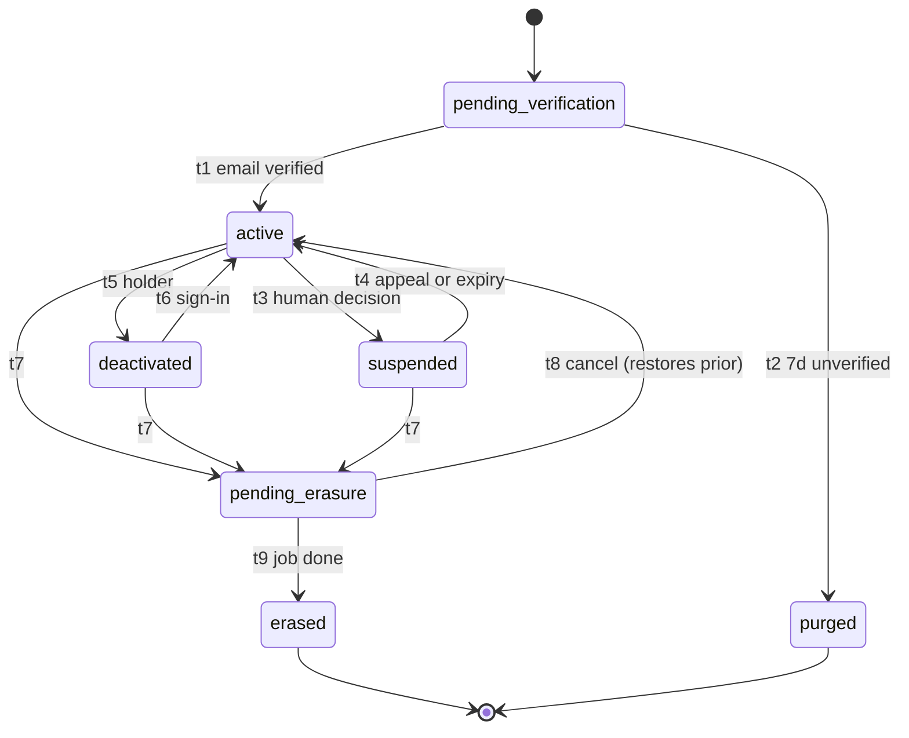

---

## SM-SESSION (DOM-01) — session = refresh-token family

| State | Meaning |
|---|---|
| `active` | Family has a current refresh token (generation g) |
| `expired` | Idle or absolute timeout reached |
| `revoked` | Ended by holder, security event, admin, or account state; `reason` ∈ {logout, device_revoke, password_change, reuse_detected, admin, account_state} |

| t | From → To | Trigger / actor | Guard | Side effects |
|---|---|---|---|---|
| t1 | (none) → active | successful authentication (C) | credentials/passkey valid; account `active` | cookie set; generation 1; `session.created` |
| t2 | active → active | refresh (C) | presented token = generation g (or g−1 within 5 s leeway and successor unused) | issue g+1; invalidate g; extend idle window |
| t3 | active → expired | idle 14 d or absolute 30 d (S/lazy) | **[OPEN]** defaults; privileged roles: idle 30 min, absolute 8 h | none |
| t4 | active → revoked(reuse_detected) | refresh token g−k presented outside leeway | whole family | revoke family; notify holder; security audit (BR-T050) |
| t5 | active → revoked(logout / device_revoke / password_change) | holder (C) | re-auth for "all devices" | cookie cleared |
| t6 | active → revoked(account_state / admin) | system / H | account suspended, deactivated, pending_erasure, or admin action | audit |

**Forbidden:** revoked → active; expired → active (must re-authenticate); refresh when account ≠ active.
**Retry:** refresh is safe to retry within leeway (returns same successor once). **Recovery:** after reuse_detected the holder must sign in again; passkey or password + email notice.

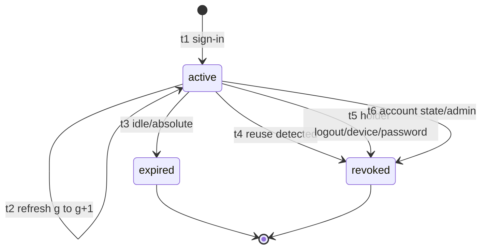

---

## SM-EVIDENCE (DOM-05) — owned by `api/evidence`

Two axes: **lifecycle state** (this SM) and **rung** ∈ {claimed, artifact_backed, peer_attested, authority_verified} (ADR-T14) which is *derived* from still-valid provenance records and changes only server-side (INV-T04).

| State | Meaning |
|---|---|
| `draft` | Owner-only, not counted |
| `pending_scan` | Artefact uploaded, awaiting virus scan; not visible (BR-T003) |
| `active` | Counted and shareable within consent; carries rung |
| `quarantined` | Scan failed; owner-only, removable |
| `under_review` | Disputed/flagged; remains visible with marker; human decides |
| `revoked` | Terminal; reason code; excluded from everything |
| `withdrawn` | Terminal; owner removed |
| `expired` | Terminal; time-limited credential lapsed (Ph3) |
| `erased` | Terminal; DSR |

| t | From → To | Trigger / actor | Guard | Side effects |
|---|---|---|---|---|
| t1 | draft → pending_scan | owner submits with artefact (C) | file allowlist/size ok | scan job enqueued |
| t2 | draft → active (rung=claimed) | owner submits claim without artefact (C) | min fields + ≥1 canonical skill | `evidence.created` |
| t3 | pending_scan → active (rung=artifact_backed) | scan clean (S) | scan verdict clean | `evidence.created` |
| t4 | pending_scan → quarantined | scan positive (S) | — | notify owner (neutral wording) |
| t5 | quarantined → withdrawn | owner (C) | — | delete blob |
| t6 | active → under_review | report/dispute opened (R/S flag) | case created | marker shown; no auto-action (INV-T09/T20) |
| t7 | under_review → active | dismissed (H) | — | clear marker |
| t8 | under_review / active → revoked | issuer or moderator (H) | reason code | `evidence.revoked`; recompute (BR-T005); notify holder with appeal path |
| t9 | active → withdrawn | owner (C) | — | recipients lose live access; submitted-application snapshots keep a redacted tombstone (FEAT-10-14) |
| t10 | active → expired | expiry date (S) | credential has `expires_at` | notify 30 d prior |
| t11 | any non-terminal → erased | DSR (S) | SM-DSR t-erase | blob + metadata removed |

**Rung changes (inside `active`):** claimed → artifact_backed (t3 or link liveness pass); artifact_backed → peer_attested (≥1 valid attestation, FEAT-05-03/06-03); {artifact_backed, peer_attested} → authority_verified (issuer verification: platform course, auto-graded assessment, institution, employer-verified); platform issuers may create directly at authority_verified. **Downgrade** only by recompute when a supporting provenance record is revoked/expired (audited). Nothing may set rung from client input or from `source=ai` (INV-T08).
**Forbidden:** terminal → any; draft → under_review; revoked → active (reinstatement = new item with `supersedes`); active → pending_scan (new artefact = new version → new item version in `pending_scan`, old version stays active until clean).
**Expiry:** `draft` auto-deleted after 90 d. **Retry:** scan job per SM-BGJOB; after dead-letter evidence stays `pending_scan` and ops is alerted (never auto-clean).

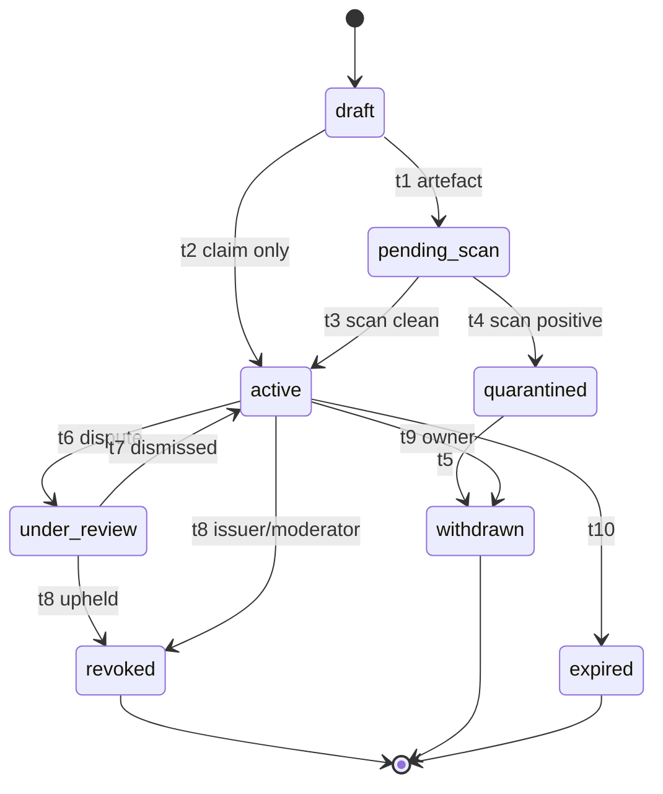

---

## SM-VERIFICATION (DOM-06) — verification request (all methods); the tables below specify the employer-domain proof-of-control path

The same states serve every `method` of `verification_request` (employer email, reference, issuer, runner, manual review). For methods other than employer email, `awaiting_proof` means "waiting for that method's proof" and t1/t3 read "request sent" / "authority or referee decision recorded".

| State | Meaning |
|---|---|
| `created` | Request drafted for one work claim |
| `awaiting_proof` | Code sent to an address on the claimed employer's domain |
| `verified` | Control of an employer-domain mailbox proven (rung effect per DT-06) |
| `failed` | Attempts exhausted, or an authority rejected the request; `reason` ∈ {attempts_exhausted, authority_rejected} |
| `expired` | Request window passed |
| `cancelled` | Candidate cancelled |
| `revoked` | Terminal after verified; set by human on dispute or fraud finding |

| t | From → To | Trigger / actor | Guard | Side effects |
|---|---|---|---|---|
| t1 | created → awaiting_proof | candidate supplies employer-domain address (C) | domain not free-mail; rate limits (≤ 3 requests / 24 h per claim) | code (6+ digits) hashed, TTL 15 min, emailed |
| t2 | awaiting_proof → awaiting_proof | resend (C) | ≤ 3 resends/h; new code invalidates old | — |
| t3 | awaiting_proof → verified | correct code (C) | attempts ≤ 5, TTL ok, bound to this request | `verification.completed`; provenance record |
| t4 | awaiting_proof → failed | 5th wrong attempt (S) | — | lock 1 h for that claim |
| t5 | awaiting_proof → expired | request age > 24 h (S) | — | — |
| t6 | created / awaiting_proof → cancelled | candidate (C) | — | — |
| t7 | verified → revoked | human decision (H) | dispute/fraud case | provenance invalidated; recompute |

**Forbidden:** verified → awaiting_proof (re-verification = new request); failed/expired → verified; code returned to caller or logged (INV-T05).
**Recovery:** failed/expired → candidate starts a new request (t1 on a fresh request) after cool-down 1 h.

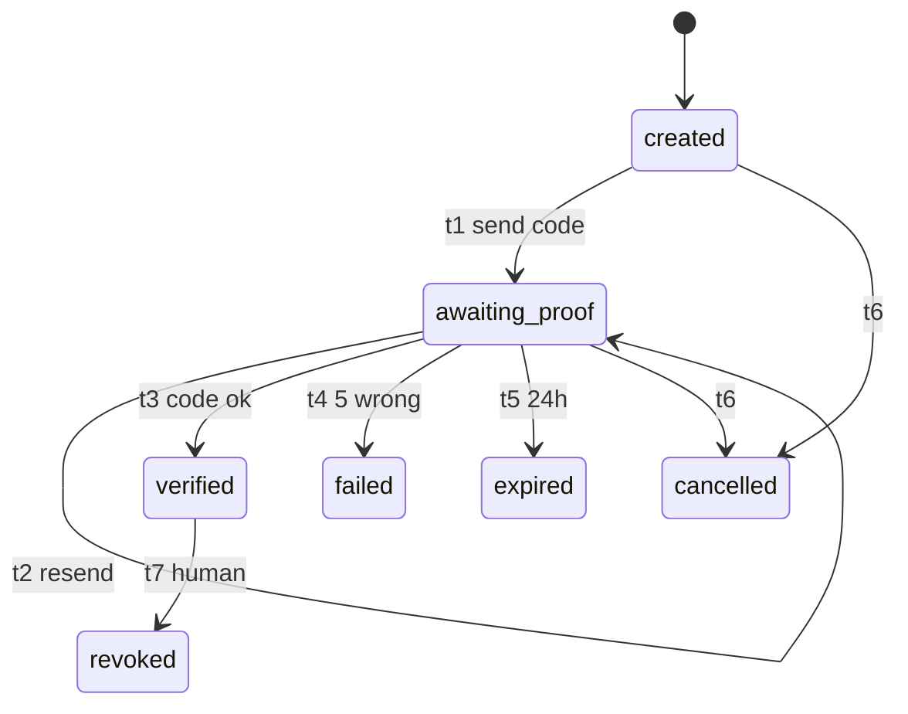

---

## SM-REFERENCE (DOM-06) — referee request (token, no account)

| State | Meaning |
|---|---|
| `queued` | Created, email not yet sent |
| `sent` | Token email delivered to provider |
| `opened` | Referee opened the link (no answer yet) |
| `submitted` | Referee answered; `outcome` ∈ {confirm, dispute, decline, unknown_candidate} |
| `expired` | 14 days elapsed (BR-T004) |
| `cancelled` | Candidate cancelled |
| `bounced` | Hard bounce / invalid address |

| t | From → To | Trigger / actor | Guard | Side effects |
|---|---|---|---|---|
| t1 | queued → sent | worker (S) | token hashed at rest, TTL 14 d, bound to (request, referee email) | email; `reference.requested` |
| t2 | sent → opened | link visited (S) | token valid, unexpired | record open (no PII beyond IP hash) |
| t3 | sent / opened → submitted | referee submits (referee) | token unused; form valid; referee ≠ candidate email/account | consume token (single-use); outcome → DT-04; `verification.completed` |
| t4 | sent / opened → expired | day 14 (S) | — | token dead; candidate told; may re-request |
| t5 | queued / sent / opened → cancelled | candidate (C) | — | token dead |
| t6 | queued / sent → bounced | provider webhook (S) | hard bounce | candidate told to fix address |
| (n/a) | reminders | S | day 4 and day 9, max 2, only while `sent`/`opened` | `reference.reminded` |

**Forbidden:** submitted → any (corrections go through FEAT-06-05 dispute); expired/cancelled/bounced → submitted; token reuse; response before `sent`.
**Concurrency:** two simultaneous submits with the same token → one wins by single-use consume (row lock); loser sees "already answered".
**Recovery:** candidate may issue a **new** request (new token) for the same claim, max 3 open referee requests per claim.

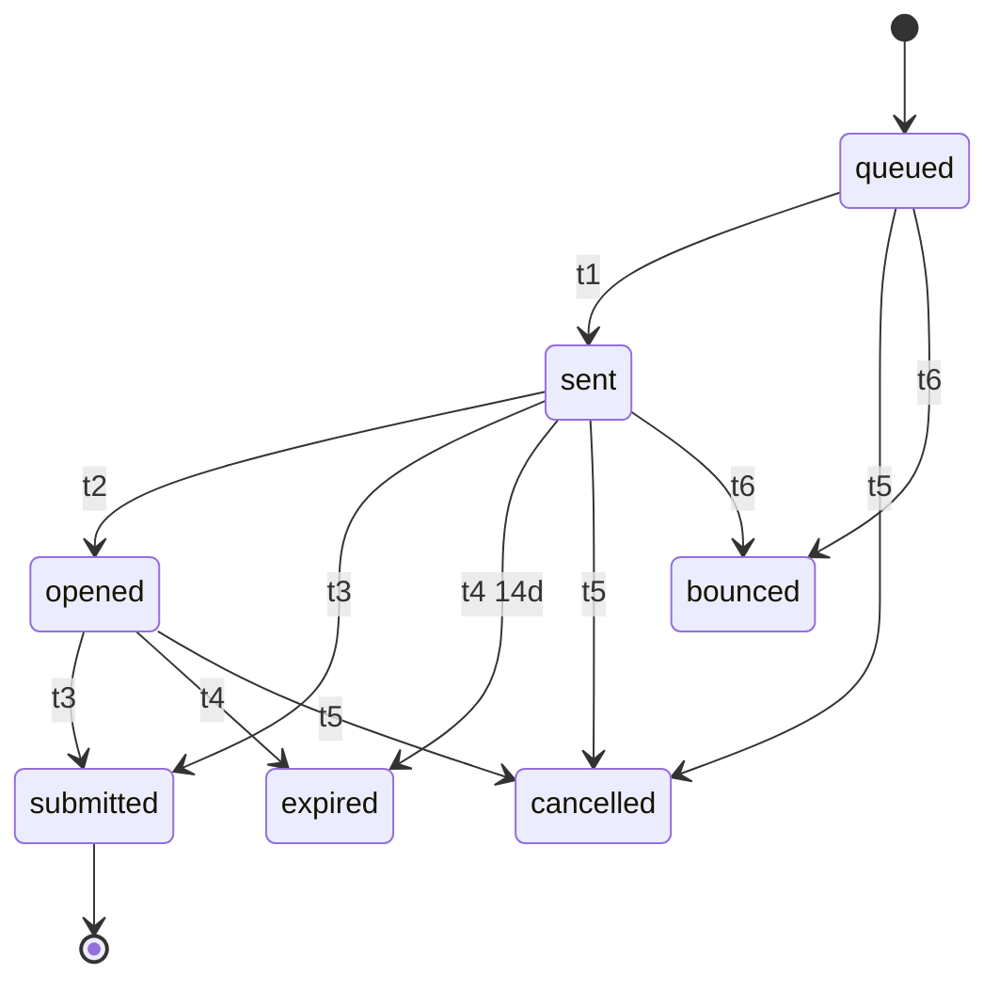

---

## SM-ATTEMPT (DOM-07) — assessment attempt

| State | Meaning |
|---|---|
| `created` | Reserved, not started |
| `in_progress` | Timer running (server clock) |
| `submitted` | Answers frozen; may be `auto_submitted` at deadline |
| `grading` | Auto-grade or runner/human grading in flight |
| `passed` / `failed` | Graded outcome |
| `unverified` | Could not be graded honestly (no runner / runner outage); never mints verified evidence (ADR-T13) |
| `under_review` | Integrity or grading appeal under human review |
| `voided` | Human-confirmed violation; terminal |
| `expired` | Never started within 24 h or abandoned untimed attempt (no heartbeat 24 h) |

| t | From → To | Trigger / actor | Guard | Side effects |
|---|---|---|---|---|
| t1 | created → in_progress | start (C) | cooldown/attempt cap ok (BR); entitlement ok | timer start; AI policy bound (AI_PROHIBITED if set) |
| t2 | in_progress → submitted | submit (C) or deadline (S) | deadline not exceeded for manual submit | freeze answers; `attempt.submitted` |
| t3 | submitted → grading | auto (S) | — | enqueue grading |
| t4 | grading → passed / failed | result (S, or H for manual) | score ≥ threshold for pass | if passed and auto-gradable: mint evidence at authority_verified (FEAT-07-06) |
| t5 | submitted / grading → unverified | code attempt with no runner, or grading dead-letter (S) | reason code | **no** evidence minted; candidate informed honestly |
| t6 | unverified → grading | re-grade when runner exists (S) | ≤ 30 d old; snapshot immutable | normal grading |
| t7 | passed / failed / unverified → under_review | integrity flag (S flags, H opens) or candidate appeal (C) | case opened | linked evidence → `under_review` (SM-EVIDENCE t6) |
| t8 | under_review → passed / failed / unverified | reviewer clears or corrects (H) | reason | evidence restored/updated |
| t9 | under_review → voided | reviewer confirms violation (H) | reason + evidence | linked evidence revoked (t8 of SM-EVIDENCE); notify with appeal |
| t10 | created / in_progress → expired | timers (S) | per above | release attempt slot (counts toward cap) |

**Forbidden:** unverified → passed (must pass through grading); passed ↔ failed directly; any change after `voided`; submit after deadline (late answers rejected, last autosave used).
**Retry:** grading job via SM-BGJOB, max 3 attempts; then t5. **Recovery:** refresh/reload during `in_progress` resumes with server timer; offline autosave replays idempotently (FEAT-07-02.1).

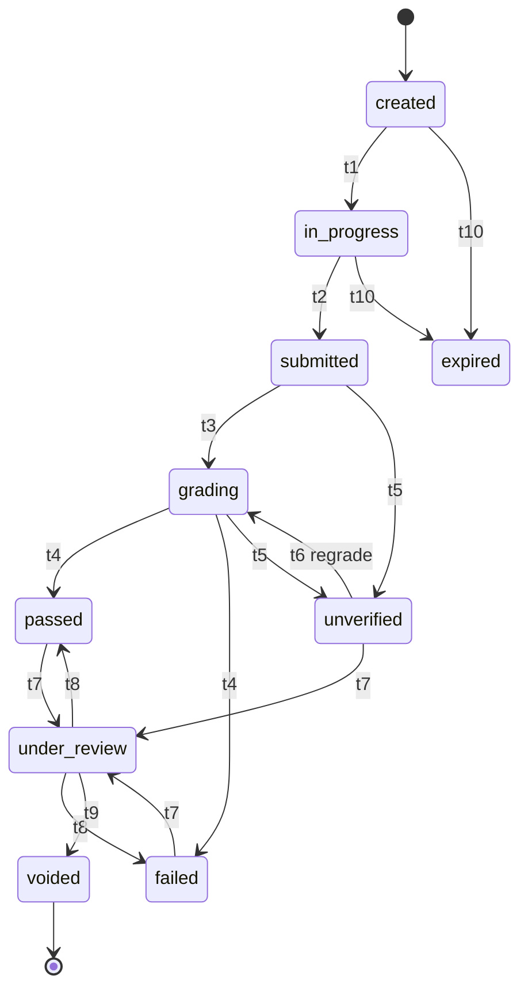

---

## SM-ENROLMENT (DOM-08)

| State | Meaning |
|---|---|
| `pending_payment` | Paid course; awaiting confirmed payment |
| `active` | Learning; progress counts |
| `completed` | Completion rule met; evidence minted |
| `dropped` | Learner left (progress kept 90 d) |
| `expired` | Checkout never confirmed (24 h) |
| `refunded` | Money returned per policy [OPEN-06] |
| `suspended` | Learner sanctioned or course taken down |

| t | From → To | Trigger / actor | Guard | Side effects |
|---|---|---|---|---|
| t1 | (none) → active | enrol free course (C) | prerequisites met; not already enrolled (idempotent) | `enrolment.created` |
| t2 | (none) → pending_payment | enrol paid course (C) | as above | checkout session (FEAT-16-09) |
| t3 | pending_payment → active | `entitlement.changed` from verified webhook (S) | payment confirmed (INV-T17) | access granted |
| t4 | pending_payment → expired | 24 h (S) | no payment | — |
| t5 | active → completed | completion rule satisfied (S) | all required lessons + passing assessments | `course.completed` → evidence (FEAT-08-04) |
| t6 | active → dropped | learner (C) | — | — |
| t7 | dropped → active | re-enrol (C) | within 90 d | progress restored |
| t8 | active → refunded | billing refund (S/H) | policy window [OPEN-06] | access removed |
| t9 | completed → refunded | exceptional refund (H) | support/admin only | linked evidence revoked via issuer (H) |
| t10 | active ↔ suspended | takedown/sanction (H) | case | access paused/restored |

**Forbidden:** completed → active/dropped; refunded → any; expired → active (new enrolment); completion without server-verified rule.
**Recovery:** progress writes are idempotent on (enrolment, lesson, version); offline progress is revalidated server-side (INV-T13).

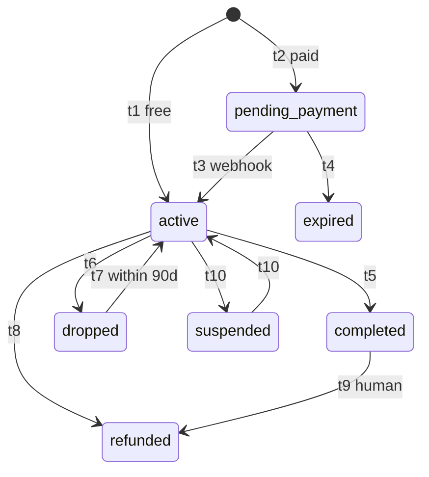

---

## SM-JOB (DOM-09)

| State | Meaning |
|---|---|
| `draft` | Editable by hiring team |
| `pending_review` | Awaiting approver or moderation pre-check |
| `scheduled` | Will publish at `publish_at` |
| `published` | Visible, accepts applications |
| `paused` | Hidden from search; existing applications continue |
| `closed` | Terminal; reason ∈ {filled, expired, cancelled} |
| `taken_down` | Hidden by a human moderator; owner notified with appeal |

| t | From → To | Trigger / actor | Guard | Side effects |
|---|---|---|---|---|
| t1 | draft → published | publish (R) | validation passes; entitlement (job slot) ok (INV-T17 derived); pre-check clean; org verified | index; `job.published` |
| t2 | draft → pending_review | publish (R) | approver required by org policy or pre-check flagged | notify approver/moderator |
| t3 | pending_review → published | approve (H) | approver ≠ author when policy demands | as t1 |
| t4 | pending_review → draft | changes requested (H) | reason | notify author |
| t5 | draft → scheduled | schedule (R) | `publish_at` future ≤ 30 d | — |
| t6 | scheduled → published | time (S) | re-check entitlement + validation at execution (U7) | as t1; on failure → draft + notify |
| t7 | published ↔ paused | recruiter (R) | — | de/re-index |
| t8 | published / paused → closed | recruiter (R) or expiry 45 d default (S) | **[OPEN]** expiry length | de-index; notify open applicants if closed unfilled |
| t9 | published / paused → taken_down | moderator (H) | case id | de-index; notice with appeal (FEAT-19-03) |
| t10 | taken_down → published / closed | appeal outcome (H) | — | re-index or close |

**Forbidden:** closed → any (use *clone* = new draft with `cloned_from`); draft → paused/closed (discard instead); published → draft (edit-in-place of safe fields only; material change creates a revision note, not a state change).
**Concurrency:** publish with the last free job slot by two recruiters → slot reservation row-lock; loser gets `entitlement_exhausted`.

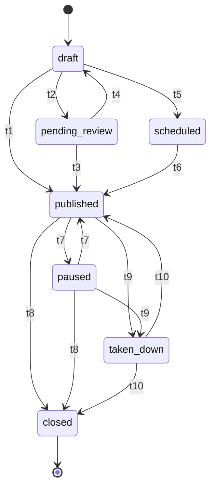

---

## SM-APPLICATION (DOM-10) — canonical states; org stages map onto them (BR-T002)

| State | Meaning | Active? |
|---|---|---|
| `draft` | Candidate-only; stored in `application_draft`, not in `application.state` (see Vocabulary authority). Discarding a draft (t9) leaves no `application` row | yes (counts for BR-T001) |
| `submitted` | Received; evidence snapshot frozen (FEAT-10-14) | yes |
| `in_review` | Hiring team screening | yes |
| `shortlisted` | Candidate selected for next steps | yes |
| `interviewing` | ≥1 interview proposed/scheduled | yes |
| `offer_extended` | Offer recorded | yes |
| `hired` | Terminal | no |
| `rejected` | Terminal; human-decided | no |
| `withdrawn` | Terminal; candidate-decided | no |
| `offer_declined` | Terminal; candidate declined offer | no |

| t | From → To | Trigger / actor | Guard | Side effects |
|---|---|---|---|---|
| t1 | draft → submitted | submit (C) | job `published`; no other active application for (candidate, job) (BR-T001); required fields; consent scope chosen | snapshot; `application.submitted`; receipt |
| t2 | submitted → in_review | first hiring-team open or assignment (S/R) | actor in job's hiring team | candidate sees "in review" |
| t3 | in_review → shortlisted | stage move (R) | `If-Match` version | `application.stage.changed` |
| t4 | shortlisted → interviewing | interview proposed (R) | ≥1 interview in `proposed`/`scheduled` | — |
| t5 | interviewing → offer_extended | record offer (R) | HM or recruiter with offer permission | notify candidate |
| t6 | offer_extended → hired | candidate accepted / recruiter records (R) | offer accepted | `application.hired`; Grow handoff (FEAT-10-15) |
| t7 | offer_extended → offer_declined | candidate (C) | — | notify team |
| t8 | {submitted, in_review, shortlisted, interviewing, offer_extended} → rejected | decision (H) | two-step confirm; reason code; actor human (INV-T09) | candidate notified; optional feedback; `application.stage.changed` |
| t9 | {draft, submitted, in_review, shortlisted, interviewing, offer_extended} → withdrawn | candidate (C) | — | cancel open interviews; notify team. From `draft`: delete the `application_draft` row, audit event only, no `application` row |
| t10 | shortlisted → in_review; interviewing → shortlisted; offer_extended → interviewing (offer withdrawn) | stage correction (R) | reason required; `in_review → submitted` and other backward moves are not allowed | audit entry |
| t11 | in_review → interviewing; shortlisted → offer_extended (forward skips) | stage move (R) | allowed only for these two skips; **never** to `hired` without `offer_extended` | `application.stage.changed` |

**Forbidden:** terminal → any (reconsideration = recruiter invites candidate to apply again; new application with `reconsidered_from`); draft → anything except submitted/withdrawn; any → hired except from offer_extended; any → rejected by system/AI/score (U6); changing candidate-supplied answers after submit.
**Stale handling:** no recruiter action for 45 d sets `stale=true` and prompts the team and the candidate; **never** an automatic transition (INV-T09).
**Job interplay:** job `closed`/`taken_down` does not alter application state; `draft` applications on a closed job are discarded after 7 d with notice.
**Concurrency:** idempotent submit key `(candidate, job)` + partial unique index on active states; two concurrent stage moves → one wins by version; loser reloads.

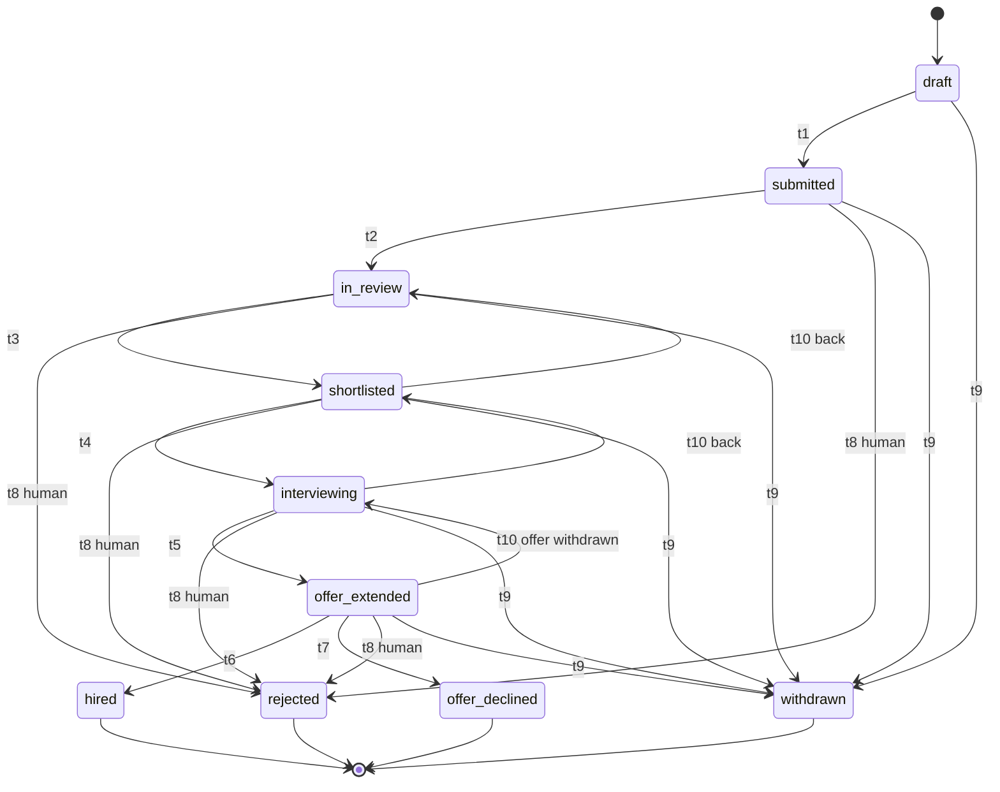

---

## SM-INTERVIEW (DOM-10)

| State | Meaning |
|---|---|
| `proposed` | Slots offered to candidate |
| `scheduled` | One slot confirmed by both sides |
| `completed` | Took place |
| `cancelled` | Cancelled with reason by either side |
| `rescheduled` | Superseded by a new interview record |
| `no_show` | Human-marked; `party` ∈ {candidate, interviewer} |
| `expired` | No slot chosen in time |

| t | From → To | Trigger / actor | Guard | Side effects |
|---|---|---|---|---|
| t1 | (none) → proposed | recruiter proposes 1–5 slots (R) | application ∈ {in_review, shortlisted, interviewing}; interviewer free (no overlap) | notify; hold slots 72 h |
| t2 | proposed → scheduled | candidate selects slot (C) | slot still free (row lock) | ICS to both; reminders at 24 h and 1 h |
| t3 | proposed → expired | 72 h without choice (S) | — | notify recruiter |
| t4 | scheduled → rescheduled | either party requests, other accepts (R/C) | ≥ 2 h before start | creates new `proposed` linked by `reschedule_of` |
| t5 | scheduled / proposed → cancelled | either party (R/C) | reason code | cancel ICS; notify |
| t6 | scheduled → completed | end time + marker or +24 h (S) | not marked no_show | prompts scorecard (FEAT-10-08) |
| t7 | scheduled → no_show | marked after start time (H) | within 48 h; evidence of absence not required but reason logged | candidate may contest (FEAT-19-06) |

**Forbidden:** completed/cancelled/rescheduled/no_show/expired → any; scheduling overlapping interviewer slots; scheduling in the past; scheduling when application is terminal.
**Timezone:** stored UTC + IANA zone; display local to viewer.

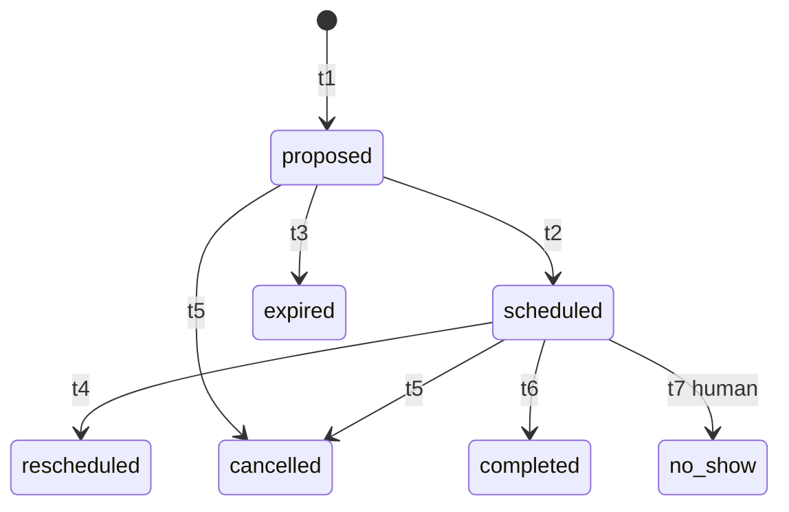

---

## SM-SUBSCRIPTION (DOM-16) — driven only by verified webhooks (INV-T17)

Vocabulary mirrors Stripe subscription statuses **[REF: Stripe docs; re-verify at build time — OPEN]**, with two deliberate differences: `canceling` is added (Stripe `active` + `cancel_at_period_end`), and Stripe `trialing` / `paused` are **not** states (no trial or pause exists in the product; an event carrying them is ignored, logged and alerted, and grants no entitlement). The processor spelling `canceled` is kept for this machine only.

| State | Entitlement derived (DT-02) |
|---|---|
| `incomplete` | none (free tier) |
| `active` | full plan |
| `canceling` | full plan until `current_period_end`, then → canceled |
| `past_due` | full during 7-day grace, then degraded (read-only on paid features) |
| `unpaid` | free tier; data retained |
| `canceled` | free tier; data retained |
| `incomplete_expired` | none; terminal |

| t | From → To | Trigger (signed webhook) | Guard | Side effects |
|---|---|---|---|---|
| t1 | (none) → incomplete | checkout session completed, first invoice open | event verified + deduped | — |
| t2 | incomplete → active | invoice paid | — | `entitlement.changed` |
| t3 | incomplete → incomplete_expired | 23 h without payment | — | — |
| t4 | active → past_due | invoice payment failed | — | dunning schedule (FEAT-16-07); notify |
| t5 | past_due → active | invoice paid | — | clear grace |
| t6 | past_due → unpaid | retries exhausted / grace over | — | degrade |
| t7 | unpaid → active | invoice paid | — | restore |
| t8 | active → canceling | cancel at period end set | — | notify |
| t9 | canceling → active | cancellation reverted | — | — |
| t10 | canceling / unpaid / past_due → canceled | period end or immediate cancel | — | free tier; seats unassigned (kept as records) |

**Forbidden:** any transition from the browser/redirect (INV-T17); canceled → active (new subscription); applying an event older than the stored object version (out-of-order → ignore + log).
**Retry:** webhook handler idempotent by event id; processor retries respected; dead-letter after 5 failures → alert. **Recovery:** reconcile job compares local state with processor daily and reports drift (never silently overwrites without audit).

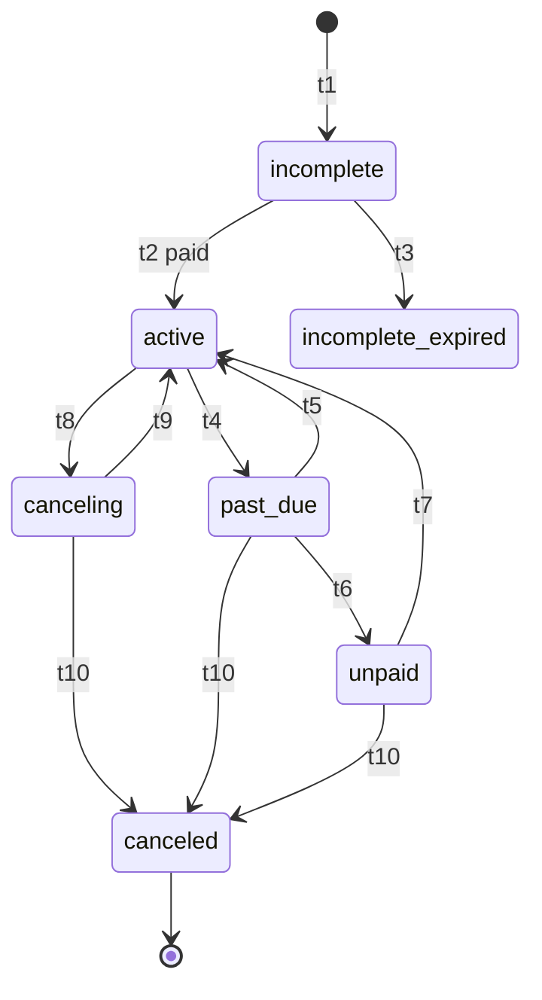

---

## SM-DSR (DOM-22) — data-rights request (`kind` ∈ access, export, erasure, rectification, restriction, objection, human_review)

One machine for every kind, stored in `data_rights_request.state`. Only `erasure` passes through `cooling_off`; other kinds go `verifying → in_progress` (t3). There is no separate erasure state machine.

| State | Meaning |
|---|---|
| `received` | Logged; type set |
| `verifying` | Re-authentication/identity confirmation |
| `cooling_off` | Erasure only: 7-day cancel window |
| `in_progress` | Export build, erasure fan-out, or change applied step-wise |
| `on_hold` | Legal hold or dispute prevents completion [OPEN-08] |
| `completed` | Fulfilled in full |
| `completed_with_retention` | Erasure done except legally retained records (listed in receipt) |
| `rejected` | Not fulfilled with stated reason (e.g. cannot verify identity) |
| `cancelled` | Requester cancelled |
| `failed` | Retries exhausted; ops escalation; request deadline still running |

| t | From → To | Trigger / actor | Guard | Side effects |
|---|---|---|---|---|
| t1 | (none) → received | request (C) / org admin assist (R) / support assist (H) | requester is the data subject or authorised | acknowledge; deadline clock starts |
| t2 | received → verifying | auto (S) | — | re-auth challenge |
| t3 | verifying → in_progress (every kind except erasure) | verified (C) | recent strong auth | enqueue job |
| t4 | verifying → cooling_off (erasure) | verified (C) | no active legal hold | account → `pending_erasure` (SM-ACCOUNT t7) |
| t5 | cooling_off → in_progress | 7 days elapsed (S) | not cancelled | fan-out erase |
| t6 | in_progress → completed / completed_with_retention | all stores done (S) | checkpoint complete; for erasure also `subject_identity_map` row deleted and sweep clean (INV-T38; history rows are not rewritten) | receipt; `erasure.completed` / `export.ready` |
| t7 | received / verifying / in_progress → on_hold ↔ in_progress | legal hold set/cleared (H) | reason | notify requester that a hold applies (reason category only) |
| t8 | verifying → rejected | verification failed 3× or not authorised (S/H) | — | notify |
| t9 | received / verifying / cooling_off → cancelled | requester (C) | — | account restored if pending |
| t10 | in_progress → failed → in_progress | retries exhausted → manual replay (H) | audited | — |

**Deadlines:** erasure ≤ 30 days from `received` (BR-T060); export target ≤ 72 h, max 30 days **[OPEN-08 legal confirmation]**.
**Forbidden:** erasure `in_progress` → cancelled (irreversible once started); rejected → in_progress (new request); any → completed without checkpoint evidence.
**Idempotency:** one open request per (subject, type); a duplicate returns the open one.
**Erasure and history (REVW-04):** erasure never UPDATEs append-only tables. Audit, consent, evidence-event and stage-transition rows hold an opaque `subject_ref`; the erasure fan-out ends by deleting the `subject_identity_map` row (and per-subject key), then the sweep runs. `completed` requires the audit and consent anchors that cover the subject's rows to still verify (TEST-PRV-009). Which history skeletons may be kept, and for how long, goes on the receipt as retained records and stays [OPEN-08].

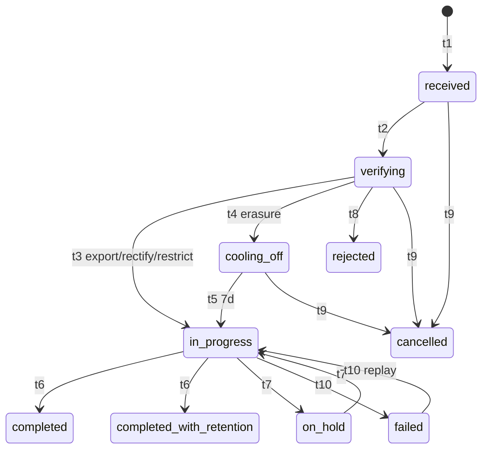

---

## SM-MODCASE (DOM-19) — moderation case

| State | Meaning |
|---|---|
| `open` | Report(s) received |
| `triaged` | Priority and queue set |
| `in_review` | Moderator working |
| `awaiting_info` | Requested info from reporter/subject; SLA paused |
| `actioned` | Human decision recorded (`outcome` ∈ {no_action, warned, content_removed, suspended, restored}) |
| `appealed` | Subject appealed within 30 d |
| `closed` | Terminal; `appeal_outcome` ∈ {none, upheld, overturned} |

| t | From → To | Trigger / actor | Guard | Side effects |
|---|---|---|---|---|
| t1 | (none) → open | report or system flag (C/S) | dedupe by (target, category) merges into existing open case | ack to reporter |
| t2 | open → triaged | auto rules or moderator (S/H) | flags may set priority; never action | SLA timer |
| t3 | triaged → in_review | moderator claims (H) | role MOD | lock to reviewer |
| t4 | in_review ↔ awaiting_info | moderator (H) | reason | notify |
| t5 | in_review → actioned | decision (H) | reasoned outcome; two-person check for `suspended` | effect applied (e.g. evidence revoked, job taken down, account suspended); notice to subject |
| t6 | actioned → appealed | subject (C/R) | ≤ 30 d | assign **different** reviewer |
| t7 | appealed → closed (upheld / overturned) | reviewer (H) | — | overturned → reverse effect (restore) |
| t8 | actioned → closed | 30 d without appeal (S) | — | — |

**Forbidden:** automation moving a case to `actioned`; same reviewer deciding the appeal; closed → any; actioned → in_review (use appeal).
**SLA (defaults [OPEN]):** triage ≤ 1 business day; decision ≤ 5 business days; safety-critical (scam, harassment) ≤ 4 h business hours.

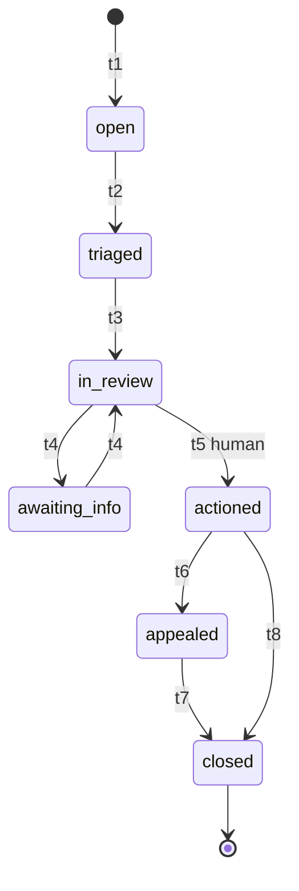

---

## SM-NOTIFY (DOM-15) — one delivery (notification × channel)

| State | Meaning |
|---|---|
| `queued` | Created, not yet routed |
| `suppressed` | Dropped by preference, suppression list, or dedupe (reason logged) |
| `deferred` | Held for quiet hours or digest window |
| `sending` | Handed to provider |
| `sent` | Provider accepted |
| `delivered` | Provider confirmed (email) / inbox row visible (in-app) / push acknowledged |
| `failed_retry` | Transient failure; backoff scheduled |
| `failed` | Permanent failure or retries exhausted |
| `bounced` | Hard bounce → address added to suppression |
| `complained` | Spam complaint → marketing category suppressed |
| `expired` | TTL passed before sending |

| t | From → To | Trigger | Guard |
|---|---|---|---|
| t1 | queued → suppressed | route check (S) | pref off (non-mandatory), suppression list, duplicate within window |
| t2 | queued → deferred | quiet hours or digest (S) | category not time-critical; mandatory security mail ignores quiet hours |
| t3 | deferred → sending | window end (S) | re-check TTL, prefs |
| t4 | queued → sending | immediate (S) | — |
| t5 | sending → sent → delivered | provider response / webhook | — |
| t6 | sending → failed_retry | 5xx/timeout (S) | attempts < 5; backoff 1 m, 5 m, 30 m, 2 h, 12 h |
| t7 | failed_retry → sending | timer | — |
| t8 | sending / failed_retry → failed | 4xx permanent or 5 attempts | dead-letter; ops metric |
| t9 | sent → bounced / complained | provider webhook | suppression updated |
| t10 | queued / deferred / failed_retry → expired | TTL (72 h time-sensitive; 7 d others) | — |

**Forbidden:** sending to a suppressed address; re-sending after `bounced` without address change; any transition out of terminal states.
**Idempotency:** delivery key `(notification_id, channel)`; duplicates collapse (at-least-once dispatcher, consumer dedupe — ADR-T09).

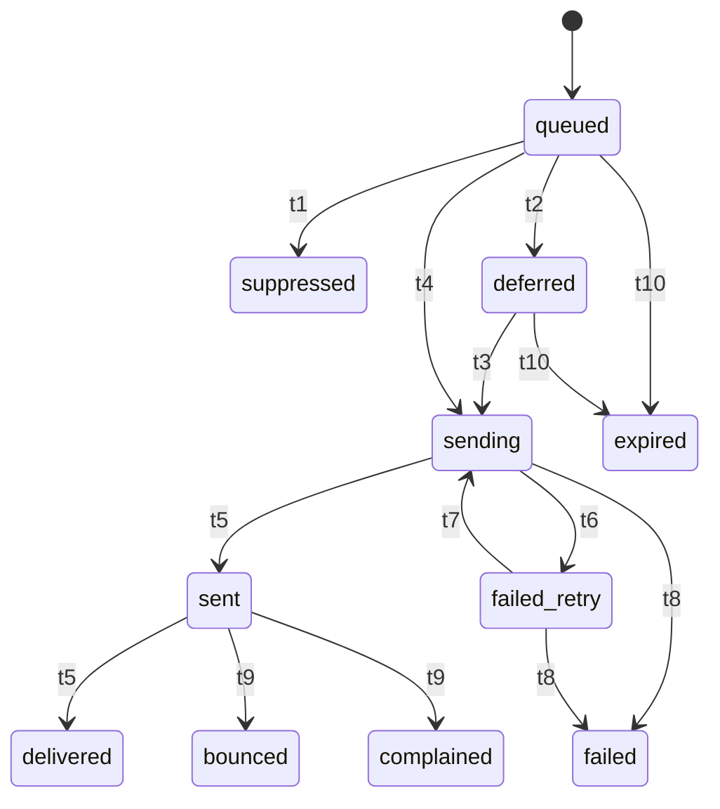

---

## SM-BGJOB (DOM-24) — background job with fenced lease (ADR-T09)

| State | Meaning |
|---|---|
| `queued` | Ready at `run_at` |
| `claimed` | Leased to one worker with `generation g`; lease TTL 60 s with heartbeat |
| `running` | Handler executing |
| `retry_wait` | Failed; waiting backoff |
| `succeeded` | Terminal |
| `dead` | Max attempts (6) exhausted |
| `cancelled` | Terminal; superseded or manually cancelled |

| t | From → To | Trigger | Guard / notes |
|---|---|---|---|
| t1 | queued → claimed | worker `FOR UPDATE SKIP LOCKED` | sets `generation = generation + 1`, `lease_until` |
| t2 | claimed → running | handler start | — |
| t3 | running → succeeded | handler ok | write is **fenced**: `WHERE id=? AND generation=?`; zero rows ⇒ stale worker must discard its result |
| t4 | running → retry_wait | handler error | attempts < 6; exponential backoff base 30 s ×2^n + jitter, cap 1 h |
| t5 | retry_wait → queued | timer | — |
| t6 | claimed / running → queued | lease expired (reaper) | `generation` bumped on next claim; counts as an attempt |
| t7 | retry_wait / running → dead | attempts exhausted | alert; payload retained |
| t8 | dead → queued | admin replay (H) | audited; attempts reset |
| t9 | queued / retry_wait → cancelled | superseding event or admin | — |

**Forbidden:** two active generations; completing with a stale generation; deleting `dead` jobs before 30 d.
**Handlers must be idempotent** (INV-T10): re-execution after t6 must be safe.

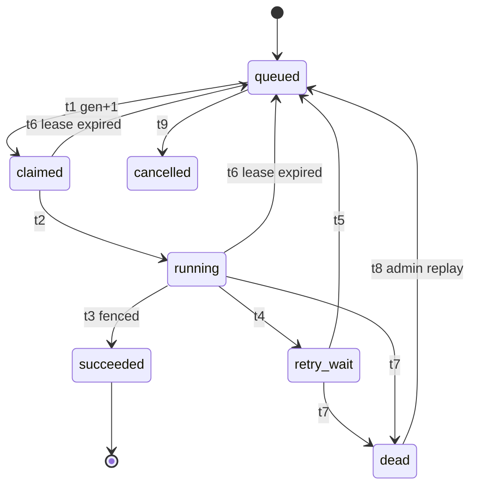

---

## Cross-machine dependencies

| Event in SM | Effect in another SM |
|---|---|
| SM-ACCOUNT t3 / t5 / t7 | SM-SESSION t6 (revoke all) |
| SM-ATTEMPT t4 (pass, auto-gradable) | SM-EVIDENCE creation at authority_verified |
| SM-ATTEMPT t9 (voided) | SM-EVIDENCE t8 (revoke) |
| SM-ENROLMENT t5 (completed) | SM-EVIDENCE creation |
| SM-REFERENCE t3 (submitted) | SM-EVIDENCE rung recompute (DT-04) |
| SM-VERIFICATION t3 (verified) | SM-EVIDENCE provenance + rung recompute (DT-06) |
| SM-EVIDENCE t8 (revoked) | skill confidence + match recompute (BR-T005) via SM-BGJOB |
| SM-SUBSCRIPTION t2/t6/t10 | entitlement cache invalidation → gates in SM-JOB t1, SM-ENROLMENT t3 |
| SM-MODCASE t5 | SM-JOB t9, SM-EVIDENCE t8, SM-ACCOUNT t3 (human-decided only) |
| SM-DSR t4 | SM-ACCOUNT t7 |
| SM-APPLICATION t1 | SM-BGJOB (notification, search/match refresh) |

## Test obligations (INV-T11)

For each SM generate: (1) one test per allowed transition; (2) one test per *forbidden* pair in the Cartesian product (state × event) expecting `409 invalid_transition`; (3) terminal-immutability property test; (4) concurrency test for each guard marked "row lock"/"version".
