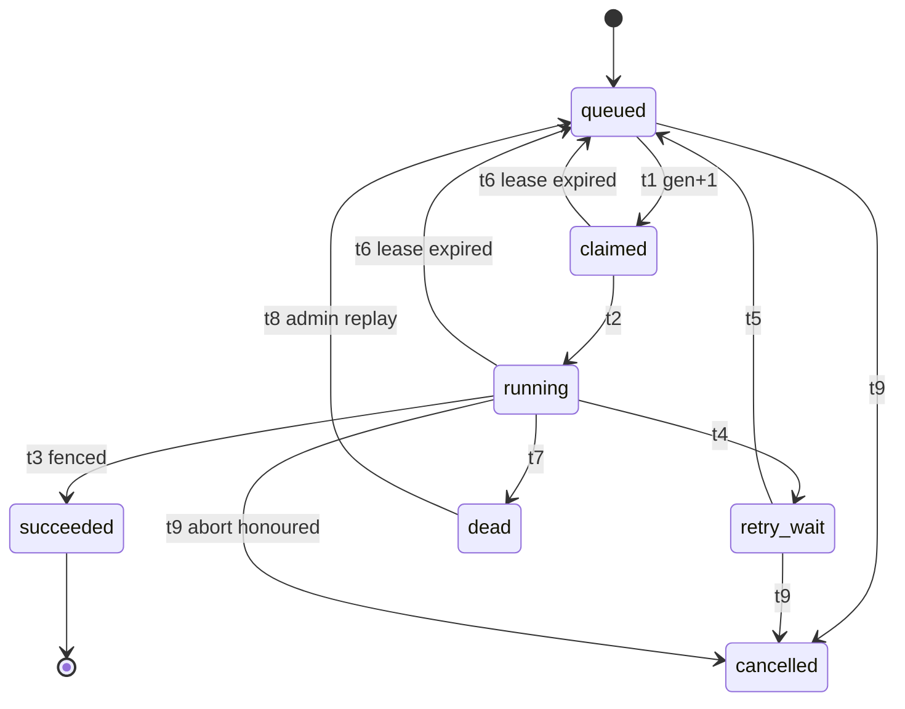

# State Machines, Revision 2 (SM-00 REV2)

Doc ID: SM-00-R2 · Owner: Domain Architect + Product Director · Version 2.0 · Status: Proposed (Under Review) · Date: 2026-10-25 · Closes: REVW-12, REVW-19, REVW-20, REVW-21, REVW-22, REVW-27 (state-machine parts) · Relates: SM-00, BR-REG-R2, INV-REG-R2, DT-00-R2, ADR-T14 (amendment ADR-T14a), ADR-T09

**Relationship (no original file was edited).** This file **supersedes, once accepted by governance**, these parts of `STATE_MACHINES.md` (SM-00 v1.1): the transition rows named in section 2 for SM-ACCOUNT, SM-EVIDENCE, SM-VERIFICATION, SM-REFERENCE, SM-APPLICATION, SM-DSR, SM-NOTIFY and SM-BGJOB; the paragraph that begins "Not covered by SM-00 (REVW-20, still open)"; and the cross-machine table (extended in section 5). Everything else in SM-00 stands, including U1 to U8, the Vocabulary authority rules, and all machines not named here. Until accepted, SM-00 v1.1 remains the text of record; where the two differ, this file states the intended change. Governance should link this file from `00_CONTROL_CENTRE/MASTER_INDEX.md`.

All content is **[TARGET]**. Nothing here claims anything is built. Items marked **[OPEN]** are product defaults awaiting an owner.

## 1. Summary of changes

| Finding | Change | Section |
|---|---|---|
| REVW-12 | Evidence `authority_verified` rung carries a mandatory `issuer_class`; instructor sign-off is a distinct, weaker class | 2.2 |
| REVW-19 | SM-BGJOB regenerated from BE-01 section 7 (attempt limits, backoff, error classes); SM-NOTIFY retry is the job retry, not a second layer | 2.7, 2.8 |
| REVW-20 | Nine machines added; justification list for entities without one; organization un-verification effects; archive semantics | 2.2, 3 |
| REVW-21 | Account: second-person guard on suspension; erasure blocked while a moderation case is open | 2.1, 2.6 |
| REVW-22 | Employer-domain proof splits into `bound` and `unbound`; only `bound` reaches `artifact_backed` | 2.3 |
| REVW-27 | Withdrawn application can be re-submitted as a new linked application after a cooldown | 2.5 |
| REVW-38 | One shared cap of two referee reminders | 2.4 |

## 2. Amended machines

Only changed rows are shown. Row identifiers (t1, t2, ...) are those of SM-00 v1.1.

### 2.1 SM-ACCOUNT (REVW-21)

| t | From → To | Trigger / actor | Guard (replaces v1.1 guard) | Side effects |
|---|---|---|---|---|
| t3 | active → suspended | moderation/admin decision (H) | case id + reason; **second-person approval recorded, approver ≠ decider** (BR-T045; the single-moderator emergency exception is reviewed within 24 h) | unchanged |
| t7 | active / deactivated / suspended → pending_erasure | erasure request verified (C) | identity re-verified; no open legal hold; **no open moderation case on the account**. A `suspended` account qualifies only once its case is `closed`. Until then the request is parked `on_hold` with reason `moderation_case_open` (SM-DSR t7) and the account is not moved | start cooling-off 7 days (SM-DSR) |

**Forbidden (adds to v1.1):** `suspended → pending_erasure` while a moderation case is open. `locked` is not a state; temporary sign-in lockout is `locked_until > now()` (Vocabulary authority, SM-00 v1.1), and the API 423 response is produced from that column.

### 2.2 SM-EVIDENCE (REVW-12, REVW-20)

Replaces the "Rung changes" paragraph; t8 side effects gain the credential link. All other rows and the diagram stand.

**Rung changes (inside `active`):** `claimed → artifact_backed` (t3, link liveness pass, or employer-domain proof for a **bound** domain, BR-T017); `artifact_backed → peer_attested` (at least one valid attestation, FEAT-05-03 or 06-03); `{artifact_backed, peer_attested} → authority_verified` (issuer verification; every authority record carries an `issuer_class`); issuers may create items directly at `authority_verified`. **Downgrade** only by recompute when a supporting provenance record is revoked or expires (audited). Nothing sets a rung from client input or `source=ai` (INV-T08).

**Issuer class (amends ADR-T14; proposed as ADR-T14a).** The ladder keeps four rungs. The `authority_verified` rung is split by a mandatory attribute, not by a fifth rung:

| `issuer_class` | Who issues | Independence rule | Matching weight (DT-03) |
|---|---|---|---|
| `platform` | Platform-run auto-graded assessment; platform-authored course rule | Platform is the issuer; no instructor sign-off involved | highest [OPEN-05 values] |
| `institution` | Verified institution (BR-T102) | Institution issues only for its own learners | high |
| `employer_org` | Verified employer organization (SM-ORG `verified`) | Org verified; confirming person is not the candidate | high |
| `instructor` | Instructor sign-off on a course (`instructorSignoff`) | BR-T119: instructor ≠ learner, no shared account, device or payment signal, issuer independence check | lowest of the four |

Rules: the class is set server-side from the issuing record and cannot come from client input (INV-T46). The UI always shows the class next to the badge. **Instructor sign-off never counts as platform-verified**, in the UI, in matching weights or in any "verified" filter (INV-T47). An `instructor` record is revocable by the issuer or a moderator (t8). A rung that rests only on `instructor` records reports `authority_verified` with class `instructor`.

**Archive and undo (REVW-20).** The UI "Archive ... Undo (8 s)" is a client-side delay: the withdraw request (t9) is dispatched after the 8-second window unless the user cancels. No "archived" state exists. After t9 commits there is no undo (`withdrawn` is terminal, U3); the UI offers "Create again from this", which creates a new `draft` item linked by `restored_from`.

| t | Change |
|---|---|
| t8 | Side effects add: linked credential moves to `revoked` (SM-CREDENTIAL t4) |

### 2.3 SM-VERIFICATION (REVW-22)

| Change | Text |
|---|---|
| State `verified` meaning | Control of an employer-domain mailbox proven. The provenance record is `bound` or `unbound`; the rung effect follows DT-06 (`artifact_backed` only when `bound`) |
| t3 side effects | `verification.completed`; provenance record with `domain_binding` ∈ {`bound`, `unbound`} computed at this instant (BR-T017) |

**Domain binding.** `bound` means the employer domain equals a verified `org_domain` (purpose `employer_email_match`; DNS TXT or registry match) of an organization whose `verification_state` is `verified` (SM-ORG). Anything else is `unbound`: the candidate controls a mailbox, which does not show the domain belongs to the claimed employer. An `unbound` result leaves the rung at `claimed` and shows the badge "Mailbox verified, employer not confirmed". A `bound` result reaches `artifact_backed` and shows "Mailbox verified". If the binding later lapses (organization un-verified or domain proof removed) the provenance record is invalidated and the rung recomputed (BR-T005, INV-T48).

### 2.4 SM-REFERENCE (REVW-38)

Replaces the "reminders" row. **One cap of 2 reminders per request, shared by system and manual reminders** (BR-T121). System reminders are due on day 4 and day 9. A manual reminder (ACT-VER-03) needs at least 3 days since the last send of any kind. A due system reminder that falls less than 3 days after the last send is deferred, not dropped, and is sent when 3 days have passed. Only while the request is `sent` or `opened`. Event: `reference.reminded`.

### 2.5 SM-APPLICATION (REVW-27)

Adds t12 and one sentence to "Forbidden".

| t | From → To | Trigger / actor | Guard | Side effects |
|---|---|---|---|---|
| t12 | (none) → draft (new `application_draft`, then t1) | candidate re-applies after withdrawing (C) | previous application for (candidate, job) is `withdrawn`; at least {24 h} since `withdrawn_at` **[OPEN]**; job `published`; no other active application (BR-T001). `rejected`, `hired` and `offer_declined` never qualify | new application carries `reapplied_from = <withdrawn application id>`; the hiring team sees the link and the withdrawal date; the earlier snapshot is not reused (a new snapshot is taken at t1); closes OPEN-B20 (BR-T125) |

**Forbidden (amends v1.1):** terminal → any, **except** the new linked application of t12 after `withdrawn`. Reconsideration after `rejected` remains a recruiter invitation with `reconsidered_from`.

### 2.6 SM-DSR (REVW-21)

| t | Change |
|---|---|
| t4 | Guard adds: no open moderation case on the account (otherwise t7) |
| t7 | From-set becomes `received / verifying / cooling_off / in_progress`; hold reason ∈ {`legal_hold`, `moderation_case_open`, `dispute`}. `moderation_case_open` clears when the case is `closed`, then the request resumes at t4. How the 30-day clock (BR-T060) treats a hold stays [OPEN-08] |

### 2.7 SM-NOTIFY (REVW-19)

| t | Replacement text |
|---|---|
| t6 | `sending → failed_retry` on 5xx or timeout. This is the delivery job's retry, not a second layer: the `email.send` or `push.send` job is in `retry_wait` (SM-BGJOB t4). Attempts stay below the job's `max_attempts` (email 12) with the BE-01 section 7.3 backoff |
| t8 | `sending / failed_retry → failed` on error class `permanent` (4xx except 408 and 429), or when the job reaches `dead` (SM-BGJOB t7) |

The v1.1 schedule "1 m, 5 m, 30 m, 2 h, 12 h, 5 attempts" is retired.

### 2.8 SM-BGJOB (REVW-19, regenerated from BE-01 section 7)

BE-01 section 7 is authoritative for the job engine; this table mirrors it. State set is unchanged: `queued, claimed, running, retry_wait, succeeded, dead, cancelled`.

| t | From → To | Trigger | Guard / notes |
|---|---|---|---|
| t1 | queued → claimed | worker `FOR UPDATE SKIP LOCKED` | `lease_generation += 1`, new `lease_token`, `attempts += 1`, `lease_expires_at`; the claim query may also take a `retry_wait` job whose `run_after ≤ now()` (t5 and t1 in one UPDATE) |
| t2 | claimed → running | handler start | heartbeat every lease/3 |
| t3 | running → succeeded | handler ok | fenced: `WHERE id=? AND lease_generation=? AND status='running'`; zero rows means a newer claim exists and the stale worker discards its result |
| t4 | running → retry_wait | handler error, class `transient` or `rate_limited` | `attempts < max_attempts`; `delay = min(cap, base × 2^(attempt−1))` with full jitter `random(0, delay)`; base 5 s, cap 15 min; `rate_limited` honours `Retry-After` |
| t5 | retry_wait → queued | `run_after` reached | see t1 |
| t6 | claimed / running → queued | lease expired (reaper) | generation unchanged until the next claim; the attempt was already counted at claim |
| t7 | running → dead | `attempts ≥ max_attempts`, or error class `permanent` | `max_attempts`: default 8; `email.send` and `webhook.deliver` 12; `ai.*` 3; `assessment.run` 2; `evt:*` 8. Alert always for protected kinds (billing, erasure, evidence); payload and error retained |
| t8 | dead → queued | admin replay (H) | audited; attempts reset |
| t9 | queued / retry_wait / running → cancelled | superseding event or admin (`cancel_requested_at`) | a `running` job reaches `cancelled` only when the handler honours the abort at its next checkpoint; handlers are idempotent on resume |

Differences from SM-00 v1.1: attempts 6 → per-kind limits above; backoff 30 s × 2^n capped 1 h → 5 s base capped 15 min with full jitter; `retry_wait → dead` removed (a job fails from `running`); `running → cancelled` added.

**[OPEN, backend owner]** BE-01 section 7.3 says 12 attempts span about 24 h. With base 5 s and cap 15 min the waits sum to about 66 minutes (5+10+20+40+80+160+320+640 s, then three waits of 900 s). Either the cap or the claim is wrong; this file keeps BE-01's numbers.

## 3. Additional machines (REVW-20)

Same conventions as SM-00: tables are the specification; U1 to U8 apply; terminal states are immutable; consequential transitions need `actor.kind = human` and a reason code.

### 3.1 SM-FILE (platform) — `file_object.state`

| State | Meaning |
|---|---|
| `intent` | Upload slot reserved (signed URL issued); no bytes yet |
| `uploaded` | Bytes received, size matches |
| `verifying` | Content-type sniffing, allowlist and size checks (BR-T014) |
| `scanning` | Malware scan in flight |
| `clean` | Passed every check |
| `rejected` | Failed type, size or policy check |
| `infected` | Scan positive |
| `deleted` | Terminal; blob removed, row kept as tombstone |

| t | From → To | Trigger / actor | Guard | Side effects |
|---|---|---|---|---|
| t1 | (none) → intent | request upload (C) | caller owns the target; quota | signed URL, TTL 1 h |
| t2 | intent → uploaded | upload complete (S) | size equals declared size | enqueue `file.scan` |
| t3 | uploaded → verifying | auto (S) | — | — |
| t4 | verifying → scanning | checks pass (S) | sniffed type in allowlist | — |
| t5 | verifying → rejected | checks fail (S) | reason code | owner told neutrally |
| t6 | scanning → clean | scan verdict clean (S) | verdict recorded | SM-EVIDENCE t3 may fire |
| t7 | scanning → infected | scan positive (S) | — | SM-EVIDENCE t4; blob quarantined |
| t8 | any non-terminal → deleted | owner delete, intent expiry (1 h), retention, erasure (S/C) | — | blob removed |

**Forbidden:** `clean` without a recorded verdict; any state → `clean` except from `scanning`; `deleted` → any. **Fail closed:** scanner outage leaves the file in `scanning` and alerts; it never becomes `clean` by timeout (BR-T003).

### 3.2 SM-ORG (DOM-02) — two axes on `organization`

**Status axis** (`organization.status`): `active` (default) · `suspended` (human sanction) · `closed` (terminal).

| t | From → To | Trigger / actor | Guard | Side effects |
|---|---|---|---|---|
| t1 | (none) → active | org created (C) | owner account verified | org starts `unverified` on the verification axis |
| t2 | active → suspended | moderation decision (H) | case id, reason, second-person approval (BR-T045) | live jobs taken down through the case (SM-JOB t9); members notified |
| t3 | suspended → active | appeal upheld or sanction end (H/S) | decision recorded | restore |
| t4 | active / suspended → closed | `org_owner` request or platform decision (C/H) | last-owner rule; re-auth | jobs closed (SM-JOB t8); data per org retention policy |

**Verification axis** (`organization.verification_state`). Mandatory for the verified benefits of BR-T035 and INV-T30. `verified_at` becomes derived: set when the state becomes `verified`, null otherwise.

| State | Meaning |
|---|---|
| `unverified` | Default. Pending-limited mode: at most 1 live job (BR-T035) |
| `pending` | Evidence submitted (domain proof, registry data); awaiting reviewer or automatic match |
| `verified` | Domain proof (DNS TXT) and registry or reviewer confirmation recorded |
| `rejected` | Reviewer declined, reason code; may resubmit |
| `revoked` | Verification withdrawn after being `verified` (fraud, impersonation, lost domain control, owner request) |

| t | From → To | Trigger / actor | Guard | Side effects |
|---|---|---|---|---|
| v1 | unverified → pending | `org_owner` or `org_admin` submits proof (C) | at least one domain; rate limit | review task |
| v2 | pending → verified | DNS and registry match (S) or reviewer (H) | proof valid at this instant | `org.verified`; `org_domain` rows usable for employer-domain binding |
| v3 | pending → rejected | reviewer (H) | reason code | notify; may resubmit after 24 h |
| v4 | rejected / revoked → pending | resubmission (C) | new evidence | review task |
| v5 | verified → revoked | reviewer or moderator (H); a system re-check failure only opens the task | reason code | Effects per BR-T123 below |

**Effects of v5 (REVW-20).** In the same transaction: the org keeps its oldest live job and every other `published` or `scheduled` job moves to `paused` (reason `org_unverified`, owner told); new publishes beyond 1 are refused (DT-12 row 2); applications on paused jobs continue; provenance with a `bound` domain of this org is invalidated and rungs recomputed; the "verified" mark leaves the public org page. INV-T30 therefore holds after the transition.

**Forbidden:** unverified → verified or revoked; verified → rejected; automation setting `revoked` or `rejected` (U6).

### 3.3 SM-COURSE (DOM-08) — `course.state` (publication; content versions are a separate axis)

| State | Meaning |
|---|---|
| `draft` | Author editing; not offered |
| `in_review` | Submitted for platform review (required for every course while Ph2 is first-party only, REVW-30) |
| `published` | Offered; new enrolments allowed |
| `unpublished` | Withdrawn by author or staff; existing enrolments continue, no new ones |
| `taken_down` | Hidden by a human moderator with notice and appeal |

| t | From → To | Trigger / actor | Guard | Side effects |
|---|---|---|---|---|
| t1 | (none) → draft | author creates (C) | approved instructor or platform staff | — |
| t2 | draft → in_review | author submits (C) | video lessons have captions (AC-08-03-04); completion rule valid; `issuer_class` of any sign-off declared | review task |
| t3 | in_review → published | reviewer approves (H) | reviewer ≠ author | `course.published` |
| t4 | in_review → draft | changes requested (H) | reason | notify author |
| t5 | published → unpublished | author or staff (C/H) | — | de-index; enrolments continue |
| t6 | unpublished → published | author (C) | changed content passes t2 and t3 again | re-index |
| t7 | published / unpublished → taken_down | moderator (H) | case id | de-index; enrolments suspended (SM-ENROLMENT t10); notice with appeal |
| t8 | taken_down → published / unpublished | appeal outcome (H) | — | restore enrolments |

**Forbidden:** `published → draft` (an edit creates a new `course_version` in draft while the published version stays); author reinstating a `taken_down` course; automation setting `taken_down`. Evidence already minted from a taken-down course is not revoked automatically (BR-T032): a human issuer decides.

### 3.4 SM-CREDENTIAL (DOM-05) — `credential.state`

| State | Meaning |
|---|---|
| `issued` | Verifiable by public code; shows `issuer_class` |
| `suspended` | Public page shows "under review"; not counted |
| `revoked` | Terminal; reason code on the public page |
| `expired` | Terminal; `expires_at` passed |

| t | From → To | Trigger / actor | Guard | Side effects |
|---|---|---|---|---|
| t1 | (none) → issued | issuer (S/H) | linked evidence `active` at `authority_verified`; `issuer_class` set | public code, at least 128 bits |
| t2 | issued → suspended | issuer or moderator (H) | reason code | notify holder with appeal path |
| t3 | suspended → issued | cleared (H) | reason | — |
| t4 | issued / suspended → revoked | issuer or moderator (H); the holder when evidence is withdrawn or erased (reason `holder_withdrawn`) | reason code; U6 except `holder_withdrawn` | BR-T012; recompute |
| t5 | issued → expired | `expires_at` (S) | — | notify 30 days before |

**Forbidden:** revoked or expired → any (re-issue is a new credential with `supersedes`); issuance without a linked evidence item.

### 3.5 SM-DISPUTE (DOM-06) — `verification_dispute.state`

| State | Meaning |
|---|---|
| `open` | Raised; candidate response window of 7 days running (BR-T021) |
| `under_review` | A human reviewer is working it |
| `upheld` | Terminal; the dispute is right |
| `dismissed` | Terminal; the dispute is rejected |
| `withdrawn` | Terminal; the raiser withdrew before a decision |

| t | From → To | Trigger / actor | Guard | Side effects |
|---|---|---|---|---|
| t1 | (none) → open | candidate, referee outcome `dispute` after human screening, or a report (C/R) | one open dispute per (evidence, raiser) | notify candidate; 7-day window |
| t2 | open → under_review | reviewer claims (H) | moderator or trust-reviewer role | — |
| t3 | under_review → upheld | decision (H) | reason; candidate response received or 7 days elapsed | SM-VERIFICATION t7 and/or SM-WORKCLAIM t2; rung recompute; notify with appeal path (SM-MODCASE) |
| t4 | under_review → dismissed | decision (H) | reason; same window rule | claim unmarked; notify |
| t5 | open → withdrawn | raiser (C) | before t2 | — |

**Forbidden:** automation setting `upheld` or `dismissed` (U6, INV-T20); terminal → any.

### 3.6 SM-WORKCLAIM (DOM-06) — `work_claim.state`

A work claim has exactly one evidence item; its state is constrained by that item's lifecycle.

| State | Meaning |
|---|---|
| `draft` | Being written; item `draft` |
| `submitted` | Claim made; item `active` |
| `disputed` | Marked for recruiters after human review (DT-04 row 4a); item stays `active` with the marker |
| `withdrawn` | Terminal; item withdrawn, revoked or erased |

| t | From → To | Trigger / actor | Guard | Side effects |
|---|---|---|---|---|
| t1 | draft → submitted | candidate submits (C) | SM-EVIDENCE t2 or t3 succeeded | — |
| t2 | submitted → disputed | SM-DISPUTE t3 (H) | upheld dispute | recruiter-visible marker; candidate may correct (new item, BR-T067) |
| t3 | disputed → submitted | reversed on appeal or marker cleared (H) | decision recorded | marker removed |
| t4 | draft / submitted / disputed → withdrawn | candidate (C), or item revoked/erased (S) | — | recipients lose live access (SM-EVIDENCE t9) |

**Forbidden:** editing employer or dates on a `submitted` claim that has a verified request (BR-T067: new item); `withdrawn` → any.

### 3.7 SM-FIRSTCONTACT (DOM-13) — `first_contact_request.state`

| State | Meaning |
|---|---|
| `pending` | Sent to the candidate; quota already consumed (DT-08 row 6) |
| `accepted` | Candidate accepted; an outreach conversation opens |
| `declined` | Candidate declined; sender sees only a generic code (BR-T082) |
| `expired` | 14 days without an answer |
| `withdrawn` | Sender withdrew |

| t | From → To | Trigger / actor | Guard | Side effects |
|---|---|---|---|---|
| t1 | (none) → pending | recruiter sends (R) | DT-08 row 6 | quota consumed; notify candidate |
| t2 | pending → accepted | candidate (C) | no block either way | conversation created |
| t3 | pending → declined | candidate (C) | optional block ticked | 30-day cooldown (BR-T081); a block adds a `block` row and closes the path (BR-T083) |
| t4 | pending → expired | day 14 (S) | — | no quota refund |
| t5 | pending → withdrawn | sender (R) | — | no quota refund |

**Forbidden:** terminal → any; a second request during cooldown (DT-08 row 5); accepting after expiry.

### 3.8 SM-SUPPORTGRANT (DOM-20) — `support_access_grant.state`

| State | Meaning |
|---|---|
| `pending_approval` | Waiting for a second person (scope `read_evidence_metadata`) |
| `active` | Reads allowed, each audited; at most 4 h (BR-T041) |
| `expired` | Terminal |
| `revoked` | Terminal; ended early |
| `rejected` | Terminal; approver refused |

| t | From → To | Trigger / actor | Guard | Side effects |
|---|---|---|---|---|
| t1 | (none) → pending_approval | support requests (H) | ticket id, reason code; scope needs approval | approver task |
| t2 | (none) → active | support requests (H) | ticket id, reason code; scope needs none | subject notified unless prohibited [OPEN-08] |
| t3 | pending_approval → active | approver (H) | approver ≠ requester | as t2 |
| t4 | pending_approval → rejected | approver (H) | reason | — |
| t5 | active → expired | `expires_at` (S) | — | access ends |
| t6 | active → revoked | grantor, Security, or system when the grantee account is suspended (H/S) | reason | access ends |

**Forbidden:** extending an active grant (a new grant is created, BR-T042); any state → `active` after `expired`, `revoked` or `rejected`.

### 3.9 SM-EXPORT (DOM-22, DOM-03) — `data_export.state`, `resume_export.state`

| State | Meaning |
|---|---|
| `requested` | Queued |
| `building` | Worker assembling the archive |
| `ready` | Download link valid 7 days; re-auth to download (BR-T064) |
| `expired` | Terminal; link and file deleted |
| `failed` | Retries exhausted; ops task (SM-DSR t10) |

| t | From → To | Trigger / actor | Guard | Side effects |
|---|---|---|---|---|
| t1 | (none) → requested | SM-DSR t3 (kind `export`) or resume export (C/S) | one per 24 h (BR-T064) | `privacy.export.build` job |
| t2 | requested → building | worker claims (S) | — | — |
| t3 | building → ready | archive complete, `file_object` `clean` (S) | own data only; no internal fraud signals | notify; link TTL 7 days |
| t4 | building → failed | retries exhausted (S) | — | ops alert |
| t5 | ready → expired | day 7 (S) | — | file deleted |
| t6 | failed → requested | manual replay (H) | audited | attempts reset |

**Forbidden:** download without re-auth (BR-T057); `expired → ready` (support issues a new export, BR-T064).

### 3.10 Entities deliberately without a machine

1. Append-only tables (`audit_event`, `consent_record`, `evidence_event`, `stage_transition`, `outbox_event`, `integrity_signal`) have no state: rows never change.
2. Single-module operational enums with no person-consequential transition and at most three values (`membership.status`, `stripe_event_inbox.state`, `webhook_endpoint.state`, `webhook_delivery.state`, `sandbox_run.state`, `report.state`, `import_job.state`) keep their local CHECK in DB-01. They stay outside FF-11 until they gain a human-decided transition or a fourth consumer-visible state.
3. Rule for adding a machine: any entity with a human-decided transition, a legal-duty clock, or a state another module reacts to.

## 4. Persisted sets and required data changes

**The backend/data owner must mirror these CHECK constraints and columns in DB-01 and the OpenAPI enums in the same change; until then the FF-11 lint reports them as unmapped.**

| Machine | Stored in | Persisted states | DB / contract change needed |
|---|---|---|---|
| SM-FILE | `file_object.state` | intent, uploaded, verifying, scanning, clean, rejected, infected, deleted | none (the provisional set is confirmed) |
| SM-ORG (status) | `organization.status` | active, suspended, closed | none |
| SM-ORG (verification) | `organization.verification_state` | unverified, pending, verified, rejected, revoked | new column; `verified_at` becomes derived |
| SM-COURSE | `course.state` | draft, in_review, published, unpublished, taken_down | none |
| SM-CREDENTIAL | `credential.state` | issued, suspended, revoked, expired | new column; `issuer_kind` {platform, institution, external} replaced by `issuer_class` {platform, institution, employer_org, instructor} |
| SM-DISPUTE | `verification_dispute.state` | open, under_review, upheld, dismissed, withdrawn | add `withdrawn` |
| SM-WORKCLAIM | `work_claim.state` | draft, submitted, disputed, withdrawn | none |
| SM-FIRSTCONTACT | `first_contact_request.state` | pending, accepted, declined, expired, withdrawn | table is specified in SPEC-G5 section 3.3 and absent from DB-01: add it |
| SM-SUPPORTGRANT | `support_access_grant.state` | pending_approval, active, expired, revoked, rejected | new column |
| SM-EXPORT | `data_export.state`, `resume_export.state` | requested, building, ready, expired, failed | none |
| SM-BGJOB | `background_job.status` | queued, claimed, running, retry_wait, succeeded, dead, cancelled | none; BE-01 section 7.3 numbers stand |

Further columns implied: `evidence_attestation.issuer_class` and `.domain_binding`; `application.reapplied_from` and `.withdrawn_at`; `account.min_age_attested_at` (BR-T120); `reference_request.reminder_count` shared across sender kinds (BR-T121).

## 5. Cross-machine dependencies (additions to SM-00 table)

| Event in SM | Effect in another SM |
|---|---|
| SM-FILE `clean` / `infected`, `rejected` | SM-EVIDENCE t3 / t4 |
| SM-EVIDENCE t8, t10, t9 or t11 | SM-CREDENTIAL t4, t5, t4 (reason `holder_withdrawn`) |
| SM-ORG verification v5 (`verified → revoked`) | SM-JOB t7 for jobs beyond the single pending-limited slot (reason `org_unverified`); provenance with a `bound` domain of that org invalidated; rung recompute |
| SM-ORG status t2 (suspended) | SM-JOB t9 for live jobs via the moderation case |
| SM-COURSE t7 (`taken_down`) | SM-ENROLMENT t10 (suspend active enrolments) |
| SM-DISPUTE t3 (`upheld`) | SM-VERIFICATION t7 and/or SM-WORKCLAIM t2, then SM-EVIDENCE rung recompute |
| SM-FIRSTCONTACT t3 (declined with block) | `block` row (BR-T083), conversation `blocked` |
| SM-DSR t3 / t6 for kind `export` | SM-EXPORT t1 / `ready` |
| SM-MODCASE open / closed | SM-DSR t7 (`moderation_case_open`) |

## 6. Test obligations (additions to SM-00)

Each new or amended machine gets the SM-00 obligations (one test per allowed transition, one per forbidden state × event pair, terminal immutability, concurrency for row-lock guards). Specific cases: instructor equals learner cannot reach `authority_verified` (INV-T47); an `unbound` domain proof leaves the rung at `claimed` (INV-T48); a suspended account with an open case cannot enter `pending_erasure` (INV-T49); a withdrawn application re-applied inside the cooldown returns `409 reapply_cooldown`; a manual plus system reminder pair never exceeds two (INV-T51); organization `v5` pauses every live job but the oldest in the same transaction (INV-T30); SM-BGJOB claim-attempt counting matches BE-01 section 7.2.
