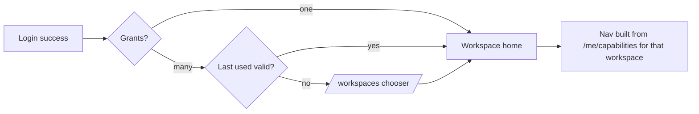
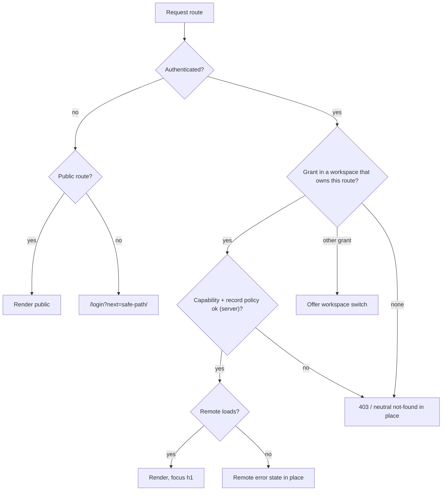

# Navigation Architecture — Shell Nav, Route Trees, Deep Links, Redirects, Dashboards

Doc ID: UI-01 · Owner: Information Architect · Version 1.0 · Status: Under Review · Relates: ADR-T03, ADR-T06, ADR-T07, ADR-T18, INV-T01, INV-T15, INV-T16, FF-01, FF-03, USR-01, UI-02 `SCREEN_REGISTRY.md`, UI-05, UI-06

Supersedes nothing; linked from the folder index and `MASTER_INDEX`. Route prefixes come from the ID registry (MOD-*); route names inside a prefix are **[TARGET]** design. Reference pages in `apps/web/src/pages` informed vocabulary only **[REF]**; the route set is not copied. Screen IDs refer to `SCREEN_REGISTRY.md`.

## 1. Principles [TARGET]

| # | Principle |
|---|---|
| N-1 | **The shell owns navigation chrome, landmarks, focus and auth redirects; remotes own content inside `main`** (ADR-T03, UI-05 §12). |
| N-2 | **Navigation is capability-derived but never security**: nav items come from `GET /api/v1/me/capabilities` (USR-01 §5); hiding an item is a hint, every route is still authorized server-side (INV-T01, INV-T02) and every route in the registry declares a policy action (FF-01). |
| N-3 | **Workspace = (role, scope)** grant. A principal with several grants switches workspace; navigation, dashboards and branding of context change; data never mixes across tenants (INV-T03). |
| N-4 | **Few top-level destinations** (≤ 5 on mobile bottom nav, ≤ 9 per sidebar section); depth ≤ 4 levels; every page reachable in ≤ 3 interactions from the workspace home. |
| N-5 | **Deep links are first-class** (email, push, share) and survive login, workspace switch, and remote failure. |
| N-6 | Role pages that don't apply are *absent from nav* but *explained on direct access* (403 state with "who can grant access"), never a silent redirect that hides why. |
| N-7 | Remotes never navigate to another remote's internals; cross-remote navigation uses public paths through the shell (FF-03). |

## 2. Workspaces and roles

| Workspace | Grant scope | Roles (ROLE-*) | Home route | Remote(s) mostly used |
|---|---|---|---|---|
| **Personal** | `self` | ROLE-CAND, ROLE-INST (instructor tools), ROLE-MENTOR [OPEN-UX-17] | `/me` (instructors: also `/learn/studio`) | MOD-CAND, MOD-LRN, MOD-OPP, MOD-MSG, MOD-ACC |
| **Organization** `org:<id>` | org | ROLE-REC, ROLE-HM, ROLE-ORGADM (`org_owner`/`org_admin`), viewer | `/hiring` | MOD-HIR, MOD-MSG, MOD-ACC |
| **Institution** `institution:<id>` | institution | ROLE-INSTADM, ROLE-FAC, proctor | `/institution` | MOD-ADM (institution workspace), MOD-LRN, MOD-MSG |
| **Platform** | platform | ROLE-MOD, ROLE-SUP, ROLE-ADM, ROLE-AUD | `/admin` | MOD-ADM |
| **Public / token** | none | ROLE-ANON, ROLE-REFEREE | `/` (anon); `/r/:requestId` (referee) | MOD-SHELL only (no remotes loaded for referee) |

Workspace switcher lives in TopBar (UI-05 §7.6). Default workspace after login = last used (server-stored), else the sole grant, else `/workspaces` chooser (SCR-SHELL-13). A candidate who is also a recruiter sees both; the Personal workspace is never hidden.



## 3. Shell navigation per role

Sidebar (≥ lg), icon rail (md), bottom nav (< md) are three renderings of one **nav manifest** per workspace. Items: label · route · required capability (UI hint) · mobile placement. `BN` = bottom nav (max 5), `TB` = top bar, `AM` = account menu / More sheet.

### 3.1 Personal workspace

| Item | Route | Cap hint | Desktop section | Mobile |
|---|---|---|---|---|
| Home | `/me` | self | Main | BN |
| Evidence | `/me/evidence` | evidence.read.own | Prove | BN |
| Jobs | `/jobs` | jobs.read | Opportunities | BN |
| Applications | `/applications` | applications.read.own | Opportunities | BN |
| Learn | `/learn` | learning.read | Learn | BN |
| Profile & visibility | `/me/profile` | profile.update.own | Showcase | AM |
| Work history | `/me/work-history` | profile.update.own | Prove | AM |
| Skills | `/me/skills` | skills.read | Prove | AM |
| Résumés | `/me/resumes` | resume.read.own | Showcase | AM |
| Assessments | `/learn/assessments` | assessment.read | Learn | AM (also from Learn) |
| Career | `/me/career` | careerintel.read.own | Grow | AM |
| Messages | `/messages` | messaging.read | — | TB (envelope icon) |
| Notifications | `/notifications` | self | — | TB (bell) |
| Network | `/network` | network.read (flag, phase 3) | Community | AM (hidden until enabled) |
| Teach (Studio) | `/learn/studio` | learning.author | Teach (only if instructor) | AM |
| Privacy & consent | `/privacy/consents` | privacy.manage.own | Account | AM |
| Billing | `/billing` | billing.read.own | Account | AM |
| Settings | `/settings` | self | Account | AM |
| Help | `/help` | public | — | TB/AM (consistent, UI-06 A11Y-D5) |

### 3.2 Organization workspace

| Item | Route | Cap hint | ROLE-REC | ROLE-HM | ROLE-ORGADM | viewer | Mobile |
|---|---|---|---|---|---|---|---|
| Home | `/hiring` | org.member | ✓ | ✓ | ✓ | ✓ | BN |
| Jobs | `/hiring/jobs` | jobs.read.org | ✓ | assigned only | ✓ | ✓ | BN |
| Verified search | `/hiring/search` | search.candidates | ✓ | — | ✓ | — | BN |
| Interviews | `/hiring/interviews` | interviews.read | ✓ | ✓ | ✓ | — | BN |
| Messages | `/messages` | messaging.read | ✓ | ✓ | metadata only | — | BN / TB |
| Shortlists | `/hiring/shortlists` | shortlist.read | ✓ | ✓ | ✓ | — | AM |
| Outreach | `/hiring/outreach` | outreach.send | ✓ | — | ✓ | — | AM |
| Templates | `/hiring/templates` | job.template | ✓ | — | ✓ | — | AM |
| Analytics | `/hiring/analytics` | analytics.read.org | ✓ (own) | — | ✓ | ✓ | AM |
| Team & roles | `/hiring/org/members` | org.members.manage | — | — | ✓ | — | AM |
| Org settings & SSO | `/hiring/org/settings` | org.settings | — | — | ✓ | — | AM |
| Audit log | `/hiring/org/audit` | audit.read.org | — | — | ✓ | — | AM |
| Data-rights (employees) | `/hiring/org/data-rights` | privacy.org.assist | — | — | ✓ | — | AM |
| Billing & seats | `/billing` | billing.manage.org | — | — | ✓ | — | AM |
| Settings, Help | `/settings`, `/help` | — | ✓ | ✓ | ✓ | ✓ | AM |

Mobile recruiter/HM experience is **triage-first** (review, decide, message, approve); heavy authoring (job editor, bulk, SSO) shows a "Best on a larger screen" hint but remains functional (no native-only features, product constitution).

### 3.3 Institution workspace

| Item | Route | INSTADM | FAC | Proctor | Mobile |
|---|---|---|---|---|---|
| Home | `/institution` | ✓ | ✓ | ✓ | BN |
| Cohorts | `/institution/cohorts` | ✓ | ✓ (own) | — | BN |
| Credentials | `/institution/credentials` | ✓ | request only | — | BN |
| Reports | `/institution/reports` | ✓ | aggregates | — | BN |
| Messages (cohort) | `/messages` | ✓ | ✓ | — | BN |
| Members & faculty | `/institution/members` | ✓ | — | — | AM |
| Courses (institution-owned) | `/learn/studio` | ✓ | — | — | AM |
| Assessments & proctoring [vendor-gated] | `/learn/assessments` | ✓ | ✓ | ✓ | AM |
| Billing & seats | `/billing` | ✓ | — | — | AM |

Faculty/INSTADM see **cohort aggregates and consented cohort evidence only** (USR-01 matrix "R(O cohort)"); no job-search data (P3 Dr. Lin) — the Cohorts screens never render application/job-search fields. See OPEN-UX-18 on the consent basis.

### 3.4 Platform workspace

| Item | Route | MOD | SUP | ADM | AUD | Mobile |
|---|---|---|---|---|---|---|
| Home (queues) | `/admin` | ✓ | ✓ | ✓ | ✓ | BN |
| Support console | `/admin/support` | — | ✓ | ✓ | read | BN |
| Moderation | `/admin/moderation` | ✓ | read | ✓ | read | BN |
| Integrity reviews | `/admin/integrity` | ✓ | — | ✓ | read | AM |
| Verification disputes | `/admin/verification-disputes` | ✓ | — | ✓ | read | AM |
| Data-rights queue | `/admin/data-rights` | — | assist | ✓ | read | AM |
| Directory | `/admin/directory` | — | ✓ (min fields) | ✓ | — | AM |
| Content review | `/admin/content` | ✓ | read | ✓ | read | AM |
| Skills curation | `/admin/skills` | — | — | ✓ | read | AM |
| Feature flags | `/admin/flags` | — | — | ✓ | read | AM |
| Platform & remotes | `/admin/platform` | — | — | ✓ | read | AM |
| Access reviews | `/admin/access-reviews` | — | — | ✓ | read | AM |
| Audit explorer | `/admin/audit` | — | scoped | ✓ | ✓ | AM |

Platform workspace is desktop-first; mobile is read/triage. The persistent **Support-access banner** appears in every route while a grant is active (§9, UI-05 §7.7).

### 3.5 Public and referee

Public header: logo, Jobs, Learn (catalogue), Sign in, Sign up, Help. Footer: legal, accessibility statement, status. Referee pages use a **minimal header** (logo only, language switch, help) with no workspace nav and no remote loading.

## 4. Route trees per remote

Routes marked `(modal)` open as dialog over the previous route and are deep-linkable. `[flag]` = behind feature flag. Every route has `title`, `policyAction` (FF-01), `workspace`, and `heading id` in the remote's route manifest.

### 4.1 MOD-SHELL
```
/                         SCR-SHELL-01 landing (anon) | redirect to workspace home (authed)
/login                    SCR-SHELL-02
  /login/challenge        SCR-SHELL-07 step-up / second factor
  /login/forgot           SCR-SHELL-05
  /login/reset/:resetId   SCR-SHELL-06  (secret in URL fragment)
/signup                   SCR-SHELL-03
  /signup/confirm         SCR-SHELL-04  (code entry | /signup/confirm/:confirmId#k=…)
/auth/callback            SCR-SHELL-19 (SSO/OIDC return; transient)
/invite/:inviteId         SCR-SHELL-12  (secret in fragment)
/workspaces               SCR-SHELL-13
/p/:handle                SCR-SHELL-08 public profile
/c/:credentialId          SCR-SHELL-11 public credential check
/r/:requestId             SCR-SHELL-09 referee form (secret in fragment or code)
  /r/:requestId/done      SCR-SHELL-10
/legal/:doc               SCR-SHELL-16 (terms, privacy-notice, accessibility, cookies)
/help, /help/sitemap      SCR-SHELL-17
/offline                  SCR-SHELL-15
/error/:kind              SCR-SHELL-14 (forbidden | not-found | remote-unavailable | maintenance)
(overlay) re-auth         SCR-SHELL-18
```

### 4.2 MOD-CAND (`/me/*`)
```
/me                                        SCR-CAND-01 home (role-adaptive)
/me/onboarding[/:step]                     SCR-CAND-02
/me/profile                                SCR-CAND-03
  /me/profile/visibility                   SCR-CAND-04
/me/portfolio                              SCR-CAND-05
  /me/portfolio/:itemId                    SCR-CAND-06
/me/evidence                               SCR-CAND-07
  /me/evidence/new                         SCR-CAND-08
  /me/evidence/:evidenceId                 SCR-CAND-09
/me/work-history                           SCR-CAND-10
  /me/work-history/:claimId                SCR-CAND-11
    /me/work-history/:claimId/references/new   SCR-CAND-12 (modal)
/me/verifications                          SCR-CAND-13
/me/skills                                 SCR-CAND-14
/me/resumes                                SCR-CAND-15
  /me/resumes/:resumeId                    SCR-CAND-16
/me/career                                 SCR-CAND-17
  /me/career/transitions                   SCR-CAND-18
  /me/career/salary                        SCR-CAND-19
```

### 4.3 MOD-LRN (`/learn/*`)
```
/learn                                     SCR-LRN-01
/learn/courses                             SCR-LRN-02
  /learn/courses/:courseId                 SCR-LRN-03
  /learn/courses/:courseId/lessons/:lessonId   SCR-LRN-04 (focus layout)
/learn/my                                  SCR-LRN-05
/learn/paths/:pathId                       SCR-LRN-06
/learn/assessments                         SCR-LRN-07
  /learn/assessments/:id                   SCR-LRN-08
  /learn/assessments/:id/attempts/:attemptId          SCR-LRN-09 (focus layout)
  /learn/assessments/:id/attempts/:attemptId/result   SCR-LRN-10
  /learn/assessments/:id/attempts/:attemptId/review   SCR-LRN-11
/learn/challenges                          SCR-LRN-12
/learn/studio                              SCR-LRN-13
  /learn/studio/courses/:courseId          SCR-LRN-14
    /…/lessons/:lessonId                   SCR-LRN-15
    /…/learners                            SCR-LRN-17
  /learn/studio/assessments/:id            SCR-LRN-16
  /learn/studio/earnings                   SCR-LRN-18 [OPEN-06]
```

### 4.4 MOD-OPP (`/jobs/*`, `/applications/*`)
```
/jobs                                      SCR-OPP-01 (public read for ANON; richer when signed in)
  /jobs/:jobId                             SCR-OPP-02
  /jobs/saved                              SCR-OPP-03
  /jobs/alerts                             SCR-OPP-04
  /jobs/companies/:slug                    SCR-OPP-05
/applications                              SCR-OPP-07
  /applications/new/:jobId                 SCR-OPP-06
  /applications/:applicationId             SCR-OPP-08
    /…/interview                           SCR-OPP-09
    /…/offer                               SCR-OPP-10
```

### 4.5 MOD-HIR (`/hiring/*`)
```
/hiring                                    SCR-HIR-01 (role-adaptive)
/hiring/onboarding                         SCR-HIR-20
/hiring/jobs                               SCR-HIR-02
  /hiring/jobs/:jobId/edit                 SCR-HIR-03
  /hiring/jobs/:jobId/pipeline             SCR-HIR-05
  /hiring/jobs/:jobId/applications/:applicationId   SCR-HIR-06
    /…/offer                               SCR-HIR-11
  /hiring/jobs/:jobId/compare              SCR-HIR-14
  /hiring/jobs/:jobId/bulk/:opId           SCR-HIR-12
/hiring/templates                          SCR-HIR-04
/hiring/search                             SCR-HIR-07
/hiring/shortlists                         SCR-HIR-08
/hiring/interviews                         SCR-HIR-09
  /hiring/interviews/:interviewId/scorecard    SCR-HIR-10
/hiring/outreach                           SCR-HIR-13
/hiring/analytics                          SCR-HIR-18
/hiring/org/members                        SCR-HIR-15
/hiring/org/settings                       SCR-HIR-16
/hiring/org/audit                          SCR-HIR-17
/hiring/org/data-rights                    SCR-HIR-19
```

### 4.6 MOD-MSG (`/messages/*`, `/network/*`, `/notifications`)
```
/messages                                  SCR-MSG-01
  /messages/new                            SCR-MSG-03
  /messages/:threadId                      SCR-MSG-02
/notifications                             SCR-MSG-04
/network [flag, phase 3]                   SCR-MSG-05
  /network/connections                     SCR-MSG-06
  /network/mentors [OPEN-UX-17]            SCR-MSG-07
```

### 4.7 MOD-ACC (`/settings/*`, `/billing/*`, `/privacy/*`)
```
/settings                                  SCR-ACC-01
  /settings/security                       SCR-ACC-02
  /settings/security/sessions              SCR-ACC-03
  /settings/notifications                  SCR-ACC-04
  /settings/display                        SCR-ACC-05
  /settings/app                            SCR-ACC-06
  /settings/integrations                   SCR-ACC-14
  /settings/account                        SCR-ACC-15
/billing                                   SCR-ACC-07
  /billing/plans                           SCR-ACC-08
  /billing/invoices                        SCR-ACC-12
  /billing/return                          SCR-ACC-13
/privacy/consents                          SCR-ACC-09
/privacy/access-log                        SCR-ACC-10
/privacy/data                              SCR-ACC-11
```

### 4.8 MOD-ADM (`/admin/*`, `/institution/*`)
```
/admin                                     SCR-ADM-01
/admin/support                             SCR-ADM-02
  /admin/support/grants/new                SCR-ADM-03
  /admin/support/sessions/:grantId         SCR-ADM-04
/admin/moderation                          SCR-ADM-05
  /admin/moderation/cases/:caseId          SCR-ADM-06
/admin/integrity                           SCR-ADM-07
/admin/verification-disputes               SCR-ADM-08
/admin/flags                               SCR-ADM-09
/admin/audit                               SCR-ADM-10
/admin/data-rights                         SCR-ADM-11
/admin/directory                           SCR-ADM-12
/admin/skills                              SCR-ADM-13
/admin/content                             SCR-ADM-14
/admin/platform                            SCR-ADM-15
/admin/access-reviews                      SCR-ADM-16
/institution                               SCR-ADM-17
/institution/cohorts                       SCR-ADM-18
  /institution/cohorts/:cohortId           SCR-ADM-19
/institution/credentials                   SCR-ADM-20
/institution/members                       SCR-ADM-21
/institution/reports                       SCR-ADM-22
```

Route registration contract: each remote publishes a **route manifest** in `mf-manifest.json` (path pattern, screen id, `policyAction`, `workspace`, `titleKey`, `headingId`, `layout: default|focus|public`). The shell validates uniqueness across remotes at build (FF-04-style check: no overlapping prefix owned by two remotes; prefixes per ID registry) and refuses a manifest that declares a path outside its prefix.

## 5. Layouts

| Layout | Used by | Chrome |
|---|---|---|
| `default` | most routes | TopBar + nav + `main` |
| `focus` | course player, assessment runner, application form (optional), referee form | TopBar reduced to logo + "Exit" + essential status; no nav; sticky ActionBar; still has skip link and landmark `main` |
| `public` | landing, public profile, jobs (anon), help | public header/footer |
| `workspace-chooser` | `/workspaces` | minimal |

## 6. Deep links

| Source | Pattern | Auth | Behaviour | Fallback |
|---|---|---|---|---|
| Email: confirm email | `/signup/confirm/:confirmId#k=<secret>` | none | Shell reads fragment, posts to BFF, then clears fragment via `history.replaceState`; shows confirmation | Manual code entry on same screen |
| Email: password reset | `/login/reset/:resetId#k=…` | none | Same pattern; single-use hashed (INV-T05) | "Request a new link" |
| Email: referee request | `/r/:requestId#k=…` | none, token-bound | Shell-only (no remote); `Referrer-Policy: no-referrer`, `Cache-Control: no-store`, no third-party scripts/analytics on page | Enter 8-character code from email; or request new link (ACT-REF-05) |
| Email: invitation | `/invite/:inviteId#k=…` | none → login/signup then accept | After auth returns to accept screen | Contact inviter |
| Email/push: new message | `/messages/:threadId` | required | Opens thread; if no access → 403 state | Inbox |
| Push/email: stage change | `/applications/:applicationId` | required | Opens timeline at the event (`#event-<id>`) | Applications list |
| Email: interview invite | `/applications/:applicationId/interview` | required | Slot picker with time zone | Detail page |
| Email: offer | `/applications/:applicationId/offer` | required + recent auth (step-up if > 15 min) | Offer review | |
| Email: reference responded | `/me/work-history/:claimId` | required | Shows status | Verifications inbox |
| Recruiter consent request | `/privacy/consents?request=<id>` | required | Opens consent manager scrolled to the request; no auto-grant | |
| Export ready | `/privacy/data` | required + step-up for download | | |
| Support-access active notice | `/privacy/access-log` | required | | |
| Job alert / shared job | `/jobs/:jobId` | optional | Public job page; "Apply" → login → `/applications/new/:jobId` | |
| Shared profile / credential | `/p/:handle`, `/c/:credentialId` | optional | Public view limited to fields the owner made public; credential check shows rung + issuer only | 404 neutral if private (no existence leak) |
| Moderation / dispute notice | `/admin/moderation/cases/:caseId` | required + role | | |
| Calendar attachments (.ics) | `/applications/:id/interview` | required | | |

Rules: (1) **No secrets in query strings** (privacy rule; also keeps them out of server logs) — fragment only; (2) deep link params are validated by the owning remote and authorized per record (INV-T02); (3) unknown record or no permission → identical neutral message (no existence oracle); (4) links open in the right workspace — if the record belongs to another of the user's grants the shell offers "Switch to Acme Corp workspace to view this" rather than failing; (5) `next=` is stored server-side or as an allow-listed relative path (§7); (6) push notification payloads carry only ids and route, no PII.

## 7. Redirect and guard rules

| ID | Condition | Rule |
|---|---|---|
| RD-01 | Unauthenticated request to a protected route | Redirect to `/login?next=<relative-path>`; `next` must be a same-origin relative path matching a registered route pattern (no scheme/host, no `//`, no `\`, max 512 chars); otherwise ignored. After login go to `next`, else workspace home. |
| RD-02 | Authenticated user visits `/login`, `/signup` | Redirect to workspace home (or `next`) |
| RD-03 | `/` while authenticated | Redirect to last-used workspace home (`/me`, `/hiring`, `/institution`, `/admin`) |
| RD-04 | Candidate with incomplete onboarding on `/me` or `/jobs` | Soft prompt card on home; **no forced redirect** except first login after signup → `/me/onboarding` (resume at last step). Skippable steps never block (see SCR-CAND-02). |
| RD-05 | Recruiter/org user with no org membership completed | `/hiring/onboarding` (SCR-HIR-20) |
| RD-06 | Sensitive area needs recent authentication (billing change, role change, export download, erasure, support grant) | In-place re-auth overlay (SCR-SHELL-18) or `/login/challenge`; returns to the same action with form data preserved |
| RD-07 | Session expired during use | Re-auth overlay in place; if refresh-token reuse detected (BR-T050) → full logout to `/login?reason=session-revoked` with explanation |
| RD-08 | Forbidden (authorized elsewhere or no capability) | Render forbidden state at same URL (no redirect) with workspace switch hint or "request access" |
| RD-09 | Not found / private | Neutral not-found state at same URL |
| RD-10 | Remote unavailable | Remote error state at same URL (UI-07 §7); never redirect loop |
| RD-11 | Role-changing events (role removed while viewing) | Next API 403 → shell refetches capabilities, shows notice, navigates to workspace home |
| RD-12 | Public job/profile URL while signed in | Same URL, enhanced view |
| RD-13 | Trailing slash, case variants | Canonical redirect 308 to lower-case no-slash form |
| RD-14 | Moved routes in later releases | Redirect table maintained in shell (`redirects.json`), versioned with Host Contract; old deep links in emails continue to work ≥ 12 months [OPEN-UX-19] |
| RD-15 | Referee link expired/used | `/r/:requestId/done?state=expired` (neutral copy + request new link); never reveals who requested |
| RD-16 | Account paused/pending erasure | Login allowed to `/settings/account` and `/privacy/data` only with banner; other routes show paused state (SCR-ACC-15) |
| RD-17 | Minor/age-gated (OPEN-09) | Block flow screen with guardian path [OPEN] |
| RD-18 | Org SSO enforced for user's domain | `/login` email step detects domain and redirects to SSO (`/auth/callback` return); password path hidden for that account |



## 8. Role-adaptive dashboards (home screens)

Widgets are rendered by the owning remote from its own APIs (no cross-remote data fetching); the shell contributes only the greeting, workspace banner and global alerts. Every widget has loading/empty/error states and an "Open" link; widgets reorder by priority not by user customisation at launch [OPEN-UX-20].

| Home | Role | Widgets (priority order) | Primary next-best action logic (rule-based, explainable; no autonomous decisions) |
|---|---|---|---|
| `/me` SCR-CAND-01 | Candidate | 1 Next step card (e.g. "Add your first evidence", "Finish reference request"); 2 Evidence strength summary (counts per rung, not a score); 3 Applications in progress (stage chips); 4 Recommended jobs with "why this matched"; 5 Learning in progress; 6 Pending verifications (awaiting referee); 7 Consent requests; 8 Career readiness snapshot | Priority: security/consent requests > time-bound items (interview/offer) > verification follow-ups > activation (first evidence) > recommendations. All rules documented; user can "Hide this suggestion" |
| `/me` | Candidate + instructor | + "Your courses" tile (learner counts, items needing attention) | |
| `/hiring` SCR-HIR-01 | Recruiter | 1 Needs your decision (candidates awaiting action, SLA age); 2 Open jobs with pipeline counts; 3 Today's interviews; 4 New applications since last visit; 5 Messages awaiting reply; 6 Outreach quota; 7 Time-to-shortlist | Sorting by age and stage; no candidate ranking by score on this page |
| `/hiring` | Hiring manager | 1 Candidates awaiting your review; 2 Scorecards due; 3 Interviews today; 4 Jobs you're assigned to | |
| `/hiring` | Org admin | + Seats used/available, pending invitations, access review due (quarterly prompt), org security notices, billing status | |
| `/institution` SCR-ADM-17 | Institution admin | Cohort activation funnel (aggregate), credentials issued/pending, learners needing nudge (aggregate counts only), seat usage, consent-notice status | Aggregates only; small-cell suppression (n < 10) [OPEN-UX-21] |
| `/institution` | Faculty | Cohort skill coverage, assessment completion (aggregate), messages | No job-search or private fields |
| `/admin` SCR-ADM-01 | Moderator | Queue counts by severity/age, appeals due, integrity reviews due | |
| `/admin` | Support operator | Open grants (with time left), cases assigned, data-rights assists due | |
| `/admin` | Platform admin | Remote health/versions, flag changes pending, access reviews due, privileged grants expiring | |
| `/admin` | Auditor | Recent audit exports, read-only links | |
| `/` SCR-SHELL-01 | Anonymous | Value proposition, search jobs, how verification works (rung explainer), sign up | |

## 9. Persistent global elements

| Element | Where | Behaviour |
|---|---|---|
| Offline / degraded / previous-version banners | Below TopBar | UI-07 §9 |
| **Support-access banner** | Shown to the **support operator** in every route and, when a candidate is viewing own pages during an active grant, a polite notice in `/privacy/access-log` and notification (not intrusive) | Non-dismissible while active; shows reason code, scope, time left (coarse cadence); "End access" button (ACT-SUP-02) |
| Workspace banner | When in an org/institution workspace | Name + role; colour never the only cue |
| Sync indicator | TopBar | UI-07 §6.2 |
| Session-timeout warning | Dialog | ≥ 2 min before expiry; extend (ACT-SYS-08) |
| Install prompt | In-page card (not modal), post-meaningful-action | FF-09 fallbacks |

## 10. Breadcrumbs

| Rule | Detail |
|---|---|
| When shown | Depth ≥ 3 from workspace home (e.g. Hiring › Jobs › Data Analyst › Candidate) or any detail page with a parent list |
| Source | Each route in the manifest declares `parent` and `crumbLabel` (may be dynamic via `host.router.setCrumb(label)`, e.g. job title) |
| Behaviour | Parents link to their list **with preserved filters/cursor** (stored in `history.state`) |
| Mobile | Collapsed to "‹ Parent" back link + current title (full trail in a menu) |
| Not used | Wizard steps (use Stepper), focus layouts, top-level pages |
| A11y | `nav aria-label="Breadcrumb"`, `ol`, `aria-current="page"` on last |

## 11. Command palette

| Aspect | Spec |
|---|---|
| Trigger | `Ctrl/⌘+K`, visible search button in TopBar (mobile: magnifier opens full-screen sheet) |
| Result groups | **Go to** (nav items & recent screens), **Actions** (capability-derived: "Add evidence", "Post a job", "Start support access"), **Records** (recent applications/jobs/candidates the user can open — fetched via search API respecting policy), **Help** |
| Rules | Only items from `/me/capabilities` (hint) – selecting still hits server policy; Records search is server-side, scoped to workspace, min 2 characters, debounced 200 ms; no cross-workspace results; never indexes other people's data without a role that already allows opening it; destructive actions are **not** in the palette (they require confirmation context) |
| Accessibility | Dialog + combobox pattern (UI-06 §3); results count announced; works with screen reader and touch; Esc closes and restores focus; no single-key shortcuts when closed unless user enabled (ACT-SYS-09) |
| Privacy | Recent items stored locally per user, cleared on logout |

## 12. Desktop sidebar vs mobile bottom nav — behaviour

| Aspect | Sidebar (≥ lg) | Rail (md) | Bottom nav (< md) |
|---|---|---|---|
| Items | Full manifest, grouped with headings | Icons + tooltip/`aria-label` (items from Main + pinned) | 3–5 primary destinations (`BN` column) + avatar menu for the rest |
| Labels | Visible | Hidden visually, present for AT | Always visible (icon + text) |
| State | Collapsible, persisted | Expand-on-click overlay | Fixed; does not auto-hide while keyboard focus is in content (2.4.11) |
| Badges | Counts with `aria-label` ("3 unread messages") | same | same; cap "9+" |
| Active | `aria-current="page"` + 3 px inline-start bar + bold (not colour only) | same | icon filled + label bold + top indicator |
| Safe areas | n/a | n/a | `padding-bottom: env(safe-area-inset-bottom)`; content gets `scroll-padding-bottom` |
| Landscape phones | Uses rail when width ≥ 768 else bottom nav stays compact (56 px) | | |
| One-handed | Primary create action ("Add evidence", "Post job") appears as a **labelled FAB-style button above bottom nav** on home screens only; it is a real button with text, never covering focus targets | | |
| Gestures | None required | | Swipe-to-go-back is browser default, not custom |

## 13. Federation-specific navigation concerns

| Concern | Rule |
|---|---|
| Route ownership | Prefix → remote per ID registry; shell holds the route table and mounts the remote for the matched prefix |
| Lazy preload | Shell prefetches the next likely remote on nav hover/focus/idle (max 1 prefetch at a time, not on metered `saveData`) |
| Layout shift | Shell reserves `main` min-height; remote skeleton matches page layout |
| History | Shell owns `history`; remotes use `host.router`; scroll and focus restoration per UI-06 §6 |
| Cross-remote link | `<ShellLink to="/jobs/123">` from `@ts/ui`; plain `<a href>` also works (full path), falls back to full page load if shell router unavailable |
| Version skew | During a deploy, a user may hold shell vN with remote vN+1; the compatibility check (ADR-T18) governs; navigation never lands on a remote that fails the check (uses last-known-good) |
| Remote removal | If a remote is disabled by flag, its prefix serves RD-10 maintenance state; nav items hidden via capability/flag |
| Observability | Route change emits `nav.route` span with remote, version, duration (ADR-T16) |

## 14. Open items

| ID | Item |
|---|---|
| OPEN-UX-16 | Fragment-carried secrets (`#k=`) vs path tokens for emailed single-use links: needs security review of mail-client link rewriting and the fallback code. |
| OPEN-UX-17 | ROLE-MENTOR exists in the ID registry but the permission matrix has no column and no screens are specified beyond `/network/mentors`; define permissions before building. |
| OPEN-UX-18 | Consent basis for faculty/institution admin cohort-evidence access (matrix says R(O cohort); INV-T15 defines only recruiter consent scopes). |
| OPEN-UX-19 | Redirect retention period for old emailed links. |
| OPEN-UX-20 | Whether users may customise dashboard widgets. |
| OPEN-UX-21 | Small-cell suppression threshold for institution aggregates. |
| OPEN-UX-33 | Public pages `/p/:handle` and `/c/:credentialId` are placed in MOD-SHELL (ID registry assigns "public pages" to the shell) while their data owners are DOM-03/DOM-05 (`mf-candidate`); confirm the shell renders them from public read APIs without importing remote code (FF-03), or move them to MOD-CAND with an anonymous-allowed route policy. |


# Patch 2026-10-27: Unsaved-change guards, focus and scroll restoration

**[TARGET].** Extends section 7 (RD-01..RD-18 above; new rows continue at RD-19). Mechanism for the browser history API and service-worker updates is owned by [10_FRONTEND_ARCHITECTURE](../10_FRONTEND_ARCHITECTURE/) and [08_PWA_AND_MOBILE](../08_PWA_AND_MOBILE/) (pending patch); this section fixes the user-visible rules. Action-level behaviour is in ACTION_REGISTRY ACT-ATOM-04, 05, 09.

## Additional redirect and guard rows

| ID | Condition | Rule |
|---|---|---|
| RD-19 | In-app navigation (link, nav item, command palette, breadcrumb) away from a dirty form | Guard dialog: Keep editing (default focus) / Save draft (only where a draft exists) / Discard. Route does not change until a choice is made. |
| RD-20 | Browser back/forward, reload or tab close with a dirty form | Browser-native `beforeunload` prompt only (custom text is not possible). Back/forward inside the app is intercepted like RD-19; if the guard is dismissed, history position is restored. |
| RD-21 | Workspace switch with dirty form or in-flight mutation | Guard dialog per UXH-02; draft is saved locally under the origin workspace id before switching. |
| RD-22 | Session expiry while dirty | RD-07 overlay; no guard dialog (nothing is leaving); form state preserved in memory and local draft. |
| RD-23 | Deep link to a route needing a different workspace | Offer workspace switch (RD-08 hint) and keep the target path; after the switch, land on the target, not on home. |
| RD-24 | Navigation blocked by a running assessment attempt (SCR-LRN-09) | Leave attempt dialog follows ACT-ASM-06 rules; the guard never silently submits. |

## Guard rules

| ID | Rule |
|---|---|
| NAV-GRD-01 | "Dirty" means a user-entered difference from the last saved or loaded value. Autofill and defaults loaded by the app are not dirty. Autosaving forms (ACT-PRO-01, ACT-APP-02) are dirty only while a save is pending or failed. |
| NAV-GRD-02 | Guards are registered per form by the owning screen and removed on unmount; a remote that fails to mount cannot leave a stale guard (shell clears guards on remote error, RD-10). |
| NAV-GRD-03 | The dialog states what will be lost, in plain words, and names buttons by verb ("Discard changes", "Keep editing"). Escape and backdrop click mean Keep editing. |
| NAV-GRD-04 | A guard never blocks sign-out (ACT-AUTH-09), security redirects (RD-06, RD-07, RD-11) or navigation forced by a revoked grant; in those cases the draft is stored locally first. |
| NAV-GRD-05 | Discard never deletes data that was already saved server-side; it drops only the unsent difference. Local drafts have a retention limit (30 d PROPOSED) and are listed in ACT-ACC-07 "Clear saved data". |

## Focus and scroll restoration

| ID | Rule |
|---|---|
| NAV-FOC-01 | After a route change, focus moves to the page `h1` (tabindex -1) and the title is announced once; focus does not move to the skip link or the first nav item. |
| NAV-FOC-02 | Back/forward restores the scroll position and the previously focused control when it still exists; if the record has changed or loads late, restore scroll first and focus the `h1`. Scroll is restored after skeletons resolve to final height (no jump). |
| NAV-FOC-03 | Opening a dialog or drawer moves focus inside it (first field or safest control); closing returns focus to the opener; if the opener was removed, focus goes to the nearest following heading. |
| NAV-FOC-04 | After a destructive action removes the focused row, focus goes to the next row, else the previous, else the list heading. |
| NAV-FOC-05 | After a failed submit, focus goes to the error summary (first invalid field in single-field forms); entered values are preserved. |
| NAV-FOC-06 | Wizard step change focuses the step heading; browser Back inside a wizard goes to the previous step, not out of the wizard. |
| NAV-FOC-07 | Pagination or "Load more" keeps focus on the first newly loaded item, announced once; infinite scroll is not used for primary tasks (PROGRESSIVE sec 3). |
| NAV-FOC-08 | In-page tab/segment changes do not move scroll; if URL-addressable they use `replace`, not `push`, so Back leaves the page. |
| NAV-FOC-09 | Tab switch between workspaces restores each workspace's last route and scroll in memory for the session (not persisted across reload). |
| NAV-FOC-10 | With `prefers-reduced-motion`, scroll restoration and focus movement are instant (no smooth scroll). |
