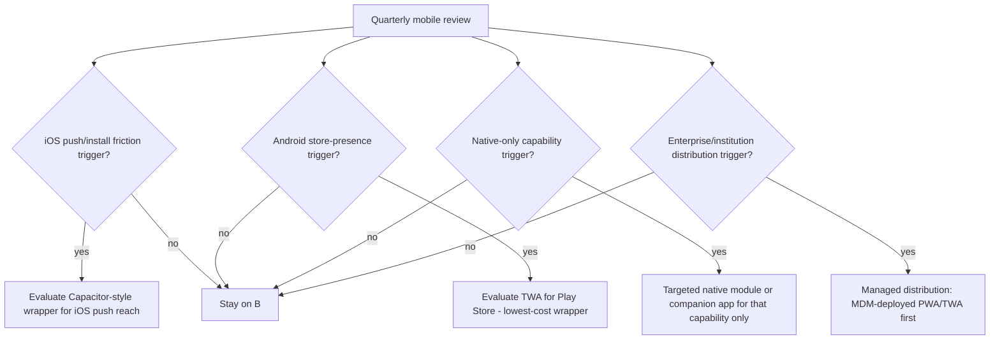

# Mobile Distribution Decision

Doc ID: MOB-01 · Owner: Frontend/Platform Architecture · Version 1.0 · Status: Under Review
Relates: ADR-T02 (PWA-first; wrapper only on verified need), ADR-T10, ADR-T20 · PWA-01, PLT-01, OFF-01 · OPEN-10 (identity verification), proctoring (vendor-gated, DOMAIN_ARCHITECTURE §6)

## 1. Decision [TARGET]
**Launch with Option B: browser + installable PWA, no store packaging** (confirms ADR-T02). Option A (plain browser tab) is always supported and is the baseline for every journey. Options C and D are **trigger-gated** (§5); a trigger needs measured evidence, not opinion. No store account, signing, review or release process is built before a trigger fires.

## 2. Options
| ID | Option | What it is | Distribution |
|---|---|---|---|
| A | Browser | Mobile/desktop browser tab | URL |
| B | Installed PWA | Same code, installed from the browser (Add to Home Screen / install prompt) | URL; no store |
| C | Wrapped | Thin shell around the same web app: Android **TWA** (Trusted Web Activity) or **Capacitor**-style WebView wrapper (iOS/Android) | Play Store / App Store |
| D | Native | Separate Swift/Kotlin (or RN/Flutter) clients over the same API | Stores |

## 3. Assessment
Scores 1 (poor) – 5 (strong) are **architect judgement**, not measurements; weights reflect ADR-T01/T02 and the stage of the product. Every score has the reason in the cell.
| Criterion (weight) | A Browser | B Installed PWA | C Wrapped | D Native |
|---|---|---|---|---|
| Time/cost to ship and maintain, one codebase (5) | 5 — single web build | 5 — manifest + SW on same build | 3 — adds store pipeline, signing, review cycles, per-OS wrapper upkeep | 1 — new clients; ADR-T02 estimated ~3× cost (judgement) |
| Reach / zero-friction entry, shareable deep links (4) | 5 | 4 — install optional | 2 — store install step | 2 |
| Push reliability (3) | 2 — none on iOS tab (V(src) PLT-01); desktop/Android OK | 3 — iOS only after Home-Screen install (V(src)); Android/desktop fine; delivery best-effort | 4 — native push (APNs/FCM) removes iOS install gating (U for integration details) | 5 |
| Offline/sync robustness (3) | 2 — SW exists but storage evictable | 3 — installed quota behaviour better but eviction exemption U | 3 — still WebView storage rules (U) | 5 — durable storage, true background work |
| Store discoverability and trust signalling (2) | 1 | 1 | 4 | 4 |
| Platform capability breadth (camera SDKs, NFC, ID verification, proctoring) (2) | 2 | 2 | 3 — plugins | 5 |
| Review/policy risk (3) | 5 | 5 | 2 — thin wrappers risk "minimum functionality" rejection (App Store Guideline 4.2, **verify** — OPEN-FE-09) | 3 |
| Security surface and update control (3) | 4 — instant deploy | 4 — SW update policy (PWA-01 §5) | 3 — two release channels; wrapper must follow CSP/session rules | 3 — store release latency |
| Accessibility parity with design system (07_*) (2) | 4 | 4 | 4 | 3 — duplicate component library |
| **Weighted total (weights sum 27, max 135)** | **98** | **100** | **81** | **85** |

Totals are Σ(weight × score), recomputed by script. Reading: A and B are within 2 points because B is A plus an optional install step; B is preferred because it is the only no-store option that reaches iOS push (V(src), PLT-01) at near-zero cost. C scores below D here because wrapping adds a store pipeline without removing the web storage limits, while D buys real push/offline/capability breadth at high cost. The ranking is **sensitive to the push, offline and capability weights** (change any of them by ±1 and C/D can swap) — which is why §5 re-opens the decision on measured triggers, not on this table.

## 4. Platform consequences of choosing B
- iOS push, badge and the most stable storage need **Home-Screen install** (V(src), PLT-01). Mitigation: install-gated push UX, email and in-app notification as channels of record for consequential events (PWA-01 §8).
- Android: install prompt (Chromium), Background Sync/periodic sync enhancements, possible TWA later at low cost.
- Desktop: installable on Chromium and Safari 14+ ; Firefox desktop is tab-only (V(src)).
- Anything requiring native APIs not available to the web is **out of scope until a trigger**, and the feature is re-planned (not hacked into a wrapper).

## 5. Triggers to re-open (each with measurement)

| # | Trigger | Measurement (source of evidence) | Threshold | Action |
|---|---|---|---|---|
| T1 | iOS users cannot receive/act on notifications because they never install | Share of iOS sessions that are standalone; push opt-in among iOS users who saw the install sheet; missed-event rate (interview invite opened >24 h after send) | **> 15% of iOS users blocked by push/install friction** (threshold fixed in ADR-T02) | Spike Capacitor-class wrapper for iOS; check Guideline 4.2 risk first (OPEN-FE-09) |
| T2 | Acquisition depends on store presence | Attributed acquisition surveys + store-search demand; institution/recruiter requirements citing a store listing | Documented demand from ≥ 3 enterprise/institution customers **or** measured acquisition gap — threshold [OPEN-FE-15], set by Product | Evaluate **TWA** for Android (reuses PWA; Digital Asset Links; Play requirements to verify) |
| T3 | A required capability has no web equivalent (ID verification OPEN-10 camera/NFC SDK, vendor proctoring, background location) | Requirement signed off in a PRD with a named capability and why web fails (spike result) | Any single *confirmed* requirement | Isolated native/companion module for that flow only; rest stays PWA |
| T4 | Institutions need managed deployment | Procurement requirement | ≥ 1 contracted customer | MDM-pushed PWA/TWA; no store listing necessarily |
| T5 | Offline requirement escalates beyond ADR-T10 tiers (low-connectivity core use) | Research + telemetry: share of sessions with offline periods; outbox usage | Evidence in `26_*` that offline core use is material | Revisit ADR-T10 first (server-side scope), wrapper second |
| T6 | Platform regression (browser removes/limits a capability we depend on) | Release-note monitoring + device suite failures (PLT-01 §5) | Any regression that breaks a Tier 0/1 journey | Incident, not a distribution change; Tier rule keeps journeys on Tier 0/1 |

## 6. Constraints that apply if C/D is ever adopted
1. Auth stays BFF-cookie based; wrappers must not introduce tokens in JS-accessible storage (ADR-T06, INV-T14). A native client would need a different token transport — a new ADR.
2. Same Host Contract / remotes load unchanged inside a wrapper; no wrapper-specific fork of remotes.
3. Update control: wrapper must not pin stale shell bundles; remote updates through the registry continue to work (VC-01).
4. Store review and privacy-label obligations (DOM-22) are scoped before commitment.
5. No decision to wrap is taken from a single stakeholder request; it needs a trigger record in the decision log.

## 7. Open items
OPEN-FE-09 App Store Guideline 4.2 / wrapper policy verification · OPEN-FE-15 T2 threshold (Product) · OPEN-FE-01 device evidence feeding T1.
