# Offline and Sync Design

Doc ID: OFF-01 · Owner: Frontend/Platform Architecture (PWA engineering) · Version 1.0 · Status: Under Review
Relates: ADR-T05, ADR-T08, ADR-T10 · INV-T10, INV-T13, INV-T14, INV-T15, INV-T04, INV-T17 · BR-T050, BR-T003 · PWA-01, PLT-01, MFA-01, HC-01 · Research RES-02 F4/F5/F10

Tags: [CONF] [TARGET] [OPEN] [REF]. API paths in examples are **illustrative** until `api/*` contracts exist (OPEN-FE-12). Numeric limits are [TARGET] starting hypotheses with the stated measurement; none is a benchmark.

## 1. Principles
1. **Server is authoritative** (INV-T13). The client holds disposable copies and a short list of *intentions* (outbox). The server revalidates every queued write exactly like an online write: authn, policy, state machine, consent, entitlements.
2. **Honest scope** (ADR-T10). Offline reads of the owner's own data; queued writes only for **application drafts, profile edits, message compose, notes**. Everything consequential is online-only.
3. **No false success.** A queued item is shown as *Waiting to sync*, never as sent/submitted/verified. Verified status, scores, entitlements and consent are never computed or promoted client-side (INV-T04, INV-T17, INV-T15).
4. **Foreground-first sync** — Background Sync exists only in Chromium (V(src), PLT-01); it is an enhancement, never the mechanism.
5. **Data minimisation**: cache the least that makes a read useful; short lifetimes; purge aggressively.
6. **Account-bound**: every local record belongs to exactly one account alias; no cross-account reads.

## 2. Operation classification
Classes: **FO** fully offline (needs no server) · **RO** read-only from cache (stale-labelled) · **QW** queued write (outbox, revalidated on flush) · **ON** online-only (control disabled with reason when offline). "TTL" = max cache age shown offline.

| # | Feature (domain) | Module | Offline class | Detail / queued op | TTL / cache | Rationale |
|---|---|---|---|---|---|---|
| 1 | App start, navigation, chrome, offline page | SHELL | **FO** | Precached shell | until SW update | Core PWA |
| 2 | Theme, locale, density prefs | SHELL | **FO** | `ts-meta.kv.prefs`; synced to server when online (last-write-wins, non-sensitive) | n/a | No server needed |
| 3 | Login, signup, passkey enrol, SSO | SHELL/ACC | **ON** | — | none | Credentials; BFF cookies (ADR-T06) |
| 4 | Session snapshot, capabilities hints (DOM-01) | SHELL | **RO** | `ts-meta`/account `queryCache` | 7 d (offline grace) | UI hints only; server decides (INV-T01) |
| 5 | View own profile & portfolio (DOM-03) | CAND | **RO** | — | 7 d | Owner data |
| 6 | Edit profile text fields (DOM-03) | CAND | **QW** | `profile.patch` (field-level, `If-Match`) | draft 14 d | ADR-T10 |
| 7 | Upload/replace avatar, portfolio files, evidence artefacts (DOM-05) | CAND | **ON** | — | none (no blobs) | Virus scan before visible (BR-T003); large blobs; ADR-T10 excludes |
| 8 | View own evidence list, rung & provenance (DOM-05/06) | CAND | **RO** | metadata only, no artefact files | 7 d, labelled "as of …" | Never presented as fresher than cached time |
| 9 | Create/update evidence claim, request verification, referee request (DOM-06) | CAND | **ON** | — | none | Consequential, token issuance (INV-T05) |
| 10 | Resume variants: view list | CAND | **RO** | metadata only | 7 d | |
| 11 | Resume generate/export (AI, files) (DOM-03/17) | CAND | **ON** | — | none | AI gateway + budget (INV-T07) |
| 12 | Career intelligence views (DOM-12) | CAND | **RO** | — | 7 d | Derived; labelled |
| 13 | Browse jobs lists / search (DOM-09/11) | OPP | **RO** (recent only) | last 5 result sets | 24 h | Freshness matters; search itself **ON** |
| 14 | Job detail (last viewed ≤ 20) | OPP | **RO** | — | 72 h | |
| 15 | Search, match explanations (DOM-11) | OPP | **ON** | — | none | Server-ranked, explainable (INV-T19) |
| 16 | Save job / follow search / alert toggle | OPP | **ON** | — | none | Outside ADR-T10 list; **candidate for ADR-T10 amendment** (low-risk idempotent) — OPEN-FE-13 |
| 17 | Application **draft** edit (DOM-10) | OPP | **QW** | `application.draft.put` (`PUT …/drafts/{draftId}`, client id, `If-Match`) | draft 14 d | ADR-T10 |
| 18 | Application **submit** / withdraw | OPP | **ON** | — | none | Consequential; BR-T001, SM-APPLICATION; INV-T10 |
| 19 | View own applications & status | OPP | **RO** | list + status | 7 d, "as of" banner | Status may be stale; no actions offline |
| 20 | Course catalogue / enrolled course text | LRN | **RO** (enrolled, last 3 courses, text only) | no video/media | 7 d | Low sensitivity |
| 21 | Lesson progress, complete lesson/course | LRN | **ON** | — | none | `course.completed` may mint evidence (DOM-05) |
| 22 | Assessment attempts, challenges (DOM-07) | LRN | **ON**, additionally blocked from local caching of items | — | none | Integrity (INV-T06/T20); no offline attempts |
| 23 | Instructor studio authoring (DOM-08) | LRN | **ON** | — | none | Not in ADR-T10 list; revisit if instructors report low-connectivity need (OPEN-FE-13) |
| 24 | Read conversations (DOM-13) | MSG | **RO** | last 20 conversations × last 50 messages | 72 h | Sensitive; bounded |
| 25 | Compose/send message | MSG | **QW** | `message.put` (`PUT …/messages/{clientMessageId}`) | 14 d | ADR-T10; shown as "Not sent yet" |
| 26 | Mark read, mute, block, report | MSG | **ON** | — | none | Safety flows (DOM-19) |
| 27 | Notifications list | MSG | **RO** | — | 72 h | |
| 28 | Notes (candidate job notes, recruiter notes) | CAND/OPP/HIR | **QW** | `note.put` (`PUT …/notes/{clientNoteId}`; edits `If-Match`) | 14 d | ADR-T10 |
| 29 | Network / connections (DOM-14) | MSG | **ON** (read **RO** last 7 d list) | — | 7 d | |
| 30 | Settings view | ACC | **RO** | — | 7 d | |
| 31 | Settings change, passkeys, sessions, MFA | ACC | **ON** | — | none | Security-sensitive |
| 32 | Billing, plans, checkout, invoices (DOM-16) | ACC | **ON** — never cached | — | none | INV-T17: redirect success grants nothing |
| 33 | Consent, privacy, data export/erasure (DOM-22) | ACC | **ON** — never cached | — | none | INV-T15: consent change must be immediate and observable |
| 34 | Hiring workspace: jobs authoring, pipeline, candidate profiles/evidence (DOM-09/10/06/11) | HIR | **ON** — **no offline cache of other people's data** | — | none | INV-T15: recruiter access needs a *live* consent scope; a cache would outlive revocation |
| 35 | Recruiter notes on a candidate | HIR | **QW** (note text + target id only, authored by the user) | `note.put` | 14 d | ADR-T10; no candidate profile data cached |
| 36 | Interview scheduling, offers | HIR | **ON** | — | none | |
| 37 | Admin/support/institution/moderation | ADM | **ON** — never cached | — | none | INV-T18 privileged access time-boxed and audited |
| 38 | Public pages (landing, public job list, public profile) | SHELL | **RO** | SW SWR on public API (PWA-01 R5) | 24 h | Server-labelled public only |

Every QW operation must be listed in the owning remote's manifest `queueableOps` (REMOTE_MANIFEST.schema.json); the shell refuses to enqueue anything not on the allowlist (enforces ADR-T10 mechanically).

## 3. Storage layout
| Store | Tech | Holds | Account-scoped | Purged on logout/switch |
|---|---|---|---|---|
| Precache + remote assets (`ts-precache-*`, `ts-remote-*`) | Cache Storage | code only | no | no (no user data) |
| `ts-registry`, `ts-public-api`, `ts-img`, `ts-static` | Cache Storage | public, non-personal | no | no |
| `ts-meta` (DB) | IndexedDB | device id, LKG pins, install/UI prefs, `signedOutPending`, schema versions | no | partial (§10) |
| `ts-acct-<alias>` (DB) | IndexedDB | query cache, outbox, drafts, conflicts, sync state | **yes** | **deleted** |
| localStorage/sessionStorage | Web Storage | non-sensitive UI flags only (reload guard, last tab); **never tokens or user data** | no | cleared `ts.*` |
No authenticated HTTP response is ever in Cache Storage (PWA-01 R0). `alias = first 16 chars of base32(SHA-256(accountId ‖ deviceSalt))`, so DB names do not disclose the account id and can be enumerated by the purge routine.

## 4. IndexedDB schema [TARGET]
Library: Dexie 4 (versioned migrations, transactions) [TARGET; alternative `idb`; confirm in spike]. Only the **shell** opens these databases; remotes use `host.sync`, `host.data` and `host.storage.scoped(moduleId)`. (Same-origin code can technically open IDB — this is lint + convention, not isolation: ADR-T19.)

```ts
// ts-meta  v1  (store: kv)
type MetaKey =
  | 'deviceSalt' | 'deviceId' | 'lastAccountAlias' | 'signedOutPending'
  | 'schema.local' | `lkg.${ModuleId}` | 'registry.lastSequence.${ModuleId}'
  | 'prefs' | 'installState' | 'persistRequestedAt';
interface MetaRow { key: MetaKey; value: unknown; updatedAt: number }

// ts-acct-<alias>  v1
interface QueryCacheRow {            // PK queryHash
  queryHash: string; queryKey: unknown[]; moduleId: ModuleId;
  class: 'owner-profile'|'owner-evidence'|'owner-apps'|'jobs'|'messages'|'notifications'|'settings'|'learning'|'career';
  data: unknown; etag?: string; fetchedAt: number; expiresAt: number; lastAccess: number; bytes: number; // idx: class, expiresAt, lastAccess
}
interface OutboxRow {                // PK id (UUIDv7, sortable)
  id: string; seq: number;           // monotonic per account
  accountAlias: string; sessionEpoch: number;
  opType: 'profile.patch'|'application.draft.put'|'message.put'|'note.put';
  opSchema: number;                  // version of descriptor shape
  moduleId: ModuleId;                // enqueuing remote (for the allowlist check and UX)
  aggregateKey: string;              // e.g. "application-draft:{id}" -> ordered per key
  request: { method: 'PUT'|'PATCH'; path: string; headers: Record<string,string>; body: unknown };
  idempotencyKey: string;            // UUIDv4 generated at enqueue
  ifMatch?: string;                  // ETag the edit was based on
  base?: unknown;                    // base snapshot of touched fields (for 3-way merge)
  mine: unknown;                     // intended values (display + merge)
  status: 'queued'|'inflight'|'retry-wait'|'conflict'|'rejected'|'needs-reauth'|'quarantined'|'expired';
  attempts: number; nextAttemptAt: number; lastError?: ProblemSummary;
  createdAt: number; expiresAt: number;   // createdAt + 14 d
  // idx: status, [aggregateKey+seq], nextAttemptAt, createdAt
}
interface DraftRow { draftId: string; kind: 'application'|'profile'|'message'|'note'; serverId?: string;
  baseEtag?: string; base?: unknown; data: unknown; dirty: boolean; updatedAt: number; expiresAt: number }
interface ConflictRow { opId: string; aggregateKey: string; base: unknown; mine: unknown; theirs: unknown; theirsEtag: string; createdAt: number }
interface SyncStateRow { key: string; value: unknown }          // sessionEpoch, lastFullSyncAt, cursors
interface RescueRow { id: string; reason: 'migration'|'quota'|'purge-export'; payload: unknown; createdAt: number }
```
`ProblemSummary` = `{type, status, code}` from RFC 9457 `application/problem+json` (ADR-T08), **never the response body text** (may contain PII).

## 5. Cache classes and expiry
| Class | Store | Eviction priority (1 = first) | Max age | Max size | Notes |
|---|---|---|---|---|---|
| CC0 shell precache | Cache Storage | 9 (never LRU) | until SW update | ≤ 1.5 MB | Required to boot |
| CC1 remote assets | Cache Storage | 5 | current + LKG versions | ≤ 40 MB total | PWA-01 R3 |
| CC2 registry | Cache Storage + IDB LKG | 8 | 7 d (offline only) | < 100 KB | Signature + `notAfter` still apply |
| CC3 public API | Cache Storage | 2 | 24 h | ≤ 5 MB | |
| CC4 public images | Cache Storage | 1 | 30 d | ≤ 15 MB | |
| CC5 owner query cache | IDB `queryCache` | 3 (by class TTL then LRU) | table §2 (24 h – 7 d) | ≤ 30 MB | `meta.offline` allowlist only |
| CC6 drafts | IDB `drafts` | 7 | 14 d | ≤ 5 MB | User intent: evict only with consent |
| CC7 outbox | IDB `outbox` | **never evicted silently** | 14 d, warn at 5 d | ≤ 10 MB (text only) | |
| CC8 meta/LKG | IDB `ts-meta` | 8 | n/a | < 1 MB | |
Eviction order under pressure: CC4 → CC3 → CC5 LRU → CC1 old versions → (stop; warn) — CC6/CC7 only with explicit user action. Total app-managed budget **≤ 100 MB** [TARGET hypothesis; rationale: far below the smallest documented quotas on modern browsers (V(src) F4: Chromium up to 60% of disk, Safari ~60%), leaves room on low-storage phones; **measure** `storage.usage_pct` and eviction/`QuotaExceededError` rate by platform, tighten or loosen from data].
Owner-data TTLs are *display* limits, not freshness: offline views carry an "as of <time>" label; when online, SWR revalidates (stale-while-revalidate in TanStack Query), ETag-conditioned requests (`If-None-Match`) keep refetch cheap.

## 6. Storage persistence and quota handling
| Event | Behaviour |
|---|---|
| Boot | If `storage.estimate` exists: record usage/quota (telemetry); if usage > 70% of quota or free < 50 MB → run eviction pass (§5 order) |
| `persist()` | Requested after PWA install or at first queued write, once per 30 d; result stored; Firefox prompt expected (V(src)); Chrome/Safari auto-decided |
| `QuotaExceededError` on write | (1) catch in the single storage gateway; (2) evict by §5 order and retry once; (3) if still failing for an **outbox/draft** write: do **not** enqueue; keep form in memory, show "Can't save offline — storage full. Reconnect to submit or free space"; (4) telemetry `storage.quota_exceeded{class}` |
| IDB unavailable (private mode, blocked, corrupt) | Detected at startup by open/transaction probe → **online-only mode**; offline classes degrade to ON; UI banner explains. No crash. |
| Browser eviction (Safari 7-day, pressure) | On boot, missing `ts-acct-*` with `lastAccountAlias` set ⇒ treat as clean cache; if the user had unsent items (server cannot know) nothing recoverable — mitigated by outbox warn at 5 d and Sync Center showing age |
| Storage-pressure UX | Settings → Offline data: usage by class, "Clear offline data", persistence status; never claims durability the platform did not grant |

## 7. Sensitive data rules
| Rule | Detail |
|---|---|
| Allowlist, not blocklist | A query is persisted only if its definition carries `meta.offline = { class, ttl }` (lint requires `class` ∈ table §5). Unannotated queries live in memory only. |
| Never persisted | Passwords, tokens, cookies (not readable anyway), verification codes, referee tokens (INV-T05), payment/billing data, consent receipts and decisions, assessment items and answers, AI conversation content ("AI memory is not evidence", INV-T08), other users' profiles/evidence for recruiters (INV-T15), admin/support data (INV-T18), file/artefact bodies (resumes, evidence files), signed URLs. |
| Minimised | Message bodies limited to §2 row 24; attachments excluded; profile cache holds the owner's fields only. |
| Redaction | Outbox bodies and cached payloads are never logged or sent to telemetry (INV-T14); errors use `ProblemSummary`. Crash reports strip IDB contents. |
| At rest | **No app-layer encryption at launch.** A non-extractable WebCrypto key kept in the same origin protects against nothing a same-origin XSS cannot undo, so claiming it as a control would be dishonest. Protection = minimisation + short TTL + purge + OS disk encryption. Security review to confirm [OPEN-FE-14]. |
| Shared-device mode | No IDB owner cache, no outbox beyond the current page session, no push, no `persist()` (PWA-01 §10). |
| Screens | Offline "as of" banner; sensitive classes (messages) show a lock-state when the offline grace has expired. |

## 8. Outbox queue
### 8.1 Enqueue contract (`host.sync.enqueue`)
Remote code supplies **data only** — an operation descriptor — never a callback. Rationale: at flush time the remote may be unloaded, rolled back or incompatible (VC-01); descriptor + server revalidation makes flush independent of remote code.
```ts
interface QueuedOpInput {
  opType: OpType;                 // must appear in the remote's manifest queueableOps
  aggregateKey: string;           // ordering domain
  request: { method: 'PUT'|'PATCH'; path: string; body: unknown };
  ifMatch?: string; base?: unknown; mine: unknown;
  display: { titleKey: string; summary: string };   // for Sync Center, no secrets
}
```
Shell validates: allowlist, `path` template match (`/api/v1/...`, no absolute URL), body size ≤ 256 KB, `accountAlias` current, session not `Anonymous`. Idempotency key (UUIDv4) assigned here, **not at send time**.

### 8.2 State machine (`SM-CLIENT-OUTBOX`, local)

```mermaid
stateDiagram-v2
  [*] --> queued
  queued --> inflight: flusher picks (lock held, session valid)
  inflight --> [*]: 2xx (server state replaces local; row deleted)
  inflight --> retry_wait: network error, 408/425/429/5xx
  retry_wait --> queued: backoff elapsed
  inflight --> conflict: 412 (ETag) or 409 (state)
  inflight --> rejected: 400/403/404/410/422
  inflight --> needs_reauth: 401 after single-flight refresh failed
  needs_reauth --> queued: same-account reauth
  needs_reauth --> quarantined: different account / cancel
  conflict --> queued: user resolves (merged op, new ifMatch + new idempotency key)
  conflict --> [*]: user discards
  rejected --> [*]: user dismisses (text kept for copy)
  queued --> expired: createdAt + 14 d
  quarantined --> [*]: export or discard
```

### 8.3 Flushing
| Aspect | Design |
|---|---|
| Triggers | App start, `online`, `visibilitychange→visible`, after enqueue (if online), 30 s timer while visible and items pending, "Sync now". Chromium additionally registers Background Sync tag `ts-outbox` (SW wakes, takes the same lock, aborts on 401). |
| Single flusher | `navigator.locks.request('ts-outbox-flush', {ifAvailable:true})` — one flusher across tabs/SW (V(src) F10). Fallback without Web Locks: BroadcastChannel leader election; double-send is still safe via idempotency. |
| Ordering | FIFO **per `aggregateKey`** (a conflict on one draft does not block unrelated aggregates). Across aggregates parallelism ≤ 3. |
| Retry | Exponential backoff: 2 s × 2ⁿ, ±30% jitter, cap 5 min; honour `Retry-After`; after 8 attempts → status stays `retry-wait` with "Needs attention" (never auto-deleted). |
| Circuit breaker | 3 consecutive 5xx/timeouts on different aggregates ⇒ pause 60 s (avoids hammering during incidents, FAULT FI-10/FI-11). |
| Auth | 401 → shared single-flight refresh (PWA-01 §10); if refresh fails → all rows `needs-reauth`, flusher stops. Rows carry `sessionEpoch`/`accountAlias`; a flusher never sends a row whose alias ≠ current session. |
| Client identity | Header `X-TS-Client: shell=<v>;hc=<v>;sw=<v>;ls=<localSchema>` on every call (stale-client handling, VC-06). |
| Observability | Metrics: `outbox.depth`, `outbox.oldest_age_s`, `outbox.flush_success/conflict/rejected`, `outbox.retry_count`; trace per op linked to the originating span (OTel, ADR-T16). |

### 8.4 Idempotency (INV-T10, FF-07)
- Every queued unsafe request carries `Idempotency-Key`; creates additionally use **client-generated resource ids in the URL** (`PUT …/messages/{clientMessageId}`), giving natural-key idempotency even if the server's key store has expired.
- Server contract needed (**OPEN-FE-12 → api docs**): idempotency record retention ≥ outbox TTL (14 d), replays return the original status with `Idempotent-Replayed: true`, and a reused key with a different body ⇒ `422`/`409` problem.
- A resolved conflict produces a **new** op (new key, new `If-Match`); the original key is never reused with a changed body.

## 9. Conflict detection and resolution UX
Detection: reads return `ETag` (strong or `W/"v<version>"`, ADR-T08); queued `PUT/PATCH` send `If-Match`. `412` = version moved; `409` = business-state conflict (e.g., job closed, conversation blocked).
| Entity | Merge rule | UX |
|---|---|---|
| Profile fields (`profile.patch`) | Field-level three-way merge using `base`, `mine`, `theirs` (fetched on 412). Non-overlapping fields auto-merge and re-queue with fresh `If-Match`. Overlapping fields need a choice. | "Your edit to *Headline* conflicts with a newer change." Side-by-side: **Keep mine / Use theirs / Edit**. Default selection is *none* — no silent overwrite either way. |
| Application draft | Same field-level merge. `409 job-closed/not-open` ⇒ draft **kept**, op `rejected` with reason. | Banner: "This job is no longer accepting applications. Your draft is saved." (no submit control) |
| Message compose | No conflict (create-by-id). `403/409` (blocked, closed, permission lost) ⇒ `rejected`. | Message stays in the composer area marked "Couldn't send: <reason>" with Copy. |
| Notes | Create-by-id never conflicts. Edit of an existing note with 412 ⇒ keep both: theirs stays, mine saved as a new note ("Your version"). | Inline notice with one-tap merge into the server note. |
| Anything `rejected` (400/403/404/410/422) | Never retried automatically. | Sync Center row, reason, "Copy my text", Dismiss. |
| Server authoritative | After any success the response body replaces local state (TanStack cache `setQueryData` with server value + ETag). | — |
Sync Center (Settings → Offline & sync): list of pending/conflict/rejected items with age, one-tap "Retry", "Resolve", "Export unsent (JSON)", "Discard". Accessibility: status changes announced via `aria-live=polite`; focus-managed conflict dialog (WCAG 2.2 focus not obscured).

## 10. Logout, account-switch and forced purge
| Trigger | Preconditions | Result |
|---|---|---|
| User logout | If outbox non-empty: flush attempt if online, then prompt **Discard / Export / Cancel** | Full purge below |
| Account switch / login as different account | Same prompt for previous account's unsent items | Previous account purged before the new session is created |
| Session revoked server-side (401 reason `session-revoked`, refresh-reuse revoke BR-T050, "sign out everywhere") | none (forced) | Purge without export; outbox rows quarantined text kept only in-memory until dismissed, then dropped |
| Account erasure (DOM-22, BR-T060) | none | Forced purge + push unsubscribe |
| Offline grace exceeded | none | Data stays but locked; purge if never reauthenticated within **30 d** [TARGET] |
| "Clear offline data" (Settings) | confirm | Purge local data, stay signed in |
| Shared-computer logout | none | Purge + `persist` not requested |
**Purge algorithm (idempotent, resumable via `ts-meta.purging=true`):** 1) set flag, lock UI, broadcast `ts-purge` (all tabs stop work and close DB connections via `versionchange`); 2) release flusher lock and abort in-flight fetches; 3) unsubscribe push + `DELETE /push-subscriptions/{id}` (queue the delete in `ts-meta` if offline); 4) `POST /api/v1/auth/logout` if online, else `signedOutPending=true` (cookies are httpOnly and cannot be cleared offline; next online action must call logout first, PWA-01 §10); 5) `indexedDB.deleteDatabase('ts-acct-<alias>')` (retry on `blocked`); 6) delete any `ts-user-*` caches (none by design) and clear `ts.*` Web Storage; 7) `navigator.clearAppBadge()`; 8) remove `lastAccountAlias`; 9) clear flag; route to `/login`. If the process dies mid-way, the flag makes boot resume the purge before rendering anything.
**Verification (automated):** after purge, e2e asserts `indexedDB.databases()` contains no `ts-acct-*`, `caches.keys()` has no user caches, Web Storage has no `ts.*` user keys, push subscription is null, and a second account sees nothing of the first (FF-05-style canary on the client).

## 11. Local schema migration
| Rule | Detail |
|---|---|
| Versions | `LOCAL_DATA_SCHEMA` (int, in host contract) = IDB version. Bumped only by shell releases; changes in `dataSchema` range of remote manifests gate which remotes may run (HC-01, VC-01). |
| Store classes | **Derived** (`queryCache`) → on incompatible change *drop and rebuild* (also `persistQueryClient.buster`). **Authoritative-local** (`outbox`, `drafts`, `conflicts`) → must migrate forward; never dropped silently. |
| Op descriptors | Carry `opSchema`; flusher keeps translators for current and previous `opSchema` (≥ 2 versions) so old queued ops still send after an upgrade. |
| Forward-only | Migrations are append-only and tested with golden fixtures per version (like FF-10 for SQL). |
| Failure | Migration error ⇒ copy affected rows to `rescue` (exportable), rebuild derived stores, show Sync Center notice; telemetry `schema.migration_failed`. |
| Multi-tab | `onversionchange` ⇒ old tabs close the DB and show "Reload to update"; new tab waits on `blocked` with a timeout and a visible prompt. |
| Downgrade (older shell sees newer DB: `VersionError`) | Do not delete. Treat as stale client → force-update flow; if update impossible, run online-only without local DB. |
| Ownership | Only the shell runs migrations, before any remote mounts. |

## 12. Test plan (OFF-01 acceptance)
| Test | Layer |
|---|---|
| Offline start from SW cache on Chromium/WebKit/Firefox | Playwright |
| Enqueue→kill tab→reopen→flush; double-tab single flusher; flusher death releases lock | Playwright + unit |
| Idempotency replay: send same op twice ⇒ one server effect (INV-T10) | integration (API contract) |
| 412 and 409 paths for each queued op type; 3-way merge cases | unit + e2e |
| 401 mid-flush ⇒ single refresh across 3 tabs does **not** trigger reuse revoke | integration with token-family logic (BR-T050) |
| Logout/switch/forced purge leaves no residue (§10 verification) | e2e |
| Quota exceeded on outbox write ⇒ no silent loss, user told | unit with mocked storage |
| Migration chain v1→vN with golden fixtures; downgrade guard | unit |
| Offline never shows a consequential action as completed | e2e assertion over all ON/QW rows in §2 |
| Recruiter cache check: revoked consent ⇒ nothing retained (class 34) | e2e |

## 13. Open items
OPEN-FE-12 idempotency retention + client-id PUT contracts · OPEN-FE-13 ADR-T10 amendment candidates (saved jobs/search follows; instructor authoring) · OPEN-FE-14 at-rest encryption stance (security review) · OPEN-FE-01 device verification of eviction behaviour.
