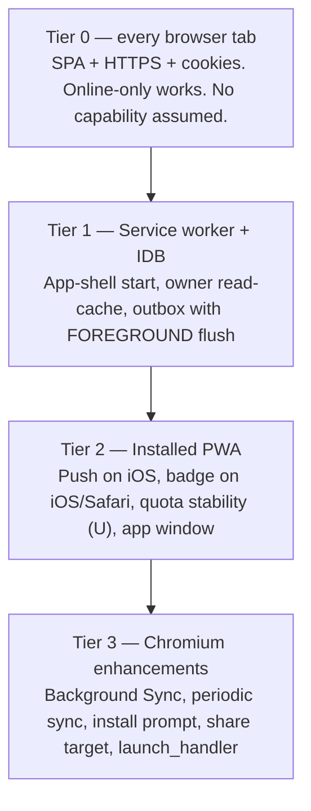

# Platform Compatibility Matrix

Doc ID: PLT-01 · Owner: Frontend/Platform Architecture (browser-platform specialists) · Version 1.0 · Status: Under Review
Relates: ADR-T02, ADR-T10 · FF-09 · PWA-01, OFF-01, MOB-01 · Research RES-02 (F1–F14)

## 0. How to read cells
| Mark | Meaning |
|---|---|
| **V(src)** | Verified **from a named primary documentation source** (MDN, MDN BCD JSON, WebKit blog, Chrome docs), accessed 2026-10-25, listed in RES-02. Not run on a device. |
| **V(dev)** | Verified on a real device/OS version by this project. **None exist yet** (OPEN-FE-01). Cells upgrade only with a dated test record. |
| **U** | Unverified: secondary source, inferred (including BCD `mirror` rows with no stated version), or not found. Treat as "may not work"; the fallback in §3 must carry the journey. |
| `—` | Not applicable. |
Platforms: **D-Chr** desktop Chrome/Edge (Chromium) · **D-FF** desktop Firefox · **D-Saf** desktop Safari (macOS) · **A-Chr** Android Chrome · **A-Sam** Samsung Internet · **iOS-T** iOS/iPadOS Safari tab (and other iOS browsers, same WebKit engine) · **iOS-I** iOS/iPadOS installed Home Screen web app. Versions in parentheses are the first version listed in source. Chromium-family rows marked "mirror" in BCD (Edge, Samsung, Chrome Android) are source-derived from Chrome.

## 1. Capability matrix
| Capability | D-Chr | D-FF | D-Saf | A-Chr | A-Sam | iOS-T | iOS-I |
|---|---|---|---|---|---|---|---|
| **Install to home/desktop** | V(src): install icon in URL bar (MDN) | V(src): **no native install; extension required** (MDN) | V(src): macOS 14+ "Add to Dock" (MDN) | V(src): menu "Install" (MDN) | U: MDN silent; `beforeinstallprompt` present (5.0, V(src)) so install UI likely exists | V(src): "Add to Home Screen" available iOS 16.4+ from any supporting browser (MDN); no install prompt API | V(src): is the installed state; tied to installing browser; not listed in Settings (MDN) |
| **`beforeinstallprompt`** | V(src): Chrome 44 | V(src): none | V(src): none | V(src): 44 | V(src): 5.0 | V(src): none | — |
| **Service worker / offline shell** | V(src): SW 40 (Edge 17), navigationPreload 59 | V(src): 44; navigationPreload 99 | V(src): 11.1; navigationPreload 15.4 | V(src): 40 | V(src): 40; navPreload 4.0 | V(src): 11.1 (Safari iOS) | V(src) for engine; U for standalone-specific lifecycle quirks |
| **Web Push** | V(src): Chrome 42, Edge 17 | V(src): 44 (desktop must be running: U) | V(src): Safari 16, macOS Ventura+ | V(src): 42 | V(src): 40 (mirror) | V(src): **not available in a tab** — Home Screen apps only (WebKit blog) | V(src): iOS 16.4+, permission only on direct user gesture; each push must show a notification; allow `*.push.apple.com` |
| **Declarative Web Push (no SW handler)** | U | U | U: reported Safari 18.5/macOS 15.5 (secondary) | U | U | U | U: reported iOS 18.4 Home Screen (WebKit blog via search summary; scope sources conflict) |
| **Background Sync (`registration.sync`)** | V(src): 49 | V(src): **none** | V(src): **none** | V(src): 49 | V(src): 4.0 | V(src): **none** | V(src): **none** |
| **Periodic Background Sync** | V(src): 80 (installed/engagement preconditions U) | V(src): none | V(src): none | V(src): 80 (preconditions U) | V(src): 80 | V(src): none | V(src): none |
| **`navigator.storage.persist()`** | V(src): 55, auto-decided by engagement, no prompt | V(src): 57, **prompts user** | V(src): 15.2, auto-decided | V(src): 55 | U: BCD "mirror" without version | V(src): 15.2 auto-decided | V(src): API as iOS-T; eviction exemption for installed apps **U** (secondary R2 says exempt; MDN silent) |
| **`storage.estimate()`** | V(src): 61 | V(src): 57 | V(src): **17** (absent in older) | V(src): 61 | U | V(src): 17 | V(src): 17 |
| **Quota / eviction** | V(src): up to 60% disk; LRU eviction of best-effort origins under pressure | V(src): best-effort min(10% disk, 10 GiB); persistent up to 50% | V(src): ~60% disk/origin; **7-day eviction of script-writable data without user interaction when tracking prevention on** | V(src): as Chromium | U | V(src): as Safari incl. 7-day rule | V(src): Home-Screen app uses browser-app quota (~60%); 7-day-rule exemption **U** |
| **Web Locks (`navigator.locks`)** | V(src): 69 | V(src): 96 | V(src): 15.4 | V(src): 69 | U (mirror) | V(src): 15.4 | V(src): 15.4 |
| **Web Share Target (manifest)** | V*: Chrome documents support, installed-only; version U (MDN: limited availability, experimental) | U | U | V*: as D-Chr (Chrome docs) | U | U | U |
| **Badging (`setAppBadge`)** | V(src): 81 (Windows, macOS; ChromeOS 91; **no Linux OS API**) | V(src): none | V(src): 17, **installed web apps only** (macOS Sonoma+) | V(src): 81; OS display behaviour U | U | V(src): **not exposed in Safari tabs** | V(src): 16.4; badge displays only with notification permission granted |
| **Deep-link capture into installed app** | U | U | U | U (WebAPK intent filters expected, not verified) | U | — | U (links from Mail/Messages expected to open Safari; push taps open app — not verified) |
| **Passkeys (WebAuthn) incl. standalone mode** | U (OPEN-13) | U | U | U | U | U | U — must be device-tested; password fallback required |
| **Camera/mic for in-app capture** | U | U | U | U | U | U | U — owning remote must provide upload alternative |

## 2. Capability tiers (design consequence)

Rule: **a journey may only depend on Tier 0/1**. Tier 2/3 features may improve it; each has a fallback (§3). This is how FF-09 is satisfied structurally rather than by exception.

## 3. Fallback and test requirement per capability (FF-09)
| Capability | Feature detection | Fallback (must exist before capability is used) | Test requirement |
|---|---|---|---|
| Install | `beforeinstallprompt` listener; `display-mode` / `navigator.standalone` | Instruction sheet (iOS/Safari); app fully usable as tab | E2E: Chromium prompt capture. **Manual**: iOS Add-to-Home-Screen, Samsung Internet install, Safari Dock |
| Service worker / offline | `'serviceWorker' in navigator` | Online-only mode, connectivity chip says offline unavailable | E2E on Chromium, WebKit, Firefox: offline start, update, kill-switch SW |
| Web Push | `'PushManager' in window` and (iOS) standalone | In-app notification centre + email (ADR-T20) | **Device**: iOS installed, Android Chrome, Samsung, desktop Chrome/Safari; permission-after-gesture; notification click deep link; subscription expiry (410) |
| Declarative push | feature probe | Imperative SW handler | Spike on iOS ≥ 18.4 device (OPEN-FE-02) |
| Background Sync | `'SyncManager' in window` | Foreground flush: `online`, `visibilitychange`, start, "Sync now" | Unit: flusher identical with/without SyncManager; E2E: forced offline→online on WebKit/Firefox (no Background Sync) |
| Periodic Sync | `'periodicSync' in registration` | Refresh on foreground | none required (enhancement) |
| `persist()` | `navigator.storage?.persist` | Best-effort storage; budget conservative; no "your data is safe" claims | Unit: quota-exceeded path; Firefox prompt behaviour manual |
| `estimate()` | `navigator.storage?.estimate` | Fixed byte caps from OFF-01 §5 | Safari <17 simulated absence |
| Web Locks | `'locks' in navigator` | BroadcastChannel leader election + idempotent server ops | Unit with stub removed |
| Share target | manifest only | In-app "Add evidence" | Phase 2; Chromium manual |
| Badging | `'setAppBadge' in navigator` | In-app unread indicator | Manual iOS installed (needs notification permission), desktop Chromium |
| Deep links | n/a | Every link works in a tab; unauth ⇒ `/login?return=` | **Device**: Mail → link on iOS installed, Android WebAPK, Windows installed Chrome |
| Passkeys standalone | `PublicKeyCredential` | Password / SSO | **Device** per platform (OPEN-13) |

## 4. Notable platform behaviours that shape the design
| Behaviour | Source status | Design consequence |
|---|---|---|
| No Background Sync on Safari and Firefox | V(src) | Outbox flushes in the foreground first-class (ADR-T10) |
| iOS push only for Home-Screen apps, gesture-gated | V(src) | Install-gated push UX (PWA-01 §8) |
| Tab-installed and browser-installed copies don't share storage | V(src) MDN | Server is the only sync channel; no "your app has your drafts" copy |
| Safari evicts script-writable data after 7 days without interaction in browser use | V(src) | No long-lived client-only state; outbox TTL ≤ 14 d plus warning when unsent items are > 5 d old |
| `estimate()` absent on Safari < 17 | V(src) | Detect; fixed budgets |
| Chromium `persist()` decided by engagement, Firefox prompts | V(src) | Request after install/first queued write, never on load |
| EU / region-specific home-screen web app behaviour | U | Check on EU-configured device before regional launch (OPEN-FE-11) |
| WebView-embedded browsers (in-app browsers from social apps) | U | Detect `wv`/in-app UA, show "Open in browser" banner; no SW/push assumed |

## 5. Verification plan (turns U into V(dev))
| Layer | Scope | Cadence | Evidence recorded |
|---|---|---|---|
| CI emulation | Playwright Chromium, Firefox, **WebKit** (FF-09 e2e) for SW update, offline start, outbox flush, fallback paths | Every PR touching SW/sync/shell | Test report. **WebKit ≠ iOS Safari**: no APNs, no Home-Screen install, no real eviction — never used to upgrade a cell to V(dev). |
| Real-device suite | iPhone (current iOS + N−1), iPad, Pixel (Chrome), Samsung (Samsung Internet), Windows (Chrome, Edge, Firefox), macOS (Safari, Chrome) | Before launch; every release that touches SW, push, install, auth; full run quarterly | Dated record per cell: device, OS, browser version, result → matrix cell becomes `V(dev) <date>` |
| Telemetry | `ts.install_state`, `push.permission`, `storage.usage_pct`, `client.version_age_days` by platform class | Continuous | Dashboard; unexpected platform behaviour opens an [OPEN] |
| Device lab | Owned devices or real-device cloud | **OPEN-FE-01** (budget/vendor undecided) | — |
Release gate (FF-09 extension): a release that adds a new capability use without a §3 row (fallback + test) fails review.

## 6. Open items
OPEN-FE-01 device lab · OPEN-FE-02 declarative push · OPEN-FE-05 share target value · OPEN-FE-11 EU/regional iOS behaviour and in-app-browser handling · OPEN-13 (global) passkey matrix.
