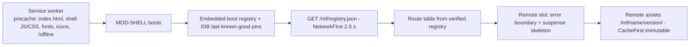
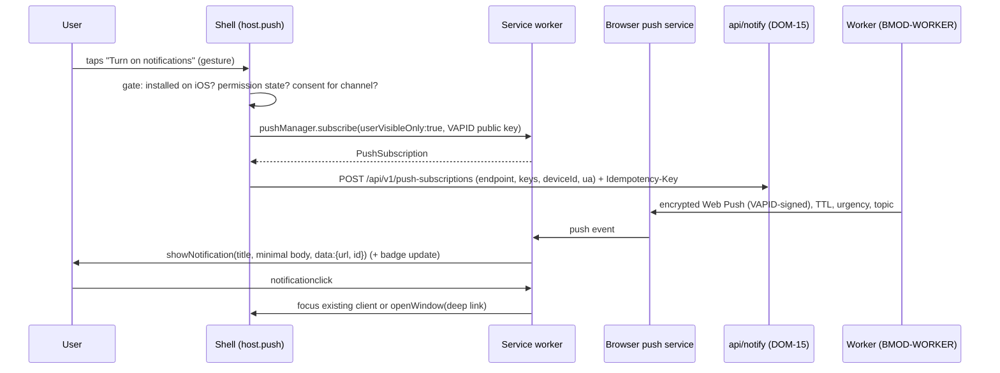
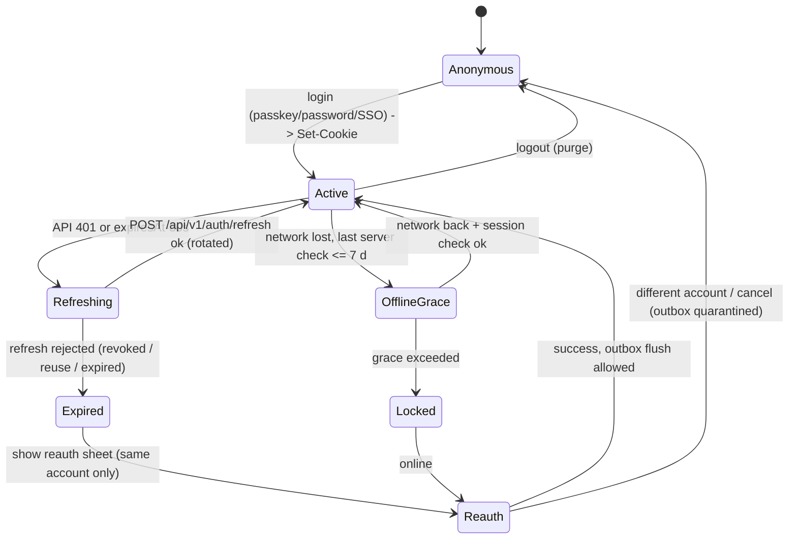

# PWA Architecture

Doc ID: PWA-01 · Owner: Frontend/Platform Architecture (PWA engineering) · Version 1.0 · Status: Under Review

> **Revision 2 folded in (2026-10-27)** from `PWA_MOBILE_REVIEW_FIXES.md`: appended under "Revision 2 additions"; where it differs from text above, the appended text governs. Status unchanged; proposals still need owner/ARB ratification.
Relates: ADR-T02, ADR-T03, ADR-T06, ADR-T10, ADR-T16, ADR-T18, ADR-T19, ADR-T20 · INV-T13, INV-T14, INV-T16 · FF-08, FF-09 · PLT-01 (`PLATFORM_COMPATIBILITY_MATRIX.md`), OFF-01 (`OFFLINE_AND_SYNC_DESIGN.md`), MOB-01, MFA-01 (`09_MODULE_FEDERATION/`), FEA-01 (`10_FRONTEND_ARCHITECTURE/`) · Research: RES-02 (F1–F14)

Tags: **[CONF]** confirmed requirement · **[TARGET]** design decision · **[OPEN]** unresolved · **[REF]** reference code. Capability claims carry `V(src)` (documented in a named primary source, RES-02) or `U` (unverified). **No claim here is device-verified** (OPEN-FE-01).

## 1. Scope and stance
| Topic | Stance |
|---|---|
| Product shape | PWA-first, no store packaging at launch (ADR-T02). Installed PWA and browser tab are the same codebase; the browser tab is always a supported baseline. |
| Reference gap [REF] | `apps/web` ships `public/manifest.webmanifest`, icons and `src/pwa.ts` but **no offline sync** and keeps the bearer token in `localStorage` (`lib/api.ts` `getToken()`). Target replaces both (ADR-T06, ADR-T10). Nothing in the reference service-worker code is inherited. |
| Server is system of record | Every client cache is a disposable convenience (INV-T13). A cache hit is never proof of current state, authorisation or consent. |
| Capability policy | Each platform capability is **feature-detected and has a listed fallback** (FF-09); no capability is required for a core journey. |
| Federation vs SW | One service worker per origin controls shell **and** all remotes (single scope `/`). Federation gives no SW isolation (ADR-T19, `FAULT_ISOLATION_MATRIX.md` FI-19). |

## 2. Web App Manifest [TARGET]
```json
{
  "id": "/",
  "name": "TalentSphere",
  "short_name": "TalentSphere",
  "description": "Prove your skills. Get hired on evidence.",
  "start_url": "/?source=pwa",
  "scope": "/",
  "display": "standalone",
  "display_override": ["standalone", "minimal-ui"],
  "orientation": "any",
  "theme_color": "<token: color.brand.primary>",
  "background_color": "<token: color.surface.base>",
  "lang": "en", "dir": "auto",
  "categories": ["business", "education"],
  "icons": [
    {"src": "/icons/192.png", "sizes": "192x192", "type": "image/png", "purpose": "any"},
    {"src": "/icons/512.png", "sizes": "512x512", "type": "image/png", "purpose": "any"},
    {"src": "/icons/maskable-512.png", "sizes": "512x512", "type": "image/png", "purpose": "maskable"}
  ],
  "screenshots": [{"src": "/shots/wide-1.png", "sizes": "1280x720", "type": "image/png", "form_factor": "wide"},
                  {"src": "/shots/narrow-1.png", "sizes": "720x1280", "type": "image/png", "form_factor": "narrow"}],
  "shortcuts": [
    {"name": "Jobs", "url": "/jobs?source=shortcut"},
    {"name": "My applications", "url": "/applications?source=shortcut"},
    {"name": "Messages", "url": "/messages?source=shortcut"}
  ],
  "launch_handler": {"client_mode": ["focus-existing", "auto"]}
}
```
| Field | Decision / rationale |
|---|---|
| `id: "/"` | Stable identity independent of `start_url` changes. |
| `scope: "/"` | Single scope; remotes are path prefixes on the same origin (FD-03) so every route stays in the app window. |
| `start_url` `?source=pwa` | Lets telemetry split installed vs tab sessions; shell strips the param after reading it. |
| `shortcuts` | Role-neutral entries only; role-specific shortcuts (hiring) cannot be conditional in a static manifest [OPEN-FE-04: per-role manifest vs static]. |
| `launch_handler` | Chromium-only hint (U) — ignored elsewhere; never relied on. |
| `share_target` | **Omitted at launch** (phase 2, Chromium-only, installed-only — RES-02 F8). If adopted: `POST` multipart to `/share-target`, SW stores file in `staging` store and redirects to `/me/evidence/new?shared=1`; shared files are untrusted, size-capped, virus-scanned (BR-T003) and require explicit user confirmation. Product value is [OPEN-FE-05]. |
| `related_applications` | Empty; `prefer_related_applications: false`. |
| Screenshots | Provide `wide` and `narrow` for richer install UI (Chromium; U elsewhere). |
| Theme | Colour values come from design tokens (07_*), not literals; dark-mode `theme_color` via `<meta name="theme-color" media>` per scheme. |

## 3. Application shell

- Shell HTML is a **static, user-independent** document (no per-user data, no tokens, no inline state) so the precached copy is safe for any account (INV-T14).
- Navigation fallback: any in-scope navigation not matching `/api`, `/mf`, `/assets`, `/.well-known` is answered with the precached shell; the router renders the route or the offline/404 screen.
- First paint of a returning user is shell chrome + skeleton from SW cache, never blocked on registry or `/me` (measured by RUM `shell.fcp`; budget in FEA-01 §14).
- Public tokenised flows (referee, email confirm, invite) live under shell-owned `/r/*` [OPEN-FE-06: prefix absent from ID_REGISTRY MOD-SHELL list; propose `/r/*`, `/invite/*`, `/p/*` public profile]; they never use SW per-URL caching (the URL carries a token) — the precache fallback serves the generic shell.

## 4. Service worker strategy
Library: Workbox modules (`workbox-precaching`, `-routing`, `-strategies`, `-expiration`, `-cacheable-response`, `-background-sync` used only where supported) [TARGET]; version pinned, generated by `vite-plugin-pwa` in `injectManifest` mode so routing rules are hand-written, reviewed code, not generated defaults [OPEN-FE-07: confirm plugin compatibility with MF build].

### 4.1 Routing rules per resource class (first match wins)
| # | Match | Strategy (Workbox) | Cache name | Expiry / limits | Rationale and rules |
|---|---|---|---|---|---|
| R0 | `/api/v1/*` (non-public), any request with `Authorization`, any `POST/PUT/PATCH/DELETE` | **NetworkOnly** | none | — | **Authenticated responses are never put in Cache Storage** (cross-account leakage, `Cache-Control: private/no-store`). Offline reads come from the app-layer owner cache in IndexedDB keyed by account (OFF-01 §5). |
| R1 | Navigation requests (`mode: navigate`) | **NavigationRoute → precached `index.html`** (denylist: R0 paths, `/mf/`, `/assets/`, `/sw.js`) | `ts-precache-v<swVersion>` | revision-keyed | Offline-capable app start; `navigationPreload` enabled where supported (V(src): Chrome 59, Firefox 99, Safari 15.4) to avoid SW boot latency. |
| R2 | `/assets/*` (shell, hashed) | **Precache** (revisioned) | `ts-precache-v<swVersion>` | replaced atomically on SW activate | Shell bundle is small and versioned with the SW. |
| R3 | `/mf/<remote>/<version>/**` (hashed, immutable) | **CacheFirst** + `cacheableResponse {200}` + integrity check plugin (§12) | `ts-remote-<remote>-<version>` | keep **current + last-known-good** versions per remote; delete others on `activate`; ≤ 30 days; ≤ 60 entries per version | Immutable URLs make CacheFirst safe; decouples remote releases from SW releases (VC-01). |
| R4 | `/mf/registry.json`, `/mf/<remote>/mf-manifest.json` | **NetworkFirst**, `networkTimeoutSeconds: 2.5` | `ts-registry` | 1 entry per URL; `maxAgeSeconds` 7 d (offline use only) | Freshness matters (rollback speed); stale registry still verifies by signature + `notAfter` (§8, VC-03). |
| R5 | `/api/v1/public/**` (server-asserted public, credential-free) | **StaleWhileRevalidate** | `ts-public-api` | ≤ 200 entries, 24 h; skip if response lacks `X-TS-Cache-Class: public` | Taxonomy/skills catalogue and public job lists. SW issues these with `credentials: 'omit'`; only server-labelled responses are cached (`cacheWillUpdate` plugin). |
| R6 | Public images (`/media/public/**`: avatars, org logos) | **CacheFirst** | `ts-img` | 100 entries, 30 d, purge on logout is unnecessary (public) | Private artefacts (resumes, evidence files, signed URLs) are **never** cached (R0-class by exclusion). |
| R7 | Fonts, icons (`/fonts/*`, `/icons/*`) | **CacheFirst** | `ts-static` | 1 y (hashed) | |
| R8 | Third-party origins (Stripe, push services, OTLP) | **NetworkOnly** (not intercepted) | — | — | CSP `connect-src` allowlist; never cached. |
| R9 | Anything else | Pass through (no handler) | — | — | Deny-by-default for caching: unknown routes are not cached. |

### 4.2 Registration and scope
- Registered by the shell after first interactive paint (`load` + idle), `updateViaCache: 'none'`, script at `/sw.js` served `Cache-Control: no-cache`, root scope `/`.
- SW handles **no business logic** and never reads tokens (it cannot — cookies are httpOnly and attached by the browser to same-origin fetches; the SW does not touch them).
- SW message API (`postMessage`): `SKIP_WAITING`, `PURGE_USER_CACHES`, `GET_VERSION`; messages are accepted only from same-origin clients and validated by schema.

## 5. Update lifecycle and `skipWaiting` policy
```mermaid
sequenceDiagram
  participant B as Browser
  participant SW1 as SW v1 (active)
  participant SW2 as SW v2 (installing)
  participant S as Shell (client)
  B->>SW2: update check (on navigation, focus, every 6 h while open)
  SW2->>SW2: install: precache v2 assets (no skipWaiting)
  SW2-->>S: statechange: installed (waiting)
  S->>S: UpdateManager classifies (normal | critical)
  alt normal
    S-->>S: show non-blocking "Update ready"; apply at idle navigation boundary when no dirty forms and outbox not mid-flush, or on user tap
    S->>SW2: postMessage SKIP_WAITING
  else critical (security / incompatible API: min-client flag)
    S->>S: autosave drafts to IDB, then apply at next navigation
    S->>SW2: SKIP_WAITING
  end
  SW2->>B: activate, clients.claim()
  B-->>S: controllerchange (once)
  S->>S: reload exactly once (guarded by sessionStorage flag)
```
| Rule | Decision |
|---|---|
| Default | **No unconditional `skipWaiting()`** in `install`. A new SW waits until it is applied through the UpdateManager. Rationale: shell JS, registry-selected remotes and cached chunks must not change under an open tab mid-form. |
| Apply conditions (normal) | (a) user taps "Update"; or (b) at a route change when no form is dirty (`host.lifecycle.hasUnsavedWork()` is false) and the outbox flusher holds no lock. Never during an assessment attempt (DOM-07) or a payment redirect. |
| Critical updates | `GET /version.json` (NetworkOnly, `no-store`) carries `minShell` and `critical:true`. Also server responds `426` problem+json `type: /problems/client-outdated` when `X-TS-Client` is below the API floor (VC-06). Shell autosaves drafts, then forces update at the next navigation; if offline it continues read-only and blocks queued-write flush. |
| Remote-only releases | Do **not** need a SW update: new remote versions arrive via the registry (R4) and hashed assets (R3). Applied on next remote load (not mid-session unless `critical`). |
| Multi-tab | `skipWaiting`+reload affects all tabs. Shell broadcasts `ts:update-applying` (BroadcastChannel) so other tabs autosave and reload together. |
| Reload loop guard | At most one automatic reload per 60 s per version; otherwise show a persistent banner. |
| Stale clients | Clients unopened for weeks (iOS installed) boot an old SW, then pull the registry; the shell checks `hostContract` (VC-03) and `minShell`. API floor window ≥ 90 days [TARGET], rationale: installed PWAs may stay closed for months; **measure** with `client_version` histogram, revise to p99 age of active clients. |
| Broken SW | `/sw.js` fetch failing validation (installs but errors) is recoverable by publishing a **kill-switch SW** (same URL) that unregisters itself and deletes `ts-*` caches; runbook in 17_*. Tested in FAULT matrix FI-19. |
| Cache hygiene | `activate` deletes caches not in `EXPECTED_CACHES` (derived from `swVersion` + registry LKG set). |

## 6. Install UX [TARGET]
| Platform | Mechanism | Rule |
|---|---|---|
| Chromium (desktop, Android, Samsung) | Capture `beforeinstallprompt` (V(src): Chrome 44, Samsung 5.0); show our own sheet | Never on first visit. Eligible after **≥ 2 distinct days of use** or after a first high-intent action (application draft saved, evidence added), whichever first. Dismiss ⇒ back off 30 days; after 3 dismissals stop and leave menu entry in Settings. Rationale: install prompts without value context are low-conversion/annoying; thresholds are [TARGET] to be tuned from `install_prompt_shown/accepted` telemetry, not assumed. |
| Safari iOS/iPadOS (any browser, 16.4+) | No programmatic prompt (U for Safari/Firefox: no `beforeinstallprompt`, V(src)) | Detect `!navigator.standalone && /iPad\|iPhone/` (or `display-mode` media query) and show a **how-to-add instructions sheet** (Share → Add to Home Screen) tied to the benefit (notifications, app icon). Same back-off rules. |
| Safari macOS 14+ | "Add to Dock" manual (V(src) MDN) | Instruction sheet in Settings only. |
| Firefox desktop | No native PWA install (V(src) MDN: extension needed) | No prompt; app works as a normal tab. |
| Installed detection | `matchMedia('(display-mode: standalone)')`, `navigator.standalone` (iOS), `appinstalled` event | Stored in telemetry as `ts.install_state`; UI changes (badge, push prompt) key off it. |
| Account mixing | A PWA is tied to the browser that installed it (V(src) MDN): tab and installed copies **do not share** storage. | Do not tell users their drafts "sync to the app" — server sync is the only bridge. |
| Uninstall/data | Uninstall behaviour differs per browser (V(src)); data purge not guaranteed. | Offline data minimised; logout purge (OFF-01 §10) is the control, not uninstall. |

## 7. Permissions UX
| Permission | When requested | Pre-prompt | If denied |
|---|---|---|---|
| Notifications | On a user gesture on a "Turn on notifications" control only (iOS requires direct interaction — V(src) F1; also best practice elsewhere); never on load | Explains exactly which events (interview invite, application status, new message), shows a preview | In-app notification centre + email (Brevo via provider port, ADR-T20) remain; Settings shows state and OS-specific re-enable help |
| Storage persistence | `navigator.storage.persist()` after install **or** first queued write (not on load: Firefox prompts, V(src) F4) | None needed for Chrome/Safari (auto-decided) | Continue best-effort; show "offline data may be cleared by the browser" only in Offline settings |
| Camera/mic (interview, evidence capture) | At the moment of the action, by the owning remote through `host.permissions` | Remote-specific copy | Offer upload alternative |
| Geolocation | Not requested at launch [TARGET] | — | — |
Remotes **never** call `Notification.requestPermission` or `pushManager.subscribe` directly; they call `host.push.requestEnable()` so gating, copy and analytics stay uniform.

## 8. Push via Web Push / VAPID [TARGET]

| Topic | Decision |
|---|---|
| Keys | One VAPID key pair per environment; private key only in `apps/worker` secrets (INV-T14); public key shipped in config. Rotation: new key requires re-subscription; shell re-subscribes silently when `applicationServerKey` mismatch is detected (`pushsubscriptionchange` where fired; otherwise on next foreground). |
| iOS gating | Push UI is **only offered when installed (standalone) and `PushManager` present** (V(src) F1: Home Screen apps only, permission after gesture). In a Safari tab the CTA becomes "Install to get notifications" + instructions. Allow `*.push.apple.com` egress from the worker (V(src)). |
| Payload privacy | Payloads carry **no personal data and no secrets**: `{type, notificationId, deepLink, titleKey}`; title/body are generic ("New message", "Application update") unless the user opted into previews. The SW fetches details only after click, through the authenticated app. Push-service operators and OS notification centres are third parties/lock-screen readers. |
| Visible notification | Every push shows a notification (`userVisibleOnly:true`; WebKit requires it — V(src)). Silent data pushes are not used. |
| Delivery semantics | Best-effort, may be delayed/dropped; **never the only channel** for consequential events (interview invites also in-app + email). Dedupe by `notificationId`; collapse with `topic`. |
| Lifecycle | One subscription row per (account, device). On logout: `unsubscribe()` + server delete (OFF-01 §10). Dead endpoints (410/404) pruned by worker. Subscriptions belong to the browser instance, not the person. |
| Consent | Channel preferences are DOM-15/DOM-22 data; push respects them server-side; browser permission ≠ consent to marketing (marketing push not offered at launch). |
| Badge | `navigator.setAppBadge(unreadCount)` guarded by feature detection (V(src): Chromium 81, Safari 17 installed, iOS 16.4 Home Screen; Firefox none); iOS needs notification permission to display. Updated from push event and on foreground. |
| Declarative Web Push | Spike only (OPEN-FE-02). |
| Test | Real devices required (PLT-01 §5); Playwright WebKit cannot validate APNs/permission flows. |

## 9. Deep links
| Surface | Behaviour | Status |
|---|---|---|
| URL scheme | Canonical `https://app.<domain>/…` routes owned by MODs (ID_REGISTRY). **No custom URL schemes.** Cross-module links are built with `@ts/host-sdk/routes` path builders (HC-01 §3, MFA-01 §6) so a remote cannot break another's links. | [TARGET] |
| Unauthenticated | `/login?return=<path>`; `return` must be a same-origin path matching `^/[^/\\]` and is re-validated by the router against the route table (no open redirect). After login, land on `return`. | [TARGET] |
| Push / email links | Always the https deep link; notification click focuses an existing window and `postMessage`s a navigate, else `openWindow(url)`. | [TARGET] |
| Android installed (WebAPK) | Links inside scope **may** open in the installed app. | U |
| iOS installed | Links tapped in Mail/Messages/Safari likely open **Safari, not the Home Screen app**; notification taps do open the app (V(src) F1 implies push targets the Home Screen app). | U — verify on device |
| Desktop Chromium | "Open in app" link capturing browser-dependent; `launch_handler` hint only. | U |
| Fallback | Every deep link must work in a plain tab. Optional "Open in app" banner using `getInstalledRelatedApps` is Chromium-only and U. | [TARGET] |
| Tokenised links (referee, confirm) | Single-use hashed tokens (INV-T05); page sets `Referrer-Policy: no-referrer`, removes the token from the address bar via `history.replaceState` after exchange, exchange is a `POST` (so the token is not retained in API GET logs) [OPEN-FE-06 with security]. | [TARGET] |

## 10. Auth lifecycle with BFF cookies (ADR-T06) [TARGET]
Cookies: `__Host-ts_at` (access, 15 min) and `__Secure-ts_rt` (refresh, rotating, `Path=/api/v1/auth/refresh`, `SameSite=Strict`); both `HttpOnly; Secure` (`__Host-` cannot be path-scoped, see SEC-02 §2.3). JS never sees either (INV-T14, INV-T16). Refresh-token lifetime is not fixed by ADR-T06 → [OPEN-FE-08].

| Concern | Design |
|---|---|
| Session view | Shell calls `GET /api/v1/me` → `{status, accountAlias, roles[], activeOrgId, capabilitiesEtag, accessExpiresAt}`; cached non-secret snapshot in `ts-meta.session`. Remotes get only the read-only `SessionView` via `host.session`. |
| Refresh single-flight | **All refreshes run under `navigator.locks.request('ts-refresh')`** (V(src) F10: Chrome 69, Firefox 96, Safari 15.4) and the result is broadcast (BroadcastChannel `ts-session`). Rationale: BR-T050 revokes the whole token family on refresh-token reuse, so two tabs/SW refreshing with the same old cookie would log the user out. Backend should also accept a short same-client grace for the previous refresh token (**[OPEN-FE-10] security/backend: grace window ≤ 10 s**). |
| Expired access while offline | Reads: allowed from owner cache until **offline grace** ends = 7 days since last successful server session check [TARGET; rationale: bounds exposure on a lost device and aligns with Safari's 7-day script-storage eviction (V(src) F4); tune with security review]. Writes: queued-write operations may be enqueued during grace tagged `accountAlias` + `sessionEpoch`; none is sent until the session is valid. |
| Reconnect with dead session | `needs-reauth`: outbox paused, reauth sheet (passkey first). Success **as the same account** → resume. Different account / cancel → outbox quarantined (never sent as another account), offered export/discard. |
| 401 semantics | One meaning: session invalid → try single-flight refresh once → else Reauth. 403 is not handled globally (surface inline). [REF] `lib/api.ts` has the same 401 stance; target removes the localStorage token. |
| CSRF | Same-origin only; unsafe methods require custom header `X-CSRF-Token` (per-session value issued by `GET /api/v1/me` / login) plus server `Origin`/`Sec-Fetch-Site` check; the API client in host-sdk adds it, remotes cannot omit it [OPEN-FE-10 with security for exact token vs header-only policy]. |
| Logout offline | httpOnly cookies cannot be cleared by JS offline. Shell purges local data, sets `ts-meta.signedOutPending=true`, locks the UI locally, and on reconnect **calls `/api/v1/auth/logout` before any other request** to revoke the server session. Lost-device revocation: sessions list + "sign out everywhere" in MOD-ACC. |
| Shared device | Login option "This is a shared computer": no offline cache, no push, no persist(), shorter session [TARGET]. |
| Passkeys in standalone | WebAuthn inside installed iOS/Android PWAs: U — device test (PLT-01 §5). Password fallback always present. |
| SSO (OIDC/SAML) | Redirect flows leave and re-enter scope; callback lands on `/login/callback` (shell). Installed iOS: the redirect may open in an in-app sheet; U. |

## 11. Offline behaviour summary (detail in OFF-01)
Offline classes per feature are fully specified in `OFFLINE_AND_SYNC_DESIGN.md` §2 (ADR-T10: queued writes only for application drafts, profile edits, message compose, notes; everything consequential online-only). UI contract: a global **connectivity chip** (online / offline / syncing N / needs attention), per-item "Waiting to sync" badges, and disabled-with-reason controls for online-only actions. Offline never fakes success of a consequential action (submit application, verify, pay, consent change).

## 12. Security of caches and the PWA surface (ADR-T19, INV-T14)
| Risk | Control |
|---|---|
| Cross-account leak via Cache Storage | R0: authenticated responses never cached by SW; only public, server-labelled responses (R5); IDB owner cache per-account DB, purged on logout/switch (OFF-01). |
| Poisoned SW cache / tampered remote asset | Registry entries are **signed** (Ed25519, key id, `notAfter`, per-remote monotonic `sequence`); shell verifies before use; assets have SRI hashes in the entry. Because ESM `import()` cannot carry per-call `integrity`, enforcement is layered: (L1) immutable content-hashed URLs from the verified registry, (L2) import-map/`modulepreload` `integrity` where the browser supports it (U), (L3) SW integrity plugin hashing R3 responses against the registry's `assets[].integrity` before cache write and serve. First-load-before-SW is only covered by L1/L2. **[OPEN-FE-03]** spike; no claim of full SRI until verified. |
| XSS ⇒ cache read | Same-origin XSS can read IDB and call APIs with cookies; federation does not change this (ADR-T19). Controls: strict CSP, Trusted Types, no `dangerouslySetInnerHTML` without sanitizer policy, minimal data cached, short offline grace (FEA-01 §12). |
| Stale-but-sensitive data | Per-class max age (OFF-01 §5); recruiters' views of candidate evidence are never cached (INV-T15 requires a live consent scope). |
| Push payload leakage | §8 payload privacy. |
| Service-worker scope hijack | SW served from `/sw.js` with `Service-Worker-Allowed` unset; no user-controlled path on the origin can host a script (upload origin separated: user uploads on a different registrable origin/`Content-Disposition: attachment`). |
| Install-state spoofing | Install state is a UX hint only; never an authorisation input. |
| Share target abuse (if enabled) | Files untrusted, size/type allowlist, virus scan before visibility (BR-T003), CSRF-protected endpoint. |

## 13. Capability fallbacks (FF-09 summary; full cells in PLT-01)
| Capability | Detect | Fallback |
|---|---|---|
| Service worker / offline | `'serviceWorker' in navigator` | Online-only SPA; connectivity chip shows "Offline unavailable" |
| Push | `'PushManager' in window` + installed (iOS) | In-app notifications + email |
| Background Sync | `'SyncManager' in window` | Foreground flush on `online`, `visibilitychange`, app start, manual "Sync now" |
| Periodic sync | `'periodicSync' in registration` | Refresh on foreground |
| Badging | `'setAppBadge' in navigator` | In-app unread count only |
| Storage persist / estimate | `navigator.storage?.persist` / `estimate` | Best-effort storage; conservative budget |
| Web Locks | `'locks' in navigator` | BroadcastChannel leader election + server-side idempotency (degraded) |
| Share target | n/a (manifest) | In-app "Add evidence" |
| beforeinstallprompt | event | Instruction sheet |
| Network Information (`saveData`) | `navigator.connection` | Default prefetch policy |

## 14. Telemetry for PWA health (feeds FEA-01 §11)
`ts.install_state`, `sw.version`, `sw.update_applied`, `sw.update_wait_ms`, `outbox.depth`, `outbox.oldest_age_s`, `storage.usage_pct` (when `estimate()` available), `push.permission`, `push.delivery_to_click`, `client.version_age_days`. No PII; account alias hashed.

## 15. Open items (this doc)
OPEN-FE-01 device lab · OPEN-FE-02 declarative push · OPEN-FE-03 SRI under federation · OPEN-FE-04 role-specific shortcuts · OPEN-FE-05 share target value · OPEN-FE-06 public/tokenised route prefixes + token exchange · OPEN-FE-07 vite-plugin-pwa × MF compatibility · OPEN-FE-08 refresh-token lifetime · OPEN-FE-10 CSRF policy + refresh grace window. (Register in `24_*` OPEN list with global numbers.)

# Revision 2 additions (folded 2026-10-27 from `PWA_MOBILE_REVIEW_FIXES.md`)

## 1. iOS Web Push claim: one marker, used everywhere (REVW-37)
The claim recurs in many documents with different source tiers. The canonical form is defined here and in PLT-01 (marks V(src), V(dev), U):

> **IOS-PUSH-CLAIM** - Web Push on iOS and iPadOS is available only to Home Screen web apps (installed), after a user gesture, from iOS 16.4. **V(src)** (WebKit and MDN documentation, PLT-01 section 1; accessed 2026-10-25). **Not device-verified**: no V(dev) record exists (OPEN-FE-01 / OPEN-12).

Rule: any document that repeats the claim writes "(V(src), PLT-01; not device-verified)" or links to this text; none states it unmarked and none cites a secondary source (RES-01 R2) for it.

| Place that repeats the claim | Marker status | Fix |
|---|---|---|
| PLT-01 sections 1, 4 | V(src) present | none (source of the marker) |
| PWA-01 section 8 "iOS gating" | V(src) F1 present | add "not device-verified" |
| MOB-01 sections 3, 4 | V(src) present | add "not device-verified" |
| ACTION_REGISTRY ACT-NTF-04; UX-07 install and push paragraph | cites RES-01 R2 only | replace with the canonical marker |
| FEA-01 section 3 "Browser targets" (iOS 16.4+ floor) | "PLT-01" without tier | add "(V(src), not device-verified)" |
| PROJECT_MASTER section 6 table; ADR-T02 "secondary sources" (outside this folder) | no marker, secondary tier | governance pass: use the canonical marker |

The declarative-push row in PLT-01 was updated by another editor to V(src) for several columns; the product-integration part stays unverified.

## 2. Service worker rules for the bundled default and gated back-office code (REVW-07, REVW-08)
PWA-01 section 4.1 rules R2 and R3 are written for federated remotes under `/mf/**`. In the default bundled mode (ADR-T23) there is one build. Overlay:

| Rule | Overlay |
|---|---|
| R2 (supersedes the "/assets/* (shell, hashed)" row) | **Precache only** the shell critical path and the offline page (budget B13, <= 1.5 MB). Lazy module chunks under `/assets/` are **not** precached; they are runtime-cached `CacheFirst` on first use (hashed, immutable), expiry as R3 |
| R2b (new) | **Never precache or runtime-cache the back-office path** `/assets/bo/**` (and `/mf/mf-admin/**` when federated). These paths sit behind the authenticated edge rule FD-14; precaching would make every installing client download back-office code and would bypass the rule. A CI test lists the generated precache manifest and fails if any `bo` path is present |
| R3 | Applies only when federated |
| R4 | Applies only when federated (no registry exists in bundled mode) |
| Update apply condition (section 5) | "outbox not mid-flush" applies only after the outbox exists; in Phase 1 the condition is "no dirty form and no unsent draft being edited" |
| Navigation fallback | Unchanged. The back-office and institution routes render the shell, which then requests the gated chunk; an unauthenticated request for the chunk gets `404` and the shell shows "no access" |

## 3. Session contract leftovers (REVW-05, frontend side)
The authoritative contract is SEC-02 section 2.3 / API-STD: `__Host-ts_at` (`HttpOnly; Secure; SameSite=Lax; Path=/`), `__Secure-ts_rt` (`Path=/api/v1/auth/refresh`, `SameSite=Strict`), `X-CSRF-Token`, `GET /api/v1/me`, `POST /api/v1/auth/refresh` and `/auth/logout`. No `/bff/*` namespace exists. Read the following as corrected: PWA-01 section 10 heading ("BFF cookies" means session cookies), FEA-01 section 12 credentials row (SameSite per cookie), MOB-01 section 6 ("session-cookie based"), OFF-01 row 3. A native client would still need a different token transport (new ADR), as MOB-01 says.

## 4. Mobile distribution (MOB-01) consistency
| Item | Overlay |
|---|---|
| Trigger T5 (offline need beyond ADR-T10) | Evidence source is the Phase 1 draft telemetry in OFF-01-REV2 section 0; revisit ADR-T10 first, wrapper second (unchanged order) |
| Option scoring | Unchanged; the iOS-push cell uses the section 1 marker |
| Store-wrapper decision | Unchanged: PWA first; no change from the bundled default |

## 5. Items for the governance pass
IOS-PUSH-CLAIM wording in PROJECT_MASTER section 6 and ADR-T02; confirm FD-14 edge rule is accepted before R2b is implemented; device verification (OPEN-FE-01) is still open, so no cell is upgraded to V(dev).
