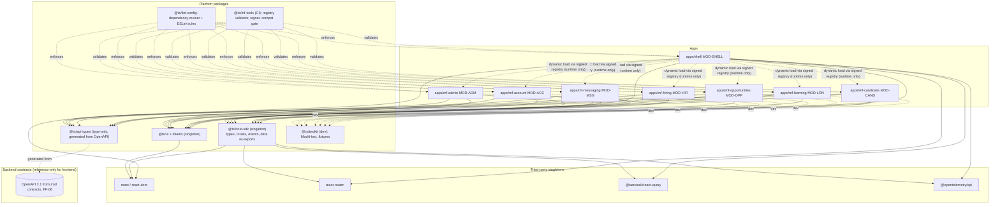
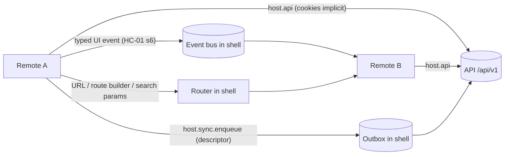

# Dependency and Ownership Map

Doc ID: DEP-01 · Owner: Frontend/Platform Architecture · Version 1.0 · Status: Under Review
Relates: ADR-T03, ADR-T07, ADR-T08, ADR-T17, ADR-T19 · INV-T01, INV-T16 · FF-02, FF-03, FF-04, FF-06, FF-08 · MFA-01, HC-01, FEA-01

Tags: [TARGET] unless marked. Team names are placeholders for roles; the count and split depend on OPEN-03 (fewer than 3 frontend teams ⇒ `MF_MODE=bundled`, ownership table collapses to path-based CODEOWNERS only).

## 1. Dependency graph (build-time and load-time)

Reading rules: solid arrows are compile/bundle dependencies, the single dashed arrow from SHELL is the only shell→remote relationship and exists **only at runtime through the registry** (no import). There are **no edges between remotes** (FF-03) and the graph is acyclic (FF-04).

## 2. Runtime interaction paths (allowed)

Everything else (direct calls, shared mutable globals, `postMessage` between remotes, shared storage keys, reading another remote's query keys) is forbidden.

## 3. Ownership
| Unit | Path (monorepo, ADR-T17) | Owning team | Required reviewers (CODEOWNERS) | Release cadence | Change control |
|---|---|---|---|---|---|
| Shell MOD-SHELL | `apps/shell` | Platform Frontend | Platform Frontend + Security for auth/session/SW | Weekly, staged | Host Contract changes need ARB note (MFA-01 §15) |
| `@ts/host-sdk` | `packages/host-sdk` | Platform Frontend | Platform Frontend + ≥ 1 remote owner | With shell | Semver; contract tests mandatory |
| `@ts/ui`, tokens | `packages/ui` | Design System (may be Platform Frontend until OPEN-03 resolved) | Design System + a11y lead | Weekly | Breaking = major; visual regression |
| `@ts/api-types` | `packages/api-types` (generated) | API platform (backend) generates; Platform Frontend owns tooling | Backend module owner for the changed paths | On every OpenAPI change | FF-06 (oasdiff) gate |
| `@ts/mf-tools` | `packages/mf-tools` | Platform Frontend (release engineering) | Security for signer/validator | As needed | Keys never in repo |
| `@ts/lint-config` | `packages/lint-config` | Platform Frontend | Architecture Review Board delegate | As needed | Rule removal = ARB decision |
| `@ts/testkit` | `packages/testkit` | Platform Frontend | Remote owners consulted | With host-sdk | |
| MOD-CAND | `apps/mf-candidate` | Candidate Experience | team | Continuous (independent) | Per MFA-01 §12 |
| MOD-LRN | `apps/mf-learning` | Learning & Assessment | team + integrity reviewer | Continuous | assessment-runner changes need integrity suite |
| MOD-OPP | `apps/mf-opportunities` | Opportunities & Applications | team | Continuous | ranking inputs allowlist review (INV-T19) |
| MOD-HIR | `apps/mf-hiring` | Hiring Workspace | team + privacy reviewer for consent-scoped views | Continuous | no auto-reject UI (INV-T09) |
| MOD-MSG | `apps/mf-messaging` | Collaboration & Notifications | team + safety reviewer for report/block | Continuous | |
| MOD-ACC | `apps/mf-account` | Account & Trust | team + Security + Billing owner | Gated | strict review |
| MOD-ADM | `apps/mf-admin` | Platform Back-office | team + Security | Gated | internal canary first |
| OpenAPI / API modules | `apps/api`, `packages/contracts` [REF layout] | Backend module teams | per module | independent | FF-02, FF-06, FF-07 |
| Registry + signing keys | release infra | Platform Frontend (release eng.) + Security | two-person rule for key ops [OPEN-FE-16] | n/a | audit log of every publish |
Escalation key per remote lives in the registry entry (`owner.escalation`), personal contacts do not.

## 4. Allowed / forbidden dependencies
| # | From | To | Verdict | Enforcement |
|---|---|---|---|---|
| 1 | Shell | Remote (load) | **Allowed — runtime only**, via verified registry; never `import` | MF config check; dependency-cruiser forbids `apps/mf-*` imports from `apps/shell` |
| 2 | Shell | `@ts/host-sdk`, `@ts/ui`, singletons | Allowed | — |
| 3 | Remote | `@ts/host-sdk` (incl. `/routes`, `/events`, `/data`, `/testing` in tests only) | Allowed (required) | FF-04 manifest validator |
| 4 | Remote | `@ts/ui` | Allowed (singleton) | — |
| 5 | Remote | `@ts/api-types` | Allowed (type-only; erased at build) | `importsNotUsedAsValues`/lint |
| 6 | Remote | its own generated API operations (bundled) | Allowed; transport only via `host.api` | ESLint `no-restricted-globals` for `fetch`, `XMLHttpRequest`, `WebSocket`, `EventSource` (except host-provided) |
| 7 | Remote | **another remote** (import, deep path, MF `remotes` config, shared mutable module) | **Forbidden** | FF-03 (dependency-cruiser + MF config check) |
| 8 | Remote | shell internals (anything not exported by `@ts/host-sdk`) | **Forbidden** | dependency-cruiser path rule |
| 9 | Remote | `document.cookie`, `localStorage`/`sessionStorage`/`indexedDB` for app data, `navigator.serviceWorker`, `Notification.requestPermission`, `pushManager` | **Forbidden** (use `host.*`) | ESLint rules; CSP does not stop these — hygiene only (ADR-T19) |
| 10 | Remote | Tokens/credentials in any form | **Forbidden** and none exist (INV-T16, ADR-T06) | Secret scan; no API returns them |
| 11 | Remote | `packages/domain`, `packages/policy` (backend business rules/authz) | **Forbidden** — UI shows server state and `allowedActions`; no restated rules (INV-T01) | dependency-cruiser |
| 12 | Remote | `packages/contracts` (Zod runtime) | Forbidden at runtime; types only via `@ts/api-types` | dependency-cruiser |
| 13 | Remote | New third-party package that is also on the shared list | Must be declared in `shared[]` with policy | FF-04 |
| 14 | Remote | New third-party package otherwise | Allowed, **bundled per remote**; license/SCA and size budget gates | CI |
| 15 | `@ts/ui` | `@ts/host-sdk` or any remote | **Forbidden** (UI is leaf) | dependency-cruiser |
| 16 | `@ts/host-sdk` | `@ts/ui`, remotes, shell internals | **Forbidden** (contract is leaf; only types + re-exports) | dependency-cruiser |
| 17 | Any package | Remote/app (reverse edge) | **Forbidden** | dependency-cruiser |
| 18 | Any cycle | — | **Forbidden** | FF-04 acyclic check |
| 19 | Remote → Remote data | Via API, URL, or typed events only | Allowed channels | HC-01 §6; lint on `window.__ts_*`, custom DOM events |
| 20 | Test code | `@ts/testkit` | Allowed in `*.test.*`/`testing` only | lint scope |
| 21 | Frontend | Backend module internals (`apps/api/**`) | Forbidden; OpenAPI is the only contract | dependency-cruiser; FF-02 mirror |
Example `dependency-cruiser` rule shape (illustrative):
```js
{ name: 'no-remote-to-remote', severity: 'error',
  from: { path: '^apps/(mf-[^/]+)/' },
  to:   { path: '^apps/(mf-[^/]+|shell)/', pathNot: '^apps/$1/' } }   // $1 = capture group of `from` (dependency-cruiser syntax; verify in spike)
```

## 5. Impact analysis rules
| Change in | Re-test / notify |
|---|---|
| `@ts/host-sdk` minor | Contract suites of all 7 remotes (affected-only: only those using the changed member), shell conformance |
| `@ts/host-sdk` major | All teams; VCD-01 §6.5 train |
| `@ts/ui` minor/major | Visual regression across all remotes; major = train |
| OpenAPI path change | Remotes whose `apiRange` covers the path (computed from generated-client usage) |
| Singleton version bump | All remotes (VCD-01 §6.6) |
| One remote | Only that remote + its contract/e2e; no other team involved |

## 6. Open items
OPEN-03 (global) team count · OPEN-FE-16 key custody/two-person rule · OPEN-FE-27 who owns `@ts/ui` (07_* design-system team vs Platform Frontend) · OPEN-FE-28 CODEOWNERS and repo layout reconciliation with the existing monorepo (FEA-01 §15).
