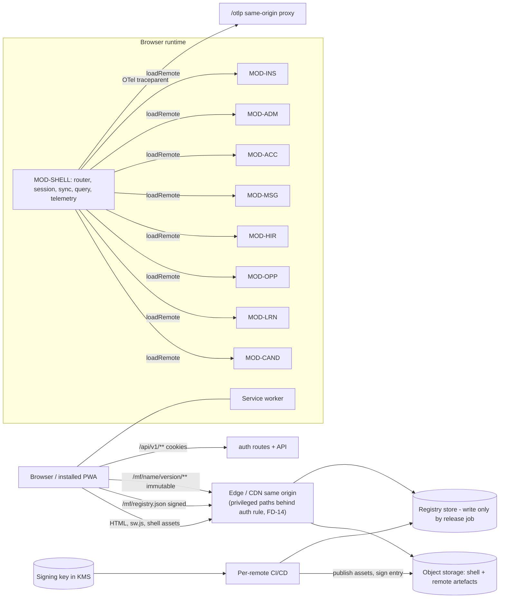
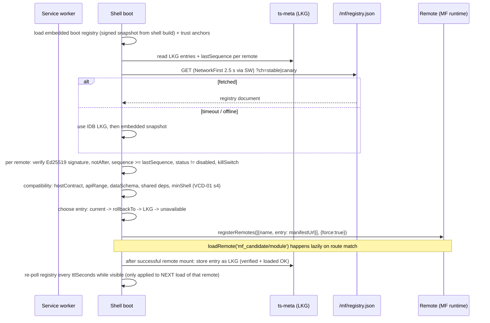

# Module Federation Architecture

Doc ID: MFA-01 · Owner: Frontend/Platform Architecture (Module Federation) · Version 1.0 · Status: Under Review
Relates: ADR-T03 (amended by ADR-T23, proposed), ADR-T16, ADR-T17, ADR-T18, ADR-T19, ADR-T24 (proposed) · INV-T13, INV-T16 · FF-03, FF-04, FF-08 · MOD-SHELL, MOD-CAND, MOD-LRN, MOD-OPP, MOD-HIR, MOD-MSG, MOD-ACC, MOD-ADM, MOD-INS · HC-01, SCH-01/02, VCD-01, FIM-01, DEP-01, PWA-01, OFF-01, FEA-01 · Research RES-01 R1, RES-02 F11

Tags: [CONF] [TARGET] [OPEN] [REF] and **[FED]** (applies only when `MF_MODE=federated`). Local decision IDs `FD-nn` are proposals to be registered as ADR-T23+ by the Architecture Review Board (global OPEN register: REVW-33); FD-09 is superseded by ADR-T23 (below).

> **Amendment banner (ADR-T23; REVW-07, REVW-08; binding decision REV-RES).** The default is **`MF_MODE=bundled`**: one shell build, every module a lazy route-chunk group behind the same typed module contract, per-route error boundaries, and one deploy. The federated runtime (signed registry, last-known-good, canary channel, SRI/SW verification, two-person key custody) is an **activation option**, enabled only when OPEN-03 closes with **at least three named independent frontend teams** and WP-FED-SPIKE has passed (§11.1). Earlier wording that called federated "the production default" is withdrawn. Everything marked **[FED]** is design for that option and is **not on the Phase 1 critical path**. The typed module contract (FD-09, HC-01), remote boundaries (§4) and manifest schema (SCH-01) are kept unchanged as the design for the option, so activating it needs no module rewrite.

## 1. Position
ADR-T03 is under review. ADR-T23 proposes a bundled initial mode with a typed module contract; federation is conditional on ARB approval, evidence of independently staffed teams, and the WP-FED-SPIKE gates. This document describes that optional federated runtime, not the production default. It therefore:
1. Makes federation an **implementation of a typed module contract**, so each remote can be built `federated` or `bundled` (`MF_MODE`) without code change (FD-09).
2. Treats federation as **delivery and fault-containment tooling, not a security boundary** (ADR-T19; §14, FIM-01 §3).
3. Is gated by a spike (WP-FED-SPIKE, §16); the plugin is actively released, but current docs do not establish compatibility with this exact toolchain or SRI behavior (RES-01 R1, RES-02 F11, OPEN-FE-03).

FD-01 through FD-14: see the applicability note after the table. Bundled mode uses the module contract but has no runtime remote registry, remote signing keys, or per-remote rollback. Nothing in this folder claims client assets are confidential; FD-14 controls only who can obtain privileged code, and the server authorises every data call and action (ADR-T19, INV-T01).

| ID | Decision [TARGET] | Why |
|---|---|---|
| FD-01 | Vite + `@module-federation/vite`; MF runtime API (`registerRemotes`, `loadRemote`, runtime plugins) driven by our registry, not hard-coded remote URLs | ADR-T03; RES-02 F11 |
| FD-02 | Shell is the **only owner** of: router instance, QueryClient, session, outbox/sync engine, telemetry provider, theme/i18n providers | Singletons must be unique; keeps credentials out of remotes (INV-T16) |
| FD-03 | Remotes are served **same-origin** under `/mf/<name>/<version>/` | One CSP origin, SW can serve them offline, cookies same-site, no CORS surface |
| FD-04 | Per-remote registry entries are **Ed25519-signed**, carry monotonic `sequence`, `notAfter`, SRI list; trust anchors embedded in the shell build | Registry-store compromise ≠ code execution; anti-rollback |
| FD-05 | Remotes contribute routes **as data** to the shell-owned router; no remote creates a Router | One history/router singleton; route ownership checkable (FF-03) |
| FD-06 | Cross-remote interaction = typed UI event bus + URL only | No hidden coupling (FF-03/INV-T16) |
| FD-07 | Top-level navigation model is shell-owned data (labels, icons, prefix, capability); a remote contributes secondary nav after it loads | Nav renders before/without remote code (offline, failure) |
| FD-08 | Queued offline operations are **data descriptors** executed by the shell | Flush must not depend on a remote being loadable (OFF-01 §8) |
| FD-09 | `MF_MODE=bundled|federated` per environment; **default `bundled`** (ADR-T23) | ADR-T03 mitigation; OPEN-03; REVW-07 |
| FD-10 | Singleton deps declared `singleton:true, import:false` in remotes (host provides) | Prevents silent duplicate React/Router copies; load fails loudly instead |
| FD-11 | Shell persists verified **last-known-good (LKG)** entry per remote and falls back to it, then to `rollbackTo`, then to degraded screen | ADR-T18 |
| FD-12 | The service worker is independent of remote releases (remote assets cached by immutable URL) | Remote deploys need no SW update (PWA-01 R3) |
| FD-13 | Generated OpenAPI client code is bundled **per remote**; transport (`host.api`) is host-provided | Client follows API version of the remote, credentials stay in host |
| FD-14 | **Privileged delivery gate** (REVW-08). Back-office code (MOD-ADM) is served only behind an authenticated edge rule: `/mf/mf-admin/**` when federated, the back-office chunk path `/assets/bo/**` when bundled. The rule requires a valid session and the `admin.console` capability claim and answers `404` otherwise. MOD-INS is customer-facing and is gated by the route guard only. Precache/SW rules exclude the gated paths (PWA-01 R2/R3) | The earlier claim "privileged UI is never delivered to non-admins" had no mechanism: assets sat on public immutable paths named in a public registry and the only gate was a client-side route guard. Honest scope: the edge rule controls **who can obtain** the code; it is not secrecy of the bundle and not a substitute for server authorisation (ADR-T19, INV-T01) |

**Applicability.** Hold in **both** modes: FD-02, FD-05, FD-06, FD-07, FD-08, FD-09, FD-13, FD-14 (the module contract, shell ownership, routes-as-data, events, descriptors). **[FED] only:** FD-01, FD-03, FD-04, FD-10, FD-11, FD-12 (registry, signing, runtime loading, LKG, shared-scope configuration, SW/remote independence). In bundled mode a module's "remote" is a lazy chunk group of the shell build and `registerRemotes/loadRemote` are not used.

## 2. Topology [FED]
Topology of the federated option. In the default bundled mode there is no registry, no `/mf/**` path and no remote artefact set: the same edge serves one shell build whose module chunks live under `/assets/` (back-office chunks under the gated `/assets/bo/` path, FD-14).

## 3. Shell responsibilities and limits (MOD-SHELL)
| Responsibility | Included | Explicitly NOT in shell |
|---|---|---|
| Boot | SW registration, update manager (PWA-01 §5); **[FED]** registry fetch/verify, LKG, compat selection | Any domain screen |
| Identity | Session snapshot (`GET /api/v1/me`), login/signup/passkey screens, reauth sheet, logout/purge (OFF-01 §10) | Tokens in JS (none exist, ADR-T06) |
| Routing | Single router, route table (static in bundled mode; from the registry when [FED]), guards (session/capability hints), redirects, 404/offline pages | Remote-internal route trees |
| Layout | Header, primary nav, notification bell/badge slot, connectivity chip, toasts, error-boundary slots | Business widgets |
| Data plumbing | `host.api` (CSRF, `Idempotency-Key`, `If-Match`, traceparent, problem+json), QueryClient, offline persister | Per-domain query hooks (live in remotes) |
| Sync | Local unsent drafts (Phase 1); outbox, flusher, Sync Center UI, conflict dialog frame activate on the ADR-T10 trigger (OFF-01 §0) | Operation logic (descriptors only) |
| Platform | Install prompt, push enrolment, permissions, badging, storage/quota | Domain notification logic |
| Cross-cutting | Telemetry, feature flags provider, i18n core, theming, a11y live regions, error reporting | Domain translations (bundled per remote) |
| Public pages | Landing, login/signup, tokenised referee/invite/confirm flows (`/r/*`, `/invite/*`), offline, 404 (prefix registration pending in ID_REGISTRY, OPEN-FE-06) | SEO-critical public job/profile rendering — edge prerender + sitemap proposed in **ADR-T24** (FEA-01 §2.1); app routes stay SPA |
**Limits:** (a) The shell must boot and render chrome with **zero remotes** (kill-switch, outage). (b) No business rules: UI shows server-provided state, `allowedActions`, reasons (INV-T01, repo rule "business rules live only in packages/domain"). (c) A capability needed by ≥ 2 remotes is promoted to `@ts/ui` or `@ts/host-sdk` through a contract change, not copied. (d) Shell JS budget in FEA-01 §14; each new shell feature must name the budget it spends.

## 4. Remotes and rationale
Eight remote boundaries (REVW-08). In bundled mode each is a lazy chunk group with the same `RemoteModule` contract; in the federated option each is a separately deployed remote.
| Remote | Route prefix (ID_REGISTRY) | Domains | Audience | Why a separate remote |
|---|---|---|---|---|
| MOD-CAND `mf-candidate` | `/me/*` | DOM-03, 05, 06 (candidate side), 12 | ROLE-CAND | Core loop (Showcase/Prove); largest candidate surface; evidence UI is the differentiator and changes weekly |
| MOD-LRN `mf-learning` | `/learn/*` | DOM-07, 08 | ROLE-CAND, ROLE-INST | Heavy, specialised (editors, assessment runner UI, media); route-level lazy loading can limit routine transfer, but client code is not confidential; integrity-sensitive changes need review. The instructor studio (`/learn/studio/*`) is a **separate lazy chunk group outside the remote's initial JS**, loaded only for holders of `instructor.studio`, so ordinary learners do not download it (REVW-08; budget B10 excludes it) |
| MOD-OPP `mf-opportunities` | `/jobs/*`, `/applications/*` | DOM-09/10/11 (candidate side) | ROLE-CAND | Highest-traffic discovery/apply flows; separate perf budget; match explanations |
| MOD-HIR `mf-hiring` | `/hiring/*` | DOM-02, 09, 10, 06 (review), 11 | ROLE-REC, ROLE-HM, ROLE-ORGADM | ATS complexity and a potentially distinct release cadence if separately staffed; route-level lazy loading is a performance choice, never an authorization control |
| MOD-MSG `mf-messaging` | `/messages/*`, `/network/*`, `/notifications` | DOM-13, 14, 15 | all authenticated | Realtime/SSE, compose, notification centre; shared by every persona but independent domain |
| MOD-ACC `mf-account` | `/settings/*`, `/billing/*`, `/privacy/*` | DOM-16, 22, 01 (security settings) | all authenticated | Security/billing/consent: strict review, low change rate, Stripe-redirect flows, must stay available when others fail |
| MOD-ADM `mf-admin` | `/admin/*` | DOM-19, 20 (+21 platform reporting views) | ROLE-ADM, ROLE-SUP, ROLE-MOD, ROLE-AUD (platform back-office: support, moderation, admin, auditor, flags) | Back-office code is served only behind the authenticated edge rule (FD-14), so customers do not download it (INV-T18; the control is delivery policy, not confidentiality of the bundle); internal canary cadence is acceptable because no customer feature depends on it; lowest traffic |
| MOD-INS `mf-institution` | `/institution/*` | DOM-18 (+21 institution reporting views) | ROLE-INSTADM, ROLE-FAC, institution proctor (customers) | Customer-facing institution workspace (cohorts, credentials, members, reports) with its own owner and release cadence, decoupled from the internal back-office canary; ships no back-office code |
**Split status (REVW-08).** REV-RES (binding decision of the orchestrator acting as ARB) splits the former single MOD-ADM: total **8 remotes**. The split is design-complete in this folder (route prefixes, screens SCR-INS-01..06, host contract card HC-01 §7.8, manifest schema, registry example, dependency map, fault matrix); ID_REGISTRY (`/institution/*` moves to MOD-INS) and the ADR register still need the governance pass to register it.
Observations the registry does not state (**[OPEN-FE-18]**, renumber into the global register): (1) ROLE-HM/REC also need MOD-MSG and MOD-ACC, (2) closed by REVW-08 (split above), (3) DOM-21 analytics has no owning remote in the registry; recruiter analytics views are assumed in MOD-HIR, platform analytics in MOD-ADM and institution aggregates in MOD-INS.
**Split heuristics (when to add/merge a remote):** separate team + separate release cadence + distinct audience or sensitivity + bundle > 150 KB gz attributable. Proposed baseline is bundled; federation activation requires ADR-T23 ratification and OPEN-03 closure. A privileged/institution module split remains a proposal until its ID, host contract, registry, build and operations changes are approved together.

## 5. Runtime discovery and manifest registry [FED]
All of §5 to §10 and §12 to §13 describe the federated option. In the default bundled mode the registry, signatures, LKG and anti-rollback rows do not apply; the module list is the build.

| Aspect | Design |
|---|---|
| Trust anchors | Ed25519 public keys (`keyId`→key, validity window) compiled into the shell build; not fetched. Key rotation = ship new shell with both keys (overlap ≥ 1 release), then retire. Registry document carries no keys (SCH-02). |
| Per-entry signature | Over RFC 8785 JCS canonical JSON of the entry minus `signature` (SCH-01). Example in `REMOTE_REGISTRY.example.json` (eight entries): **illustrative; signed with a published example key that is not a trust anchor**. The example key is derived from the public seed string `talentsphere-example-registry-key-v1 (NOT A SECRET; example only)` through SHA-256 (the digest is the Ed25519 private seed), public key (base64url) `AYyNjNhNolnrIarjLtXNPeKuYdbFyL5dzD4msKCpizA`; hashes in `assets[]` and `rollbackTo` are placeholders (SHA-384 of placeholder strings), not hashes of real artefacts. The example validates against SCH-01/SCH-02 (jsonschema 2020-12) and each signature verifies against that public key over the JCS (RFC 8785) canonical form with `signature` removed (Python `json.dumps(sort_keys=True, separators=(",", ":"), ensure_ascii=False)` equals JCS for this ASCII-keyed, integer/string data). A production key never appears in the repository. |
| Anti-rollback | Shell stores highest verified `sequence` per remote. Lower sequence is accepted **only** if referenced by `rollbackTo` of a currently valid higher-sequence entry and its `entryIntegrity` matches. |
| Expiry | `notAfter` ≈ issue + 30 d; the release pipeline re-issues (heartbeat) at least weekly. Expired entries are treated as stale: usable as LKG for ≤ 14 d grace with `registry.entry_expired` telemetry, never as "current". Avoids total outage if the heartbeat job fails. |
| Caching | `registry.json`: `Cache-Control: no-cache` + ETag; SW NetworkFirst 2.5 s (PWA-01 R4). Remote assets: immutable. |
| Atomic publish | Registry store write is a single put of the whole document; consumers never see a half-published set. |
| Per-remote independence | Each entry is verified and chosen independently; one bad entry never blocks others (FIM-01 FI-06/07). |
| Mid-session changes | New registry content affects only the **next** load of a not-yet-loaded remote; already mounted remotes are never swapped under the user, except `critical`/kill-switch which triggers the update flow (PWA-01 §5). |
| Integrity of assets | Layered SRI/SW verification; unresolved gaps [OPEN-FE-03] (a gate for activating the federated option, §11.1). |
| Privileged assets | Back-office entry and chunks sit behind the edge rule of FD-14; the registry still lists the entry (its existence is not secret), but fetching `/mf/mf-admin/**` without an admin-capable session returns `404`. The SW never precaches or runtime-caches this path for non-admin sessions. |
| Offline | Registry from LKG; assets from SW cache; remote versions not cached are unavailable offline → "This area isn't available offline" screen (not blank). |

## 6. Route ownership
| Rule | Detail |
|---|---|
| Single owner | Each top-level prefix has exactly one owner (table §4 = ID_REGISTRY). Registry validator rejects overlap and prefixes not allocated to that `moduleId` (checked by CI and by the shell). |
| Shell-owned | `/`, `/login`, `/signup`, `/login/callback`, `/offline`, `/r/*` and `/invite/*` (public tokenised), `/p/*` (public profile), 404. Prefixes absent from ID_REGISTRY's MOD-SHELL list: `/r/*`, `/invite/*`, `/p/*`, `/login/callback`, `/offline`, `/help` [OPEN-FE-06; governance pass registers them]. |
| Remote routes | `RemoteModule.routes` returns route objects relative to the prefix; the shell mounts them lazily under `/<prefix>/*` inside the layout, with per-remote `ErrorBoundary` + `Suspense`. |
| Guards | Shell guard: session status + capability hint (`GET /me/capabilities`) hide/deny UI early; **the API is the authority** (INV-T01). A direct hit on a route without capability renders "no access" without loading the remote bundle. |
| Links across remotes | Only via `@ts/host-sdk/routes` typed builders (e.g., `routes.applications.detail({id})`); a breaking path change requires a shell redirect entry in the same Host Contract release (VCD-01). |
| Nav | Shell nav model (FD-07); remote adds in-area secondary nav. |
| Deep link | Hard-load of `/jobs/123` boots shell → (bundled: loads the MOD-OPP chunk group; [FED]: resolves registry → loads MOD-OPP) → renders (skeleton during). Route data loaders fetch through `host.api`. |
| Not found | Unknown prefix ⇒ shell 404; known prefix but remote unavailable ⇒ remote-unavailable screen with retry and link home. |

## 7. Shared singleton policy [FED]
In bundled mode these are ordinary dependencies of the single build (one copy by construction); the table and the FF-04 checks matter when remotes are built separately.
| Package | Policy | Version range | Notes |
|---|---|---|---|
| `react`, `react-dom` | singleton, `strictVersion`, `import:false` | `^19.0.0` | Duplicate React ⇒ hooks break; fail load rather than run (FIM-01 FI-05). Reference uses React 19 [REF]. |
| `react-router` | singleton, strict | `^7.0.0` [TARGET; **unverified**: the reference uses `react-router-dom` and the v7 package layout and API names used here are not confirmed — OPEN-FE-19] | Router is created by the shell; remotes use hooks/components only |
| `@tanstack/react-query` | singleton, strict | `^5.0.0` | One QueryClient; remotes use via `@ts/host-sdk/data` re-exports |
| `@ts/ui` | singleton, non-strict within major | `^1.0.0` | Design system (07_*); tokens; non-strict allows minor skew; any breaking = major |
| `@ts/host-sdk` | singleton, strict | `^1.0.0` | The contract. Remote declares the range it was built for. |
| `@opentelemetry/api` | singleton (global API by design) | `^1.9` [OPEN: confirm] | Context propagation across remotes; SDK lives in the shell |
| Everything else | **not shared** — bundled per remote | — | Includes date libs, zod, icons, markdown, charts. Adding to the shared list requires a contract-change review (MFA change control) because it creates a coupling and a failure mode. |
CI check (FF-04): manifest validator verifies (a) the six singletons present with `singleton:true`, (b) ranges overlap with the shell's provided versions, (c) no extra undeclared shared packages, (d) dependency graph acyclic (no remote → remote edges). Version ranges are evaluated at publish (FF-08) **and** at runtime (shell, VCD-01 §4).

## 8. State ownership
| State | Owner | Access for remotes | Persisted |
|---|---|---|---|
| Session view (status, account alias, roles, active org) | Shell | `host.session` read-only + `session.changed@1` event | `ts-meta` snapshot (non-secret) |
| Capabilities / entitlement hints | Shell (from `/me/capabilities`) | `host.capabilities.has(key)` | Query cache (7 d) |
| Feature flags | Shell | `host.flags.get(key)` | Snapshot in `ts-meta` |
| Server data (queries) | Shell's QueryClient; **key namespaces owned by remotes** (`[moduleId, …]`) | `useQuery` via host-sdk; reading another module's key is lint-forbidden | Allowlisted classes only (OFF-01 §7) |
| Outbox / drafts / conflicts | Shell | `host.sync.*` | IDB per account |
| URL (route, search params, filters, selected ids) | Router (shell) | `useSearchParams`, route builders | Browser history |
| Form state, UI state, local component state | The remote | n/a | Memory; drafts through `host.sync` only if a queued class |
| Theme, locale, density | Shell | `host.theme`, `host.i18n` | `ts-meta.prefs` |
| Connectivity, install/update state | Shell | `host.lifecycle` | Memory |
| Cross-remote shared mutable state | **None allowed** | — | — |
Remote-local stores (e.g., Zustand) are allowed but private; they are not read by other modules and are reset on logout via `host.lifecycle.onSessionEnd`.

## 9. Cross-remote communication: typed events + URL only (FD-06)
- **UI event bus** (`host.events`): `emit<T extends TopicKey>(topic, payload: Payload[T])`, `on(topic, handler)`. Topics are `domain.noun-verb@major` (e.g., `profile.updated@1`), declared in the emitting remote's manifest (`events.publishes`) and in `@ts/host-sdk/events` types. These are **UI notifications**, not backend domain events (EVT-*, outbox) and never authoritative (INV-T13).
- Rules: payload JSON-serialisable, ≤ 2 KB, no tokens/PII beyond ids; fire-and-forget (no request/response, no return values); handlers isolated (a throwing handler is caught and reported, FI-24); delivery only to currently loaded subscribers; no replay except `session.changed@1` (sticky current value). Schema major bump = new topic name; both emitted during deprecation window.
- **URL**: navigation and shared context across remotes pass through route builders and search params (e.g., `applications.detail({id})`); no hidden channels (globals on `window`, shared singleton stores, `localStorage` mailboxes).
- Forbidden: importing another remote's code (FF-03), `window.__ts_*` globals, `postMessage` between remotes, reading another module's query cache keys, custom DOM events as API.
- Consistency pattern: after a mutation that affects another module, the emitter emits an event; subscribers **invalidate and refetch** — they never trust the payload as data.
- Catalogue of initial topics is in HC-01 §6 and each remote card.

## 10. Dependency rules (full table in DEP-01)
Allowed: shell → remotes (dynamic, via registry only); remotes → `@ts/host-sdk`, `@ts/ui`, shared singletons, own generated API client, own code. Forbidden: remote → remote (any import, FF-03), remote → shell internals (only the published SDK), packages → remotes, circular package graph, remote → `packages/domain` business-rule functions (UI never restates rules), any module reading `document.cookie`/tokens (INV-T16; CSP + lint; not isolation). Enforced by dependency-cruiser + MF config check (FF-03/FF-04) in CI.

## 11. Bundled vs federated (`MF_MODE`, FD-09, ADR-T23)
| Aspect | `bundled` (proposed initial baseline; ADR-T23 pending) | `federated` (optional after ADR-T23/OPEN-03 gates) |
|---|---|---|
| Remote resolution | Static dynamic `import('@ts/mod-candidate')` of the workspace package | Registry → `loadRemote()` over network |
| Build output | Single shell build containing all modules as lazy chunks | Shell + N remote artefact sets |
| Deploy | One deploy; one version | Independent per remote |
| Compat checks | CI gate only (all built together) | Runtime registry gate + CI gate |
| Contract | Identical `RemoteModule` interface and `HostApi` | Identical |
| Rollback | Whole-app rollback | Registry flip/LKG per remote |
| Use when | Initial delivery; local development; end-to-end runs; fallback | Only after ≥ 3 named independent frontend teams, a demonstrated independent-release need, ARB approval, and passing spike |
| Benefits available without federation | Route-level code splitting, per-route `ErrorBoundary`, privileged chunks behind the FD-14 edge rule, the same typed contract | Independent deploy and per-remote rollback |
| Failure and rollback trade-off | Removes runtime registry, manifest, signing, partial-remote-deploy and remote-availability failure modes; a bad module deploy requires whole-app rollback | Enables per-remote fallback and rollback; adds registry, manifest, signing, shared-dependency and partial-deployment failure modes |
Mechanism: each domain module exports `module.ts` (default `RemoteModule`). The initial shell imports modules through a generated `modules.bundled.ts`. A `ModuleLoader` port may add a `FederatedLoader` only if federation is activated. Do not build or operate the registry/signing pipeline before the activation decision; validate the bundled contract as the baseline. **CI builds bundled on every release** (release artefact and e2e target); the federated build runs as a **scheduled non-release job** (weekly) so the option does not rot, and becomes a release build only after activation. This replaces the earlier "build both on every release" rule, which doubled build cost before any federation need was shown.

### 11.1 Activation criteria for the federated option (all required; ARB decision)
| # | Criterion | Evidence |
|---|---|---|
| 1 | OPEN-03 closed with at least 3 **named** independent frontend teams (staffing plan names them) | Staffing record; ownership map DEP-01 §3 with real teams |
| 2 | A measured need that route chunks plus error boundaries do not meet (independent release cadence blocked, shared-release incident, cross-team deploy contention) | Release-queue and incident data; threshold [OPEN] |
| 3 | WP-FED-SPIKE passes all seven §16 questions on the pinned plugin version | Spike report |
| 4 | SRI/integrity for federated ESM resolved or accepted by ADR (OPEN-FE-03) | ADR or documented per-browser behaviour |
| 5 | Signing-key custody and two-person rule decided (OPEN-FE-16) | Security sign-off |
| 6 | Availability allowance reconciled: per-remote registry/CDN dependency must not give a lower availability allowance than the API (OPS-SLO SLO-03) | SLO owner sign-off |
Until then `MF_MODE=bundled` and no registry, signing or canary-channel work is scheduled.

## 12. Independent build and deploy [FED]
In bundled mode the pipeline is the standard single-app pipeline (affected-only CI, contract tests per module, one build, canary by shell cohort/flag, whole-app rollback); the flow below adds the per-remote publishing steps of the federated option.

```mermaid
flowchart LR
  A[PR in remote package] --> B[affected-only CI ADR-T17: lint, types, unit]
  B --> C[contract tests vs MockHost for each supported Host Contract minor]
  C --> D[build federated + bundled]
  D --> E[static gates: FF-03 imports, FF-04 shared singletons, size budgets, SRI list generated]
  E --> F[FF-08 compat gate vs current shell + registry + API OpenAPI range]
  F --> G[publish immutable assets /mf/name/version/]
  G --> H[contract-smoke in headless host against staging registry]
  H --> I[sign entry with KMS key, sequence+1, rollbackTo = current stable]
  I --> J[canary registry channel ?ch=canary]
  J --> K{SLO guard: error rate, JS errors, INP, remote load p75}
  K -- ok --> L[promote: write stable entry]
  K -- breach --> M[auto-rollback: publish rollbackTo target]
```

| Point | Rule |
|---|---|
| Artefacts | Immutable, content-hashed, never overwritten. Retention: current + previous 5 versions + any LKG-eligible within 30 d (clients on stale shells may still request them). |
| Signing | Release job identity only; private key in KMS; two-person approval for key creation/rotation [OPEN-FE-16]. |
| Canary | Shell flag selects `?ch=canary` for a cohort; canary entry has the same schema (`channel:"canary"`). Cohort size and soak time are [TARGET] defaults 5% / 30 min, justified by the need for enough sessions to see an error-rate change — **confirm with baseline traffic**. |
| No cross-remote lockstep | Remotes release independently unless Host Contract has a major change (VCD-01 §6). |
| Shell release | Separate pipeline; must pass a compatibility run against every currently published remote entry (inverse of FF-08). |

## 13. Rollback (summary; sequencing in VCD-01 §6) [FED, except the last two rows]
| Level | Mechanism | Time to effect |
|---|---|---|
| Client self-heal | Remote fails to load/initialise ⇒ shell tries `rollbackTo` entry, else LKG, marks bad build for 24 h, reports `mf.remote.fallback` | next load of that remote (seconds) |
| Operator rollback | Publish previous artefacts as a new entry with higher `sequence` (keeps anti-rollback intact) | registry TTL (≤ 300 s) + next load |
| Kill switch | `status:"disabled"` for one remote, or `killSwitch.modules` / `global` | registry TTL |
| Federation off (or bundled-mode rollback) | Deploy the previous bundled build | one deploy |
| Shell rollback | Previous shell + SW; SW kill-switch if SW is the fault | SW update cycle (PWA-01 §5) |

## 14. Security posture (ADR-T19) — what this design does and does not claim
Does: signed registry entries and SRI/SW verification reduce *supply-chain tampering at the registry/CDN layer*; CSP + Trusted Types + no tokens in JS reduce XSS impact; capability checks are server-enforced. Does **not** claim: that remotes are isolated from each other — they share one JS realm, DOM, storage, cookies' send-context and CSP; compromised or buggy remote code can call any same-origin API as the user, read IDB, patch prototypes or `window`. Lint rules "remotes never read tokens/other internals" (INV-T16) are *hygiene guarded by CI*, not a sandbox. Untrusted third-party content, if ever required, goes in sandboxed iframes with a postMessage contract (ADR-T19 trigger). Full list in FIM-01 §3.

**Privileged delivery, stated precisely (REVW-08).** Three different claims must not be conflated: (1) the shell **does not request** a remote the session lacks the capability for (client behaviour, network-tested); (2) the edge **will not serve** back-office code to a session without `admin.console` (FD-14; a server-side control that exists only if the edge rule is configured and tested, including that the SW does not precache it); (3) the server **authorises every call** (ADR-T19, INV-T01), which is the actual security control. Only (2)+(3) justify "customers never download back-office code"; (1) alone does not. MOD-HIR's and MOD-INS's "never downloaded by non-members" statements are claim (1) and are worded that way in HC-01.

## 15. Change control
Adding a shared singleton, changing `HostApi`, removing a topic, changing a route prefix, or changing manifest schema = **contract change**: version bump per VCD-01, compat window, notice to all remote owners, and a contract test added to `@ts/host-sdk/testkit`.

## 16. Spike WP-FED-SPIKE (time-boxed option; exit criteria before activating federation, OPEN-11)
The spike is **not** a Phase 1 prerequisite for the bundled default; it runs only to keep the option credible and to feed §11.1 criterion 3. API names below (`registerRemotes`, `loadRemote`, `errorLoadRemote`, `loadEntryError`, `createScript`) and the react-router `patchRoutesOnNavigation` hook (FEA-01 §4) are **unverified** until the spike confirms them against the pinned versions.
| # | Question | Pass condition |
|---|---|---|
| 1 | Vite plugin version and MF manifest runtime with `registerRemotes` + `loadRemote` work with React 19 + react-router 7 + singletons `import:false` | Host loads two remotes; one React instance (verified by identity check) |
| 2 | Runtime plugin `errorLoadRemote` / `loadEntryError` yields fallback and retry as designed | Forced 404 and thrown init errors reach the error boundary; fallback entry loads |
| 3 | Integrity: can `createScript`/import-map/modulepreload enforce SRI on federated ESM? | Documented behaviour per browser; else SW verification plugin proven (OPEN-FE-03) |
| 4 | `vite-plugin-pwa` (injectManifest) coexists with MF build | SW precache excludes `/mf/**`; builds reproducible (OPEN-FE-07) |
| 5 | Dev experience: remote runs standalone against `MockHost` | Hot reload, tests without shell |
| 6 | Same-origin path hosting with versioned URLs and `publicPath` correctness | No absolute-URL leaks; works from SW cache offline |
| 7 | Build both `federated` and `bundled` from the same sources | Both pass e2e smoke |
If #1 or #2 fail at acceptable effort ⇒ stay in `bundled` mode (the default anyway) and revisit; no other doc changes.

## 17. Open items
OPEN-03/OPEN-11 (global) · OPEN-FE-03 SRI · OPEN-FE-06 public/tokenised prefixes · OPEN-FE-07 · OPEN-FE-16 signing custody · OPEN-FE-17 SEO/public-page rendering strategy: **proposed answer ADR-T24** (§18) · OPEN-FE-18 persona coverage gaps (item 2 closed by REVW-08) · OPEN-FE-19 router version. FE-namespace items are to be renumbered into the single global register (REVW-33).

## 18. ADR amendments and proposals arising from the review fix pass
| ID | Statement | Status |
|---|---|---|
| ADR-T23 | Amends ADR-T03: default `MF_MODE=bundled`; the federated runtime is an activation option gated by §11.1; remotes total **8** (MOD-ADM back-office + MOD-INS institution); the typed module contract, remote boundaries and manifest schema are retained | Proposed (REVW-07, REVW-08); ARB to register |
| FD-14 | Privileged delivery gate (authenticated edge rule for back-office chunks) | Proposed; register as ADR-T23+ or fold into ADR-T23 |
| ADR-T10a | Amends ADR-T10: assessment answers are online-only (no offline replay); lesson progress is a queued-write class (`lesson.progress.put`); downloadable video offline is out of Ph1-2; **Phase 1 offline = read cache + local unsent drafts, no outbox**; the outbox activates on ADR-T10's own trigger; queued-op routes need a natural key or 14-day key retention (OFF-01) | Proposed (REVW-14, 15, 24) |
| ADR-T24 | Public job and profile pages are prerendered at the edge with a sitemap; app routes stay SPA (FEA-01 §2.1) | Proposed (REVW-13) |
