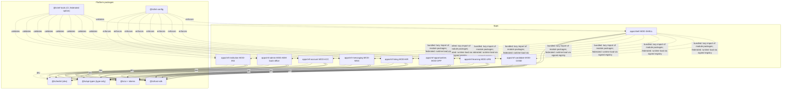

# Module Federation - Review Fixes (revision overlay)

Doc ID: MFA-01-REV2 (covers MFA-01, DEP-01, FIM-01, HC-01, VCD-01, SCH-01, SCH-02) · Owner: Frontend/Platform Architecture · Version 2.0 · Status: Under Review

> **Folded into `FEDERATION_ARCHITECTURE.md` on 2026-10-27.** Change record only; edit the original.
Relates: ADR-T03 (amended by ADR-T23, proposed), ADR-T10a (proposed), ADR-T19 · REVW-07, REVW-08, REVW-14, REVW-15 · REV-RES · OPEN-03

Tags: [CONF] [TARGET] [OPEN] [FED] (federated option only). This file is **additive**. The other files in this folder are not modified by this revision; where this file differs it governs, and section 9 names what it supersedes (a relationship, not a deletion). New machine-readable files: `REMOTE_MANIFEST.schema_REV2.json`, `REMOTE_REGISTRY.schema_REV2.json`, `REMOTE_REGISTRY.example_REV2.json`.

## 0. Disclosure: earlier in-place edit
Before the additive-only rule was issued, one in-place edit pass was applied to `FEDERATION_ARCHITECTURE.md` (MFA-01) only (and nowhere else in this folder). It added: an amendment banner, the "[FED]" tags, FD-14, the MOD-ADM/MOD-INS split rows in section 4, section 11.1 activation criteria, the scheduled federated build, section 14 "privileged delivery, stated precisely", section 16 unverified-API note and section 18 ADR table. Another editor had also changed that file (ADR-T23 wording). The prior text is in git. This revision restates the same content so that the overlay is self-contained; if the in-place edit is reverted, nothing here is lost.

## 1. Default delivery mode (REVW-07)
`MF_MODE=bundled` is the default (ADR-T23, proposed). The federated runtime (signed registry, last-known-good, canary channel, SRI/SW verification, two-person key custody) is an **activation option**. The typed module contract (FD-09, HC-01), the remote boundaries and the manifest schema stay as the design for that option. "Federated is the production default" (MFA-01 section 11 table header) is withdrawn.

Activation requires all of (ARB decision): (1) OPEN-03 closed with at least three **named** independent frontend teams; (2) a measured need that route chunks plus error boundaries do not meet (threshold [OPEN]); (3) WP-FED-SPIKE passes all seven MFA-01 section 16 questions on the pinned plugin version; (4) SRI/integrity for federated ESM resolved or accepted by ADR (OPEN-FE-03); (5) signing-key custody and two-person rule decided (OPEN-FE-16); (6) the per-remote availability allowance (OPS-SLO SLO-03, 216 min/month) is reconciled so a remote is not allowed lower availability than the API; (7) the first-visit LCP budget holds with the 250 ms overhead (FEA-01-REV2 section 4.3, B16). CI builds **bundled on every release**; a federated build runs weekly as a non-release job.

### 1.1 What applies in each mode
| Item | Bundled (default) | Federated |
|---|---|---|
| FD-02, 05, 06, 07, 08, 09, 13, 14 | Apply | Apply |
| FD-01, 03, 04, 10, 11, 12 | Not used | Apply |
| MFA-01 sections 5, 7, 12, 13 (registry, shared singletons, per-remote pipeline, remote rollback) | Not used | Apply |
| VCD-01 axes | A1 shell, A5 service worker, A6 cache schema, A7 local DB schema, A8 API, A9 event topics. A2 host contract is a build-time check | All ten (A1 to A10) |
| VCD-01 rules | VC-02 (CI only), VC-05, VC-06, VC-07, VC-08, VC-09, VC-13 (trivially), VC-14 | All VC-01 to VC-14 |
| VCD-01 section 3 matrix, section 4 selection algorithm, VC-03, VC-10, VC-11, VC-12 | Not used | Apply |
| VCD-01 tests | T9 to T12, T15 to T18 and T21 apply; T1 to T8, T13, T14, T19, T20 do not | All; T21 (bundled/federated parity) becomes a scheduled job |
| FIM-01 scenarios | FI-04, FI-09 to FI-14 (FI-12 only after the outbox exists; FI-14 as bad shell deploy), FI-16, FI-18 to FI-30, FI-31 (new) | All FI-01 to FI-31 |
| FIM-01 section 3 (what federation does not isolate) | Rows 1 to 14 still describe the same realm and platform limits and apply as written | Apply |
| Rollback | Whole-app rollback | Per-remote (registry flip, LKG) |

## 2. Split of MOD-ADM into MOD-ADM and MOD-INS (REVW-08)
Total remotes: **8**.

| Module | Route prefix | Domains | Audience | Delivery |
|---|---|---|---|---|
| MOD-ADM `mf-admin` | `/admin/*` | DOM-19, 20, platform part of DOM-21 | ROLE-ADM, ROLE-SUP, ROLE-MOD, ROLE-AUD (platform back-office: support, moderation, admin, auditor, flags) | Gated by the authenticated edge rule FD-14; internal canary cadence |
| MOD-INS `mf-institution` | `/institution/*` | DOM-18, institution part of DOM-21 | ROLE-INSTADM, ROLE-FAC, institution proctor (customers) | Customer-facing release cadence; route guard only (no back-office code inside) |

The instructor studio (`/learn/studio/*`) is a separate lazy chunk group outside MOD-LRN's initial JS, loaded only for `instructor.studio` holders (the earlier rationale "studio code must not ship to every candidate" was defeated by hosting it in the remote every learner loads).

### 2.1 Screens and routes
`/institution/*` screens move from MOD-ADM to MOD-INS. To keep traceability while IDs stay stable, the six screens get module-aligned IDs and the old IDs remain as aliases; see `07_UI_UX_AND_DESIGN_SYSTEM/UX_REVIEW_FIXES.md` (SCR-INS-01..06 = SCR-ADM-17..22). ID_REGISTRY must move the `/institution` prefix to MOD-INS and list MOD-INS (governance pass).

### 2.2 DEP-01 changes
Dependency graph (replaces the diagram in DEP-01 section 1; the reading rules are unchanged: solid edges are build dependencies, the single dashed edge from SHELL is a runtime-only relationship in the federated option, no remote-to-remote edges, acyclic):

Ownership rows (replace the MOD-ADM row of DEP-01 section 3):

| Unit | Path | Owning team | Required reviewers | Release cadence | Change control |
|---|---|---|---|---|---|
| MOD-ADM | `apps/mf-admin` | Platform Back-office | team + Security | Gated; internal canary first | Edge rule FD-14 must pass its test before release |
| MOD-INS | `apps/mf-institution` | Institutions | team + privacy reviewer for consent-scoped cohort views | Continuous (customer-facing canary) | no back-office imports (dependency rule below) |

Team names remain role placeholders. In bundled mode with fewer than three teams the ownership table collapses to path-based CODEOWNERS, as DEP-01's header already says. Impact analysis (DEP-01 section 5): "all 7 remotes" reads "all 8". New allowed/forbidden row: **MOD-INS must not import MOD-ADM code or any `/assets/bo/` chunk** (same rule as remote-to-remote, FF-03). DEP-01's example `dependency-cruiser` rule keeps its intent; the exact back-reference syntax is **unverified** (FEA-01-REV2 section 6).

### 2.3 FIM-01 additions
| ID | Scenario | Source | Blast radius | Shared deps | Detection |
|---|---|---|---|---|---|
| FI-31 | **Back-office code served to a session without `admin.console`** (edge rule absent, misordered with the cache, or SW precaches the path) | Edge/CDN misconfiguration, release that moves the chunk path, SW precache change | U (all customers can obtain admin UI code; no data is exposed by this alone because the server authorises every call) | CDN, SW | Scheduled synthetic: anonymous and non-admin fetch of the back-office entry must return `404`; CI check that the precache manifest contains no `bo` path; edge deny counter; alert on any `200` for the gated path to a non-admin synthetic |

| ID | Containment | Fallback | User-visible behaviour | Recovery | Monitoring / alert | Verification |
|---|---|---|---|---|---|---|
| FI-31 | Server authorisation (INV-T01) is unaffected; the leak is limited to code, not data | Disable the gated path at the edge (deny all) and redeploy the rule | None for customers; admins see "unavailable" until fixed | Fix rule, purge CDN cache of the gated path, rotate nothing (no secret in bundle by policy) | Sev-2 page to Security on any non-admin `200`; deny/allow ratio dashboard | Release gate: edge-rule test (anonymous, candidate, admin sessions); SW precache scan |

FIM-01 section 3 gains one row: **"Privileged code delivery"** - federation and bundling do not by themselves keep back-office code from customers; only the FD-14 edge rule (a server-side control) does, and it controls who can obtain the code, not secrecy of the bundle; server authorisation remains the security control (ADR-T19).

### 2.4 FD-14 privileged delivery gate (edge rule)
| Aspect | Design [TARGET] |
|---|---|
| Paths | `/mf/mf-admin/**` (federated) and `/assets/bo/**` (bundled) |
| Rule | Valid session AND capability claim `admin.console`; otherwise `404` (not `403`, to avoid advertising the path). The registry may still list the entry (existence is not secret) |
| Ordering | The check runs **before** any shared cache lookup. Gated responses carry `Cache-Control: private, max-age=31536000, immutable` and `Vary: Cookie`; they are never stored in a shared cache without the check |
| Service worker | Never precache or runtime-cache the gated path for sessions without the capability (PWA-01-REV2 rule R2b) |
| How the edge learns the capability | **[OPEN, owner Security Architect]**: (a) edge verifies the signed session token and a capability claim (needs key material at the edge; the self-issued HMAC token of ADR-T06 would put a shared secret there, so an asymmetric signature or option b is preferred), or (b) edge sub-request to an auth-check endpoint with a short per-session cache |
| What it is not | Not bundle confidentiality, not an authorisation control, not a defence against a compromised admin session |
| Test | Anonymous, candidate and admin sessions fetch the entry: `404`, `404`, `200`; precache scan; cache-order test |

## 3. HC-01 changes (Host Contract)
| HC-01 place | Revised content |
|---|---|
| Section 2 `ModuleId` | add `'MOD-INS'` |
| Section 2 `OpType` | add `'lesson.progress.put'` (five classes; ADR-T10a); assessment answers are never an `OpType` |
| Section 2 `ApiRequest.idempotencyKey` | `idempotencyKey?: string`: for unsafe methods, obtain once per user intent from `api.intentKey()` and reuse on every retry; the host never injects a fresh key per call; an unsafe request with neither a key nor a natural-key operation is rejected (REVW-14) |
| Section 2 `ApiApi` | add `intentKey(): string` |
| Section 6 events | `admin.context-changed@1` (MOD-ADM) payload `{}`; add `institution.context-changed@1` (MOD-INS) payload `{ institutionId }`; `org.context-changed@1` subscribers add MOD-INS |
| Section 7 heading | "all eight" |
| Section 7.2 MOD-LRN, State row | queued op after the outbox trigger: `lesson.progress.put`; assessment answers online-only, never persisted or replayed. Loading row adds the studio chunk group |
| Section 7.4 MOD-HIR, Loading row | "the shell does not request it without the capability (network-tested)" is client behaviour, not an access control; remove "never downloaded by non-recruiters" as an assurance |
| Section 7.7 MOD-ADM | Domain DOM-19, 20 (+ platform DOM-21); routes `/admin/*` only; APIs `api/admin`, `api/safety`, `api/orgs`, `api/analytics` (platform), `api/platform`; events publish `admin.context-changed@1`, subscribe `session.changed@1`, `org.context-changed@1`; permission `admin.console` with the FD-14 delivery rule; tests add the edge-rule test; monitoring adds edge-denial alerts |
| New 7.8 MOD-INS | below |

### 3.1 Remote contract card 7.8 MOD-INS - `mf-institution`
| Field | Value |
|---|---|
| Module ID / name | MOD-INS / `mf-institution` (`mf_institution`) |
| Domain | DOM-18 institutions workspace (+ institution reporting views of DOM-21) |
| Purpose | Customer-facing workspace for institution administrators, faculty and proctors: cohorts, credentials, members, aggregate reports |
| Owning team | Institutions [TARGET; OPEN-03] |
| Exposes | `./module`, `./testkit` |
| Routes (prefix `/institution`) | `/institution`, `/institution/cohorts`, `/institution/cohorts/:cohortId`, `/institution/credentials`, `/institution/members`, `/institution/reports` (SCR-INS-01..06) |
| State | Private; **no persistence and no offline** (institution data and consented cohort evidence must not outlive consent, INV-T15). Namespace `['MOD-INS', ...]` |
| APIs | `api/institutions`, `api/orgs` (institution scope), `api/evidence` (issue/revoke credential), `api/analytics` (institution report), `api/privacy` (cohort notices) |
| Events | Publishes `institution.context-changed@1`. Subscribes `session.changed@1`, `org.context-changed@1`, `consent.changed@1` |
| Shared libs | Six singletons; bundled: data grid, charts |
| Permissions | `institution.workspace` (ROLE-INSTADM, ROLE-FAC, proctor). The shell does not request the module without the capability; the server authorises every call and applies small-cell suppression and consent scope (INV-T01, INV-T02, INV-T15). No back-office code |
| Loading | Route-lazy; capability gate before load |
| Versioning / deployment | As common; customer-facing canary, independent of the back-office internal canary |
| Failure behaviour | Unavailable screen; candidate and recruiter products unaffected |
| Recovery | Fallback chain (federated) or reload (bundled); credential issue/revoke are server operations with operation-status pages, nothing half-applied client-side |
| Tests | Common + aggregate-only rendering (no job-search fields for faculty), small-cell suppression text, credential revoke recompute notice, ROLE-FAC sees no issue/revoke controls |
| Monitoring | Common + `ins.credential_action_error`, `ins.report_export_pending_ms` |

## 4. Schemas and example (SCH-01, SCH-02)
New files (jsonschema 2020-12; the example validates against them and every signature verifies):
- `REMOTE_MANIFEST.schema_REV2.json` (`$id` .../remote-manifest/1.1.json): `moduleId` adds `MOD-INS`; `opType` adds `lesson.progress.put`; new optional `access` object (`audience` public or privileged; privileged requires `edgeRule` and `requiredCapability`). `manifestSchema` stays 1 because all changes are additive.
- `REMOTE_REGISTRY.schema_REV2.json` (`$id` .../remote-registry/1.1.json): remote key pattern includes INS and references the 1.1 manifest.
- `REMOTE_REGISTRY.example_REV2.json`: eight entries. MOD-ADM re-issued as 1.1.0, sequence 47, back-office only, `access.audience: privileged`, `rollbackTo` the earlier 1.0.0 build; MOD-INS new, 1.0.0, sequence 1.

**Illustrative, signed with a published example key that is not a trust anchor.** The original example's signing key was not retained, so all eight entries in REV2 are re-signed. Key derivation: SHA-256 of the public string `talentsphere-example-registry-key-v1 (NOT A SECRET; example only)` is the Ed25519 private seed; public key (base64url) `AYyNjNhNolnrIarjLtXNPeKuYdbFyL5dzD4msKCpizA`; `keyId` `ts-registry-2026-a`. Signature = Ed25519 over the RFC 8785 canonical JSON of the entry with `signature` removed (computed with `json.dumps(sort_keys=True, separators=(",", ":"), ensure_ascii=False)`, which equals JCS for ASCII keys with string/integer/boolean/null values; `sampleRate` 0.1 serialises identically). SRI values and `rollbackTo.entryIntegrity` are SHA-384 of placeholder strings, not real artefacts; `assetsDigest` follows the schema rule (SHA-384 of the sorted `<path> <integrity>` lines joined by newlines) and was checked. Validation and signature verification were re-run after the files were written. The original `REMOTE_REGISTRY.example.json` (seven entries) is unchanged and remains valid against the original schemas.

## 5. Claims marked unverified in this folder
Plugin and runtime API names (`registerRemotes`, `loadRemote`, `errorLoadRemote`, `loadEntryError`, `createScript`), react-router `patchRoutesOnNavigation`, the `$1` back-reference in the dependency-cruiser example, and SRI behaviour for federated ESM are **unverified** until WP-FED-SPIKE; none is relied on by the bundled default. See FEA-01-REV2 section 6.

## 6. Open items (for the single global register, REVW-33)
OPEN-03 (team count; blocking for activation, not for the bundled default) · OPEN-FE-03 SRI · OPEN-FE-16 key custody · OPEN-FE-18 closed by the split · new: how the edge learns `admin.console` (FD-14, owner Security Architect) · new: activation threshold for criterion 2 (owner Frontend Platform Lead) · OPEN-FE-12 partly answered by REVW-14.

## 7. ADR and register items for the governance pass
ADR-T23 (bundled baseline, already proposed) should also state the 8-remote split and FD-14, or FD-14 registers as its own ADR-T25+; ADR-T10a (OFF-01-REV2); ADR-T24 (FEA-01-REV2); ID_REGISTRY: add MOD-INS, move `/institution/*`, add shell prefixes `/r/*`, `/invite/*`, `/p/*`, `/login/callback`, `/offline`, `/help`; screen IDs SCR-INS-01..06 with aliases; USER_JOURNEYS (folder 02) still cites SCR-ADM-17..22 (resolved by the alias table).

## 8. Quality checks run
JSON schemas pass `check_schema`; example validates (0 errors); privileged entry without `edgeRule` is rejected (negative test); 8 signatures verify; `assetsDigest` recomputed for all entries.

## 9. Supersession map (relationship only)
| This revision | Supersedes |
|---|---|
| section 1 | MFA-01 sections 1 (position), 11 table header and "CI builds both on every release"; DEP-01 header assumption of 8 owning teams; VCD-01 scope (applies to federated option) |
| section 2 | MFA-01 section 4 rows MOD-ADM and observations; DEP-01 sections 1, 3, 5; FIM-01 sections 1, 2, 3 (adds FI-31); ID_REGISTRY MOD-ADM entry (relationship) |
| section 3 | HC-01 sections 2, 6, 7.2, 7.4, 7.7 and heading of section 7 |
| section 4 | SCH-01, SCH-02 and `REMOTE_REGISTRY.example.json` (originals remain valid for their own content) |
