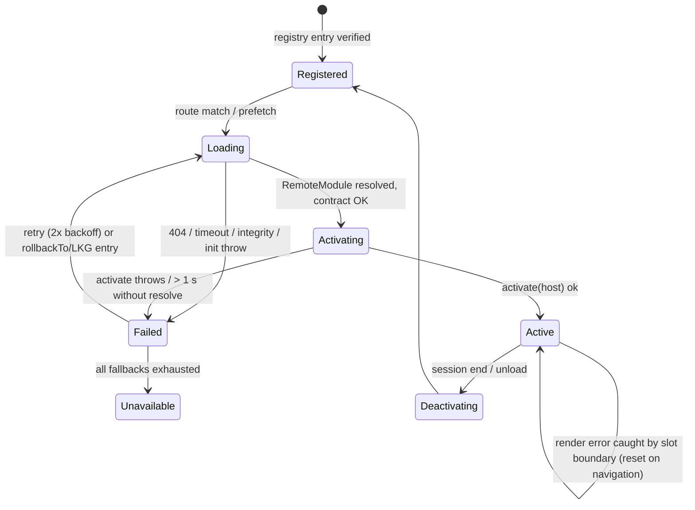

# Host Contract v1 and Remote Contracts

Doc ID: HC-01 · Owner: Frontend/Platform Architecture (Module Federation) · Version 1.0 · Status: Under Review
Relates: ADR-T03, ADR-T06, ADR-T08, ADR-T10, ADR-T16, ADR-T18, ADR-T19 · INV-T01, INV-T10, INV-T13, INV-T14, INV-T16 · FF-03, FF-04, FF-07, FF-08 · MFA-01, SCH-01/02, VCD-01, FIM-01, DEP-01, OFF-01, PWA-01

Tags: [CONF] [TARGET] [OPEN]. Interfaces are the **design contract**, not code that exists. `HOST_CONTRACT_VERSION = '1.0.0'`; semver rules in §9 and VCD-01. Package: `@ts/host-sdk` (types + thin runtime glue provided by the shell as a singleton) with subpaths `/routes`, `/events`, `/data`, `/testing`.

## 1. What the contract guarantees
| Direction | Guarantee |
|---|---|
| Shell → remote | `HostApi` is fully constructed before `activate()`; every member present at `contractVersion` ≥ the member's introduction version; additive minors never remove or change members; unknown optional members must be tolerated. |
| Remote → shell | Default export of `./module` is a `RemoteModule`; no side effects at import time except defining it (import must be cheap and never throw); no global writes; no direct network/storage outside `HostApi` (lint + CI, not isolation, ADR-T19). |
| Both | Everything crossing the boundary is serialisable data or typed function references; no shared mutable objects other than singleton library instances. |
| Credentials | There is **no API** that returns a token, cookie or credential (INV-T16). `host.api` attaches cookies implicitly through the browser. |

## 2. Host Contract v1 — TypeScript
```ts
// ===== @ts/host-sdk  (HOST_CONTRACT_VERSION = '1.0.0') =====
export type ModuleId = 'MOD-CAND' | 'MOD-LRN' | 'MOD-OPP' | 'MOD-HIR' | 'MOD-MSG' | 'MOD-ACC' | 'MOD-ADM';
export type RoleKey = 'ROLE-CAND'|'ROLE-INST'|'ROLE-REC'|'ROLE-HM'|'ROLE-ORGADM'|'ROLE-INSTADM'|'ROLE-FAC'
  |'ROLE-MENTOR'|'ROLE-MOD'|'ROLE-SUP'|'ROLE-ADM'|'ROLE-AUD';          // REFEREE/ANON/SVC never reach remotes
export type CapabilityKey = `${string}.${string}`;                      // UI hints only (INV-T01)
export type MessageKey = string;                                        // i18n key, never user text
export type OpType = 'profile.patch' | 'application.draft.put' | 'message.put' | 'note.put';   // ADR-T10 closed set

/** Default export of the remote's './module' expose. */
export interface RemoteModule {
  readonly moduleId: ModuleId;
  /** Host Contract semver range this build supports; must match the registry entry hostContract. */
  readonly hostContract: string;
  readonly routes: readonly RemoteRoute[];                              // relative to the module prefix
  /** Secondary navigation inside the module area (primary nav is shell-owned, FD-07). */
  secondaryNav?(host: HostApi): readonly NavItem[];
  /** Called once per session after the module is first loaded. Must resolve < 1 s; no network required. */
  activate(host: HostApi): void | Promise<void>;
  /** Called on session end/logout/module unload. Release timers, subscriptions, local stores. */
  deactivate?(): void;
  /** Headless contract smoke used by CI and registry healthcheck probe 'contract-smoke'. */
  selfCheck?(host: HostApi): Promise<SelfCheckResult>;
}
export interface SelfCheckResult { ok: boolean; checks: { name: string; ok: boolean; detail?: string }[] }

export interface RemoteRoute {
  path: string;                                                         // e.g. 'profile', 'evidence/:evidenceId'
  index?: boolean;
  lazy?: () => Promise<{ Component: React.ComponentType; loader?: RouteLoader; action?: never }>;  // actions go through host.api/sync, never router actions
  children?: readonly RemoteRoute[];
  handle: RouteHandle;
}
export interface RouteHandle {
  title: MessageKey;
  analyticsName: string;                                                // stable id for telemetry (no PII)
  requires?: readonly CapabilityKey[];                                  // UI gate; server still authoritative
  offline: 'FO' | 'RO' | 'QW' | 'ON';                                   // OFF-01 §2 class for this screen
  crumbs?: readonly MessageKey[];
}
export type RouteLoader = (ctx: { params: Record<string,string>; request: Request; host: HostApi }) => unknown | Promise<unknown>;
export interface NavItem { id: string; label: MessageKey; to: string; badge?: number; requires?: readonly CapabilityKey[] }

export interface HostApi {
  readonly contractVersion: string;                                     // semver of the running host
  readonly moduleId: ModuleId;                                          // identity of the caller (set by host, not claimed by remote)
  supports(feature: HostFeature): boolean;                              // additive-minor feature detection
  readonly session: SessionApi;
  readonly capabilities: CapabilitiesApi;
  readonly api: ApiApi;
  readonly sync: SyncApi;
  readonly events: EventBus;
  readonly nav: NavApi;
  readonly flags: FlagsApi;
  readonly i18n: I18nApi;
  readonly telemetry: TelemetryApi;
  readonly storage: ScopedStorageApi;
  readonly lifecycle: LifecycleApi;
  readonly notify: NotifyApi;
  readonly push: PushApi;
  readonly permissions: PermissionsApi;
  readonly theme: ThemeApi;
  readonly errors: ErrorsApi;
}
export type HostFeature = 'push' | 'badge' | 'share-target' | 'background-sync' | 'sync-queue' | 'persistent-storage';

// ---- session & capabilities (read-only; no credentials exist in this API) ----
export type SessionStatus = 'anonymous' | 'active' | 'refreshing' | 'offline-grace' | 'needs-reauth' | 'locked' | 'ending';
export interface SessionView {
  readonly status: SessionStatus;
  readonly accountAlias: string | null;           // opaque per-device alias, not the account id
  readonly displayName: string | null;
  readonly roles: readonly RoleKey[];
  readonly activeOrg: { id: string; name: string; role: RoleKey } | null;
  readonly offlineGraceEndsAt: number | null;     // epoch ms
}
export interface SessionApi {
  get(): SessionView;
  subscribe(cb: (s: SessionView) => void): Unsubscribe;
  /** Ask the shell to show the reauth sheet (e.g., before a sensitive action). Resolves true if reauth succeeded for the SAME account. */
  requestReauth(reason: MessageKey): Promise<boolean>;
}
export interface CapabilitiesApi {
  has(key: CapabilityKey): boolean;               // hint; stale-labelled when offline
  etag(): string;
  subscribe(cb: () => void): Unsubscribe;
}

// ---- network ----
export interface ApiRequest {
  method: 'GET' | 'POST' | 'PUT' | 'PATCH' | 'DELETE';
  path: `/api/v1/${string}`;                      // same-origin /api/v1 only; absolute URLs rejected
  query?: Record<string, string | number | boolean | undefined>;
  body?: unknown;                                 // JSON only
  ifMatch?: string;                               // ETag for concurrent edits (ADR-T08)
  idempotencyKey?: 'auto' | string;               // 'auto' generated by host; REQUIRED semantic for unsafe methods (FF-07): host injects when absent
  signal?: AbortSignal;
  timeoutMs?: number;                             // default 15000 = host.api request timeout ONLY, not remote load (remote load = 10000 ms, see Timer reconciliation)
}
export interface ApiResult<T> { status: number; data: T; etag?: string; replayed?: boolean; requestId: string }
export interface ProblemDetails { type: string; title: string; status: number; detail?: string; instance?: string; code?: string; errors?: { path: string; message: string }[] }   // RFC 9457
export class ApiError extends Error { readonly problem: ProblemDetails; readonly retriable: boolean }
export interface ApiApi {
  request<T = unknown>(req: ApiRequest): Promise<ApiResult<T>>;     // throws ApiError; 401 handled globally (refresh → reauth), 403 surfaced to caller
}
/* Host adds: credentials (cookies), X-CSRF-Token, X-TS-Client, traceparent, Accept-Language, Idempotency-Key; remote cannot override them. */

// ---- offline write queue (descriptors only; allowlist from the manifest) ----
export interface QueuedOpInput {
  opType: OpType; aggregateKey: string;
  request: { method: 'PUT' | 'PATCH'; path: `/api/v1/${string}`; body: unknown };
  ifMatch?: string; base?: unknown; mine: unknown;
  display: { titleKey: MessageKey; summary: string };
}
export interface SyncItemView { id: string; opType: OpType; aggregateKey: string; status: 'queued'|'inflight'|'retry-wait'|'conflict'|'rejected'|'needs-reauth'|'quarantined'|'expired'; createdAt: number; lastError?: { type: string; status: number } }
export interface SyncApi {
  enqueue(op: QueuedOpInput): Promise<{ id: string }>;               // rejects if opType not in this module's manifest queueableOps
  items(filter?: { aggregateKey?: string }): readonly SyncItemView[];
  subscribe(cb: () => void): Unsubscribe;
  resolveConflict(opId: string, resolution: { choice: 'mine' | 'theirs' | 'merged'; merged?: unknown }): Promise<void>;
  discard(opId: string): Promise<void>;
}

// ---- typed UI events (§6) ----
export interface EventBus {
  emit<K extends keyof UiEventMap>(topic: K, payload: UiEventMap[K]): void;
  on<K extends keyof UiEventMap>(topic: K, handler: (payload: UiEventMap[K]) => void): Unsubscribe;
}
// ---- navigation ----
export interface NavApi {
  go(to: string, opts?: { replace?: boolean; state?: never }): void;   // same-origin paths only
  readonly routes: typeof import('./routes').routes;                   // typed builders
}
// ---- flags / i18n / telemetry ----
export interface FlagsApi { get<T extends boolean | string | number = boolean>(key: string, fallback: T): T; subscribe(cb: () => void): Unsubscribe }   // keys declared in manifest flags[]
export interface I18nApi { readonly locale: string; readonly dir: 'ltr'|'rtl'; t(key: MessageKey, vars?: Record<string, string|number>): string; registerCatalog(ns: string, loader: (locale: string) => Promise<Record<string,string>>): void; format: { number(n: number, o?: Intl.NumberFormatOptions): string; date(d: Date|number, o?: Intl.DateTimeFormatOptions): string } }
export interface TelemetryApi {
  tracer(): import('@opentelemetry/api').Tracer;                        // scope ts-web-<module>, resource attrs ts.module, ts.module.version set by host
  event(name: string, attrs?: Record<string, string | number | boolean>): void;   // allowlisted names; PII scrubbed
  measure<T>(name: string, fn: () => Promise<T>): Promise<T>;
}
// ---- storage (non-sensitive, namespaced, purged on session end) ----
export interface ScopedStorageApi { get<T>(key: string): Promise<T | undefined>; set(key: string, value: unknown): Promise<void>; remove(key: string): Promise<void> }   // JSON ≤ 64 KB/value, ≤ 1 MB/module
// ---- lifecycle ----
export interface LifecycleApi {
  readonly online: boolean; onOnlineChange(cb: (online: boolean) => void): Unsubscribe;
  readonly visibility: 'visible' | 'hidden';
  setDirty(key: string, dirty: boolean): void;                          // blocks non-critical update apply while true
  onSessionEnd(cb: () => void | Promise<void>): Unsubscribe;            // reset private stores
  onUpdateReady(cb: (info: { critical: boolean }) => void): Unsubscribe;
}
// ---- UX services ----
export interface NotifyApi { toast(o: { kind: 'info'|'success'|'warning'|'error'; messageKey: MessageKey; action?: { labelKey: MessageKey; onAction: () => void } }): void; announce(messageKey: MessageKey, politeness?: 'polite'|'assertive'): void; confirm(o: { titleKey: MessageKey; bodyKey: MessageKey; destructive?: boolean }): Promise<boolean> }
export interface PushApi { readonly state: 'unsupported'|'needs-install'|'default'|'granted'|'denied'; requestEnable(): Promise<'granted'|'denied'|'dismissed'|'needs-install'> }   // the ONLY way to ask for notification permission (PWA-01 §7)
export interface PermissionsApi { query(name: 'camera'|'microphone'): Promise<PermissionState>; }
export interface ThemeApi { readonly scheme: 'light'|'dark'; readonly tokens: Readonly<Record<string, string>> }
export interface ErrorsApi { report(error: unknown, ctx?: { area: string; severity?: 'info'|'warning'|'error' }): void }
export type Unsubscribe = () => void;
```

## 3. Route builders (`@ts/host-sdk/routes`) [TARGET]
```ts
export const routes = {
  home: () => '/',
  me: { profile: () => '/me/profile', evidence: { list: () => '/me/evidence', detail: (p: { evidenceId: string }) => `/me/evidence/${p.evidenceId}` } },
  jobs: { list: () => '/jobs', detail: (p: { jobId: string }) => `/jobs/${p.jobId}` },
  applications: { list: () => '/applications', detail: (p: { applicationId: string }) => `/applications/${p.applicationId}` },
  hiring: { pipeline: (p: { jobId: string }) => `/hiring/jobs/${p.jobId}/pipeline` },
  messages: { thread: (p: { conversationId: string }) => `/messages/${p.conversationId}` },
  settings: { security: () => '/settings/security', notifications: () => '/settings/notifications', offline: () => '/settings/offline' },
  billing: { overview: () => '/billing' }, privacy: { consents: () => '/privacy/consents' },
} as const;
```
A path may be added in a minor; renamed/removed only with a shell redirect and a deprecation window (VCD-01).

## 4. Cross-module data contracts
- **No data objects cross modules** except ids in route params and event payloads. A module needing another's data calls the API (the API is the shared contract, ADR-T08), not the other remote.
- Shared UI types for display (e.g., `EvidenceRung`, `ApplicationStageLabel`) are generated from the OpenAPI document into `@ts/api-types` (a type-only package, no runtime) to avoid redefining enums (FF-06 governs change).

## 5. Lifecycle of a remote


## 6. UI event catalogue v1 (typed bus)
Topic = `domain.event@major`. All are **notifications to refetch**, not data transfer (INV-T13).
| Topic | Publisher | Payload | Typical subscribers |
|---|---|---|---|
| `session.changed@1` (sticky) | Shell | `{ status, accountAlias, activeOrgId }` | all (reset local stores, refetch) |
| `sync.item-resolved@1` | Shell | `{ opType, aggregateKey, outcome: 'ok'|'conflict'|'rejected' }` | owner of the aggregate (CAND, OPP, MSG, HIR) |
| `profile.updated@1` | MOD-CAND | `{ fields: string[] }` | MOD-OPP (match inputs), shell (display name) |
| `evidence.changed@1` | MOD-CAND | `{ evidenceId, change: 'created'|'updated'|'revoked-seen' }` | MOD-OPP, MOD-LRN |
| `course.progressed@1` | MOD-LRN | `{ courseId, status }` | MOD-CAND (evidence list refetch) |
| `assessment.attempt-started@1` | MOD-LRN | `{ assessmentId }` | shell (suppress non-critical updates) |
| `application.submitted@1` | MOD-OPP | `{ applicationId, jobId }` | MOD-MSG (thread appears), shell |
| `job.saved@1` | MOD-OPP | `{ jobId, saved }` | — |
| `pipeline.stage-changed@1` | MOD-HIR | `{ applicationId, jobId }` | MOD-MSG |
| `notification.count-changed@1` | MOD-MSG | `{ unread }` | shell badge |
| `message.sent@1` | MOD-MSG | `{ conversationId }` | — |
| `consent.changed@1` | MOD-ACC | `{ scope }` | all (purge caches for scope; MOD-HIR refetch) |
| `entitlement.refresh-requested@1` | MOD-ACC | `{}` | shell (refetch capabilities) |
| `org.context-changed@1` | Shell | `{ orgId }` | MOD-HIR, MOD-ADM, MOD-ACC |
| `admin.context-changed@1` | MOD-ADM | `{ institutionId? }` | — |
Adding a topic = contract minor (PR to `@ts/host-sdk/events`); a remote may not invent topics at runtime.

## 7. Remote contract cards (all seven)
Common to every card (not repeated): contract = `RemoteModule`, `hostContract ^1.0.0`; shared libs = the six singletons (MFA-01 §7) + own bundled deps; hosted same-origin at `/mf/<name>/<version>/`; telemetry `serviceName ts-web-<name>`; load timeout 10 s cold with 2 automatic retries (500 ms, 1500 ms) then fallback chain (`rollbackTo` → LKG → unavailable screen) — the 10 s bound and retry counts are [TARGET] starting values (rationale: finite wait on slow 3G-class links; refine from `mf.remote.load_ms` p99); versioning = semver, `sequence` monotonic, breaking `./module` contract ⇒ major; deployment = pipeline of MFA-01 §12 with canary and auto-rollback; tests = unit, component, **contract tests against MockHost at each supported Host Contract minor**, a11y (axe, WCAG 2.2 AA), e2e journeys on Chromium/WebKit/Firefox, offline e2e for QW/RO screens, budget checks; monitoring = `mf.remote.load_ms`, `mf.remote.load_error`, `mf.remote.fallback`, JS error rate and INP by `ts.module`, API error rate by module, route-level LCP, plus the module-specific metrics listed.

### 7.1 MOD-CAND — `mf-candidate`
| Field | Value |
|---|---|
| Module ID / name | MOD-CAND / `mf-candidate` (`mf_candidate`) |
| Domain | DOM-03 profile/portfolio/resume, DOM-05 evidence, DOM-06 verification (candidate side), DOM-12 career intelligence |
| Purpose | Let a candidate build, evidence-back and showcase their profile (Prove → Showcase) |
| Owning team | Candidate Experience [TARGET; OPEN-03] |
| Public interface / exposes | `./module` (RemoteModule), `./testkit` (fixtures/MockHost presets). No widgets. |
| Routes (prefix `/me`) | `/me/profile`, `/me/portfolio`, `/me/evidence`, `/me/evidence/:evidenceId`, `/me/evidence/new`, `/me/verification`, `/me/resumes`, `/me/career`, `/me/notes` [indicative] |
| State | Private: forms, uploader state. Query namespace `['MOD-CAND', …]`. Queued ops: `profile.patch`, `note.put`. Drafts in shell store (kind `profile`, `note`). |
| APIs (BMOD) | `api/profile`, `api/evidence`, `api/verification`, `api/careerintel`, `api/skills` (read), `api/ai` (resume/profile assist via gateway; never autonomous) |
| Events | Publishes `profile.updated@1`, `evidence.changed@1`. Subscribes `session.changed@1`, `sync.item-resolved@1`, `course.progressed@1`. |
| Shared libs | Six singletons; bundled: form lib, file-upload helper, charts for readiness. |
| Permissions (UI hints) | `candidate.profile`, `candidate.evidence`; ROLE-CAND. Verified status rendered **only** from server fields (INV-T04). |
| Loading behaviour | Route-lazy; prefetch on idle for candidates after first paint; skeletons per route; evidence artefact viewer lazy chunk |
| Versioning / deployment | As common. Evidence ladder UI changes are the highest-churn area → feature flag `cand.evidence_ladder_v2`. |
| Failure behaviour | Slot boundary shows "Profile tools unavailable" with retry; shell chrome, nav, MOD-OPP/MSG keep working. Job-apply funnel continues because applications live in MOD-OPP. |
| Recovery | Auto fallback chain; reload; if LKG also fails → unavailable screen with link to read-only public profile preview [OPEN-FE-20: server-rendered fallback]. Queued profile/note ops flush regardless (descriptors). |
| Tests | Common + conflict-merge UX tests for profile; evidence status never promoted client-side; upload virus-scan-pending state (BR-T003) |
| Monitoring | Common + `cand.evidence_upload_error`, `outbox.conflict{opType=profile.patch}`, profile completion funnel (non-PII) |

### 7.2 MOD-LRN — `mf-learning`
| Field | Value |
|---|---|
| Module ID / name | MOD-LRN / `mf-learning` |
| Domain | DOM-07 assessment/challenges/integrity, DOM-08 learning |
| Purpose | Courses, paths, assessments and challenges that convert learning into evidence; instructor studio |
| Owning team | Learning & Assessment [TARGET] |
| Public interface / exposes | `./module`, `./testkit` |
| Routes (prefix `/learn`) | `/learn/courses`, `/learn/courses/:courseId`, `/learn/paths`, `/learn/assessments/:assessmentId`, `/learn/challenges`, `/learn/studio/*` (instructor) |
| State | Private: lesson player state, attempt UI state. Namespace `['MOD-LRN', …]`. **No queued ops** (assessment/progress are online-only). Attempt timer/autosave is server-side (DOM-07); UI never decides pass/fail. |
| APIs | `api/learning`, `api/assessment`, `api/skills` (read), `api/ai` (blocked server-side in `AI_PROHIBITED` sessions, INV-T06) |
| Events | Publishes `course.progressed@1`, `assessment.attempt-started@1`. Subscribes `session.changed@1`. |
| Shared libs | Six singletons; bundled: rich-text/code editor (large, lazy), media player, markdown |
| Permissions | `learner.courses`, `learner.assessments`; instructor routes need `instructor.studio` (ROLE-INST) |
| Loading behaviour | Route-lazy; editor and media player as separate lazy chunks; assessment runner loads on explicit start |
| Versioning / deployment | As common; assessment-runner UI changes pass an integrity-regression suite first |
| Failure behaviour | Outside an attempt: unavailable screen. **During an attempt:** render failure is a *technical interruption*, never an integrity anomaly (INV-T20); UI reports `assessment.tech_interruption` to the API so reviewers see the cause; attempt state is server-side so reload resumes per DOM-07 rules [OPEN-FE-21: resume/timer policy owned by DOM-07 docs] |
| Recovery | Reload resumes attempt; fallback chain as common; no silent version swap mid-attempt (update apply blocked via `setDirty`) |
| Tests | Common + attempt-resume e2e, AI-prohibited UI state, no-offline-attempt assertion, a11y of timers (WCAG 2.2 AA) |
| Monitoring | Common + `lrn.attempt_start_to_first_item_ms`, `lrn.tech_interruption` count (critical alert), editor chunk load p95 |

### 7.3 MOD-OPP — `mf-opportunities`
| Field | Value |
|---|---|
| Module ID / name | MOD-OPP / `mf-opportunities` |
| Domain | DOM-09 opportunities (candidate side), DOM-10 applications (candidate side), DOM-11 search/matching UI |
| Purpose | Discover jobs with explainable matches and apply with evidence (Match → Apply) |
| Owning team | Opportunities & Applications [TARGET] |
| Public interface / exposes | `./module`, `./testkit` |
| Routes (prefixes `/jobs`, `/applications`) | `/jobs`, `/jobs/:jobId`, `/jobs/saved`, `/jobs/alerts`, `/applications`, `/applications/:applicationId`, `/applications/:applicationId/draft` |
| State | Private: filters (mirrored in URL), compare tray. Namespace `['MOD-OPP', …]`. Queued ops: `application.draft.put`, `note.put`. Submit/withdraw online-only (BR-T001, SM-APPLICATION). |
| APIs | `api/jobs`, `api/applications`, `api/search`, `api/matching`, `api/evidence` (attach), `api/ai` (draft assist) |
| Events | Publishes `application.submitted@1`, `job.saved@1`. Subscribes `session.changed@1`, `sync.item-resolved@1`, `profile.updated@1`, `evidence.changed@1`. |
| Shared libs | Six singletons; bundled: virtualised list, map (if any, lazy) |
| Permissions | `candidate.jobs`, `candidate.applications` |
| Loading behaviour | Route-lazy; highest-traffic remote → preloaded after shell idle on `/` and on landing from push/email deep links |
| Versioning / deployment | As common; match-explanation UI behind `opp.match_explanations` flag; ranking inputs allowlisted server-side (INV-T19) |
| Failure behaviour | Unavailable screen: "Jobs are temporarily unavailable" (the remote's own RO cached views need the remote's code, so they are unavailable too; cached data is not shown by shell code). Queued items: draft remains in outbox/server. Never presents an application as submitted without a server `201`. |
| Recovery | Fallback chain; `application.draft.put` conflict UX (job closed ⇒ draft kept); circuit breaker on repeated API 5xx |
| Tests | Common + draft offline→online flush, submit disabled offline, 409 job-closed path, match explanation shows uncertainty (INV-T19 UI check), duplicate-application prevention reflected (BR-T001) |
| Monitoring | Common + `opp.search_to_result_ms`, `opp.apply_funnel` (non-PII), outbox draft metrics |

### 7.4 MOD-HIR — `mf-hiring`
| Field | Value |
|---|---|
| Module ID / name | MOD-HIR / `mf-hiring` |
| Domain | DOM-02 org/team admin (org side), DOM-09 job authoring, DOM-10 pipeline/interviews, DOM-06 verification review, DOM-11 candidate search |
| Purpose | Let recruiters/hiring managers author jobs, review evidence-backed candidates and run the pipeline (Hire) |
| Owning team | Hiring Workspace [TARGET] |
| Public interface / exposes | `./module`, `./testkit` |
| Routes (prefix `/hiring`) | `/hiring/jobs`, `/hiring/jobs/:jobId`, `/hiring/jobs/:jobId/pipeline`, `/hiring/candidates/:applicationId`, `/hiring/interviews`, `/hiring/team`, `/hiring/analytics` [indicative] |
| State | Private: pipeline board UI, bulk selection. Namespace `['MOD-HIR', …]`. **No persisted query cache** (INV-T15). Queued ops: `note.put` only. |
| APIs | `api/orgs`, `api/jobs`, `api/applications`, `api/verification`, `api/search`, `api/matching`, `api/analytics` (recruiter views), `api/messaging` (links) |
| Events | Publishes `pipeline.stage-changed@1`. Subscribes `session.changed@1`, `org.context-changed@1`, `consent.changed@1`. |
| Shared libs | Six singletons; bundled: drag-drop board, table/virtualisation, charts |
| Permissions | `org.hiring`, `org.jobs-manage`; ROLE-REC, ROLE-HM, ROLE-ORGADM. Candidate evidence views render only consent-scoped data returned by the API (INV-T15). |
| Loading behaviour | Route-lazy; **never preloaded for candidates** (not even fetched: capability gate before load; the bundle is never downloaded by non-recruiters — verified by network test) |
| Versioning / deployment | As common; pipeline actions are human-confirmed (INV-T09) — no auto-reject UI; canary limited to internal org first |
| Failure behaviour | Unavailable screen; candidate-facing flows unaffected; stage changes are server calls, so nothing half-applied client-side |
| Recovery | Fallback chain; reload; ATS actions retried only by user (no auto-retry of consequential mutations except idempotent-keyed ones) |
| Tests | Common + cross-tenant UI canary (FF-05 client side), consent-revocation e2e (no cached candidate data after revoke), no-auto-reject assertion, bulk-action idempotency |
| Monitoring | Common + `hir.pipeline_action_error`, `hir.board_render_ms`, org-scoped error rate (tenant id hashed) |

### 7.5 MOD-MSG — `mf-messaging`
| Field | Value |
|---|---|
| Module ID / name | MOD-MSG / `mf-messaging` |
| Domain | DOM-13 messaging, DOM-14 networking/community (phase 3 parts flagged), DOM-15 notifications centre |
| Purpose | Conversations around applications, notification centre, connections |
| Owning team | Collaboration & Notifications [TARGET] |
| Public interface / exposes | `./module`, `./testkit` |
| Routes | `/messages`, `/messages/:conversationId`, `/network`, `/network/connections`, `/notifications` |
| State | Private: composer UI, scroll/virtualisation. Namespace `['MOD-MSG', …]`. Queued op: `message.put`. Realtime channel (SSE, cookie-auth) owned by this remote while active; reconnect with backoff; polling fallback. |
| APIs | `api/messaging`, `api/network`, `api/notify`, `api/safety` (report/block) |
| Events | Publishes `notification.count-changed@1`, `message.sent@1`. Subscribes `session.changed@1`, `sync.item-resolved@1`, `application.submitted@1`, `pipeline.stage-changed@1`. |
| Shared libs | Six singletons; bundled: virtual list, emoji/attachment helpers (lazy) |
| Permissions | `messaging.use`; block/report always available |
| Loading behaviour | Route-lazy; unread count/badge is **shell-owned** (lightweight query) so the bell works even if this remote is down |
| Versioning / deployment | As common |
| Failure behaviour | Messages unavailable screen; bell + push + email still carry events; queued messages keep flushing via shell |
| Recovery | Fallback chain; SSE → polling fallback; message `rejected` (blocked/closed) keeps text for copy |
| Tests | Common + compose offline→online, duplicate-send prevention (`clientMessageId`), reduced-motion/aria-live for new messages, report/block flows |
| Monitoring | Common + `msg.send_to_ack_ms`, `msg.sse_reconnects`, outbox `message.put` conflicts/rejections |

### 7.6 MOD-ACC — `mf-account`
| Field | Value |
|---|---|
| Module ID / name | MOD-ACC / `mf-account` |
| Domain | DOM-16 billing/plans/entitlements, DOM-22 privacy/consent/data rights, DOM-01 security settings (passkeys, sessions, MFA) |
| Purpose | Self-service settings, subscription, privacy and consent management |
| Owning team | Account & Trust [TARGET] |
| Public interface / exposes | `./module`, `./testkit` |
| Routes | `/settings`, `/settings/profile`, `/settings/security`, `/settings/notifications`, `/settings/offline`, `/billing`, `/billing/checkout/return`, `/privacy`, `/privacy/consents`, `/privacy/data` |
| State | Private only; **nothing persisted** (billing/consent never cached, OFF-01 §2). Namespace `['MOD-ACC', …]`. No queued ops. |
| APIs | `api/billing` (Stripe Checkout/portal redirects; entitlements from webhook-derived state only, INV-T17), `api/privacy`, `api/identity` (credentials management), `api/notify` (preferences) |
| Events | Publishes `consent.changed@1`, `entitlement.refresh-requested@1`. Subscribes `session.changed@1`, `org.context-changed@1`. |
| Shared libs | Six singletons; bundled: form lib |
| Permissions | `account.settings`, `account.privacy`; all authenticated roles |
| Loading behaviour | Route-lazy; checkout-return route is minimal and **never grants anything** — it polls `GET /billing/entitlements` until the webhook-derived state changes (INV-T17) |
| Versioning / deployment | As common; strictest review (security/billing); deploy freeze rules around billing incidents |
| Failure behaviour | Unavailable screen with support link; shell still provides **logout / sign-out-everywhere** and the offline-data purge (shell-owned) so a failure here never traps a user's data |
| Recovery | Fallback chain; passkey flows fall back to password; consent changes are server-confirmed before UI states "changed" |
| Tests | Common + checkout-return grants nothing without webhook state, consent change immediately visible to MOD-HIR (cache purge), erasure request flow, re-auth gating of sensitive changes |
| Monitoring | Common + `acc.checkout_return_pending_ms`, `acc.consent_change_error`, passkey enrolment success rate by platform (feeds PLT-01 U cells) |

### 7.7 MOD-ADM — `mf-admin`
| Field | Value |
|---|---|
| Module ID / name | MOD-ADM / `mf-admin` |
| Domain | DOM-18 institutions workspace, DOM-19 trust & safety/moderation, DOM-20 administration/support (+ DOM-21 platform reporting views) |
| Purpose | Privileged back-office and institution workspace |
| Owning team | Platform Back-office (institution workspace sub-team if split) [TARGET] |
| Public interface / exposes | `./module`, `./testkit` |
| Routes (prefixes `/admin`, `/institution`) | `/admin/users`, `/admin/support/access`, `/admin/moderation`, `/admin/flags`, `/admin/audit`, `/institution/cohorts`, `/institution/reports` [indicative] |
| State | Private only; **no persistence**, no offline (INV-T18). Namespace `['MOD-ADM', …]`. Time-boxed access grants (≤ 4 h, reason required — BR-T041) displayed with countdown; UI never extends silently. |
| APIs | `api/admin`, `api/safety`, `api/institutions`, `api/orgs`, `api/analytics`, `api/platform` (flags) |
| Events | Publishes `admin.context-changed@1`. Subscribes `session.changed@1`, `org.context-changed@1`. |
| Shared libs | Six singletons; bundled: data-grid, charts |
| Permissions | `admin.console` (ROLE-ADM/SUP/MOD/AUD), `institution.workspace` (ROLE-INSTADM/FAC). Remote bundle is **never downloaded** by users lacking the capability (network-tested). Server authorises every call (INV-T01/T02). |
| Loading behaviour | Route-lazy; capability gate precedes load; stricter session policy (recent reauth required for privileged actions via `host.session.requestReauth`) |
| Versioning / deployment | As common; separate internal canary; change-freeze with incident process |
| Failure behaviour | Unavailable screen; end-user product unaffected (strongest isolation benefit of splitting this remote) |
| Recovery | Fallback chain; break-glass operational path documented in 17_*/21_* (not a UI workaround) [OPEN-FE-22] |
| Tests | Common + capability-gated download test, access-grant expiry UX, audit-visible actions, auditor read-only (ROLE-AUD) enforcement |
| Monitoring | Common + `adm.privileged_action_count`, `adm.grant_expiry_events`; alerts on unusual admin bundle downloads by non-admin sessions (security signal) |

## 8. Contract tests (`@ts/host-sdk/testing`)
- `MockHost(version)` implements `HostApi` for each supported minor, with controllable session/capabilities/network/outbox/flags/events and fault injection (offline, 401, 412, 5xx, slow).
- **Remote conformance suite** run in every remote CI: `activate` < 1 s and no network; no import-time side effects; routes valid; all `handle.offline` values present; only declared topics emitted; only manifest-declared `queueableOps` enqueued; no `fetch`/`XMLHttpRequest`/`localStorage`/`indexedDB`/`document.cookie` use (static + runtime guard); `selfCheck` passes.
- **Host conformance suite** run in shell CI against fixture remotes built for N and N−1 majors (§9).

## 9. Versioning rules (detail: VCD-01)
| Change | Version impact |
|---|---|
| New optional `HostApi` member / new event topic / new route builder / new `HostFeature` | minor |
| Doc, perf, bugfix with unchanged types | patch |
| Remove/rename member, change a signature or semantics, remove topic, change required `RemoteModule` member | **major**; shell supports majors N and N−1 simultaneously for ≥ 90 days via contract shims [TARGET; rationale: same as stale-client window, PWA-01 §5] |
A remote declares `hostContract: ^1.x` (lowest minor it needs). The shell refuses to mount a remote whose range excludes `HOST_CONTRACT_VERSION`; it never mounts "best effort".

## 10. Open items
OPEN-FE-20 server-rendered fallback for profile preview · OPEN-FE-21 attempt resume/timer policy (DOM-07) · OPEN-FE-22 admin break-glass path · OPEN-FE-12 idempotency/API conventions for queued-op endpoints · OPEN-03 team count (global).

## Timer reconciliation (PATCH 2026-10-27, PROPOSED; closes audit gap: 10 s vs 15000 ms)
The two numbers measured different timers. **Chosen value: remote load timeout = 10 000 ms (cold), 2 retries (500 ms, 1500 ms)**, matching `FAULT_ISOLATION_MATRIX.md` FI-02 and FAILURE_MODE_ANALYSIS FM-01. The `15000` in `ApiRequest.timeoutMs` is the default for `host.api` calls and is unchanged; it is **not** a remote-load timer. Rationale: a finite wait that still fits slow 3G-class links; 15 s of spinner exceeds typical user patience and the fallback chain (`rollbackTo` then LKG) is only useful if reached early. All values are [TARGET] starting values; refine from `mf.remote.load_ms` p99 (needs measured data; none exists). Searched `09_MODULE_FEDERATION`: no other remote-load timer value found (registry fetch 2.5 s FI-08, `activate` 1 s FI-03, health-probe `timeoutMs` 3000 in registry examples are separate timers).

| Timer | Value | Source |
|---|---|---|
| Remote load (cold) | 10 000 ms, 2 retries | this section; FI-02 |
| Remote `activate` | 1 000 ms | FI-03 |
| Registry fetch | 2 500 ms | FI-08 |
| `host.api` request default | 15 000 ms | `ApiRequest.timeoutMs` |
| Remote health probe | 3 000 ms (registry examples) | `REMOTE_REGISTRY.example.json` |
