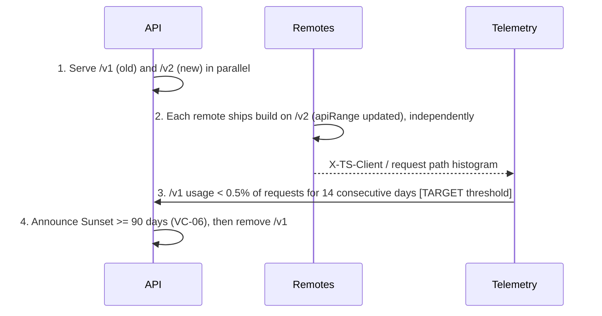
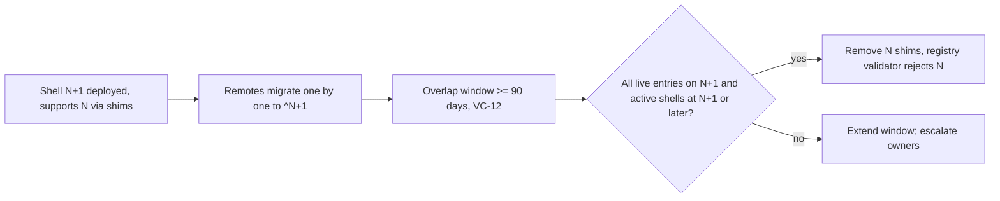

# Version Compatibility Design

Doc ID: VCD-01 · Owner: Frontend/Platform Architecture (Module Federation + PWA engineering) · Version 1.0 · Status: Under Review
Relates: ADR-T03, ADR-T08, ADR-T17, ADR-T18, ADR-T19 · INV-T13 · FF-04, FF-06, FF-08, FF-10 · MFA-01, HC-01, SCH-01/02, FIM-01, PWA-01, OFF-01

Tags: [CONF] [TARGET] [OPEN]. Windows and thresholds are starting values with a stated measurement; none is a benchmark.

## 1. Version axes and their coupling
| # | Axis | Identified by | Declared where | Checked where / when | Mismatch consequence |
|---|---|---|---|---|---|
| A1 | **Shell** build | semver `shellVersion` + build id; `minShell` in entries | `/version.json`, `X-TS-Client` | Remote entry `minShell`; API floor (426) | Remote rejected; or force-update flow |
| A2 | **Host Contract** | semver `HOST_CONTRACT_VERSION` (HC-01) | Shell build; remote `hostContract` range (entry + `RemoteModule`) | Shell at registry selection (runtime) + CI FF-08 | Remote not mounted; fallback chain |
| A3 | **Remote** build | semver `version`, `buildId`, monotonic `sequence` | Registry entry (signed) | Signature, sequence, notAfter at runtime | Entry ignored/stale; LKG |
| A4 | **Shared dependencies** | per-package `requiredVersion` range, `singleton`, `strictVersion` | Entry `shared[]`; shell provides versions | CI FF-04; runtime check against shell-provided versions; MF runtime (`strictVersion`) | Remote not loaded (clean error) instead of broken render |
| A5 | **Service worker** | `swVersion` = shell build hash; cache names embed it | `sw.js`, `GET_VERSION` message | UpdateManager; `minSw` in `/version.json` | Update waiting → apply per policy |
| A6 | **Cache schema** (Cache Storage + persisted query cache) | cache-name suffix; `persistQueryClient` `buster` = `LOCAL_DATA_SCHEMA`+class versions | SW code; shell | Activate cleanup; hydrate-time check | Stale caches dropped and rebuilt |
| A7 | **Local DB schema** | IDB version `LOCAL_DATA_SCHEMA`; outbox `opSchema` | Shell; entry `dataSchema` | Shell migration at boot; entry range check | Remote not mounted if outside range; migration/rescue path (OFF-01 §11) |
| A8 | **API** | `/api/v1` base + OpenAPI document semver (oasdiff, FF-06) | Entry `apiRange`; `X-TS-Client` | CI FF-08 (generated client vs spec); server floor check | 426 `client-outdated`; or deprecation signals |
| A9 | **UI event topics** | `topic@major` | Entry `events` + `HC-01 §6` | CI (declared vs emitted); runtime bus | Unknown topic ignored; deprecated topic dual-emitted |
| A10 | **Registry / manifest schema** | `registrySchema`, `manifestSchema` | Documents | Shell supports N and N−1 | Entry ignored; boot snapshot/LKG |
Principle: **everything that can disagree carries an explicit version and is checked at a defined point; nothing is assumed to deploy atomically** (ADR-T18).

## 2. Rules
| ID | Rule |
|---|---|
| VC-01 | **Remote releases are independent of shell and SW releases.** Remote assets live at immutable versioned URLs; adding/removing a remote version needs no SW update; queued offline ops are data descriptors so flush never needs remote code (FD-08, FD-12). |
| VC-02 | **Host Contract check is strict.** Mount iff `semver.satisfies(HOST_CONTRACT_VERSION, entry.hostContract)` and `shellVersion ≥ entry.minShell`. No "best effort" mounts. Additive minors (HC-01 §9) never need remote rebuilds. |
| VC-03 | **Registry trust.** Entry accepted only if Ed25519 signature valid with an embedded trust anchor in its validity window, `sequence ≥ storedSequence[remote]` (or authorised by a signed `rollbackTo`), `status≠disabled`, and not killed. `notAfter` expiry is *soft*: an expired entry may serve as LKG for ≤ 14 d grace (telemetry + alert), never as "current". |
| VC-04 | **Shared dependencies.** Singleton ranges must be satisfied by shell-provided versions (checked in CI and at runtime). A singleton **major** upgrade follows the three-step *widen → flip → narrow* train (§6.6). `@ts/ui` minors are non-strict; majors strict. |
| VC-05 | **Local data schema.** Shell migrates IDB before any remote mounts. Mount iff `dataSchema.localSchemaMin ≤ LOCAL_DATA_SCHEMA ≤ localSchemaMax` and all `opSchemas` have shell translators. Shell never lowers the schema; remotes must tolerate the whole range they declare. |
| VC-06 | **API compatibility.** Within `/api/v1` only additive, oasdiff-clean changes (FF-06). Server honours clients up to a **90-day floor** after a deprecation notice (`Deprecation`/`Sunset` response headers, RFC 8594 for Sunset) [TARGET]. Every request carries `X-TS-Client: shell=…;hc=…;sw=…;ls=…`; below the floor the server answers `426` with problem `type:/problems/client-outdated` and `minShell`. Rationale for 90 days: installed PWAs can stay closed for months (PWA-01 §5); **measure** the age distribution of `shell` versions in requests and set the window to cover the p99 of active clients, then re-tune. |
| VC-07 | **Caches are versioned and disposable.** Cache names embed `swVersion` (shell/precache) or `remote@version`. `activate` removes unknown caches. Persisted query cache `buster` changes force a cold rebuild (never a crash). |
| VC-08 | **SW ↔ shell.** Shell reads `swVersion`; if below `minSw` from `/version.json` it triggers update (critical path). A shell must run correctly with an SW one minor behind (SW does not own business logic). |
| VC-09 | **Events are versioned by topic name.** Breaking payload change = new `@major`; emitter dual-emits for ≥ 1 release train (≥ 30 days); subscribers ignore unknown topics. |
| VC-10 | **Schema evolution of registry/manifest.** Shell supports `manifestSchema` N and N−1; publisher writes the lower schema until ≥ 99% of active shells (by telemetry) support the higher one [TARGET]. |
| VC-11 | **Last-known-good (LKG) pinning.** A remote entry becomes LKG only after (a) verification, (b) successful `activate` and first route render without boundary error in a real session. Retained per remote: 1 LKG + the previous current. LKG assets are retained in SW cache and on the CDN ≥ 30 days after retirement. |
| VC-12 | **Contract majors overlap.** Shell supports Host Contract majors N and N−1 simultaneously (shims) for ≥ 90 days [TARGET; same measurement as VC-06]. After the window the registry validator refuses entries for N−1. |
| VC-13 | **No inter-remote version dependencies.** A remote may never require a specific version of another remote; features depending on others detect via `host.supports()`/capabilities/events (FF-04 acyclic). Publish order of remotes is therefore unconstrained. |
| VC-14 | **Compatibility is never encoded in feature flags.** Flags change behaviour within a compatible set; version ranges decide compatibility. |

## 3. Compatibility matrix (current-state template; CI renders the live version)
Cells state what the system does, not what is "supported by promise".
| Shell \ Remote built for | HC `^1.0.0` | HC `^1.2.0` | HC `^2.0.0` |
|---|---|---|---|
| Shell HC 1.0.x | mount | **reject** (needs ≥1.2) → rollbackTo/LKG | reject |
| Shell HC 1.2.x | mount | mount | reject |
| Shell HC 2.0.x (supports N and N−1 via shims, VC-12) | mount via 1.x shims (≤ window) | mount via shims | mount |
| Shared dep | Shell provides | Remote requires | Result |
|---|---|---|---|
| `react` | 19.1.x | `^19.0.0` | ok |
| `react` | 19.1.x | `^18.3.0` | reject; remote not loaded (never double-React) |
| `@ts/ui` | 1.4.x | `^1.2.0` | ok (non-strict minor skew) |
| `@ts/ui` | 1.4.x | `^2.0.0` | reject |
| Local schema | Shell | Remote `[min,max]` | Result |
|---|---|---|---|
| `LOCAL_DATA_SCHEMA` 2 | 2 | `[1,2]` | mount |
| 3 (after migration) | 3 | `[1,2]` | reject remote (older remote cannot read v3); fallback; remote must publish `max:3` |
| API | Server `/api/v1` OpenAPI | Remote `openapi` | Result |
| 1.9.0 | 1.9.0 | `>=1.0.0 <2.0.0` | ok |
| 1.9.0 | 2.0.0 (new major path) | `<2.0.0` | not applicable: breaking = new base path `/api/v2` with parallel serving |
| Client floor | client shell 1.0 | floor 1.3 | 426 → forced update |

## 4. Runtime selection algorithm (per remote, deterministic)
```text
select(remoteId, registryDoc, embeddedSnapshot, idbState, host):
  candidates = [ registryDoc.remotes[id]            // "current"
               , current?.rollbackTo -> fetch+verify (entryIntegrity)
               , idbState.lkg[id]                    // verified before, ran OK
               , embeddedSnapshot.remotes[id] ]      // from the shell build; may be old
  for e in candidates (skip null):
      if !verifySignature(e, trustAnchors)            -> log(FI-07); continue
      if e.sequence < idbState.maxSeq[id] and !authorisedRollback(e): -> log(anti-rollback); continue
      if expired(e) and not (e is LKG and withinGrace(e, 14d))       -> continue
      if e.status == disabled or killSwitch.global or id in killSwitch.modules -> return UNAVAILABLE(disabled)
      if !satisfies(HOST_CONTRACT_VERSION, e.hostContract) or shellVersion < e.minShell -> log(FI-17); continue
      if !sharedOk(e.shared, host.provided)           -> log(FI-05); continue
      if !dataSchemaOk(e.dataSchema, LOCAL_DATA_SCHEMA, host.opTranslators) -> continue
      if !manifestSchemaSupported(e)                  -> continue
      return e
  return UNAVAILABLE(incompatible)                    // show update-required if the cause is shell age
```
`UNAVAILABLE(incompatible)` with every candidate failing only on A1/A2/A5 shows **"Update required"** and starts the force-update flow; otherwise a plain "temporarily unavailable" screen.

## 5. Stale clients
| Scenario | What happens | Control |
|---|---|---|
| Tab open for days | `registry.json` re-polled every `ttlSeconds` while visible; `/version.json` checked on focus and every 6 h; critical flag triggers apply at next navigation | PWA-01 §5 |
| Installed PWA unopened for 2 weeks | Old SW serves old shell → registry fetched → entries need newer HC? → LKG/rollbackTo else "Update required" → `registration.update()` + apply | VC-02, VC-11 |
| Unopened > floor (90 d) | API returns 426; shell shows blocking "Update required" (offline: read-only until online); drafts in outbox preserved; queued ops translated by `opSchema` translators if within 2 versions, else exported/quarantined (OFF-01 §11) | VC-06 |
| Unopened and storage evicted (Safari) | Starts as fresh install; outbox lost (documented limitation) | OFF-01 §6 |
| SW broken/stuck | Kill-switch SW | FIM-01 FI-19 |
| Two tabs on different shell versions | Both share SW? only one active SW; old tab warned by `ts:update-applying`; IDB `versionchange` forces reload | OFF-01 §11 |
| Clock skew (device clock wrong) | `notAfter`/`issuedAt` checks use server `Date` header skew estimate captured from the registry response; if skew > 24 h expiry checks are skipped with telemetry (avoid locking out users with bad clocks) [TARGET] | VC-03 |

## 6. Deploy and rollback sequencing
### 6.1 General rule
**Expand → migrate → contract.** Consumers must be able to handle both old and new before producers switch; removal happens only after telemetry shows the old shape is unused (§6.8). Roll back in **reverse order of rollout**. Never roll back a producer below what any *live* consumer requires: before an API rollback the release tool queries the registry (all live entries' `apiRange`), and before a shell rollback it checks every live entry's `hostContract`/`minShell`.

### 6.2 Additive API change (common case)
1. Deploy API with new endpoint/field (oasdiff non-breaking, FF-06). 2. Release remote using it, `apiRange` lower bound = the new OpenAPI minor. 3. CI blocks remote publish if production API OpenAPI version < lower bound (FF-08). Rollback: remote registry flip; API untouched (old remote still valid).

### 6.3 Breaking API change

`apiRange.basePath` currently allows only `/api/v1` (SCH-01) — schema update accompanies the first `/api/v2`. Rollback of step 2 per remote is a registry flip while `/v1` still lives.

### 6.4 Host Contract minor
Order: shell (new minor) first → remotes that need it (`hostContract ^1.k`). Pipeline gate: remote publish is blocked until the *production* shell's HC satisfies the lower bound (FF-08). Rollback of shell below `k` is blocked while any live entry requires ≥ k.

### 6.5 Host Contract major

Rollback: shell N+1 → N allowed only while no live entry requires N+1.

### 6.6 Singleton major upgrade (e.g., React 19 → 20)
Widen → flip → narrow: (1) every remote publishes with `requiredVersion` covering both (`^19 || ^20`) and tests on both in CI; (2) shell upgrades React (singleton) — remotes still work; (3) remotes narrow to the new major. Rollback of the shell is safe while step (3) hasn't occurred. Because a singleton cannot have two majors, this is a coordinated *platform train* with a named owner, not independent releases.

### 6.7 Local DB schema change
Expand: shell ships migration `vN→vN+1` and widens translators; remotes widen `localSchemaMax`. Flip: the new IDB version becomes default (migration runs at boot). Contract: after the window, raise `localSchemaMin`. Because IDB cannot be downgraded, **rollback = forward-fix** (FF-10 style): a shell rollback sees `VersionError` → treat as stale client → force update (OFF-01 §11). Hence schema migrations ship one release before any code depends on them.

### 6.8 Contract-phase thresholds
Removal criteria use telemetry: share of requests/loads from the old shape over a rolling window, with a minimum sample size so low-traffic periods don't trigger early removal. Starting values (0.5% / 14 days / n ≥ 1 000 requests/day) are [TARGET] placeholders chosen to avoid stranding long-tail installed clients; validate against real client-age distributions and adjust.

### 6.9 Service worker / shell
SW and shell ship together (A5). Order: static assets and SW published → `/version.json` updated (`minShell` only if critical) → clients update per PWA-01 §5. Rollback: re-publish previous shell+SW with *new* SW version string (so browsers see a changed script); if the new SW is itself broken, publish the kill-switch SW.

## 7. Partial deployments
| Situation | Behaviour | Rule |
|---|---|---|
| Some remotes on new build, others old | Supported always; no inter-remote version dependency | VC-13 |
| Registry published but CDN replica lagging (assets 404) | Entry's `healthcheck` (asset-reachability) must pass from ≥ N regions **before** the registry write; client falls back on 404 (FI-01) | MFA-01 §12 |
| Shell new, remote still on old contract | Works (minor) or shim (major) | VC-02, VC-12 |
| Mixed canary/stable cohorts | Different users see different remote builds; cross-user features rely on API, not remote parity | MFA-01 §12 |
| Two registry documents differ by cohort | Cohort chosen by flag → `?ch=` param; offline defaults to stable/LKG | |
| Database migration partially applied | Out of scope for frontend; API reports `degraded` capability; remotes degrade per FI-11 | FF-10 |

## 8. Incompatible remote handling (user-visible)
1. Never a white screen: slot boundary renders "This area is updating" (incompatible/unavailable) or "Update required" (client-side stale) with **Reload/Update** and **Go home**.
2. Deep link preserved so after update the user returns to the same URL.
3. Quiet telemetry (`mf.remote.incompatible{reason,remote,from,to}`) and alert when > 1% of loads for a remote end in `UNAVAILABLE` over 10 minutes [TARGET threshold; tune].
4. Queued writes, session and chrome unaffected.
5. A remote that fails compatibility in the registry **at publish** is never published (CI gate) — runtime rejection is for drift only (stale shells).

## 9. Test plan for mismatches
| # | Case | Expected | Level |
|---|---|---|---|
| T1 | Entry `hostContract: ^1.2` vs shell 1.0 | rejected → rollbackTo/LKG; telemetry `incompatible` | shell unit + e2e with fixture remotes |
| T2 | Shell 2.0 + remote `^1.0` | mounts via shim; contract tests pass | host conformance suite (N−1 fixtures) |
| T3 | Remote requires React `^18` | not loaded; clean error; one React instance still | e2e |
| T4 | Duplicate React forced via bad build | runtime identity check fails fast (FI-05) | e2e + build check (FF-04) |
| T5 | Tampered entry (byte flip) | signature fail → next candidate | unit |
| T6 | Replay of older signed entry (lower sequence) | rejected unless authorised rollbackTo | unit |
| T7 | Expired entry, LKG within 14 d | used as LKG with alert; beyond grace → unavailable | unit |
| T8 | Clock skew > 24 h | expiry checks skipped, telemetry | unit |
| T9 | Local schema 3 vs remote `[1,2]` | remote rejected; shell offers update; outbox intact | integration |
| T10 | Old `opSchema` in outbox after upgrade | translated and sent | unit + integration |
| T11 | Client below API floor | 426 → forced update, drafts preserved | API contract + e2e |
| T12 | Deprecated endpoint with `Sunset` | telemetry marks; no user impact | integration |
| T13 | Registry kill-switch module / global | module gone; shell chrome stays; offline unaffected | e2e |
| T14 | Remote 404 at asset level (CDN lag) | retry → fallback chain | e2e (network fault injection) |
| T15 | SW update waiting with dirty form | not applied until clean (non-critical) | e2e |
| T16 | Critical update with dirty form | autosave then apply; no data loss | e2e |
| T17 | Event topic `@2` dual emit; subscriber only knows `@1` | works | unit |
| T18 | Two tabs, schema bump | `versionchange` handled; no corruption | e2e |
| T19 | Shell rollback blocked when live entry requires newer HC | release tool refuses | release-tool test |
| T20 | `manifestSchema` 2 entry to shell supporting 1 | ignored; LKG | unit |
| T21 | Bundled vs federated parity | identical behaviour on smoke suite | e2e |
CI runs T1–T10 and T13–T21 on every shell/contract change and a subset (contract + conformance) on every remote change.

## 10. Telemetry for compatibility
`client.shell_version`, `client.hc_version`, `client.sw_version`, `client.local_schema`, `mf.remote.selected{source=current|rollbackTo|lkg|snapshot}`, `mf.remote.incompatible{reason}`, `registry.entry_expired`, `api.426_count`, `api.deprecated_hit{endpoint}`. Dashboards: version distribution (feeds VC-06/VC-12 windows).

## 11. Open items
OPEN-FE-23 hosting of `/version.json` and canary query param vs cohort header (CDN Vary behaviour) · OPEN-FE-16 signing custody · OPEN-FE-12 API conventions · windows (90 d, 14 d grace, 0.5%/14 d) [TARGET] pending client-age telemetry.

## 12. Compatibility and release-train rules (PATCH 2026-10-27, PROPOSED; applies only if federation is activated per ADR-T23)
IDs: FED-RT-01..10. Validation needed: WP-FED-SPIKE, real-device matrix, security review of manifest signing.

| ID | Topic | Rule (PROPOSED) |
|---|---|---|
| FED-RT-01 | Shared dependency ranges | Six singletons pinned with `requiredVersion` caret range on the host major; remote build fails CI (FF-04) if its range does not intersect the host's. Singleton major bump follows section 6.6 (dual-build window, never mixed realms). |
| FED-RT-02 | Public contract version | Host Contract semver is the only public surface; remote declares `hostContract` range; minor = additive only, major = breaking with a >= 1 release-train overlap. Supported minors tested by MockHost contract tests. |
| FED-RT-03 | Manifest provenance, integrity, origin | Registry entry signed (Ed25519, dual-key rotation window per FM-48); each asset carries SRI hash; assets load only from the allowed same-origin `/mf/<name>/<version>/` path; CSP `script-src` allow-list matches; unsigned, hash-mismatched or off-origin entry is rejected and treated as FM-05. Monotonic `sequence` blocks rollback-attacks. |
| FED-RT-04 | Incompatible client | Client outside `[minShell, maxShell]` or Host Contract range keeps its LKG remote; if none, shows "Update required" and forces SW update at a safe point (no mid-form reload). Never loads a remote it cannot validate. |
| FED-RT-05 | Rollback | Registry `rollbackTo` publishes previous signed entry with a new higher `sequence` (no sequence reuse); target <= 5 min to propagate is a [TARGET], unmeasured. Bad build marked bad client-side for 24 h (FI-03). |
| FED-RT-06 | Cache invalidation | Registry `no-cache` + ETag; remote assets immutable content-hashed; SW precache keyed by shell version; on rollback the registry change is the invalidator, assets are never mutated in place. |
| FED-RT-07 | Feature flags | Flags gate behaviour inside a remote, not remote identity; flag defaults safe when flag service unreachable; flag state included in telemetry. A release pairs each remote version with an explicit kill-switch flag. |
| FED-RT-08 | Log correlation | W3C trace-context from shell to remote to API (ADR-T16); every log/RUM event carries `shell_ver`, `hc_version`, `remote_name`, `remote_ver`, `flag_set_hash`, `request_id`. |
| FED-RT-09 | Release train | Fixed cadence [TARGET, owner to set]: contract freeze, canary cohort, promote or auto-halt on guardrails (FM-07); a remote may skip a train but must stay inside the supported Host Contract window. |
| FED-RT-10 | **Residual risk: shared JS runtime** | Remotes share one realm with the shell. Not mitigated by this design: prototype pollution, global monkey-patching, DOM/storage access, CPU/memory hogging, and a compromised remote reading anything the shell page can read. Controls reduce likelihood only (signing, SRI, CSP, review, no client-held secrets, server-side authz). Untrusted/third-party code must use iframe sandbox or worker isolation (see `24_RISKS_AND_DECISIONS/ADR_REGISTER.md` "Decision analysis" D-05). Accepted residual: owned first-party remotes only. |
