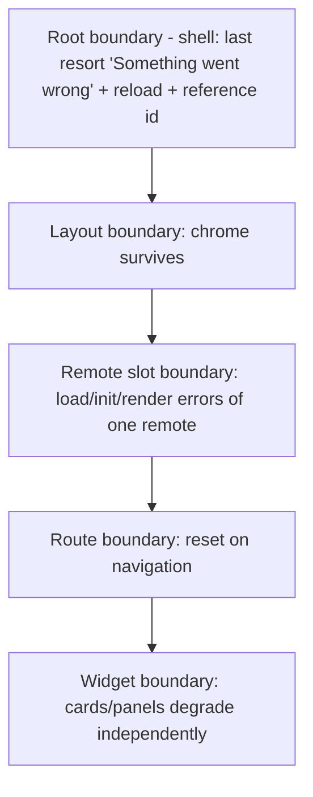

# Frontend Architecture

Doc ID: FEA-01 · Owner: Frontend/Platform Architecture · Version 1.0 · Status: Under Review

> **Revision 2 folded in (2026-10-27)** from `FRONTEND_ARCHITECTURE.md#record-frontend-architecture-rev2`: appended under "Revision 2 additions"; where it differs from text above, the appended text governs. Status unchanged; proposals still need owner/ARB ratification.
Relates: ADR-T02, ADR-T03, ADR-T06, ADR-T08, ADR-T10, ADR-T16, ADR-T17, ADR-T18, ADR-T19 · INV-T01, INV-T13, INV-T14, INV-T16 · FF-03, FF-04, FF-06, FF-07, FF-08, FF-09 · MFA-01, HC-01, VCD-01, FIM-01, DEP-01, PWA-01, PLT-01, OFF-01, MOB-01 · RES-01, RES-02

Tags: [CONF] [TARGET] [OPEN] [REF]. Scores in this document are **architect judgement against stated criteria, not measurements**; numeric budgets are hypotheses with a rationale and a measurement method, to be re-based on the WP-FED-SPIKE baseline. [REF] = observed in the reference repo (`apps/web`, graphify query 2026-10-25): React 19 + TypeScript + Vite + `react-router-dom`, page-per-route SPA (`apps/web/src/pages/*`), shared `components/ui`, a `fetch` helper `lib/api.ts` with a `localStorage` bearer token, no TanStack Query, no offline sync, Vitest + Playwright. The reference is not inherited; it informs risk and continuity.

## 1. Principles
1. **Thin shell, honest modules** — shell owns the cross-cutting singletons; domain UI lives in remotes (MFA-01).
2. **Server decides.** UI shows server state, `allowedActions`, reasons; no client restatement of business rules or authz (INV-T01, INV-T13).
3. **No tokens in JS** (ADR-T06); remotes cannot reach credentials by contract (INV-T16).
4. **Every capability feature-detected with a fallback** (FF-09).
5. **Budgets are release criteria**, not aspirations (§14).
6. **Contracts over conventions**: types generated from OpenAPI (FF-06), Host Contract (HC-01), manifest schema (SCH-01).
7. **Accessibility is structural**: WCAG 2.2 AA target (RES-01 R3), design tokens and components from `@ts/ui`, per-route focus management.

## 2. Framework choice
Decision **[TARGET] FD-F1: React 19 + TypeScript SPA/PWA built with Vite**, federated by `@module-federation/vite` (ADR-T03).
| Criterion (weight) | A React 19 + Vite SPA | B Next.js (App Router) | C React Router 7 framework mode | D SolidJS/SolidStart | E Vue 3 + Nuxt | F Angular |
|---|---|---|---|---|---|---|
| Federation fit: MF 2.0 + runtime registry (5) | 5 — documented Vite plugin + runtime API (RES-02 F11), spike pending | 2 — MF on Next uses separate tooling and constrains routing/SSR; not evaluated here | 2 — framework mode owns build/router; MF fit unverified | 3 | 3 | 3 — native federation exists; not evaluated |
| Continuity with reference stack + hiring pool (4) | 5 [REF] same stack | 4 | 5 | 1 | 2 | 2 |
| Control of service worker / PWA / offline (4) | 5 — own SW, no framework opinion | 3 — possible, SW and routing interplay with server rendering | 3 | 4 | 4 | 4 |
| Migration cost from reference (3) | 5 — same libraries; reorganise pages into modules | 2 | 4 | 1 | 1 | 1 |
| Runtime performance potential (3) | 3 — client rendering; React cost on low-end phones | 4 — RSC/streaming | 4 | 5 | 4 | 3 |
| SSR/SEO capability for public pages (2) | 2 — needs prerender/edge rendering for public pages (OPEN-FE-17) | 5 | 4 | 3 | 4 | 4 |
| a11y/component ecosystem (2) | 5 | 5 | 5 | 2 | 3 | 4 |
| **Weighted total (weights 23, max 115)** | **103** | **76** | **84** | **63** | **68** | **67** |
Totals recomputed by script from the scores above. The ranking is **most sensitive to the federation-fit weight**; if the spike fails (MFA-01 §16) the choice remains React+Vite in `bundled` mode, not a framework change. Public-page SEO (row 6) is the genuine weakness of choice A → **OPEN-FE-17**: prerender/edge-render a small set of public pages (landing, public job pages, public profile) without moving the whole product to SSR.

## 3. Language, build and module federation
| Topic | Decision |
|---|---|
| Language | TypeScript, `strict`, `noUncheckedIndexedAccess`, `exactOptionalPropertyTypes`; project references; no `any` in public contracts |
| Build | Vite per app; `@module-federation/vite` with `manifest: true` (RES-01 R1); versions **pinned** (sources disagreed: 1.16.12 vs 1.21.3 — OPEN-11); Rollup chunking by route |
| Shell federation config (illustrative) | `federation({ name:'mf_shell', remotes:{}, shared:{ react:{singleton:true,requiredVersion:'^19.0.0'}, 'react-dom':{…}, 'react-router':{…}, '@tanstack/react-query':{…}, '@ts/ui':{…}, '@ts/host-sdk':{…} } })`; remotes registered at runtime (`registerRemotes`, `loadRemote`) from the verified registry (MFA-01 §5) |
| Remote federation config | `federation({ name:'mf_candidate', filename:'remoteEntry.js', manifest:true, exposes:{'./module':'./src/module.ts','./testkit':'./src/testkit.ts'}, shared:{ …singletons with import:false } })` |
| Output path | `/mf/<name>/<version>/` with `publicPath` set at build from version (FD-03) |
| MF_MODE | `federated` \| `bundled`, same sources (MFA-01 §11) |
| Browser targets | ES2022 baseline with modern evergreen browsers + iOS Safari 16.4+ (push/installed-PWA floor, PLT-01); no legacy transpile; browserslist check in CI [TARGET; confirm analytics] |
| Styling | **Compile-time CSS only** (CSS Modules or vanilla-extract-class tooling) + design tokens as CSS custom properties from `@ts/ui`; **no runtime CSS-in-JS** so CSP `style-src 'self'` holds. Needs alignment with 07_* (OPEN-FE-31) |
| Reference constraint | Build files in the existing repo are read-only for agents; this is a target design, no config changes were made |

## 4. Routing
| Aspect | Decision |
|---|---|
| Library | `react-router` v7 in **data-router** mode (`createBrowserRouter`) [TARGET; reference uses `react-router-dom` — verify version (OPEN-FE-19)]. Single router instance created by the shell. |
| Route table | Static shell routes (`/`, `/login`, `/signup`, `/r/*`, `/offline`, `*`) + one lazy prefix route per remote registered from the verified registry. |
| Remote routes | Preferred: `patchRoutesOnNavigation` (lazy route discovery: on first hit of `/me/*` the shell loads MOD-CAND and patches its `RemoteRoute[]` into the tree) — API name/stability to be confirmed in the spike; fallback: prefix route renders `useRoutes(remote.routes)` (loses data-router loaders, so loaders become query prefetches). |
| Data loading | Route `loader` prefetches via `queryClient.ensureQueryData`; components read through `useQuery` (single source of truth is QueryClient). Loaders never throw for auth; 401 handled globally. |
| URL as state | Filters/pagination/selection in search params (typed helpers), enabling deep links and back/forward; no hidden state across remotes (MFA-01 §9). |
| Guards | Session + capability hint guard before loading a remote bundle (`handle.requires`); API remains authority. |
| Transitions | Suspense + skeletons; route change moves focus to the page `<h1>`/main and announces title (WCAG); scroll restoration. |
| Redirect hygiene | `return` parameter validated against the route table (PWA-01 §9). |

## 5. Server-state library
Decision **[TARGET] FD-F2: TanStack Query v5** (single shell-owned `QueryClient`, shared singleton).
| Criterion (weight) | TanStack Query v5 | SWR | RTK Query | Apollo Client | Plain fetch + context [REF] |
|---|---|---|---|---|---|
| Persistence/offline cache support (5) | 5 — official persister API, per-query `meta`, `networkMode` | 3 | 3 | 2 | 1 |
| Mutation handling, optimistic updates, pause/resume (3) | 5 | 3 | 4 | 3 | 1 |
| Devtools / observability (2) | 5 | 3 | 4 | 4 | 1 |
| Bundle size (2) | 3 | 5 | 3 | 2 | 5 |
| Works as a cross-bundle singleton without a global store (3) | 4 | 4 | 3 | 2 | 5 |
| Team/ecosystem familiarity (3) | 5 | 4 | 3 | 2 | 2 |
| **Weighted total (weights 18, max 90)** | **83** | **64** | **59** | **43** | **41** |
Rationale: queries are the cache of record for RO offline screens (OFF-01 §5) via `persistQueryClient` with an allowlist; GraphQL is excluded by ADR-T08, which removes Apollo's advantage. **Rules:** key `[moduleId, resource, params]`; `meta.offline = {class, ttl}` required to persist (lint); defaults `staleTime 30 s`, `gcTime ≥ longest persisted TTL`, `retry` ≤ 2 with backoff and no retry on 4xx; `networkMode:'offlineFirst'` only for RO classes; mutations that are not QW go through `host.api` with disabled-offline UI; QW mutations go through `host.sync`, then `setQueryData` from the server response; cross-module invalidation via UI events (HC-01 §6). Persisted data is dropped when `LOCAL_DATA_SCHEMA` (`buster`) changes.

## 6. Client state boundaries
| State kind | Home | Notes |
|---|---|---|
| Server data | TanStack Query | Never copied into another store |
| Navigation/filters/selection | URL (router) | Shareable and restorable |
| Session, capabilities, flags, theme, locale, connectivity, install/update, sync | Shell stores exposed through `host.*` | Read-only for remotes (HC-01) |
| Form state | Component-local (form lib bundled per remote) + `host.sync` drafts for QW forms | Dirty state reported via `host.lifecycle.setDirty` |
| Ephemeral UI (dialogs, tabs) | Component state / `useReducer` | |
| Remote-private cross-component state | Small store (e.g., Zustand) private to the remote | Reset on `onSessionEnd`; never read by other modules |
| Global mutable singletons | **None** besides those above | Lint forbids module-level mutable exports shared across packages |
No Redux-style global store: the only genuinely global state is already modelled by the host APIs.

## 7. API client generated from OpenAPI (ADR-T08, FF-06)
| Aspect | Decision |
|---|---|
| Source of truth | OpenAPI 3.1 produced from Zod contracts on the backend; published per release as an artefact |
| Types | `openapi-typescript` → `@ts/api-types` (type-only) [TARGET; alternatives orval, hey-api — OPEN-FE-29 spike picks on bundle size and TanStack integration] |
| Operations | Typed client (`openapi-fetch`-style) generated per remote from a **tag-filtered subset** (e.g., `candidate`, `evidence`) so each remote bundles only its operations; `apiRange` derived from the spec version used (SCH-01) |
| Transport | The generated client's `fetch` is replaced by `host.api.request` (cookies implicit; `X-CSRF-Token`, `X-TS-Client`, `traceparent`, `Accept-Language`, `Idempotency-Key` for unsafe methods, `If-Match` pass-through); remotes cannot override these headers |
| Query hooks | Thin typed wrappers over TanStack Query (e.g., `openapi-react-query` if mature — OPEN-FE-29); each declares `meta.offline` |
| Errors | `application/problem+json` (RFC 9457) parsed once into `ApiError` (HC-01); `type`/`code` map to UX (§8); validation `errors[]` mapped to form fields |
| Drift control | CI regenerates and fails if committed output differs; oasdiff (FF-06) gates breaking changes; contract tests with MSW handlers generated from the spec |
| Pagination | Cursor-based helpers (`useInfiniteQuery`) with `next` cursors from the API (ADR-T08) |
| Idempotency | Host injects `Idempotency-Key: auto` for POST/PUT/PATCH/DELETE (FF-07), stable across automatic retries of the same logical operation |
| Concurrency | `ETag` captured in query data; mutation helpers add `If-Match` |

## 8. Error handling and boundaries

| Error class | Source | Handling |
|---|---|---|
| Remote load/init | MFA-01 | Slot fallback chain (HC-01 §5) |
| Render exception | React | Nearest boundary; `errors.report`; Retry resets boundary |
| `ApiError` 401 | API | Global: single-flight refresh → reauth (PWA-01 §10) |
| 403 / policy deny | API | Inline "you don't have access", never a redirect loop; no leakage of resource existence beyond API response |
| 404 resource | API | Not-found view within the module |
| 409 / 412 / 422 | API | Domain-specific UX: conflict dialog (OFF-01 §9), field errors |
| 426 `client-outdated` | API | Update-required flow (VCD-01 §5) |
| 429 | API | Honour `Retry-After`, inline message, backoff |
| 5xx / network | API | Section error + Retry; offline detection via `lifecycle.online`; circuit breaker |
| Unexpected | Anywhere | Reported with trace/correlation id; user sees a short **reference code** (trace id suffix) for support, never stack traces or PII |
Messages come from i18n keys keyed by problem `code`; unknown codes fall back to a generic localised message. Assessment-session render errors are reported as technical interruptions, never integrity anomalies (INV-T20; HC-01 §7.2).

## 9. Internationalisation and accessibility
| Topic | Decision |
|---|---|
| Scope | English at launch; framework-ready; RTL and locale formats designed (DOMAIN_ARCHITECTURE family V) |
| Library | FormatJS (`@formatjs/intl`, ICU MessageFormat) as the engine behind `host.i18n` [TARGET; alternatives i18next, Lingui; chosen for ICU + framework-agnostic core + small footprint — judgement, confirm in spike] |
| Catalogues | Per remote namespace, lazily loaded by locale (`registerCatalog`); shell owns locale, `dir`, fallbacks; extraction/compile in CI; missing-key check; pseudo-locale (long/accented) and RTL smoke in e2e |
| Layout | CSS logical properties only (no left/right); icons mirrored where directional |
| Formats | `Intl.NumberFormat`/`DateTimeFormat`/`RelativeTimeFormat` via `host.i18n.format`; time zones explicit |
| User content | Not auto-translated; AI translation features go through the AI gateway with disclosure (ADR-T12) |
| Accessibility | WCAG 2.2 AA (RES-01 R3): ≥ 44 px touch targets (design target), 2.4.11 Focus Not Obscured (sticky headers offset), 2.5.8 target size, keyboard operability, visible focus, reduced motion, `aria-live` for sync/connectivity status, route-change focus management, axe-core in CI plus manual screen-reader passes (NVDA/VoiceOver/TalkBack) on key journeys. Conformance is a target; not measured yet. |

## 10. UI composition
`@ts/ui` provides tokens (colour, spacing, typography, motion, elevation) and accessible primitives; feature code uses tokens only (no hard-coded colours/spacing, consistent with the repo rule on `tokens.ts`). Forms: remotes may bundle their form library, but must use `@ts/ui` field components so errors/labels/ARIA are uniform. Data grids and charts are bundled per remote and lazy-loaded. Images: responsive `srcset`, `loading=lazy`, dimensions reserved (CLS).

## 11. Telemetry (OpenTelemetry web, ADR-T16)
| Aspect | Design |
|---|---|
| Ownership | SDK/provider in the shell; remotes receive a `Tracer` scoped `ts-web-<module>` via `host.telemetry`; `@opentelemetry/api` is a shared singleton so context is global |
| Packages | `sdk-trace-web`, `instrumentation-document-load`, `instrumentation-fetch` (host transport is the single fetch path), `instrumentation-user-interaction`, `web-vitals` (with attribution) → OTLP/HTTP to same-origin `/otlp/*` (no third-party egress; ad-blocker resilient) |
| Resource attributes | `service.name=ts-web-shell`, `ts.shell.version`, `ts.hc.version`, `ts.sw.version`, `ts.install_state`, `ts.locale`, `ts.mf_mode`; per-span `ts.module`, `ts.module.version`, `ts.route` (template) |
| Trace propagation | W3C `traceparent`/`tracestate` injected by `host.api` on every API call using the span active at call time; backend continues the trace through API → outbox event → worker (ADR-T16). Because browser async context is not auto-propagated without `zone.js`, `host.api.request` and `host.telemetry.measure` capture the active context **synchronously at call** and `context.with(...)` around the work [TARGET; zone.js rejected for size/compat — verify in spike]. Navigation spans link remote load to the route span. |
| Remote load spans | `mf.registry.fetch`, `mf.remote.select`, `mf.remote.load` (children: `manifest`, `entry`, `activate`) with `source=current|rollbackTo|lkg|snapshot` |
| Metrics | CWV by route/module/device class; `mf.remote.load_ms`; `outbox.*`; `storage.usage_pct`; `sw.update_wait_ms`; `client.version_age_days` (PWA-01 §14) |
| Sampling | Head sampling default **10%** for traces [TARGET; rationale: cost control before volume is known — set from measured event rate]; errors always exported as log/events; server-side tail sampling for slow/error traces |
| Privacy | Attribute **allowlist**; URL paths templated (`/api/v1/jobs/{jobId}`); no names, emails, free text, tokens, request/response bodies (INV-T14); account identifier only as per-device hashed alias; DOM-22 consent decides whether *analytics* (as opposed to operational telemetry) runs — legal basis [OPEN-FE-30] |
| Offline | In-memory bounded buffer (≤ 200 spans), flushed on reconnect, dropped on overflow; never persisted to IDB |
| Failure | Exporter failures never block UI (FI-26) |
| Error reporting | `errors.report` → same pipeline (log events with trace id); source maps stored privately, not served publicly |

## 12. Security
| Control | Design |
|---|---|
| Credentials | `HttpOnly; Secure; SameSite=Lax` cookies via BFF (ADR-T06); no tokens in JS/localStorage; refresh through shell under Web Locks (PWA-01 §10); no API in `HostApi` exposes credentials |
| CSRF | Same-origin only + custom header `X-CSRF-Token` on unsafe methods + server `Origin`/`Sec-Fetch-Site` checks [OPEN-FE-10] |
| CSP (production, enforced after report-only soak) | `default-src 'none'; script-src 'self'; style-src 'self'; img-src 'self' data: https://cdn.<domain>; font-src 'self'; connect-src 'self'; worker-src 'self'; manifest-src 'self'; frame-src https://checkout.stripe.com [only if embedded; redirect flow preferred]; frame-ancestors 'none'; base-uri 'none'; form-action 'self'; object-src 'none'; upgrade-insecure-requests; require-trusted-types-for 'script'; trusted-types ts-default ts-dompurify; report-to csp` — works because remotes are same-origin (FD-03) and styles are compile-time. Dev server uses a relaxed policy documented separately. Rollout: `Content-Security-Policy-Report-Only` first, then enforce; violations → collector. |
| Trusted Types | Baseline 2026 "newly available" (RES-02 F13) so enforcement is feasible in evergreen browsers; a tinyfill covers older ones. One default policy `ts-default` (throws) + `ts-dompurify` (sanitising) — the only sanctioned path for HTML sinks; `dangerouslySetInnerHTML` allowed solely with `ts-dompurify` output; lint bans `innerHTML`, `document.write`, `eval`, `new Function`. |
| SRI / signed assets | Registry entries signed, asset hashes in entry; SRI on shell `<script>/<link>` tags; federated ESM integrity via layered controls (import-map integrity if supported, SW verification, immutable URLs) — **not claimed complete until OPEN-FE-03 closes** |
| Other headers | `Strict-Transport-Security` (preload decision with ops), `X-Content-Type-Options: nosniff`, `Referrer-Policy: strict-origin-when-cross-origin` (tokenised routes: `no-referrer`), `Permissions-Policy` (disable unused features; allow camera/mic only where needed), `Cross-Origin-Opener-Policy: same-origin`, `Cross-Origin-Resource-Policy: same-origin`; no `X-XSS-Protection` |
| User uploads | Served from a separate registrable origin with `Content-Disposition: attachment` and `nosniff`; no uploaded content executes on the app origin |
| Third-party scripts | None at launch (no tag managers, no ad/analytics SDKs); any addition needs security review + CSP change |
| Dependency hygiene | Lockfile review, SCA, provenance, `npm audit`-class gates, no install scripts from unvetted packages; shared/bundled additions reviewed (DEP-01) |
| Storage | No tokens or secrets; minimal owner cache (OFF-01 §7); purge on logout |
| Federation honesty | Remotes share a JS realm; these controls reduce risk, they do not make remotes a trust boundary (ADR-T19, FIM-01 §3) |
| Post-message / windows | No cross-origin `postMessage` handlers without origin checks; `noopener` on external links |
| Passkeys | WebAuthn RP ID = registrable domain; standalone-mode behaviour device-tested (PLT-01) |

## 13. Feature flags
| Aspect | Decision |
|---|---|
| Source | `GET /me/flags` evaluated **server-side** per session (DOM-24); client receives final values only (no client-side targeting rules, no user attributes sent to third parties). Shell snapshot persisted in `ts-meta` (non-sensitive), refreshed on focus/`ttl` |
| Types | `release` (progressive delivery), `ops` (kill switch), `experiment` (needs consent-aware analytics, OPEN-FE-30). **Not** for authorisation (server only) and **not** for compatibility (VC-14) |
| Naming | `<mod>.<snake_case>` e.g. `cand.evidence_ladder_v2`; declared in the remote manifest `flags[]`; undeclared use fails lint |
| Defaults | Safe-off default compiled in; evaluation failure ⇒ default (FI-25) |
| Lifecycle | Owner + expiry date at creation; CI warns when a flag outlives expiry; removal PRs delete both flag and dead code |
| Remote-level kill | Registry `status`/`killSwitch` (MFA-01 §13), distinct from flags so it works when the flag service is down |
| Observability | Active flag set attached to error reports (names only) |

## 14. Performance budgets
Method for every row: **lab gate in CI** (Lighthouse CI + Playwright traces on a mid-tier-Android profile: Lighthouse mobile emulation with 4× CPU slowdown and slow-4G throttling, plus a "returning installed user" run with warm SW) **and field measurement** (RUM via `web-vitals` → OTel, p75 by route, module, device class, `ts.install_state`). Lab numbers are regression guards; field p75 is the target of record. Rows marked *published* use Google's published "good" thresholds; rows marked *hypothesis* have no external basis and are replaced after the WP-FED-SPIKE baseline plus 4 weeks of RUM.
| # | Area | Budget | Basis | Rationale | Measurement / gate |
|---|---|---|---|---|---|
| B1 | LCP (mobile, p75) | ≤ 2.5 s | *published* | Core Web Vitals "good" | RUM p75 per route; LH CI warns at 2.5 s lab |
| B2 | INP (p75) | ≤ 200 ms | *published* | CWV "good" | RUM; Playwright interaction traces; INP support on Safari is partial (U) so Safari reported separately |
| B3 | CLS (p75) | ≤ 0.1 | *published* | CWV "good" | RUM; layout-shift CI check on key routes |
| B4 | TTFB for HTML (p75) | ≤ 0.8 s | *published* | web.dev "good" threshold | RUM navigation timing; edge config |
| B5 | Startup: shell critical-path JS (gzip, incl. React, router, Query, host-sdk, ui core) | ≤ 150 KB | *hypothesis* | Keep parse/execute cost low on mid-tier phones; set after measuring the real baseline; shell must not grow without a recorded trade-off | `size-limit` in CI fails PR; trend dashboard |
| B6 | Startup: returning installed user, FCP from SW cache (p75) | ≤ 1.0 s | *hypothesis* | Offline-capable shell should feel instant; no network on critical path | RUM filtered by `ts.install_state=standalone` + warm SW; Playwright with SW |
| B7 | Startup: registry never blocks first paint | registry timeout ≤ 2.5 s, FCP independent | *design rule* | Resilience (FI-08) | Trace: `mf.registry.fetch` is off the FCP path (assert in e2e) |
| B8 | Remote load: route match → remote module ready, warm (SW cache) p75 | ≤ 500 ms | *hypothesis* | Cached immutable chunk + parse; feels like a route change | Span `mf.remote.load`; alert when p75 exceeds 2× baseline |
| B9 | Remote load, cold on 4G p75 | ≤ 1.5 s | *hypothesis* | One extra RTT chain: manifest + entry + chunks; prefetch should hide it for common paths | Same span with `cache=miss` |
| B10 | Remote initial JS (gzip, excl. singletons) | ≤ 120 KB per remote; lazy heavy chunks (editor, grid, charts) ≤ 250 KB each, loaded on use | *hypothesis* | Per-persona code only; prevents one remote becoming the monolith | `size-limit` per remote; CI diff comment |
| B11 | Interaction: click → next route content (warm), p75 | ≤ 300 ms | *hypothesis* | Perceived responsiveness; INP is the field metric of record | Custom span `route.transition`; Playwright |
| B12 | Long tasks during route transitions | no task > 200 ms at p95 [Chromium only for field data] | *hypothesis* | Main thread is shared (FIM-01 FI-22) | Long Tasks API (Chromium); lab traces for WebKit/Firefox |
| B13 | SW precache total | ≤ 1.5 MB | *hypothesis* | Install on constrained networks; fewer evictions | Build report; CI gate |
| B14 | Offline storage (app-managed total) | ≤ 100 MB (OFF-01 §5) | *hypothesis* | Far below documented quotas | `storage.usage_pct` telemetry |
| B15 | Image weight on key routes | ≤ 300 KB above the fold | *hypothesis* | Protect LCP on mobile | LH CI audit |
| B16 | Federation overhead | 0 duplicate singleton instances; ≤ 1 extra request waterfall level for manifest | *design rule* | Correctness and latency | Boot identity probe; network waterfall test |
Budget governance: exceeding a *hypothesis* budget requires a written trade-off and an owner; *published* thresholds are always fix-forward. Budgets are reviewed after the spike baseline (OPEN-FE-32).

## 15. Repository layout (target; reconcile with the existing monorepo — OPEN-FE-28)
```text
apps/
  shell/                 MOD-SHELL (host)
  mf-candidate/  mf-learning/  mf-opportunities/  mf-hiring/  mf-messaging/  mf-account/  mf-admin/
  api/  worker/          [REF names] backend
packages/
  host-sdk/              Host Contract (types, routes, events, data re-exports, testing/)
  ui/                    design system + tokens
  api-types/             generated from OpenAPI (type-only)
  testkit/               MockHost, fixtures, MSW handlers generated from OpenAPI
  mf-tools/              registry validator, signer, compat gate, CLI
  lint-config/           eslint + dependency-cruiser configs
  contracts/ domain/ policy/   [REF] backend packages — NOT imported by frontend (DEP-01 #11/#12)
tools/ci/                pipeline scripts
docs/                    pointers to Yash_Final_Project_Document
```
Reference today: single `apps/web` with `pages/`, `components/`, `lib/`. Migration is by moving page groups into the module they belong to (MOD-* table), keeping the existing `components/ui` as the seed of `@ts/ui`. No code was moved or changed by this documentation.

## 16. Build pipeline
| Stage | Content | Gate |
|---|---|---|
| 1 Affected detection | pnpm workspace graph (ADR-T17) | only affected apps/packages continue |
| 2 Static | typecheck, ESLint (incl. restricted globals, i18n, offline-meta rules), dependency-cruiser (FF-03), manifest validator (FF-04) | zero errors |
| 3 Generate | OpenAPI → `@ts/api-types` and per-remote operations; drift check | no uncommitted diff |
| 4 Tests | unit (Vitest [REF]), component, **contract tests vs MockHost per supported HC minor** | pass |
| 5 Build | both `federated` and `bundled`; hidden source maps to private store; SBOM + provenance | reproducible hash check |
| 6 Budgets | `size-limit`, precache size, SRI list generation | within B5/B10/B13 |
| 7 E2E | Playwright Chromium/WebKit/Firefox on bundled build (full) + federated smoke; offline and update scenarios; axe | pass (FF-09) |
| 8 Compat gate | FF-08: remote entry vs production shell HC/minShell + OpenAPI range + shared ranges; shell vs all live entries | pass |
| 9 Publish | immutable upload, healthcheck from regions, sign entry, canary, SLO guard, promote (MFA-01 §12) | automated |
| 10 Post-deploy | synthetic journeys, RUM watch, rollback automation | auto-rollback on breach |
Shell and SW release in lockstep (VCD-01 §6.9). Secrets never present in build logs or bundles (secret scan).

## 17. Testing hooks
| Hook | Purpose | Availability |
|---|---|---|
| Role-based locators first; `data-testid` only where no accessible name exists | Stable, a11y-aligned tests | all builds |
| `data-ts-module`, `data-ts-route` attributes on slot/root nodes | Attribute telemetry/e2e to a module | all builds |
| `window.__TS_TEST__` (test builds only; absent in production) | Toggle connectivity, advance clock, override registry (with test key), force SW update, read outbox/queue state, trigger purge | non-production only, stripped by build flag; CI asserts absence in prod bundle |
| `MockHost` (`@ts/host-sdk/testing`) | Unit/contract tests for remotes without the shell; fault injection (offline, 401, 412, 5xx, slow) | tests |
| MSW handlers generated from OpenAPI | Deterministic API for component/e2e | tests |
| Playwright fixtures | `offline()`, `withSession(role)`, `withRegistry(overrides)`, `installPWA()` (Chromium), WebKit/Firefox parity runs | e2e |
| Registry override (`?ts_registry=`) | Staging-only, requires test signing key in trust anchors | staging builds only |
| Perf & PWA | Lighthouse CI; manual device checklist (PLT-01 §5) | scheduled |
| Visual regression | Playwright screenshots on `@ts/ui` stories and key routes | CI |
| Accessibility | axe-core per route in e2e; manual AT passes | CI + release |
Test pyramid target (shape, not a coverage claim): many unit/component, a moderate number of contract tests (one set per remote per HC minor), fewer e2e journeys, a small curated device suite.

## 18. Cross-document consistency notes
Aligns with: ADR-T02 (PWA-first), T03 (MF 2.0, Vite), T06 (cookies, no tokens), T08 (OpenAPI, problem+json, idempotency, ETag), T10 (offline tiers), T16 (OTel + W3C), T17 (pnpm monorepo, affected-only), T18 (Host Contract), T19 (no isolation claim). No contradiction with canonical docs found; **gaps** the registry leaves open are listed as OPEN-FE items (route prefixes for public/tokenised flows, DOM-21 ownership, persona overlap).

## 19. Open items
OPEN-FE-03 SRI under federation · OPEN-FE-10 CSRF/refresh grace · OPEN-FE-17 public-page SEO strategy · OPEN-FE-19 router version · OPEN-FE-28 repo reconciliation · OPEN-FE-29 OpenAPI client toolchain · OPEN-FE-30 telemetry vs analytics consent/legal basis · OPEN-FE-31 design-system styling approach (no runtime CSS-in-JS) · OPEN-FE-32 budget rebase after spike · OPEN-11/OPEN-12 (global) MF spike and device matrix.

# Revision 2 additions (folded 2026-10-27 from `FRONTEND_ARCHITECTURE.md#record-frontend-architecture-rev2`)

## 1. Delivery mode (REVW-07)
FEA-01 sections 2, 3, 15 and 16 describe React 19 + Vite "federated by `@module-federation/vite`". Read them as follows: **the default is `MF_MODE=bundled`** (one shell build, every module a lazy route-chunk group behind the same typed module contract, per-route error boundaries); the federated runtime is an activation option gated by MFA-01 section 11.1. Consequences for this document:

| FEA-01 place | Read as |
|---|---|
| Section 2 decision FD-F1 "federated by ..." | React 19 + TypeScript SPA/PWA built with Vite; modules are bundled lazy chunk groups; federation is [FED] |
| Section 3 rows "Shell/Remote federation config", "Output path /mf/...", "MF_MODE" | [FED]. In bundled mode: `build.rollupOptions` route chunking, module packages under `apps/mf-*` are workspace packages imported by `modules.bundled.ts`; output under `/assets/`, back-office chunks under `/assets/bo/` (gated, FD-14) |
| Section 11 telemetry spans `mf.registry.*`, `mf.remote.*` | [FED]. Bundled mode emits `module.load` (chunk load) with `source=bundled` |
| Section 14 B7, B8, B9, B16 | [FED] rows (see section 4) |
| Section 15 layout | Add `apps/mf-institution/` (MOD-INS). `apps/mf-admin/` is MOD-ADM back-office only |
| Section 16 stage 5 and 7 | Stage 5 builds **bundled on every release**; the federated build is a scheduled non-release job (weekly). Stage 7 runs the full e2e on the bundled build; the federated smoke runs with the scheduled job. Stage 9 (publish, sign, canary registry) runs only after activation |
| Section 4 router `patchRoutesOnNavigation`, section 3 plugin option names | See section 6 (unverified) |

Remote count is **eight** (MOD-ADM back-office, MOD-INS institution). The instructor studio is a lazy chunk group outside MOD-LRN's initial JS (MFA-01 section 4).

## 2. SEO and public pages (REVW-13)
### 2.1 Re-scoring FEA-01 section 2
FEA-01 section 2 weights federation fit at 5 for option A while rivals are scored 2 or 3 as "not evaluated here", and weights SEO at 2 although public job pages are an acquisition surface (SPEC-G4 FEAT-09-05.1, P0 Phase 1). Recomputed from FEA-01's own per-criterion scores (script, totals checked):

Criteria and scores (A React+Vite SPA, B Next.js, C React Router 7 framework mode, D SolidJS, E Vue+Nuxt, F Angular), in the order Federation, Continuity, SW/PWA control, Migration, Runtime perf, SEO, a11y: A 5,5,5,5,3,2,5 · B 2,4,3,2,4,5,5 · C 2,5,3,4,4,4,5 · D 3,1,4,1,5,3,2 · E 3,2,4,1,4,4,3 · F 3,2,4,1,3,4,4.

| Scenario (weights Fed/Cont/SW/Mig/Perf/SEO/a11y) | A | B | C | D | E | F |
|---|---|---|---|---|---|---|
| S0 original (5/4/4/3/3/2/2) | 103 | 76 | 84 | 63 | 68 | 67 |
| S1 bundled default: federation weight 0 (0/4/4/3/3/2/2) | 78 | 66 | 74 | 48 | 53 | 52 |
| S2 S1 with SEO weight 5 (0/4/4/3/3/5/2), A SEO as scored (2) | 84 | 81 | **86** | 57 | 65 | 64 |
| S3 S2 with ADR-T24 adopted: A SEO = 4 (edge prerender covers the public surface) | **94** | 81 | 86 | 57 | 65 | 64 |
| S4 original weights, A SEO = 4 | 107 | 76 | 84 | 63 | 68 | 67 |

Reading: (1) with federation removed from the default and SEO weighted by acquisition value, **A leads only if ADR-T24 is adopted**; without it C leads (S2). (2) The SPA choice therefore depends on ADR-T24 and not on federation. (3) "A SEO = 4" is judgement conditional on the design in 2.2 and must be re-scored after the prerender spike; the federation-fit scores of B, C, D, E, F remain "not evaluated" and are excluded (weight 0) in S1 to S3. (4) Re-run again when OPEN-03 closes. Decision FD-F1 stands (React 19 + Vite SPA/PWA) conditional on ADR-T24; if ADR-T24 is rejected, re-open the choice between A and C.

### 2.2 ADR-T24 (proposed): public pages prerendered at the edge, app routes stay SPA
| Aspect | Design [TARGET] |
|---|---|
| Scope | Public job page (`/jobs/:jobId` public view), landing, help, and public profile (`/p/:handle`, only when the owner made it public) once public profiles ship. App routes (`/me`, `/hiring`, `/admin`, `/institution`, `/learn`, `/applications`, `/messages`, `/settings`, `/billing`, `/privacy`) are SPA, `noindex`, disallowed in `robots.txt` |
| Rendering | A **public-page renderer** produces a complete HTML document (title, meta description, canonical, Open Graph, `JobPosting` or `ProfilePage` JSON-LD, semantic body, and the SPA bootstrap script) from the server-asserted public API representation (the same credential-free data as `X-TS-Cache-Class: public`, PWA-01 R5). Renderer technology (server-side template module in the API versus headless render in a worker) is decided by a short spike [OPEN]; the SPA replaces the body on load rather than hydrating, so no React server rendering dependency is introduced |
| Freshness | Snapshots are generated by a worker job class on outbox events (`job.published`, `job.updated`, `job.closed`, `job.taken_down`, profile visibility change, erasure) and stored in object storage; the edge serves them at the canonical URL with short `Cache-Control` and a purge on each event. If a snapshot is missing the edge falls back to the SPA shell (never a 5xx) |
| Same content for all | Crawlers and users receive the same HTML (no cloaking) |
| Sitemap | Worker-generated `sitemap.xml` index plus child sitemaps (sitemap protocol limit 50,000 URLs per file), only open public jobs and public profiles, `lastmod` from the entity; `robots.txt` references it. Closed or taken-down jobs leave the sitemap and the page shows a closed notice (status code policy [UNVERIFIED against current search-engine guidance, check before build]) |
| Structured data | `JobPosting` fields follow the current search-engine documentation [UNVERIFIED here: fields such as `validThrough` and employer identity requirements must be checked against current docs and against the REVW-22 employer verification badge before launch]; no claim of ranking benefit is made |
| Privacy | A profile snapshot contains only fields the owner set public; hiding a profile or erasure (BR-T060) purges the snapshot and sitemap entry within a purge SLA [OPEN: owner Privacy lead]. Copies already held by search engines are outside our control and the privacy notice says so |
| Phase | Job pages: Phase 1 (SPEC-G4 FEAT-09-05.1). Profile pages: with public profiles |
| Alternatives rejected for Phase 1 | Whole-product SSR (Next.js B or React Router 7 framework mode C): couples the framework choice to the unproven federation decision, high migration cost from the reference stack, and the service-worker/offline model gets harder. Revisit trigger: the public surface grows beyond a handful of templates, or prerender maintenance cost exceeds the SSR migration cost [OPEN threshold] |
| Verification | No-JS fetch test per template (title, canonical, JSON-LD, links present); structured-data validation (manual, rich-results tool); `public.snapshot_age_s` metric and alert; purge test (hide profile, snapshot gone); Lighthouse SEO audit; crawl of sitemap URLs returns 200 |
| Owners | Frontend Architect (templates), Backend (worker job class, renderer API), Platform/edge (routing and purge), Product growth (SEO weight, keyword scope) |
| Hosting detail | See `17_DEVOPS_AND_INFRASTRUCTURE/FRONTEND_DELIVERY_REVIEW_FIXES.md` |

OPEN-FE-17 is answered by this proposal and should be moved to the global register (REVW-33).

## 3. Idempotency in the transport row (REVW-14 c)
FEA-01 section 7 Idempotency row ("Host injects `Idempotency-Key: auto` ... stable across automatic retries") is replaced by: **one mutation-scoped key per user intent** from `host.api.intentKey()` (HC-01), reused on every retry and reload of that intent and stored with the local draft; the host never creates a fresh key per call; an unsafe request with neither a key nor an operation that declares a natural key is rejected in development and reported in production. FF-07 wording: "accepts `Idempotency-Key` or declares a natural key". Queued routes: OFF-01-REV2 section 4.

## 4. Performance budgets re-derived (REVW-23)
### 4.1 Formula and constants (from OPS-SLO section 3, not new numbers)
Lab profile RMP-1: Lighthouse mobile emulation, 4x CPU slowdown, simulated Slow-4G about 1.6 Mbit/s, about 150 ms RTT. `t_transfer = bytes x 8 / throughput`. Critical-path budget `B = (T_target - T_ttfb - T_cpu) x throughput / 8` with `T_target` 2.5 s, `T_ttfb` 0.45 s (3 RTT), `T_cpu` 1.0 s: `B = 1.05 s x 1.6e6 / 8 = 210 KB` gzip for HTML+JS+CSS on the critical path. Illustration of a method, to be replaced by RMP-1 measurements (OPEN-15).

### 4.2 Lab versus field
LCP (B1) applies to **hard navigations (entry routes)**, measured in the field at p75 (target of record) and in the lab on RMP-1 as a regression guard, run twice: cold (first visit, empty cache) and warm (returning installed user). Soft navigations inside the SPA are governed by B11 and INP (B2), not LCP. Entry routes are the candidate home, job list and detail, application detail (email and push deep links), and public pages. Public pages are prerendered (section 2.2), so their LCP content does not wait for JS.

### 4.3 First-visit arithmetic
| Case | Transfer | Total (ttfb 0.45 + transfer + cpu 1.0) | Against LCP 2.5 s |
|---|---|---|---|
| Original budgets: shell B5 150 KB + route B10 120 KB = 270 KB | 1.35 s | 2.80 s | **0.30 s over** (the contradiction in REVW-23) |
| Corrected: shell 150 KB + entry-route initial JS 60 KB = 210 KB | 1.05 s | 2.50 s | at budget |
| Federated option adds SLO-17 overhead 250 ms to the corrected case | 1.05 s + 0.25 s | 2.75 s | 0.25 s over |

Corrected budgets (replace B10 and annotate B5, B9, B16):

| # | Budget [hypothesis unless noted] | Basis |
|---|---|---|
| B5 | Shell critical-path JS <= 150 KB gz (unchanged); it leaves **60 KB** of the 210 KB budget for an entry route | formula 4.1 |
| B10a | **Entry-route initial JS <= 60 KB gz** (candidate home, job list/detail, application detail). Route-level lazy chunks (editor, grid, charts) are not part of the entry cost and load on use | 210 - 150 |
| B10b | Non-entry route chunk group initial JS <= 120 KB gz (reached by soft navigation with the shell already cached; LCP does not apply; B11 applies); lazy heavy chunks <= 250 KB each | unchanged from the original B10 |
| B9 [FED] | Cold remote load, field 4G p75 <= 1.5 s, **decomposed** as extra federation overhead (<= SLO-17 250 ms: manifest + entry round trips) + chunk transfer (R x 8 / throughput; 60 KB at RMP-1 is 0.30 s) + parse and activate allowance. B9 is an absolute ceiling for the whole remote load; SLO-17 is the delta against bundled mode. They nest and no longer conflict. The 4G throughput for field is [OPEN] until RUM data exists |
| B16 [FED] | The 250 ms overhead cannot be added to the corrected first-visit case (2.75 s). Activation (MFA-01 section 11.1) therefore requires the spike to show the entry-route chunk and shell can shrink by about 50 KB (0.25 s) or that preloading hides the overhead; otherwise federation fails the LCP budget on cold deep links. This is an additional reason it is an option and not the default |
| B8 [FED] | Warm remote load <= 500 ms (unchanged). Bundled equivalent: warm chunk load <= 500 ms (same span `module.load`) |
| B13 | SW precache <= 1.5 MB, shell critical path and offline page only (module chunks are runtime-cached, PWA-01-REV2 section 2) |

OPS-SLO owner action: SLO-17 and SLO-03 apply only to the federated option (SLO-03's 216 min/month per remote is lower than the API allowance); SLO-13 states lab versus field per section 4.2. Not edited here (folder 15).

## 5. Session and security wording leftovers (REVW-05)
FEA-01 section 12 "Credentials" row: read as `__Host-ts_at` (`HttpOnly; Secure; SameSite=Lax; Path=/`) and `__Secure-ts_rt` (`SameSite=Strict`, `Path=/api/v1/auth/refresh`) per SEC-02 section 2.3; "via BFF" means the `/api/v1` auth routes, not a separate namespace. The CSRF row already says `X-CSRF-Token` and is correct. User-generated content on a separate registrable domain (REVW-32) is governed by SEC-02; FEA-01's "separate registrable origin" row stands.

## 6. Claims marked unverified (router, build tooling)
| Claim in FEA-01 / MFA-01 / DEP-01 | Status |
|---|---|
| `patchRoutesOnNavigation` lazy route discovery in react-router v7 data routers (FEA-01 section 4) | **Unverified**: name and stability not confirmed against the pinned version; fallback in FEA-01 section 4 applies; confirm in the spike or first routing task |
| `react-router` v7 package layout, `createBrowserRouter` data mode with the reference's `react-router-dom` | **Unverified** (OPEN-FE-19) |
| `@module-federation/vite` options `manifest: true`, `registerRemotes`, `loadRemote`, `errorLoadRemote`, `loadEntryError`, `createScript` | **Unverified** until WP-FED-SPIKE [FED] |
| dependency-cruiser rule syntax with `$1` back-references in DEP-01 section 4 (`pathNot: '^apps/$1/'`) | **Unverified syntax**; the intent (no remote-to-remote imports) is the requirement, not the exact rule text |
| `openapi-react-query` maturity; `vite-plugin-pwa` injectManifest coexistence | Already marked "if mature" / spike items; stay unverified |
| Trusted Types availability and CSP directives list | Sourced to RES-02 F13; not re-verified here |

## 7. Repository layout addition
`apps/mf-institution/` (MOD-INS) beside `apps/mf-admin/` (MOD-ADM). Module packages are workspace packages in bundled mode. Back-office build output is emitted under a distinct path prefix (`/assets/bo/`) through the build's chunk naming so the edge rule (FD-14) and the SW exclusion (PWA-01-REV2 section 2 rule R2b) can match it; the build config is a build file and is not changed by this documentation.

## 8. Remaining open items
OPEN-FE-17 (answered by ADR-T24 once ratified), OPEN-FE-19, OPEN-FE-32 (budget re-base after the spike baseline), OPEN-15 (RMP-1 calibration). New: renderer technology spike for ADR-T24; purge SLA; status-code policy for closed jobs.

## 9. Supersession map (relationship only)
| This revision | Supersedes (in FEA-01) |
|---|---|
| section 1 | sections 2 (decision wording), 3 (federation rows), 15, 16 (stage 5, 7, 9 timing) |
| section 2 | section 2 totals sentence "103 ... most sensitive to federation-fit weight", and the SEO row note; OPEN-FE-17 |
| section 3 | section 7 Idempotency row |
| section 4 | section 14 rows B5 (annotation), B9, B10, B16; method paragraph unchanged |
| section 5 | section 12 Credentials row wording |
| section 6 | section 4 Remote routes row, section 3 build row, DEP-01 section 4 example rule |


---

<a id="record-frontend-architecture-rev2"></a>
## Preserved source record: FRONTEND_ARCHITECTURE_REV2

> Consolidated on 2026-10-27. The following is the complete source record, retained for provenance, exceptions and rationale. Its dates, counts and statements about files describe the earlier revision, not the current filesystem. Approval conditions and authority remain unchanged: this move neither ratifies proposals nor overrides the owning document’s current precedence rules. Relative references now point to the consolidated records.

<!-- source-record-begin: Yash_Final_Project_Document/10_FRONTEND_ARCHITECTURE/FRONTEND_ARCHITECTURE_REV2.md -->
<a id="record-frontend-architecture-rev2--frontend-architecture---revision-2-review-fixes"></a>
# Frontend Architecture - Revision 2 (review fixes)

Doc ID: FEA-01-REV2 · Owner: Frontend/Platform Architecture · Version 2.0 · Status: Under Review

> **Folded into `FRONTEND_ARCHITECTURE.md` on 2026-10-27.** Change record only; edit the original.
Relates: ADR-T02, ADR-T03 (amended by ADR-T23, proposed), ADR-T10a (proposed), ADR-T24 (proposed here) · REVW-07, REVW-13, REVW-14, REVW-23 · REV-RES · FEA-01, MFA-01, MFA-01-REV2 (`09_MODULE_FEDERATION/FEDERATION_REVIEW_FIXES.md`), OFF-01-REV2, OPS-SLO

Tags: [CONF] [TARGET] [OPEN] [FED] (federated option only). This file is **additive**: `FRONTEND_ARCHITECTURE.md` (FEA-01) is unchanged. Where this revision differs, it governs; section 9 lists what it supersedes. Supersession is a relationship, not a deletion. Scores are architect judgement against stated criteria, not measurements. Budgets are hypotheses with a formula and a measurement method.

<a id="record-frontend-architecture-rev2--1-delivery-mode-revw-07"></a>
## 1. Delivery mode (REVW-07)
FEA-01 sections 2, 3, 15 and 16 describe React 19 + Vite "federated by `@module-federation/vite`". Read them as follows: **the default is `MF_MODE=bundled`** (one shell build, every module a lazy route-chunk group behind the same typed module contract, per-route error boundaries); the federated runtime is an activation option gated by MFA-01 section 11.1. Consequences for this document:

| FEA-01 place | Read as |
|---|---|
| Section 2 decision FD-F1 "federated by ..." | React 19 + TypeScript SPA/PWA built with Vite; modules are bundled lazy chunk groups; federation is [FED] |
| Section 3 rows "Shell/Remote federation config", "Output path /mf/...", "MF_MODE" | [FED]. In bundled mode: `build.rollupOptions` route chunking, module packages under `apps/mf-*` are workspace packages imported by `modules.bundled.ts`; output under `/assets/`, back-office chunks under `/assets/bo/` (gated, FD-14) |
| Section 11 telemetry spans `mf.registry.*`, `mf.remote.*` | [FED]. Bundled mode emits `module.load` (chunk load) with `source=bundled` |
| Section 14 B7, B8, B9, B16 | [FED] rows (see section 4) |
| Section 15 layout | Add `apps/mf-institution/` (MOD-INS). `apps/mf-admin/` is MOD-ADM back-office only |
| Section 16 stage 5 and 7 | Stage 5 builds **bundled on every release**; the federated build is a scheduled non-release job (weekly). Stage 7 runs the full e2e on the bundled build; the federated smoke runs with the scheduled job. Stage 9 (publish, sign, canary registry) runs only after activation |
| Section 4 router `patchRoutesOnNavigation`, section 3 plugin option names | See section 6 (unverified) |

Remote count is **eight** (MOD-ADM back-office, MOD-INS institution). The instructor studio is a lazy chunk group outside MOD-LRN's initial JS (MFA-01 section 4).

<a id="record-frontend-architecture-rev2--2-seo-and-public-pages-revw-13"></a>
## 2. SEO and public pages (REVW-13)
<a id="record-frontend-architecture-rev2--21-re-scoring-fea-01-section-2"></a>
### 2.1 Re-scoring FEA-01 section 2
FEA-01 section 2 weights federation fit at 5 for option A while rivals are scored 2 or 3 as "not evaluated here", and weights SEO at 2 although public job pages are an acquisition surface (SPEC-G4 FEAT-09-05.1, P0 Phase 1). Recomputed from FEA-01's own per-criterion scores (script, totals checked):

Criteria and scores (A React+Vite SPA, B Next.js, C React Router 7 framework mode, D SolidJS, E Vue+Nuxt, F Angular), in the order Federation, Continuity, SW/PWA control, Migration, Runtime perf, SEO, a11y: A 5,5,5,5,3,2,5 · B 2,4,3,2,4,5,5 · C 2,5,3,4,4,4,5 · D 3,1,4,1,5,3,2 · E 3,2,4,1,4,4,3 · F 3,2,4,1,3,4,4.

| Scenario (weights Fed/Cont/SW/Mig/Perf/SEO/a11y) | A | B | C | D | E | F |
|---|---|---|---|---|---|---|
| S0 original (5/4/4/3/3/2/2) | 103 | 76 | 84 | 63 | 68 | 67 |
| S1 bundled default: federation weight 0 (0/4/4/3/3/2/2) | 78 | 66 | 74 | 48 | 53 | 52 |
| S2 S1 with SEO weight 5 (0/4/4/3/3/5/2), A SEO as scored (2) | 84 | 81 | **86** | 57 | 65 | 64 |
| S3 S2 with ADR-T24 adopted: A SEO = 4 (edge prerender covers the public surface) | **94** | 81 | 86 | 57 | 65 | 64 |
| S4 original weights, A SEO = 4 | 107 | 76 | 84 | 63 | 68 | 67 |

Reading: (1) with federation removed from the default and SEO weighted by acquisition value, **A leads only if ADR-T24 is adopted**; without it C leads (S2). (2) The SPA choice therefore depends on ADR-T24 and not on federation. (3) "A SEO = 4" is judgement conditional on the design in 2.2 and must be re-scored after the prerender spike; the federation-fit scores of B, C, D, E, F remain "not evaluated" and are excluded (weight 0) in S1 to S3. (4) Re-run again when OPEN-03 closes. Decision FD-F1 stands (React 19 + Vite SPA/PWA) conditional on ADR-T24; if ADR-T24 is rejected, re-open the choice between A and C.

<a id="record-frontend-architecture-rev2--22-adr-t24-proposed-public-pages-prerendered-at-the-edge-app-routes-stay-spa"></a>
### 2.2 ADR-T24 (proposed): public pages prerendered at the edge, app routes stay SPA
| Aspect | Design [TARGET] |
|---|---|
| Scope | Public job page (`/jobs/:jobId` public view), landing, help, and public profile (`/p/:handle`, only when the owner made it public) once public profiles ship. App routes (`/me`, `/hiring`, `/admin`, `/institution`, `/learn`, `/applications`, `/messages`, `/settings`, `/billing`, `/privacy`) are SPA, `noindex`, disallowed in `robots.txt` |
| Rendering | A **public-page renderer** produces a complete HTML document (title, meta description, canonical, Open Graph, `JobPosting` or `ProfilePage` JSON-LD, semantic body, and the SPA bootstrap script) from the server-asserted public API representation (the same credential-free data as `X-TS-Cache-Class: public`, PWA-01 R5). Renderer technology (server-side template module in the API versus headless render in a worker) is decided by a short spike [OPEN]; the SPA replaces the body on load rather than hydrating, so no React server rendering dependency is introduced |
| Freshness | Snapshots are generated by a worker job class on outbox events (`job.published`, `job.updated`, `job.closed`, `job.taken_down`, profile visibility change, erasure) and stored in object storage; the edge serves them at the canonical URL with short `Cache-Control` and a purge on each event. If a snapshot is missing the edge falls back to the SPA shell (never a 5xx) |
| Same content for all | Crawlers and users receive the same HTML (no cloaking) |
| Sitemap | Worker-generated `sitemap.xml` index plus child sitemaps (sitemap protocol limit 50,000 URLs per file), only open public jobs and public profiles, `lastmod` from the entity; `robots.txt` references it. Closed or taken-down jobs leave the sitemap and the page shows a closed notice (status code policy [UNVERIFIED against current search-engine guidance, check before build]) |
| Structured data | `JobPosting` fields follow the current search-engine documentation [UNVERIFIED here: fields such as `validThrough` and employer identity requirements must be checked against current docs and against the REVW-22 employer verification badge before launch]; no claim of ranking benefit is made |
| Privacy | A profile snapshot contains only fields the owner set public; hiding a profile or erasure (BR-T060) purges the snapshot and sitemap entry within a purge SLA [OPEN: owner Privacy lead]. Copies already held by search engines are outside our control and the privacy notice says so |
| Phase | Job pages: Phase 1 (SPEC-G4 FEAT-09-05.1). Profile pages: with public profiles |
| Alternatives rejected for Phase 1 | Whole-product SSR (Next.js B or React Router 7 framework mode C): couples the framework choice to the unproven federation decision, high migration cost from the reference stack, and the service-worker/offline model gets harder. Revisit trigger: the public surface grows beyond a handful of templates, or prerender maintenance cost exceeds the SSR migration cost [OPEN threshold] |
| Verification | No-JS fetch test per template (title, canonical, JSON-LD, links present); structured-data validation (manual, rich-results tool); `public.snapshot_age_s` metric and alert; purge test (hide profile, snapshot gone); Lighthouse SEO audit; crawl of sitemap URLs returns 200 |
| Owners | Frontend Architect (templates), Backend (worker job class, renderer API), Platform/edge (routing and purge), Product growth (SEO weight, keyword scope) |
| Hosting detail | See `17_DEVOPS_AND_INFRASTRUCTURE/FRONTEND_DELIVERY_REVIEW_FIXES.md` |

OPEN-FE-17 is answered by this proposal and should be moved to the global register (REVW-33).

<a id="record-frontend-architecture-rev2--3-idempotency-in-the-transport-row-revw-14-c"></a>
## 3. Idempotency in the transport row (REVW-14 c)
FEA-01 section 7 Idempotency row ("Host injects `Idempotency-Key: auto` ... stable across automatic retries") is replaced by: **one mutation-scoped key per user intent** from `host.api.intentKey()` (HC-01), reused on every retry and reload of that intent and stored with the local draft; the host never creates a fresh key per call; an unsafe request with neither a key nor an operation that declares a natural key is rejected in development and reported in production. FF-07 wording: "accepts `Idempotency-Key` or declares a natural key". Queued routes: OFF-01-REV2 section 4.

<a id="record-frontend-architecture-rev2--4-performance-budgets-re-derived-revw-23"></a>
## 4. Performance budgets re-derived (REVW-23)
<a id="record-frontend-architecture-rev2--41-formula-and-constants-from-ops-slo-section-3-not-new-numbers"></a>
### 4.1 Formula and constants (from OPS-SLO section 3, not new numbers)
Lab profile RMP-1: Lighthouse mobile emulation, 4x CPU slowdown, simulated Slow-4G about 1.6 Mbit/s, about 150 ms RTT. `t_transfer = bytes x 8 / throughput`. Critical-path budget `B = (T_target - T_ttfb - T_cpu) x throughput / 8` with `T_target` 2.5 s, `T_ttfb` 0.45 s (3 RTT), `T_cpu` 1.0 s: `B = 1.05 s x 1.6e6 / 8 = 210 KB` gzip for HTML+JS+CSS on the critical path. Illustration of a method, to be replaced by RMP-1 measurements (OPEN-15).

<a id="record-frontend-architecture-rev2--42-lab-versus-field"></a>
### 4.2 Lab versus field
LCP (B1) applies to **hard navigations (entry routes)**, measured in the field at p75 (target of record) and in the lab on RMP-1 as a regression guard, run twice: cold (first visit, empty cache) and warm (returning installed user). Soft navigations inside the SPA are governed by B11 and INP (B2), not LCP. Entry routes are the candidate home, job list and detail, application detail (email and push deep links), and public pages. Public pages are prerendered (section 2.2), so their LCP content does not wait for JS.

<a id="record-frontend-architecture-rev2--43-first-visit-arithmetic"></a>
### 4.3 First-visit arithmetic
| Case | Transfer | Total (ttfb 0.45 + transfer + cpu 1.0) | Against LCP 2.5 s |
|---|---|---|---|
| Original budgets: shell B5 150 KB + route B10 120 KB = 270 KB | 1.35 s | 2.80 s | **0.30 s over** (the contradiction in REVW-23) |
| Corrected: shell 150 KB + entry-route initial JS 60 KB = 210 KB | 1.05 s | 2.50 s | at budget |
| Federated option adds SLO-17 overhead 250 ms to the corrected case | 1.05 s + 0.25 s | 2.75 s | 0.25 s over |

Corrected budgets (replace B10 and annotate B5, B9, B16):

| # | Budget [hypothesis unless noted] | Basis |
|---|---|---|
| B5 | Shell critical-path JS <= 150 KB gz (unchanged); it leaves **60 KB** of the 210 KB budget for an entry route | formula 4.1 |
| B10a | **Entry-route initial JS <= 60 KB gz** (candidate home, job list/detail, application detail). Route-level lazy chunks (editor, grid, charts) are not part of the entry cost and load on use | 210 - 150 |
| B10b | Non-entry route chunk group initial JS <= 120 KB gz (reached by soft navigation with the shell already cached; LCP does not apply; B11 applies); lazy heavy chunks <= 250 KB each | unchanged from the original B10 |
| B9 [FED] | Cold remote load, field 4G p75 <= 1.5 s, **decomposed** as extra federation overhead (<= SLO-17 250 ms: manifest + entry round trips) + chunk transfer (R x 8 / throughput; 60 KB at RMP-1 is 0.30 s) + parse and activate allowance. B9 is an absolute ceiling for the whole remote load; SLO-17 is the delta against bundled mode. They nest and no longer conflict. The 4G throughput for field is [OPEN] until RUM data exists |
| B16 [FED] | The 250 ms overhead cannot be added to the corrected first-visit case (2.75 s). Activation (MFA-01 section 11.1) therefore requires the spike to show the entry-route chunk and shell can shrink by about 50 KB (0.25 s) or that preloading hides the overhead; otherwise federation fails the LCP budget on cold deep links. This is an additional reason it is an option and not the default |
| B8 [FED] | Warm remote load <= 500 ms (unchanged). Bundled equivalent: warm chunk load <= 500 ms (same span `module.load`) |
| B13 | SW precache <= 1.5 MB, shell critical path and offline page only (module chunks are runtime-cached, PWA-01-REV2 section 2) |

OPS-SLO owner action: SLO-17 and SLO-03 apply only to the federated option (SLO-03's 216 min/month per remote is lower than the API allowance); SLO-13 states lab versus field per section 4.2. Not edited here (folder 15).

<a id="record-frontend-architecture-rev2--5-session-and-security-wording-leftovers-revw-05"></a>
## 5. Session and security wording leftovers (REVW-05)
FEA-01 section 12 "Credentials" row: read as `__Host-ts_at` (`HttpOnly; Secure; SameSite=Lax; Path=/`) and `__Secure-ts_rt` (`SameSite=Strict`, `Path=/api/v1/auth/refresh`) per SEC-02 section 2.3; "via BFF" means the `/api/v1` auth routes, not a separate namespace. The CSRF row already says `X-CSRF-Token` and is correct. User-generated content on a separate registrable domain (REVW-32) is governed by SEC-02; FEA-01's "separate registrable origin" row stands.

<a id="record-frontend-architecture-rev2--6-claims-marked-unverified-router-build-tooling"></a>
## 6. Claims marked unverified (router, build tooling)
| Claim in FEA-01 / MFA-01 / DEP-01 | Status |
|---|---|
| `patchRoutesOnNavigation` lazy route discovery in react-router v7 data routers (FEA-01 section 4) | **Unverified**: name and stability not confirmed against the pinned version; fallback in FEA-01 section 4 applies; confirm in the spike or first routing task |
| `react-router` v7 package layout, `createBrowserRouter` data mode with the reference's `react-router-dom` | **Unverified** (OPEN-FE-19) |
| `@module-federation/vite` options `manifest: true`, `registerRemotes`, `loadRemote`, `errorLoadRemote`, `loadEntryError`, `createScript` | **Unverified** until WP-FED-SPIKE [FED] |
| dependency-cruiser rule syntax with `$1` back-references in DEP-01 section 4 (`pathNot: '^apps/$1/'`) | **Unverified syntax**; the intent (no remote-to-remote imports) is the requirement, not the exact rule text |
| `openapi-react-query` maturity; `vite-plugin-pwa` injectManifest coexistence | Already marked "if mature" / spike items; stay unverified |
| Trusted Types availability and CSP directives list | Sourced to RES-02 F13; not re-verified here |

<a id="record-frontend-architecture-rev2--7-repository-layout-addition"></a>
## 7. Repository layout addition
`apps/mf-institution/` (MOD-INS) beside `apps/mf-admin/` (MOD-ADM). Module packages are workspace packages in bundled mode. Back-office build output is emitted under a distinct path prefix (`/assets/bo/`) through the build's chunk naming so the edge rule (FD-14) and the SW exclusion (PWA-01-REV2 section 2 rule R2b) can match it; the build config is a build file and is not changed by this documentation.

<a id="record-frontend-architecture-rev2--8-remaining-open-items"></a>
## 8. Remaining open items
OPEN-FE-17 (answered by ADR-T24 once ratified), OPEN-FE-19, OPEN-FE-32 (budget re-base after the spike baseline), OPEN-15 (RMP-1 calibration). New: renderer technology spike for ADR-T24; purge SLA; status-code policy for closed jobs.

<a id="record-frontend-architecture-rev2--9-supersession-map-relationship-only"></a>
## 9. Supersession map (relationship only)
| This revision | Supersedes (in FEA-01) |
|---|---|
| section 1 | sections 2 (decision wording), 3 (federation rows), 15, 16 (stage 5, 7, 9 timing) |
| section 2 | section 2 totals sentence "103 ... most sensitive to federation-fit weight", and the SEO row note; OPEN-FE-17 |
| section 3 | section 7 Idempotency row |
| section 4 | section 14 rows B5 (annotation), B9, B10, B16; method paragraph unchanged |
| section 5 | section 12 Credentials row wording |
| section 6 | section 4 Remote routes row, section 3 build row, DEP-01 section 4 example rule |

<!-- source-record-end: Yash_Final_Project_Document/10_FRONTEND_ARCHITECTURE/FRONTEND_ARCHITECTURE_REV2.md -->
