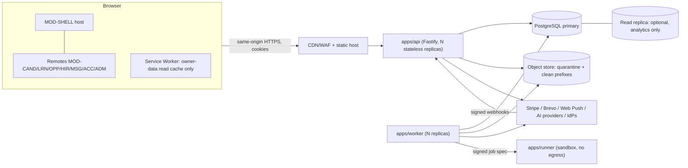
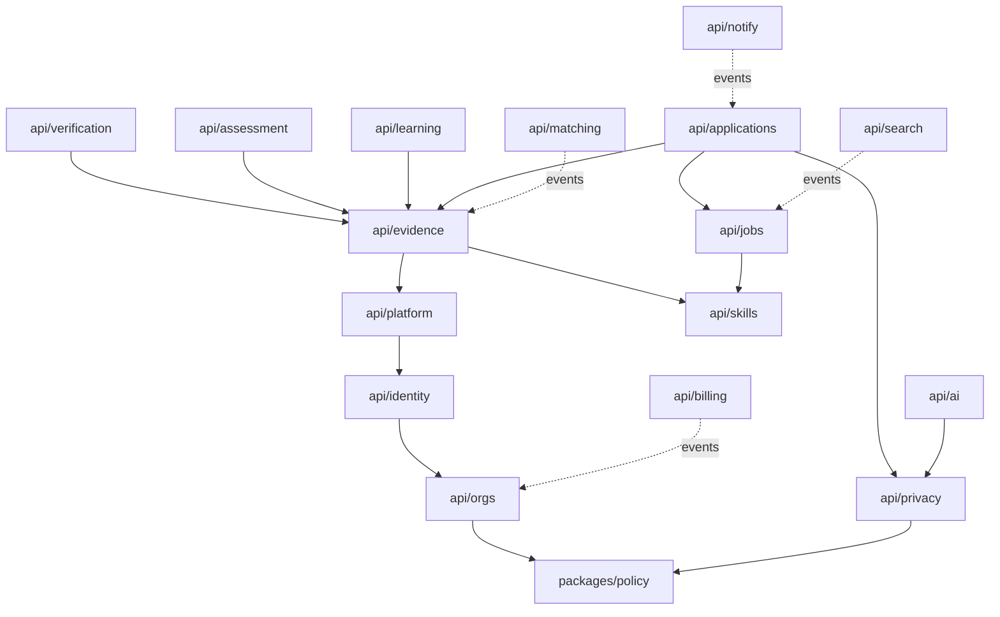
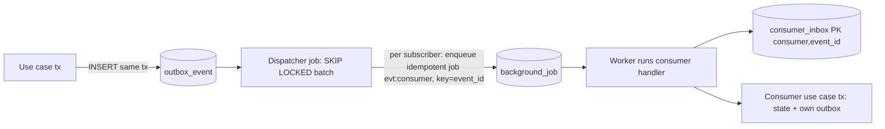
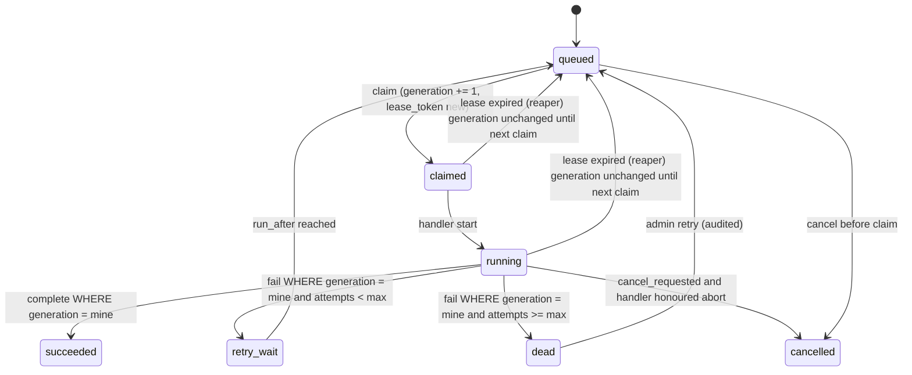
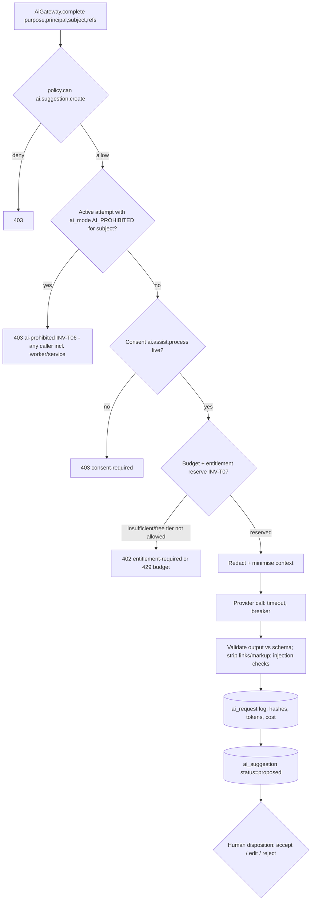

# Backend Architecture (Target)

Doc ID: BE-01 · Owner: Backend Architecture Team · Version 1.0 · Status: Under Review · Relates: ADR-T04..T09, T11..T15, T20, T21 · DOM-01..24 · INV-T01..T20 · FF-01, FF-02, FF-05, FF-07 · Companions: `12_DATA_AND_DATABASE/*`, `13_API_EVENTS_AND_INTEGRATIONS/*`, `14_SECURITY_PRIVACY_COMPLIANCE/*`

Tags: **[CONF]** confirmed requirement · **[TARGET]** design decision · **[OPEN]** open assumption · **[REF]** reference-project observation (read-only evidence, not inherited). Numeric values marked **[TARGET]** are starting defaults with stated rationale; none is a measured benchmark. Calibration is tracked as OPEN-B2.

## 1. Scope, reference lessons and design stance

Greenfield backend for a PWA career-evidence platform. The reference project (`ARCHITECTURE.md`, `docs/engineering/DATABASE.md`, `supabase/migrations`) is read for lessons only.

| # | Reference weakness [REF] | Target design response | Where |
|---|---|---|---|
| L1 | In-process `Map` read model hydrated at boot; single writer; stale reads (ADR-T05 rejects it) | Every read/write is SQL; API replicas are stateless | §3, §7 |
| L2 | Job leases not fenced: a slow worker can finish after lease expiry and double-execute | `lease_generation` fencing token checked in every completion/side-effect write | §6 |
| L3 | Bearer token in `localStorage` | httpOnly cookies (`__Host-ts_at`, `__Secure-ts_rt`) via same-origin `/api/v1/auth/*` routes; remotes never see tokens (ADR-T06, INV-T16) | §4, SEC-02 |
| L4 | Assessment "pass" simulated for code challenges | Sandbox runner or `unverified`; never mints verified evidence (ADR-T13) | §14 |
| L5 | Org-role checks inline in handlers | Central `packages/policy`; route registry requires a policy action (FF-01) | §5 |
| L6 | No idempotency keys, no pagination | Idempotency middleware (FF-07); cursor pagination mandatory on list routes | §8, API-STD |
| L7 | Long-tail modules in memory labelled `ephemeral` | No ephemeral modules: a capability is persisted or not shipped | §3 |
| L8 | Reference referee `token` stored plaintext; referee email plaintext | Hash-only tokens (INV-T05); field-level encryption for referee/employer emails | §11, DB-02 |
| L9 | PBKDF2-SHA512 password hashes | Argon2id with lazy rehash on login | MIG-DATA-01 |

## 2. Runtime topology



| Deployable | Role | State | Scaling unit |
|---|---|---|---|
| `apps/api` (BMOD per DOM table) | HTTP: BFF cookie routes, REST `/api/v1`, webhook receivers | none (stateless; no in-process read model) | replicas behind LB |
| `apps/worker` (BMOD-WORKER, DOM-24) | Outbox dispatcher, job engine, schedulers, projections | none | replicas; concurrency per job kind |
| `apps/runner` [TARGET] | Isolated code-assessment execution only | ephemeral per run | pool sized by assessment demand |
| `packages/policy` (BMOD-POLICY) | `can()` + capability set; pure | none | library |
| `packages/domain` | Business rules, state machines (SM-*) | none | library |
| `packages/contracts` | Zod schemas -> OpenAPI/AsyncAPI/JSON Schema | none | library |

Postgres is the only required stateful dependency besides the object store (ADR-T05). No Redis/broker at launch (ADR-T09); rate-limit store decision is OPEN-B1 (§16).

## 3. Module layout and public-interface rule

Modules are `api/<name>` for each backend DOM (ID_REGISTRY). A module is a directory with a fixed anatomy:

```
apps/api/src/modules/<name>/
  index.ts            # ONLY public surface: service interface type, factory, event types, error codes
  http/               # routes + Zod request/response binding (adapter layer)
  app/                # use cases: transaction boundary, orchestration, calls policy + domain
  domain/             # re-exports/adapters of packages/domain rules (no I/O)
  data/               # repositories (SQL only); owns this module's tables exclusively
  events/             # producer helpers (outbox) + consumers (inbox-deduped)
  jobs/               # job handlers registered with the worker
  ports/              # interfaces for outbound dependencies (EmailPort, ...)
  adapters/           # concrete implementations of ports
```

**Public-interface rule (FF-02, DOM-00 §2).** (1) Another module may import only `api/<name>/index.ts`. (2) A module never reads or writes another module's tables; cross-module reads go through the owner's service interface; cross-module reactions go through events. (3) The service interface is the unit of future extraction (§18) so it takes and returns plain DTOs (no repository types, no `pg` clients, no request objects). (4) Every public method takes an explicit `Actor` (`{principal, requestId, traceId}`) and an optional `Tx` handle; it never reads ambient request state. (5) `dependency-cruiser` enforces (1)-(2) in CI; a table-ownership manifest (`module -> tables`) is checked by a SQL-parsing lint against repository files.

Module dependency direction (acyclic, enforced by FF-02 plus a cycle check):


Solid arrows are synchronous interface calls; dotted are event subscriptions. Where DOM-00 lists a flow in both directions (e.g. evidence <-> verification), the synchronous direction is one-way and the return path is an event (`verification.completed` -> evidence), which keeps the call graph acyclic.

## 4. Layers and request lifecycle

| Layer | Responsibility | May call | Must not |
|---|---|---|---|
| HTTP adapter (`http/`) | Parse + validate (Zod), authenticate, bind policy action, idempotency, ETag, map errors to problem+json | app layer | contain business rules (BR-*), SQL |
| Application service (`app/`) | One use case = one transaction; load resource, call `policy.can`, call domain rules, write state + outbox + audit | domain, repositories, other modules' `index.ts`, ports | open its own pool connection outside the passed `Tx` |
| Domain (`packages/domain`) | Pure rules and state-machine tables (SM-*) | nothing external | do I/O, read clock directly (clock injected) |
| Repository (`data/`) | Parameterised SQL; sets tenant context; optimistic-lock updates | `Tx` | contain authz decisions, call other modules |
| Ports/adapters | Email, push, AI, scan, runner, object store, payments, search | provider SDKs | leak provider types upward (anti-corruption, INT-01) |

```mermaid
sequenceDiagram
  participant C as Client (remote via shell fetch)
  participant H as HTTP adapter
  participant I as Idempotency mw
  participant P as policy.can
  participant A as App service
  participant D as Domain rules
  participant DB as Postgres (tx)
  C->>H: POST /api/v1/... (cookie, CSRF hdr, Idempotency-Key, If-Match)
  H->>H: authn (session cookie), rate limit, Zod validate
  H->>I: reserve (principal,key,request_hash)
  I-->>H: new | replay stored response | 409 in-flight | 422 key reuse
  H->>A: execute(actor, input)
  A->>DB: BEGIN; set_config(app.*) ; load resource FOR UPDATE (if mutating)
  A->>P: can(principal, action, resource)
  P-->>A: Decision{allow|deny, obligations}
  A->>D: apply rule / SM transition
  A->>DB: UPDATE (version check) + INSERT outbox_event + INSERT audit_event
  A->>DB: COMMIT
  A-->>H: result DTO
  H->>I: complete(store status+body hash)
  H-->>C: 2xx + ETag + RateLimit headers
```

Rules: `Tx` is created by the app layer (`withTx(actor, {isolation}, fn)`), which executes `SET LOCAL` of `app.account_id`, `app.org_ids`, `app.platform_roles`, `app.grants_version` (RLS inputs, DB-02 §RLS) and commits only after outbox and audit rows are written (INV-T10, INV-T12). The audit insert is **lock-free**: the repository computes `row_hash` for the row alone and writes a person as the opaque `subject_ref`, never an account id or email; tamper-evidence comes from the off-path `audit.anchor` job (DB-02 §4.1-4.2), and the rows and locks each P0 use case takes are tracked in the write-budget table (DB-02 §17, REVW-06). Reads for list endpoints use the same helper with `READ ONLY`. Errors thrown by domain/app are typed `DomainError(code)`; the adapter maps codes to problem types in the API-STD catalogue; unknown errors become `500 internal` with a `traceId`, never a stack.

## 5. Policy module (`packages/policy`, ADR-T07, INV-T01/T02)

```ts
type Principal = { accountId: string|null; kind: 'user'|'service'|'referee_token'|'anonymous';
                   grants: Grant[]; grantsVersion: number; supportGrantId?: string; amr: string[]; recentAuthAt?: Date };
type Grant = { role: RoleName; scope: {type:'platform'}|{type:'org',id:string}|{type:'institution',id:string}|{type:'self'} };
type Decision = { allow: boolean; reason: ReasonCode; obligations: Obligation[] };
// Obligation: field_mask(fields) | require_consent(scope,{grantee,target}) | require_step_up | audit(level) | time_box(expiresAt)
function can(principal: Principal, action: ActionId, resource: ResourceRef, ctx?: Ctx): Decision
```

| Aspect | Design |
|---|---|
| Action ids | `<module>.<resource>.<verb>` (e.g. `evidence.item.read`, `applications.stage.transition`); registry in `packages/policy/actions.ts` generated from route registry |
| Evaluation | Pure function over (grants, resource attributes incl. owner/org/institution/participants/state, context). Resource attributes are loaded by the module's repository via a `ResourceLoader` bound to the action; policy never queries the DB itself, except through the injected `ConsentPort` for `require_consent` |
| Default | Deny. A missing rule, missing resource, or unknown action denies (INV-T01). Existence disclosure: for resources the principal cannot see, return 404 not 403 (avoid IDOR oracle) unless the principal can see the container |
| Consent | `evidence.item.read` by ROLE-REC/HM/ORGADM returns allow + `require_consent(scope, {grantee, target})` with the scope chosen by the read context, using canonical ids from the Consent Scope Catalogue: inside an application `require_consent('application.share_snapshot', {grantee: {org: orgId}, target: {application: appId}})`; outside one `require_consent('evidence.share_artefact', {grantee: {org: orgId}, target: {evidence: id}})` (search summaries add `search.discoverable` and `evidence.share_summary`; contact details `profile.share_contact`). The app layer resolves the obligation through `privacy` (live scope read from the primary at read time, no consent cache, INV-T15; CSC section 6) and masks if absent |
| Support/admin | Personal-data actions require a live `support_access_grant` (<=4 h, reason-coded, BR-T041); decision carries `audit('privileged')` and `time_box` |
| Capabilities | `GET /me/capabilities` runs `can` over the action catalogue for a scope and returns actions + flags; UI hints only (INV-T01). Cached per `grantsVersion` |
| Grants freshness | Grants are embedded in the access token with `grants_version`; a role change bumps `account.grants_version`, and the API compares the token's version to a cached per-account version (TTL <=15 s [TARGET]); mismatch forces reload from DB. Bounded staleness = min(token TTL 15 min, cache TTL) |
| Testing | The permission matrix (USR-01 §4) is the source for a table-driven test generator (`role x action x resource-relationship`); FF-05 canary suite is generated from the same registry |

Route registration (FF-01, FF-07): `registerRoute({method, path, action, authn, rateClass, idempotent, ifMatch, req, res})`. The CI lint fails when `action` is absent, when an unsafe method lacks `idempotent` (or an explicit `idempotent:'natural'` justification), or when a list route lacks `pagination: 'cursor'`.

## 6. Transactions, outbox and consumers (ADR-T05, T09, INV-T10..T12)

**Transactional outbox.** `withOutbox(tx).emit(event)` inserts into `outbox_event` in the caller's transaction (no dual write). Columns: `id` (UUIDv7 = `event_id`), `aggregate_type`, `aggregate_id`, `aggregate_seq` (per-aggregate monotonic counter maintained by the repository from the aggregate's `version`), `type`, `version`, `tenant jsonb`, `payload jsonb`, `trace_id`, `occurred_at`, `available_at`, `published_at`.



| Concern | Rule |
|---|---|
| Delivery | At-least-once. Dispatcher selects `published_at IS NULL AND available_at <= now()` with `FOR UPDATE SKIP LOCKED`, enqueues one `evt:<consumer>` job per registered subscriber with `idempotency_key = event_id` (unique with kind), then sets `published_at`. Crash between the two steps re-enqueues harmlessly (unique key) |
| Dedupe | Consumer handler first `INSERT INTO consumer_inbox(consumer,event_id) ON CONFLICT DO NOTHING`; zero rows -> already applied -> ack. Insert and consumer state change share one transaction |
| Ordering | Total order is not promised. Per-aggregate order is best-effort via `aggregate_seq`. Order-sensitive consumers (search index, skill confidence, entitlement projection) keep `last_seq` per aggregate: `seq <= last` skip; `seq > last+1` defer (retry later, bounded) then fall back to rebuilding from the owner's interface. Every projection must be rebuildable from source tables (no projection is a system of record) |
| Poison events | After max attempts the consumer job goes `dead` (§7); the dispatcher does not block other events; alert fires; admin replay (`POST /admin/jobs/{id}/retry`) re-runs the same job (idempotent) |
| Schema evolution | `version` integer per event type; additive changes keep the version; breaking = new version published in parallel for one deprecation window; consumers declare accepted versions (AsyncAPI) |
| Retention | Published outbox rows purged after 14 days [TARGET]; table partitioned monthly (DB-02) so purge is `DROP PARTITION` |

**Isolation per operation** is tabulated in DB-02 §8; the default is `READ COMMITTED` with explicit row locks or unique constraints, escalating to `SERIALIZABLE` (with bounded retry) only where listed.

## 7. Worker and job engine (DOM-24)

### 7.1 Job table contract
`background_job(id, kind, payload, status, priority, run_after, attempts, max_attempts, lease_token, lease_generation, leased_by, lease_expires_at, heartbeat_at, cancel_requested_at, idempotency_key, last_error_class, last_error, dead_at, created_at, updated_at)`; `UNIQUE(kind, idempotency_key)`; status in `queued | claimed | running | retry_wait | succeeded | dead | cancelled` (vocabulary owned by SM-BGJOB in `06_BUSINESS_PROCESSES/STATE_MACHINES.md`; attempt limits and backoff below diverge from SM-BGJOB and are tracked as REVW-19). Attempt history in `background_job_attempt` (partitioned monthly).

### 7.2 Fenced leases (fixes L2)


| Step | SQL/behaviour |
|---|---|
| Claim | `UPDATE background_job SET status='claimed', lease_generation=lease_generation+1, lease_token=$new, leased_by=$w, lease_expires_at=now()+$lease, attempts=attempts+1 WHERE id IN (SELECT id FROM background_job WHERE status IN ('queued','retry_wait') AND run_after<=now() AND kind = ANY($kinds) ORDER BY priority DESC, run_after LIMIT $n FOR UPDATE SKIP LOCKED) RETURNING id, lease_generation, lease_token, payload` |
| Heartbeat | Every lease/3: `UPDATE ... SET lease_expires_at=..., heartbeat_at=now() WHERE id=$id AND lease_generation=$g RETURNING cancel_requested_at`. Zero rows = lease lost: handler's `AbortSignal` fires; the worker stops and discards results |
| Complete/fail | Always `WHERE id=$id AND lease_generation=$g AND status='running'`. Zero rows = a newer claim exists; the stale worker does nothing further |
| Side effects | The fencing token (`job_id`, `lease_generation`) is passed to every handler; external calls use `job_id`-derived idempotency keys (Stripe key, email `idempotencyKey`, push topic) so a zombie worker that already acted is harmless to the new run; DB writes inside the handler carry `WHERE lease_generation = $g` via the shared `fencedTx` helper |
| Reaper | Scheduler job every 30 s [TARGET] returns expired leases to `queued` (no generation change; the next claim increments). Lease length per kind (default 60 s, runner/export 5 min) with heartbeat so long jobs do not expire |
| Liveness | `worker_heartbeat(worker_id, kinds, last_seen)`; `/readyz` of worker fails if no claim loop tick for 3x poll interval |

### 7.3 Retries, backoff, dead letter, cancellation
| Policy | Value [TARGET] | Rationale |
|---|---|---|
| Backoff | `delay = min(cap, base * 2^(attempt-1))` with full jitter (`random(0, delay)`); base 5 s, cap 15 min | Avoids synchronised retry storms against a recovering provider |
| Max attempts | default 8; `email.send`/`webhook.deliver` 12 (spans ~24 h with cap); `ai.*` 3; `assessment.run` 2; `evt:*` 8 | Provider outages of hours should heal without operator action; AI retries cost money |
| Error classes | `transient` (retry), `permanent` (dead immediately: validation, 4xx except 408/429), `rate_limited` (retry honouring `Retry-After`), `cancelled` | Prevents burning attempts on permanent failures |
| Dead letter | `status='dead'`, `dead_at`, error retained; alert when any dead job of a protected kind (billing, erasure, evidence) exists, or dead count > threshold | Erasure/billing must not silently stall |
| Cancel | `POST /admin/jobs/{id}/cancellation` sets `cancel_requested_at`; queued jobs flip to `cancelled`; running jobs observe it at heartbeat and abort at the next checkpoint; handlers must be idempotent on resume | Operator control without kill -9 |
| Scheduling | `job_schedule(kind, cron, next_run_at, last_run_at)` claimed with the same lease protocol (one runner per tick via unique `(kind, idempotency_key = tick_time)`) | Single execution of cron-like work across replicas |
| Concurrency | Per kind max concurrency + per-tenant fairness key (`payload.tenantKey`) so one org's bulk import cannot starve others | Noisy-neighbour control |

### 7.4 Job kinds (registry; owner module registers handler)
`outbox.dispatch`, `evt:<consumer>`, `email.send`, `push.send`, `file.scan`, `file.derive`, `resume.export`, `search.index`, `ai.embed`, `match.recompute`, `verification.reference_sweep` (BR-T004 expiry/reminders), `assessment.run`, `privacy.export.build`, `privacy.erasure.step`, `billing.reconcile`, `webhook.deliver`, `import.run`, `retention.purge`, `retention.replay_erasure` (restore runbook), `audit.anchor` (single runner per slot, seals Merkle batches; DB-02 §4.2), `audit.anchor_verify` (daily), `analytics.rollup`, `job.reaper`.

## 8. Idempotency middleware (INV-T10, FF-07)

| Item | Design |
|---|---|
| Scope | Every unsafe route (`POST`, `PUT`, `PATCH`, `DELETE`) accepts `Idempotency-Key` (client UUIDv4/7, 16-64 chars). Routes whose operation is naturally idempotent (e.g. `PUT /me/saved-jobs/{jobId}`) declare `idempotent:'natural'` with the natural key; they still accept the header |
| Store | `idempotency_key(principal_id, key, method, route_template, request_hash, state, response_status, response_body_ref, locked_until, created_at, expires_at)`, PK `(principal_id, key)`. Anonymous routes use `principal_id = ip_hash` scope |
| Flow | (1) `INSERT ... ON CONFLICT DO NOTHING` state `in_progress`, `locked_until=now()+30 s`; (2) inserted -> proceed; (3) conflict + `completed` + same `request_hash` -> replay stored status/body (header `Idempotency-Replayed: true`); (4) conflict + different hash/route -> `422 idempotency-key-reuse`; (5) conflict + `in_progress` not expired -> `409 idempotency-in-flight` + `Retry-After`; (6) expired `in_progress` (crash) -> takeover |
| Atomicity | The `complete` write shares the use-case transaction when the operation is DB-only (response stored at commit). For operations with external effects the middleware stores the result after commit; the use case itself is retry-safe through a natural key, so a crash window yields a replayed execution, never a duplicate effect |
| Body storage | Success body stored (<=64 KB) with column-level encryption for `C2+` data classes; larger/binary responses store a reference + hash and the replay returns `200` with a fresh representation (documented in API-STD) |
| TTL | 24 h default; 7 days for payment-adjacent routes (checkout, portal) [TARGET]; purge via partition drop (daily partitions) |
| Layering with natural keys | Business uniqueness (BR-T001 one active application) is enforced by the DB partial unique index, not by the key; the key only makes retries cheap and responses stable |

## 9. Concurrency control (ETag / If-Match)

| Item | Design |
|---|---|
| Version | Mutable aggregates carry `version bigint` incremented in the same `UPDATE`. Strong ETag = `"<resourceType>-<id>-<version>"` (opaque to clients) |
| Required | `If-Match` is **required** (428 `precondition-required`) on PATCH/PUT and on state-transition POSTs listed in the catalogue (`m` flag): profile, evidence update, job update, application stage transition, verification decision, pipeline/role changes. Mismatch -> `412 precondition-failed` with the current ETag and a pointer to refetch |
| Write | `UPDATE t SET ..., version=version+1 WHERE id=$1 AND version=$2`; zero rows -> 412 (or 404 if not visible) |
| Hot rows | Application stage transitions additionally `SELECT ... FOR UPDATE` so concurrent recruiters serialise; second request sees new version -> 412 |
| Offline queue | Queued writes (ADR-T10) carry the ETag from when edited; on replay a 412 produces a conflict item the user resolves (INV-T13) |

## 10. Search port (DOM-11, ADR-T11)

```ts
interface SearchPort {
  index(doc: SearchDoc): Promise<void>;                 // idempotent upsert by (kind,id,sourceVersion)
  remove(kind: DocKind, id: string): Promise<void>;
  query(q: SearchQuery, scope: SearchScope): Promise<Page<SearchHit>>; // scope carries tenant + consent epoch
  similar(kind: DocKind, id: string, scope: SearchScope): Promise<Page<SearchHit>>;
}
```
| Aspect | Postgres adapter design |
|---|---|
| Lexical | `tsvector` generated columns (weighted: title A, skills B, body C) + GIN; language config per locale |
| Fuzzy | `pg_trgm` GIN on title/skill names for typo tolerance and autocomplete |
| Semantic | `pgvector` column + HNSW index on embeddings from `ai.embed` jobs (derived data; model version stored; rebuildable) |
| Ranking | Weighted blend of lexical rank, trigram similarity, vector similarity, and evidence-rung factors. **Payment is not an input** (INV-T19): the ranking-input allowlist is a typed constant checked by test |
| Candidate search | `search_candidate_doc` contains only candidates with live `matching.recommend` consent, holds only consented visible fields, and carries `consent_epoch`; on `consent.changed` the doc is removed/updated; query applies tenant + entitlement + consent-epoch filters in SQL (not post-filter) |
| Authorisation | Search returns IDs + safe projections; detail reads re-run `policy.can` (INV-T02). Cursor pagination is keyset on `(rank_bucket, id)` with a signed cursor |
| Replacement | OpenSearch adapter implementable against the same port when the ADR-T11 trigger fires (p95 > 400 ms at target corpus or relevance gap). Dual-write via the same events during cutover |

## 11. Ports for email and push (DOM-15, ADR-T20)

| Port | Interface | Adapters | Rules |
|---|---|---|---|
| `EmailPort` | `send({templateId, to, vars, locale, idempotencyKey, category, headers})` -> `{providerMessageId}`; `parseWebhook(req)` | `BrevoAdapter` (default), `DevOutboxAdapter` (dev: labelled outbox table, never sends) | Called only from `email.send` jobs. Templates stored by id + version in repo. Category `transactional` vs `marketing` (marketing requires `comms.marketing_email` consent and one-click unsubscribe, RFC 8058 headers). Suppression list checked before send. Bounce/complaint webhooks (signature-verified) -> `email_suppression` + `email.bounced` event. No secrets/tokens in logs; one-time links carry only the opaque token (hashed at rest, INV-T05) |
| `PushPort` | `send(subscription, payload, {ttl, urgency, topic})`; `generateVapidKeys` out-of-band | `WebPushAdapter` (VAPID, payload encryption per RFC 8291) | Payload is generic ("You have an update") plus deep-link id; sensitive text is fetched after authenticated open. HTTP 404/410 -> delete subscription; 429/5xx -> retry with backoff and `TTL`. Push is opt-in (permission prompt after a user gesture) and capability-detected (FF-09) |

## 12. File upload pipeline (BR-T003, INV-T14)

```mermaid
stateDiagram-v2
  [*] --> intent: POST /files/upload-intents (type, size, sha256 declared)
  intent --> uploaded: client PUT to presigned URL (quarantine prefix)
  uploaded --> verifying: POST completion (server HEAD: size, checksum)
  verifying --> rejected: size/hash mismatch, type not allowlisted, magic-byte mismatch
  verifying --> scanning: file.scan job
  scanning --> clean: AV clean + (image: re-encode; pdf: structure check)
  scanning --> infected: AV positive
  clean --> deleted: owner removal / erasure
  infected --> deleted: purge after retention
```


| Control | Design |
|---|---|
| Intent | Authenticated; purpose-specific allowlist and size cap (e.g. evidence artifact: pdf/png/jpeg/webp/txt/md up to 25 MB [TARGET]; avatar: image up to 5 MB); per-user pending-intent and daily-bytes quotas; random object key `q/<fileId>`; presigned `PUT` with `Content-Length-Range`, content-type, checksum header, expiry 10 min |
| Quarantine | Objects are written to a quarantine prefix that no read path serves; file row state `uploaded`. Evidence artifacts attached to evidence are `pending` and not shown to anyone but the owner (as "scanning") until `clean` |
| Sniffing | Server reads the first bytes (magic numbers) and compares to declared type and allowlist; never trusts extension/`Content-Type`. Archives (zip), executables, SVG, HTML are not allowlisted at launch (script/zip-bomb risk). SVG avatars are rasterised or refused |
| Scan | `ScanPort` (ClamAV-class engine behind a port; vendor OPEN-B3). **Fail-closed**: scanner unavailable -> file stays `scanning`, never visible; backlog alert |
| Sanitise | Images re-encoded (strips EXIF/GPS and polyglot payloads) producing derivative sizes; PDFs structurally validated and flagged if they contain embedded JavaScript/launch actions (rejected at launch) |
| Promote | On clean, copy to the `clean` prefix and flip state; emit `file.scanned` (consumers: evidence/profile/learning) |
| Download | `GET .../download-url` runs `policy.can` then returns a signed URL (<=5 min [TARGET]); served from a separate cookieless user-content origin with `Content-Disposition: attachment` for non-images, `X-Content-Type-Options: nosniff`, restrictive CSP `sandbox`; never from the app origin |
| Erasure | `deleted` state triggers object delete + CDN purge; backups per DB-03 §deletion |
| Resume exports | Generated by `resume.export`, stored as private files with 24 h link validity |

## 13. AI gateway (DOM-17, ADR-T12, INV-T06..T09)


| Control | Design |
|---|---|
| Single door | Only `api/ai` imports provider SDKs (FF-02 lint: provider packages restricted to `api/ai/adapters`). Other modules call `ai.complete()` through its `index.ts` |
| Prohibited mode | Before any call the gateway queries `assessment` interface `getActiveAiMode(accountId)`; if an in-progress attempt has `AI_PROHIBITED` (or `AI_RESTRICTED` and purpose not whitelisted) the call is denied **inside the gateway**, regardless of caller, route or role; denial is audited. The attempt's `ai_mode` is snapshotted at start so later edits to the assessment cannot weaken it |
| Budgets (INV-T07) | `ai_budget(scope, scope_key, period, limit_micros, allow_free_inference, hard_stop)`; scopes global > plan > org > account (strictest wins). Reserve-then-settle: `ai_spend.reserved_micros` incremented atomically (`UPDATE ... WHERE spent+reserved+$est <= limit`); settle with actual tokens; release on failure. Free tier: allowed only when the effective policy has `allow_free_inference=true`, and then capped per day. Cost per purpose estimated from max tokens |
| Redaction | Purpose-specific context builders send only allowlisted fields; deterministic redactor replaces emails, phone numbers, government-ID patterns, URLs with tokens, and names of third parties (referees) with placeholders; secrets/tokens, private messages, referee responses and assessment answer keys are never eligible context. Redaction summary (counts only) logged |
| Prompt injection | User/content text is passed only as quoted data in a delimited block; system prompt states it is untrusted; model has **no tools with side effects** in v1; output is schema-validated (JSON mode/Zod), length-capped, stripped of links/HTML, and rendered as text. Output cannot trigger any state transition (INV-T09) |
| Human gate | Result is an `ai_suggestion` in `proposed`; adoption into profile/cover note requires the user to accept or edit (disposition recorded). Evidence creation rejects `source='ai'` (CHECK constraint + schema, INV-T08); AI "memory" features, if ever added, are stored outside evidence/profile tables and are user-viewable/deletable |
| Logging | `ai_request` stores purpose, model, token counts, cost, prompt SHA-256, redaction counts, denial reason, latency; **no raw prompts/outputs** by default (short-lived encrypted debug capture behind an admin flag, 7 days [OPEN-B4]) |
| Embeddings | `ai.embed` jobs go through the same gateway (purpose `embedding`), with consent `matching.recommend` for candidate data; derived vectors are deleted on consent revoke/erasure |
| Failure | Provider failure degrades only the AI feature; core flows never depend on AI. No automatic failover to a second provider at launch (data-processing agreements differ; OPEN-B5) |

## 14. Sandbox assessment runner (ADR-T13)

| Item | Design |
|---|---|
| Position | Separate deployable `apps/runner`, not in the API/worker process or network zone. Worker is the only caller (`assessment.run` job) through `RunnerPort` using mutually authenticated, signed run requests |
| Isolation | One ephemeral sandbox per run (microVM or user-space-kernel container class; technology selection OPEN-B6): read-only root filesystem, **no network egress**, no secrets mounted, non-root, cgroup limits (CPU, memory, pids, disk), wall-clock timeout, output size cap, no host mounts. Candidate code and hidden tests are mounted separately; hidden tests and answer keys are never exposed in output |
| Protocol | Request = `{runId, attemptId, assessmentVersion, artifactRef(hash), limits}`; runner fetches artifact by signed URL, runs, returns `{runId, status, results, durationMs, imageDigest}` signed with a per-deployment key. Worker verifies signature, run-to-attempt binding, and idempotency (`runId` unique) before recording |
| Verification basis | `attempt.verification_basis` in {`auto_graded_objective`, `runner_verified`, `human_graded`, `unverified`}. Code/project assessments with `requires_runner=true` may reach `passed` **only** with `runner_verified` (or `human_graded` by an authorised human). Otherwise the attempt ends `unverified`, `assessment.passed` is **not** emitted, and no evidence is minted (ADR-T13, INV-T04) |
| Feature gate | `assessment.runner.enabled` flag (default off) and a startup check: if the flag is on but runner health/attestation fails, code assessments are not offered |
| Abuse | Per-user and per-tenant run quotas; no outbound network prevents exfiltration and crypto-mining payoff; wall-clock caps; runs are not retained beyond results + hashes (30 days) |
| Integrity | Integrity signals (tab blur, paste, timing) are advisory; they open an `integrity_flag` for human review and never void or fail an attempt automatically (INV-T20) |

## 15. Media

| Asset | Pipeline |
|---|---|
| Avatars/images | Upload pipeline (§12) -> `file.derive` produces re-encoded WebP/AVIF/JPEG derivatives at fixed sizes with cache-busting hashes; served from the user-content origin via CDN |
| Resume/portfolio exports | `resume.export` job renders from structured data (HTML->PDF in an isolated render context, no network), private file, link TTL 24 h |
| Course video/audio | Provider-hosted streaming/transcoding behind a `MediaPort` [OPEN-B7: provider]; the app stores references, captions (WCAG) and signed playback tokens; no self-hosted transcoding at launch |
| Documents | No server-side Office conversion at launch (attack surface); PDFs only |

## 16. Rate limiting (INV-T10 abuse controls)

| Layer | Design |
|---|---|
| Edge | CDN/WAF coarse per-IP limits, bot challenge on auth routes, managed rules [TARGET]; provider OPEN |
| App | Token bucket keyed by `(rateClass, key)` where key = principal id, token hash, or IP-prefix for anonymous; classes in API-STD (RL-AUTH, RL-TOKEN, RL-READ, RL-WRITE, RL-HEAVY, RL-PUBLIC, RL-WEBHOOK) |
| Store | `RateLimitStore` port. Default adapter: Postgres `UNLOGGED` table `rate_limit_bucket` with atomic `INSERT ... ON CONFLICT DO UPDATE` refill math (avoids a new infra dependency; unlogged data is disposable). If write amplification becomes a bottleneck, a Redis adapter replaces it (OPEN-B1 trigger: bucket updates exceed 20% of primary write IOPS or p95 limit-check latency > 5 ms) |
| Auth-specific | Per-account and per-IP+account counters on login/reset/email-challenge; progressive delay; responses never reveal account existence; optional breached-password check at set time (k-anonymity range query, fail-open) [OPEN-B8] |
| Quotas | Business quotas (outreach messages, AI, postings) are entitlements/usage counters in `billing`, not rate limits |
| Signalling | `RateLimit-Policy`/`RateLimit` (IETF draft headers) and `Retry-After` on 429; limits are config-driven, not hard-coded |

## 17. Configuration and secrets (INV-T14)

| Item | Design |
|---|---|
| Schema | A single Zod `AppConfig` per deployable; validated at boot; missing/invalid -> process exits (fail fast). Typed accessors only (no `process.env` reads elsewhere, lint-enforced) |
| Sources | Environment variables for non-secrets; secret manager (or platform secret store) injected as env at runtime for secrets; no secrets in repo, images, or client bundle (build-time scan, INV-T14) |
| Separation | Distinct DB roles: `ts_migrator` (DDL, owner), `ts_app` (DML; no BYPASSRLS), `ts_worker` (DML on job/outbox + module tables via grants), `ts_readonly` (analytics). Distinct object-store credentials for quarantine write vs clean read |
| Client config | A minimal public config object (API base, feature flag snapshot, VAPID public key, manifest URL); never secrets |
| Flags | Runtime feature flags in `feature_flag` (DOM-20) cached per replica (TTL 30 s [TARGET]); flags gate rollout, never security controls (a security check cannot be disabled by flag except `assessment.runner.enabled` which fails closed) |
| Rotation | Secrets referenced by name+version; dual-key acceptance windows for HMAC/JWT signing keys, webhook secrets, VAPID, field-encryption KEKs (SEC-02) |

## 18. Extraction triggers and service-boundary decisions (ADR-T04)

| Component | Decision [TARGET] | Reason | Extraction / change trigger |
|---|---|---|---|
| All `api/<name>` modules | One deployable `apps/api`, enforced module boundaries | Transactional consistency, team size, ops cost | Module needs independent scaling/SLA, distinct residency, or team contention (ADR-T04) |
| Worker / job engine | Separate process, same repo and DB | Isolates background load from request latency; independent scaling | n/a |
| Sandbox runner | **Separate service from day one when enabled** | Executes untrusted code; network and trust isolation are non-negotiable | n/a |
| AI gateway | Module in monolith; provider calls from API (interactive) or worker (batch) | Needs transactional budget ledger and consent/assessment lookups | Provider latency starving API pool, or regulated-data processor split -> dedicated service |
| Search | Module + Postgres adapter behind `SearchPort` | ADR-T11 | p95 search > 400 ms at target corpus or proven relevance gap -> OpenSearch adapter |
| Matching compute | Worker jobs (`match.recompute`) | Batch/derived, rebuildable | Compute cost/latency requires GPU/vector service |
| Media derivation | Worker jobs | CPU-bound, async | Sustained queue age > SLO -> dedicated media workers (still same code) |
| Notifications/email | Module + worker | Port-isolated | Volume or deliverability needs dedicated pipeline |
| Billing | Module; Stripe webhook receiver in API | Entitlement derivation needs org/identity data | Compliance scope isolation (PCI-adjacent) needs separate deployable |
| Event transport | Outbox -> Postgres-backed jobs (ADR-T09) | Single store, no broker ops | Outbox throughput exceeds Postgres budget, or a service is extracted -> NATS/Kafka adapter behind the dispatcher |
| Analytics | Consent-gated event table + rollup jobs; optional read replica | Minimal footprint | Event volume warrants columnar store |

## 19. Failure, timeout and circuit-breaker policy

Defaults are **[TARGET]** starting values chosen from the interactive-vs-background distinction (interactive paths must fail fast and degrade; background paths may wait and retry), not from benchmarks; calibration under load test is OPEN-B2. A breaker is per dependency per process: *open* when >=5 consecutive failures or >=50% failures over a 30 s window with >=10 calls; *half-open* after 30 s, admitting 3 probes; state exported as a metric.

| Dependency | Connect / total timeout | Retry | Breaker | Behaviour on failure (user-visible) |
|---|---|---|---|---|
| PostgreSQL (API) | pool acquire 2 s; `statement_timeout` 5 s; `idle_in_transaction_session_timeout` 10 s | none in request (except serialization failures: 3 tries) | n/a (pool saturation -> 503 + `Retry-After`) | 503 `upstream-unavailable`; reads of cached owner data continue in PWA read cache (stale label, INV-T13) |
| PostgreSQL (worker) | `statement_timeout` 60 s | per job policy | n/a | jobs retry with backoff |
| Object store | connect 2 s / total 10 s (signing is local) | 2 retries on 5xx/timeouts with jitter | yes | upload start 503; downloads 503 with retry hint; no partial state (state advances only after HEAD verify) |
| Stripe (outbound API) | 3 s / 10 s | up to 2 retries with the same Stripe idempotency key | yes | checkout creation fails with 503 and message; **entitlements never change on outbound failure or redirect** (INV-T17) |
| Stripe (inbound webhook) | respond < 5 s: verify signature, insert `stripe_event_inbox`, enqueue, return 200 | Stripe retries delivery; our processing job retries 8x | n/a | If processing is delayed, plan state is stale until reconcile job (`billing.reconcile`, periodic) heals it |
| Email provider | 3 s / 10 s inside `email.send` job | 12 attempts over ~24 h | yes (pauses sending, queue grows) | Transactional mail delayed; in-app notification still delivered; user can resend verification (rate-limited) |
| Web Push services | 3 s / 5 s | 404/410 delete; 429/5xx retry (<= 4, TTL-bounded) | per-endpoint-host | No push; in-app notification unaffected |
| AI provider | 3 s / 30 s | 1 retry on 5xx/timeout (not on 4xx) | yes | Feature banner "assistant unavailable"; budget reservation released; core flows unaffected |
| Virus scanner | 5 s / 60 s per file (size-scaled) | 5 attempts | yes | **Fail-closed**: file remains "scanning"; nothing becomes visible |
| Sandbox runner | 3 s / assessment limit + 30 s | 2 attempts (new `runId`, same attempt) | yes | Attempt shown "awaiting verification"; ends `unverified` if runner is down beyond SLA; never auto-pass |
| OIDC/SAML IdP | 3 s / 8 s | none | per-IdP | SSO login error; password/passkey fallback only if org policy allows |
| Breached-password API | 1 s | none | n/a | **Fail-open** (log), because blocking registration on a third party is worse than the marginal risk |
| Outbound customer webhooks | 3 s / 5 s; SSRF-guarded resolver | 12 attempts / ~24 h, then endpoint auto-paused after sustained failure | per-endpoint | Customer sees delivery log; no impact on core flows |
| Import sources (URL/file) | 3 s / 15 s; size cap | 3 | per-host | Import job fails with report; no partial publish |

Cross-cutting: every outbound call has a timeout and an `AbortSignal`; no unbounded queues in memory; bulkheads via separate pools/concurrency per dependency; graceful shutdown drains in-flight requests and stops claiming jobs; each request has a deadline propagated to calls (`min(request deadline, dependency timeout)`).

## 20. Observability hooks (ADR-T16)
W3C `traceparent` accepted from shell fetch, stored on `outbox_event.trace_id` and `background_job.payload.trace`, and restored by the worker so a trace spans request -> event -> consumer. Pino JSON logs with redaction paths (`*.password`, `*.token`, `*.email` hashed, cookies, `authorization`) enforced by a log test (INV-T14). Metrics: queue age per kind, lease-lost count, outbox lag, dead jobs, breaker state, policy denials by action, idempotency replays.

## 21. Extraction/processing triggers for derived data
| Trigger (event or schedule) | Effect | Idempotency basis |
|---|---|---|
| `evidence.verified/revoked/updated` | recompute `competency` confidence; invalidate `match_explanation`; reindex candidate doc (BR-T005, async + audited) | `(evidenceId, aggregate_seq)` |
| `profile.updated`, `consent.changed` | reindex or remove candidate doc | `(accountId, consent_epoch)` |
| `job.published/updated/closed` | reindex job doc; fan out saved-search alerts | `(jobId, version)` |
| `skill.merged` | remap `evidence_skill`, `job_skill_requirement`, `competency` | `(fromSkillId, intoSkillId)` |
| nightly schedule | `verification.reference_sweep` (expire at 14 d, send <=2 reminders), `retention.purge`, `billing.reconcile`, `analytics.rollup` | tick time |

## 22. Contradictions, assumptions and open items
**Contradictions / gaps found against canonical docs** (none silently resolved): (1) ADR-T04..T22 mention T22 (matching) though the brief enumerated T04..T21; this doc treats T22 as binding. (2) ID_REGISTRY lists `MASTER_INDEX.md` and `99_FINAL_MASTER_BLUEPRINT` as authority, but neither exists yet; this doc is linked from the folder index in `11_BACKEND_ARCHITECTURE` only until MASTER_INDEX is created. (3) resolved (REVW-03): SM-00 (`06_BUSINESS_PROCESSES/STATE_MACHINES.md`) is the single state vocabulary and `12_*`/`13_*` derive from it (FF-11); the job-engine limits in §7 still differ from SM-BGJOB (REVW-19). (4) DOM-00 §2 says "no module reads another module's tables" while DOM-11 search/matching "consume" job/evidence data; resolved here as event-fed projections owned by `api/search`/`api/matching` (no cross-table reads).

| ID | Open item |
|---|---|
| OPEN-B1 | Rate-limit store: Postgres unlogged vs Redis (trigger in §16) |
| OPEN-B2 | Calibrate all timeouts, breaker thresholds, lease lengths, rate limits by load test |
| OPEN-B3 | Virus-scan engine/vendor |
| OPEN-B4 | Whether to keep any raw AI prompt capture (debug) and its retention |
| OPEN-B5 | Multi-provider AI failover (DPA implications) |
| OPEN-B6 | Sandbox isolation technology |
| OPEN-B7 | Course video/transcoding provider |
| OPEN-B8 | Breached-password check adoption |
| OPEN-B9 | PostgreSQL major version (native `uuidv7()` needs PG 18+; otherwise app-generated) |

(Proposed OPEN ids; to be registered in the central OPEN register by the Documentation Architect.)
