# Conceptual & Logical Data Model (Target)

Doc ID: DB-01 · Owner: Data Architecture (DBA + Domain Architects) · Version 1.0 · Status: Under Review · Relates: DOM-00, ADR-T05, T14, T21, INV-T03/T04/T05/T08/T10/T11/T12/T15, FF-05, FF-10 · Companions: DB-02 `PHYSICAL_DESIGN.md`, DB-03 `DATA_GOVERNANCE_AND_LIFECYCLE.md`, BE-01

Tags: **[TARGET]** design decision · **[OPEN]** open assumption · **[REF]** reference-project observation. This is a *design*; no table exists yet and nothing here claims implementation. Names of states in `state`/`status`/`lifecycle` CHECK lists for the 14 machines in §5 are **derived** from the state-machine registry (SM-00, `06_BUSINESS_PROCESSES/STATE_MACHINES.md`); where they differ, SM-00 wins and this file is amended in the same change (FF-11, enum-vs-SM lint).

## 1. Modelling conventions

| Convention | Rule |
|---|---|
| Keys | `id uuid` PK, UUIDv7 (time-ordered, app-generated; DB-02 §1). Natural/composite keys only on pure join/projection tables |
| Auto columns | `std` = `id, created_at, updated_at, version`; `imm` = `id, created_at` (append-only, no UPDATE grant); `imm+` = `id, created_at, updated_at`; `none` = explicit composite PK. Auto columns are listed first in each table |
| Types | `timestamptz` (UTC) for instants, `date` for calendar dates, `citext` for case-insensitive identifiers, `text` + `CHECK` for enumerations (not PG enums, to keep migrations additive; DB-02 §10), `jsonb` only per the JSONB policy (DB-02 §9) |
| Nullability | `NN` = NOT NULL. Anything not marked `NN` is nullable by design |
| Tenancy (INV-T03) | Tenant-owned tables carry `org_id` or `institution_id` (or are reachable only through a parent that does, with RLS via join-free denormalised column where hot). `RLS-*` class per entity is listed; policies in DB-02 §6 |
| Money | Integer minor units + ISO currency; never float |
| PII | Direct identifiers are columns of `account`/`profile` or field-encrypted (`*_enc`) with a blind-index hash (`*_hash`) where equality lookup is required. Classification per DATA-GOV (DB-03) |
| Derived data | Marked `derived`; rebuildable from sources + events; never a system of record; deleted on erasure/consent revocation |
| Deletion | Soft-delete via explicit `lifecycle`/`state`/`*_at` columns only where the business needs history; erasure is a separate orchestrated process (DB-03) |
| Audit | Every consequential mutation writes `audit_event` and `outbox_event` in the same transaction (INV-T10/T12) |

RLS classes: **RLS-OWNER** row belongs to one account; **RLS-ORG / RLS-INST** visible to active members of the tenant per role; **RLS-PARTICIPANT** visible to conversation/connection participants; **RLS-PUBLIC-READ** reference or published data readable by all roles, writable only by owner module; **RLS-GRANT** visible to grantee while a live support grant exists; **RLS-INTERNAL** no end-user DB role has access; read and written only by server roles through module code.

## 2. Conceptual model (aggregates and their relationships)

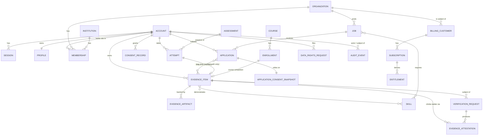

### 2.1 Aggregate coverage (DOMAIN_ARCHITECTURE §3 -> entities)


| DOMAIN_ARCHITECTURE aggregate roots | Logical entities |
|---|---|
| Account, Session, Passkey, Device | `account, session, passkey, device` |
| Organization, Membership, RoleGrant | `organization, membership, role_grant` |
| Profile, Portfolio, ResumeVariant | `profile, portfolio_item, resume_variant` |
| Skill, SkillRelation, Competency | `skill, skill_relation, competency` |
| EvidenceItem, Credential | `evidence_item, credential (+ evidence_attestation, evidence_event, evidence_artifact)` |
| VerificationRequest, ReferenceRequest, WorkClaim | `verification_request, reference_request, work_claim` |
| Assessment, Attempt, IntegritySession | `assessment, attempt, integrity_session (+ sandbox_run, integrity_flag)` |
| Course, Enrollment, Path | `course, enrollment, learning_path` |
| Job, JobTemplate, SavedSearch | `job, job_template, saved_search` |
| Application, Pipeline, Interview | `application, pipeline, interview` |
| MatchExplanation, SearchIndex | `match_explanation, search_job_doc, search_candidate_doc` |
| Conversation, Message | `conversation, message` |
| Notification, Preference, Delivery | `notification, notification_preference, notification_delivery` |
| Subscription, Entitlement, Invoice | `subscription, entitlement, invoice` |
| ConsentRecord, DataRightsRequest | `consent_record, data_rights_request` (+ `subject_identity_map`, the erasable token link) |
| Report, ModerationCase | `report, moderation_case` |
| SupportAccessGrant, AuditEvent, FeatureFlag | `support_access_grant, audit_event (+ audit_anchor), feature_flag` |
| (platform, not a domain aggregate) | `outbox_event, consumer_inbox, idempotency_key, background_job, file_object` |


## 3. Evidence ladder, provenance and the verification chain (ADR-T14, INV-T04, INV-T05, INV-T08)

`evidence_item.rung` is a **denormalised read value** equal to the highest rung among that item's `valid` attestations (default `claimed`). It is written only inside the `evidence` module's server-side transition function, in the same transaction that inserts the `evidence_attestation` / `evidence_event` rows and the outbox event. No API accepts a `rung` or `verified` field from a client. A claim is never displayed as verified (INV-T04).

| Rung | Meaning | Established by (`method`) | Attester kind | Revocable by |
|---|---|---|---|---|
| `claimed` | Self-asserted; no independent support | creation | none | n/a |
| `artifact_backed` | Has >=1 scanned-clean artifact **or** proof of control of an employer-domain mailbox. Shows supporting material exists; does not prove truth | `artifact_scan`, `employer_email` | system | owner removing artifact; moderator |
| `peer_attested` | A named non-account referee or peer confirmed facts via a single-use token | `reference` | referee | platform reviewer on dispute; expiry |
| `authority_verified` | The issuing/owning authority (institution, platform assessment runner, authorised platform reviewer) confirmed | `institution_issuer`, `assessment_runner`, `manual_review` | institution / system / platform_reviewer | issuing authority; admin with reason |

Rules [TARGET]: (1) A material edit (change of `content_hash`) expires attestations that attest content and recomputes the rung; the owner is told which proofs were lost. (2) Attestations may have `expires_at` (e.g. employer mailbox proofs); expiry recomputes the rung via a scheduled job. (3) Revocation (`evidence.revoked`) sets lifecycle `revoked`, emits an event, and triggers async recomputation of dependent `competency` and `match_explanation` rows (BR-T005). (4) `evidence_event` is the append-only provenance history shown on the evidence "history" view and to authorised reviewers. (5) `source='ai'` does not exist as a value (CHECK), and AI suggestions live in `ai_suggestion` (INV-T08). (6) `assessment_runner` attestations can be written only when `attempt.verification_basis in ('runner_verified','auto_graded_objective','human_graded')`; an `unverified` attempt cannot reach evidence (ADR-T13). (7) `reference_request.token_hash` and `email_challenge.code_hmac` are the only stored forms of those credentials; the raw values are emailed to the verifier and never returned to the candidate (INV-T05).

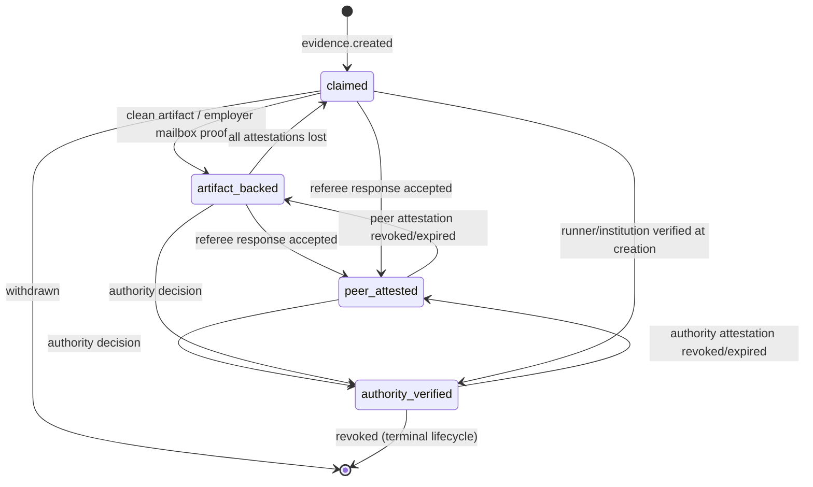
(`lifecycle` `withdrawn` and `revoked` are terminal and immutable except for erasure — INV-T11; the diagram shows `rung` movement, which is a derived value.)

## 4. Consent model (INV-T15)

`consent_record` is append-only: each grant or revoke inserts a row (`granted` true/false) carrying the **data object** it is about (`target_type`/`target_id`: `evidence` or `application`, or none), the **grantee** (`grantee_type`/`grantee_id`: all verified orgs, one org, one institution, or none), an optional `expires_at` and, for alumni sharing only, the chosen `field_set`. The current state is the latest row per `(subject, scope, target_type, target_id, grantee_type, grantee_id)` exposed via a view `consent_current` that omits expired grants. Per-employer and per-artefact grants are rows of this ledger; there is no separate grant table. The scope vocabulary is **not defined here**: the only list is `00_CONTROL_CENTRE/CONSENT_SCOPE_CATALOGUE.md` (CSC, 14 scopes, FF-12). Summary [TARGET]:

| Scope | Purpose it gates | Grain (CSC section 2) |
|---|---|---|
| `profile.public_view` | Profile visible beyond owner | account |
| `search.discoverable` | Presence in recruiter search | audience (all verified orgs) |
| `matching.recommend` | Recommendations and match explanations for the candidate | account |
| `outreach.recruiter_contact` | Recruiter-initiated first contact | audience |
| `evidence.share_summary` | Evidence titles, skills, rung in recruiter results | audience |
| `evidence.share_artefact` | One employer opens evidence artefacts | grantee_object (org required, evidence optional) |
| `profile.share_contact` | One employer sees email/phone | grantee (org) |
| `application.share_snapshot` | Hiring team of the job sees the application snapshot | application (job org + application) |
| `evidence.share_institution` | Institution cohort reads and aggregates | grantee (institution) |
| `alumni.share_outcomes` | Chosen outcome fields shared with the institution after graduation | grantee (institution) + `field_set` |
| `ai.assist.process` | Sending user content to AI providers | account |
| `analytics.product` | Product analytics events | account |
| `comms.marketing_email` | Marketing/lifecycle email | account |
| `data.research_aggregate` | Aggregate/anonymised analysis [OPEN-B10] | account |

The earlier scope `evidence.share_recruiter` is retired and split by target (CSC section 4 crosswalk).

Applying to a job creates an immutable `application_consent_snapshot` that references the exact `consent_record` ids relied on; recruiter reads of `application_evidence` are authorised against the snapshot **and** the live `application.share_snapshot` grant (revocation takes effect for future reads; already-disclosed information is a governance matter, DB-03).

## 5. State machines referenced by CHECK constraints

State names are **derived** from `06_BUSINESS_PROCESSES/STATE_MACHINES.md` (SM-00), which is the single vocabulary source (see its "Vocabulary authority" section and FF-11). Every CHECK below equals the machine's persisted state set; transitions, guards and diagrams live only in SM-00 and are not restated here.

| SM-00 machine | Stored in | Persisted states |
|---|---|---|
| SM-ACCOUNT | `account.status` | pending_verification, active, suspended, deactivated, pending_erasure, erased (`purged` is event-only; sign-in lockout is `locked_until`, not a state) |
| SM-EVIDENCE | `evidence_item.lifecycle` | draft, pending_scan, active, quarantined, under_review, revoked, withdrawn, expired, erased |
| SM-VERIFICATION | `verification_request.state` | created, awaiting_proof, verified, failed, expired, cancelled, revoked |
| SM-REFERENCE | `reference_request.state` | queued, sent, opened, submitted, expired, cancelled, bounced |
| SM-ATTEMPT | `attempt.state` | created, in_progress, submitted, grading, passed, failed, unverified, under_review, voided, expired |
| SM-ENROLMENT | `enrollment.state` | pending_payment, active, completed, dropped, expired, refunded, suspended |
| SM-JOB | `job.state` | draft, pending_review, scheduled, published, paused, closed, taken_down |
| SM-APPLICATION | `application.state` (`draft` lives in `application_draft`) | submitted, in_review, shortlisted, interviewing, offer_extended, hired, rejected, withdrawn, offer_declined |
| SM-INTERVIEW | `interview.state` | proposed, scheduled, completed, cancelled, rescheduled, no_show, expired |
| SM-SUBSCRIPTION | `subscription.state` | incomplete, active, canceling, past_due, unpaid, canceled, incomplete_expired |
| SM-DSR | `data_rights_request.state` (all kinds, including erasure) | received, verifying, cooling_off, in_progress, on_hold, completed, completed_with_retention, rejected, cancelled, failed |
| SM-MODCASE | `moderation_case.state` | open, triaged, in_review, awaiting_info, actioned, appealed, closed |
| SM-NOTIFY | `notification_delivery.state` | queued, suppressed, deferred, sending, sent, delivered, failed_retry, failed, bounced, complained, expired |
| SM-BGJOB | `background_job.status` | queued, claimed, running, retry_wait, succeeded, dead, cancelled |

Old-to-new name mapping: see "Vocabulary authority" in SM-00. Not yet in SM-00 (REVW-20): **SM-FILE** (`file_object.state`) keeps its provisional set intact: intent -> uploaded -> verifying -> scanning -> clean / rejected / infected; any -> deleted (BR-T003); SM-EVIDENCE t3/t4 consume its result. The former provisional SM-ERASURE is folded into SM-DSR.

## 6. Logical model by domain
Each domain lists an ER diagram (keys, foreign keys, state columns) followed by full attribute tables. Foreign keys to entities of other domains are drawn for orientation only: at the **module** level they are not queried across (FF-02); DB-level FKs across modules are permitted for referential integrity but are listed in the table-ownership manifest, and cross-module reads still go through interfaces. Where integrity must survive module extraction, a deferrable FK is replaced by an application check plus periodic reconciliation (DB-02 §11).


### DOM-01 Identity, Sessions & Access  (module `api/identity`)

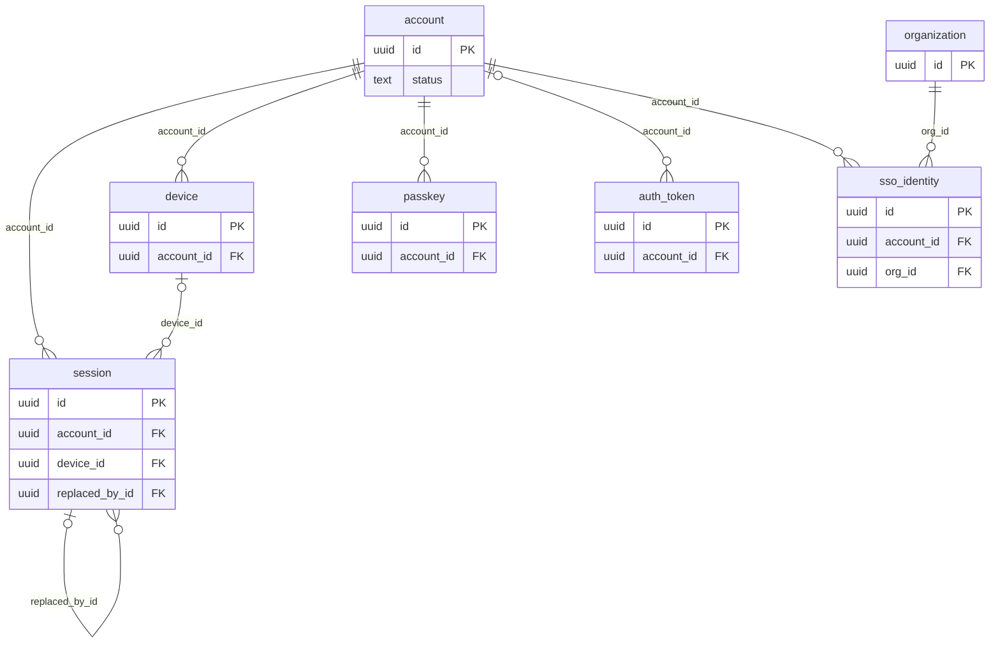

#### DATA-E0101 `account` — Account
Role: root · Tenancy/RLS: RLS-OWNER · Owner module: `api/identity`

| Attribute | Type | Constraints / notes |
|---|---|---|
| `id` | uuid | PK, UUIDv7, app-generated |
| `created_at` | timestamptz | NN, DEF now() |
| `updated_at` | timestamptz | NN, DEF now() |
| `version` | bigint | NN, DEF 1; optimistic lock / ETag |
| `email` | citext | NN, UQ (case-insensitive), CHK length<=254 |
| `email_verified_at` | timestamptz | NULL until verified |
| `display_name` | text | NN, CHK length 1..100 |
| `locale` | text | NN, DEF 'en' |
| `timezone` | text | NULL (IANA name) |
| `status` | text | NN, CHK in (pending_verification,active,suspended,deactivated,pending_erasure,erased), DEF 'pending_verification' (SM-ACCOUNT; sign-in lockout is `locked_until`, not a status) |
| `password_hash` | text | NULL for passkey/SSO-only; Argon2id PHC string; never selected by general queries |
| `password_updated_at` | timestamptz | NULL |
| `failed_login_count` | int | NN, DEF 0, CHK >=0 |
| `locked_until` | timestamptz | NULL |
| `grants_version` | bigint | NN, DEF 1; bumped on any role/grant change (policy freshness) |
| `consent_epoch` | bigint | NN, DEF 0; incremented on every consent change; stamps derived search/match data |
| `terms_version` | text | NN |
| `terms_accepted_at` | timestamptz | NN |
| `last_login_at` | timestamptz | NULL |
| `erased_at` | timestamptz | NULL; set by erasure orchestrator |

#### DATA-E0102 `session` — Session (refresh-token family member)
Role: member of Account · Tenancy/RLS: RLS-OWNER · Owner module: `api/identity`

| Attribute | Type | Constraints / notes |
|---|---|---|
| `id` | uuid | PK, UUIDv7 |
| `created_at` | timestamptz | NN, DEF now() |
| `updated_at` | timestamptz | NN, DEF now() |
| `account_id` | uuid | NN, FK(account.id) |
| `family_id` | uuid | NN; all rotations of one login share a family (BR-T050) |
| `generation` | int | NN, DEF 1; increments on each rotation |
| `refresh_token_hash` | bytea | NN, UQ; SHA-256 of 256-bit random token (INV-T05 style hash-only) |
| `device_id` | uuid | NULL, FK(device.id) |
| `user_agent_class` | text | NULL (coarse class, not raw UA) |
| `ip_prefix` | inet | NULL (truncated /24 or /48) |
| `last_seen_at` | timestamptz | NN |
| `refresh_expires_at` | timestamptz | NN |
| `absolute_expires_at` | timestamptz | NN; hard cap regardless of rotation |
| `recent_auth_at` | timestamptz | NULL; step-up marker |
| `revoked_at` | timestamptz | NULL |
| `revoke_reason` | text | NULL, CHK in (user,admin,password_change,reuse_detected,expiry,erasure) |
| `replaced_by_id` | uuid | NULL, FK(session.id); reuse of a replaced token revokes family |

#### DATA-E0103 `device` — Device
Role: member of Account · Tenancy/RLS: RLS-OWNER · Owner module: `api/identity`

| Attribute | Type | Constraints / notes |
|---|---|---|
| `id` | uuid | PK, UUIDv7, app-generated |
| `created_at` | timestamptz | NN, DEF now() |
| `updated_at` | timestamptz | NN, DEF now() |
| `version` | bigint | NN, DEF 1; optimistic lock / ETag |
| `account_id` | uuid | NN, FK(account.id) |
| `label` | text | NULL |
| `first_seen_at` | timestamptz | NN |
| `last_seen_at` | timestamptz | NN |

#### DATA-E0104 `passkey` — Passkey (WebAuthn credential)
Role: member of Account · Tenancy/RLS: RLS-OWNER · Owner module: `api/identity`

| Attribute | Type | Constraints / notes |
|---|---|---|
| `id` | uuid | PK, UUIDv7, app-generated |
| `created_at` | timestamptz | NN, DEF now() |
| `updated_at` | timestamptz | NN, DEF now() |
| `version` | bigint | NN, DEF 1; optimistic lock / ETag |
| `account_id` | uuid | NN, FK(account.id) |
| `credential_id` | bytea | NN, UQ |
| `public_key` | bytea | NN |
| `sign_count` | bigint | NN, DEF 0 |
| `transports` | text[] | NULL |
| `label` | text | NULL |
| `backup_eligible` | bool | NN |
| `backup_state` | bool | NN |
| `last_used_at` | timestamptz | NULL |
| `revoked_at` | timestamptz | NULL |

#### DATA-E0105 `auth_token` — AuthToken (one-time link/code token)
Role: member of Account · Tenancy/RLS: RLS-INTERNAL · Owner module: `api/identity`

| Attribute | Type | Constraints / notes |
|---|---|---|
| `id` | uuid | PK, UUIDv7 |
| `created_at` | timestamptz | NN, DEF now(); row is append-only |
| `account_id` | uuid | NULL, FK(account.id) |
| `purpose` | text | NN, CHK in (password_reset,email_verify,org_invite) |
| `token_hash` | bytea | NN, UQ; hash only, single use (INV-T05) |
| `expires_at` | timestamptz | NN |
| `consumed_at` | timestamptz | NULL |

#### DATA-E0106 `sso_identity` — SsoIdentity
Role: member of Account · Tenancy/RLS: RLS-OWNER · Owner module: `api/identity`

| Attribute | Type | Constraints / notes |
|---|---|---|
| `id` | uuid | PK, UUIDv7 |
| `created_at` | timestamptz | NN, DEF now(); row is append-only |
| `account_id` | uuid | NN, FK(account.id) |
| `org_id` | uuid | NN, FK(organization.id) |
| `issuer` | text | NN |
| `subject` | text | NN; UQ(issuer,subject) |


### DOM-02 Organizations, Tenancy & Roles  (module `api/orgs`)

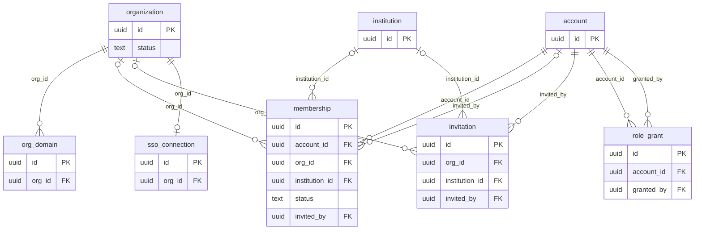

#### DATA-E0201 `organization` — Organization (employer tenant)
Role: root · Tenancy/RLS: RLS-ORG · Owner module: `api/orgs`

| Attribute | Type | Constraints / notes |
|---|---|---|
| `id` | uuid | PK, UUIDv7, app-generated |
| `created_at` | timestamptz | NN, DEF now() |
| `updated_at` | timestamptz | NN, DEF now() |
| `version` | bigint | NN, DEF 1; optimistic lock / ETag |
| `name` | text | NN, CHK length 1..150 |
| `slug` | citext | NN, UQ |
| `status` | text | NN, CHK in (active,suspended,closed), DEF 'active' |
| `size_band` | text | NULL |
| `website` | text | NULL |
| `verified_at` | timestamptz | NULL (org identity verification, if offered) |

#### DATA-E0202 `org_domain` — OrgDomain
Role: member of Organization · Tenancy/RLS: RLS-ORG · Owner module: `api/orgs`

| Attribute | Type | Constraints / notes |
|---|---|---|
| `id` | uuid | PK, UUIDv7, app-generated |
| `created_at` | timestamptz | NN, DEF now() |
| `updated_at` | timestamptz | NN, DEF now() |
| `version` | bigint | NN, DEF 1; optimistic lock / ETag |
| `org_id` | uuid | NN, FK(organization.id) |
| `domain` | citext | NN, UQ |
| `verified_at` | timestamptz | NULL; DNS TXT proof |
| `purpose` | text | NN, CHK in (sso,employer_email_match) |

#### DATA-E0203 `membership` — Membership (account in tenant with role)
Role: root · Tenancy/RLS: RLS-ORG · Owner module: `api/orgs`

| Attribute | Type | Constraints / notes |
|---|---|---|
| `id` | uuid | PK, UUIDv7, app-generated |
| `created_at` | timestamptz | NN, DEF now() |
| `updated_at` | timestamptz | NN, DEF now() |
| `version` | bigint | NN, DEF 1; optimistic lock / ETag |
| `account_id` | uuid | NN, FK(account.id) |
| `org_id` | uuid | NULL, FK(organization.id) |
| `institution_id` | uuid | NULL, FK(institution.id) |
| `role` | text | NN, CHK in (org_owner,org_admin,recruiter,hiring_manager,viewer,inst_admin,faculty,proctor) |
| `status` | text | NN, CHK in (invited,active,removed) |
| `invited_by` | uuid | NULL, FK(account.id) |
| `joined_at` | timestamptz | NULL |
| `removed_at` | timestamptz | NULL |

#### DATA-E0204 `invitation` — Invitation
Role: member of Membership · Tenancy/RLS: RLS-ORG · Owner module: `api/orgs`

| Attribute | Type | Constraints / notes |
|---|---|---|
| `id` | uuid | PK, UUIDv7, app-generated |
| `created_at` | timestamptz | NN, DEF now() |
| `updated_at` | timestamptz | NN, DEF now() |
| `version` | bigint | NN, DEF 1; optimistic lock / ETag |
| `org_id` | uuid | NULL, FK(organization.id) |
| `institution_id` | uuid | NULL, FK(institution.id) |
| `email_hash` | bytea | NN; HMAC of normalised email |
| `email_enc` | bytea | NN; field-encrypted for sending |
| `role` | text | NN |
| `token_hash` | bytea | NN, UQ |
| `invited_by` | uuid | NN, FK(account.id) |
| `expires_at` | timestamptz | NN |
| `accepted_at` | timestamptz | NULL |

#### DATA-E0205 `role_grant` — PlatformRoleGrant (moderator/support/admin/auditor)
Role: root · Tenancy/RLS: RLS-INTERNAL · Owner module: `api/orgs`

| Attribute | Type | Constraints / notes |
|---|---|---|
| `id` | uuid | PK, UUIDv7, app-generated |
| `created_at` | timestamptz | NN, DEF now() |
| `updated_at` | timestamptz | NN, DEF now() |
| `version` | bigint | NN, DEF 1; optimistic lock / ETag |
| `account_id` | uuid | NN, FK(account.id) |
| `role` | text | NN, CHK in (moderator,support,admin,auditor) |
| `granted_by` | uuid | NN, FK(account.id) |
| `expires_at` | timestamptz | NN; dormant grants auto-expire (60 d rule, USR-01 §6) |
| `last_used_at` | timestamptz | NULL |
| `revoked_at` | timestamptz | NULL |

#### DATA-E0206 `sso_connection` — SsoConnection
Role: member of Organization · Tenancy/RLS: RLS-ORG · Owner module: `api/orgs`

| Attribute | Type | Constraints / notes |
|---|---|---|
| `id` | uuid | PK, UUIDv7, app-generated |
| `created_at` | timestamptz | NN, DEF now() |
| `updated_at` | timestamptz | NN, DEF now() |
| `version` | bigint | NN, DEF 1; optimistic lock / ETag |
| `org_id` | uuid | NN, FK(organization.id), UQ |
| `protocol` | text | NN, CHK in (oidc,saml) |
| `issuer` | text | NN |
| `client_id` | text | NULL |
| `secret_ref` | text | NULL; reference to secret manager, never the secret |
| `metadata` | jsonb | NN; validated IdP metadata (bounded size) |
| `enforced` | bool | NN, DEF false |


### DOM-03 Profile, Portfolio & Resume  (module `api/profile`)

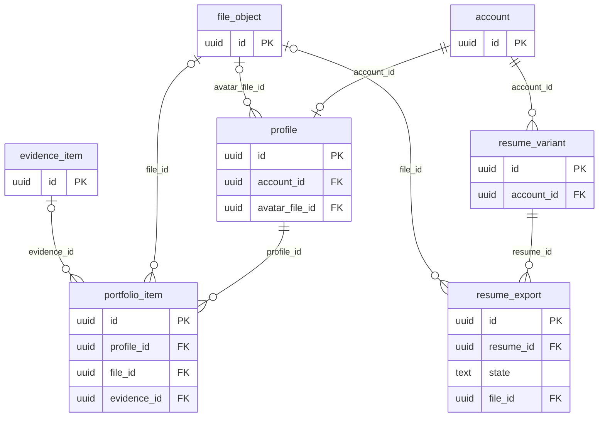

#### DATA-E0301 `profile` — Profile
Role: root · Tenancy/RLS: RLS-OWNER (+ public projection) · Owner module: `api/profile`

| Attribute | Type | Constraints / notes |
|---|---|---|
| `id` | uuid | PK, UUIDv7, app-generated |
| `created_at` | timestamptz | NN, DEF now() |
| `updated_at` | timestamptz | NN, DEF now() |
| `version` | bigint | NN, DEF 1; optimistic lock / ETag |
| `account_id` | uuid | NN, FK(account.id), UQ |
| `handle` | citext | NN, UQ, CHK ^[a-z0-9-]{3,40}$ |
| `headline` | text | NULL, CHK length<=160 |
| `summary` | text | NULL, CHK length<=4000 |
| `location_text` | text | NULL |
| `country_code` | text | NULL, CHK length=2 |
| `visibility` | text | NN, CHK in (private,members,public), DEF 'private' |
| `open_to_work` | bool | NN, DEF false |
| `avatar_file_id` | uuid | NULL, FK(file_object.id) |
| `links` | jsonb | NN, DEF '[]'; bounded array validated by Zod (<=10) |

#### DATA-E0302 `portfolio_item` — PortfolioItem
Role: member of Profile · Tenancy/RLS: RLS-OWNER · Owner module: `api/profile`

| Attribute | Type | Constraints / notes |
|---|---|---|
| `id` | uuid | PK, UUIDv7, app-generated |
| `created_at` | timestamptz | NN, DEF now() |
| `updated_at` | timestamptz | NN, DEF now() |
| `version` | bigint | NN, DEF 1; optimistic lock / ETag |
| `profile_id` | uuid | NN, FK(profile.id) |
| `title` | text | NN |
| `description` | text | NULL |
| `url` | text | NULL; https only |
| `file_id` | uuid | NULL, FK(file_object.id) |
| `evidence_id` | uuid | NULL, FK(evidence_item.id) |
| `position` | int | NN |
| `visibility` | text | NN, CHK in (private,public) |

#### DATA-E0303 `resume_variant` — ResumeVariant
Role: member of Profile · Tenancy/RLS: RLS-OWNER · Owner module: `api/profile`

| Attribute | Type | Constraints / notes |
|---|---|---|
| `id` | uuid | PK, UUIDv7, app-generated |
| `created_at` | timestamptz | NN, DEF now() |
| `updated_at` | timestamptz | NN, DEF now() |
| `version` | bigint | NN, DEF 1; optimistic lock / ETag |
| `account_id` | uuid | NN, FK(account.id) |
| `name` | text | NN |
| `template_key` | text | NN |
| `content_refs` | jsonb | NN; ordered references (evidence/portfolio ids), not copies |
| `last_exported_at` | timestamptz | NULL |

#### DATA-E0304 `resume_export` — ResumeExport
Role: member of ResumeVariant · Tenancy/RLS: RLS-OWNER · Owner module: `api/profile`

| Attribute | Type | Constraints / notes |
|---|---|---|
| `id` | uuid | PK, UUIDv7, app-generated |
| `created_at` | timestamptz | NN, DEF now() |
| `updated_at` | timestamptz | NN, DEF now() |
| `version` | bigint | NN, DEF 1; optimistic lock / ETag |
| `resume_id` | uuid | NN, FK(resume_variant.id) |
| `state` | text | NN, CHK in (requested,building,ready,failed,expired) |
| `file_id` | uuid | NULL, FK(file_object.id) |
| `expires_at` | timestamptz | NULL |


### DOM-04 Skills Graph & Taxonomy  (module `api/skills`)

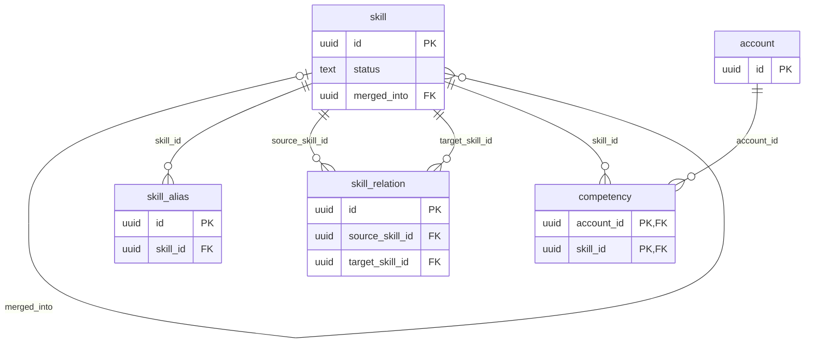

#### DATA-E0401 `skill` — Skill
Role: root · Tenancy/RLS: RLS-PUBLIC-READ · Owner module: `api/skills`

| Attribute | Type | Constraints / notes |
|---|---|---|
| `id` | uuid | PK, UUIDv7, app-generated |
| `created_at` | timestamptz | NN, DEF now() |
| `updated_at` | timestamptz | NN, DEF now() |
| `version` | bigint | NN, DEF 1; optimistic lock / ETag |
| `slug` | text | NN, UQ |
| `name` | text | NN |
| `category` | text | NN |
| `description` | text | NULL |
| `status` | text | NN, CHK in (active,deprecated,merged), DEF 'active' |
| `merged_into` | uuid | NULL, FK(skill.id) |
| `embedding` | vector(1536) | NULL; derived (dimension per model; OPEN-B9 family) |

#### DATA-E0402 `skill_alias` — SkillAlias
Role: member of Skill · Tenancy/RLS: RLS-PUBLIC-READ · Owner module: `api/skills`

| Attribute | Type | Constraints / notes |
|---|---|---|
| `id` | uuid | PK, UUIDv7, app-generated |
| `created_at` | timestamptz | NN, DEF now() |
| `updated_at` | timestamptz | NN, DEF now() |
| `version` | bigint | NN, DEF 1; optimistic lock / ETag |
| `skill_id` | uuid | NN, FK(skill.id) |
| `alias` | citext | NN, UQ |
| `locale` | text | NN, DEF 'en' |

#### DATA-E0403 `skill_relation` — SkillRelation
Role: member of Skill · Tenancy/RLS: RLS-PUBLIC-READ · Owner module: `api/skills`

| Attribute | Type | Constraints / notes |
|---|---|---|
| `id` | uuid | PK, UUIDv7, app-generated |
| `created_at` | timestamptz | NN, DEF now() |
| `updated_at` | timestamptz | NN, DEF now() |
| `version` | bigint | NN, DEF 1; optimistic lock / ETag |
| `source_skill_id` | uuid | NN, FK(skill.id) |
| `target_skill_id` | uuid | NN, FK(skill.id) |
| `relation_type` | text | NN, CHK in (prerequisite_of,subskill_of,supersedes,correlates_with); UQ(source,target,type); acyclic for hierarchical types (domain-enforced) |
| `weight` | numeric(3,2) | NN, DEF 1.0, CHK 0..1 |

#### DATA-E0404 `competency` — Competency (derived confidence)
Role: derived from Evidence · Tenancy/RLS: RLS-OWNER · Owner module: `api/skills`

| Attribute | Type | Constraints / notes |
|---|---|---|
| `account_id` | uuid | NN, FK(account.id); PK part |
| `skill_id` | uuid | NN, FK(skill.id); PK part |
| `confidence` | numeric(4,3) | NN, CHK 0..1 |
| `basis` | jsonb | NN; explanation: contributing evidence ids, rungs, weights |
| `model_version` | text | NN |
| `computed_at` | timestamptz | NN |


### DOM-05 Evidence & Credentials  (module `api/evidence`)

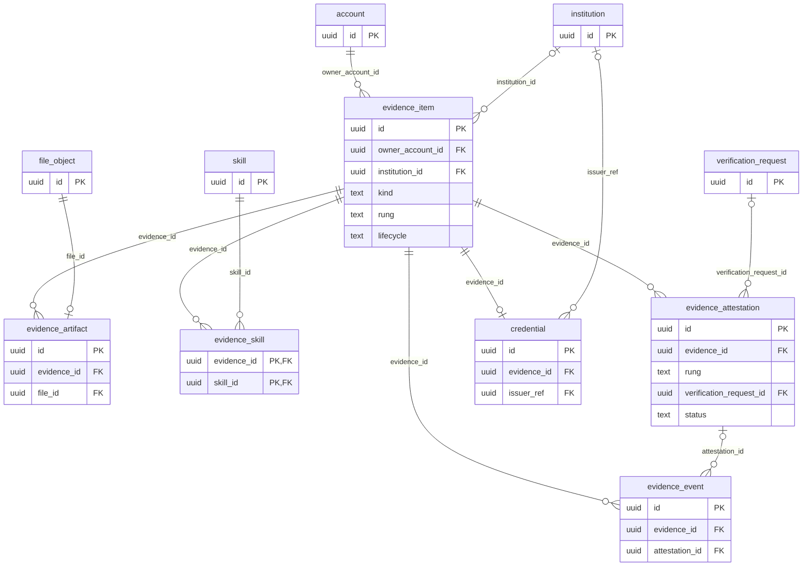

#### DATA-E0501 `evidence_item` — EvidenceItem
Role: root · Tenancy/RLS: RLS-OWNER (+ consented share) · Owner module: `api/evidence`

| Attribute | Type | Constraints / notes |
|---|---|---|
| `id` | uuid | PK, UUIDv7, app-generated |
| `created_at` | timestamptz | NN, DEF now() |
| `updated_at` | timestamptz | NN, DEF now() |
| `version` | bigint | NN, DEF 1; optimistic lock / ETag |
| `owner_account_id` | uuid | NN, FK(account.id) |
| `institution_id` | uuid | NULL, FK(institution.id); set for institution-issued evidence |
| `kind` | text | NN, CHK in (project,work_experience,education,certification,publication,assessment_result,course_completion,other) |
| `title` | text | NN, CHK length<=200 |
| `summary` | text | NULL, CHK length<=4000 |
| `source` | text | NN, CHK in (self,course,assessment,institution,import) -- 'ai' is not a member (INV-T08) |
| `source_ref_type` | text | NULL |
| `source_ref_id` | uuid | NULL |
| `rung` | text | NN, CHK in (claimed,artifact_backed,peer_attested,authority_verified), DEF 'claimed'; written only by evidence module SM transition (INV-T04) |
| `lifecycle` | text | NN, CHK in (draft,pending_scan,active,quarantined,under_review,revoked,withdrawn,expired,erased), DEF 'draft' (SM-EVIDENCE) |
| `visibility` | text | NN, CHK in (private,share_on_request,public), DEF 'private' |
| `occurred_from` | date | NULL |
| `occurred_to` | date | NULL, CHK >= occurred_from |
| `external_url` | text | NULL; https only; never fetched server-side without SSRF guard |
| `content_hash` | bytea | NULL; hash of material fields (change detection resets attestations) |
| `revoked_at` | timestamptz | NULL |
| `revoked_reason` | text | NULL |

#### DATA-E0502 `evidence_artifact` — EvidenceArtifact
Role: member of EvidenceItem · Tenancy/RLS: RLS-OWNER · Owner module: `api/evidence`

| Attribute | Type | Constraints / notes |
|---|---|---|
| `id` | uuid | PK, UUIDv7, app-generated |
| `created_at` | timestamptz | NN, DEF now() |
| `updated_at` | timestamptz | NN, DEF now() |
| `version` | bigint | NN, DEF 1; optimistic lock / ETag |
| `evidence_id` | uuid | NN, FK(evidence_item.id) |
| `file_id` | uuid | NN, FK(file_object.id), UQ |
| `label` | text | NULL |
| `removed_at` | timestamptz | NULL |

#### DATA-E0503 `evidence_skill` — EvidenceSkill
Role: member of EvidenceItem · Tenancy/RLS: RLS-OWNER · Owner module: `api/evidence`

| Attribute | Type | Constraints / notes |
|---|---|---|
| `evidence_id` | uuid | NN, FK(evidence_item.id); PK part |
| `skill_id` | uuid | NN, FK(skill.id); PK part |
| `added_at` | timestamptz | NN |

#### DATA-E0504 `evidence_attestation` — EvidenceAttestation (ladder rung proof)
Role: member of EvidenceItem · Tenancy/RLS: RLS-OWNER (read) / module-write · Owner module: `api/evidence`

| Attribute | Type | Constraints / notes |
|---|---|---|
| `id` | uuid | PK, UUIDv7, app-generated |
| `created_at` | timestamptz | NN, DEF now() |
| `updated_at` | timestamptz | NN, DEF now() |
| `version` | bigint | NN, DEF 1; optimistic lock / ETag |
| `evidence_id` | uuid | NN, FK(evidence_item.id) |
| `rung` | text | NN, CHK in (artifact_backed,peer_attested,authority_verified) |
| `method` | text | NN, CHK in (artifact_scan,employer_email,reference,institution_issuer,assessment_runner,manual_review) |
| `attester_kind` | text | NN, CHK in (system,referee,employer_domain,institution,platform_reviewer) |
| `attester_ref` | text | NULL; pseudonymous reference (never raw email) |
| `verification_request_id` | uuid | NULL, FK(verification_request.id) |
| `status` | text | NN, CHK in (valid,revoked,expired), DEF 'valid' |
| `granted_at` | timestamptz | NN |
| `expires_at` | timestamptz | NULL |
| `revoked_at` | timestamptz | NULL |
| `revoked_reason` | text | NULL |
| `provenance` | jsonb | NN, DEF '{}'; method-specific facts (hashes, runner digest, domain), bounded |

#### DATA-E0505 `evidence_event` — EvidenceEvent (append-only ladder history)
Role: member of EvidenceItem · Tenancy/RLS: RLS-OWNER (read) · Owner module: `api/evidence`

| Attribute | Type | Constraints / notes |
|---|---|---|
| `id` | uuid | PK, UUIDv7 |
| `created_at` | timestamptz | NN, DEF now(); row is append-only |
| `evidence_id` | uuid | NN; soft reference to evidence_item.id, **no FK** (erasure hard-deletes the item; history keeps the bare id, DB-02 §4.1) |
| `seq` | bigint | NN, UQ(evidence_id,seq) |
| `event` | text | NN, CHK in (created,edited,attestation_granted,attestation_revoked,attestation_expired,withdrawn,revoked,rung_changed) |
| `from_rung` | text | NULL |
| `to_rung` | text | NULL |
| `actor_kind` | text | NN, CHK in (owner,system,referee,authority,moderator,admin) |
| `actor_ref` | text | NULL; opaque `subject_ref` for account actors or a random per-request `referee_ref`; never an email, name or account id (DB-02 §4.1) |
| `attestation_id` | uuid | NULL; soft reference to evidence_attestation.id, no FK |
| `details` | jsonb | NN, DEF '{}'; allowlisted keys only, no referee-supplied facts or user text (those live in erasable attestation provenance) |
| `prev_hash` | bytea | NULL; row_hash of the previous event of the same evidence_id (aggregate chain under the item's row lock; DB-02 §4.2) |
| `row_hash` | bytea | NN; SHA256(canonical(row)); sealed into `audit_anchor` batches |

#### DATA-E0506 `credential` — Credential (publicly verifiable)
Role: root · Tenancy/RLS: RLS-PUBLIC-READ (by code) · Owner module: `api/evidence`

| Attribute | Type | Constraints / notes |
|---|---|---|
| `id` | uuid | PK, UUIDv7, app-generated |
| `created_at` | timestamptz | NN, DEF now() |
| `updated_at` | timestamptz | NN, DEF now() |
| `version` | bigint | NN, DEF 1; optimistic lock / ETag |
| `evidence_id` | uuid | NN, FK(evidence_item.id), UQ |
| `issuer_kind` | text | NN, CHK in (platform,institution,external) |
| `issuer_ref` | uuid | NULL, FK(institution.id) |
| `public_code` | text | NN, UQ; >=128-bit random, base32 |
| `issued_at` | timestamptz | NN |
| `expires_at` | timestamptz | NULL |
| `revoked_at` | timestamptz | NULL |
| `revocation_reason` | text | NULL |


### DOM-06 Verification & Trust  (module `api/verification`)

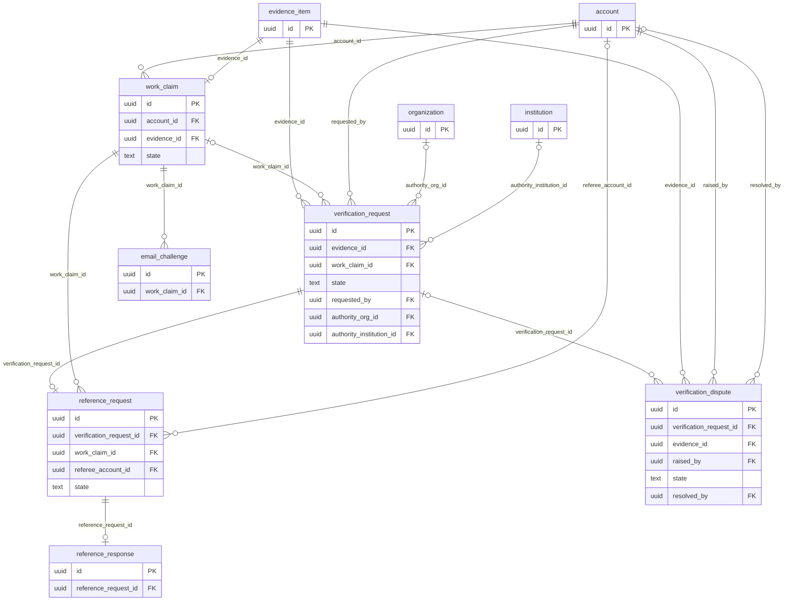

#### DATA-E0601 `work_claim` — WorkClaim
Role: root · Tenancy/RLS: RLS-OWNER · Owner module: `api/verification`

| Attribute | Type | Constraints / notes |
|---|---|---|
| `id` | uuid | PK, UUIDv7, app-generated |
| `created_at` | timestamptz | NN, DEF now() |
| `updated_at` | timestamptz | NN, DEF now() |
| `version` | bigint | NN, DEF 1; optimistic lock / ETag |
| `account_id` | uuid | NN, FK(account.id) |
| `evidence_id` | uuid | NN, FK(evidence_item.id), UQ |
| `employer_name` | text | NN |
| `employer_domain` | citext | NULL |
| `title` | text | NN |
| `employment_type` | text | NN, CHK in (full_time,part_time,contract,internship,freelance) |
| `start_date` | date | NN |
| `end_date` | date | NULL, CHK >= start_date |
| `is_current` | bool | NN |
| `corporate_email_enc` | bytea | NULL; field-encrypted |
| `corporate_email_hash` | bytea | NULL |
| `email_verified_at` | timestamptz | NULL |
| `state` | text | NN, CHK in (draft,submitted,disputed,withdrawn) |

#### DATA-E0602 `verification_request` — VerificationRequest
Role: root · Tenancy/RLS: RLS-OWNER / authority · Owner module: `api/verification`

| Attribute | Type | Constraints / notes |
|---|---|---|
| `id` | uuid | PK, UUIDv7, app-generated |
| `created_at` | timestamptz | NN, DEF now() |
| `updated_at` | timestamptz | NN, DEF now() |
| `version` | bigint | NN, DEF 1; optimistic lock / ETag |
| `evidence_id` | uuid | NN, FK(evidence_item.id) |
| `work_claim_id` | uuid | NULL, FK(work_claim.id) |
| `method` | text | NN, CHK in (artifact_scan,employer_email,reference,institution_issuer,assessment_runner,manual_review) |
| `state` | text | NN, CHK in (created,awaiting_proof,verified,failed,expired,cancelled,revoked), DEF 'created' (SM-VERIFICATION; all methods; `failed` carries `reason` in attempts_exhausted, authority_rejected; disputes live in `verification_dispute`) |
| `requested_by` | uuid | NN, FK(account.id) |
| `authority_org_id` | uuid | NULL, FK(organization.id) |
| `authority_institution_id` | uuid | NULL, FK(institution.id) |
| `expires_at` | timestamptz | NULL |
| `decided_at` | timestamptz | NULL |
| `decided_by_kind` | text | NULL, CHK in (system,referee,authority,platform_reviewer) |
| `decided_by_ref` | text | NULL |
| `decision_reason_code` | text | NULL |
| `decision_note` | text | NULL |

#### DATA-E0603 `email_challenge` — EmailChallenge
Role: member of WorkClaim · Tenancy/RLS: RLS-INTERNAL · Owner module: `api/verification`

| Attribute | Type | Constraints / notes |
|---|---|---|
| `id` | uuid | PK, UUIDv7, app-generated |
| `created_at` | timestamptz | NN, DEF now() |
| `updated_at` | timestamptz | NN, DEF now() |
| `version` | bigint | NN, DEF 1; optimistic lock / ETag |
| `work_claim_id` | uuid | NN, FK(work_claim.id) |
| `code_hmac` | bytea | NN; HMAC(server key, code); code never stored or returned to candidate (INV-T05) |
| `attempts` | int | NN, DEF 0, CHK <= 5 |
| `send_count` | int | NN, DEF 1 |
| `expires_at` | timestamptz | NN |
| `consumed_at` | timestamptz | NULL |

#### DATA-E0604 `reference_request` — ReferenceRequest
Role: member of VerificationRequest · Tenancy/RLS: RLS-OWNER (masked) / token path · Owner module: `api/verification`

| Attribute | Type | Constraints / notes |
|---|---|---|
| `id` | uuid | PK, UUIDv7, app-generated |
| `created_at` | timestamptz | NN, DEF now() |
| `updated_at` | timestamptz | NN, DEF now() |
| `version` | bigint | NN, DEF 1; optimistic lock / ETag |
| `verification_request_id` | uuid | NN, FK(verification_request.id), UQ |
| `work_claim_id` | uuid | NN, FK(work_claim.id) |
| `referee_name_enc` | bytea | NN |
| `referee_email_enc` | bytea | NN |
| `referee_email_hash` | bytea | NN; for dedupe and abuse limits |
| `referee_account_id` | uuid | NULL, FK(account.id) |
| `relationship` | text | NN, CHK in (manager,peer,direct_report,mentor,client) |
| `token_hash` | bytea | NN, UQ; single-use, bound to this request (INV-T05) |
| `state` | text | NN, CHK in (queued,sent,opened,submitted,expired,cancelled,bounced), DEF 'queued' (SM-REFERENCE) |
| `outcome` | text | NULL, CHK in (confirm,dispute,decline,unknown_candidate); set with `submitted` (`decline` replaces the former `declined` state) |
| `reminders_sent` | int | NN, DEF 0, CHK <= 2 (BR-T004) |
| `last_reminded_at` | timestamptz | NULL |
| `expires_at` | timestamptz | NN; = requested_at + 14 days (BR-T004) |
| `opened_at` | timestamptz | NULL |
| `responded_at` | timestamptz | NULL |

#### DATA-E0605 `reference_response` — ReferenceResponse
Role: member of ReferenceRequest · Tenancy/RLS: RLS-OWNER (read, masked) / authority · Owner module: `api/verification`

| Attribute | Type | Constraints / notes |
|---|---|---|
| `id` | uuid | PK, UUIDv7 |
| `created_at` | timestamptz | NN, DEF now(); row is append-only |
| `reference_request_id` | uuid | NN, FK(reference_request.id), UQ |
| `confirms_employment` | bool | NN |
| `confirms_dates` | bool | NULL |
| `confirms_title` | bool | NULL |
| `ratings` | jsonb | NN, DEF '{}' |
| `endorsed_skill_ids` | uuid[] | NN, DEF '{}' |
| `comment` | text | NULL, CHK length<=2000 |
| `ip_hash` | bytea | NULL |
| `user_agent_class` | text | NULL |

#### DATA-E0606 `verification_dispute` — VerificationDispute
Role: root · Tenancy/RLS: RLS-INTERNAL / involved · Owner module: `api/verification`

| Attribute | Type | Constraints / notes |
|---|---|---|
| `id` | uuid | PK, UUIDv7, app-generated |
| `created_at` | timestamptz | NN, DEF now() |
| `updated_at` | timestamptz | NN, DEF now() |
| `version` | bigint | NN, DEF 1; optimistic lock / ETag |
| `verification_request_id` | uuid | NULL, FK(verification_request.id) |
| `evidence_id` | uuid | NN, FK(evidence_item.id) |
| `raised_by` | uuid | NN, FK(account.id) |
| `reason` | text | NN |
| `state` | text | NN, CHK in (open,under_review,upheld,dismissed), DEF 'open' |
| `resolved_by` | uuid | NULL, FK(account.id) |
| `resolution_note` | text | NULL |
| `resolved_at` | timestamptz | NULL |


### DOM-07 Assessment, Challenges & Integrity  (module `api/assessment`)

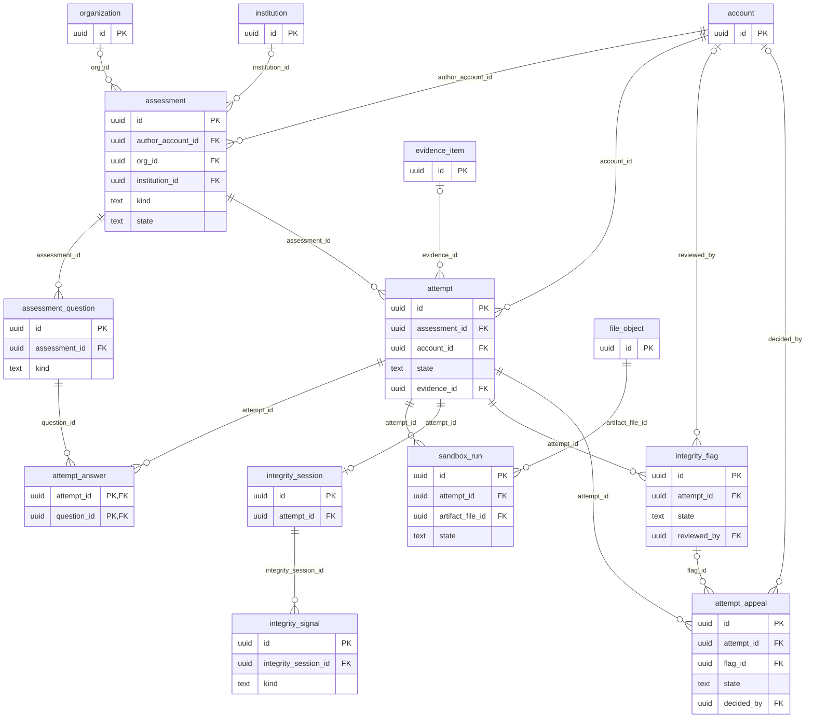

#### DATA-E0701 `assessment` — Assessment
Role: root · Tenancy/RLS: RLS-ORG/INST author + public published · Owner module: `api/assessment`

| Attribute | Type | Constraints / notes |
|---|---|---|
| `id` | uuid | PK, UUIDv7, app-generated |
| `created_at` | timestamptz | NN, DEF now() |
| `updated_at` | timestamptz | NN, DEF now() |
| `version` | bigint | NN, DEF 1; optimistic lock / ETag |
| `author_account_id` | uuid | NN, FK(account.id) |
| `org_id` | uuid | NULL, FK(organization.id) |
| `institution_id` | uuid | NULL, FK(institution.id) |
| `title` | text | NN |
| `kind` | text | NN, CHK in (quiz,code,project,timed_challenge) |
| `ai_mode` | text | NN, CHK in (AI_PROHIBITED,AI_RESTRICTED,AI_ALLOWED), DEF 'AI_PROHIBITED' |
| `requires_runner` | bool | NN; true for code/project kinds (ADR-T13) |
| `state` | text | NN, CHK in (draft,published,retired) |
| `time_limit_seconds` | int | NULL |
| `pass_threshold` | numeric(5,2) | NN |
| `spec` | jsonb | NN; versioned spec |
| `skill_ids` | uuid[] | NN |

#### DATA-E0702 `assessment_question` — AssessmentQuestion
Role: member of Assessment · Tenancy/RLS: RLS-INTERNAL (answer key never exposed) · Owner module: `api/assessment`

| Attribute | Type | Constraints / notes |
|---|---|---|
| `id` | uuid | PK, UUIDv7, app-generated |
| `created_at` | timestamptz | NN, DEF now() |
| `updated_at` | timestamptz | NN, DEF now() |
| `version` | bigint | NN, DEF 1; optimistic lock / ETag |
| `assessment_id` | uuid | NN, FK(assessment.id) |
| `position` | int | NN |
| `kind` | text | NN |
| `prompt` | jsonb | NN |
| `answer_key_enc` | bytea | NULL; encrypted; read only by grading service |
| `points` | numeric(6,2) | NN |

#### DATA-E0703 `attempt` — Attempt
Role: root · Tenancy/RLS: RLS-OWNER · Owner module: `api/assessment`

| Attribute | Type | Constraints / notes |
|---|---|---|
| `id` | uuid | PK, UUIDv7, app-generated |
| `created_at` | timestamptz | NN, DEF now() |
| `updated_at` | timestamptz | NN, DEF now() |
| `version` | bigint | NN, DEF 1; optimistic lock / ETag |
| `assessment_id` | uuid | NN, FK(assessment.id) |
| `assessment_version` | bigint | NN; snapshot |
| `account_id` | uuid | NN, FK(account.id) |
| `ai_mode_snapshot` | text | NN; copied at start so edits cannot weaken (INV-T06) |
| `state` | text | NN, CHK in (created,in_progress,submitted,grading,passed,failed,unverified,under_review,voided,expired), DEF 'created' (SM-ATTEMPT) |
| `started_at` | timestamptz | NN |
| `deadline_at` | timestamptz | NULL |
| `submitted_at` | timestamptz | NULL |
| `score` | numeric(5,2) | NULL |
| `passed` | bool | NULL |
| `verification_basis` | text | NULL, CHK in (auto_graded_objective,runner_verified,human_graded,unverified) |
| `evidence_id` | uuid | NULL, FK(evidence_item.id); set only when passed with a valid basis |

#### DATA-E0704 `attempt_answer` — AttemptAnswer
Role: member of Attempt · Tenancy/RLS: RLS-OWNER · Owner module: `api/assessment`

| Attribute | Type | Constraints / notes |
|---|---|---|
| `attempt_id` | uuid | NN, FK(attempt.id); PK part |
| `question_id` | uuid | NN, FK(assessment_question.id); PK part |
| `answer` | jsonb | NN |
| `saved_at` | timestamptz | NN |

#### DATA-E0705 `sandbox_run` — SandboxRun
Role: member of Attempt · Tenancy/RLS: RLS-INTERNAL · Owner module: `api/assessment`

| Attribute | Type | Constraints / notes |
|---|---|---|
| `id` | uuid | PK, UUIDv7, app-generated |
| `created_at` | timestamptz | NN, DEF now() |
| `updated_at` | timestamptz | NN, DEF now() |
| `version` | bigint | NN, DEF 1; optimistic lock / ETag |
| `attempt_id` | uuid | NN, FK(attempt.id) |
| `run_id` | uuid | NN, UQ |
| `artifact_file_id` | uuid | NN, FK(file_object.id) |
| `state` | text | NN, CHK in (queued,running,completed,failed,timeout) |
| `image_digest` | text | NULL |
| `limits` | jsonb | NN |
| `result` | jsonb | NULL |
| `result_signature` | bytea | NULL; verified by worker before use |
| `started_at` | timestamptz | NULL |
| `finished_at` | timestamptz | NULL |

#### DATA-E0706 `integrity_session` — IntegritySession
Role: member of Attempt · Tenancy/RLS: RLS-INTERNAL · Owner module: `api/assessment`

| Attribute | Type | Constraints / notes |
|---|---|---|
| `id` | uuid | PK, UUIDv7, app-generated |
| `created_at` | timestamptz | NN, DEF now() |
| `updated_at` | timestamptz | NN, DEF now() |
| `version` | bigint | NN, DEF 1; optimistic lock / ETag |
| `attempt_id` | uuid | NN, FK(attempt.id), UQ |
| `policy` | jsonb | NN |
| `signal_count` | int | NN, DEF 0 |

#### DATA-E0707 `integrity_signal` — IntegritySignal (append-only; partition candidate)
Role: member of IntegritySession · Tenancy/RLS: RLS-INTERNAL · Owner module: `api/assessment`

| Attribute | Type | Constraints / notes |
|---|---|---|
| `id` | uuid | PK, UUIDv7 |
| `created_at` | timestamptz | NN, DEF now(); row is append-only |
| `integrity_session_id` | uuid | NN, FK(integrity_session.id) |
| `kind` | text | NN |
| `observed_at` | timestamptz | NN |
| `payload` | jsonb | NN; bounded size; allowlisted keys, no account identifiers or user text (DB-02 §4.1) |

#### DATA-E0708 `integrity_flag` — IntegrityFlag (advisory, human-reviewed)
Role: root · Tenancy/RLS: RLS-INTERNAL / reviewer · Owner module: `api/assessment`

| Attribute | Type | Constraints / notes |
|---|---|---|
| `id` | uuid | PK, UUIDv7, app-generated |
| `created_at` | timestamptz | NN, DEF now() |
| `updated_at` | timestamptz | NN, DEF now() |
| `version` | bigint | NN, DEF 1; optimistic lock / ETag |
| `attempt_id` | uuid | NN, FK(attempt.id) |
| `severity` | text | NN, CHK in (low,medium,high) |
| `reasons` | jsonb | NN |
| `state` | text | NN, CHK in (open,in_review,cleared,confirmed,appealed), DEF 'open' |
| `reviewed_by` | uuid | NULL, FK(account.id); CHK reviewed_by NOT NULL when state in (cleared,confirmed) (INV-T20) |
| `reviewed_at` | timestamptz | NULL |
| `outcome_note` | text | NULL |

#### DATA-E0709 `attempt_appeal` — AttemptAppeal
Role: member of Attempt · Tenancy/RLS: RLS-OWNER · Owner module: `api/assessment`

| Attribute | Type | Constraints / notes |
|---|---|---|
| `id` | uuid | PK, UUIDv7, app-generated |
| `created_at` | timestamptz | NN, DEF now() |
| `updated_at` | timestamptz | NN, DEF now() |
| `version` | bigint | NN, DEF 1; optimistic lock / ETag |
| `attempt_id` | uuid | NN, FK(attempt.id) |
| `flag_id` | uuid | NULL, FK(integrity_flag.id) |
| `statement` | text | NN |
| `state` | text | NN, CHK in (open,upheld,dismissed) |
| `decided_by` | uuid | NULL, FK(account.id) |


### DOM-08 Learning  (module `api/learning`)

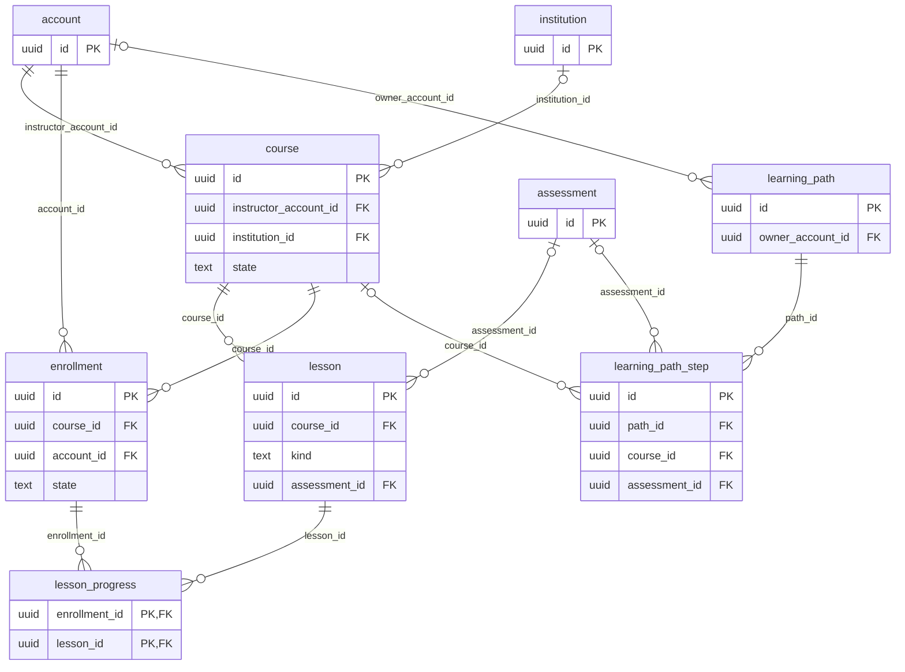

#### DATA-E0801 `course` — Course
Role: root · Tenancy/RLS: RLS-PUBLIC-READ published / author · Owner module: `api/learning`

| Attribute | Type | Constraints / notes |
|---|---|---|
| `id` | uuid | PK, UUIDv7, app-generated |
| `created_at` | timestamptz | NN, DEF now() |
| `updated_at` | timestamptz | NN, DEF now() |
| `version` | bigint | NN, DEF 1; optimistic lock / ETag |
| `instructor_account_id` | uuid | NN, FK(account.id) |
| `institution_id` | uuid | NULL, FK(institution.id) |
| `title` | text | NN |
| `slug` | text | NN, UQ |
| `summary` | text | NULL |
| `level` | text | NULL |
| `access` | text | NN, CHK in (free,subscription,paid), DEF 'free' |
| `state` | text | NN, CHK in (draft,in_review,published,unpublished,taken_down) |
| `published_at` | timestamptz | NULL |

#### DATA-E0802 `lesson` — Lesson
Role: member of Course · Tenancy/RLS: RLS-PUBLIC-READ published · Owner module: `api/learning`

| Attribute | Type | Constraints / notes |
|---|---|---|
| `id` | uuid | PK, UUIDv7, app-generated |
| `created_at` | timestamptz | NN, DEF now() |
| `updated_at` | timestamptz | NN, DEF now() |
| `version` | bigint | NN, DEF 1; optimistic lock / ETag |
| `course_id` | uuid | NN, FK(course.id) |
| `position` | int | NN |
| `kind` | text | NN, CHK in (video,reading,quiz,assessment) |
| `content_ref` | jsonb | NN |
| `assessment_id` | uuid | NULL, FK(assessment.id) |

#### DATA-E0803 `enrollment` — Enrollment
Role: root · Tenancy/RLS: RLS-OWNER · Owner module: `api/learning`

| Attribute | Type | Constraints / notes |
|---|---|---|
| `id` | uuid | PK, UUIDv7, app-generated |
| `created_at` | timestamptz | NN, DEF now() |
| `updated_at` | timestamptz | NN, DEF now() |
| `version` | bigint | NN, DEF 1; optimistic lock / ETag |
| `course_id` | uuid | NN, FK(course.id) |
| `account_id` | uuid | NN, FK(account.id); UQ(course,account) |
| `state` | text | NN, CHK in (pending_payment,active,completed,dropped,expired,refunded,suspended) (SM-ENROLMENT) |
| `progress_pct` | numeric(5,2) | NN, DEF 0 |
| `started_at` | timestamptz | NN |
| `completed_at` | timestamptz | NULL |

#### DATA-E0804 `lesson_progress` — LessonProgress
Role: member of Enrollment · Tenancy/RLS: RLS-OWNER · Owner module: `api/learning`

| Attribute | Type | Constraints / notes |
|---|---|---|
| `enrollment_id` | uuid | NN, FK(enrollment.id); PK part |
| `lesson_id` | uuid | NN, FK(lesson.id); PK part |
| `completed_at` | timestamptz | NN |

#### DATA-E0805 `learning_path` — LearningPath
Role: root · Tenancy/RLS: RLS-OWNER / PUBLIC-READ system paths · Owner module: `api/learning`

| Attribute | Type | Constraints / notes |
|---|---|---|
| `id` | uuid | PK, UUIDv7, app-generated |
| `created_at` | timestamptz | NN, DEF now() |
| `updated_at` | timestamptz | NN, DEF now() |
| `version` | bigint | NN, DEF 1; optimistic lock / ETag |
| `owner_account_id` | uuid | NULL, FK(account.id); NULL = curated |
| `title` | text | NN |
| `goal_skill_ids` | uuid[] | NN |

#### DATA-E0806 `learning_path_step` — LearningPathStep
Role: member of LearningPath · Tenancy/RLS: same as path · Owner module: `api/learning`

| Attribute | Type | Constraints / notes |
|---|---|---|
| `id` | uuid | PK, UUIDv7, app-generated |
| `created_at` | timestamptz | NN, DEF now() |
| `updated_at` | timestamptz | NN, DEF now() |
| `version` | bigint | NN, DEF 1; optimistic lock / ETag |
| `path_id` | uuid | NN, FK(learning_path.id) |
| `position` | int | NN |
| `course_id` | uuid | NULL, FK(course.id) |
| `assessment_id` | uuid | NULL, FK(assessment.id) |


### DOM-09 Opportunities  (module `api/jobs`)

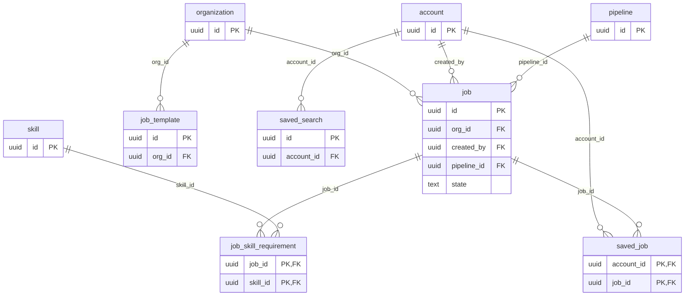

#### DATA-E0901 `job` — Job
Role: root · Tenancy/RLS: RLS-ORG + public published · Owner module: `api/jobs`

| Attribute | Type | Constraints / notes |
|---|---|---|
| `id` | uuid | PK, UUIDv7, app-generated |
| `created_at` | timestamptz | NN, DEF now() |
| `updated_at` | timestamptz | NN, DEF now() |
| `version` | bigint | NN, DEF 1; optimistic lock / ETag |
| `org_id` | uuid | NN, FK(organization.id) |
| `created_by` | uuid | NN, FK(account.id) |
| `pipeline_id` | uuid | NN, FK(pipeline.id) |
| `title` | text | NN |
| `description` | text | NN |
| `location_text` | text | NULL |
| `work_mode` | text | NN, CHK in (onsite,hybrid,remote) |
| `employment_type` | text | NN |
| `salary_min` | int | NULL |
| `salary_max` | int | NULL, CHK >= salary_min |
| `salary_currency` | text | NULL |
| `salary_period` | text | NULL, CHK in (hour,month,year) |
| `state` | text | NN, CHK in (draft,pending_review,scheduled,published,paused,closed,taken_down), DEF 'draft' (SM-JOB) |
| `close_reason` | text | NULL, CHK in (filled,expired,cancelled); required when `state = 'closed'` (replaces the former `expired` state) |
| `publish_at` | timestamptz | NULL; required when `state = 'scheduled'`, at most 30 days ahead |
| `published_at` | timestamptz | NULL |
| `closes_at` | timestamptz | NULL |

#### DATA-E0902 `job_skill_requirement` — JobSkillRequirement
Role: member of Job · Tenancy/RLS: RLS-ORG + public · Owner module: `api/jobs`

| Attribute | Type | Constraints / notes |
|---|---|---|
| `job_id` | uuid | NN, FK(job.id); PK part |
| `skill_id` | uuid | NN, FK(skill.id); PK part |
| `importance` | text | NN, CHK in (required,preferred) |
| `min_rung` | text | NULL, CHK in (claimed,artifact_backed,peer_attested,authority_verified) |

#### DATA-E0903 `job_template` — JobTemplate
Role: root · Tenancy/RLS: RLS-ORG · Owner module: `api/jobs`

| Attribute | Type | Constraints / notes |
|---|---|---|
| `id` | uuid | PK, UUIDv7, app-generated |
| `created_at` | timestamptz | NN, DEF now() |
| `updated_at` | timestamptz | NN, DEF now() |
| `version` | bigint | NN, DEF 1; optimistic lock / ETag |
| `org_id` | uuid | NN, FK(organization.id) |
| `name` | text | NN |
| `body` | jsonb | NN |

#### DATA-E0904 `saved_search` — SavedSearch
Role: root · Tenancy/RLS: RLS-OWNER · Owner module: `api/jobs`

| Attribute | Type | Constraints / notes |
|---|---|---|
| `id` | uuid | PK, UUIDv7, app-generated |
| `created_at` | timestamptz | NN, DEF now() |
| `updated_at` | timestamptz | NN, DEF now() |
| `version` | bigint | NN, DEF 1; optimistic lock / ETag |
| `account_id` | uuid | NN, FK(account.id) |
| `name` | text | NN |
| `query` | jsonb | NN |
| `alert_frequency` | text | NN, CHK in (off,daily,weekly), DEF 'off' |
| `last_run_at` | timestamptz | NULL |

#### DATA-E0905 `saved_job` — SavedJob
Role: member of Job · Tenancy/RLS: RLS-OWNER · Owner module: `api/jobs`

| Attribute | Type | Constraints / notes |
|---|---|---|
| `account_id` | uuid | NN, FK(account.id); PK part |
| `job_id` | uuid | NN, FK(job.id); PK part |
| `saved_at` | timestamptz | NN |


### DOM-10 Applications & Hiring Pipeline  (module `api/applications`)

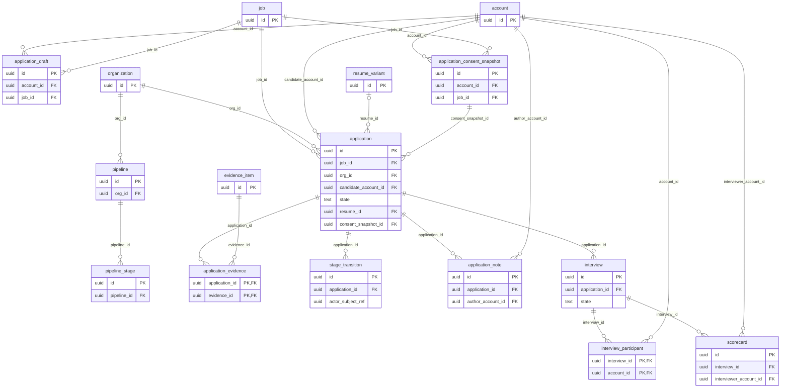

#### DATA-E1001 `pipeline` — Pipeline
Role: root · Tenancy/RLS: RLS-ORG · Owner module: `api/applications`

| Attribute | Type | Constraints / notes |
|---|---|---|
| `id` | uuid | PK, UUIDv7, app-generated |
| `created_at` | timestamptz | NN, DEF now() |
| `updated_at` | timestamptz | NN, DEF now() |
| `version` | bigint | NN, DEF 1; optimistic lock / ETag |
| `org_id` | uuid | NN, FK(organization.id) |
| `name` | text | NN |
| `is_default` | bool | NN, DEF false |

#### DATA-E1002 `pipeline_stage` — PipelineStage
Role: member of Pipeline · Tenancy/RLS: RLS-ORG · Owner module: `api/applications`

| Attribute | Type | Constraints / notes |
|---|---|---|
| `id` | uuid | PK, UUIDv7, app-generated |
| `created_at` | timestamptz | NN, DEF now() |
| `updated_at` | timestamptz | NN, DEF now() |
| `version` | bigint | NN, DEF 1; optimistic lock / ETag |
| `pipeline_id` | uuid | NN, FK(pipeline.id) |
| `stage_key` | text | NN; UQ(pipeline,stage_key) |
| `label` | text | NN |
| `position` | int | NN |
| `macro_state` | text | NN, CHK in (in_review,shortlisted,interviewing,offer_extended,hired,rejected); maps stage to SM-APPLICATION state |

#### DATA-E1003 `application` — Application
Role: root · Tenancy/RLS: RLS-OWNER + RLS-ORG · Owner module: `api/applications`

| Attribute | Type | Constraints / notes |
|---|---|---|
| `id` | uuid | PK, UUIDv7, app-generated |
| `created_at` | timestamptz | NN, DEF now() |
| `updated_at` | timestamptz | NN, DEF now() |
| `version` | bigint | NN, DEF 1; optimistic lock / ETag |
| `job_id` | uuid | NN, FK(job.id) |
| `org_id` | uuid | NN, FK(organization.id); denormalised tenant column for RLS |
| `candidate_account_id` | uuid | NN, FK(account.id) |
| `state` | text | NN, CHK in (submitted,in_review,shortlisted,interviewing,offer_extended,hired,rejected,withdrawn,offer_declined), DEF 'submitted' (SM-APPLICATION; its `draft` state is the `application_draft` row) |
| `stage_key` | text | NN |
| `resume_id` | uuid | NULL, FK(resume_variant.id) |
| `cover_note` | text | NULL, CHK length<=4000 |
| `consent_snapshot_id` | uuid | NN, FK(application_consent_snapshot.id) |
| `submitted_at` | timestamptz | NN |
| `terminal_at` | timestamptz | NULL; set on rejected/withdrawn/hired/offer_declined; terminal rows immutable (INV-T11) |

#### DATA-E1004 `application_draft` — ApplicationDraft
Role: member of Application · Tenancy/RLS: RLS-OWNER · Owner module: `api/applications`

| Attribute | Type | Constraints / notes |
|---|---|---|
| `id` | uuid | PK, UUIDv7, app-generated |
| `created_at` | timestamptz | NN, DEF now() |
| `updated_at` | timestamptz | NN, DEF now() |
| `version` | bigint | NN, DEF 1; optimistic lock / ETag |
| `account_id` | uuid | NN, FK(account.id) |
| `job_id` | uuid | NN, FK(job.id); UQ(account,job) |
| `payload` | jsonb | NN; bounded size |
| `expires_at` | timestamptz | NN |

#### DATA-E1005 `application_consent_snapshot` — ConsentSnapshot
Role: member of Application · Tenancy/RLS: RLS-OWNER read / ORG read · Owner module: `api/applications`

| Attribute | Type | Constraints / notes |
|---|---|---|
| `id` | uuid | PK, UUIDv7 |
| `created_at` | timestamptz | NN, DEF now(); row is append-only |
| `account_id` | uuid | NN, FK(account.id) |
| `job_id` | uuid | NN, FK(job.id) |
| `consent_record_ids` | uuid[] | NN; the exact consent_record rows relied on |
| `policy_version` | text | NN |

#### DATA-E1006 `application_evidence` — ApplicationEvidence
Role: member of Application · Tenancy/RLS: RLS-OWNER + RLS-ORG(consented) · Owner module: `api/applications`

| Attribute | Type | Constraints / notes |
|---|---|---|
| `application_id` | uuid | NN, FK(application.id); PK part |
| `evidence_id` | uuid | NN, FK(evidence_item.id); PK part |
| `rung_at_submission` | text | NN |
| `evidence_version` | bigint | NN |

#### DATA-E1007 `stage_transition` — StageTransition (append-only)
Role: member of Application · Tenancy/RLS: RLS-ORG · Owner module: `api/applications`

| Attribute | Type | Constraints / notes |
|---|---|---|
| `id` | uuid | PK, UUIDv7 |
| `created_at` | timestamptz | NN, DEF now(); row is append-only |
| `application_id` | uuid | NN, FK(application.id) |
| `from_state` | text | NN |
| `to_state` | text | NN |
| `from_stage` | text | NN |
| `to_stage` | text | NN |
| `actor_subject_ref` | uuid | NN; opaque `subject_ref` of the acting human, no FK, resolved through subject_identity_map (DB-02 §4.1); NOT NULL enforces human actor (INV-T09) |
| `reason_code` | text | NULL |
| `note_ref` | uuid | NULL; soft reference to application_note.id (free-text narrative lives in the erasable note, never in this append-only row) |
| `idempotency_key` | text | NULL |
| `prev_hash` | bytea | NULL; row_hash of the previous transition of the same application (aggregate chain under the application row lock; DB-02 §4.2) |
| `row_hash` | bytea | NN; SHA256(canonical(row)); sealed into `audit_anchor` batches |

#### DATA-E1008 `application_note` — ApplicationNote
Role: member of Application · Tenancy/RLS: RLS-ORG · Owner module: `api/applications`

| Attribute | Type | Constraints / notes |
|---|---|---|
| `id` | uuid | PK, UUIDv7, app-generated |
| `created_at` | timestamptz | NN, DEF now() |
| `updated_at` | timestamptz | NN, DEF now() |
| `version` | bigint | NN, DEF 1; optimistic lock / ETag |
| `application_id` | uuid | NN, FK(application.id) |
| `author_account_id` | uuid | NN, FK(account.id) |
| `body` | text | NN, CHK length<=4000 |

#### DATA-E1009 `interview` — Interview
Role: member of Application · Tenancy/RLS: RLS-ORG + candidate participant · Owner module: `api/applications`

| Attribute | Type | Constraints / notes |
|---|---|---|
| `id` | uuid | PK, UUIDv7, app-generated |
| `created_at` | timestamptz | NN, DEF now() |
| `updated_at` | timestamptz | NN, DEF now() |
| `version` | bigint | NN, DEF 1; optimistic lock / ETag |
| `application_id` | uuid | NN, FK(application.id) |
| `scheduled_at` | timestamptz | NULL until a slot is confirmed; NN when `state` in (scheduled,completed,no_show) |
| `proposed_slots` | jsonb | NULL; 1..5 slots offered while `state = 'proposed'` (72 h hold) |
| `reschedule_of` | uuid | NULL, FK(interview.id); set on the new `proposed` record that supersedes a `rescheduled` one |
| `duration_minutes` | int | NN |
| `mode` | text | NN, CHK in (video,phone,onsite) |
| `location_ref` | text | NULL |
| `state` | text | NN, CHK in (proposed,scheduled,completed,cancelled,rescheduled,no_show,expired), DEF 'proposed' (SM-INTERVIEW) |

#### DATA-E1010 `interview_participant` — InterviewParticipant
Role: member of Interview · Tenancy/RLS: RLS-ORG · Owner module: `api/applications`

| Attribute | Type | Constraints / notes |
|---|---|---|
| `interview_id` | uuid | NN, FK(interview.id); PK part |
| `account_id` | uuid | NN, FK(account.id); PK part |
| `role` | text | NN, CHK in (interviewer,candidate,observer) |

#### DATA-E1011 `scorecard` — Scorecard
Role: member of Interview · Tenancy/RLS: RLS-ORG · Owner module: `api/applications`

| Attribute | Type | Constraints / notes |
|---|---|---|
| `id` | uuid | PK, UUIDv7, app-generated |
| `created_at` | timestamptz | NN, DEF now() |
| `updated_at` | timestamptz | NN, DEF now() |
| `version` | bigint | NN, DEF 1; optimistic lock / ETag |
| `interview_id` | uuid | NN, FK(interview.id) |
| `interviewer_account_id` | uuid | NN, FK(account.id); UQ(interview,interviewer) |
| `ratings` | jsonb | NN |
| `recommendation` | text | NN, CHK in (strong_yes,yes,no,strong_no); human-entered |
| `submitted_at` | timestamptz | NN |


### DOM-11 Matching, Search & Recommendations  (module `api/search, api/matching`)

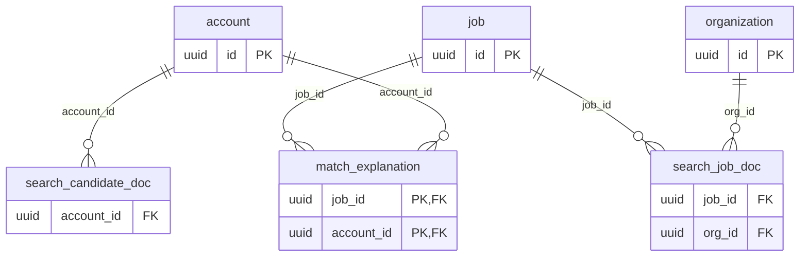

#### DATA-E1101 `search_job_doc` — SearchJobDoc (derived)
Role: derived from Job · Tenancy/RLS: RLS-PUBLIC-READ published · Owner module: `api/search, api/matching`

| Attribute | Type | Constraints / notes |
|---|---|---|
| `job_id` | uuid | NN, FK(job.id); PK |
| `org_id` | uuid | NN, FK(organization.id) |
| `tsv` | tsvector | NN |
| `embedding` | vector(1536) | NULL |
| `facets` | jsonb | NN |
| `source_version` | bigint | NN |
| `indexed_at` | timestamptz | NN |

#### DATA-E1102 `search_candidate_doc` — SearchCandidateDoc (derived, consent-gated)
Role: derived from Profile+Evidence · Tenancy/RLS: RLS-INTERNAL (queries via module only) · Owner module: `api/search, api/matching`

| Attribute | Type | Constraints / notes |
|---|---|---|
| `account_id` | uuid | NN, FK(account.id); PK |
| `tsv` | tsvector | NN |
| `embedding` | vector(1536) | NULL |
| `visible_fields` | jsonb | NN; only consented fields |
| `rung_summary` | jsonb | NN |
| `consent_epoch` | bigint | NN; mismatch with current epoch invalidates |
| `indexed_at` | timestamptz | NN |

#### DATA-E1103 `match_explanation` — MatchExplanation (derived)
Role: derived · Tenancy/RLS: RLS-OWNER + RLS-ORG(consented) · Owner module: `api/search, api/matching`

| Attribute | Type | Constraints / notes |
|---|---|---|
| `job_id` | uuid | NN, FK(job.id); PK part |
| `account_id` | uuid | NN, FK(account.id); PK part |
| `score` | numeric(5,4) | NN |
| `factors` | jsonb | NN; [{skill, evidenceRung, weight, contribution}] |
| `uncertainty` | jsonb | NN |
| `model_version` | text | NN |
| `stale` | bool | NN, DEF false |
| `computed_at` | timestamptz | NN |
| `expires_at` | timestamptz | NN |


### DOM-12 Career Intelligence  (module `api/careerintel`)

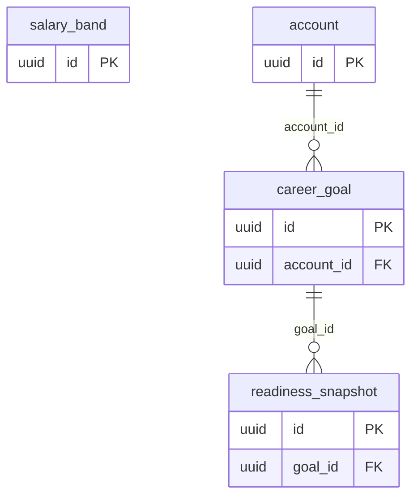

#### DATA-E1201 `career_goal` — CareerGoal
Role: root · Tenancy/RLS: RLS-OWNER · Owner module: `api/careerintel`

| Attribute | Type | Constraints / notes |
|---|---|---|
| `id` | uuid | PK, UUIDv7, app-generated |
| `created_at` | timestamptz | NN, DEF now() |
| `updated_at` | timestamptz | NN, DEF now() |
| `version` | bigint | NN, DEF 1; optimistic lock / ETag |
| `account_id` | uuid | NN, FK(account.id) |
| `target_role` | text | NN |
| `target_skill_ids` | uuid[] | NN |
| `target_date` | date | NULL |

#### DATA-E1202 `readiness_snapshot` — ReadinessSnapshot (derived)
Role: derived · Tenancy/RLS: RLS-OWNER · Owner module: `api/careerintel`

| Attribute | Type | Constraints / notes |
|---|---|---|
| `id` | uuid | PK, UUIDv7 |
| `created_at` | timestamptz | NN, DEF now(); row is append-only |
| `goal_id` | uuid | NN, FK(career_goal.id) |
| `score` | numeric(5,2) | NN |
| `gaps` | jsonb | NN |
| `model_version` | text | NN |

#### DATA-E1203 `salary_band` — SalaryBand (reference data)
Role: root · Tenancy/RLS: RLS-PUBLIC-READ · Owner module: `api/careerintel`

| Attribute | Type | Constraints / notes |
|---|---|---|
| `id` | uuid | PK, UUIDv7, app-generated |
| `created_at` | timestamptz | NN, DEF now() |
| `updated_at` | timestamptz | NN, DEF now() |
| `version` | bigint | NN, DEF 1; optimistic lock / ETag |
| `role_family` | text | NN |
| `region` | text | NN |
| `p25` | int | NN |
| `p50` | int | NN |
| `p75` | int | NN |
| `currency` | text | NN |
| `source` | text | NN; provenance of dataset (OPEN: data source) |
| `as_of` | date | NN |


### DOM-13 Messaging & Collaboration  (module `api/messaging`)

```mermaid
erDiagram
  conversation {
    uuid id PK
    text kind
    uuid application_id FK
    uuid org_id FK
    uuid created_by FK
    text state
  }
  conversation_participant {
    uuid conversation_id PK,FK
    uuid account_id PK,FK
  }
  message {
    uuid id PK
    uuid conversation_id FK
    uuid sender_account_id FK
  }
  account {
    uuid id PK
  }
  application {
    uuid id PK
  }
  organization {
    uuid id PK
  }
  application |o--o{ conversation : "application_id"
  organization |o--o{ conversation : "org_id"
  account ||--o{ conversation : "created_by"
  conversation ||--o{ conversation_participant : "conversation_id"
  account ||--o{ conversation_participant : "account_id"
  conversation ||--o{ message : "conversation_id"
  account ||--o{ message : "sender_account_id"
```

#### DATA-E1301 `conversation` — Conversation
Role: root · Tenancy/RLS: RLS-PARTICIPANT · Owner module: `api/messaging`

| Attribute | Type | Constraints / notes |
|---|---|---|
| `id` | uuid | PK, UUIDv7, app-generated |
| `created_at` | timestamptz | NN, DEF now() |
| `updated_at` | timestamptz | NN, DEF now() |
| `version` | bigint | NN, DEF 1; optimistic lock / ETag |
| `kind` | text | NN, CHK in (direct,application,outreach) |
| `application_id` | uuid | NULL, FK(application.id) |
| `org_id` | uuid | NULL, FK(organization.id) |
| `created_by` | uuid | NN, FK(account.id) |
| `state` | text | NN, CHK in (open,closed,blocked), DEF 'open' |
| `last_message_at` | timestamptz | NULL |

#### DATA-E1302 `conversation_participant` — ConversationParticipant
Role: member of Conversation · Tenancy/RLS: RLS-PARTICIPANT · Owner module: `api/messaging`

| Attribute | Type | Constraints / notes |
|---|---|---|
| `conversation_id` | uuid | NN, FK(conversation.id); PK part |
| `account_id` | uuid | NN, FK(account.id); PK part |
| `role` | text | NN |
| `muted` | bool | NN, DEF false |
| `last_read_message_id` | uuid | NULL |
| `joined_at` | timestamptz | NN |
| `left_at` | timestamptz | NULL |

#### DATA-E1303 `message` — Message
Role: member of Conversation · Tenancy/RLS: RLS-PARTICIPANT · Owner module: `api/messaging`

| Attribute | Type | Constraints / notes |
|---|---|---|
| `id` | uuid | PK, UUIDv7 |
| `created_at` | timestamptz | NN, DEF now(); row is append-only |
| `conversation_id` | uuid | NN, FK(conversation.id) |
| `sender_account_id` | uuid | NN, FK(account.id) |
| `body` | text | NN, CHK length<=8000; treated as untrusted text, never HTML |
| `client_msg_id` | text | NN; UQ(conversation,sender,client_msg_id) dedupes offline retries |
| `edited_at` | timestamptz | NULL |
| `deleted_at` | timestamptz | NULL |
| `moderation_state` | text | NN, CHK in (ok,flagged,hidden), DEF 'ok' |


### DOM-14 Networking & Community (phase 3, conditional)  (module `api/network`)

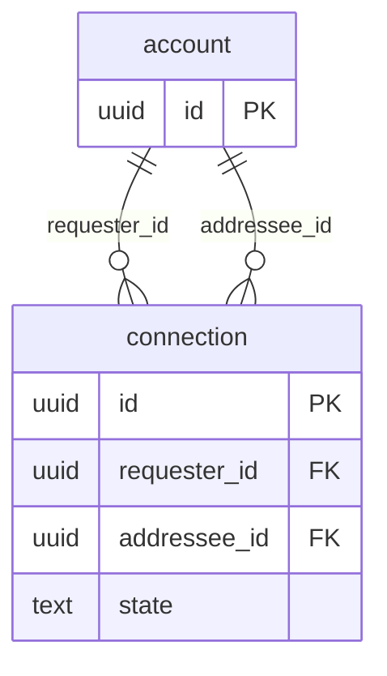

#### DATA-E1401 `connection` — Connection
Role: root · Tenancy/RLS: RLS-PARTICIPANT · Owner module: `api/network`

| Attribute | Type | Constraints / notes |
|---|---|---|
| `id` | uuid | PK, UUIDv7, app-generated |
| `created_at` | timestamptz | NN, DEF now() |
| `updated_at` | timestamptz | NN, DEF now() |
| `version` | bigint | NN, DEF 1; optimistic lock / ETag |
| `requester_id` | uuid | NN, FK(account.id) |
| `addressee_id` | uuid | NN, FK(account.id); UQ on (least,greatest) pair |
| `state` | text | NN, CHK in (pending,accepted,declined,blocked) |
| `responded_at` | timestamptz | NULL |


### DOM-15 Notifications & Engagement  (module `api/notify`)

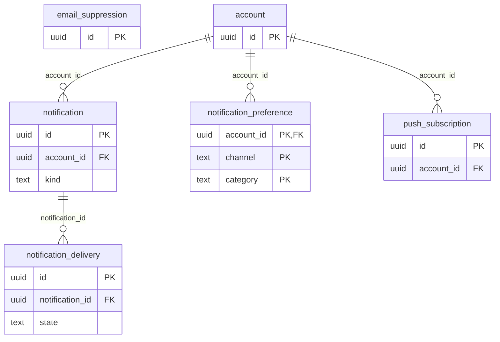

#### DATA-E1501 `notification` — Notification
Role: root · Tenancy/RLS: RLS-OWNER · Owner module: `api/notify`

| Attribute | Type | Constraints / notes |
|---|---|---|
| `id` | uuid | PK, UUIDv7 |
| `created_at` | timestamptz | NN, DEF now() |
| `updated_at` | timestamptz | NN, DEF now() |
| `account_id` | uuid | NN, FK(account.id) |
| `kind` | text | NN |
| `payload` | jsonb | NN; references only (ids), no sensitive free text |
| `dedupe_key` | text | NN; UQ(account,dedupe_key) |
| `source_event_id` | uuid | NULL |
| `read_at` | timestamptz | NULL |

#### DATA-E1502 `notification_preference` — NotificationPreference
Role: member of Account · Tenancy/RLS: RLS-OWNER · Owner module: `api/notify`

| Attribute | Type | Constraints / notes |
|---|---|---|
| `account_id` | uuid | NN, FK(account.id); PK part |
| `channel` | text | NN, CHK in (in_app,email,push); PK part |
| `category` | text | NN; PK part |
| `enabled` | bool | NN |
| `frequency` | text | NN, CHK in (immediate,daily,weekly) |
| `quiet_hours` | jsonb | NULL |

#### DATA-E1503 `notification_delivery` — NotificationDelivery (partition candidate)
Role: member of Notification · Tenancy/RLS: RLS-INTERNAL · Owner module: `api/notify`

| Attribute | Type | Constraints / notes |
|---|---|---|
| `id` | uuid | PK, UUIDv7 |
| `created_at` | timestamptz | NN, DEF now() |
| `updated_at` | timestamptz | NN, DEF now() |
| `notification_id` | uuid | NN, FK(notification.id) |
| `channel` | text | NN |
| `state` | text | NN, CHK in (queued,suppressed,deferred,sending,sent,delivered,failed_retry,failed,bounced,complained,expired), DEF 'queued' (SM-NOTIFY) |
| `provider` | text | NULL |
| `provider_message_id` | text | NULL |
| `attempts` | int | NN, DEF 0 |
| `last_error_class` | text | NULL |
| `sent_at` | timestamptz | NULL |

#### DATA-E1504 `push_subscription` — PushSubscription
Role: member of Account · Tenancy/RLS: RLS-OWNER · Owner module: `api/notify`

| Attribute | Type | Constraints / notes |
|---|---|---|
| `id` | uuid | PK, UUIDv7, app-generated |
| `created_at` | timestamptz | NN, DEF now() |
| `updated_at` | timestamptz | NN, DEF now() |
| `version` | bigint | NN, DEF 1; optimistic lock / ETag |
| `account_id` | uuid | NN, FK(account.id) |
| `endpoint_hash` | bytea | NN, UQ |
| `endpoint_enc` | bytea | NN |
| `p256dh_enc` | bytea | NN |
| `auth_enc` | bytea | NN |
| `user_agent_class` | text | NULL |
| `last_success_at` | timestamptz | NULL |
| `expired_at` | timestamptz | NULL |

#### DATA-E1505 `email_suppression` — EmailSuppression
Role: root · Tenancy/RLS: RLS-INTERNAL · Owner module: `api/notify`

| Attribute | Type | Constraints / notes |
|---|---|---|
| `id` | uuid | PK, UUIDv7, app-generated |
| `created_at` | timestamptz | NN, DEF now() |
| `updated_at` | timestamptz | NN, DEF now() |
| `version` | bigint | NN, DEF 1; optimistic lock / ETag |
| `email_hash` | bytea | NN, UQ |
| `reason` | text | NN, CHK in (bounce,complaint,unsubscribe,manual) |
| `source_event_id` | uuid | NULL |


### DOM-16 Billing, Plans & Entitlements  (module `api/billing`)

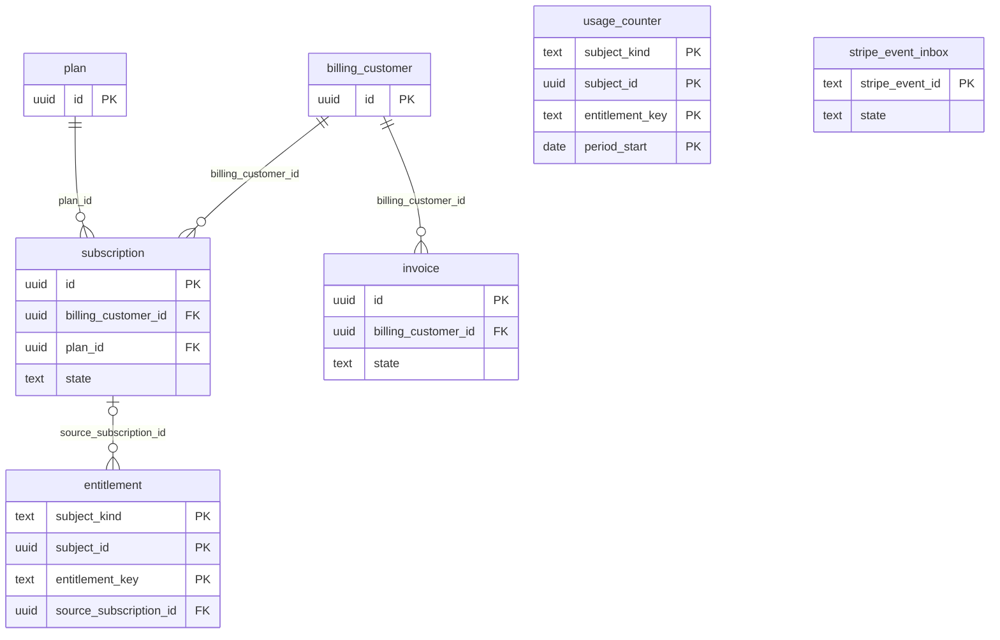

#### DATA-E1601 `plan` — Plan (configuration data)
Role: root · Tenancy/RLS: RLS-PUBLIC-READ · Owner module: `api/billing`

| Attribute | Type | Constraints / notes |
|---|---|---|
| `id` | uuid | PK, UUIDv7, app-generated |
| `created_at` | timestamptz | NN, DEF now() |
| `updated_at` | timestamptz | NN, DEF now() |
| `version` | bigint | NN, DEF 1; optimistic lock / ETag |
| `plan_key` | text | NN, UQ |
| `name` | text | NN |
| `subject_kind` | text | NN, CHK in (account,org) |
| `interval` | text | NN, CHK in (month,year) |
| `price_minor` | int | NN |
| `currency` | text | NN |
| `stripe_price_id` | text | NN, UQ |
| `features` | jsonb | NN; entitlement keys and limits |
| `active` | bool | NN |

#### DATA-E1602 `billing_customer` — BillingCustomer
Role: root · Tenancy/RLS: RLS-ORG / OWNER · Owner module: `api/billing`

| Attribute | Type | Constraints / notes |
|---|---|---|
| `id` | uuid | PK, UUIDv7, app-generated |
| `created_at` | timestamptz | NN, DEF now() |
| `updated_at` | timestamptz | NN, DEF now() |
| `version` | bigint | NN, DEF 1; optimistic lock / ETag |
| `subject_kind` | text | NN, CHK in (account,org) |
| `subject_id` | uuid | NN; UQ(subject_kind,subject_id) |
| `stripe_customer_id` | text | NN, UQ |

#### DATA-E1603 `subscription` — Subscription
Role: member of BillingCustomer · Tenancy/RLS: RLS-ORG / OWNER · Owner module: `api/billing`

| Attribute | Type | Constraints / notes |
|---|---|---|
| `id` | uuid | PK, UUIDv7, app-generated |
| `created_at` | timestamptz | NN, DEF now() |
| `updated_at` | timestamptz | NN, DEF now() |
| `version` | bigint | NN, DEF 1; optimistic lock / ETag |
| `billing_customer_id` | uuid | NN, FK(billing_customer.id) |
| `plan_id` | uuid | NN, FK(plan.id) |
| `stripe_subscription_id` | text | NN, UQ |
| `state` | text | NN, CHK in (incomplete,active,canceling,past_due,unpaid,canceled,incomplete_expired) (SM-SUBSCRIPTION; no `trialing`; `canceled` is the processor spelling; "no subscription" is the absence of a row) |
| `seats` | int | NN, DEF 1 |
| `current_period_end` | timestamptz | NULL |
| `cancel_at_period_end` | bool | NN, DEF false; processor mirror; `state = 'canceling'` implies true |
| `provider_event_created_at` | timestamptz | NN; out-of-order webhook guard |

#### DATA-E1604 `entitlement` — Entitlement (derived server-side)
Role: derived from Subscription · Tenancy/RLS: RLS-ORG / OWNER · Owner module: `api/billing`

| Attribute | Type | Constraints / notes |
|---|---|---|
| `subject_kind` | text | NN; PK part |
| `subject_id` | uuid | NN; PK part |
| `entitlement_key` | text | NN; PK part |
| `limit_value` | bigint | NULL (NULL = unlimited) |
| `source_subscription_id` | uuid | NULL, FK(subscription.id) |
| `valid_until` | timestamptz | NULL |
| `computed_at` | timestamptz | NN |

#### DATA-E1605 `usage_counter` — UsageCounter
Role: member of Entitlement · Tenancy/RLS: RLS-ORG / OWNER · Owner module: `api/billing`

| Attribute | Type | Constraints / notes |
|---|---|---|
| `subject_kind` | text | NN; PK part |
| `subject_id` | uuid | NN; PK part |
| `entitlement_key` | text | NN; PK part |
| `period_start` | date | NN; PK part |
| `used` | bigint | NN, DEF 0; atomic `used = used + n` with limit guard |

#### DATA-E1606 `invoice` — Invoice
Role: member of BillingCustomer · Tenancy/RLS: RLS-ORG / OWNER · Owner module: `api/billing`

| Attribute | Type | Constraints / notes |
|---|---|---|
| `id` | uuid | PK, UUIDv7, app-generated |
| `created_at` | timestamptz | NN, DEF now() |
| `updated_at` | timestamptz | NN, DEF now() |
| `version` | bigint | NN, DEF 1; optimistic lock / ETag |
| `billing_customer_id` | uuid | NN, FK(billing_customer.id) |
| `stripe_invoice_id` | text | NN, UQ |
| `amount_due_minor` | int | NN |
| `amount_paid_minor` | int | NN |
| `currency` | text | NN |
| `state` | text | NN |
| `hosted_invoice_url` | text | NULL |
| `issued_at` | timestamptz | NN |

#### DATA-E1607 `stripe_event_inbox` — StripeEventInbox (webhook dedupe)
Role: root · Tenancy/RLS: RLS-INTERNAL · Owner module: `api/billing`

| Attribute | Type | Constraints / notes |
|---|---|---|
| `stripe_event_id` | text | NN, PK |
| `event_type` | text | NN |
| `received_at` | timestamptz | NN |
| `processed_at` | timestamptz | NULL |
| `state` | text | NN, CHK in (received,processed,failed,ignored) |
| `payload_hash` | bytea | NN |


### DOM-17 AI Gateway & Governance  (module `api/ai`)

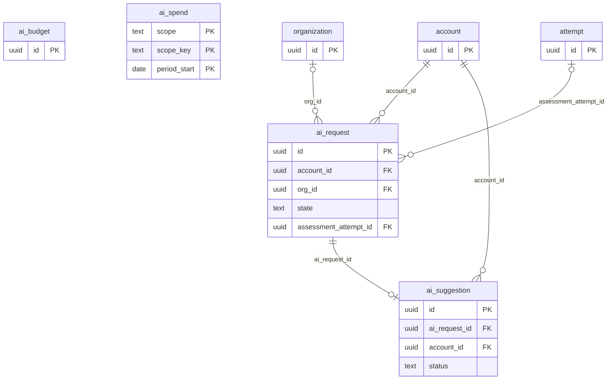

#### DATA-E1701 `ai_request` — AiRequest (partition candidate)
Role: root · Tenancy/RLS: RLS-OWNER read / INTERNAL · Owner module: `api/ai`

| Attribute | Type | Constraints / notes |
|---|---|---|
| `id` | uuid | PK, UUIDv7 |
| `created_at` | timestamptz | NN, DEF now(); row is append-only |
| `account_id` | uuid | NN, FK(account.id) |
| `org_id` | uuid | NULL, FK(organization.id) |
| `purpose` | text | NN |
| `provider` | text | NN |
| `model` | text | NN |
| `state` | text | NN, CHK in (reserved,completed,denied,failed) |
| `denial_reason` | text | NULL, CHK in (prohibited_mode,consent,budget,entitlement,policy) |
| `assessment_attempt_id` | uuid | NULL, FK(attempt.id) |
| `prompt_hash` | bytea | NN; SHA-256; no raw prompt stored |
| `input_tokens` | int | NULL |
| `output_tokens` | int | NULL |
| `cost_micros` | bigint | NULL |
| `redaction_summary` | jsonb | NN |
| `latency_ms` | int | NULL |

#### DATA-E1702 `ai_suggestion` — AiSuggestion
Role: member of AiRequest · Tenancy/RLS: RLS-OWNER · Owner module: `api/ai`

| Attribute | Type | Constraints / notes |
|---|---|---|
| `id` | uuid | PK, UUIDv7, app-generated |
| `created_at` | timestamptz | NN, DEF now() |
| `updated_at` | timestamptz | NN, DEF now() |
| `version` | bigint | NN, DEF 1; optimistic lock / ETag |
| `ai_request_id` | uuid | NN, FK(ai_request.id), UQ |
| `account_id` | uuid | NN, FK(account.id) |
| `target_type` | text | NN |
| `target_id` | uuid | NULL |
| `content` | text | NN; classification C2; encrypted at rest |
| `status` | text | NN, CHK in (proposed,accepted,edited,rejected,expired), DEF 'proposed' |
| `disposition_at` | timestamptz | NULL |
| `expires_at` | timestamptz | NN |

#### DATA-E1703 `ai_budget` — AiBudget
Role: root · Tenancy/RLS: RLS-INTERNAL · Owner module: `api/ai`

| Attribute | Type | Constraints / notes |
|---|---|---|
| `id` | uuid | PK, UUIDv7, app-generated |
| `created_at` | timestamptz | NN, DEF now() |
| `updated_at` | timestamptz | NN, DEF now() |
| `version` | bigint | NN, DEF 1; optimistic lock / ETag |
| `scope` | text | NN, CHK in (global,plan,org,account) |
| `scope_key` | text | NN; UQ(scope,scope_key,period) |
| `period` | text | NN, CHK in (day,month) |
| `limit_micros` | bigint | NN |
| `allow_free_inference` | bool | NN, DEF false (INV-T07) |
| `hard_stop` | bool | NN, DEF true |

#### DATA-E1704 `ai_spend` — AiSpend
Role: member of AiBudget · Tenancy/RLS: RLS-INTERNAL · Owner module: `api/ai`

| Attribute | Type | Constraints / notes |
|---|---|---|
| `scope` | text | NN; PK part |
| `scope_key` | text | NN; PK part |
| `period_start` | date | NN; PK part |
| `spent_micros` | bigint | NN, DEF 0 |
| `reserved_micros` | bigint | NN, DEF 0, CHK spent+reserved <= limit enforced in UPDATE guard |


### DOM-18 Institutions (B2B2C)  (module `api/institutions`)

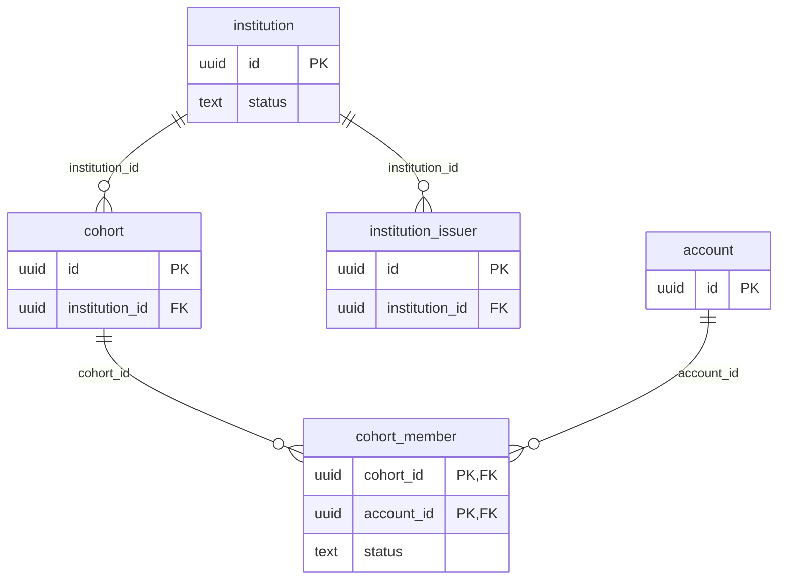

#### DATA-E1801 `institution` — Institution (tenant)
Role: root · Tenancy/RLS: RLS-INST · Owner module: `api/institutions`

| Attribute | Type | Constraints / notes |
|---|---|---|
| `id` | uuid | PK, UUIDv7, app-generated |
| `created_at` | timestamptz | NN, DEF now() |
| `updated_at` | timestamptz | NN, DEF now() |
| `version` | bigint | NN, DEF 1; optimistic lock / ETag |
| `name` | text | NN |
| `slug` | citext | NN, UQ |
| `status` | text | NN, CHK in (active,suspended,closed) |
| `domain` | citext | NULL |

#### DATA-E1802 `cohort` — Cohort
Role: member of Institution · Tenancy/RLS: RLS-INST · Owner module: `api/institutions`

| Attribute | Type | Constraints / notes |
|---|---|---|
| `id` | uuid | PK, UUIDv7, app-generated |
| `created_at` | timestamptz | NN, DEF now() |
| `updated_at` | timestamptz | NN, DEF now() |
| `version` | bigint | NN, DEF 1; optimistic lock / ETag |
| `institution_id` | uuid | NN, FK(institution.id) |
| `name` | text | NN |
| `term_start` | date | NULL |
| `term_end` | date | NULL |

#### DATA-E1803 `cohort_member` — CohortMember
Role: member of Cohort · Tenancy/RLS: RLS-INST + RLS-OWNER · Owner module: `api/institutions`

| Attribute | Type | Constraints / notes |
|---|---|---|
| `cohort_id` | uuid | NN, FK(cohort.id); PK part |
| `account_id` | uuid | NN, FK(account.id); PK part |
| `status` | text | NN, CHK in (invited,active,left) |
| `joined_at` | timestamptz | NULL; cohort-level visibility of the member's evidence requires consent scope evidence.share_institution |

#### DATA-E1804 `institution_issuer` — InstitutionIssuer
Role: member of Institution · Tenancy/RLS: RLS-INST · Owner module: `api/institutions`

| Attribute | Type | Constraints / notes |
|---|---|---|
| `id` | uuid | PK, UUIDv7, app-generated |
| `created_at` | timestamptz | NN, DEF now() |
| `updated_at` | timestamptz | NN, DEF now() |
| `version` | bigint | NN, DEF 1; optimistic lock / ETag |
| `institution_id` | uuid | NN, FK(institution.id) |
| `display_name` | text | NN |
| `verified_at` | timestamptz | NULL |
| `signing_key_ref` | text | NULL; reference to KMS key, never key material |


### DOM-19 Trust, Safety & Moderation  (module `api/safety`)

```mermaid
erDiagram
  report {
    uuid id PK
    uuid reporter_account_id FK
    text state
  }
  moderation_case {
    uuid id PK
    text state
    uuid assigned_to FK
  }
  moderation_case_report {
    uuid case_id PK,FK
    uuid report_id PK,FK
  }
  moderation_action {
    uuid id PK
    uuid case_id FK
    uuid actor_account_id FK
  }
  moderation_appeal {
    uuid id PK
    uuid case_id FK
    uuid appellant_account_id FK
    text state
    uuid decided_by FK
  }
  account {
    uuid id PK
  }
  account |o--o{ report : "reporter_account_id"
  account |o--o{ moderation_case : "assigned_to"
  moderation_case ||--o{ moderation_case_report : "case_id"
  report ||--o{ moderation_case_report : "report_id"
  moderation_case ||--o{ moderation_action : "case_id"
  account ||--o{ moderation_action : "actor_account_id"
  moderation_case ||--o{ moderation_appeal : "case_id"
  account ||--o{ moderation_appeal : "appellant_account_id"
  account |o--o{ moderation_appeal : "decided_by"
```

#### DATA-E1901 `report` — Report
Role: root · Tenancy/RLS: RLS-INTERNAL + reporter read · Owner module: `api/safety`

| Attribute | Type | Constraints / notes |
|---|---|---|
| `id` | uuid | PK, UUIDv7, app-generated |
| `created_at` | timestamptz | NN, DEF now() |
| `updated_at` | timestamptz | NN, DEF now() |
| `version` | bigint | NN, DEF 1; optimistic lock / ETag |
| `reporter_account_id` | uuid | NULL, FK(account.id) |
| `subject_type` | text | NN |
| `subject_id` | uuid | NN |
| `reason_code` | text | NN |
| `details` | text | NULL |
| `content_snapshot` | jsonb | NULL; bounded, short retention |
| `state` | text | NN, CHK in (open,triaged,closed) |

#### DATA-E1902 `moderation_case` — ModerationCase
Role: root · Tenancy/RLS: RLS-INTERNAL · Owner module: `api/safety`

| Attribute | Type | Constraints / notes |
|---|---|---|
| `id` | uuid | PK, UUIDv7, app-generated |
| `created_at` | timestamptz | NN, DEF now() |
| `updated_at` | timestamptz | NN, DEF now() |
| `version` | bigint | NN, DEF 1; optimistic lock / ETag |
| `subject_type` | text | NN |
| `subject_id` | uuid | NN |
| `state` | text | NN, CHK in (open,triaged,in_review,awaiting_info,actioned,appealed,closed), DEF 'open' (SM-MODCASE) |
| `outcome` | text | NULL, CHK in (no_action,warned,content_removed,suspended,restored); set with `actioned` (`no_action` replaces the former `dismissed` state) |
| `appeal_outcome` | text | NULL, CHK in (none,upheld,overturned); set with `closed` (`overturned` replaces the former `reversed` state) |
| `assigned_to` | uuid | NULL, FK(account.id) |
| `sla_due_at` | timestamptz | NULL |
| `closed_at` | timestamptz | NULL |

#### DATA-E1903 `moderation_case_report` — CaseReport link
Role: member of ModerationCase · Tenancy/RLS: RLS-INTERNAL · Owner module: `api/safety`

| Attribute | Type | Constraints / notes |
|---|---|---|
| `case_id` | uuid | NN, FK(moderation_case.id); PK part |
| `report_id` | uuid | NN, FK(report.id); PK part |

#### DATA-E1904 `moderation_action` — ModerationAction
Role: member of ModerationCase · Tenancy/RLS: RLS-INTERNAL · Owner module: `api/safety`

| Attribute | Type | Constraints / notes |
|---|---|---|
| `id` | uuid | PK, UUIDv7 |
| `created_at` | timestamptz | NN, DEF now(); row is append-only |
| `case_id` | uuid | NN, FK(moderation_case.id) |
| `action` | text | NN, CHK in (warn,hide_content,takedown,suspend_messaging,suspend_account) |
| `actor_account_id` | uuid | NN, FK(account.id); human actor required (INV-T09) |
| `reason` | text | NN |
| `expires_at` | timestamptz | NULL |
| `reversed_at` | timestamptz | NULL |

#### DATA-E1905 `moderation_appeal` — ModerationAppeal
Role: member of ModerationCase · Tenancy/RLS: RLS-INTERNAL + appellant · Owner module: `api/safety`

| Attribute | Type | Constraints / notes |
|---|---|---|
| `id` | uuid | PK, UUIDv7, app-generated |
| `created_at` | timestamptz | NN, DEF now() |
| `updated_at` | timestamptz | NN, DEF now() |
| `version` | bigint | NN, DEF 1; optimistic lock / ETag |
| `case_id` | uuid | NN, FK(moderation_case.id) |
| `appellant_account_id` | uuid | NN, FK(account.id) |
| `statement` | text | NN |
| `state` | text | NN, CHK in (open,upheld,overturned), DEF 'open'; `upheld` = original decision stands (former `dismissed`), `overturned` = appeal succeeded (former `upheld`); feeds `moderation_case.appeal_outcome` |
| `decided_by` | uuid | NULL, FK(account.id) |


### DOM-20 Administration, Support & Back Office  (module `api/admin`)

```mermaid
erDiagram
  support_access_grant {
    uuid id PK
    uuid grantee_account_id FK
    uuid subject_account_id FK
    uuid approved_by FK
  }
  audit_event {
    uuid id PK
    uuid support_grant_id FK
  }
  feature_flag {
    uuid id PK
  }
  account {
    uuid id PK
  }
  account ||--o{ support_access_grant : "grantee_account_id"
  account ||--o{ support_access_grant : "subject_account_id"
  account |o--o{ support_access_grant : "approved_by"
  support_access_grant |o--o{ audit_event : "support_grant_id"
```

#### DATA-E2001 `support_access_grant` — SupportAccessGrant
Role: root · Tenancy/RLS: RLS-GRANT · Owner module: `api/admin`

| Attribute | Type | Constraints / notes |
|---|---|---|
| `id` | uuid | PK, UUIDv7, app-generated |
| `created_at` | timestamptz | NN, DEF now() |
| `updated_at` | timestamptz | NN, DEF now() |
| `version` | bigint | NN, DEF 1; optimistic lock / ETag |
| `grantee_account_id` | uuid | NN, FK(account.id) |
| `subject_account_id` | uuid | NN, FK(account.id) |
| `scope` | text | NN, CHK in (read_summary,read_profile,read_evidence_metadata,read_billing) |
| `reason_code` | text | NN |
| `reason_text` | text | NN |
| `ticket_ref` | text | NULL |
| `approved_by` | uuid | NULL, FK(account.id); required for read_evidence_metadata |
| `starts_at` | timestamptz | NN |
| `expires_at` | timestamptz | NN, CHK expires_at <= starts_at + interval '4 hours' (BR-T041) |
| `revoked_at` | timestamptz | NULL |

#### DATA-E2002 `audit_event` — AuditEvent (append-only, partitioned monthly)
Role: root · Tenancy/RLS: RLS-INTERNAL (+ own-access-log view) · Owner module: `api/admin`

| Attribute | Type | Constraints / notes |
|---|---|---|
| `id` | uuid | PK, UUIDv7 |
| `created_at` | timestamptz | NN, DEF now(); row is append-only |
| `occurred_at` | timestamptz | NN; partition key |
| `actor_kind` | text | NN, CHK in (user,service,system,support,referee) |
| `actor_subject_ref` | uuid | NULL; opaque `subject_ref` of the acting person (never `account.id`); no FK; resolved through subject_identity_map, which erasure deletes (DB-02 §4.1) |
| `subject_ref` | uuid | NULL; opaque ref of the person the event concerns (subject access log); no FK |
| `support_grant_id` | uuid | NULL, FK(support_access_grant.id) |
| `tenant_org_id` | uuid | NULL |
| `tenant_institution_id` | uuid | NULL |
| `action` | text | NN; policy action id |
| `resource_type` | text | NN |
| `resource_id` | uuid | NULL; CHK: NULL when `resource_type='account'` (the person is carried by `subject_ref`) |
| `outcome` | text | NN, CHK in (allow,deny,success,failure) |
| `reason_code` | text | NULL; enum code only, no free text |
| `request_id` | text | NULL |
| `trace_id` | text | NULL |
| `ip_prefix` | inet | NULL; truncated prefix; whether it is personal data is OPEN-08 |
| `changed_fields` | text[] | NULL; names only for C3+ data, never values |
| `row_hash` | bytea | NN; SHA256(canonical(row)) computed by the application, no previous-row dependency and no lock; sealed into `audit_anchor` batches (DB-02 §4.2) |

#### DATA-E2004 `audit_anchor` — AuditAnchor (append-only; KMS-signed Merkle batch over closed windows)
Role: root · Tenancy/RLS: RLS-INTERNAL · Owner module: `api/admin` (written only by the `audit.anchor` job)

| Attribute | Type | Constraints / notes |
|---|---|---|
| `id` | uuid | PK, UUIDv7 |
| `created_at` | timestamptz | NN, DEF now(); row is append-only |
| `source_table` | text | NN, CHK in (audit_event,consent_record,evidence_event,stage_transition) |
| `first_id` | uuid | NN; first row id of the window (UUIDv7 order) |
| `last_id` | uuid | NN; last row id of the window |
| `row_count` | int | NN; leaves in the tree |
| `merkle_root` | bytea | NN; root over the window's `row_hash` leaves |
| `prev_anchor_root` | bytea | NULL; `merkle_root` of the previous anchor for the same `source_table` (single writer) |
| `key_id` | text | NN; KMS signing key version |
| `signature` | bytea | NN; KMS signature over the canonical anchor fields |
| `sealed_at` | timestamptz | NN |
| UQ | | (source_table, first_id) |

#### DATA-E2003 `feature_flag` — FeatureFlag
Role: root · Tenancy/RLS: RLS-INTERNAL · Owner module: `api/admin`

| Attribute | Type | Constraints / notes |
|---|---|---|
| `id` | uuid | PK, UUIDv7, app-generated |
| `created_at` | timestamptz | NN, DEF now() |
| `updated_at` | timestamptz | NN, DEF now() |
| `version` | bigint | NN, DEF 1; optimistic lock / ETag |
| `flag_key` | text | NN, UQ |
| `description` | text | NN |
| `enabled` | bool | NN |
| `rollout` | jsonb | NN; percentage, allowlists |
| `owner` | text | NN |
| `review_by` | date | NULL; stale-flag review date |


### DOM-21 Analytics & Reporting  (module `api/analytics`)

```mermaid
erDiagram
  analytics_event {
    uuid id PK
  }
  funnel_daily {
    uuid org_id PK,FK
    uuid job_id PK,FK
    text stage_key PK
    date day PK
  }
  job {
    uuid id PK
  }
  organization {
    uuid id PK
  }
  organization ||--o{ funnel_daily : "org_id"
  job ||--o{ funnel_daily : "job_id"
```

#### DATA-E2101 `analytics_event` — AnalyticsEvent (consent-gated; partition daily)
Role: root · Tenancy/RLS: RLS-INTERNAL · Owner module: `api/analytics`

| Attribute | Type | Constraints / notes |
|---|---|---|
| `id` | uuid | PK, UUIDv7 |
| `created_at` | timestamptz | NN, DEF now(); row is append-only |
| `occurred_at` | timestamptz | NN; partition key |
| `subject_key` | bytea | NN; rotating pseudonymous key (not account id) |
| `name` | text | NN; allowlisted event names |
| `props` | jsonb | NN; allowlisted keys only |
| `org_id` | uuid | NULL |

#### DATA-E2102 `funnel_daily` — FunnelDaily (derived rollup)
Role: derived · Tenancy/RLS: RLS-ORG · Owner module: `api/analytics`

| Attribute | Type | Constraints / notes |
|---|---|---|
| `org_id` | uuid | NN, FK(organization.id); PK part |
| `job_id` | uuid | NN, FK(job.id); PK part |
| `stage_key` | text | NN; PK part |
| `day` | date | NN; PK part |
| `count` | int | NN; small counts suppressed in API (k-threshold, OPEN) |


### DOM-22 Privacy, Consent & Data Rights  (module `api/privacy`)

```mermaid
erDiagram
  consent_record {
    uuid id PK
    uuid subject_ref
    uuid supersedes_id FK
  }
  subject_identity_map {
    uuid subject_ref PK
    uuid account_id FK
  }
  data_rights_request {
    uuid id PK
    uuid account_id FK
    text kind
    text state
    uuid handler_account_id FK
  }
  data_export {
    uuid id PK
    uuid request_id FK
    text state
    uuid file_id FK
  }
  erasure_request {
    uuid id PK
    uuid request_id FK
    timestamptz cooling_off_until
  }
  erasure_step {
    uuid erasure_request_id PK,FK
    text module PK
    text state
  }
  erasure_ledger {
    uuid id PK
  }
  legal_hold {
    uuid id PK
    uuid placed_by FK
  }
  account {
    uuid id PK
  }
  file_object {
    uuid id PK
  }
  account ||--o| subject_identity_map : "account_id"
  consent_record |o--o{ consent_record : "supersedes_id"
  account ||--o{ data_rights_request : "account_id"
  account |o--o{ data_rights_request : "handler_account_id"
  data_rights_request ||--o| data_export : "request_id"
  file_object |o--o{ data_export : "file_id"
  data_rights_request ||--o| erasure_request : "request_id"
  erasure_request ||--o{ erasure_step : "erasure_request_id"
  account ||--o{ legal_hold : "placed_by"
```

#### DATA-E2201 `consent_record` — ConsentRecord (append-only)
Role: root · Tenancy/RLS: RLS-OWNER · Owner module: `api/privacy`

| Attribute | Type | Constraints / notes |
|---|---|---|
| `id` | uuid | PK, UUIDv7 |
| `created_at` | timestamptz | NN, DEF now(); row is append-only |
| `subject_ref` | uuid | NN; opaque per-subject token, no FK; maps to the account only through subject_identity_map, which erasure deletes (DB-02 §4.1). Replaces `subject_account_id` so the ledger never needs rewriting |
| `scope` | text | NN, CHK in (profile.public_view,search.discoverable,matching.recommend,outreach.recruiter_contact,evidence.share_summary,evidence.share_artefact,profile.share_contact,application.share_snapshot,evidence.share_institution,alumni.share_outcomes,ai.assist.process,analytics.product,comms.marketing_email,data.research_aggregate); **generated from `00_CONTROL_CENTRE/CONSENT_SCOPE_CATALOGUE.md` section 8 (FF-12)**; the retired `evidence.share_recruiter` is not allowed |
| `target_type` | text | NULL, CHK in (evidence,application); the data object the grant is about |
| `target_id` | uuid | NULL; NN when `target_type` is set |
| `grantee_type` | text | NULL, CHK in (all_verified_orgs,org,institution); who may use the data (NULL = no named grantee) |
| `grantee_id` | uuid | NULL; NN when `grantee_type` is `org` or `institution`; NULL when `all_verified_orgs` |
| `field_set` | text[] | NULL; allowed only for `alumni.share_outcomes` (fields chosen by the learner) |
| `expires_at` | timestamptz | NULL = until revoked; `consent_current` omits rows past `expires_at`; must be > `created_at` |
| `granted` | bool | NN |
| `policy_version` | text | NN |
| `source` | text | NN, CHK in (signup,settings,application,prompt,import) |
| `ip_hash` | bytea | NULL; HMAC under the per-subject key held in subject_identity_map (unlinkable once the key is destroyed) |
| `user_agent_class` | text | NULL |
| `supersedes_id` | uuid | NULL, FK(consent_record.id) |
| `prev_hash` | bytea | NULL; row_hash of the previous record of the same `subject_ref` (aggregate chain under the account row lock taken for `consent_epoch`; DB-02 §4.2) |
| `row_hash` | bytea | NN; SHA256(canonical(row)); sealed into `audit_anchor` batches |

Table CHECK `consent_grain_ck` (generated, CSC section 5) fixes the allowed `grantee_type`/`target_type` combination per scope, for example `evidence.share_artefact` requires `grantee_type='org'` and a `grantee_id`, and `application.share_snapshot` additionally requires `target_type='application'` and a `target_id`. `consent_current` = latest row per `(subject_ref, scope, target_type, target_id, grantee_type, grantee_id)` where `granted AND (expires_at IS NULL OR expires_at > now())`; the view joins `subject_identity_map` to expose `subject_account_id` for RLS and policy code, so after erasure the rows resolve to no account.

#### DATA-E2202 `data_rights_request` — DataRightsRequest
Role: root · Tenancy/RLS: RLS-OWNER · Owner module: `api/privacy`

| Attribute | Type | Constraints / notes |
|---|---|---|
| `id` | uuid | PK, UUIDv7, app-generated |
| `created_at` | timestamptz | NN, DEF now() |
| `updated_at` | timestamptz | NN, DEF now() |
| `version` | bigint | NN, DEF 1; optimistic lock / ETag |
| `account_id` | uuid | NN, FK(account.id) |
| `kind` | text | NN, CHK in (access,export,erasure,rectification,restriction,objection,human_review) |
| `state` | text | NN, CHK in (received,verifying,cooling_off,in_progress,on_hold,completed,completed_with_retention,rejected,cancelled,failed), DEF 'received' (SM-DSR; all kinds; only `erasure` uses `cooling_off`) |
| `due_at` | timestamptz | NOT NULL; erasure 30 days (BR-T060); other kinds OPEN-08 |
| `completed_at` | timestamptz | NULL |
| `handler_account_id` | uuid | NULL, FK(account.id) |
| `details` | jsonb | NN, DEF '{}' |

#### DATA-E2203 `data_export` — DataExport
Role: member of DataRightsRequest · Tenancy/RLS: RLS-OWNER · Owner module: `api/privacy`

| Attribute | Type | Constraints / notes |
|---|---|---|
| `id` | uuid | PK, UUIDv7, app-generated |
| `created_at` | timestamptz | NN, DEF now() |
| `updated_at` | timestamptz | NN, DEF now() |
| `version` | bigint | NN, DEF 1; optimistic lock / ETag |
| `request_id` | uuid | NN, FK(data_rights_request.id), UQ |
| `state` | text | NN, CHK in (requested,building,ready,expired,failed) |
| `file_id` | uuid | NULL, FK(file_object.id) |
| `manifest` | jsonb | NULL |
| `expires_at` | timestamptz | NULL |

#### DATA-E2204 `erasure_request` — ErasureRequest
Role: member of DataRightsRequest · Tenancy/RLS: RLS-OWNER · Owner module: `api/privacy`

| Attribute | Type | Constraints / notes |
|---|---|---|
| `id` | uuid | PK, UUIDv7, app-generated |
| `created_at` | timestamptz | NN, DEF now() |
| `updated_at` | timestamptz | NN, DEF now() |
| `version` | bigint | NN, DEF 1; optimistic lock / ETag |
| `request_id` | uuid | NN, FK(data_rights_request.id), UQ |
| (no state column) | n/a | lifecycle is `data_rights_request.state` (SM-DSR, formerly the separate SM-ERASURE); this row keeps `cooling_off_until`, `completed_at` and its `erasure_step` rows |
| `cooling_off_until` | timestamptz | NULL |
| `completed_at` | timestamptz | NULL |

#### DATA-E2205 `erasure_step` — ErasureStep
Role: member of ErasureRequest · Tenancy/RLS: RLS-INTERNAL · Owner module: `api/privacy`

| Attribute | Type | Constraints / notes |
|---|---|---|
| `erasure_request_id` | uuid | NN, FK(erasure_request.id); PK part |
| `module` | text | NN; PK part |
| `state` | text | NN, CHK in (pending,done,failed,retained) |
| `retained_reason` | text | NULL |
| `completed_at` | timestamptz | NULL |

#### DATA-E2206 `erasure_ledger` — ErasureLedger (minimal, no PII)
Role: root · Tenancy/RLS: RLS-INTERNAL · Owner module: `api/privacy`

| Attribute | Type | Constraints / notes |
|---|---|---|
| `id` | uuid | PK, UUIDv7 |
| `created_at` | timestamptz | NN, DEF now(); row is append-only |
| `erased_subject_ref` | uuid | NN; opaque token only (never `account.id`, never both), kept so a restore replay can find and delete the restored `subject_identity_map` row |
| `erased_at` | timestamptz | NN |
| `retain_until` | timestamptz | NN; backup-window + margin (OPEN-08 with counsel) |

#### DATA-E2207 `legal_hold` — LegalHold
Role: root · Tenancy/RLS: RLS-INTERNAL · Owner module: `api/privacy`

| Attribute | Type | Constraints / notes |
|---|---|---|
| `id` | uuid | PK, UUIDv7, app-generated |
| `created_at` | timestamptz | NN, DEF now() |
| `updated_at` | timestamptz | NN, DEF now() |
| `version` | bigint | NN, DEF 1; optimistic lock / ETag |
| `subject_account_id` | uuid | NN |
| `reason` | text | NN |
| `placed_by` | uuid | NN, FK(account.id) |
| `released_at` | timestamptz | NULL |

#### DATA-E2208 `subject_identity_map` — SubjectIdentityMap (the only erasable link from history to a person; REVW-04)
Role: root · Tenancy/RLS: RLS-INTERNAL (server roles only; no end-user path) · Owner module: `api/privacy`

| Attribute | Type | Constraints / notes |
|---|---|---|
| `subject_ref` | uuid | PK; random 128-bit token from a CSPRNG, minted with the account; not derived from account id, email or any key |
| `account_id` | uuid | NN, UQ, FK(account.id); the sole place that links the token to an identity |
| `created_at` | timestamptz | NN, DEF now() |
| `wrapped_subject_key` | bytea | NULL; per-subject data key wrapped by KMS, used to HMAC subject-linkable values in append-only rows (e.g. `consent_record.ip_hash`); deleting it, plus KMS key destruction, crypto-shreds those values |

Rules: rows are inserted with the account and never updated; the erasure function deletes the row (and schedules key destruction) as its last step, after which the post-erasure sweep runs (INV-T38). `account` has no `subject_ref` column. Referees, who have no account, receive a random `referee_ref` per reference request instead of a map row. Append-only tables hold no FK to this table (DB-02 §4.1).


### DOM-23 Integrations & Developer Platform  (module `api/integrations`)

```mermaid
erDiagram
  webhook_endpoint {
    uuid id PK
    uuid org_id FK
    text state
  }
  webhook_delivery {
    uuid id PK
    uuid endpoint_id FK
    text state
  }
  api_client {
    uuid id PK
    uuid org_id FK
    text state
    uuid created_by FK
  }
  import_job {
    uuid id PK
    uuid org_id FK
    uuid account_id FK
    uuid source_file_id FK
    text state
    uuid report_file_id FK
  }
  account {
    uuid id PK
  }
  file_object {
    uuid id PK
  }
  organization {
    uuid id PK
  }
  organization ||--o{ webhook_endpoint : "org_id"
  webhook_endpoint ||--o{ webhook_delivery : "endpoint_id"
  organization ||--o{ api_client : "org_id"
  account ||--o{ api_client : "created_by"
  organization |o--o{ import_job : "org_id"
  account |o--o{ import_job : "account_id"
  file_object |o--o{ import_job : "source_file_id"
  file_object |o--o{ import_job : "report_file_id"
```

#### DATA-E2301 `webhook_endpoint` — WebhookEndpoint
Role: root · Tenancy/RLS: RLS-ORG · Owner module: `api/integrations`

| Attribute | Type | Constraints / notes |
|---|---|---|
| `id` | uuid | PK, UUIDv7, app-generated |
| `created_at` | timestamptz | NN, DEF now() |
| `updated_at` | timestamptz | NN, DEF now() |
| `version` | bigint | NN, DEF 1; optimistic lock / ETag |
| `org_id` | uuid | NN, FK(organization.id) |
| `url` | text | NN; https only; SSRF-validated at create and at send |
| `secret_enc` | bytea | NN |
| `event_types` | text[] | NN |
| `state` | text | NN, CHK in (active,paused,disabled) |
| `consecutive_failures` | int | NN, DEF 0 |
| `last_success_at` | timestamptz | NULL |

#### DATA-E2302 `webhook_delivery` — WebhookDelivery (partition candidate)
Role: member of WebhookEndpoint · Tenancy/RLS: RLS-ORG · Owner module: `api/integrations`

| Attribute | Type | Constraints / notes |
|---|---|---|
| `id` | uuid | PK, UUIDv7 |
| `created_at` | timestamptz | NN, DEF now() |
| `updated_at` | timestamptz | NN, DEF now() |
| `endpoint_id` | uuid | NN, FK(webhook_endpoint.id) |
| `event_id` | uuid | NN |
| `attempt` | int | NN |
| `state` | text | NN, CHK in (pending,succeeded,failed,abandoned) |
| `response_status` | int | NULL |
| `next_attempt_at` | timestamptz | NULL |

#### DATA-E2303 `api_client` — ApiClient (ROLE-SVC)
Role: root · Tenancy/RLS: RLS-ORG · Owner module: `api/integrations`

| Attribute | Type | Constraints / notes |
|---|---|---|
| `id` | uuid | PK, UUIDv7, app-generated |
| `created_at` | timestamptz | NN, DEF now() |
| `updated_at` | timestamptz | NN, DEF now() |
| `version` | bigint | NN, DEF 1; optimistic lock / ETag |
| `org_id` | uuid | NN, FK(organization.id) |
| `name` | text | NN |
| `client_id` | text | NN, UQ |
| `secret_hash` | bytea | NN; Argon2id or HMAC with pepper |
| `scopes` | text[] | NN |
| `state` | text | NN, CHK in (active,revoked) |
| `expires_at` | timestamptz | NULL |
| `last_used_at` | timestamptz | NULL |
| `created_by` | uuid | NN, FK(account.id) |

#### DATA-E2304 `import_job` — ImportJob
Role: root · Tenancy/RLS: RLS-ORG / OWNER · Owner module: `api/integrations`

| Attribute | Type | Constraints / notes |
|---|---|---|
| `id` | uuid | PK, UUIDv7, app-generated |
| `created_at` | timestamptz | NN, DEF now() |
| `updated_at` | timestamptz | NN, DEF now() |
| `version` | bigint | NN, DEF 1; optimistic lock / ETag |
| `org_id` | uuid | NULL, FK(organization.id) |
| `account_id` | uuid | NULL, FK(account.id) |
| `adapter_key` | text | NN |
| `source_file_id` | uuid | NULL, FK(file_object.id) |
| `source_url` | text | NULL; SSRF-guarded fetch |
| `state` | text | NN, CHK in (queued,running,completed,failed,cancelled) |
| `counts` | jsonb | NN |
| `report_file_id` | uuid | NULL, FK(file_object.id) |


### DOM-24 Platform (flags, media, job queue, observability)  (module `api/platform, apps/worker`)

```mermaid
erDiagram
  outbox_event {
    uuid id PK
  }
  consumer_inbox {
    text consumer PK
    uuid event_id PK
  }
  idempotency_key {
    text principal_id PK
    text idem_key PK
    text state
  }
  background_job {
    uuid id PK
    text kind
    text status
  }
  background_job_attempt {
    uuid id PK
    uuid job_id FK
  }
  job_schedule {
    uuid id PK
    text kind
  }
  file_object {
    uuid id PK
    uuid owner_account_id FK
    uuid org_id FK
    text state
  }
  rate_limit_bucket {
    text bucket_class PK
    text bucket_key PK
  }
  worker_heartbeat {
    text worker_id PK
  }
  schema_migration {
    text version PK
    text kind
  }
  account {
    uuid id PK
  }
  organization {
    uuid id PK
  }
  background_job ||--o{ background_job_attempt : "job_id"
  account ||--o{ file_object : "owner_account_id"
  organization |o--o{ file_object : "org_id"
```

#### DATA-E2401 `outbox_event` — OutboxEvent (partition monthly)
Role: root · Tenancy/RLS: RLS-INTERNAL · Owner module: `api/platform, apps/worker`

| Attribute | Type | Constraints / notes |
|---|---|---|
| `id` | uuid | PK, UUIDv7 |
| `created_at` | timestamptz | NN, DEF now(); row is append-only |
| `aggregate_type` | text | NN |
| `aggregate_id` | uuid | NN |
| `aggregate_seq` | bigint | NN |
| `event_type` | text | NN |
| `event_version` | int | NN |
| `tenant` | jsonb | NN; {org_id?, institution_id?} |
| `payload` | jsonb | NN; schema-registered, no emails, names or free text; a person appears as `subject_ref` (for aggregate_type `account`, `aggregate_id` is the `subject_ref`); consumers resolve through subject_identity_map and skip when it is gone (DB-02 §4.1). Transient transport: published partitions are dropped after 14 d |
| `trace_id` | text | NULL |
| `occurred_at` | timestamptz | NN |
| `available_at` | timestamptz | NN |
| `published_at` | timestamptz | NULL |

#### DATA-E2402 `consumer_inbox` — ConsumerInbox
Role: root · Tenancy/RLS: RLS-INTERNAL · Owner module: `api/platform, apps/worker`

| Attribute | Type | Constraints / notes |
|---|---|---|
| `consumer` | text | NN; PK part |
| `event_id` | uuid | NN; PK part |
| `processed_at` | timestamptz | NN |

#### DATA-E2403 `idempotency_key` — IdempotencyKey (partition daily)
Role: root · Tenancy/RLS: RLS-INTERNAL · Owner module: `api/platform, apps/worker`

| Attribute | Type | Constraints / notes |
|---|---|---|
| `principal_id` | text | NN; PK part (account id or ip hash) |
| `idem_key` | text | NN; PK part |
| `method` | text | NN |
| `route_template` | text | NN |
| `request_hash` | bytea | NN |
| `state` | text | NN, CHK in (in_progress,completed) |
| `response_status` | int | NULL |
| `response_body` | bytea | NULL; encrypted when class C2+ |
| `locked_until` | timestamptz | NN |
| `expires_at` | timestamptz | NN |

#### DATA-E2404 `background_job` — BackgroundJob
Role: root · Tenancy/RLS: RLS-INTERNAL · Owner module: `api/platform, apps/worker`

| Attribute | Type | Constraints / notes |
|---|---|---|
| `id` | uuid | PK, UUIDv7, app-generated |
| `created_at` | timestamptz | NN, DEF now() |
| `updated_at` | timestamptz | NN, DEF now() |
| `version` | bigint | NN, DEF 1; optimistic lock / ETag |
| `kind` | text | NN |
| `payload` | jsonb | NN |
| `status` | text | NN, CHK in (queued,claimed,running,retry_wait,succeeded,dead,cancelled) (SM-BGJOB) |
| `priority` | int | NN, DEF 0 |
| `run_after` | timestamptz | NN |
| `attempts` | int | NN, DEF 0 |
| `max_attempts` | int | NN |
| `lease_token` | uuid | NULL |
| `lease_generation` | bigint | NN, DEF 0; fencing token (ADR-T09) |
| `leased_by` | text | NULL |
| `lease_expires_at` | timestamptz | NULL |
| `heartbeat_at` | timestamptz | NULL |
| `cancel_requested_at` | timestamptz | NULL |
| `idempotency_key` | text | NULL; UNIQUE(kind,idempotency_key) |
| `last_error_class` | text | NULL, CHK in (transient,permanent,rate_limited,cancelled) |
| `last_error` | text | NULL, CHK length<=4096 |
| `dead_at` | timestamptz | NULL |

#### DATA-E2405 `background_job_attempt` — BackgroundJobAttempt (partition monthly)
Role: member of BackgroundJob · Tenancy/RLS: RLS-INTERNAL · Owner module: `api/platform, apps/worker`

| Attribute | Type | Constraints / notes |
|---|---|---|
| `id` | uuid | PK, UUIDv7 |
| `created_at` | timestamptz | NN, DEF now(); row is append-only |
| `job_id` | uuid | NN, FK(background_job.id) |
| `attempt_no` | int | NN |
| `lease_generation` | bigint | NN |
| `started_at` | timestamptz | NN |
| `finished_at` | timestamptz | NULL |
| `outcome` | text | NULL |
| `error_class` | text | NULL |

#### DATA-E2406 `job_schedule` — JobSchedule
Role: root · Tenancy/RLS: RLS-INTERNAL · Owner module: `api/platform, apps/worker`

| Attribute | Type | Constraints / notes |
|---|---|---|
| `id` | uuid | PK, UUIDv7, app-generated |
| `created_at` | timestamptz | NN, DEF now() |
| `updated_at` | timestamptz | NN, DEF now() |
| `version` | bigint | NN, DEF 1; optimistic lock / ETag |
| `kind` | text | NN, UQ |
| `cron` | text | NN |
| `next_run_at` | timestamptz | NN |
| `last_run_at` | timestamptz | NULL |

#### DATA-E2407 `file_object` — FileObject
Role: root · Tenancy/RLS: RLS-OWNER · Owner module: `api/platform, apps/worker`

| Attribute | Type | Constraints / notes |
|---|---|---|
| `id` | uuid | PK, UUIDv7, app-generated |
| `created_at` | timestamptz | NN, DEF now() |
| `updated_at` | timestamptz | NN, DEF now() |
| `version` | bigint | NN, DEF 1; optimistic lock / ETag |
| `owner_account_id` | uuid | NN, FK(account.id) |
| `org_id` | uuid | NULL, FK(organization.id) |
| `purpose` | text | NN, CHK in (evidence_artifact,avatar,resume_export,data_export,import_source,course_media,runner_artifact) |
| `state` | text | NN, CHK in (intent,uploaded,verifying,scanning,clean,rejected,infected,deleted) |
| `object_key` | text | NN, UQ |
| `declared_content_type` | text | NN |
| `sniffed_content_type` | text | NULL |
| `size_bytes` | bigint | NN |
| `sha256` | bytea | NN |
| `scanned_at` | timestamptz | NULL |
| `scan_engine_version` | text | NULL |
| `deleted_at` | timestamptz | NULL |

#### DATA-E2408 `rate_limit_bucket` — RateLimitBucket (UNLOGGED)
Role: root · Tenancy/RLS: RLS-INTERNAL · Owner module: `api/platform, apps/worker`

| Attribute | Type | Constraints / notes |
|---|---|---|
| `bucket_class` | text | NN; PK part |
| `bucket_key` | text | NN; PK part |
| `tokens` | numeric | NN |
| `refilled_at` | timestamptz | NN |

#### DATA-E2409 `worker_heartbeat` — WorkerHeartbeat
Role: root · Tenancy/RLS: RLS-INTERNAL · Owner module: `api/platform, apps/worker`

| Attribute | Type | Constraints / notes |
|---|---|---|
| `worker_id` | text | NN, PK |
| `kinds` | text[] | NN |
| `last_seen_at` | timestamptz | NN |
| `version` | text | NN |

#### DATA-E2410 `schema_migration` — SchemaMigration
Role: root · Tenancy/RLS: RLS-INTERNAL · Owner module: `api/platform, apps/worker`

| Attribute | Type | Constraints / notes |
|---|---|---|
| `version` | text | NN, PK; contiguous NNNNN (FF-10) |
| `checksum` | bytea | NN |
| `applied_at` | timestamptz | NN |
| `applied_by` | text | NN |
| `kind` | text | NN, CHK in (expand,backfill,contract,repair) |


## 7. Cross-cutting platform entities (summary of contracts)

| Entity | Contract highlights | Referenced by |
|---|---|---|
| `outbox_event` | Inserted in the same transaction as the state change (INV-T12); `aggregate_seq` gives per-aggregate order; partitioned monthly; published rows purged after 14 days | BE-01 §6, EVENT_CATALOG |
| `consumer_inbox` | `(consumer, event_id)` PK = idempotent consumption | BE-01 §6 |
| `idempotency_key` | `(principal_id, idem_key)` PK; request-hash binding; 24 h default TTL | BE-01 §8, API-STD |
| `background_job` | `lease_generation` fencing token; `UNIQUE(kind, idempotency_key)`; dead-letter status | BE-01 §7 |
| `audit_event` | Append-only; per-row `row_hash` sealed into KMS-signed Merkle batches (`audit_anchor`), no inline chain lock; actors and subjects stored as opaque `subject_ref`, never account ids; names of changed fields only for C3+ data | SEC-02, INV-T18, DB-02 §4.1-4.2 |
| `consent_record` | Append-only; versioned policy; purpose-bound; subject held as opaque `subject_ref` (erasure deletes the mapping, not the rows) | SEC-03, INV-T15, DB-02 §4.1 |
| `subject_identity_map` | The only token-to-account link; deleted on erasure; per-subject key optional (crypto-shred) | DB-02 §4.1, DB-03 §5 |

## 8. Entity count and integrity checks
126 logical entities across 24 domains (124 generated plus `audit_anchor` and `subject_identity_map` added for REVW-04/06, which the generator must emit) were generated from a single source and cross-checked mechanically: every `FK(...)` target exists; every DOMAIN_ARCHITECTURE aggregate root maps to at least one entity (table in §2.1). Referential rules and ON DELETE behaviours are specified in DB-02 §2 (default `RESTRICT`; `CASCADE` only for pure child rows of one aggregate; erasure never relies on cascades).

## 9. Open items
| ID | Item |
|---|---|
| OPEN-B10 | Scope `data.research_aggregate`: whether to offer it at all, and its legal basis (counsel) |
| OPEN-B11 | `salary_band.source`: licensed/crowd/government dataset provenance and licensing |
| OPEN-B12 | Minimum-count (k) suppression threshold for `funnel_daily` and institution coverage aggregates |
| OPEN-B13 | Whether `competency.confidence` is exposed numerically or banded to users (uncertainty display, INV-T19) |
