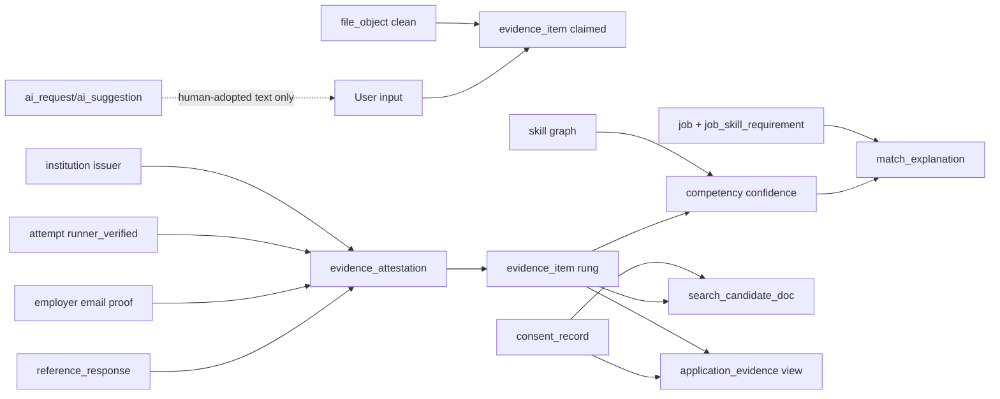

# Data Governance & Lifecycle (Target)

Doc ID: DB-03 · Owner: Data Governance Lead + Privacy Engineer · Version 1.0 · Status: Under Review · Relates: DOM-22, INV-T05, INV-T08, INV-T14, INV-T15, INV-T18, BR-T041, BR-T060, OPEN-08, OPEN-09, OPEN-10 · Companions: DB-01, DB-02, SEC-01..SEC-04, BE-01

Tags: **[TARGET]** design · **[OPEN]** open · **[REF]** reference. **No legal requirement is asserted here.** Retention periods marked [TARGET] are engineering defaults chosen for function and data minimisation; any period that is legally driven is **[OPEN-08]** and must be set with counsel. This document makes no compliance or certification claim.

## 1. Classification scheme
| Class | Definition | Examples | Handling controls |
|---|---|---|---|
| C0 Public | Intended for anyone | Published job, public profile fields the user chose to publish, skill taxonomy, plan catalogue | Integrity controls; cacheable |
| C1 Internal | Business data without personal data | Feature flags, job queue metadata, aggregate rollups | Authenticated server access; no export to third parties without review |
| C2 Personal | Identifies or relates to a person | Account, profile, evidence, applications, messages, consents, notifications | Encryption in transit and at rest (volume); RLS; access audited; included in export/erasure |
| C3 Sensitive personal / high-impact | Harm if exposed is high, or credentials/proofs | Referee names/emails, employer emails, verification outcomes, assessment answers & integrity data, files uploaded as evidence, billing identifiers, support-access records, dispute/moderation case content | C2 + field-level encryption for contact data, purpose-bound access via consent/grant, names-only audit diffs, no analytics use, shorter log retention |
| C4 Secret | Authenticates or decrypts | Password hashes, refresh/reset/referee token hashes, API client secrets, KEKs/DEKs, webhook secrets, VAPID private key, Stripe keys | Never in logs/events/exports; KMS/secret manager; rotation; hash-only where verifiable by hash |

Special categories of personal data are **not intentionally collected**. Fields invited by the product (free text, uploads) can contain them; the product shows a collection notice and moderation/redaction paths exist (SEC-03). Whether any processing involves legally special categories is a counsel question (OPEN-B23).

## 2. Data inventory
Owner = accountable module (`api/<name>`); the business steward role is in §3. Retention: [TARGET] engineering default unless marked OPEN-08.

| DATA ID | Data set | Tables | Class | Owner | Purpose | Source | Recipients | Retention | Deletion on erasure |
|---|---|---|---|---|---|---|---|---|---|
| DATA-001 | Account identity (email, name, locale) | account | C2 | identity | Authentication, contact | User | Email provider (transactional) | Life of account | Tombstone (DB-02 §12) |
| DATA-002 | Credentials (password hash, passkeys) | account.password_hash, passkey | C4 | identity | Authentication | User | none | Life of account | Hard delete |
| DATA-003 | Sessions/devices | session, device | C2 | identity | Security, session mgmt | System | none | Expiry + 30 d (security forensics) [TARGET] | Hard delete |
| DATA-004 | One-time tokens (reset/verify/invite) | auth_token, invitation | C4 | identity/orgs | Account flows | System | Email provider (link) | Until expiry + 7 d | Hard delete |
| DATA-005 | SSO identity link | sso_identity | C2 | identity | SSO login | IdP | IdP | Life of membership | Hard delete |
| DATA-006 | Organization & members | organization, membership, invitation, role_grant | C2 (member data) / C1 (org) | orgs | Tenancy, RBAC | Org admin | Org admins | Life of org; membership history 24 mo [TARGET] | Member pseudonymised in org history |
| DATA-007 | Profile & portfolio | profile, portfolio_item, resume_variant, resume_export | C2 (C0 where published) | profile | Showcase | User | Public (if visibility), consented recruiters | Life of account | Hard delete + CDN purge |
| DATA-008 | Evidence items & artifacts | evidence_item, evidence_artifact, evidence_skill, file_object | C2 (artifacts C3 by default) | evidence | Prove skills | User / courses / assessments / institutions | Consented recruiters/faculty | Life of account (user-controlled) | Hard delete rows + objects |
| DATA-009 | Attestations & provenance | evidence_attestation, evidence_event | C2 | evidence | Trust ladder | System/referee/authority | Consented viewers (summary) | Life of evidence | Attestations deleted; referee-supplied facts removed with them. `evidence_event` (append-only) is not rewritten: it holds only opaque refs and allowlisted codes, so it becomes an unlinkable skeleton and leaves by retention (DB-02 §4.1) [OPEN-08] |
| DATA-010 | Credentials (public) | credential | C0 (display name only) | evidence | Public verification | System/institution | Public by code | Until revoked/expired + 12 mo [TARGET] | Hard delete; public code invalidated |
| DATA-011 | Work claims | work_claim | C3 (employer email) | verification | Work-history verification | User | Referees (limited view) | Life of account | Hard delete |
| DATA-012 | Reference requests & referee contact | reference_request | C3 | verification | Reference flow | User supplies referee | Referee (email) | Request: 14 d active + 90 d [TARGET]; referee PII minimised after completion | Hard delete |
| DATA-013 | Reference responses | reference_response | C3 | verification | Attestation | Referee | Candidate (masked), authorised reviewers | With evidence | Deleted with evidence; referee can request own deletion (§5.5) |
| DATA-014 | Email challenges | email_challenge | C4 | verification | Employer-domain proof | System | Employer mailbox | Expiry + 7 d | Hard delete |
| DATA-015 | Verification requests/disputes | verification_request, verification_dispute | C2/C3 | verification | Decisions & appeals | Users/authorities | Authorities, moderators | Life of evidence; disputes 24 mo [OPEN-08] | Pseudonymise reviewer notes; delete subject link |
| DATA-016 | Assessment attempts & answers | attempt, attempt_answer, sandbox_run | C3 | assessment | Grading, integrity | User | Instructors (own course), authorised reviewers | Attempt 24 mo [TARGET] unless evidence minted | Hard delete; evidence minted from it handled as DATA-008 |
| DATA-017 | Integrity signals & flags | integrity_session, integrity_signal, integrity_flag, attempt_appeal | C3 | assessment | Advisory integrity review (INV-T20) | System | Human reviewers | Signals 90 d after closure; flags with attempt | Hard delete |
| DATA-018 | Course/learning progress | enrollment, lesson_progress, learning_path | C2 | learning | Learning | User | Instructors (aggregate), institution (consented) | Life of account | Hard delete |
| DATA-019 | Instructor/authoring content | course, lesson, assessment, assessment_question | C0/C1 (author is C2) | learning/assessment | Content supply | Instructor | Learners | Until withdrawn | Author pseudonymised; content may remain if licensed [OPEN-B24] |
| DATA-020 | Jobs & templates | job, job_skill_requirement, job_template, saved_search, saved_job | C0 (jobs) / C2 (candidate saves) | jobs | Opportunities | Org / user | Public / user | Job: 24 mo after close [TARGET]; saves: life of account | Candidate saves deleted; org jobs unaffected |
| DATA-021 | Applications & pipeline | application, application_draft, application_evidence, application_consent_snapshot, stage_transition, application_note, interview, interview_participant, scorecard | C2/C3 | applications | Hiring | Candidate / recruiters | Org members | Per org policy within platform max 24 mo after close [OPEN-08] | Mutable rows (application, notes, interviews, scorecards): candidate identifiers pseudonymised in org view; see §5.3. `stage_transition` (append-only) is not rewritten: actor held as `subject_ref`, narrative in `application_note` |
| DATA-022 | Search/match derived data | search_job_doc, search_candidate_doc, match_explanation, competency, readiness_snapshot | C2 (derived) | search/matching/skills/careerintel | Discovery, explanation | Derived | Consented viewers | Rebuildable; deleted on consent revoke | Hard delete (rebuild excludes user) |
| DATA-023 | Embeddings | embedding columns | C2 (derived; may be invertible in principle) | search/skills | Semantic search | Derived | none | With source | Hard delete |
| DATA-024 | Messages & conversations | conversation, conversation_participant, message, connection | C2 | messaging | Communication | Users | Participants | 24 mo after last activity [TARGET, OPEN-08] | Sender pseudonymised in others' threads ("Deleted user"); own-only threads deleted |
| DATA-025 | Notifications & preferences | notification, notification_preference, notification_delivery, push_subscription, email_suppression | C2 | notify | Engagement | System | Email/push providers | Notifications 12 mo; deliveries 90 d; suppression keeps hash [TARGET] | Delete; suppression hash retained to honour opt-out (hash only) [OPEN-B25] |
| DATA-026 | Billing | billing_customer, subscription, entitlement, usage_counter, invoice, stripe_event_inbox | C3 (identifiers) | billing | Payments, entitlements | User/org + Stripe | Stripe | Financial records per law [OPEN-08]; inbox payloads 30 d | Retain minimum financial records; delete the rest; Stripe customer data handled per Stripe (§5.4) |
| DATA-027 | AI requests & suggestions | ai_request, ai_suggestion, ai_spend | C2 (no raw prompts) | ai | Assistance, cost control | System | AI provider (redacted input) | Metadata 13 mo [TARGET]; suggestions 7 d unless adopted | Hard delete |
| DATA-028 | Consents | consent_record | C2 | privacy | Purpose-bound processing | User | none | Life of account + proof period [OPEN-08] | Ledger rows hold only `subject_ref` (no FK); never UPDATEd or DELETEd by erasure. Deleting the mapping (DATA-041) makes them unlinkable; whether they may be kept as consent proof, and for how long, is [OPEN-08]; if counsel requires full removal they go by whole-aggregate purge (DB-02 §4.2) |
| DATA-029 | Data-rights requests | data_rights_request, data_export, erasure_request, erasure_step | C2 | privacy | Rights handling | User | Handlers | 36 mo [TARGET, OPEN-08] | Retained as proof of handling (minimal fields) |
| DATA-030 | Erasure ledger | erasure_ledger | C1 (surrogate id only) | privacy | Backup-restore replay | System | none | Backup retention + margin | Not erasable by design: holds `erased_subject_ref` only, never `account.id` (contains no personal data once the mapping is gone) |
| DATA-031 | Safety reports & cases | report, moderation_case, moderation_action, moderation_appeal | C3 | safety | Trust & safety | Users/mods | Moderators | 24 mo after closure [OPEN-08] | Reporter pseudonymised; case outcome retained if needed for repeat-offender controls [OPEN-B26] |
| DATA-032 | Support access & audit | support_access_grant, audit_event, audit_anchor | C3 (audit_anchor C1: hashes and signatures) | admin | Accountability (INV-T18) | System | Auditors/admins | [OPEN-08]; engineering default 24 mo; anchors kept after the rows they cover are purged | `audit_event` is never rewritten: actor and subject are opaque `subject_ref` values, unlinkable once the mapping is deleted; event skeleton retained. `support_access_grant` (mutable) is pseudonymised by UPDATE |
| DATA-033 | Product analytics | analytics_event, funnel_daily | C2 pseudonymous | analytics | Product improvement | Consented clients | none external at launch | 13 mo [TARGET] | Subject key discarded; rollups aggregate only |
| DATA-034 | Integrations | webhook_endpoint, webhook_delivery, api_client, import_job | C1 / C4 secrets | integrations | B2B integration | Org admins | Customer endpoints | Endpoint life; deliveries 30 d | Org-owned (not user erasure) |
| DATA-035 | Institution data | institution, cohort, cohort_member, institution_issuer | C2 (members) / C1 | institutions | B2B2C | Institution | Faculty (consented) | Per institution contract [OPEN-B27] | Member rows deleted on erasure; cohort aggregates unaffected |
| DATA-036 | Platform operational | outbox_event, consumer_inbox, idempotency_key, background_job(+attempt), rate_limit_bucket, worker_heartbeat, schema_migration | C1 (payloads may carry ids) | platform | Operations | System | none | 14 d / 24 h-7 d / 30 d (DB-02 §7) | Expire by partition drop; no personal free text by design |
| DATA-037 | Logs & traces | (external) | C1 (PII redacted, INV-T14) | platform | Operations | System | Observability vendor | 30 d logs, 7 d traces [TARGET] | Not needed (no PII); test enforces |
| DATA-038 | Backups | (external) | all classes | platform | Disaster recovery | System | Backup storage | [OPEN-B28] | Age out; erasure replay on restore |
| DATA-039 | Salary reference data | salary_band | C0 | careerintel | Insights | Licensed dataset [OPEN-B11] | Candidates | Dataset licence | n/a |
| DATA-040 | Feature flags & config | feature_flag | C1 | admin | Rollout | Admins | none | Flag life | n/a |
| DATA-041 | Subject identity map (token to account link) | subject_identity_map | C2 (the only link from append-only history to a person) | privacy | Keep history free of identifiers while allowing lookups | System | none (server roles only) | Life of account; on erasure deleted immediately, together with the wrapped per-subject key | Hard delete is the erasure act for history; KMS key destruction scheduled; backups age out (DATA-038) |

Maintenance: this inventory is the source for the record-of-processing register and for the column-level data-class registry that migrations must update (DB-04 lint: a new column in a table of class C2+ without a class label fails).

## 3. Ownership and stewardship
| Role | Responsibility |
|---|---|
| Data owner (module lead, `api/<name>`) | Accountable for schema, retention, quality metrics, access rules of the module's tables; approves changes touching class C3+ |
| Data steward (product-domain lead) | Defines meaning, vocabularies (e.g. consent scopes, skill taxonomy), resolves duplicates and disputes |
| Platform custodian (SRE/DBA) | Backups, encryption, partitions, access, restore drills; no business-level access to C3 plaintext |
| Privacy lead / DPO function | Rights handling process, DPIA triggers, third-party register, retention-list with counsel (OPEN-08). Whether a statutory DPO is required is a counsel question |
| Security lead | Key management, access reviews, incident response |
Access to production personal data by humans is exceptional, time-boxed, reason-coded and audited (INV-T18, BR-T041); no standing read access for engineers.

## 4. Retention and minimisation
Principles: (1) collect only fields a documented purpose needs; (2) every table in the inventory has a retention rule enforced by a job (`retention.purge`), not by convention; (3) derived data has no retention of its own beyond its sources; (4) logs and events carry ids, not personal free text (INV-T14); (5) retention extension requires a legal hold record (`legal_hold`) that is itself audited.
Mechanisms: partition drop for time-series tables; batched `DELETE` with `lock_timeout` for others; object-store lifecycle rules for files; purge jobs emit metrics (rows purged, oldest row age) and alert if the oldest row exceeds policy.

## 5. Deletion and erasure
### 5.1 Process (BR-T060: complete within 30 days except legally retained records)

```mermaid
stateDiagram-v2
  [*] --> requested: POST /me/erasure-requests (step-up auth)
  requested --> cooling_off: confirmation email; account deactivated (login disabled, public data hidden)
  cooling_off --> cancelled: user cancels (login again)
  cooling_off --> in_progress: cooling-off elapsed (7 days [TARGET]) and no legal hold
  in_progress --> in_progress: each module runs privacy.erasure.step (idempotent)
  in_progress --> completed: all erasure_step rows done or retained
  completed --> [*]: erasure_ledger row written; confirmation sent to a retained contact address, then address discarded
```

Orchestration: `erasure.requested` event fans out to every module (EVT-22-03); each module executes its steps as a `privacy.erasure.step` job, records `erasure_step(module, state, retained_reason)`, and emits `erasure.module_completed`. Failure keeps the request `in_progress`, retries with backoff, and pages after the SLA margin (BR-T060 days remaining < 7). The cooling-off length is a product decision [TARGET 7 days, user-cancellable] and counts inside the 30 days.

### 5.2 Per-module action
| Module | Action | Retained (if any) and why |
|---|---|---|
| identity | Delete sessions, passkeys, tokens, SSO links; tombstone account (the account row carries no `subject_ref`) | Account id (surrogate) |
| profile | Delete profile, portfolio, resumes, exports; purge CDN | none |
| evidence | Delete items, artifacts, attestations; delete objects; invalidate credentials (public code returns "not found"). `evidence_event` rows are left untouched: identifier-free by construction, they become unlinkable skeletons (DB-02 §4.1) | none; institution-issued credential records of the *institution* remain in the institution's own records [OPEN-B27] |
| verification | Delete work claims, requests, challenges, responses; referee contact data removed | Dispute outcome skeleton if needed for fraud controls [OPEN-B26] |
| assessment | Delete attempts, answers, runs, signals, flags | Aggregate statistics only |
| learning | Delete enrollments/progress | Aggregates |
| applications | Remove candidate-owned drafts/snapshots; **org-owned mutable records pseudonymised by UPDATE** (`stage_transition` is append-only and is not touched: it holds `subject_ref` only): candidate identity fields replaced by a stable pseudonym, free-text notes about the candidate by recruiters kept only if org retention policy requires and then without identifiers | Org hiring records per policy [OPEN-08, counsel] |
| messaging | Delete own-only conversations; in shared threads replace sender with "Deleted user" and remove body if requested | Counterparty's copy of their own messages [OPEN-B29] |
| notify | Delete notifications, subscriptions, deliveries; keep email hash in suppression list to honour opt-out | email hash [OPEN-B25] |
| billing | Detach customer link; delete non-financial rows | Invoices/records legally required [OPEN-08]; Stripe retains its own records |
| ai | Delete requests/suggestions | none |
| search/matching/skills/careerintel | Delete derived rows and embeddings; remove from indexes | none |
| analytics | Subject key rotated/discarded (events unlinkable); aggregates untouched | Aggregates |
| privacy | Keep minimal request rows; `consent_record` is not rewritten (holds `subject_ref` only); write `erasure_ledger` with `erased_subject_ref`; **last step: delete the `subject_identity_map` row and its wrapped key, schedule KMS key destruction**, then run the sweep | proof of handling; consent rows as unlinkable proof if counsel confirms [OPEN-08] |
| admin/audit | **No UPDATE.** `audit_event` and `audit_anchor` are untouched: audit rows carry `subject_ref`, which stops resolving when the mapping is deleted, so hash batches stay valid. `support_access_grant` (mutable) is pseudonymised | security accountability, action skeleton [OPEN-08] |
| platform | Delete files; purge outbox/job payloads referencing the account if still within retention | none |

### 5.3 Data about a person held by others
Organizations own their hiring records about candidates (DATA-021). Candidate erasure pseudonymises identity in those records and the org is notified; whether the org may keep the residual record, and for how long, is policy set with counsel (OPEN-08). Recruiter notes are never visible to the candidate and are not part of export unless counsel requires (OPEN-B30).

### 5.4 Third parties
| Processor | Erasure action | Verification |
|---|---|---|
| Stripe | Delete/anonymise the customer where Stripe permits; financial records retained by Stripe under its obligations | Confirmation stored in `erasure_step` |
| Email provider (Brevo) | Delete contact record and event history; keep suppression hash | API response stored |
| AI provider | Contractual zero-retention/no-training terms required before launch (OPEN-B31); no raw prompts stored locally | Contract + `ai_request` metadata deletion |
| Object store / CDN | Delete objects, purge cache | Delete markers + purge ack |
| Push services | Subscription deletion (no data held beyond endpoint) | n/a |
| Observability vendor | Not applicable by design (no PII in logs/traces); redaction test is the control | CI test |

### 5.5 Referees (non-account data subjects)
A referee's data (name, email, response) is processed only for the reference request. After completion, referee contact data is minimised (name/email deleted or reduced to hash) after the request retention window. A referee may ask for deletion via an emailed link or the support channel; fulfilment deletes the response, **revokes the dependent attestation, recomputes the candidate's rung (BR-T005) and notifies the candidate**. Referee contact addresses are never used for marketing.

### 5.6 Backups and restore
Erased data persists in backups until they age out ([OPEN-B28] retention window; encrypted, access-restricted, immutable). Rule: **a restored database is never exposed to users before the erasure ledger is re-applied** (restore runbook step: `retention.replay_erasure` takes every `erased_subject_ref` in the ledger newer than the backup's snapshot, resolves it through the restored `subject_identity_map` row to the account, re-runs the erasure steps, and deletes the map row last). The ledger holds only the opaque `subject_ref` (never `account.id`, so the ledger itself is not a durable link to an identity) and is kept for backup retention plus margin. Backup age-out and whether destroyed per-subject KMS keys count as erasure of backed-up history copies are [OPEN-08]. Restore drills include this step and verify counts. Whether this satisfies a given legal standard for backups is for counsel to confirm.

### 5.7 Append-only history, opaque refs and the post-erasure sweep (resolves REVW-04)
| Topic | Rule |
|---|---|
| Mechanism | Append-only tables (`audit_event`, `consent_record`, `evidence_event`, `stage_transition`, `outbox_event`, `integrity_signal`) never store a direct identifier. A person appears as an opaque `subject_ref` (referees as a per-request `referee_ref`). The token-to-account link lives only in `subject_identity_map` (DATA-041). Erasure deletes that row; it never UPDATEs history, so row hashes and signed batch anchors stay valid (DB-02 §4.1-4.2) |
| Optional crypto-shred | Subject-linkable values in history (e.g. `consent_record.ip_hash`) are keyed with a per-subject KMS-wrapped key stored in the map row; erasure deletes it and schedules key destruction |
| Sweep (INV-T38) | Searches every primary store, search index, cache and object store for the account id, email, email hash, artefact hashes and referee contact data. `subject_ref` and `referee_ref` values are **excluded** from hit terms (they are not personal data once unmapped). The sweep additionally asserts: no `subject_identity_map` row and no wrapped key for the subject; the integrity verifier still passes for every anchor covering the subject's history rows (TEST-PRV-009). Allowlisted survivors: the tombstoned `account` row (surrogate id, no personal fields) and the `erasure_ledger` row |
| Write-time guard | A CI test and a migration lint reject an identifier-bearing column or free-text column in an append-only table (TEST-PRV-010); JSONB columns in history tables use registered allowlist schemas |
| What survives | Unlinkable skeletons: timestamps, action ids, state names, tenant ids. They leave through retention (partition drop, or whole-aggregate purge that writes a receipt). Whether skeletons, truncated IP prefixes and consent proof rows may or must be kept is [OPEN-08] |
| Legal-hold exception | If counsel allows keeping the map row for a subject under legal hold (OPEN-08), the hold is a `legal_hold` record, the DSR is `on_hold`, and erasure is not reported complete |

## 6. Export / portability
| Aspect | Design |
|---|---|
| Trigger | `POST /me/data-exports` (step-up auth); async job `privacy.export.build` |
| Scope [TARGET] | Data the user provided or generated: account, profile, portfolio, evidence + artifacts (original files), attestations summary, work claims, applications they submitted (their own answers, evidence shared), messages they sent/received, consents + history, notification preferences, billing summary, AI usage metadata, data-rights history, access log of who viewed their evidence |
| Exclusions | Other people's personal data (referee contact details are masked; recruiter notes, scorecards, internal org data), security secrets, derived scores unless the user asks for explanations (explanations of matches are included as they relate to the user, OPEN-B13/B30) |
| Format | ZIP: `manifest.json` (schema version, generated-at, file list, SHA-256), one JSON file per entity group (stable documented schemas), `files/` with originals; human-readable `README` |
| Consistency | REPEATABLE READ snapshot; derived data labelled `derived` |
| Delivery | Stored as private `file_object` (purpose `data_export`), signed link valid 24 h, new link re-issuable while export row `ready` (expiry 7 days [TARGET]), notification when ready; link use audited |
| Integrity | Export builder uses the same policy engine as the API (it runs *as the subject*), so it cannot leak more than the subject may see |
| Timing | Target completion within the 30-day envelope for rights requests; system target is minutes-to-hours depending on files [TARGET] |

## 7. Residency [OPEN-B32]
No residency commitment is made. Design hooks: (1) all stateful stores (primary DB, replicas, object store, backups, logs, search index) are enumerated in DATA-038/§2 so a regional decision covers all of them; (2) tenants carry a `home_region` attribute reserved for a future multi-region cell design (not implemented; ADR-T21 rejects schema-per-tenant); (3) AI and email providers are the main cross-border flows and are port-isolated, so region-specific adapters/endpoints can be chosen; (4) no cross-region replication or analytics export is enabled by default. Decision triggers: first customer or regulator requirement for in-region storage/processing, or launch in a market where counsel advises it.

## 8. Data quality
| Dimension | Control | Metric (alert when) |
|---|---|---|
| Validity | Zod at boundary; DB CHECKs; normalised unicode, trimmed, length-capped | validation-failure rate by field (spike) |
| Uniqueness | Partial unique indexes (DB-02 §3.1); duplicate detection for skills (alias/trigram) and organizations (domain) with steward review queue | duplicate-candidate backlog |
| Referential integrity | Declared FKs + nightly cross-module reconciliation (DB-02 §11) | orphan count > 0 |
| Consistency of derived data | Rebuild-equivalence test: rebuild from sources equals live projection | drift count; stale-flag age |
| Timeliness | Outbox lag, queue age, projection staleness | p95 lag over SLO (SLOs set in 17_*) |
| Provenance completeness | Every evidence item has `source`; every attestation has `method`/`attester_kind`; every AI-assisted field is traceable to `ai_suggestion` | null-provenance count = 0 |
| Accuracy of verification | Dispute upheld rate per method/authority; reference confirmation anomaly checks | dispute-upheld rate trend |
| Taxonomy health | Skill merge/deprecate workflow; unmapped evidence skills | unmapped-skill ratio |
| Reference data | `salary_band` carries source and `as_of`; stale data hidden after expiry | datasets older than policy |

## 9. Lineage

Mechanics: (1) provenance is *in the row* (`source`, `method`, `attester_kind`, `provenance`), (2) causal lineage is in events (`correlation_id`, `causation_id`, `aggregate_seq`), (3) every derived table records `model_version`/`source_version`/`consent_epoch` and `computed_at`, (4) explanations (`competency.basis`, `match_explanation.factors`) are first-class data shown to users (INV-T19), (5) lineage-affecting changes (taxonomy merges, model upgrades) are versioned jobs with before/after counts. AI never appears upstream of evidence (INV-T08); the dotted edge shows that only user-adopted text re-enters as user input.

## 10. Governance processes
| Process | Rule |
|---|---|
| Schema change | PR template requires data class, purpose, retention, erasure behaviour, export inclusion for each new column/table; lint blocks otherwise |
| Access review | Quarterly for DB roles and platform grants (USR-01 §6); breakglass use reviewed within 24 h |
| Third-party register | Maintained in SEC-03; adding a processor needs privacy review and DPIA-trigger check |
| Logging | PII-redaction test in CI (INV-T14); production log sampling forbidden to include request bodies |
| Incident / breach | Procedure outline in SEC-02; personal-data incidents trigger privacy-lead assessment of notification duties with counsel |
| Training data | User content is **not** used to train models by TalentSphere; provider terms must prohibit provider training on our data (OPEN-B31) |

## 11. Open items
| ID | Item |
|---|---|
| OPEN-08 | Legal retention list (audit, billing, hiring records, consent proof, data-rights logs) — counsel |
| OPEN-B23 | Treatment of potentially special-category content inside free text/uploads |
| OPEN-B24 | Licensing/ownership of instructor content after instructor erasure |
| OPEN-B25 | Keep hashed email in suppression list after erasure (opt-out honouring vs minimisation) |
| OPEN-B26 | Whether a minimal safety/fraud record may survive erasure and its basis |
| OPEN-B27 | Institution-held records and contractual retention for credentials/cohorts |
| OPEN-B28 | Backup retention window and immutability tooling |
| OPEN-B29 | Counterparty copies of messages after one party's erasure |
| OPEN-B30 | Whether recruiter notes/scorecards/derived scores fall within access/export rights |
| OPEN-B31 | AI provider terms: zero retention, no training, sub-processor list |
| OPEN-B32 | Data residency decision and triggers |
| OPEN-09 | Minors in education contexts (affects retention, consent, institution data) |
| OPEN-10 | Identity verification (if added) introduces C3+ biometric/ID data; out of scope until decided |
