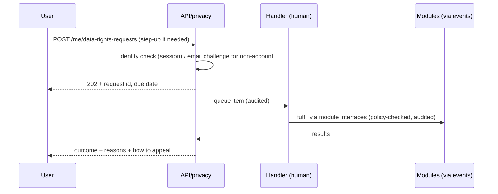

# Privacy & Data Lifecycle Design

Doc ID: SEC-03 · Owner: Privacy Engineer + Product Director · Version 1.0 · Status: Under Review · Relates: DOM-22, INV-T08, INV-T09, INV-T14, INV-T15, INV-T18, INV-T19, INV-T20, BR-T004, BR-T005, BR-T041, BR-T060, OPEN-08, OPEN-09, OPEN-10 · Companions: DB-03 `DATA_GOVERNANCE_AND_LIFECYCLE.md`, SEC-01, SEC-02, SEC-04, BE-01 §13, INT-01

Tags: **[TARGET]** design · **[OPEN]** open. **This document describes product and engineering design. It does not state legal requirements, lawful bases, deadlines or thresholds as fact; every "legal basis category" cell and every legal-sounding item is a candidate for counsel to confirm (see SEC-04).** No compliance claim is made.

## 1. Design principles
1. **Purpose-bound**: each data use maps to a named purpose (§2); a new purpose needs review.
2. **Private by default**: profiles `private`, evidence `private`, recruiter-facing sharing and matching are opt-in consent scopes (INV-T15).
3. **Minimise**: collect only fields a purpose needs; derived data is rebuildable and deleted with its source.
4. **Transparent**: users can see what is shared, who viewed it (`GET /me/access-log`), why they matched (INV-T19), and what each ladder rung means.
5. **Controllable**: consent revocable as easily as granted; export and erasure self-service (step-up auth).
6. **Humans decide** consequential outcomes about people (INV-T09, INV-T20).
7. **No sale or ad-tech**: no advertising networks, no selling or sharing of personal data for cross-context advertising (ADR-T01 non-goal); stated as a product commitment [TARGET], wording of public commitments reviewed by counsel.

## 2. Processing purposes register
"Basis category" = candidate category for counsel to confirm: **contract** (necessary to provide the service the user asked for), **consent** (opt-in scope in the product), **legit-int** (legitimate-interests style balancing), **legal** (legal obligation). The product implements opt-in for rows marked consent regardless of whether another basis could apply (privacy by default).

| PUR | Purpose | Data (DB-03) | Consent scope | Basis category (counsel) | Recipients | Automated decision? |
|---|---|---|---|---|---|---|
| PUR-01 | Account creation, authentication, security | DATA-001..005 | - | contract; legit-int (security) | Email provider (transactional) | No |
| PUR-02 | Maintain profile and portfolio | DATA-007 | `profile.public_view` for public visibility | contract; consent (public) | Public if chosen | No |
| PUR-03 | Store evidence and run verification workflow | DATA-008..010, 014..015 | - | contract | Verifiers/authorities named by the user | No (human decisions) |
| PUR-04 | Contact referees and employer mailboxes at user's request | DATA-011..013 | - | contract; legit-int (referee contact, minimised) | Referee/employer mailbox | No |
| PUR-05 | Share evidence with a recruiter via an application | DATA-021 | `application.share_snapshot` (application target; implicit at submit) | consent | Org members of that job | No |
| PUR-06 | Recommendations and match explanations to the candidate | DATA-022..023 | `matching.recommend` | consent | Candidate (explanations) | **Decision support** only (§7) |
| PUR-07 | Recruiter-initiated outreach | DATA-024 | `outreach.recruiter_contact` | consent | Recruiter | No |
| PUR-08 | Deliver courses and assessments | DATA-016, 018 | - | contract | Instructors | Grading of objective items is automated; outcome appealable |
| PUR-09 | Assessment integrity review | DATA-017 | - | legit-int | Human reviewers | Signals advisory; human decides (INV-T20) |
| PUR-10 | AI assistance on user content | DATA-027 | `ai.assist.process` | consent | AI provider (redacted) | Suggestions only, human-gated |
| PUR-11 | Billing and entitlements | DATA-026 | - | contract; legal (records) | Stripe | Entitlements derived by rule from subscription state |
| PUR-12 | Transactional notifications | DATA-025 | user preferences | contract | Email/push services | No |
| PUR-13 | Marketing and lifecycle email | DATA-025 | `comms.marketing_email` | consent | Email provider | No |
| PUR-14 | Product analytics | DATA-033 | `analytics.product` | consent | None external at launch | No |
| PUR-15 | Safety, moderation, abuse prevention | DATA-031 | - | legit-int | Moderators | Reports triaged by humans; no automated sanctions |
| PUR-16 | Fraud and verification-integrity analytics (e.g. reference rings) | DATA-009, 015 | - | legit-int [OPEN-B46] | Human reviewers | Flags to review only |
| PUR-17 | Customer support with privileged access | DATA-032 | - | legit-int | Support (time-boxed) | No |
| PUR-18 | Institution cohort reporting | DATA-035 | `evidence.share_institution` | consent; contract (institution) | Faculty (aggregates, small-count suppression) | No |
| PUR-19 | Rights handling and legal obligations | DATA-028..030 | - | legal | Handlers | No |
| PUR-20 | Aggregate/anonymised research | derived | `data.research_aggregate` | consent [OPEN-B10] | Internal | No |
| PUR-21 | Recruiter search presence (profile summary in recruiter search) | DATA-022 | `search.discoverable` | consent | Consented recruiters (search) | **Decision support** only (§7) |
| PUR-22 | Candidate-granted employer access: evidence summary in search, evidence artefacts and contact details per employer | DATA-007, 008, 022 | `evidence.share_summary`, `evidence.share_artefact` (per employer), `profile.share_contact` (per employer) | consent | Named org (artefacts, contact); all verified orgs (summary) | No |
| PUR-23 | Alumni outcome sharing with the candidate's institution after graduation | DATA-035 | `alumni.share_outcomes` (chosen fields) | consent | Named institution | No |
| PUR-24 | Operational telemetry: service reliability, error and version beacons, abuse and security signals (REVW-31) | DATA-033 (operational subset only, §3.1) | - | legit-int (service operation and security) **[counsel to confirm, OPEN-08]**; falls back to consent if counsel disagrees | Internal SRE | No |

## 3. Consent design
| Aspect | Design |
|---|---|
| Granularity | One scope per purpose; the only list of scope ids is `00_CONTROL_CENTRE/CONSENT_SCOPE_CATALOGUE.md` (CSC, 14 scopes, FF-12); never bundled with terms acceptance; no pre-ticked boxes; no dark patterns (equal prominence for accept/decline) |
| Record | Append-only `consent_record` keyed by an opaque `subject_ref` (not the account id; erasure deletes the identity mapping, not the rows): scope, target (data object), grantee (all verified orgs / one org / one institution), granted, optional `expires_at` and `field_set`, policy version, source, timestamp, coarse client info; `consent_current` view (excludes expired grants); account `consent_epoch` stamps derived data. Revocation is evaluated at read time with no consent cache (CSC section 6) |
| Withdrawal | Same surface and effort as granting (`PUT /me/consents/{scope}`); effective on the next read |
| Re-consent | On material change of a scope's description, policy version increments and the scope is treated as not granted until re-confirmed |
| Application consent | Applying shows exactly which evidence/fields will be visible to which org; creates the immutable snapshot (DB-01); candidate can revoke later |
| Defaults for new accounts | All optional scopes off. Only strictly necessary processing occurs |
| Children / unverified age | See §8 |

Effects of revocation:
| Scope | Immediate effect | Asynchronous effect | Cannot be undone |
|---|---|---|---|
| `profile.public_view` | Public profile 404s; caches purged | Search docs removed | Copies already viewed/scraped by others |
| `application.share_snapshot` | New live-item reads by that job's team denied (policy + RLS P5); snapshot kept with tombstones for revoked items | Recruiter dashboards drop live items; audit entry; org-side identifiable copy pseudonymised at consent end (CSC R-RET, OPEN-08) | What a recruiter already saw or exported manually; org's own hiring record per DB-03 §5.3 |
| `evidence.share_artefact` | That org's artefact reads and new signed URLs denied (policy + RLS P5b) | Recruiter dashboards drop it; issued URLs lapse <= 5 min; audit entry | What that org already saw or downloaded |
| `evidence.share_summary` | Summary fields removed from recruiter results at next read | Search docs recomputed (consent_epoch bump); cleanup only, the query-time epoch filter already hides stale docs | Summaries already seen |
| `profile.share_contact` | Email/phone masked for that org at next read | Audit entry | Details already seen or copied |
| `search.discoverable` | Absent from recruiter results at next read (query-time epoch check) | Search doc removal <= 15 min (BR-T063) is cleanup only: reads are already denied by the query-time epoch check | Prior shortlist exports by recruiters |
| `matching.recommend` | No new recommendations or match explanations | `match_explanation`, embeddings deleted (consent_epoch bump); cleanup only, reads are denied at read time | Prior shortlist exports by recruiters |
| `outreach.recruiter_contact` | New outreach blocked | Open threads remain but recruiter cannot continue | Messages already received |
| `ai.assist.process` | AI endpoints return `consent-required` | Pending jobs cancelled | Data already processed by provider (retention per provider terms, OPEN-B31) |
| `analytics.product` | Client stops sending; server rejects | Subject key discarded | Aggregated rollups |
| `comms.marketing_email` | Sends suppressed | Provider lists synced | Emails already sent |
| `evidence.share_institution` | Faculty/cohort reads denied | Cohort aggregates recomputed | Reports already issued |
| `alumni.share_outcomes` | Institution loses the chosen fields at next read | Audit entry | Fields already seen |
| `data.research_aggregate` | Subject excluded from the next aggregate run [OPEN-B10] | None | Aggregates already published |

### 3.1 Operational telemetry versus product analytics (REVW-31)
Problem: client-side and remote-activation SLIs (OPS-SLO SLO-03, SLO-13 to SLO-16) rest on RUM, and RUM was treated as consent-gated, so field SLIs could rest on a small, self-selected subset. Decision: split the two classes by what is collected, not by tool.

| Class | Allowed content (allowlist, schema-validated server-side) | Not allowed | Basis | Retention |
|---|---|---|---|---|
| **Operational** (PUR-24) | Server metrics, logs and traces (no body, no free text, INV-T14); client error and performance beacons limited to: route template (never the concrete URL), error class, build and remote version, timing bucket, coarse device class, effective connection class, outcome of the remote-activation attempt; a random per-page-load id that is never stored client-side | User id, email, any persistent or cross-session client id, concrete URL or query string, referrer, full user agent string, free text, DOM or form content, IP beyond truncation for rate limiting | legit-int for service operation and security, **pending counsel (OPEN-08)** | 30 days raw, then aggregated |
| **Product analytics** (PUR-14) | Anything keyed to a person or a persistent identifier: funnels, feature use, retention cohorts, journey paths | Session replay (not offered) | Consent `analytics.product` | Per DB-03 |

Rules: (1) a beacon type is either on the operational allowlist or consent-gated; there is no third class, and a lint over the beacon schemas fails on an allowlisted field that can identify a person; (2) operational beacons cannot carry a user id even when the user has consented to analytics, so the two streams never join; (3) **synthetic-only alternative (if counsel decides operational beacons also need consent):** the client SLIs of record become scheduled real-browser probes from fixed regions on reference device profiles, and consented RUM is advisory (diagnosis only); (4) in either case the SLO report states **consented or beaconed coverage** (sessions with beacons / all sessions, the denominator counted server-side from anonymous request counters) and that field data is a self-selected subset, so population claims are not made from it.

## 4. User rights flows (product design; timing targets set with counsel)
Generic rights are mapped to product capabilities; naming of statutory rights per jurisdiction is a counsel matter. All authenticated flows require an active session and step-up for export/erasure.

| Right (generic) | Flow | API | Target | Notes |
|---|---|---|---|---|
| Access / transparency | Settings -> Privacy: data summary, "who viewed my evidence", consent history, automated-processing explanations | `GET /me/access-log`, `/me/consents*`, match explanations | Immediate (self-service) | Support-assisted for people without accounts |
| Portability / export | Request export; async build; signed link 24 h | `POST /me/data-exports` | Minutes-hours; within overall request envelope | Scope in DB-03 §6 |
| Rectification | Edit directly (profile, evidence); for verified items, edit lowers rung transparently; contested third-party data via request | `PATCH` routes; `POST /me/data-rights-requests` (rectification) | Self-service / handler SLA | Authority-verified facts are corrected through the authority |
| Erasure | Request with step-up, cooling-off, orchestrated deletion | `POST /me/erasure-requests` | 30 days (BR-T060) except legally retained records (OPEN-08) | DB-03 §5 |
| Restriction | Handler-assisted: processing paused for contested data (hidden from search/sharing, kept) | `POST /me/data-rights-requests` (restriction) | Handler SLA | Implemented as visibility lock + search removal |
| Objection | Opt-out of consent-based uses is self-service via scopes; objection to legit-int purposes handled by handler review | consent endpoints / rights request | Handler SLA | e.g. PUR-16 analytics |
| Human review of automated outcome | "Ask for human review" on a match, integrity flag, grading result or moderation action | `POST /me/data-rights-requests` (human_review) or appeal routes | Handler SLA, human reviewer different from original | Review outcome recorded; reasons given |
| Withdraw consent | Toggle scope | `PUT /me/consents/{scope}` | Immediate | §3 |
| Referee / non-account person | Link in every referee email: decline, report misuse, request deletion | token routes + support intake | Handler SLA | DB-03 §5.5 |

Identity assurance: signed-in requests rely on the session plus step-up; requests from people without a session go through an email challenge to the address on file and are never fulfilled by email attachment of personal data. Requests made by organisations on behalf of employees/students (rare) are held until the individual confirms.

## 5. Third-party sharing and processors
| Recipient | Role (to confirm) | Data | Purpose | Safeguards | Status |
|---|---|---|---|---|---|
| Cloud hosting / PostgreSQL / object store / CDN | Processor | All classes (encrypted) | Hosting | DPA, encryption, region choice, access controls | [OPEN-B19, B32] |
| Stripe | Independent controller and/or processor for payments (counsel) | Name/email, plan, payment via hosted pages | Billing | Hosted Checkout; no card data on our systems | Contract review |
| Email provider (Brevo default) | Processor | Recipient address, template variables | Notifications | DPA, token-link tracking disabled, suppression handling | [OPEN] |
| AI provider(s) | Processor | Redacted user content | Assistance | Consent scope, redaction, no training, zero/limited retention (OPEN-B31) | Not enabled until contract |
| Browser push services (Apple/Google/Mozilla etc.) | Infrastructure | Encrypted generic payload | Push | Payload carries no sensitive text | n/a |
| Observability vendor | Processor | Redacted logs/traces | Operations | PII redaction test; retention limits | [OPEN] |
| Customer IdPs | Customer's system | Authentication claims | SSO | Org-owned | n/a |
| Recruiters / employer orgs | Recipients (they become controllers of what they receive) | Only consented evidence/profile | Hiring | Consent snapshot, access log, org terms of use | Terms drafting (counsel) |
| Institutions | Recipients | Consented cohort evidence/aggregates | Education reporting | Consent scope, small-count suppression | Contract (OPEN-B27) |
| Referees / employer mailboxes | Third parties contacted at user's request | Minimal request context | Verification | Content limited to what is needed; abuse reporting | n/a |
| Customer webhook endpoints | Customer systems | Curated event DTOs | Integration | Entitlement + consent gating (INT-01 §7) | n/a |
A maintained register (generated from this table and DB-03 §2) is reviewed on every new processor (DPIA-trigger check, §9). International transfer mechanisms depend on provider/region choices and are for counsel (OPEN-B32).

## 6. Data lifecycle summary
Collect (minimal, notice at point of collection) -> Use (purpose-bound, consent-checked at use time) -> Share (consent snapshot, access log) -> Retain (per DB-03 §4 jobs) -> Delete/erase (DB-03 §5) -> Prove (audit, erasure ledger). The PWA read cache holds only owner data allowed by the platform matrix, is cleared at logout/revocation, and is never authoritative (INV-T13); no personal data in local storage beyond non-sensitive UI preferences.

### 6.1 Erasure and append-only history (REVW-04)
| Aspect | Design |
|---|---|
| Principle | History that must stay tamper-evident (audit, consent, evidence events, stage transitions) is **never rewritten to erase a person**. It never contains a direct identifier in the first place: each person is an opaque, random `subject_ref`, and only `subject_identity_map` links the token to an account (DB-02 §4.1) |
| Erasure act | The privacy orchestrator deletes the mapping (and the per-subject KMS-wrapped key, with key destruction scheduled) as its last step. Hash batches and signatures stay valid because no history row changes (DB-02 §4.2) |
| What the user is told | The receipt lists that history rows (audit, consent proof, state changes) remain as records that can no longer be linked to them, with category and reason; the length of retention is [OPEN-08] |
| Residual-risk statement | Remaining skeleton rows still carry timestamps, tenant ids and action names. Re-identification would need data held outside the primary store (backups before age-out, third parties); this is why the legal status of the skeletons, truncated IP prefixes and backups is an open counsel question (OPEN-08), not a settled claim of anonymity |
| Verification | Post-erasure sweep (INV-T38) excludes `subject_ref` values and checks the mapping is gone; the audit verifier must still pass after erasure (TEST-PRV-009); a lint rejects identifier or free-text columns in append-only tables (TEST-PRV-010) |

## 7. Automated-decision safeguards (INV-T09, T19, T20)
| Safeguard | Design |
|---|---|
| No autonomous consequential decision | No code path rejects, ranks-out, flags, bans or sanctions a person on a score alone. State transitions require a human actor id (DB-01 `stage_transition.actor_subject_ref NOT NULL`); closing a job does not reject applicants; integrity flags and fraud signals open review items only |
| Explainability | Every recommendation/shortlist item carries factors (skills matched, evidence rung, weight, contribution) and an uncertainty indicator; candidates see why they matched; recruiters see the same factors, labelled "suggestion" |
| Ranking inputs | Typed allowlist (skills, evidence rung/recency, job requirements, stated preferences); **payment, plan tier, advertising spend, protected attributes and inferred sensitive traits are not inputs**; a test fails the build if a non-allowlisted feature reaches the scorer (INV-T19) |
| Human accountability | Decisions after a suggestion require a reason code; reviewers differ from original actor for appeals; decision history is appendable and auditable |
| Contestability | Candidates can request human review (§4); integrity flags are appealable; outcomes include reasons |
| Quality and fairness | Pre-release evaluation of matching changes on held-out data including segment analysis where lawful and appropriately consented (OPEN-B54); documented model cards (inputs, limits, known failure modes); drift monitoring; re-evaluation on model/feature change; ability to disable a model by flag |
| Notice | Plain-language explanation of where automation assists, shown in product and privacy notice; employer customers are told which features constitute decision support (relevant to SEC-04 regimes) |
| Automated technical controls (not decisions about people) | Malware-positive files stay quarantined; rate limits and spam heuristics throttle requests; these are reversible and do not judge a person's merit |

## 8. Minors [OPEN-09]
Not intentionally directed at children. Design stance until counsel decides: (1) minimum age gate at registration with a value set by counsel per target market [OPEN-B53]; (2) institution-provisioned accounts may include learners under 18: such accounts default to no public profile, no recruiter-facing sharing or outreach, no marketing, no analytics, and shortened retention; (3) parent/guardian consent mechanics are not designed; if required they are a new design item; (4) any feature touching minors is a DPIA trigger (§9); (5) FERPA-style education-record handling for institution data is a counsel question [REF: the reference schema contains a "severance on graduation" idea, not adopted here].

## 9. DPIA triggers (internal criteria)
A privacy review (and a DPIA document from a standard template) is started before build when a change involves any of: new or changed AI use on personal data; systematic scoring/profiling or change to ranking inputs; new data classes C3+ or special-category content collection; processing of minors' data; biometric, ID-document or proctoring features (OPEN-10); large-scale monitoring (e.g. expanding integrity signals); new processor, recipient class or region; combining data from new sources (imports, social); new retention extension or new purpose; employer-facing automation that could affect hiring decisions. Output: risks, mitigations, residual-risk sign-off by privacy lead; **counsel determines whether a statutory assessment is required**. DPIAs are filed in `24_RISKS_AND_DECISIONS` and linked from the ADR.

## 10. Engineering checklist per feature (PR template)
Purpose id (PUR-xx); data classes and DATA ids touched; consent scope checked at use time; retention rule; erasure behaviour per module; export inclusion; log/event content free of personal free text; access log entry for third-party reads; policy action; DPIA-trigger check; user-facing explanation text; tests for revocation effects.

## 11. Transparency artefacts
Privacy notice (layered, counsel-reviewed); in-product explanations of ladder rungs and match factors; consent screens with plain descriptions; "who viewed" log; referee notice in every request email; storage notice: only strictly necessary cookies and local storage (no advertising/tracking cookies), so no cookie-consent banner is expected, subject to counsel review of ePrivacy-type rules (OPEN-B55); analytics gated by consent.

## 12. Incident and breach handling
Personal-data incidents follow SEC-02 §11; the privacy lead and counsel decide on notifications; the audit log, access log and consent records support scoping (who/what was affected).

## 13. Open items
| ID | Item |
|---|---|
| OPEN-B53 | Minimum age and handling of under-age users per market |
| OPEN-B54 | Lawful, consented approach to segment-level fairness evaluation |
| OPEN-B55 | Whether any cookie/storage notice is required beyond strictly necessary use |
| OPEN-B10 | Offer of `data.research_aggregate` (see DB-01) |
| OPEN-B46 | Fraud-analytics scope and privacy review |
| OPEN-B31 | AI provider terms |
