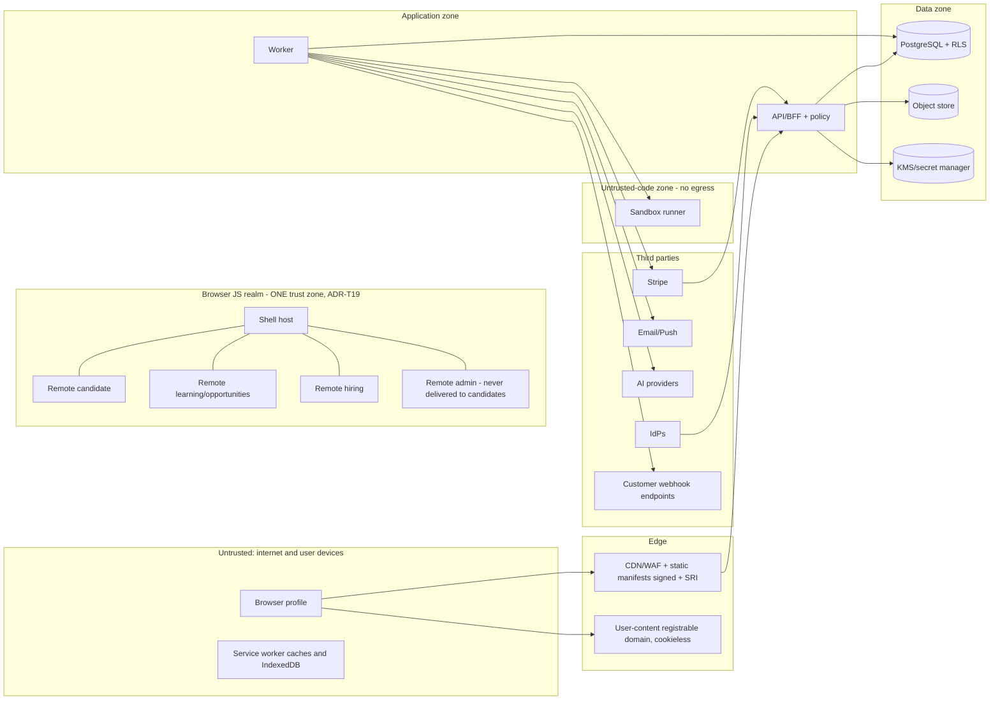

# Threat Model

Doc ID: SEC-01 · Owner: Security Architect · Version 1.0 · Status: Under Review · Relates: ADR-T06, T07, T12, T13, T19, T21 · INV-T01..T20 · FF-01..FF-10 · Companions: SEC-02 `SECURITY_ARCHITECTURE.md`, SEC-03, SEC-04, BE-01, INT-01, DB-02/DB-03

Tags: **[TARGET]** design control · **[OPEN]** open · **[REF]** reference observation. Every mitigation below is a *design intent*; none is implemented or tested. Risk ratings are qualitative (Low / Medium / High) with the reasoning stated; they are not measurements. This document asserts no compliance or certification.

## 1. Method and scope
STRIDE per component and per trust boundary, plus abuse-case analysis from attacker goals specific to a **career-evidence platform** (where the asset is *trust in claims*, not only data confidentiality). In scope: browser (shell + federated remotes + service worker), API/BFF, policy/RLS, worker/outbox, PostgreSQL, object store and user-content origin, sandbox runner, AI gateway, email/push, Stripe, import/webhook dispatchers, admin/support console, CI/CD and remote registry. Out of scope: physical security, cloud-provider internals, end-user device compromise beyond shared-device scenarios.

Reference lessons designed out [REF]: localStorage bearer tokens (XSS-readable), plaintext referee tokens, simulated assessment pass, inline org authorisation, in-process state, unfenced job leases.

## 2. Assets
| ID | Asset | Why it matters | Class (DB-03) | Primary threats |
|---|---|---|---|---|
| A1 | Credentials & sessions | Account takeover grants all of a user's data and actions | C4/C2 | AC-04, AC-05, AC-06, AC-25 |
| A2 | Candidate personal data (profile, evidence, applications, messages) | Privacy harm, discrimination risk, legal exposure | C2/C3 | AC-01, AC-02, AC-12, AC-24 |
| A3 | **Evidence integrity / verification status** | Core product promise: "verified over claimed" (ADR-T14) | C2 | AC-03, AC-09, AC-10, AC-11 |
| A4 | Referee and challenge tokens | Possession = ability to attest as a third party | C4 | AC-07, AC-08 |
| A5 | Consent and access scope | Recruiters may see evidence only within live consent | C2 | AC-02, AC-12 |
| A6 | Assessment integrity | Credible skill signals; fairness | C3 | AC-18, AC-19 |
| A7 | Tenant isolation | Cross-tenant read = Sev-1 (ADR-T21) | all | AC-01, AC-13 |
| A8 | Billing & entitlements | Revenue, fraud | C3 | AC-21, AC-22 |
| A9 | AI budget & prohibited-mode control | Cost, assessment fairness | C1 | AC-15, AC-16 |
| A10 | Secrets & keys (KEKs, signing keys, API keys) | Total compromise | C4 | AC-27, AC-28 |
| A11 | Audit log & privileged-access records | Accountability (INV-T18) | C3 | AC-23 |
| A12 | Availability of core loop | Hiring deadlines, brand | C1 | AC-26 |
| A13 | Build/deploy chain and remote registry | Code execution in every user's browser | C1 | AC-17 |
| A14 | User-content origin and rendered content | XSS/phishing vector | C2 | AC-14, AC-20 |

## 3. Adversaries
| Adversary | Capability | Motive |
|---|---|---|
| ADV-1 Anonymous internet attacker / bot operator | Automation, stolen credential lists, residential proxies | Takeover, spam, scraping |
| ADV-2 Malicious candidate | Valid account, can craft content/uploads, may collude | Inflate verification status, cheat assessments |
| ADV-3 Malicious or careless recruiter/org member | Valid org role | Harvest candidate data, bypass consent, cross-tenant snooping |
| ADV-4 Impostor / colluding referee | Controls an email address, can receive tokens | Forge attestations |
| ADV-5 Malicious insider (support/admin/engineer) | Privileged tooling | Data browsing, tampering |
| ADV-6 Supply-chain attacker | Compromise a dependency, build step, or remote bundle | Code execution in browsers/CI |
| ADV-7 Network attacker on shared Wi-Fi / shared-device user | MITM attempts, physical access to a logged-in browser profile | Session/data theft |
| ADV-8 Competitor | Systematic scraping, data-extraction | Business intelligence |

## 4. Trust boundaries

| TB | Boundary | Crossing controls |
|---|---|---|
| TB0->TB2 | Internet to edge | TLS 1.2+ (HSTS preload-eligible), WAF rules, rate limits, bot challenge on auth |
| Within TB1 | Shell and remotes | **Not a security boundary** (shared JS realm). Controls: signed manifests + SRI, CSP, no token access (httpOnly), privilege-segmented delivery (recruiter/admin code is not shipped to candidate sessions), server enforces everything (ADR-T19, INV-T16) |
| TB1->TB3 | Browser to API | Cookies + CSRF + Origin checks, Zod validation, policy per request, idempotency, rate classes |
| TB3->TB4 | App to data | Separate DB roles, RLS FORCE, column privileges, KMS-held keys, no direct client DB access |
| TB3->TB5 | Worker to runner | mTLS + signed requests, ephemeral sandboxes, no egress, signed results |
| TB3->TB6 | Egress to providers | Adapters (ACL), SSRF-guarded egress proxy for user-influenced URLs, per-provider secrets, redaction |
| TB6->TB3 | Inbound webhooks/IdP | Signature verification before parse, replay protection, dedupe |
| User-content domain | Separate **registrable domain** (not an apex subdomain; REVW-32) | Cookieless, `Content-Disposition: attachment`, CSP sandbox, `nosniff` so uploaded content cannot run in app origin |

## 5. STRIDE per component
Mitigation shorthand: **SEC-02 §x** controls; **BE §x** = BE-01 section; **INT §x**; **DB §x** = DB-02 section.

| Component | Spoofing | Tampering | Repudiation | Information disclosure | Denial of service | Elevation of privilege |
|---|---|---|---|---|---|---|
| C1 Browser shell + remotes | Phishing clone; malicious remote impersonates UI -> signed manifest, SRI, `frame-ancestors 'none'`, anti-phishing UX for verified badges (server-rendered rung label) | Remote bundle tampering via CDN/registry compromise -> signed manifests, hash-pinned chunks, last-known-good fallback (ADR-T18) | User denies action -> audit of consequential actions with trace id; step-up for high-risk | XSS reading DOM data; tokens not readable (httpOnly) -> CSP strict, Trusted Types [TARGET], output encoding, markdown sanitiser | Remote crash loops -> per-remote error boundary, fallback | Candidate session obtaining recruiter/admin code -> not delivered; server authz regardless |
| C2 Service worker + IndexedDB | SW hijack via XSS -> scope limited, CSP, versioned SW with integrity check | Cache poisoning -> cache only same-origin GETs allowed by matrix; key by user | n/a | **Shared-device residue** -> cache only owner data of the matrix, per-user keying, clear on logout/session revoke, "shared device" login mode disables persistence, non-extractable WebCrypto key for IndexedDB payloads [TARGET] | Cache bloat -> quotas/TTL | Stale authz in cache -> offline data is never authoritative (INV-T13) |
| C3 API/BFF | Session forgery -> signed tokens, key rotation, refresh rotation + reuse detection (BR-T050) | Mass assignment of `rung`, `state` -> strict Zod, column privileges (DB §4) | Missing audit -> audit in same tx (INV-T10) | Verbose errors/IDOR oracle -> problem+json hygiene, 404-over-403 | Expensive queries/search -> rate classes, timeouts, pagination caps | BOLA/BFLA -> policy per resource (INV-T01/T02), FF-01, IDOR suites |
| C4 Policy + RLS | Principal confusion (service vs user) -> typed Principal, service tokens scoped | Policy bypass by direct SQL path -> repository layer + RLS net (DB §6) | Policy decisions untraceable -> deny reasons logged, privileged decisions audited | Over-broad `field_mask` omission -> mask tests per role | Policy cost on hot paths -> `grants_version` cache | Role-mapping errors on migration -> least-privilege defaults (MIG-DATA-01) |
| C5 Worker/outbox/jobs | Fake events injected via DB -> only app roles write outbox; consumers check tenant | Zombie worker double-effects -> fencing generation (BE §7.2) | Job replays without trace -> attempts table, audit for admin actions | Payload leakage in job tables/logs -> ids only, redaction | Poison event stalling queue -> per-job DLQ, no head-of-line blocking | Worker role over-privileged -> `ts_worker` grants + tenant pinning (DB §5-6) |
| C6 PostgreSQL | Stolen credentials -> short-lived DB creds, network policy | Direct DDL/DML tamper -> append-only guards, batch-anchored audit hashes (KMS-signed, daily verifier) | Log tampering -> signed batch anchors in a write-once archive, WAL archive | Backup theft -> encrypted backups, restricted access | Lock storms from migrations -> lock_timeout, expand/contract (DB-04) | Superuser misuse -> breakglass 2-person, logged (INV-T18) |
| C7 Object store + user-content origin | Presigned URL sharing -> short TTL, bound content-type/length | Overwrite of clean objects -> quarantine/clean prefixes, write-once keys | n/a | Public bucket misconfig -> block-public-access policy test; signed URLs only | Storage exhaustion -> per-user quotas | Upload to app origin to run script -> separate origin, nosniff, attachment |
| C8 Sandbox runner | Fake runner results -> signed results, run binding | Candidate tampering with grader -> hidden tests separate, read-only FS | Disputed grade -> immutable run record + image digest | Answer-key leakage -> keys never mounted in candidate namespace | Fork bombs/CPU burn -> cgroups, timeouts, quotas | Sandbox escape -> no egress, minimal syscalls, patch cadence, isolation tech reviewed (OPEN-B6) |
| C9 AI gateway | Prompt origin spoof -> only gateway calls providers | Prompt injection altering output -> data-only blocks, schema-validated output, no tools (BE §13) | Disowned AI text -> `ai_suggestion` provenance, human disposition | PII leakage to provider -> redaction, consent, minimisation | Cost exhaustion -> budgets, hard stop (INV-T07) | Bypass of prohibited mode -> enforced inside gateway (INV-T06) |
| C10 Email/Push | Spoofed sender -> SPF/DKIM/DMARC | Link tampering -> tokens bound to request; no tracking rewrite on token links (INT §5) | Disputed notice -> delivery records | Token leakage via provider redirectors -> tracking disabled | Email bombing of third parties -> per-recipient/domain limits (BR-T004 caps) | n/a |
| C11 Stripe webhook | Forged events -> signature + timestamp | Replay -> event-id dedupe | Disputed charge -> inbox log | Secret leak -> secret manager, rotation | Webhook flood -> signature check first, concurrency cap | Entitlement grant via redirect -> forbidden (INV-T17) |
| C12 Import + webhook dispatcher | n/a | XXE/CSV injection -> hardened parsers, escaping | Dispatch disputes -> delivery log | **SSRF** to metadata/internal -> IP validation, pinning, no redirects, egress proxy (INT §7) | Huge imports -> caps, concurrency 1 per tenant | Imported content as admin-trusted -> drafts only, human publish |
| C13 Admin/support console | Stolen admin session -> step-up, short sessions, network restriction | Unlogged edits -> audit with before/after field names | Insider denial -> hash-anchored audit | Browsing personal data -> grants <= 4 h, reason-coded, field minimisation (BR-T041) | n/a | Self-approval -> two-person rule for broader scopes, approver != grantee |
| C14 CI/CD + remote registry | Fake maintainer -> protected branches, signed commits/tags, OIDC federation to cloud | Malicious dependency/build step -> lockfile pinning, provenance, SBOM, scoped CI tokens | Unattributed deploy -> signed release + audit | Secrets in CI logs -> masking, secret scanning | CI abuse -> quotas | Registry write by compromised remote team -> per-remote signing keys, compatibility gate (FF-08), shell verifies signature |
| C15 Cookie scope: apex and sibling subdomains (REVW-32) | A sibling subdomain (or an attacker-controlled host under the same registrable domain, e.g. a taken-over dangling DNS name) sets a `Domain=<apex>` cookie named like ours -> `__Host-` cookies cannot be set with `Domain`, so `__Host-ts_at` and the CSRF/session cookies are untossable; the `__Secure-ts_rt` refresh cookie can be tossed, so refresh is bound to the `sid` inside the `__Host-ts_at` cookie (SEC-02 §2.3) | Tossed cookie replaces ours with the attacker's session (login fixation) or shadows ours with a junk value -> binding check fails and does not rotate; duplicate cookie names rejected, cleared and alerted; user content lives on a separate registrable domain so no user-influenced host shares our cookie scope | Attacker acts as victim session -> binding, `refresh-binding-mismatch` and duplicate-cookie alerts are audited | Not applicable | Persistent logout loop by tossing a bad cookie -> server clears the bad cookie in the 4xx response; support runbook "clear site data" | Sibling host reads or sets session -> only first-party hosts exist under the apex (DNS inventory, takeover monitoring); HSTS `includeSubDomains` |
| C16 Telemetry ingest (`/otlp`, `POST /analytics/events`; unauthenticated or weakly authenticated by design) | Forged beacons impersonating other users or versions -> no identity is trusted from the body; user id comes only from the session, if any | Poisoned metrics (fake error spikes or fake "healthy" signals) -> telemetry never drives security or business decisions; SLO inputs are cross-checked against server-side metrics and synthetic probes | n/a | Beacon bodies carrying personal data or tokens -> allowlisted schema, size cap, server-side field drop, operational vs consent-gated classification (PRIVACY §3.1, REVW-31) | Flooding the same-origin proxy -> RL-PUBLIC class limits at the edge first, per-IP and per-session caps, payload cap, sampling, shed-load before the collector | Proxy abused as an open relay/SSRF -> fixed upstream (no client-supplied target), path allowlist, no redirects |

## 6. Abuse cases
Rating key: Likelihood L / Impact I in {Low, Med, High}; **Residual** = judgement after the stated mitigations assuming they are implemented and tested. "Test" refers to the test classes in `16_*`.

| ID | Abuse case | Vector | Key mitigations (INV/FF/design) | Detection | L / I -> Residual | Test |
|---|---|---|---|---|---|---|
| AC-01 | **IDOR / BOLA**: read or edit another user's resource by id | Change ids in URLs; enumerate time-ordered UUIDs | Per-resource policy (INV-T01/T02), 404-not-403, RLS net (INV-T03), FF-01 lint, generated IDOR matrix + FF-05 canary; ids not secret by design | Policy-deny metrics by action; anomalous 404 patterns | High / High -> **Low-Med** (depends on test completeness) | IDOR suite, FF-05 |
| AC-02 | Recruiter bypasses consent to read evidence/PII | Direct evidence id calls; search side-channels | `require_consent` obligations (INV-T15), P5 RLS, consent-epoch gated search docs, access log visible to candidate | Access-log anomaly (reads without application/consent) | Med / High -> Low | consent tests |
| AC-03 | **Mass assignment of verification**: client sets `rung`/`verified` | Extra JSON fields | Strict request schemas; no `rung` in any request; column privileges + definer function (DB §4); INV-T04 | Schema-conformance tests; DB privilege tests | Med / High -> Low | SM tests, schema test |
| AC-04 | **Credential stuffing** | Breach lists via proxies | RL-AUTH per IP+account, progressive delay, uniform errors, passkeys, optional breached-password check, anomaly alerts, MFA/step-up for risky actions | Failed-login rate by account/IP/ASN | High / Med -> Med (stuffing cannot be eliminated; passkeys reduce) | auth abuse tests |
| AC-05 | Password-reset / email-verify takeover | Token theft, host-header poisoning, mailbox compromise | Hash-only single-use tokens (INV-T05), canonical base URL from config (not Host header), expiry, session revocation on reset, notification of change | Reset-volume anomalies | Med / High -> Low-Med (mailbox compromise out of scope) | token tests |
| AC-06 | Session theft / refresh replay | XSS, device theft, network | httpOnly cookies (`__Host-ts_at`, `__Secure-ts_rt`), short access TTL, rotating refresh with family revocation (BR-T050) and binding to the `__Host-` cookie's session id, device list, step-up | Refresh-reuse alerts | Med / High -> Low-Med | session tests |
| AC-07 | **Referee-token theft or forwarding** | Email interception, forwarded link, log/referrer leakage | 256-bit random, hash-only, single-use, 14-day expiry, bound to request, no-tracking links, `Referrer-Policy: no-referrer`, tokens never in query strings or logs, response visible only to authorised parties; attestation capped at `peer_attested` | Multiple IP/UA on one token; late responses | Med / Med -> Med (a forwarded link cannot be technically distinguished from the referee; residual accepted, hence rung cap) | token tests |
| AC-08 | **Fake referee / collusion** (friend vouching, throwaway mailbox) | Candidate supplies attacker-controlled address; reference rings | Rung ladder: peer attestation never reaches authority level; employer-domain proof for work claims; referee domain vs employer domain signal shown (not hidden); per-referee and per-domain frequency caps; graph analysis of mutual-reference rings -> human review, **no auto-penalty** (INV-T20); disputes | Ring/velocity analytics | High / Med -> Med | fraud scenario tests |
| AC-09 | **Evidence forgery** (fabricated documents, lookalike employer domains, edited PDFs) | Uploads, claimed employers | Artifact-backed means "material exists", not "true" (UI wording); domain-control proof (not just mailbox lookalike: exact domain match + org-domain registry); authority verification for top rung; metadata/hash tracking; reviewer tooling; revocation path (BR-T005) | Duplicate artifact hashes across accounts; lookalike-domain heuristics | High / High -> Med (inherent to self-supplied evidence; ladder limits claims) | forgery drills |
| AC-10 | **Gaming the ladder / skill inflation** | Many trivial evidence items, keyword stuffing, copy-paste projects | Competency confidence weights by rung and evidence diversity; caps per source; explainable basis; anomaly flags to human review (INV-T20) | Evidence-per-hour velocity, near-duplicate text | High / Med -> Med | match explanation tests |
| AC-11 | Fake assessment passes (simulated or forged results) | API call claiming a pass; runner spoofing | Server-only attestations; signed runner results bound to run id; `unverified` never mints evidence (ADR-T13, INV-T04); `assessment.passed` schema excludes unverified | Verification-basis audit report | Med / High -> Low | runner/state tests |
| AC-12 | **Scraping candidates** via search/API | Automation, many accounts, recruiter trials | Consent-gated candidate docs; RL-HEAVY per user/org; entitlements; no bulk export; result-set caps and pagination depth caps; per-org daily profile-view budgets; honeypots/canary profiles; contract terms; behavioural anomaly -> throttle + human review | Views/min, distinct profiles/hour per org | High / High -> Med (determined paid scrapers can still extract slowly) | scraping simulation |
| AC-13 | Cross-tenant data access (Sev-1) | Missing `org_id` filter, bad join | Repository tenant context, RLS FORCE, worker tenant pinning, FF-05 canaries, code review checklist | Canary alarms in prod (seeded tenant B rows) | Med / High -> Low | FF-05 |
| AC-14 | **Stored XSS in user content** (profile, portfolio, messages, job text, markdown, filenames) | Script/HTML/SVG/URL schemes | Text-only by default; markdown through allowlist sanitiser; React escaping; no `dangerouslySetInnerHTML` on user data (lint); URL scheme allowlist (https/mailto); strict CSP (no inline script) + Trusted Types [TARGET]; uploads on separate origin; message bodies treated as plain text | CSP reports | High / High -> Low-Med | XSS payload corpus tests |
| AC-15 | AI **prompt injection** (resume/evidence text instructs the model) | Hidden instructions in user content shown to AI features or reviewers | Data-block isolation, no side-effect tools, schema-validated output, link/markup stripping, human gate (INV-T09; gateway per ADR-T12); AI output never counts as evidence (INV-T08) | Output anomaly checks; eval suite | High / Med -> Low-Med | injection eval set |
| AC-16 | AI prohibited-mode bypass during assessment | Direct API call, other tab, service account | Check inside gateway by subject (INV-T06), attempt `ai_mode_snapshot`, audited denials | Denial logs; attempt integrity review | Med / Med -> Low | gateway matrix |
| AC-17 | **Supply chain & remote-module integrity** (malicious npm package, tampered remote bundle, CDN/registry compromise, dependency confusion) | Compromised dependency; stolen remote-signing key | Lockfile + pinned versions + provenance/SBOM; install scripts disabled by default; private registry scope for internal packages; signed remote manifests + SRI; FF-03/04/08 gates; per-remote signing keys; CSP `script-src` allowlist; staged rollout with canary and instant manifest rollback; reproducible builds [TARGET]. **Residual: a malicious script in the shared realm can act as the user (call APIs with the CSRF token it can read) even without reading cookies** | Manifest/hash mismatch alerts; CSP reports; unusual API sequences | Med / High -> **Med-High** (inherent to same-realm federation, ADR-T19; mitigated by minimising what any session can do without step-up) | supply-chain drills |
| AC-18 | Assessment cheating (collusion, solution sharing, AI use, proxy test-taker) | Out-of-band | Randomised question variants, time limits, runner similarity detection, AI-mode enforcement, integrity signals -> **human review only** (INV-T20), appeals | Similarity clusters | High / Med -> Med (proctoring is vendor-gated/deferred) | process review |
| AC-19 | Integrity-signal false positives harm candidates | Over-trusting signals | Signals advisory; no automatic fail; appeal path; reviewer must record reason | Appeal-overturn rate | Med / High -> Low | process tests |
| AC-20 | **File upload attacks** (malware, polyglot, zip bomb, SVG script, path traversal, content-type confusion, huge files) | Evidence/avatar uploads, import files | Quarantine, magic-byte sniffing, allowlist, size caps, AV scan fail-closed, re-encode images, reject JS-bearing PDFs, random object keys, separate origin, attachment disposition (BE §12) | Scan results, rejection rate | High / Med -> Low | upload corpus |
| AC-21 | Payment/entitlement bypass | Tamper redirect, forge webhook, replay | Redirect grants nothing; signed webhook; event dedupe + ordering guard; entitlements server-derived (INV-T17) | Reconcile drift | Med / Med -> Low | webhook tests |
| AC-22 | Free-tier abuse of paid inference/quotas | Many accounts, scripted calls | Budget reserve-then-settle, free inference off by default (INV-T07), per-account + global caps, RL-HEAVY, email/phone-agnostic velocity checks | Spend anomalies | High / Med -> Low-Med | cost-guard tests |
| AC-23 | **Privileged insider abuse** (support/admin browses data) | Support console | Grants <= 4 h, reason code, approver for broader scope, scoped field views, hash-anchored audit, subject-visible access log, access reviews (BR-T041, INV-T18) | Grant volume/anomaly; audit review | Med / High -> Med (cannot fully prevent a privileged insider; accountability and minimisation) | audit tests |
| AC-24 | **Shared-device offline data theft** | PWA cache/IndexedDB on a kiosk or family PC | No tokens at rest; owner-data-only cache; per-user keyed + encrypted payloads; logout/revoke clears; explicit "this is a shared device" mode; idle timeout lock [TARGET]; cache TTLs | n/a (client side) | Med / Med -> Low-Med | device-sharing scenarios |
| AC-25 | CSRF / clickjacking / open redirect | Cross-site forms, framing, SSO `returnTo` | CSRF header + Origin/Sec-Fetch-Site checks, SameSite=Lax; `frame-ancestors 'none'`; `returnTo` allowlist of relative paths | CSRF rejection metrics | Med / Med -> Low | security tests |
| AC-26 | **DoS / resource abuse** (expensive search, report spam, upload flooding, reference-email bombing, resend verification) | Automated clients | Rate classes, timeouts, quotas, pagination caps, per-recipient caps, queue fairness (BE §7.3), WAF, caching of public reads | Saturation metrics, queue age | High / Med -> Low-Med | load/abuse tests |
| AC-27 | Secret leakage (repo, logs, CI, client bundle) | Mistakes, compromised dev laptop | Secret manager, no secrets in client (INV-T14), secret scanning in CI + pre-commit, log redaction tests, short-lived CI credentials | Scanner findings | Med / High -> Low-Med | secret-scan |
| AC-28 | Cryptographic key compromise or loss | KMS misuse, insider | Envelope encryption, KEK in KMS, key separation by purpose, rotation, break-glass, backup of key policy not material | KMS audit | Low / High -> Med | key drills |
| AC-29 | **SSRF** via import URL, webhook endpoint, avatar/link fetch, SSO metadata URL | User-supplied URL | Central `safeFetch`: scheme/port allowlist, DNS resolve + IP validation + pinning, no redirects, egress proxy, size/time caps, metadata IP blocks, no credentials (INT §7) | Blocked-attempt metrics | Med / High -> Low | SSRF corpus tests |
| AC-30 | Account/handle enumeration | Register/reset/login responses, timing | Uniform responses/timing, rate limits, handle availability behind auth + throttle | Enumeration patterns | High / Low -> Low | auth tests |
| AC-31 | Email/header injection, CSV/formula injection, log injection | Newlines in names; `=cmd()` in exports | Header validation in adapters, template engines escape, CSV escaping, structured logs with escaping | n/a | Med / Med -> Low | injection tests |
| AC-32 | Discriminatory or opaque automated ranking presented as truth | Biased matching | Explainable factors, uncertainty, no pay-to-rank, no auto-reject, bias evaluation (INV-T09/T19, SEC-03/04) | Fairness monitoring | Med / High -> Med (requires ongoing evaluation, not solved by design alone) | explanation + fairness tests |
| AC-33 | **Cookie tossing / session fixation from a sibling host** (REVW-32) | Attacker controls any host under the apex registrable domain (takeover, user-generated subdomain, shared hosting) and sets `ts_rt` or shadow cookies with `Domain=<apex>` | `__Host-` access cookie (cannot be tossed); refresh bound to the `sid` of that cookie (SEC-02 §2.3); duplicate-name rejection; no user content under the apex (separate registrable domain); subdomain-takeover monitoring; HSTS `includeSubDomains` | `refresh-binding-mismatch`, duplicate `ts_rt` and sibling-host cookie alerts | Low / High -> Low | cookie-scope tests (refresh with mismatched `sid` fails; duplicate cookie rejected) |
| AC-34 | **Abuse of the unauthenticated telemetry endpoint** (REVW-32, REVW-31) | Flood, poison or smuggle data through `/otlp` and `POST /analytics/events` | Edge rate limit first, size and schema caps, no client-chosen upstream, no identity trusted from the body, telemetry never authoritative, operational/analytics split | Beacon rejection rate, volume per IP/ASN | Med / Low -> Low | telemetry-abuse tests |

## 7. Invariant and fitness-function coverage
| Control | Threats mitigated |
|---|---|
| INV-T01 deny-by-default | AC-01, AC-03, AC-13 |
| INV-T02 resource-level authz | AC-01, AC-02, AC-13 |
| INV-T03 tenant isolation | AC-13, AC-12 |
| INV-T04 server-side verified status | AC-03, AC-09, AC-11 |
| INV-T05 hash-only single-use tokens | AC-05, AC-07, AC-08 |
| INV-T06 AI prohibited enforced in gateway | AC-16 |
| INV-T07 free tier cost guard | AC-22 |
| INV-T08 AI never evidence | AC-09, AC-15 |
| INV-T09 / T20 human decisions, anomaly != guilt | AC-08, AC-10, AC-18, AC-19, AC-32 |
| INV-T10 idempotent + audited effects | AC-21, AC-23, AC-26 |
| INV-T11 state machines | AC-03, AC-11 |
| INV-T12 outbox | AC-21 (consistent entitlements), integrity of events |
| INV-T13 offline caches non-authoritative | AC-24 |
| INV-T14 secrets/PII hygiene | AC-27, AC-31 |
| INV-T15 consent | AC-02, AC-12 |
| INV-T16 remotes never read credentials | AC-06, AC-17 |
| INV-T17 payment redirect grants nothing | AC-21 |
| INV-T18 time-boxed privileged access | AC-23 |
| INV-T19 explainable, not pay-to-rank | AC-12, AC-32 |
| FF-01/FF-07 route lints | AC-01, AC-26 |
| FF-02/03/04/08 boundaries & compat | AC-17 |
| FF-05 canary | AC-01, AC-13 |
| FF-09 PWA feature detection | AC-24 |
| Refresh bound to `__Host-` session id; separate UGC registrable domain; telemetry edge limits (REVW-32) | AC-06, AC-33, AC-34 |
| FF-10 migrations | AC-13 (RLS lint), AC-03 (privileges lint) |

## 8. Residual risk register
| ID | Residual risk | Rating | Why it remains | Acceptance / watch |
|---|---|---|---|---|
| RR-1 | Same-realm federation: a compromised remote can act as the signed-in user | Med-High | Browser realm is shared (ADR-T19) | Step-up on sensitive actions; per-remote signing; staged rollout; reconsider iframe/sandbox if third-party remotes appear |
| RR-2 | Forged or collusive soft evidence (peer level) | Med | Self-supplied evidence cannot be proven by software | Ladder wording, caps, authority rung, disputes |
| RR-3 | Determined slow scraping by paying recruiters | Med | Legit access path is the attack surface | Budgets, canaries, contracts, human review |
| RR-4 | Insider misuse of privileged support access | Med | Humans need access | Time-box, audit, subject-visible log, reviews |
| RR-5 | Credential stuffing success against weak/reused passwords | Med | User behaviour | Passkeys, breached-password check, anomaly alerts |
| RR-6 | Bias in matching/ranking outputs | Med | Data and model effects | Explanation, uncertainty, evaluation (SEC-03), human final decisions |
| RR-7 | Sandbox escape (once runner enabled) | Low-Med | Defence in depth, not proof | Isolation review, minimal surface, patching, no egress |
| RR-8 | A first-party sibling host is compromised and tosses or reads apex-scoped cookies (REVW-32) | Low-Med | Any host under the apex shares the cookie scope; `__Host-` cookies are protected, `__Secure-` refresh is protected only by the `sid` binding | Keep the apex-host inventory minimal and monitored; never place user-influenced hosts under the apex |

## 9. Security verification plan (summary)
Static: dependency/IaC/secret scanning, lint rules (FF-01/02/07), SQL/migration lint. Dynamic: authz matrix + IDOR + cross-tenant (FF-05) in CI; token single-use and rate-limit tests; upload corpus; SSRF corpus; XSS corpus; CSP report review. Manual/periodic: independent penetration test before external launch and after major changes; supply-chain drill (revoke remote, rollback manifest); restore + erasure-replay drill; incident exercise. Findings feed `24_RISKS_AND_DECISIONS`.

## 10. Open items
| ID | Item |
|---|---|
| OPEN-B45 | Trusted Types adoption feasibility across all remotes and third-party UI libraries |
| OPEN-B46 | Fraud-analytics scope (reference-ring detection) and its privacy review (profiling) |
| OPEN-B47 | WAF/bot-management provider |
| OPEN-B48 | Whether to require MFA for recruiter/admin roles at launch (proposed: yes for org_owner/org_admin/admin/support) |
